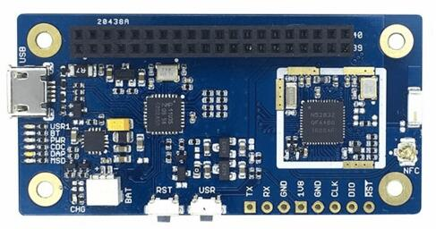

<!-- Copyright 2015-2026 Zephyr Project members and individual contributors. -->
<!-- SPDX-License-Identifier: Apache-2.0 -->
<!-- 中文翻译；编号、导航与译注为本地新增。 -->

<a id="96b_nitrogen"></a>

# 第3章\_Nitrogen

原文：[官方页面](https://docs.zephyrproject.org/latest/boards/96boards/nitrogen/doc/index.html)。读取日期：2026-10-16；来源摘要见[来源记录](../SOURCES.md)。

开发板概览（Board Overview）

<a id="id1"></a>

[](images/96b_nitrogen.jpg)

Nitrogen

名称（Name）：

`96b_nitrogen`

厂商（Vendor）：

[96Boards](https://docs.zephyrproject.org/latest/boards/index.html#vendor=96boards)

状态（Status）：

未处于积极维护状态（Not Actively Maintained）

架构（Architecture）：

[arm](https://docs.zephyrproject.org/latest/boards/index.html#arch=arm)

片上系统（SoC）：

[nrf52832](https://docs.zephyrproject.org/latest/boards/index.html#soc=nrf52832)

<a id="board-github-link"></a>

[浏览开发板源码（Browse Board Sources）](https://github.com/zephyrproject-rtos/zephyr/blob/main//boards/96boards/nitrogen/doc/index.rst/../..)<a id="boards-nitrogen"></a>

## 96Boards Nitrogen

<a id="overview"></a>

### 概述（Overview）

96Boards Nitrogen硬件支持Nordic Semiconductor的nRF52832 ARM Cortex-M4F处理器。

<a id="id2"></a>



96Boards Nitrogen

有关开发板的更多信息，请访问[seeed BLE Nitrogen](http://wiki.seeed.cc/BLE_Nitrogen/)网站。[Nordic Semiconductor信息中心（Infocenter）](http://infocenter.nordicsemi.com/)提供处理器信息和数据手册（Datasheet）。

<a id="hardware"></a>

### 硬件（Hardware）

96Boards Nitrogen提供以下硬件组件：


- nRF52832微控制器（Microcontroller），带512 kB Flash和64 kB RAM
- 带浮点单元（FPU）的 ARM 32 位 Cortex-M4 CPU。
- 低功耗蓝牙（Bluetooth LE）
- 近场通信（NFC）
- 基于LPC11U35的板载串行线调试器（SWD Debugger）


  - SWD调试器固件（Firmware）
  - USB转UART
  - 拖放式固件升级（Drag and Drop Firmware Upgrade）
- 7个发光二极管（LED）


  - USR1、BT、PWR、CDC、DAP、MSD及电池充电（Battery Charge）指示灯
- SWD调试接口（Debug Connectors）


  - nRF52832 SWD接口
  - nRF52832 UART接口
- 板载芯片天线（Chip Antenna）
- 工作电压 1.8 V。
- 2 × 20针、2.0 mm间距的低速接口（Low-speed Connector）

<a id="supported-features"></a>

#### 支持的功能（Supported Features）

`96b_nitrogen`开发板支持下表所列的硬件功能。

片上／板载（On-Chip / On-Board）

功能集成在片上系统（SoC）内／位于开发板上。

2 / 2

分别表示已启用／已禁用的实例数。点击数量标签，可查看开发板或SoC设备树源码（DTS）中该功能的第一个实例。

`vnd,foo`

与此功能匹配的设备树绑定兼容字符串（Compatible String）；点击链接可查看绑定文档。

<a id="96b_nitrogen-hw-features"></a>

<a id="96b_nitrogen-96b_nitrogen/nrf52832-hw-features-section"></a>

##### `96b_nitrogen/nrf52832`目标（Target）

<a id="96b_nitrogen-96b_nitrogen/nrf52832-hw-features-panel"></a>

<a id="96b_nitrogen-96b_nitrogen/nrf52832-hw-features-memory"></a>

该开发板目标的片上存储容量：64 KiB RAM、512 KiB Flash。

<a id="96b_nitrogen-96b_nitrogen/nrf52832-hw-features-table"></a>

<table>
<tr>
<th>类型（Type）</th>
<th>位置（Location）</th>
<th>说明（Description）</th>
<th>兼容字符串（Compatible）</th>
</tr>
<tr>
<td rowspan="1">中央处理器（CPU）</td>
<td>片上（On-Chip）</td>
<td>ARM Cortex-M4F 处理器（CPU）（<a href="https://github.com/zephyrproject-rtos/zephyr/blob/main/dts/arm/nordic/nrf52832.dtsi?plain=1#L23">已启用：1</a>）</td>
<td><a href="../cpu_arm_riscv_binding_reference/P025_arm_cortex-m4f.md#std-dtcompatible-arm-cortex-m4f"><code>arm,cortex-m4f</code></a></td>
</tr>
<tr>
<td rowspan="1">模数转换器（ADC）</td>
<td>片上（On-Chip）</td>
<td>Nordic Semiconductor nRF系列逐次逼近模数转换器（SAADC）节点（<a href="https://github.com/zephyrproject-rtos/zephyr/blob/main/dts/arm/nordic/nrf52832.dtsi?plain=1#L239">已禁用：1</a>）</td>
<td><a href="../hardware/P846_NordicNRF逐次逼近ADC绑定.md#dtbinding-nordic-nrf-saadc"><code>nordic,nrf-saadc</code></a></td>
</tr>
<tr>
<td rowspan="4">ARM 架构（ARM Architecture）</td>
<td>片上（On-Chip）</td>
<td>Nordic用户信息配置寄存器（UICR / User Information Configuration Registers）（<a href="https://github.com/zephyrproject-rtos/zephyr/blob/main/dts/arm/nordic/nrf52832.dtsi?plain=1#L57">已启用：1</a>）</td>
<td><a href="../arm_nordic_nxp_control_binding_reference/P007_nordic_nrf-uicr.md#std-dtcompatible-nordic-nrf-uicr"><code>nordic,nrf-uicr</code></a></td>
</tr>
<tr>
<td>片上（On-Chip）</td>
<td>Nordic nRF系列块保护（BPROT / Block Protection）（<a href="https://github.com/zephyrproject-rtos/zephyr/blob/main/dts/arm/nordic/nrf52832.dtsi?plain=1#L121">已启用：1</a>）</td>
<td><a href="../arm_timing_ethosu_control_binding_reference/P015_nordic_nrf-bprot.md#std-dtcompatible-nordic-nrf-bprot"><code>nordic,nrf-bprot</code></a></td>
</tr>
<tr>
<td>片上（On-Chip）</td>
<td>Nordic事件发生器单元（EGU / Event Generator Unit）（<a href="https://github.com/zephyrproject-rtos/zephyr/blob/main/dts/arm/nordic/nrf52832.dtsi?plain=1#L352">已启用：6</a>）</td>
<td><a href="../arm_timing_ethosu_control_binding_reference/P018_nordic_nrf-egu.md#std-dtcompatible-nordic-nrf-egu"><code>nordic,nrf-egu</code></a></td>
</tr>
<tr>
<td>片上（On-Chip）</td>
<td>Nordic nRF系列存储器监视单元（MWU / Memory Watch Unit）（<a href="https://github.com/zephyrproject-rtos/zephyr/blob/main/dts/arm/nordic/nrf52832.dtsi?plain=1#L452">已启用：1</a>）</td>
<td><a href="../arm_timing_ethosu_control_binding_reference/P022_nordic_nrf-mwu.md#std-dtcompatible-nordic-nrf-mwu"><code>nordic,nrf-mwu</code></a></td>
</tr>
<tr>
<td rowspan="1">音频（Audio）</td>
<td>片上（On-Chip）</td>
<td>Nordic脉冲密度调制接口（PDM / Pulse Density Modulation Interface）（<a href="https://github.com/zephyrproject-rtos/zephyr/blob/main/dts/arm/nordic/nrf52832.dtsi?plain=1#L422">已禁用：1</a>）</td>
<td><a href="../audio_pdm_codec_binding_reference/P012_nordic_nrf-pdm.md#std-dtcompatible-nordic-nrf-pdm"><code>nordic,nrf-pdm</code></a></td>
</tr>
<tr>
<td rowspan="4">时钟控制（Clock Control）</td>
<td>片上（On-Chip）</td>
<td>Nordic nRF时钟控制（Clock Control）节点（<a href="https://github.com/zephyrproject-rtos/zephyr/blob/main/dts/arm/nordic/nrf52832.dtsi?plain=1#L72">已启用：1</a>）</td>
<td><a href="../clock_sam_nordic_binding_reference/P015_nordic_nrf-clock.md#std-dtcompatible-nordic-nrf-clock"><code>nordic,nrf-clock</code></a></td>
</tr>
<tr>
<td>片上（On-Chip）</td>
<td>Nordic nRF高频时钟（HFCLK）控制节点（<a href="https://github.com/zephyrproject-rtos/zephyr/blob/main/dts/arm/nordic/nrf52832.dtsi?plain=1#L78">已启用：1</a>）</td>
<td><a href="../clock_sam_nordic_binding_reference/P009_nordic_nrf-clock-hfclk.md#std-dtcompatible-nordic-nrf-clock-hfclk"><code>nordic,nrf-clock-hfclk</code></a></td>
</tr>
<tr>
<td>片上（On-Chip）</td>
<td>Nordic nRF低频时钟（LFCLK）控制节点（<a href="https://github.com/zephyrproject-rtos/zephyr/blob/main/dts/arm/nordic/nrf52832.dtsi?plain=1#L83">已启用：1</a>）</td>
<td><a href="../clock_sam_nordic_binding_reference/P012_nordic_nrf-clock-lfclk.md#std-dtcompatible-nordic-nrf-clock-lfclk"><code>nordic,nrf-clock-lfclk</code></a></td>
</tr>
<tr>
<td>片上（On-Chip）</td>
<td>Nordic nRF高频晶体振荡器（High-frequency Crystal Oscillator，nRF52系列）（<a href="https://github.com/zephyrproject-rtos/zephyr/blob/main/dts/arm/nordic/nrf52832.dtsi?plain=1#L39">已启用：1</a>）</td>
<td><a href="../clock_sam_nordic_binding_reference/P022_nordic_nrf52-hfxo.md#std-dtcompatible-nordic-nrf52-hfxo"><code>nordic,nrf52-hfxo</code></a></td>
</tr>
<tr>
<td rowspan="1">比较器（Comparator）</td>
<td>片上（On-Chip）</td>
<td>Nordic nRF模拟比较器（COMP / Analog Comparator）（<a href="https://github.com/zephyrproject-rtos/zephyr/blob/main/dts/arm/nordic/nrf52832.dtsi?plain=1#L341">已禁用：1</a>）</td>
<td><a href="../hardware/P752_NordicnRF比较器绑定.md#dtbinding-nordic-nrf-comp"><code>nordic,nrf-comp</code></a></td>
</tr>
<tr>
<td rowspan="1">计数器（Counter）</td>
<td>片上（On-Chip）</td>
<td>Nordic nRF定时器（Timer）节点（<a href="https://github.com/zephyrproject-rtos/zephyr/blob/main/dts/arm/nordic/nrf52832.dtsi?plain=1#L248">已禁用：5</a>）</td>
<td><a href="../microchip_soc_counter_binding_reference/P017_nordic_nrf-timer.md#std-dtcompatible-nordic-nrf-timer"><code>nordic,nrf-timer</code></a></td>
</tr>
<tr>
<td rowspan="2">密码学加速器（Cryptographic Accelerator）</td>
<td>片上（On-Chip）</td>
<td>Nordic ECB（AES电子密码本模式加密 / Electronic Codebook Mode Encryption）（<a href="https://github.com/zephyrproject-rtos/zephyr/blob/main/dts/arm/nordic/nrf52832.dtsi?plain=1#L302">已启用：1</a>）</td>
<td><a href="../crypto_secure_engine_st_ti_binding_reference/P001_nordic_nrf-ecb.md#std-dtcompatible-nordic-nrf-ecb"><code>nordic,nrf-ecb</code></a></td>
</tr>
<tr>
<td>片上（On-Chip）</td>
<td>Nordic nRF系列CCM（AES CCM模式加密 / CCM Mode Encryption）（<a href="https://github.com/zephyrproject-rtos/zephyr/blob/main/dts/arm/nordic/nrf52832.dtsi?plain=1#L309">已启用：1</a>）</td>
<td><a href="../crypto_aes_sha_ccm_binding_reference/P020_nordic_nrf-ccm.md#std-dtcompatible-nordic-nrf-ccm"><code>nordic,nrf-ccm</code></a></td>
</tr>
<tr>
<td rowspan="1">调试（Debug）</td>
<td>片上（On-Chip）</td>
<td>ARMv7仪器化跟踪宏单元（ITM / Instrumentation Trace Macrocell）（<a href="https://github.com/zephyrproject-rtos/zephyr/blob/main/dts/arm/nordic/nrf52832.dtsi?plain=1#L30">已启用：1</a>）</td>
<td><a href="../debug_binding_reference/P001_ARMv7M_ITM调试绑定.md#std-dtcompatible-arm-armv7m-itm"><code>arm,armv7m-itm</code></a></td>
</tr>
<tr>
<td rowspan="1">闪存控制器（Flash Controller）</td>
<td>片上（On-Chip）</td>
<td>Nordic非易失性存储器控制器（NVMC / Non-Volatile Memory Controller）（<a href="https://github.com/zephyrproject-rtos/zephyr/blob/main/dts/arm/nordic/nrf52832.dtsi?plain=1#L429">已启用：1</a>）</td>
<td><a href="../flash_adi_microchip_nordic_binding_reference/P030_nordic_nrf52-flash-controller.md#std-dtcompatible-nordic-nrf52-flash-controller"><code>nordic,nrf52-flash-controller</code></a></td>
</tr>
<tr>
<td rowspan="3">通用输入输出与接插件（GPIO &amp; Headers）</td>
<td>片上（On-Chip）</td>
<td>NRF5 GPIO任务与事件（GPIOTE）（<a href="https://github.com/zephyrproject-rtos/zephyr/blob/main/dts/arm/nordic/nrf52832.dtsi?plain=1#L231">已启用：1</a>）</td>
<td><a href="../gpio_microchip_nordic_nuvoton_binding_reference/P017_nordic_nrf-gpiote.md#std-dtcompatible-nordic-nrf-gpiote"><code>nordic,nrf-gpiote</code></a></td>
</tr>
<tr>
<td>片上（On-Chip）</td>
<td>NRF5通用输入输出（GPIO）（<a href="https://github.com/zephyrproject-rtos/zephyr/blob/main/dts/arm/nordic/nrf52832.dtsi?plain=1#L511">已启用：1</a>）</td>
<td><a href="../gpio_microchip_nordic_nuvoton_binding_reference/P016_nordic_nrf-gpio.md#std-dtcompatible-nordic-nrf-gpio"><code>nordic,nrf-gpio</code></a></td>
</tr>
<tr>
<td>板载（On-Board）</td>
<td>引出到96Boards 1.8 V低速排针（Low-speed Header）的GPIO引脚（<a href="https://github.com/zephyrproject-rtos/zephyr/blob/main/boards/96boards/nitrogen/96b_lscon.dtsi?plain=1#L8">已启用：1</a>）</td>
<td><a href="../gpio_infineon_intel_ite_microchip_binding_reference/P012_linaro_96b-lscon-1v8.md#std-dtcompatible-linaro-96b-lscon-1v8"><code>linaro,96b-lscon-1v8</code></a></td>
</tr>
<tr>
<td rowspan="2">集成电路间总线（I2C）</td>
<td>片上（On-Chip）</td>
<td>Nordic nRF系列双线接口（TWI，TWI主机）（<a href="https://github.com/zephyrproject-rtos/zephyr/blob/main/dts/arm/nordic/nrf52832.dtsi?plain=1#L152">已启用：1</a>）</td>
<td><a href="../i2c_infineon_ite_nordic_binding_reference/P015_nordic_nrf-twi.md#std-dtcompatible-nordic-nrf-twi"><code>nordic,nrf-twi</code></a></td>
</tr>
<tr>
<td>片上（On-Chip）</td>
<td>Nordic nRF系列TWIM（带EasyDMA的TWI主机）（<a href="https://github.com/zephyrproject-rtos/zephyr/blob/main/dts/arm/nordic/nrf52832.dtsi?plain=1#L188">已禁用：1</a>）</td>
<td><a href="../i2c_infineon_ite_nordic_binding_reference/P016_nordic_nrf-twim.md#std-dtcompatible-nordic-nrf-twim"><code>nordic,nrf-twim</code></a></td>
</tr>
<tr>
<td rowspan="1">集成电路间音频总线（I2S）</td>
<td>片上（On-Chip）</td>
<td>Nordic芯片间音频接口（I2S / Inter-IC Sound Interface）（<a href="https://github.com/zephyrproject-rtos/zephyr/blob/main/dts/arm/nordic/nrf52832.dtsi?plain=1#L502">已禁用：1</a>）</td>
<td><a href="../i2s_binding_reference/P010_nordic_nrf-i2s.md#std-dtcompatible-nordic-nrf-i2s"><code>nordic,nrf-i2s</code></a></td>
</tr>
<tr>
<td rowspan="1">输入（Input）</td>
<td>板载（On-Board）</td>
<td>一组绑定到 GPIO 的输入按键（GPIO-Bound Input Keys）（<a href="https://github.com/zephyrproject-rtos/zephyr/blob/main/boards/96boards/nitrogen/96b_nitrogen.dts?plain=1#L52">已启用：1</a>）</td>
<td><a href="../hardware/P563_GPIO按键绑定.md#std-dtcompatible-gpio-keys"><code>gpio-keys</code></a></td>
</tr>
<tr>
<td rowspan="1">中断控制器（Interrupt Controller）</td>
<td>片上（On-Chip）</td>
<td>ARMv7-M 嵌套向量中断控制器（Nested Vectored Interrupt Controller，NVIC）（<a href="https://github.com/zephyrproject-rtos/zephyr/blob/main/dts/arm/armv7-m.dtsi?plain=1#L13">已启用：1</a>）</td>
<td><a href="../arm_interrupt_timer_binding_reference/P002_ARMv7_M_NVIC.md#std-dtcompatible-arm-v7m-nvic"><code>arm,v7m-nvic</code></a></td>
</tr>
<tr>
<td rowspan="1">发光二极管（LED）</td>
<td>板载（On-Board）</td>
<td>一组由 GPIO 控制的 LED（GPIO-Controlled LEDs）（<a href="https://github.com/zephyrproject-rtos/zephyr/blob/main/boards/96boards/nitrogen/96b_nitrogen.dts?plain=1#L36">已启用：1</a>）</td>
<td><a href="../hardware/P564_GPIO指示灯绑定.md#dtbinding-gpio-leds"><code>gpio-leds</code></a></td>
</tr>
<tr>
<td rowspan="2">其他绑定（Miscellaneous）</td>
<td>片上（On-Chip）</td>
<td>Nordic工厂信息配置寄存器（FICR / Factory Information Configuration Registers）（<a href="https://github.com/zephyrproject-rtos/zephyr/blob/main/dts/arm/nordic/nrf52832.dtsi?plain=1#L50">已启用：1</a>）</td>
<td><a href="../misc_adi_nordic_binding_reference/P018_nordic_nrf-ficr.md#std-dtcompatible-nordic-nrf-ficr"><code>nordic,nrf-ficr</code></a></td>
</tr>
<tr>
<td>片上（On-Chip）</td>
<td>Nordic nRF系列可编程外设互连（PPI / Programmable Peripheral Interconnect）（<a href="https://github.com/zephyrproject-rtos/zephyr/blob/main/dts/arm/nordic/nrf52832.dtsi?plain=1#L446">已启用：1</a>）</td>
<td><a href="../misc_adi_nordic_binding_reference/P020_nordic_nrf-ppi.md#std-dtcompatible-nordic-nrf-ppi"><code>nordic,nrf-ppi</code></a></td>
</tr>
<tr>
<td rowspan="1">存储技术设备（MTD）</td>
<td>片上（On-Chip）</td>
<td>闪存（Flash）节点（<a href="https://github.com/zephyrproject-rtos/zephyr/blob/main/dts/arm/nordic/nrf52832.dtsi?plain=1#L436">已启用：1</a>）</td>
<td><a href="../mtd_nxp_st_ti_partition_binding_reference/P013_soc-nv-flash.md#std-dtcompatible-soc-nv-flash"><code>soc-nv-flash</code></a></td>
</tr>
<tr>
<td rowspan="2">网络（Networking）</td>
<td>片上（On-Chip）</td>
<td>Nordic nRF系列无线电（RADIO）外设（<a href="https://github.com/zephyrproject-rtos/zephyr/blob/main/dts/arm/nordic/nrf52832.dtsi?plain=1#L127">已启用：1</a>）</td>
<td><a href="../network_radio_frontend_binding_reference/P009_nordic_nrf-radio.md#std-dtcompatible-nordic-nrf-radio"><code>nordic,nrf-radio</code></a></td>
</tr>
<tr>
<td>片上（On-Chip）</td>
<td>Nordic nRF系列近场通信标签（NFCT / Near Field Communication Tag）（<a href="https://github.com/zephyrproject-rtos/zephyr/blob/main/dts/arm/nordic/nrf52832.dtsi?plain=1#L224">已禁用：1</a>）</td>
<td><a href="../network_radio_frontend_binding_reference/P008_nordic_nrf-nfct.md#std-dtcompatible-nordic-nrf-nfct"><code>nordic,nrf-nfct</code></a></td>
</tr>
<tr>
<td rowspan="1">引脚控制（Pin Control）</td>
<td>片上（On-Chip）</td>
<td>Nordic nRF系列引脚控制器（Pin Controller）（<a href="https://github.com/zephyrproject-rtos/zephyr/blob/main/dts/vendor/nordic/nrf_common.dtsi?plain=1#L26">已启用：1</a>）</td>
<td><a href="../pinctrl_infineon_nordic_nxp_binding_reference/P009_nordic_nrf-pinctrl.md#std-dtcompatible-nordic-nrf-pinctrl"><code>nordic,nrf-pinctrl</code></a></td>
</tr>
<tr>
<td rowspan="1">电源管理（Power Management）</td>
<td>片上（On-Chip）</td>
<td>Nordic nRF电源控制（Power Control）节点（<a href="https://github.com/zephyrproject-rtos/zephyr/blob/main/dts/arm/nordic/nrf52832.dtsi?plain=1#L89">已启用：1</a>）</td>
<td><a href="../power_control_binding_reference/P008_nordic_nrf-power.md#std-dtcompatible-nordic-nrf-power"><code>nordic,nrf-power</code></a></td>
</tr>
<tr>
<td rowspan="2">脉宽调制（PWM）</td>
<td>片上（On-Chip）</td>
<td>nRF脉宽调制（PWM）（<a href="https://github.com/zephyrproject-rtos/zephyr/blob/main/dts/arm/nordic/nrf52832.dtsi?plain=1#L414">已禁用：3</a>）</td>
<td><a href="../pwm_intel_microchip_nxp_binding_reference/P015_nordic_nrf-pwm.md#std-dtcompatible-nordic-nrf-pwm"><code>nordic,nrf-pwm</code></a></td>
</tr>
<tr>
<td>片上（On-Chip）</td>
<td>nRFx软件脉宽调制（S/W PWM）（<a href="https://github.com/zephyrproject-rtos/zephyr/blob/main/dts/vendor/nordic/nrf_common.dtsi?plain=1#L39">已禁用：1</a>）</td>
<td><a href="../pwm_intel_microchip_nxp_binding_reference/P016_nordic_nrf-sw-pwm.md#std-dtcompatible-nordic-nrf-sw-pwm"><code>nordic,nrf-sw-pwm</code></a></td>
</tr>
<tr>
<td rowspan="1">稳压器（Regulator）</td>
<td>片上（On-Chip）</td>
<td>Nordic nRF5X稳压器（Regulator，内核供电的固定级）（<a href="https://github.com/zephyrproject-rtos/zephyr/blob/main/dts/arm/nordic/nrf52832.dtsi?plain=1#L113">已启用：1</a>）</td>
<td><a href="../hardware/P643_nRF5X稳压器绑定.md#dtbinding-nordic-nrf5x-regulator"><code>nordic,nrf5x-regulator</code></a></td>
</tr>
<tr>
<td rowspan="1">保持存储器（Retained Memory）</td>
<td>片上（On-Chip）</td>
<td>Nordic通用保持寄存器（GPREGRET / General Purpose Register Retention）设备（<a href="https://github.com/zephyrproject-rtos/zephyr/blob/main/dts/arm/nordic/nrf52832.dtsi?plain=1#L97">已启用：2</a>）</td>
<td><a href="../hardware/P627_Nordic通用保留寄存器绑定.md#dtbinding-nordic-nrf-gpregret"><code>nordic,nrf-gpregret</code></a></td>
</tr>
<tr>
<td rowspan="1">随机数生成器（RNG）</td>
<td>片上（On-Chip）</td>
<td>Nordic nRF系列随机数发生器（RNG / Random Number Generator）（<a href="https://github.com/zephyrproject-rtos/zephyr/blob/main/dts/arm/nordic/nrf52832.dtsi?plain=1#L295">已启用：1</a>）</td>
<td><a href="../rng_binding_reference/P014_nordic_nrf-rng.md#std-dtcompatible-nordic-nrf-rng"><code>nordic,nrf-rng</code></a></td>
</tr>
<tr>
<td rowspan="1">实时时钟（RTC）</td>
<td>片上（On-Chip）</td>
<td>Nordic nRF实时时间计数器（RTC / Real-Time Counter）（<a href="https://github.com/zephyrproject-rtos/zephyr/blob/main/dts/arm/nordic/nrf52832.dtsi?plain=1#L278">已禁用：3</a>）</td>
<td><a href="../microchip_microcrystal_nxp_rtc_binding_reference/P010_nordic_nrf-rtc.md#std-dtcompatible-nordic-nrf-rtc"><code>nordic,nrf-rtc</code></a></td>
</tr>
<tr>
<td rowspan="2">传感器（Sensors）</td>
<td>片上（On-Chip）</td>
<td>Nordic nRF系列温度（TEMP）节点（<a href="https://github.com/zephyrproject-rtos/zephyr/blob/main/dts/arm/nordic/nrf52832.dtsi?plain=1#L288">已启用：1</a>）</td>
<td><a href="../sensor_microchip_nordic_nxp_binding_reference/P023_nordic_nrf-temp.md#std-dtcompatible-nordic-nrf-temp"><code>nordic,nrf-temp</code></a></td>
</tr>
<tr>
<td>片上（On-Chip）</td>
<td>Nordic nRF正交解码器（QDEC / Quadrature Decoder）节点（<a href="https://github.com/zephyrproject-rtos/zephyr/blob/main/dts/arm/nordic/nrf52832.dtsi?plain=1#L334">已禁用：1</a>）</td>
<td><a href="../sensor_microchip_nordic_nxp_binding_reference/P021_nordic_nrf-qdec.md#std-dtcompatible-nordic-nrf-qdec"><code>nordic,nrf-qdec</code></a></td>
</tr>
<tr>
<td rowspan="1">串行控制器（Serial Controller）</td>
<td>片上（On-Chip）</td>
<td>Nordic nRF系列通用异步收发器（UART）（<a href="https://github.com/zephyrproject-rtos/zephyr/blob/main/dts/arm/nordic/nrf52832.dtsi?plain=1#L143">已启用：1</a>）</td>
<td><a href="../uart_microchip_nordic_nxp_binding_reference/P003_nordic_nrf-uart.md#std-dtcompatible-nordic-nrf-uart"><code>nordic,nrf-uart</code></a></td>
</tr>
<tr>
<td rowspan="1">串行外设接口（SPI）</td>
<td>片上（On-Chip）</td>
<td>Nordic nRF系列串行外设接口（SPI）控制器（<a href="https://github.com/zephyrproject-rtos/zephyr/blob/main/dts/arm/nordic/nrf52832.dtsi?plain=1#L206">已启用：1</a>；<a href="https://github.com/zephyrproject-rtos/zephyr/blob/main/dts/arm/nordic/nrf52832.dtsi?plain=1#L170">已禁用：2</a>）</td>
<td><a href="../spi_microchip_nordic_nxp_binding_reference/P012_nordic_nrf-spi.md#std-dtcompatible-nordic-nrf-spi"><code>nordic,nrf-spi</code></a></td>
</tr>
<tr>
<td rowspan="1">静态随机存储器（SRAM）</td>
<td>片上（On-Chip）</td>
<td>通用片上静态随机存储器（SRAM）（<a href="https://github.com/zephyrproject-rtos/zephyr/blob/main/dts/arm/nordic/nrf52832.dtsi?plain=1#L66">已启用：1</a>）</td>
<td><a href="../hardware/P567_内存映射SRAM绑定.md#dtbinding-mmio-sram"><code>mmio-sram</code></a></td>
</tr>
<tr>
<td rowspan="1">定时器（Timer）</td>
<td>片上（On-Chip）</td>
<td>ARMv7-M 系统节拍（System Tick）（<a href="https://github.com/zephyrproject-rtos/zephyr/blob/main/dts/arm/armv7-m.dtsi?plain=1#L21">已禁用：1</a>）</td>
<td><a href="../arm_interrupt_timer_binding_reference/P006_ARMv7_M_SysTick.md#std-dtcompatible-arm-armv7m-systick"><code>arm,armv7m-systick</code></a></td>
</tr>
<tr>
<td rowspan="1">看门狗（Watchdog）</td>
<td>片上（On-Chip）</td>
<td>Nordic nRF系列看门狗定时器（WDT / Watchdog Timer）（<a href="https://github.com/zephyrproject-rtos/zephyr/blob/main/dts/arm/nordic/nrf52832.dtsi?plain=1#L317">已启用：1</a>）</td>
<td><a href="../nxp_nordic_nuvoton_watchdog_binding_reference/P002_nordic_nrf-wdt.md#std-dtcompatible-nordic-nrf-wdt"><code>nordic,nrf-wdt</code></a></td>
</tr>
</table>

<a id="pin-mapping"></a>

#### 引脚映射（Pin Mapping）

<a id="led"></a>

##### 发光二极管（LED）


- LED1 / 用户指示灯（User LED，绿色）= P0.29
- LED2 / 蓝牙指示灯（BT LED，蓝色）= P0.28

<a id="push-buttons"></a>

##### 按键（Push Buttons）


- 按键（BUTTON）= SW1 = P0.27

<a id="external-connectors"></a>

##### 外部接插件（External Connectors）

低速排针（Low-Speed Header）

<table>
<tr>
<th>引脚编号（PIN #）</th>
<th>信号名称（Signal Name）</th>
<th>nRF52832功能（Functions）</th>
</tr>
<tr>
<td>1</td>
<td>地（GND）</td>
<td>地（GND）</td>
</tr>
<tr>
<td>3</td>
<td>UART清除发送（CTS）</td>
<td><code>P.014 / TRACEDATA[3]</code></td>
</tr>
<tr>
<td>5</td>
<td>UART发送（TX）</td>
<td>P0.13</td>
</tr>
<tr>
<td>7</td>
<td>UART接收（RX）</td>
<td><code>P0.15 / TRACEDATA[2]</code></td>
</tr>
<tr>
<td>9</td>
<td>UART请求发送（RTS）</td>
<td>P0.12</td>
</tr>
<tr>
<td>11</td>
<td>UART发送（TX）</td>
<td>P0.13</td>
</tr>
<tr>
<td>13</td>
<td>UART接收（RX）</td>
<td><code>P0.15 / TRACEDATA[2]</code></td>
</tr>
<tr>
<td>15</td>
<td>P0.22</td>
<td>P0.22</td>
</tr>
<tr>
<td>17</td>
<td>P0.20</td>
<td>P0.20</td>
</tr>
<tr>
<td>19</td>
<td>N/A</td>
<td>N/A</td>
</tr>
<tr>
<td>21</td>
<td>N/A</td>
<td>N/A</td>
</tr>
<tr>
<td>23</td>
<td>P0.02</td>
<td>P0.02</td>
</tr>
<tr>
<td>25</td>
<td>P0.04</td>
<td>P0.04</td>
</tr>
<tr>
<td>27</td>
<td>P0.06</td>
<td>P0.06</td>
</tr>
<tr>
<td>29</td>
<td>P0.08</td>
<td>P0.08</td>
</tr>
<tr>
<td>31</td>
<td>P0.16</td>
<td>P0.16</td>
</tr>
<tr>
<td>33</td>
<td>P0.18</td>
<td>P0.18</td>
</tr>
<tr>
<td>35</td>
<td>VCC</td>
<td></td>
</tr>
<tr>
<td>37</td>
<td>USB5V</td>
<td></td>
</tr>
<tr>
<td>39</td>
<td>地（GND）</td>
<td>地（GND）</td>
</tr>
</table>

<table>
<tr>
<th>引脚编号（PIN #）</th>
<th>信号名称（Signal Name）</th>
<th>nRF52832功能（Functions）</th>
</tr>
<tr>
<td>2</td>
<td>地（GND）</td>
<td>地（GND）</td>
</tr>
<tr>
<td>4</td>
<td>电源按键（PWR BTN）</td>
<td></td>
</tr>
<tr>
<td>6</td>
<td>复位按键（RST BTN）</td>
<td><code>P0.21 / RESET</code></td>
</tr>
<tr>
<td>8</td>
<td>P0.26</td>
<td>P0.26</td>
</tr>
<tr>
<td>10</td>
<td>P0.25</td>
<td>P0.25</td>
</tr>
<tr>
<td>12</td>
<td>P0.24</td>
<td>P0.24</td>
</tr>
<tr>
<td>14</td>
<td>P0.23</td>
<td>P0.23</td>
</tr>
<tr>
<td>16</td>
<td>N/A</td>
<td>N/A</td>
</tr>
<tr>
<td>18</td>
<td>N/A</td>
<td>PC7</td>
</tr>
<tr>
<td>20</td>
<td>N/A</td>
<td>PC9</td>
</tr>
<tr>
<td>22</td>
<td>N/A</td>
<td>PB8</td>
</tr>
<tr>
<td>24</td>
<td>P0.03</td>
<td>P0.03</td>
</tr>
<tr>
<td>26</td>
<td>P0.05</td>
<td>P0.05</td>
</tr>
<tr>
<td>28</td>
<td>P0.07</td>
<td>P0.07</td>
</tr>
<tr>
<td>30</td>
<td>P0.11</td>
<td>P0.11</td>
</tr>
<tr>
<td>32</td>
<td>P0.17</td>
<td>P0.17</td>
</tr>
<tr>
<td>34</td>
<td>P0.19</td>
<td>P0.19</td>
</tr>
<tr>
<td>36</td>
<td>未连接（NC）</td>
<td></td>
</tr>
<tr>
<td>38</td>
<td>未连接（NC）</td>
<td></td>
</tr>
<tr>
<td>40</td>
<td>地（GND）</td>
<td>地（GND）</td>
</tr>
</table>

接插件的详细信息见 96Boards IE 规范（Specification）。（[96Boards IE规范（Specification）](https://linaro.co/ie-specification)）

<a id="system-clock"></a>

#### 系统时钟（System Clock）

nRF52有两个外部振荡器（External Oscillator）。低速时钟频率为32.768 kHz，主时钟频率为32 MHz。

<a id="serial-port"></a>

##### 串口（Serial Port）

96Boards Nitrogen有1路UART，用作Zephyr控制台（Console），默认设置为115200波特率、8N1。

<a id="i2c"></a>

##### 集成电路间总线（I2C）

96Boards Nitrogen有1路I2C。Zephyr默认I2C引脚映射如下：


- `I2C0_SCL : P0.22`
- `I2C0_SDA : P0.20`

<a id="spi"></a>

##### 串行外设接口（SPI）

96Boards Nitrogen有1路SPI。Zephyr默认SPI引脚映射如下：


- `SPI0_NSS : P0.24`
- `SPI0_SCK : P0.26`
- `SPI0_MISO : P0.25`
- `SPI0_MOSI : P0.23`

<a id="flashing-zephyr-onto-96boards-nitrogen"></a>

### 将Zephyr烧录到96Boards Nitrogen（Flashing Zephyr）

96Boards Nitrogen开发板可通过CMSIS-DAP接口烧录。该接口由连接到LPC11U35芯片的Micro USB接口提供。（[CMSIS调试访问端口（DAP）](https://developer.mbed.org/handbook/CMSIS-DAP)）

通过CMSIS-DAP接口，可以利用USB存储接口进行拖放式烧录（Drag-and-drop），也可以使用[`pyOCD`](https://github.com/pyocd/pyOCD)。

要使用pyOCD，请安装[pyOCD调试主机工具（Debug Host Tools）](https://docs.zephyrproject.org/latest/develop/flash_debug/host-tools.html#pyocd-debug-host-tools)，并确保这些工具位于命令搜索路径中。

<a id="common-errors"></a>

#### 常见错误（Common Errors）

<a id="no-connected-boards"></a>

##### 未连接开发板（No Connected Boards）

调用`pyocd-flashtool`时如果未使用`sudo`，可能出现以下任一错误：

```text
No available boards are connected
```

```text
No connected boards
```

```text
Error: There is no board connected.
```

要解决权限问题，请为NXP LPC1768接口添加以下udev规则（udev Rule）：

```text
$ echo 'ATTR{idProduct}=="0204", ATTR{idVendor}=="0d28", MODE="0666", GROUP="plugdev"' > /etc/udev/rules.d/50-cmsis-dap.rules
```

最后，拔下开发板并重新插入。

<a id="valueerror-the-device-has-no-langid"></a>

##### `ValueError: The device has no langid`

正如[pyOCD问题259（Issue 259）](https://github.com/pyocd/pyOCD/issues/259)所述，未以root身份运行pyOCD时（例如没有使用`sudo`），可能出现`ValueError: The device has no langid`错误。

要解决上述错误，请添加上一节所示的udev规则，并安装较新版本的pyOCD。

<a id="flashing-an-application-to-96boards-nitrogen"></a>

#### 将应用烧录到96Boards Nitrogen（Flashing an Application）

下面以[Hello World](../getting_started/P005_HelloWorld示例.md#hello_world)应用为例。这需要安装[pyOCD调试主机工具（Debug Host Tools）](https://docs.zephyrproject.org/latest/develop/flash_debug/host-tools.html#pyocd-debug-host-tools)。

```text
# From the root of the zephyr repository
west build -b 96b_nitrogen samples/hello_world
west flash
```

运行你惯用的终端程序，监听输出。

```text
$ minicom -D <tty_device> -b 115200
```

将`<tty_device>`替换为96Boards Nitrogen开发板所在的端口，例如Linux下的`/dev/ttyACM0`。`-b`选项用于设置波特率（Baud Rate），覆盖配置中的数值。

按复位按钮，终端应显示以下消息：

```text
Hello World! arm
```

<a id="debugging-with-gdb"></a>

#### 使用GDB调试（Debugging with GDB）

可以按常规方式调试应用。下面以[Hello World](../getting_started/P005_HelloWorld示例.md#hello_world)应用为例，同样需要pyOCD。

```text
# From the root of the zephyr repository
west build -b 96b_nitrogen samples/hello_world
west debug
```

## 译注

原文硬件概述列出LPC11U35调试器，而权限说明称为NXP LPC1768接口；原文引脚表的P.014拼写也按源文保留。udev规则、pyocd-flashtool命令及系统路径为原文示例，不表示本次执行过权限修改、固件烧录或实板调试。

## 原文外链核对

2026-10-16核对并重试以下原文外链时未能确认可访问性，保留原始目标，不将访问失败解释为原文内容有误。

- [](http://infocenter.nordicsemi.com/)：HTTP Error 403: Forbidden。

---

[上一章](P002_Neonkey.md) · [返回大纲](大纲.md) · [全站翻译进度](../PROGRESS.md) · [下一章](P004_STM32_Sensor_Mezzanine.md)
