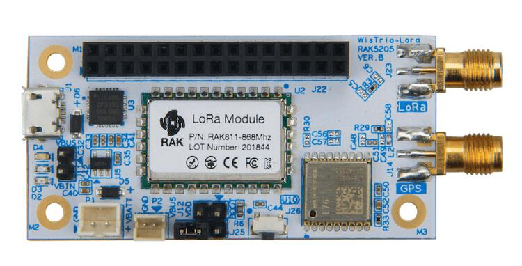

<!-- Copyright 2015-2026 Zephyr Project members and individual contributors. -->
<!-- SPDX-License-Identifier: Apache-2.0 -->
<!-- 中文翻译；编号、导航与译注为本地新增。 -->

<a id="96b_wistrio"></a>

# 第5章\_WisTrio

原文：[官方页面](https://docs.zephyrproject.org/latest/boards/96boards/wistrio/doc/96b_wistrio.html)。读取日期：2026-10-16；来源摘要见[来源记录](../SOURCES.md)。

开发板概览（Board Overview）

<a id="id1"></a>

[](images/96b-wistrio.jpg)

WisTrio

名称（Name）：

`96b_wistrio`

厂商（Vendor）：

[96Boards](https://docs.zephyrproject.org/latest/boards/index.html#vendor=96boards)

状态（Status）：

未处于积极维护状态（Not Actively Maintained）

架构（Architecture）：

[arm](https://docs.zephyrproject.org/latest/boards/index.html#arch=arm)

片上系统（SoC）：

[stm32l151xba](https://docs.zephyrproject.org/latest/boards/index.html#soc=stm32l151xba)

<a id="board-github-link"></a>

[浏览开发板源码（Browse Board Sources）](https://github.com/zephyrproject-rtos/zephyr/blob/main//boards/96boards/wistrio/doc/96b_wistrio.rst/../..)<a id="boards-wistrio"></a>

## 96Boards WisTrio

<a id="overview"></a>

### 概述（Overview）

96Boards WisTrio LoRa跟踪器（LoRa Tracker）开发板采用RAK Wireless RAK5205芯片组，集成SX1276 LoRaWAN调制解调器（Modem）、STM32L151CB-A微控制器（MCU）和GPS模块。Zephyr应用使用`96b_wistrio`配置在这些开发板上运行。

<a id="id2"></a>


96Boards WisTrio

<a id="id13"></a>

该开发板属于[96Boards物联网版（IoT Edition）](https://linaro.co/ie-specification)[注5](#id12)平台，提供LoRa连接能力。

<a id="hardware"></a>

### 硬件（Hardware）

96Boards WisTrio提供以下硬件组件：


- RAK5205芯片组（Chipset）
- 工作电压为3.3 V
- 128 KB闪存（Flash）
- 16 KB静态随机存储器（SRAM）
- 板载传感器（Onboard Sensors）：


  - 加速度计（Accelerometer）：STMicro LIS3DH
  - 集成式环境传感器（Integrated Environmental Sensor）：Bosch BME680
- 两个用户 LED。
- 支持外部中断（External Interrupt）的 GPIO。
- UART接口（2路）
- I2C接口（1路）
- 全球定位系统模块（GPS Module）
- GPS天线（Antenna）
- LoRa天线（Antenna）

<a id="supported-features"></a>

#### 支持的功能（Supported Features）

`96b_wistrio`开发板支持下表所列的硬件功能。

片上／板载（On-Chip / On-Board）

功能集成在片上系统（SoC）内／位于开发板上。

2 / 2

分别表示已启用／已禁用的实例数。点击数量标签，可查看开发板或SoC设备树源码（DTS）中该功能的第一个实例。

`vnd,foo`

与此功能匹配的设备树绑定兼容字符串（Compatible String）；点击链接可查看绑定文档。

<a id="96b_wistrio-hw-features"></a>

<a id="96b_wistrio-96b_wistrio/stm32l151xba-hw-features-section"></a>

##### `96b_wistrio/stm32l151xba`目标（Target）

<a id="96b_wistrio-96b_wistrio/stm32l151xba-hw-features-panel"></a>

<a id="96b_wistrio-96b_wistrio/stm32l151xba-hw-features-memory"></a>

该开发板目标的片上存储容量：32 KiB RAM、128 KiB Flash。

<a id="96b_wistrio-96b_wistrio/stm32l151xba-hw-features-table"></a>

<table>
<tr>
<th>类型（Type）</th>
<th>位置（Location）</th>
<th>说明（Description）</th>
<th>兼容字符串（Compatible）</th>
</tr>
<tr>
<td rowspan="1">中央处理器（CPU）</td>
<td>片上（On-Chip）</td>
<td>ARM Cortex-M3处理器（CPU）（<a href="https://github.com/zephyrproject-rtos/zephyr/blob/main/dts/arm/st/l1/stm32l1.dtsi?plain=1#L33">已启用：1</a>）</td>
<td><a href="../cpu_arm_riscv_binding_reference/P021_arm_cortex-m3.md#std-dtcompatible-arm-cortex-m3"><code>arm,cortex-m3</code></a></td>
</tr>
<tr>
<td rowspan="1">模数转换器（ADC）</td>
<td>片上（On-Chip）</td>
<td>STM32F4 模数转换器（ADC）（<a href="https://github.com/zephyrproject-rtos/zephyr/blob/main/dts/arm/st/l1/stm32l1.dtsi?plain=1#L322">已禁用：1</a>）</td>
<td><a href="../hardware/P841_STM32F4模数转换器绑定.md#dtbinding-st-stm32f4-adc"><code>st,stm32f4-adc</code></a></td>
</tr>
<tr>
<td rowspan="5">时钟控制（Clock Control）</td>
<td>片上（On-Chip）</td>
<td>STM32复位和时钟控制器（RCC / Reset and Clock Controller）（<a href="https://github.com/zephyrproject-rtos/zephyr/blob/main/dts/arm/st/l1/stm32l1.dtsi?plain=1#L166">已启用：1</a>）</td>
<td><a href="../timer_reference/P126_STM32复位与时钟控制绑定.md#dtbinding-st-stm32-rcc"><code>st,stm32-rcc</code></a></td>
</tr>
<tr>
<td>片上（On-Chip）</td>
<td>STM32 外部高速时钟（HSE Clock）（<a href="https://github.com/zephyrproject-rtos/zephyr/blob/main/dts/arm/st/l1/stm32l1.dtsi?plain=1#L63">已禁用：1</a>）</td>
<td><a href="../timer_reference/P129_STM32高速外部时钟绑定.md#dtbinding-st-stm32-hse-clock"><code>st,stm32-hse-clock</code></a></td>
</tr>
<tr>
<td>片上（On-Chip）</td>
<td>通用固定频率时钟提供者（Fixed-Rate Clock Provider）（<a href="https://github.com/zephyrproject-rtos/zephyr/blob/main/dts/arm/st/l1/stm32l1.dtsi?plain=1#L69">已启用：2</a>；<a href="https://github.com/zephyrproject-rtos/zephyr/blob/main/dts/arm/st/l1/stm32l1.dtsi?plain=1#L83">已禁用：1</a>）</td>
<td><a href="../hardware/P566_固定时钟绑定.md#dtbinding-fixed-clock"><code>fixed-clock</code></a></td>
</tr>
<tr>
<td>片上（On-Chip）</td>
<td>STM32L0/L1多速率内部时钟（Multi Speed Internal Clock）（<a href="https://github.com/zephyrproject-rtos/zephyr/blob/main/dts/arm/st/l1/stm32l1.dtsi?plain=1#L76">已禁用：1</a>）</td>
<td><a href="../timer_reference/P158_STM32L0多速内部时钟绑定.md#dtbinding-st-stm32l0-msi-clock"><code>st,stm32l0-msi-clock</code></a></td>
</tr>
<tr>
<td>片上（On-Chip）</td>
<td>STM32L0/L1主锁相环（Main PLL）（<a href="https://github.com/zephyrproject-rtos/zephyr/blob/main/dts/arm/st/l1/stm32l1.dtsi?plain=1#L97">已启用：1</a>）</td>
<td><a href="../timer_reference/P141_STM32L0锁相环时钟绑定.md#dtbinding-st-stm32l0-pll-clock"><code>st,stm32l0-pll-clock</code></a></td>
</tr>
<tr>
<td rowspan="1">计数器（Counter）</td>
<td>片上（On-Chip）</td>
<td>STM32 计数器（Counters）（<a href="https://github.com/zephyrproject-rtos/zephyr/blob/main/dts/arm/st/l1/stm32l1.dtsi?plain=1#L389">已禁用：8</a>）</td>
<td><a href="../stm32_ti_xilinx_counter_binding_reference/P007_st_stm32-counter.md#std-dtcompatible-st-stm32-counter"><code>st,stm32-counter</code></a></td>
</tr>
<tr>
<td rowspan="1">数模转换器（DAC）</td>
<td>片上（On-Chip）</td>
<td>STM32 系列数模转换器（DAC）（<a href="https://github.com/zephyrproject-rtos/zephyr/blob/main/dts/arm/st/l1/stm32l1.dtsi?plain=1#L348">已禁用：1</a>）</td>
<td><a href="../hardware/P760_STM32数模转换器绑定.md#dtbinding-st-stm32-dac"><code>st,stm32-dac</code></a></td>
</tr>
<tr>
<td rowspan="1">直接存储器访问（DMA）</td>
<td>片上（On-Chip）</td>
<td>用于stm32F0、stm32F1和stm32L1片上系统（SoC）系列的STM32直接存储器访问控制器（DMA，V2bis）（<a href="https://github.com/zephyrproject-rtos/zephyr/blob/main/dts/arm/st/l1/stm32l1.dtsi?plain=1#L637">已禁用：1</a>）</td>
<td><a href="../stm32_ti_xilinx_dma_binding_reference/P009_st_stm32-dma-v2bis.md#std-dtcompatible-st-stm32-dma-v2bis"><code>st,stm32-dma-v2bis</code></a></td>
</tr>
<tr>
<td rowspan="1">闪存控制器（Flash Controller）</td>
<td>片上（On-Chip）</td>
<td>STM32 系列闪存控制器（Flash Controller）（<a href="https://github.com/zephyrproject-rtos/zephyr/blob/main/dts/arm/st/l1/stm32l1.dtsi?plain=1#L105">已启用：1</a>）</td>
<td><a href="../flash_renesas_st_ti_binding_reference/P011_st_stm32-flash-controller.md#std-dtcompatible-st-stm32-flash-controller"><code>st,stm32-flash-controller</code></a></td>
</tr>
<tr>
<td rowspan="2">通用输入输出与接插件（GPIO &amp; Headers）</td>
<td>片上（On-Chip）</td>
<td>STM32 通用输入输出控制器（GPIO Controller）（<a href="https://github.com/zephyrproject-rtos/zephyr/blob/main/dts/arm/st/l1/stm32l1.dtsi?plain=1#L569">已启用：6</a>）</td>
<td><a href="../gpio_silabs_st_connectors_binding_reference/P029_st_stm32-gpio.md#std-dtcompatible-st-stm32-gpio"><code>st,stm32-gpio</code></a></td>
</tr>
<tr>
<td>板载（On-Board）</td>
<td>引出到96Boards 3.3 V低速排针（Low-speed Header）的GPIO引脚（<a href="https://github.com/zephyrproject-rtos/zephyr/blob/main/boards/96boards/wistrio/96b_lscon.dtsi?plain=1#L8">已启用：1</a>）</td>
<td><a href="../gpio_infineon_intel_ite_microchip_binding_reference/P013_linaro_96b-lscon-3v3.md#std-dtcompatible-linaro-96b-lscon-3v3"><code>linaro,96b-lscon-3v3</code></a></td>
</tr>
<tr>
<td rowspan="1">集成电路间总线（I2C）</td>
<td>片上（On-Chip）</td>
<td>STM32 I2C V1 控制器（Controller）（<a href="https://github.com/zephyrproject-rtos/zephyr/blob/main/dts/arm/st/l1/stm32l1.dtsi?plain=1#L225">已启用：1</a>；<a href="https://github.com/zephyrproject-rtos/zephyr/blob/main/dts/arm/st/l1/stm32l1.dtsi?plain=1#L237">已禁用：1</a>）</td>
<td><a href="../i2c_stm32_ti_mux_binding_reference/P007_st_stm32-i2c-v1.md#std-dtcompatible-st-stm32-i2c-v1"><code>st,stm32-i2c-v1</code></a></td>
</tr>
<tr>
<td rowspan="2">中断控制器（Interrupt Controller）</td>
<td>片上（On-Chip）</td>
<td>ARMv7-M 嵌套向量中断控制器（Nested Vectored Interrupt Controller，NVIC）（<a href="https://github.com/zephyrproject-rtos/zephyr/blob/main/dts/arm/armv7-m.dtsi?plain=1#L13">已启用：1</a>）</td>
<td><a href="../arm_interrupt_timer_binding_reference/P002_ARMv7_M_NVIC.md#std-dtcompatible-arm-v7m-nvic"><code>arm,v7m-nvic</code></a></td>
</tr>
<tr>
<td>片上（On-Chip）</td>
<td>STM32 外部中断控制器（External Interrupt Controller）（<a href="https://github.com/zephyrproject-rtos/zephyr/blob/main/dts/arm/st/l1/stm32l1.dtsi?plain=1#L356">已启用：1</a>）</td>
<td><a href="../mcu_external_interrupt_binding_reference/P001_st_stm32-exti.md#std-dtcompatible-st-stm32-exti"><code>st,stm32-exti</code></a></td>
</tr>
<tr>
<td rowspan="1">发光二极管（LED）</td>
<td>板载（On-Board）</td>
<td>一组由 GPIO 控制的 LED（GPIO-Controlled LEDs）（<a href="https://github.com/zephyrproject-rtos/zephyr/blob/main/boards/96boards/wistrio/96b_wistrio.dts?plain=1#L23">已启用：1</a>）</td>
<td><a href="../hardware/P564_GPIO指示灯绑定.md#dtbinding-gpio-leds"><code>gpio-leds</code></a></td>
</tr>
<tr>
<td rowspan="1">远距离无线通信（LoRa）</td>
<td>板载（On-Board）</td>
<td>Semtech SX1276 LoRa调制解调器（Modem）（<a href="https://github.com/zephyrproject-rtos/zephyr/blob/main/boards/96boards/wistrio/96b_wistrio.dts?plain=1#L116">已启用：1</a>）</td>
<td><a href="../lora_ieee802154_binding_reference/P024_semtech_sx1276.md#std-dtcompatible-semtech-sx1276"><code>semtech,sx1276</code></a></td>
</tr>
<tr>
<td rowspan="1">存储器控制器（Memory Controller）</td>
<td>片上（On-Chip）</td>
<td>STM32 电池备份 RAM（Battery-Backed RAM）（<a href="https://github.com/zephyrproject-rtos/zephyr/blob/main/dts/arm/st/l1/stm32l151Xb-a.dtsi?plain=1#L27">已禁用：1</a>）</td>
<td><a href="../memory_controller_sdram_psram_binding_reference/P010_st_stm32-bbram.md#std-dtcompatible-st-stm32-bbram"><code>st,stm32-bbram</code></a></td>
</tr>
<tr>
<td rowspan="1">其他绑定（Miscellaneous）</td>
<td>板载（On-Board）</td>
<td>Qorvo RFSW8001单刀三掷射频开关（SP3T / Single Pole Triple Throw RF Switch）（<a href="https://github.com/zephyrproject-rtos/zephyr/blob/main/boards/96boards/wistrio/96b_wistrio.dts?plain=1#L44">已启用：1</a>）</td>
<td><code>qorvo,rfsw8001</code></td>
</tr>
<tr>
<td rowspan="2">存储技术设备（MTD）</td>
<td>片上（On-Chip）</td>
<td>STM32F4 闪存（Flash Memory）（<a href="https://github.com/zephyrproject-rtos/zephyr/blob/main/dts/arm/st/l1/stm32l1.dtsi?plain=1#L115">已启用：1</a>）</td>
<td><a href="../mtd_nxp_st_ti_partition_binding_reference/P017_st_stm32f4-nv-flash.md#std-dtcompatible-st-stm32f4-nv-flash"><code>st,stm32f4-nv-flash</code></a></td>
</tr>
<tr>
<td>片上（On-Chip）</td>
<td>STM32片上电可擦除可编程只读存储器（EEPROM）（<a href="https://github.com/zephyrproject-rtos/zephyr/blob/main/dts/arm/st/l1/stm32l1.dtsi?plain=1#L632">已启用：1</a>）</td>
<td><a href="../mtd_nxp_st_ti_partition_binding_reference/P015_st_stm32-eeprom.md#std-dtcompatible-st-stm32-eeprom"><code>st,stm32-eeprom</code></a></td>
</tr>
<tr>
<td rowspan="1">非易失存储器（NVMEM）</td>
<td>片上（On-Chip）</td>
<td>非易失存储器固定布局（Fixed Layout for Non-Volatile Memory）（<a href="https://github.com/zephyrproject-rtos/zephyr/blob/main/dts/arm/st/l1/stm32l1.dtsi?plain=1#L140">已启用：1</a>）</td>
<td><a href="../memory_protection_binding_reference/P009_fixed-layout.md#std-dtcompatible-fixed-layout"><code>fixed-layout</code></a></td>
</tr>
<tr>
<td rowspan="1">一次性可编程存储器（OTP Memory）</td>
<td>片上（On-Chip）</td>
<td>STM32 嵌入式非易失一次性可编程存储器（NVM OTP）（<a href="https://github.com/zephyrproject-rtos/zephyr/blob/main/dts/arm/st/l1/stm32l1.dtsi?plain=1#L136">已启用：1</a>）</td>
<td><a href="../otp_binding_reference/P010_st_stm32-nvm-otp.md#std-dtcompatible-st-stm32-nvm-otp"><code>st,stm32-nvm-otp</code></a></td>
</tr>
<tr>
<td rowspan="1">物理层（PHY）</td>
<td>片上（On-Chip）</td>
<td>用于所有内置于 USB IP 的 USB 收发器（USB Transceivers）的绑定。（<a href="https://github.com/zephyrproject-rtos/zephyr/blob/main/dts/arm/st/l1/stm32l1.dtsi?plain=1#L647">已启用：1</a>）</td>
<td><a href="../phy_binding_reference/P008_usb-nop-xceiv.md#std-dtcompatible-usb-nop-xceiv"><code>usb-nop-xceiv</code></a></td>
</tr>
<tr>
<td rowspan="1">引脚控制（Pin Control）</td>
<td>片上（On-Chip）</td>
<td>STM32 引脚控制器（Pin Controller）（<a href="https://github.com/zephyrproject-rtos/zephyr/blob/main/dts/arm/st/l1/stm32l1.dtsi?plain=1#L562">已启用：1</a>）</td>
<td><a href="../pinctrl_stm32_ti_xilinx_binding_reference/P004_st_stm32-pinctrl.md#std-dtcompatible-st-stm32-pinctrl"><code>st,stm32-pinctrl</code></a></td>
</tr>
<tr>
<td rowspan="2">电源管理（Power Management）</td>
<td>片上（On-Chip）</td>
<td>STM32 电源控制器（Power Controller）（<a href="https://github.com/zephyrproject-rtos/zephyr/blob/main/dts/arm/st/l1/stm32l1.dtsi?plain=1#L262">已启用：1</a>）</td>
<td><a href="../stm32_soc_power_binding_reference/P010_st_stm32-pwr.md#std-dtcompatible-st-stm32-pwr"><code>st,stm32-pwr</code></a></td>
</tr>
<tr>
<td>片上（On-Chip）</td>
<td>STM32F1 风格的唤醒引脚控制器（Wake-Up Pins Controller）（<a href="https://github.com/zephyrproject-rtos/zephyr/blob/main/dts/arm/st/l1/stm32l1.dtsi?plain=1#L266">已禁用：1</a>）</td>
<td><a href="../stm32_soc_power_binding_reference/P011_st_stm32f1-pwr-wkupctrl.md#std-dtcompatible-st-stm32f1-pwr-wkupctrl"><code>st,stm32f1-pwr-wkupctrl</code></a></td>
</tr>
<tr>
<td rowspan="1">脉宽调制（PWM）</td>
<td>片上（On-Chip）</td>
<td>STM32 脉宽调制（PWM）（<a href="https://github.com/zephyrproject-rtos/zephyr/blob/main/dts/arm/st/l1/stm32l1.dtsi?plain=1#L383">已禁用：6</a>）</td>
<td><a href="../pwm_stm32_ti_generic_binding_reference/P011_st_stm32-pwm.md#std-dtcompatible-st-stm32-pwm"><code>st,stm32-pwm</code></a></td>
</tr>
<tr>
<td rowspan="1">稳压器（Regulator）</td>
<td>板载（On-Board）</td>
<td>固定电压稳压器（Fixed Voltage Regulators）（<a href="https://github.com/zephyrproject-rtos/zephyr/blob/main/boards/96boards/wistrio/96b_wistrio.dts?plain=1#L52">已启用：1</a>）</td>
<td><a href="../hardware/P635_固定稳压器设备树绑定.md#dtbinding-regulator-fixed"><code>regulator-fixed</code></a></td>
</tr>
<tr>
<td rowspan="1">复位控制器（Reset Controller）</td>
<td>片上（On-Chip）</td>
<td>STM32 复位与时钟控制器（Reset and Clock Control，RCC）（<a href="https://github.com/zephyrproject-rtos/zephyr/blob/main/dts/arm/st/l1/stm32l1.dtsi?plain=1#L171">已启用：1</a>）</td>
<td><a href="../reset_controller_binding_reference/P017_st_stm32-rcc-rctl.md#std-dtcompatible-st-stm32-rcc-rctl"><code>st,stm32-rcc-rctl</code></a></td>
</tr>
<tr>
<td rowspan="1">实时时钟（RTC）</td>
<td>片上（On-Chip）</td>
<td>STM32 实时时钟（RTC）（<a href="https://github.com/zephyrproject-rtos/zephyr/blob/main/dts/arm/st/l1/stm32l1.dtsi?plain=1#L177">已启用：1</a>）</td>
<td><a href="../soc_rtc_binding_reference/P014_st_stm32-rtc.md#std-dtcompatible-st-stm32-rtc"><code>st,stm32-rtc</code></a></td>
</tr>
<tr>
<td rowspan="4">传感器（Sensors）</td>
<td>板载（On-Board）</td>
<td>意法半导体（STMicroelectronics）LIS3DH三轴加速度计（3-axis Accelerometer）（<a href="https://github.com/zephyrproject-rtos/zephyr/blob/main/boards/96boards/wistrio/96b_wistrio.dts?plain=1#L104">已启用：1</a>）</td>
<td><a href="../sensor_st_lis_lps_binding_reference/P016_st_lis3dh-i2c.md#std-dtcompatible-st-lis3dh"><code>st,lis3dh</code></a></td>
</tr>
<tr>
<td>片上（On-Chip）</td>
<td>STM32 正交解码器（Quadrature Decoder）（<a href="https://github.com/zephyrproject-rtos/zephyr/blob/main/dts/arm/st/l1/stm32l1.dtsi?plain=1#L394">已禁用：3</a>）</td>
<td><a href="../sensor_st_lsm_stm32_binding_reference/P028_st_stm32-qdec.md#std-dtcompatible-st-stm32-qdec"><code>st,stm32-qdec</code></a></td>
</tr>
<tr>
<td>片上（On-Chip）</td>
<td>STM32 系列温度节点（TEMP），用于以两个温度点完成生产校准的传感器。（<a href="https://github.com/zephyrproject-rtos/zephyr/blob/main/dts/arm/st/l1/stm32l1.dtsi?plain=1#L652">已禁用：1</a>）</td>
<td><a href="../sensor_st_lsm_stm32_binding_reference/P029_st_stm32-temp-cal.md#std-dtcompatible-st-stm32-temp-cal"><code>st,stm32-temp-cal</code></a></td>
</tr>
<tr>
<td>片上（On-Chip）</td>
<td>STM32 参考电压（VREF+）（<a href="https://github.com/zephyrproject-rtos/zephyr/blob/main/dts/arm/st/l1/stm32l1.dtsi?plain=1#L663">已禁用：1</a>）</td>
<td><a href="../sensor_st_ti_power_capacitance_binding_reference/P003_st_stm32-vref.md#std-dtcompatible-st-stm32-vref"><code>st,stm32-vref</code></a></td>
</tr>
<tr>
<td rowspan="2">串行控制器（Serial Controller）</td>
<td>片上（On-Chip）</td>
<td>STM32 通用同步／异步收发器（USART）（<a href="https://github.com/zephyrproject-rtos/zephyr/blob/main/dts/arm/st/l1/stm32l1.dtsi?plain=1#L189">已启用：2</a>；<a href="https://github.com/zephyrproject-rtos/zephyr/blob/main/dts/arm/st/l1/stm32l1.dtsi?plain=1#L198">已禁用：1</a>）</td>
<td><a href="../uart_silabs_stm32_ti_binding_reference/P016_st_stm32-usart.md#std-dtcompatible-st-stm32-usart"><code>st,stm32-usart</code></a></td>
</tr>
<tr>
<td>片上（On-Chip）</td>
<td>STM32 通用异步收发器（UART）（<a href="https://github.com/zephyrproject-rtos/zephyr/blob/main/dts/arm/st/l1/stm32l1.dtsi?plain=1#L207">已禁用：2</a>）</td>
<td><a href="../uart_silabs_stm32_ti_binding_reference/P015_st_stm32-uart.md#std-dtcompatible-st-stm32-uart"><code>st,stm32-uart</code></a></td>
</tr>
<tr>
<td rowspan="1">系统管理总线（SMbus）</td>
<td>片上（On-Chip）</td>
<td>STM32 系统管理总线控制器（SMBus Controller）（<a href="https://github.com/zephyrproject-rtos/zephyr/blob/main/dts/arm/st/l1/stm32l1.dtsi?plain=1#L671">已禁用：2</a>）</td>
<td><a href="../i3c_smbus_binding_reference/P013_st_stm32-smbus.md#std-dtcompatible-st-stm32-smbus"><code>st,stm32-smbus</code></a></td>
</tr>
<tr>
<td rowspan="1">串行外设接口（SPI）</td>
<td>片上（On-Chip）</td>
<td>STM32 串行外设接口控制器（SPI Controller）（<a href="https://github.com/zephyrproject-rtos/zephyr/blob/main/dts/arm/st/l1/stm32l1.dtsi?plain=1#L291">已启用：1</a>；<a href="https://github.com/zephyrproject-rtos/zephyr/blob/main/dts/arm/st/l1/stm32l1.dtsi?plain=1#L302">已禁用：1</a>）</td>
<td><a href="../spi_stm32_ti_xilinx_binding_reference/P012_st_stm32-spi.md#std-dtcompatible-st-stm32-spi"><code>st,stm32-spi</code></a></td>
</tr>
<tr>
<td rowspan="2">定时器（Timer）</td>
<td>片上（On-Chip）</td>
<td>ARMv7-M 系统节拍（System Tick）（<a href="https://github.com/zephyrproject-rtos/zephyr/blob/main/dts/arm/armv7-m.dtsi?plain=1#L21">已启用：1</a>）</td>
<td><a href="../arm_interrupt_timer_binding_reference/P006_ARMv7_M_SysTick.md#std-dtcompatible-arm-armv7m-systick"><code>arm,armv7m-systick</code></a></td>
</tr>
<tr>
<td>片上（On-Chip）</td>
<td>STM32 定时器（Timers）（<a href="https://github.com/zephyrproject-rtos/zephyr/blob/main/dts/arm/st/l1/stm32l1.dtsi?plain=1#L372">已禁用：8</a>）</td>
<td><a href="../stm32_ti_silabs_timer_binding_reference/P008_st_stm32-timers.md#std-dtcompatible-st-stm32-timers"><code>st,stm32-timers</code></a></td>
</tr>
<tr>
<td rowspan="1">通用串行总线（USB）</td>
<td>片上（On-Chip）</td>
<td>STM32 USB控制器（Controller）（<a href="https://github.com/zephyrproject-rtos/zephyr/blob/main/dts/arm/st/l1/stm32l1.dtsi?plain=1#L249">已禁用：1</a>）</td>
<td><a href="../usb_stm32_audio_binding_reference/P006_st_stm32-usb.md#std-dtcompatible-st-stm32-usb"><code>st,stm32-usb</code></a></td>
</tr>
<tr>
<td rowspan="2">看门狗（Watchdog）</td>
<td>片上（On-Chip）</td>
<td>STM32 看门狗（Watchdog）（<a href="https://github.com/zephyrproject-rtos/zephyr/blob/main/dts/arm/st/l1/stm32l1.dtsi?plain=1#L618">已禁用：1</a>）</td>
<td><a href="../stm32_ti_xilinx_watchdog_binding_reference/P001_st_stm32-watchdog.md#std-dtcompatible-st-stm32-watchdog"><code>st,stm32-watchdog</code></a></td>
</tr>
<tr>
<td>片上（On-Chip）</td>
<td>STM32 系统窗口看门狗（System Window Watchdog）（<a href="https://github.com/zephyrproject-rtos/zephyr/blob/main/dts/arm/st/l1/stm32l1.dtsi?plain=1#L624">已禁用：1</a>）</td>
<td><a href="../stm32_ti_xilinx_watchdog_binding_reference/P002_st_stm32-window-watchdog.md#std-dtcompatible-st-stm32-window-watchdog"><code>st,stm32-window-watchdog</code></a></td>
</tr>
</table>

<a id="connections-and-ios"></a>

#### 连接与输入输出（Connections and IOs）

<a id="led"></a>

##### 发光二极管（LED）


- LED1 / 用户指示灯1（User1 LED）= PA12
- LED2 / 用户指示灯2（User2 LED）= PB4

<a id="push-buttons"></a>

##### 按键（Push Buttons）


- 按钮 = 复位 RST（BT1）。

<a id="serial-port"></a>

#### 串口（Serial Port）

96Boards WisTrio开发板有2路UART。Zephyr控制台（Console）输出分配给USART1，默认设置为115200波特率、8N1；USART3用于GPS模块。

<a id="i2c"></a>

##### 集成电路间总线（I2C）

96Boards WisTrio开发板有1路I2C，连接到板载传感器。默认I2C引脚映射如下：


- `I2C1_SCL : PB8`
- `I2C1_SDA : PB9`

I2C1也连接到J22接口，可用于连接外部传感器。

<a id="spi"></a>

##### 串行外设接口（SPI）

96Boards WisTrio开发板有1路SPI，连接到芯片组内的LoRa无线电（Radio）。默认SPI引脚映射如下：


- `SPI1_SCLK : PA5`
- `SPI1_MISO : PA6`
- `SPI1_MOSI : PA7`
- `SPI1_NSS : PB0`

<a id="programming-and-debugging"></a>

### 烧录与调试（Programming and Debugging）

<a id="flashing"></a>

#### 烧录（Flashing）

96Boards WisTrio有两种烧录方式：使用ROM引导加载程序（ROM Bootloader），或者使用需要额外硬件的串行线调试端口（SWD Debug Port）。

<a id="id4"></a>

使用ROM引导加载程序（ROM Bootloader）烧录时，需要通过BOOT0引脚触发特定的激活序列。ROM引导加载程序支持通过UART和I2C烧录，本文只说明UART方式。关于启用和使用ROM引导加载程序的更多信息，请参阅应用笔记[AN2606](https://www.st.com/resource/en/application_note/cd00167594.pdf)[注1](#id3)。

<a id="using-rom-bootloader"></a>

##### 使用 ROM 引导加载程序（ROM Bootloader）：


1. 使用Micro USB转USB-A线缆，将96Boards WisTrio连接到Linux PC。
2. 可以按以下步骤触发ROM引导加载程序（ROM Bootloader）：


  - 将BOOT0连接到VDD，即短接J12上的引脚1和2。
  - 按下并松开 RST 按钮。

<a id="id5"></a>

关于激活ROM引导加载程序（ROM Bootloader）的详细信息，参阅应用笔记[AN2606](https://www.st.com/resource/en/application_note/cd00167594.pdf)[注1](#id3)第29章。ROM引导加载程序支持通过UART和I2C协议烧录。

<a id="id7"></a>

下面以[Hello World](../getting_started/P005_HelloWorld示例.md#hello_world)应用为例，说明如何使用[stm32flash](https://sourceforge.net/p/stm32flash/wiki/Home/)[注2](#id6)命令行工具构建和烧录：

```text
# From the root of the zephyr repository
west build -b 96b_wistrio samples/hello_world
west flash
```

<a id="using-swd-debugger"></a>

##### 使用 SWD 调试器（SWD Debugger）：

<a id="id9"></a>

<a id="id11"></a>

使用[Black Magic Debug Probe](https://github.com/blacksphere/blackmagic/wiki)[注3](#id8)作为SWD编程器，通过飞线和20针JTAG适配板套件（20 Pin JTAG Adapter Board Kit）连接到J22排针引出的SWD引脚。将其插入主机PC后，Black Magic Debug Probe会枚举为USB串口设备，详见其[入门页面（Getting Started）](https://github.com/blacksphere/blackmagic/wiki/Getting-Started)[注4](#id10)。

示例使用 Zephyr SDK 提供的 `arm-zephyr-eabi-gdb`，也可使用 GCC ARM Embedded 附带的 GDB 等其他二进制程序。

```text
$ arm-zephyr-eabi-gdb -q zephyr.elf
(gdb) target extended-remote /dev/ttyACM0
Remote debugging using /dev/ttyACM0
(gdb) monitor swdp_scan
Target voltage: 3.3V
Available Targets:
No. Att Driver
```

<a id="debugging"></a>

#### 调试（Debugging）

烧录96Boards WisTrio后，可以使用同一个GDB实例进行调试。重新连接时，重复前述步骤直到`attach 1`，随后即可按常规方式使用GDB调试。特别地，在GDB提示符下输入`run`，可重新启动已烧录的程序。

<a id="references"></a>

### 参考资料（References）

<a id="id3"></a>

〔1〕 ([1](#id4),[2](#id5))[https://www.st.com/resource/en/application_note/cd00167594.pdf](https://www.st.com/resource/en/application_note/cd00167594.pdf)

<a id="id6"></a>

〔[2](#id7)〕 [https://sourceforge.net/p/stm32flash/wiki/Home/](https://sourceforge.net/p/stm32flash/wiki/Home/)

<a id="id8"></a>

〔[3](#id9)〕 [https://github.com/blacksphere/blackmagic/wiki](https://github.com/blacksphere/blackmagic/wiki)

<a id="id10"></a>

〔[4](#id11)〕 [https://github.com/blacksphere/blackmagic/wiki/Getting-Started](https://github.com/blacksphere/blackmagic/wiki/Getting-Started)

<a id="id12"></a>

〔[5](#id13)〕 [https://linaro.co/ie-specification](https://linaro.co/ie-specification)

## 译注

原文硬件概述列出16 KB SRAM，而自动生成的目标存储器说明列出32 KiB RAM；两处数值分别保留。

## 原文外链核对

2026-10-16核对并重试以下原文外链时未能确认可访问性，保留原始目标，不将访问失败解释为原文内容有误。

- [](https://sourceforge.net/p/stm32flash/wiki/Home/)：HTTP Error 403: Forbidden。
- [cd00167594.pdf](https://www.st.com/resource/en/application_note/cd00167594.pdf)：HTTP Error 567: Unknown Status。

---

[上一章](P004_STM32_Sensor_Mezzanine.md) · [返回大纲](大纲.md) · [全站翻译进度](../PROGRESS.md)
