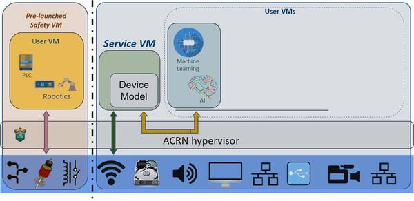

<!-- Copyright 2015-2026 Zephyr Project members and individual contributors. -->
<!-- SPDX-License-Identifier: Apache-2.0 -->
<!-- 中文翻译；编号、导航与译注为本地新增。 -->

<a id="acrn-hypervisor"></a>

# 第3章\_ACRN虚拟机监控器（Hypervisor）

原文：[官方页面](https://docs.zephyrproject.org/latest/boards/acrn/acrn/doc/index.html)。读取日期：2026-10-16；来源摘要见[来源记录](../SOURCES.md)。

Zephyr可以作为客户机（Guest）运行在x86架构的ACRN虚拟机监控器（Hypervisor）上，参见[https://projectacrn.org/](https://projectacrn.org/)。不过，实现这一运行方式需要完成一些较为繁复的配置。

ACRN虚拟机监控器（Hypervisor）支持混合场景（Hybrid Scenario），Zephyr在其中以所谓“预启动”（Pre-launched）模式运行。这意味着Zephyr直接访问ACRN，不经过服务操作系统虚拟机（SOS VM）。原文认为，这种方式最适合实际用户场景，因为Zephyr的实时性（Real-time）和安全性（Safety）可避免受到其他虚拟机的影响。下图引自ACRN官方文档，展示混合场景的工作方式：

<a id="id1"></a>



ACRN混合用户场景（Hybrid User Scenario）

本教程展示如何构建Zephyr与ACRN虚拟机监控器（Hypervisor）的最小可运行实例，验证它们能够一起运行。有关构建和使用服务操作系统虚拟机（SOS VM）或其他客户虚拟机（Guest VM）等功能，请参阅ACRN入门指南（Getting Started Guide）：[https://projectacrn.github.io/latest/tutorials/using_hybrid_mode_on_nuc.html](https://projectacrn.github.io/latest/tutorials/using_hybrid_mode_on_nuc.html)

<a id="build-your-zephyr-app"></a>

## 构建Zephyr应用（Build Your Zephyr App）

首先，选择适当的开发板，按常规方式构建要在ACRN中运行的Zephyr应用：

> ```text
> west build -b acrn_ehl_crb samples/hello_world
> ```

本教程使用Intel Elkhart Lake参考开发板（[EHL](https://www.intel.com/content/www/us/en/products/docs/processors/embedded/enhanced-for-iot-platform-brief.html) CRB），因为它是此类场景的推荐平台之一。目标开发板参数使用`acrn_ehl_crb`。

记下`build/zephyr/.config`中的Kconfig输出；稍后配置ACRN时需要参考它。

所需的Zephyr构建产物为`build/zephyr/zephyr.bin`，它是原始内存镜像（Raw Memory Image）。此处与其他x86目标不同，应使用该文件，不应使用`zephyr.elf`。

<a id="configure-and-build-acrn"></a>

## 配置并构建ACRN（Configure and Build ACRN）

首先获取源码，从以下地址克隆：

> ```text
> git clone https://github.com/projectacrn/acrn-hypervisor
> ```

原文建议使用ACRN虚拟机监控器（Hypervisor）v2.5.1或更新版本，因为这些版本对Zephyr的对称多处理（SMP）提供了更好的支持。

与Zephyr一样，ACRN倾向于在构建时管理配置（Build-time Configuration），而不是在运行时探测或控制。Zephyr使用Kconfig defconfig文件、设备树包含文件（Devicetree Includes）等易于合并的小配置单元；ACRN则使用单个较大的配置文件。因此，需要编辑一份较大的XML文件，使它与Zephyr配置匹配。选择与硬件匹配的ACRN主机配置，本例为`ehl-crb-b`，然后找到对应的`misc/config_tools/data/<platform>/hybrid.xml`文件。

首先找到`<vm>`声明列表，每项都有`id=`属性。测试Zephyr时，应确保Zephyr镜像的ID为0。这样可以仅使用一个虚拟机镜像启动ACRN，避免将大型Linux二进制文件复制到启动文件系统中。在原文当前测试过的配置下，Zephyr的`vm_type`标签始终为`SAFETY_VM`。

<a id="configure-zephyr-memory-layout"></a>

### 配置Zephyr存储器布局（Memory Layout）

接下来确定Zephyr镜像的加载地址（Load Address）和入口点地址（Entry Point Address），并在ACRN中手动配置。Zephyr通常以ELF镜像形式分发，可以从中自动提取这些地址；但ACRN不会进行这种提取，它只知道将一段连续的数据加载到内存，再跳转到指定地址执行。

找到`<vm id="0">…<os_config>`标签，其内容类似如下：

> ```text
> <os_config>
>     <name>Zephyr</name>
>     <kern_type>KERNEL_ZEPHYR</kern_type>
>     <kern_mod>Zephyr_RawImage</kern_mod>
>     <ramdisk_mod/>
>     <bootargs></bootargs>
>     <kern_load_addr>0x1000</kern_load_addr>
>     <kern_entry_addr>0x1000</kern_entry_addr>
> </os_config>
> ```

`kern_load_addr`标签必须与`include/arch/x86/memory.ld`中的Zephyr `LOCORE_BASE`符号一致。原文所述值为`0x1000`，与ACRN默认配置相同。

`kern_entry_addr`标签必须与构建得到的`zephyr.elf`文件中的入口点一致。可以使用二进制工具集（binutils）查询，例如：

> ```text
> $ objdump -f build/zephyr/zephyr.elf
>
> build/zephyr/zephyr.elf:     file format elf64-x86-64
> architecture: i386:x86-64, flags 0x00000012:
> EXEC_P, HAS_SYMS
> start address 0x0000000000001000
> ```

默认情况下，入口地址同样为`0x1000`。不过，这并非对所有历史配置都成立，将来也可能改变。

<a id="configure-zephyr-cpus"></a>

### 配置Zephyr处理器（CPUs）

现在需要配置ACRN呈现给客户机（Guest）的CPU环境。Zephyr默认以对称多处理（SMP）模式构建，而ACRN默认只分配1个CPU。在Zephyr的`.config`文件中查找`CONFIG_MP_MAX_NUM_CPUS`的值，再通过`<cpu_affinity>`标签为客户机分配对应数量的CPU。例如：

> ```text
> <vm id="0">
>     <vm_type>SAFETY_VM</vm_type>
>     <name>ACRN PRE-LAUNCHED VM0</name>
>     <guest_flags>
>         <guest_flag>0</guest_flag>
>     </guest_flags>
>     <cpu_affinity>
>         <pcpu_id>0</pcpu_id>
>         <pcpu_id>1</pcpu_id>
>     </cpu_affinity>
>     ...
>     <clos>
>         <vcpu_clos>0</vcpu_clos>
>         <vcpu_clos>0</vcpu_clos>
>     </clos>
>     ...
> </vm>
> ```

要使用对称多处理（SMP），必须将VM0的`pcpu_id`改为0和1，使ACRN在CPU0和CPU1上运行Zephyr。不做这一修改，ACRN虚拟机监控器（Hypervisor）与Zephyr应用将无法成功启动。如果只打算让Zephyr使用1个CPU，可以跳过此修改。

Zephyr使用CPU0和CPU1，因此还必须修改VM1的配置，使其运行在CPU2和CPU3上。如果ACRN配置中还有其他虚拟机，也应相应修改它们的配置。

> ```text
> <vm id="1">
>     <vm_type>SOS_VM</vm_type>
>     <name>ACRN SOS VM</name>
>     <guest_flags>
>         <guest_flag>0</guest_flag>
>     </guest_flags>
>     <cpu_affinity>
>         <pcpu_id>2</pcpu_id>
>         <pcpu_id>3</pcpu_id>
>     </cpu_affinity>
>     <clos>
>         <vcpu_clos>0</vcpu_clos>
>         <vcpu_clos>0</vcpu_clos>
>     </clos>
>     ...
> </vm>
> ```

注意，这些索引对应主机上的物理CPU（Physical CPU）。配置多个客户机时，通常不应让这些分配与其他客户机重叠。仅测试Zephyr时，使用CPU0和CPU1即可。`ehl-crb-b`具有4个物理CPU，将0至3全部分配给Zephyr也可以运行，但这样就无法为其他客户机保留专用CPU。

<a id="build-acrn"></a>

### 构建ACRN（Build ACRN）

配置完成后，ACRN的构建较为直接：

> ```text
> $ make -j BOARD=ehl-crb-b SCENARIO=hybrid
> ```

唯一需要的构建产物是`build/hypervisor/acrn.bin`中的ACRN多重引导镜像（Multiboot Image）。

<a id="assemble-efi-boot-media"></a>

## 准备EFI启动介质（EFI Boot Media）

ACRN通过GNU GRUB引导加载程序（Bootloader）在硬件上启动，GRUB本身由EFI固件启动；两者都需要正确配置。

<a id="locate-grub"></a>

### 获取GRUB（Locate GRUB）

首先需要与硬件对应的GRUB EFI二进制文件。很多情况下，从上游源码直接构建，或者从合适的Linux发行版中复制一份即可。但某些硬件需要专门为GRUB打补丁。请向硬件支持团队咨询构建可用GRUB的明确方法——原文在此以“停下来笑一下”作诙谐评论。实际操作中，可能需要询问他人，并复制他们最近测试成功的二进制文件。

<a id="create-efi-boot-filesystem"></a>

### 创建EFI启动文件系统（EFI Boot Filesystem）

将启动介质连接到Linux系统，例如设备路径为`/dev/sdb`的USB存储盘；实际硬件路径可能不同。创建类型码为`0xEF`、足以存放启动文件的EFI启动分区。以下命令将所需操作直接传给`fdisk`，也可以手动逐项输入：

> ```text
> # for i in n p 1 "" "" t ef w; do echo $i; done | fdisk /dev/sdb
> ...
> <lots of fdisk output>
> ```

在新分区中创建FAT文件系统（Filesystem）并挂载：

> ```text
> # mkfs.vfat -n ACRN_ZEPHYR /dev/sdb1
> # mkdir -p /mnt/acrn
> # mount /dev/sdb1 /mnt/acrn
> ```

<a id="copy-images-and-configure-grub"></a>

### 复制镜像并配置GRUB（Copy Images and Configure GRUB）

ACRN自身不能访问运行时文件系统。它通过GRUB的多重引导模块（Multiboot Module）接收客户虚拟机镜像，例如`zephyr.bin`，因此必须依靠GRUB的文件系统驱动。GRUB、ACRN和Zephyr这3个文件都要复制到启动介质的`/efi/boot`目录。注意，GRUB必须命名为`bootx64.efi`，固件才能将其识别为引导加载程序（Bootloader）：

> ```text
> # mkdir -p /mnt/acrn/efi/boot
> # cp $PATH_TO_GRUB_BINARY /mnt/acrn/efi/boot/bootx64.efi
> # cp $ZEPHYR_BASE/build/zephyr/zephyr.bin /mnt/acrn/efi/boot/
> # cp $PATH_TO_ACRN/build/hypervisor/acrn.bin /mnt/acrn/efi/boot/
> ```

启动时，GRUB会加载`efi/boot/grub.cfg`文件，从中读取运行时配置指令。原文顺带指出，ACRN和Zephyr都没有这类运行时配置功能。该配置需要将`acrn.bin`作为启动目标，并将`zephyr.bin`作为第一个模块传给它，因为前面将Zephyr配置为`<vm id="0">`。除极少数特殊硬件外，以下最小配置即可工作；`hd0`几乎总是GRUB自身所在的启动文件系统，无需调整GRUB插件、菜单或超时设置：

> ```text
> # cat > /mnt/acrn/efi/boot/grub.cfg<<EOF
> set root='hd0,msdos1'
> multiboot2 /efi/boot/acrn.bin
> module2 /efi/boot/zephyr.bin Zephyr_RawImage
> boot
> EOF
> ```

此时，文件系统应已准备完整。

> ```text
> # umount /dev/sdb1
> # sync
> ```

<a id="boot-acrn"></a>

## 启动ACRN（Boot ACRN）

如果一切正常，使用EFI介质启动硬件后，ACRN和Zephyr都会运行，控制台也会提供可用的ACRN命令行。Zephyr之所以随之运行，是因为默认配置为预启动虚拟机（Prelaunched VM）。

使用`vm_console`命令可以查看Zephyr（虚拟机0 / VM 0）的控制台输出：

> ```text
> ACRN:\>vm_console 0
>
> ----- Entering VM 0 Shell -----
> *** Booting Zephyr OS build v2.6.0-rc1-324-g1a03783861ad  ***
> Hello World! acrn
> ```

## 译注

本页翻译保留官方ACRN教程所用版本、XML配置和构建命令。0x1000是原文说明的加载／入口地址，实际入口仍须依原文步骤从构建产物核对。原例的/dev/sdb、/efi/boot等为Linux设备与启动介质路径，不是作者的仓库位置；本次仅整理文档，未执行分区、格式化或虚拟机启动。

## 原文外链核对

2026-10-16核对并重试以下原文外链时未能确认可访问性，保留原始目标，不将访问失败解释为原文内容有误。

- [enhanced-for-iot-platform-brief.html](https://www.intel.com/content/www/us/en/products/docs/processors/embedded/enhanced-for-iot-platform-brief.html)：HTTP Error 403: Forbidden。

---

[上一章](P002_Aconno.md) · [返回大纲](大纲.md) · [全站翻译进度](../PROGRESS.md) · [下一章](P004_Project_ACRN.md)
