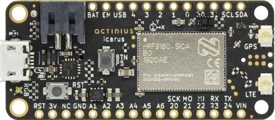

<!-- Copyright 2015-2026 Zephyr Project members and individual contributors. -->
<!-- SPDX-License-Identifier: Apache-2.0 -->
<!-- 中文翻译；编号、导航与译注为本地新增。 -->

# 第5章\_Icarus

原文：[官方页面](https://docs.zephyrproject.org/latest/boards/actinius/icarus/doc/index.html)。读取日期：2026-10-16；来源摘要见[来源记录](../SOURCES.md)。

开发板概览（Board Overview）

Icarus

名称（Name）：

`actinius_icarus`

厂商（Vendor）：

[Actinius B.V.](https://docs.zephyrproject.org/latest/boards/index.html#vendor=actinius)

状态（Status）：

当前未积极维护（Not Actively Maintained）

架构（Architecture）：

[arm](https://docs.zephyrproject.org/latest/boards/index.html#arch=arm)

片上系统（SoC）：

[nrf9160](https://docs.zephyrproject.org/latest/boards/index.html#soc=nrf9160)

[浏览开发板源码（Browse Board Sources）](https://github.com/zephyrproject-rtos/zephyr/blob/main//boards/actinius/icarus/doc/index.rst/../..)

## 概述（Overview）

Icarus是一款采用Adafruit Feather/FeatherWing外形规格（Form Factor）、价格经济的蜂窝物联网开发板（Cellular IoT Board）。它围绕Nordic Semiconductor nRF9160调制解调器（Modem）构建，集成LTE-M、窄带物联网（NB-IoT）、GPS、加速度计（Accelerometer）、USB、锂聚合物电池充电器（LiPo Charger）、嵌入式SIM（eSIM）和nano-SIM接口。

主微控制器（Microcontroller）为Nordic Semiconductor nRF9160，具有ARM Cortex-M33F处理器、ARMv8-M安全扩展（Security Extension）以及以下由Nordic直接提供的设备：

- 模数转换器（ADC）
- 时钟（CLOCK）
- 闪存（FLASH）
- 通用输入输出（GPIO）
- 集成电路间总线（I2C）
- 存储器保护单元（MPU）
- 嵌套向量中断控制器（NVIC）
- 脉宽调制（PWM）
- 实时时钟（RTC）
- Segger实时传输（RTT，RTT控制台 / RTT Console）
- 串行外设接口（SPI）
- 带EasyDMA的通用异步收发器（UARTE）
- 看门狗定时器（WDT）
- 实现定义的归属单元（IDAU）

## 硬件（Hardware）

有关板载硬件的详细信息，请参阅[Icarus产品网站（Product Website）](https://www.actinius.com/icarus)[注2](#id5)。

Icarus物联网开发板及引脚分配（IoT Dev Board with Pinouts）

### 引脚说明（Pin Description）

用户可用的外部引脚（External Pins）如下：

<table>
<tr>
<th>Icarus引脚（Pin）</th>
<th>功能（Function）</th>
<th>说明（Description）</th>
<th>设备树节点（Devicetree Node）</th>
</tr>
<tr>
<td>RST</td>
<td>复位（Reset）</td>
<td>低电平有效的复位（Active-low Reset），带内部上拉（Internal Pull-up）</td>
<td><ul><li></li></ul></td>
</tr>
<tr>
<td>3.3V</td>
<td>电源输出（Power Output）</td>
<td>主3.3 V电源（Supply）</td>
<td><ul><li></li></ul></td>
</tr>
<tr>
<td>未连接（NC）</td>
<td><ul><li></li></ul></td>
<td>未连接（Not Connected）</td>
<td><ul><li></li></ul></td>
</tr>
<tr>
<td>地（GND）</td>
<td>电源输出（Power Output）</td>
<td>地（Ground）</td>
<td><ul><li></li></ul></td>
</tr>
<tr>
<td><code>14 / A1</code></td>
<td>GPIO／模拟输入（Analog In）</td>
<td><code>nRF9160 P0.14 / AIN1</code></td>
<td><code>gpio0 / adc_1</code></td>
</tr>
<tr>
<td><code>15 / A2</code></td>
<td>GPIO／模拟输入（Analog In）</td>
<td><code>nRF9160 P0.15 / AIN2</code></td>
<td><code>gpio0 / adc_2</code></td>
</tr>
<tr>
<td><code>16 / A3</code></td>
<td>GPIO／模拟输入（Analog In）</td>
<td><code>nRF9160 P0.16 / AIN3</code></td>
<td><code>gpio0 / adc_3</code></td>
</tr>
<tr>
<td><code>17 / A4</code></td>
<td>GPIO／模拟输入（Analog In）</td>
<td><code>nRF9160 P0.17 / AIN4</code></td>
<td><code>gpio0 / adc_4</code></td>
</tr>
<tr>
<td><code>18 / A5</code></td>
<td>GPIO／模拟输入（Analog In）</td>
<td><code>nRF9160 P0.18 / AIN5</code></td>
<td><code>gpio0 / adc_5</code></td>
</tr>
<tr>
<td><code>19 / A6</code></td>
<td>GPIO／模拟输入（Analog In）</td>
<td><code>nRF9160 P0.19 / AIN6</code></td>
<td><code>gpio0 / adc_6</code></td>
</tr>
<tr>
<td><code>20 / SCK</code></td>
<td>GPIO／SPI引脚（Pin）</td>
<td>nRF9160 P0.20／SPI时钟引脚（SCK）</td>
<td><code>gpio0 / spi3</code></td>
</tr>
<tr>
<td><code>21 / MOSI</code></td>
<td>GPIO／SPI引脚（Pin）</td>
<td>nRF9160 P0.21／SPI主机输出从机输入引脚（MOSI）</td>
<td><code>gpio0 / spi3</code></td>
</tr>
<tr>
<td><code>22 / MISO</code></td>
<td>GPIO／SPI引脚（Pin）</td>
<td>nRF9160 P0.22／SPI主机输入从机输出引脚（MISO）</td>
<td><code>gpio0 / spi3</code></td>
</tr>
<tr>
<td><code>23 / RX</code></td>
<td>GPIO／UART引脚（Pin）</td>
<td>nRF9160 P0.23／UART接收引脚（RX）</td>
<td><code>gpio0 / uart1</code></td>
</tr>
<tr>
<td><code>24 / TX</code></td>
<td>GPIO／UART引脚（Pin）</td>
<td>nRF9160 P0.24／UART发送引脚（TX）</td>
<td><code>gpio0 / uart1</code></td>
</tr>
<tr>
<td>VIN</td>
<td>电源输入（Power Input）</td>
<td>电压输入（Voltage Input），最大10.2 V</td>
<td><ul><li></li></ul></td>
</tr>
<tr>
<td>VBAT</td>
<td>电源输入（Power Input）</td>
<td>电池电压输入（Battery Voltage Input）</td>
<td><ul><li></li></ul></td>
</tr>
<tr>
<td>EN</td>
<td>电源使能（Power Enable）</td>
<td>电源使能引脚（Power Enable Pin），拉低可关闭电源</td>
<td><ul><li></li></ul></td>
</tr>
<tr>
<td>通用串行总线（USB）</td>
<td>电源输入（Power Input）</td>
<td>USB电压输入（Voltage Input）</td>
<td>gpio0</td>
</tr>
<tr>
<td>4</td>
<td>通用输入输出（GPIO）</td>
<td><code>nRF9160 P0.04</code></td>
<td>gpio0</td>
</tr>
<tr>
<td>3</td>
<td>通用输入输出（GPIO）</td>
<td><code>nRF9160 P0.03</code></td>
<td>gpio0</td>
</tr>
<tr>
<td>2</td>
<td>通用输入输出（GPIO）</td>
<td><code>nRF9160 P0.02</code></td>
<td>gpio0</td>
</tr>
<tr>
<td>1</td>
<td>通用输入输出（GPIO）</td>
<td><code>nRF9160 P0.01</code></td>
<td>gpio0</td>
</tr>
<tr>
<td>0</td>
<td>通用输入输出（GPIO）</td>
<td><code>nRF9160 P0.00</code></td>
<td>gpio0</td>
</tr>
<tr>
<td>30</td>
<td>通用输入输出（GPIO）</td>
<td><code>nRF9160 P0.30</code></td>
<td>gpio0</td>
</tr>
<tr>
<td>31</td>
<td>通用输入输出（GPIO）</td>
<td><code>nRF9160 P0.31</code></td>
<td>gpio0</td>
</tr>
<tr>
<td>SCL</td>
<td>GPIO／I2C引脚（Pin）</td>
<td>nRF9160 P0.26／I2C时钟引脚（SCL）</td>
<td><code>gpio0 / i2c2</code></td>
</tr>
<tr>
<td>SDA</td>
<td>GPIO／I2C引脚（Pin）</td>
<td>nRF9160 P0.27／I2C数据引脚（SDA）</td>
<td><code>gpio0 / i2c2</code></td>
</tr>
</table>

nRF9160内部连接的引脚如下：

<table>
<tr>
<th>nRF9160引脚（Pin）</th>
<th>功能（Function）</th>
<th>设备树节点（Devicetree Node）</th>
</tr>
<tr>
<td>P0.05</td>
<td>用户按键（User Button）</td>
<td>button0</td>
</tr>
<tr>
<td>P0.10</td>
<td>红色LED（Red LED）</td>
<td><code>led0 / pwm-led0</code></td>
</tr>
<tr>
<td>P0.11</td>
<td>绿色LED（Green LED）</td>
<td><code>led1 / pwm-led1</code></td>
</tr>
<tr>
<td>P0.12</td>
<td>蓝色LED（Blue LED）</td>
<td><code>led2 / pwm-led2</code></td>
</tr>
<tr>
<td>P0.28</td>
<td>加速度计中断1（Accelerometer Interrupt 1）</td>
<td>lis2dh12-accel</td>
</tr>
<tr>
<td>P0.29</td>
<td>加速度计中断2（Accelerometer Interrupt 2）</td>
<td>lis2dh12-accel</td>
</tr>
<tr>
<td>P0.08</td>
<td>SIM选择引脚（SIM Select Pin）</td>
<td>gpio0</td>
</tr>
<tr>
<td><code>P0.13 / AIN0</code></td>
<td>电池电压测量（Battery Voltage Measurement）</td>
<td>adc_0</td>
</tr>
<tr>
<td>P0.06</td>
<td>USB—FTDI串口接收（Serial RX）</td>
<td>uart0</td>
</tr>
<tr>
<td>P0.09</td>
<td>USB—FTDI串口发送（Serial TX）</td>
<td>uart0</td>
</tr>
<tr>
<td>P0.07</td>
<td>USB—FTDI串口请求发送（Serial RTS）；充电器使能引脚（Charger Enable Pin，Icarus v2.0）</td>
<td><code>uart0</code>；<code>gpio0</code>（Icarus v2.0）</td>
</tr>
<tr>
<td>P0.25</td>
<td>USB—FTDI串口清除发送（Serial CTS）；闪存SPI片选引脚（Flash Memory SPI CS Pin，Icarus v2.0）</td>
<td><code>uart0</code>；<code>gpio0</code>（Icarus v2.0）</td>
</tr>
</table>

### 支持的功能（Supported Features）

`actinius_icarus`开发板支持下表所列的硬件功能。

片上／板载（On-Chip / On-Board）

功能集成在片上系统（SoC）内／位于开发板上。

2 / 2

分别表示已启用／已禁用的实例数。点击数量标签，可查看开发板或SoC设备树源码（DTS）中该功能的第一个实例。

`vnd,foo`

与此功能匹配的设备树绑定兼容字符串（Compatible String）；点击链接可查看绑定文档。

#### `actinius_icarus@1.4.0/nrf9160`目标（Target）

该开发板目标的片上存储容量：88 KiB RAM、1 MiB Flash。

<table>
<tr>
<th>类型（Type）</th>
<th>位置（Location）</th>
<th>说明（Description）</th>
<th>兼容字符串（Compatible）</th>
</tr>
<tr>
<td rowspan="1">中央处理器（CPU）</td>
<td>片上（On-Chip）</td>
<td>ARM Cortex-M33F处理器（CPU）（<a href="https://github.com/zephyrproject-rtos/zephyr/blob/main/dts/arm/nordic/nrf91.dtsi?plain=1#L16">已启用：1</a>）</td>
<td><a href="../cpu_arm_riscv_binding_reference/P023_arm_cortex-m33f.md#std-dtcompatible-arm-cortex-m33f"><code>arm,cortex-m33f</code></a></td>
</tr>
<tr>
<td rowspan="1">模数转换器（ADC）</td>
<td>片上（On-Chip）</td>
<td>Nordic Semiconductor nRF系列逐次逼近模数转换器（SAADC）节点（<a href="https://github.com/zephyrproject-rtos/zephyr/blob/main/dts/arm/nordic/nrf91_peripherals.dtsi?plain=1#L7">已启用：1</a>）</td>
<td><a href="../hardware/P846_NordicNRF逐次逼近ADC绑定.md#dtbinding-nordic-nrf-saadc"><code>nordic,nrf-saadc</code></a></td>
</tr>
<tr>
<td rowspan="5">ARM 架构（ARM Architecture）</td>
<td>片上（On-Chip）</td>
<td>Nordic事件发生器单元（EGU / Event Generator Unit）（<a href="https://github.com/zephyrproject-rtos/zephyr/blob/main/dts/arm/nordic/nrf91_peripherals.dtsi?plain=1#L24">已启用：6</a>）</td>
<td><a href="../arm_timing_ethosu_control_binding_reference/P018_nordic_nrf-egu.md#std-dtcompatible-nordic-nrf-egu"><code>nordic,nrf-egu</code></a></td>
</tr>
<tr>
<td>片上（On-Chip）</td>
<td>Nordic密钥管理单元（KMU / Key Management Unit）（<a href="https://github.com/zephyrproject-rtos/zephyr/blob/main/dts/arm/nordic/nrf91_peripherals.dtsi?plain=1#L82">已启用：1</a>）</td>
<td><a href="../arm_timing_ethosu_control_binding_reference/P019_nordic_nrf-kmu.md#std-dtcompatible-nordic-nrf-kmu"><code>nordic,nrf-kmu</code></a></td>
</tr>
<tr>
<td>片上（On-Chip）</td>
<td>Nordic nRF系列控制访问端口（CTRL-AP / Control Access Port）（<a href="https://github.com/zephyrproject-rtos/zephyr/blob/main/dts/arm/nordic/nrf91.dtsi?plain=1#L81">已启用：1</a>）</td>
<td><a href="../arm_timing_ethosu_control_binding_reference/P016_nordic_nrf-ctrlapperi.md#std-dtcompatible-nordic-nrf-ctrlapperi"><code>nordic,nrf-ctrlapperi</code></a></td>
</tr>
<tr>
<td>片上（On-Chip）</td>
<td>Nordic系统保护单元（SPU / System Protection Unit）（<a href="https://github.com/zephyrproject-rtos/zephyr/blob/main/dts/arm/nordic/nrf91.dtsi?plain=1#L109">已启用：1</a>）</td>
<td><a href="../arm_nordic_nxp_control_binding_reference/P004_nordic_nrf-spu.md#std-dtcompatible-nordic-nrf-spu"><code>nordic,nrf-spu</code></a></td>
</tr>
<tr>
<td>片上（On-Chip）</td>
<td>Nordic用户信息配置寄存器（UICR / User Information Configuration Registers）（<a href="https://github.com/zephyrproject-rtos/zephyr/blob/main/dts/arm/nordic/nrf91.dtsi?plain=1#L123">已启用：1</a>）</td>
<td><a href="../arm_nordic_nxp_control_binding_reference/P007_nordic_nrf-uicr.md#std-dtcompatible-nordic-nrf-uicr"><code>nordic,nrf-uicr</code></a></td>
</tr>
<tr>
<td rowspan="1">音频（Audio）</td>
<td>片上（On-Chip）</td>
<td>Nordic脉冲密度调制接口（PDM / Pulse Density Modulation Interface）（<a href="https://github.com/zephyrproject-rtos/zephyr/blob/main/dts/arm/nordic/nrf91_peripherals.dtsi?plain=1#L89">已禁用：1</a>）</td>
<td><a href="../audio_pdm_codec_binding_reference/P012_nordic_nrf-pdm.md#std-dtcompatible-nordic-nrf-pdm"><code>nordic,nrf-pdm</code></a></td>
</tr>
<tr>
<td rowspan="3">时钟控制（Clock Control）</td>
<td>片上（On-Chip）</td>
<td>Nordic nRF时钟控制（Clock Control）节点（<a href="https://github.com/zephyrproject-rtos/zephyr/blob/main/dts/arm/nordic/nrf91_peripherals.dtsi?plain=1#L326">已启用：1</a>）</td>
<td><a href="../clock_sam_nordic_binding_reference/P015_nordic_nrf-clock.md#std-dtcompatible-nordic-nrf-clock"><code>nordic,nrf-clock</code></a></td>
</tr>
<tr>
<td>片上（On-Chip）</td>
<td>Nordic nRF高频时钟（HFCLK）控制节点（<a href="https://github.com/zephyrproject-rtos/zephyr/blob/main/dts/arm/nordic/nrf91_peripherals.dtsi?plain=1#L332">已启用：1</a>）</td>
<td><a href="../clock_sam_nordic_binding_reference/P009_nordic_nrf-clock-hfclk.md#std-dtcompatible-nordic-nrf-clock-hfclk"><code>nordic,nrf-clock-hfclk</code></a></td>
</tr>
<tr>
<td>片上（On-Chip）</td>
<td>Nordic nRF低频时钟（LFCLK）控制节点（<a href="https://github.com/zephyrproject-rtos/zephyr/blob/main/dts/arm/nordic/nrf91_peripherals.dtsi?plain=1#L337">已启用：1</a>）</td>
<td><a href="../clock_sam_nordic_binding_reference/P012_nordic_nrf-clock-lfclk.md#std-dtcompatible-nordic-nrf-clock-lfclk"><code>nordic,nrf-clock-lfclk</code></a></td>
</tr>
<tr>
<td rowspan="1">计数器（Counter）</td>
<td>片上（On-Chip）</td>
<td>Nordic nRF定时器（Timer）节点（<a href="https://github.com/zephyrproject-rtos/zephyr/blob/main/dts/arm/nordic/nrf91_peripherals.dtsi?plain=1#L376">已禁用：3</a>）</td>
<td><a href="../microchip_soc_counter_binding_reference/P017_nordic_nrf-timer.md#std-dtcompatible-nordic-nrf-timer"><code>nordic,nrf-timer</code></a></td>
</tr>
<tr>
<td rowspan="1">密码学加速器（Cryptographic Accelerator）</td>
<td>片上（On-Chip）</td>
<td>ARM TrustZone CryptoCell 310密码模块（<a href="https://github.com/zephyrproject-rtos/zephyr/blob/main/dts/arm/nordic/nrf91.dtsi?plain=1#L73">已禁用：1</a>）</td>
<td><a href="../crypto_aes_sha_ccm_binding_reference/P001_arm_cryptocell-310.md#std-dtcompatible-arm-cryptocell-310"><code>arm,cryptocell-310</code></a></td>
</tr>
<tr>
<td rowspan="1">闪存控制器（Flash Controller）</td>
<td>片上（On-Chip）</td>
<td>Nordic非易失性存储器控制器（NVMC / Non-Volatile Memory Controller）（<a href="https://github.com/zephyrproject-rtos/zephyr/blob/main/dts/arm/nordic/nrf91.dtsi?plain=1#L52">已启用：1</a>）</td>
<td><a href="../flash_nuvoton_nxp_renesas_binding_reference/P002_nordic_nrf91-flash-controller.md#std-dtcompatible-nordic-nrf91-flash-controller"><code>nordic,nrf91-flash-controller</code></a></td>
</tr>
<tr>
<td rowspan="3">通用输入输出与接插件（GPIO &amp; Headers）</td>
<td>片上（On-Chip）</td>
<td>NRF5通用输入输出（GPIO）（<a href="https://github.com/zephyrproject-rtos/zephyr/blob/main/dts/arm/nordic/nrf91_peripherals.dtsi?plain=1#L296">已启用：1</a>）</td>
<td><a href="../gpio_microchip_nordic_nuvoton_binding_reference/P016_nordic_nrf-gpio.md#std-dtcompatible-nordic-nrf-gpio"><code>nordic,nrf-gpio</code></a></td>
</tr>
<tr>
<td>片上（On-Chip）</td>
<td>NRF5 GPIO任务与事件（GPIOTE）（<a href="https://github.com/zephyrproject-rtos/zephyr/blob/main/dts/arm/nordic/nrf91.dtsi?plain=1#L92">已启用：1</a>；<a href="https://github.com/zephyrproject-rtos/zephyr/blob/main/dts/arm/nordic/nrf91.dtsi?plain=1#L101">已禁用：1</a>）</td>
<td><a href="../gpio_microchip_nordic_nuvoton_binding_reference/P017_nordic_nrf-gpiote.md#std-dtcompatible-nordic-nrf-gpiote"><code>nordic,nrf-gpiote</code></a></td>
</tr>
<tr>
<td>板载（On-Board）</td>
<td>引出到Adafruit Feather排针（Headers）的GPIO引脚（<a href="https://github.com/zephyrproject-rtos/zephyr/blob/main/boards/actinius/icarus/feather_connector.dtsi?plain=1#L8">已启用：1</a>）</td>
<td><a href="../gpio_adi_headers_ambiq_binding_reference/P001_adafruit-feather-header.md#std-dtcompatible-adafruit-feather-header"><code>adafruit-feather-header</code></a></td>
</tr>
<tr>
<td rowspan="1">集成电路间总线（I2C）</td>
<td>片上（On-Chip）</td>
<td>Nordic nRF系列TWIM（带EasyDMA的TWI主机）（<a href="https://github.com/zephyrproject-rtos/zephyr/blob/main/dts/arm/nordic/nrf91_peripherals.dtsi?plain=1#L168">已启用：1</a>；<a href="https://github.com/zephyrproject-rtos/zephyr/blob/main/dts/arm/nordic/nrf91_peripherals.dtsi?plain=1#L136">已禁用：3</a>）</td>
<td><a href="../i2c_infineon_ite_nordic_binding_reference/P016_nordic_nrf-twim.md#std-dtcompatible-nordic-nrf-twim"><code>nordic,nrf-twim</code></a></td>
</tr>
<tr>
<td rowspan="1">集成电路间音频总线（I2S）</td>
<td>片上（On-Chip）</td>
<td>Nordic芯片间音频接口（I2S / Inter-IC Sound Interface）（<a href="https://github.com/zephyrproject-rtos/zephyr/blob/main/dts/arm/nordic/nrf91_peripherals.dtsi?plain=1#L73">已禁用：1</a>）</td>
<td><a href="../i2s_binding_reference/P010_nordic_nrf-i2s.md#std-dtcompatible-nordic-nrf-i2s"><code>nordic,nrf-i2s</code></a></td>
</tr>
<tr>
<td rowspan="1">工业输入输出（IIO）</td>
<td>板载（On-Board）</td>
<td>分压器（Voltage Divider）（<a href="https://github.com/zephyrproject-rtos/zephyr/blob/main/boards/actinius/icarus/actinius_icarus_common.dtsi?plain=1#L84">已启用：1</a>）</td>
<td><a href="../auxdisplay_iio_tach_binding_reference/P012_voltage-divider.md#std-dtcompatible-voltage-divider"><code>voltage-divider</code></a></td>
</tr>
<tr>
<td rowspan="1">输入（Input）</td>
<td>板载（On-Board）</td>
<td>一组绑定到 GPIO 的输入按键（GPIO-Bound Input Keys）（<a href="https://github.com/zephyrproject-rtos/zephyr/blob/main/boards/actinius/icarus/actinius_icarus_common.dtsi?plain=1#L57">已启用：1</a>）</td>
<td><a href="../hardware/P563_GPIO按键绑定.md#std-dtcompatible-gpio-keys"><code>gpio-keys</code></a></td>
</tr>
<tr>
<td rowspan="1">中断控制器（Interrupt Controller）</td>
<td>片上（On-Chip）</td>
<td>ARMv8-M嵌套向量中断控制器（NVIC / Nested Vectored Interrupt Controller）（<a href="https://github.com/zephyrproject-rtos/zephyr/blob/main/dts/arm/armv8-m.dtsi?plain=1#L13">已启用：1</a>）</td>
<td><a href="../arm_interrupt_timer_binding_reference/P003_ARMv8_M_NVIC.md#std-dtcompatible-arm-v8m-nvic"><code>arm,v8m-nvic</code></a></td>
</tr>
<tr>
<td rowspan="1">处理器间／进程间通信（IPC）</td>
<td>片上（On-Chip）</td>
<td>Nordic nRF系列处理器间通信（IPC / Interprocessor Communication）（<a href="https://github.com/zephyrproject-rtos/zephyr/blob/main/dts/arm/nordic/nrf91_peripherals.dtsi?plain=1#L66">已启用：1</a>）</td>
<td><a href="../intercore_reference/P102_NordicnRF处理器间通信绑定.md#dtbinding-nordic-nrf-ipc"><code>nordic,nrf-ipc</code></a></td>
</tr>
<tr>
<td rowspan="2">发光二极管（LED）</td>
<td>板载（On-Board）</td>
<td>一组由 GPIO 控制的 LED（GPIO-Controlled LEDs）（<a href="https://github.com/zephyrproject-rtos/zephyr/blob/main/boards/actinius/icarus/actinius_icarus_common.dtsi?plain=1#L19">已启用：1</a>）</td>
<td><a href="../hardware/P564_GPIO指示灯绑定.md#dtbinding-gpio-leds"><code>gpio-leds</code></a></td>
</tr>
<tr>
<td>板载（On-Board）</td>
<td>一组由脉宽调制（PWM）控制的LED（<a href="https://github.com/zephyrproject-rtos/zephyr/blob/main/boards/actinius/icarus/actinius_icarus_common.dtsi?plain=1#L38">已启用：1</a>）</td>
<td><a href="../hardware/P565_PWM指示灯绑定.md#dtbinding-pwm-leds"><code>pwm-leds</code></a></td>
</tr>
<tr>
<td rowspan="3">其他绑定（Miscellaneous）</td>
<td>片上（On-Chip）</td>
<td>Nordic分布式可编程外设互连控制器（DPPIC / Distributed Programmable Peripheral Interconnect Controller）（<a href="https://github.com/zephyrproject-rtos/zephyr/blob/main/dts/arm/nordic/nrf91_peripherals.dtsi?plain=1#L16">已启用：1</a>）</td>
<td><a href="../misc_adi_nordic_binding_reference/P017_nordic_nrf-dppic.md#std-dtcompatible-nordic-nrf-dppic"><code>nordic,nrf-dppic</code></a></td>
</tr>
<tr>
<td>片上（On-Chip）</td>
<td>Nordic工厂信息配置寄存器（FICR / Factory Information Configuration Registers）（<a href="https://github.com/zephyrproject-rtos/zephyr/blob/main/dts/arm/nordic/nrf91.dtsi?plain=1#L116">已启用：1</a>）</td>
<td><a href="../misc_adi_nordic_binding_reference/P018_nordic_nrf-ficr.md#std-dtcompatible-nordic-nrf-ficr"><code>nordic,nrf-ficr</code></a></td>
</tr>
<tr>
<td>板载（On-Board）</td>
<td>Icarus开发板为LTE-M／NB-IoT通信提供两种SIM使用选择。（<a href="https://github.com/zephyrproject-rtos/zephyr/blob/main/boards/actinius/icarus/actinius_icarus_common.dtsi?plain=1#L91">已启用：1</a>）</td>
<td><code>actinius-sim-select</code></td>
</tr>
<tr>
<td rowspan="1">内存管理单元／内存保护单元（MMU / MPU）</td>
<td>片上（On-Chip）</td>
<td>ARMv8-M存储器保护单元（MPU / Memory Protection Unit）（<a href="https://github.com/zephyrproject-rtos/zephyr/blob/main/dts/arm/nordic/nrf91.dtsi?plain=1#L23">已启用：1</a>）</td>
<td><a href="../memory_protection_binding_reference/P007_arm_armv8m-mpu.md#std-dtcompatible-arm-armv8m-mpu"><code>arm,armv8m-mpu</code></a></td>
</tr>
<tr>
<td rowspan="3">存储技术设备（MTD）</td>
<td>片上（On-Chip）</td>
<td>闪存（Flash）节点（<a href="https://github.com/zephyrproject-rtos/zephyr/blob/main/dts/arm/nordic/nrf91.dtsi?plain=1#L60">已启用：1</a>）</td>
<td><a href="../mtd_nxp_st_ti_partition_binding_reference/P013_soc-nv-flash.md#std-dtcompatible-soc-nv-flash"><code>soc-nv-flash</code></a></td>
</tr>
<tr>
<td>片上（On-Chip）</td>
<td>在Nordic片上系统（SoC）的ARM TrustZone-M布局中标记安全闪存分区（Secure Flash Partitions）。（<a href="https://github.com/zephyrproject-rtos/zephyr/blob/main/dts/vendor/nordic/nrf91xx_partition.dtsi?plain=1#L159">已启用：1</a>）</td>
<td><a href="../mtd_microchip_nordic_nxp_binding_reference/P014_nordic_tz-secure.md#std-dtcompatible-nordic-tz-secure"><code>nordic,tz-secure</code></a></td>
</tr>
<tr>
<td>片上（On-Chip）</td>
<td>在Nordic片上系统（SoC）的ARM TrustZone-M布局中标记非安全闪存分区（Non-secure Flash Partitions）。（<a href="https://github.com/zephyrproject-rtos/zephyr/blob/main/dts/vendor/nordic/nrf91xx_partition.dtsi?plain=1#L168">已启用：1</a>）</td>
<td><a href="../mtd_microchip_nordic_nxp_binding_reference/P013_nordic_tz-nonsecure.md#std-dtcompatible-nordic-tz-nonsecure"><code>nordic,tz-nonsecure</code></a></td>
</tr>
<tr>
<td rowspan="1">引脚控制（Pin Control）</td>
<td>片上（On-Chip）</td>
<td>Nordic nRF系列引脚控制器（Pin Controller）（<a href="https://github.com/zephyrproject-rtos/zephyr/blob/main/dts/vendor/nordic/nrf_common.dtsi?plain=1#L26">已启用：1</a>）</td>
<td><a href="../pinctrl_infineon_nordic_nxp_binding_reference/P009_nordic_nrf-pinctrl.md#std-dtcompatible-nordic-nrf-pinctrl"><code>nordic,nrf-pinctrl</code></a></td>
</tr>
<tr>
<td rowspan="2">电源管理（Power Management）</td>
<td>片上（On-Chip）</td>
<td>Nordic易失性存储器控制器（VMC / Volatile Memory Controller）（<a href="https://github.com/zephyrproject-rtos/zephyr/blob/main/dts/arm/nordic/nrf91_peripherals.dtsi?plain=1#L102">已启用：1</a>）</td>
<td><a href="../power_control_binding_reference/P010_nordic_nrf-vmc.md#std-dtcompatible-nordic-nrf-vmc"><code>nordic,nrf-vmc</code></a></td>
</tr>
<tr>
<td>片上（On-Chip）</td>
<td>Nordic nRF电源控制（Power Control）节点（<a href="https://github.com/zephyrproject-rtos/zephyr/blob/main/dts/arm/nordic/nrf91_peripherals.dtsi?plain=1#L343">已启用：1</a>）</td>
<td><a href="../power_control_binding_reference/P008_nordic_nrf-power.md#std-dtcompatible-nordic-nrf-power"><code>nordic,nrf-power</code></a></td>
</tr>
<tr>
<td rowspan="2">脉宽调制（PWM）</td>
<td>片上（On-Chip）</td>
<td>nRF脉宽调制（PWM）（<a href="https://github.com/zephyrproject-rtos/zephyr/blob/main/dts/arm/nordic/nrf91_peripherals.dtsi?plain=1#L264">已启用：1</a>；<a href="https://github.com/zephyrproject-rtos/zephyr/blob/main/dts/arm/nordic/nrf91_peripherals.dtsi?plain=1#L272">已禁用：3</a>）</td>
<td><a href="../pwm_intel_microchip_nxp_binding_reference/P015_nordic_nrf-pwm.md#std-dtcompatible-nordic-nrf-pwm"><code>nordic,nrf-pwm</code></a></td>
</tr>
<tr>
<td>片上（On-Chip）</td>
<td>nRFx软件脉宽调制（S/W PWM）（<a href="https://github.com/zephyrproject-rtos/zephyr/blob/main/dts/vendor/nordic/nrf_common.dtsi?plain=1#L39">已禁用：1</a>）</td>
<td><a href="../pwm_intel_microchip_nxp_binding_reference/P016_nordic_nrf-sw-pwm.md#std-dtcompatible-nordic-nrf-sw-pwm"><code>nordic,nrf-sw-pwm</code></a></td>
</tr>
<tr>
<td rowspan="1">稳压器（Regulator）</td>
<td>片上（On-Chip）</td>
<td>nRF91X上的Nordic REGULATORS电压稳压器控制模块（Voltage Regulators Control Module）（<a href="https://github.com/zephyrproject-rtos/zephyr/blob/main/dts/arm/nordic/nrf91_peripherals.dtsi?plain=1#L96">已启用：1</a>）</td>
<td><a href="../hardware/P644_nRF91稳压器集合绑定.md#dtbinding-nordic-nrf91x-regulators"><code>nordic,nrf91x-regulators</code></a></td>
</tr>
<tr>
<td rowspan="1">保持存储器（Retained Memory）</td>
<td>片上（On-Chip）</td>
<td>Nordic通用保持寄存器（GPREGRET / General Purpose Register Retention）设备（<a href="https://github.com/zephyrproject-rtos/zephyr/blob/main/dts/arm/nordic/nrf91_peripherals.dtsi?plain=1#L352">已启用：2</a>）</td>
<td><a href="../hardware/P627_Nordic通用保留寄存器绑定.md#dtbinding-nordic-nrf-gpregret"><code>nordic,nrf-gpregret</code></a></td>
</tr>
<tr>
<td rowspan="1">实时时钟（RTC）</td>
<td>片上（On-Chip）</td>
<td>Nordic nRF实时时间计数器（RTC / Real-Time Counter）（<a href="https://github.com/zephyrproject-rtos/zephyr/blob/main/dts/arm/nordic/nrf91_peripherals.dtsi?plain=1#L306">已禁用：2</a>）</td>
<td><a href="../microchip_microcrystal_nxp_rtc_binding_reference/P010_nordic_nrf-rtc.md#std-dtcompatible-nordic-nrf-rtc"><code>nordic,nrf-rtc</code></a></td>
</tr>
<tr>
<td rowspan="1">传感器（Sensors）</td>
<td>板载（On-Board）</td>
<td>意法半导体（STMicroelectronics）LIS2DH12三轴加速度计（3-axis Accelerometer）（<a href="https://github.com/zephyrproject-rtos/zephyr/blob/main/boards/actinius/icarus/actinius_icarus_common.dtsi?plain=1#L145">已启用：1</a>）</td>
<td><a href="../sensor_st_lis_lps_binding_reference/P003_st_lis2dh12-i2c.md#std-dtcompatible-st-lis2dh12"><code>st,lis2dh12</code></a></td>
</tr>
<tr>
<td rowspan="1">串行控制器（Serial Controller）</td>
<td>片上（On-Chip）</td>
<td>Nordic nRF系列UARTE（带EasyDMA的UART）（<a href="https://github.com/zephyrproject-rtos/zephyr/blob/main/dts/arm/nordic/nrf91_peripherals.dtsi?plain=1#L108">已启用：2</a>；<a href="https://github.com/zephyrproject-rtos/zephyr/blob/main/dts/arm/nordic/nrf91_peripherals.dtsi?plain=1#L122">已禁用：2</a>）</td>
<td><a href="../uart_microchip_nordic_nxp_binding_reference/P004_nordic_nrf-uarte.md#std-dtcompatible-nordic-nrf-uarte"><code>nordic,nrf-uarte</code></a></td>
</tr>
<tr>
<td rowspan="1">串行外设接口（SPI）</td>
<td>片上（On-Chip）</td>
<td>Nordic nRF系列SPIM（带EasyDMA的SPI控制器）（<a href="https://github.com/zephyrproject-rtos/zephyr/blob/main/dts/arm/nordic/nrf91_peripherals.dtsi?plain=1#L248">已启用：1</a>；<a href="https://github.com/zephyrproject-rtos/zephyr/blob/main/dts/arm/nordic/nrf91_peripherals.dtsi?plain=1#L200">已禁用：3</a>）</td>
<td><a href="../spi_microchip_nordic_nxp_binding_reference/P013_nordic_nrf-spim.md#std-dtcompatible-nordic-nrf-spim"><code>nordic,nrf-spim</code></a></td>
</tr>
<tr>
<td rowspan="1">静态随机存储器（SRAM）</td>
<td>片上（On-Chip）</td>
<td>通用片上静态随机存储器（SRAM）（<a href="https://github.com/zephyrproject-rtos/zephyr/blob/main/dts/arm/nordic/nrf91.dtsi?plain=1#L37">已启用：1</a>）</td>
<td><a href="../hardware/P567_内存映射SRAM绑定.md#dtbinding-mmio-sram"><code>mmio-sram</code></a></td>
</tr>
<tr>
<td rowspan="1">定时器（Timer）</td>
<td>片上（On-Chip）</td>
<td>ARMv8-M系统节拍（System Tick）（<a href="https://github.com/zephyrproject-rtos/zephyr/blob/main/dts/arm/armv8-m.dtsi?plain=1#L21">已禁用：1</a>）</td>
<td><a href="../arm_interrupt_timer_binding_reference/P007_ARMv8_M_SysTick.md#std-dtcompatible-arm-armv8m-systick"><code>arm,armv8m-systick</code></a></td>
</tr>
<tr>
<td rowspan="1">看门狗（Watchdog）</td>
<td>片上（On-Chip）</td>
<td>Nordic nRF系列看门狗定时器（WDT / Watchdog Timer）（<a href="https://github.com/zephyrproject-rtos/zephyr/blob/main/dts/arm/nordic/nrf91_peripherals.dtsi?plain=1#L369">已启用：1</a>）</td>
<td><a href="../nxp_nordic_nuvoton_watchdog_binding_reference/P002_nordic_nrf-wdt.md#std-dtcompatible-nordic-nrf-wdt"><code>nordic,nrf-wdt</code></a></td>
</tr>
</table>

#### `actinius_icarus@1.4.0/nrf9160/ns`目标（Target）

该开发板目标的片上存储容量：168 KiB RAM、1 MiB Flash。

<table>
<tr>
<th>类型（Type）</th>
<th>位置（Location）</th>
<th>说明（Description）</th>
<th>兼容字符串（Compatible）</th>
</tr>
<tr>
<td rowspan="1">中央处理器（CPU）</td>
<td>片上（On-Chip）</td>
<td>ARM Cortex-M33F处理器（CPU）（<a href="https://github.com/zephyrproject-rtos/zephyr/blob/main/dts/arm/nordic/nrf91_ns.dtsi?plain=1#L16">已启用：1</a>）</td>
<td><a href="../cpu_arm_riscv_binding_reference/P023_arm_cortex-m33f.md#std-dtcompatible-arm-cortex-m33f"><code>arm,cortex-m33f</code></a></td>
</tr>
<tr>
<td rowspan="1">模数转换器（ADC）</td>
<td>片上（On-Chip）</td>
<td>Nordic Semiconductor nRF系列逐次逼近模数转换器（SAADC）节点（<a href="https://github.com/zephyrproject-rtos/zephyr/blob/main/dts/arm/nordic/nrf91_peripherals.dtsi?plain=1#L7">已启用：1</a>）</td>
<td><a href="../hardware/P846_NordicNRF逐次逼近ADC绑定.md#dtbinding-nordic-nrf-saadc"><code>nordic,nrf-saadc</code></a></td>
</tr>
<tr>
<td rowspan="2">ARM 架构（ARM Architecture）</td>
<td>片上（On-Chip）</td>
<td>Nordic事件发生器单元（EGU / Event Generator Unit）（<a href="https://github.com/zephyrproject-rtos/zephyr/blob/main/dts/arm/nordic/nrf91_peripherals.dtsi?plain=1#L24">已启用：6</a>）</td>
<td><a href="../arm_timing_ethosu_control_binding_reference/P018_nordic_nrf-egu.md#std-dtcompatible-nordic-nrf-egu"><code>nordic,nrf-egu</code></a></td>
</tr>
<tr>
<td>片上（On-Chip）</td>
<td>Nordic密钥管理单元（KMU / Key Management Unit）（<a href="https://github.com/zephyrproject-rtos/zephyr/blob/main/dts/arm/nordic/nrf91_peripherals.dtsi?plain=1#L82">已启用：1</a>）</td>
<td><a href="../arm_timing_ethosu_control_binding_reference/P019_nordic_nrf-kmu.md#std-dtcompatible-nordic-nrf-kmu"><code>nordic,nrf-kmu</code></a></td>
</tr>
<tr>
<td rowspan="1">音频（Audio）</td>
<td>片上（On-Chip）</td>
<td>Nordic脉冲密度调制接口（PDM / Pulse Density Modulation Interface）（<a href="https://github.com/zephyrproject-rtos/zephyr/blob/main/dts/arm/nordic/nrf91_peripherals.dtsi?plain=1#L89">已禁用：1</a>）</td>
<td><a href="../audio_pdm_codec_binding_reference/P012_nordic_nrf-pdm.md#std-dtcompatible-nordic-nrf-pdm"><code>nordic,nrf-pdm</code></a></td>
</tr>
<tr>
<td rowspan="3">时钟控制（Clock Control）</td>
<td>片上（On-Chip）</td>
<td>Nordic nRF时钟控制（Clock Control）节点（<a href="https://github.com/zephyrproject-rtos/zephyr/blob/main/dts/arm/nordic/nrf91_peripherals.dtsi?plain=1#L326">已启用：1</a>）</td>
<td><a href="../clock_sam_nordic_binding_reference/P015_nordic_nrf-clock.md#std-dtcompatible-nordic-nrf-clock"><code>nordic,nrf-clock</code></a></td>
</tr>
<tr>
<td>片上（On-Chip）</td>
<td>Nordic nRF高频时钟（HFCLK）控制节点（<a href="https://github.com/zephyrproject-rtos/zephyr/blob/main/dts/arm/nordic/nrf91_peripherals.dtsi?plain=1#L332">已启用：1</a>）</td>
<td><a href="../clock_sam_nordic_binding_reference/P009_nordic_nrf-clock-hfclk.md#std-dtcompatible-nordic-nrf-clock-hfclk"><code>nordic,nrf-clock-hfclk</code></a></td>
</tr>
<tr>
<td>片上（On-Chip）</td>
<td>Nordic nRF低频时钟（LFCLK）控制节点（<a href="https://github.com/zephyrproject-rtos/zephyr/blob/main/dts/arm/nordic/nrf91_peripherals.dtsi?plain=1#L337">已启用：1</a>）</td>
<td><a href="../clock_sam_nordic_binding_reference/P012_nordic_nrf-clock-lfclk.md#std-dtcompatible-nordic-nrf-clock-lfclk"><code>nordic,nrf-clock-lfclk</code></a></td>
</tr>
<tr>
<td rowspan="1">计数器（Counter）</td>
<td>片上（On-Chip）</td>
<td>Nordic nRF定时器（Timer）节点（<a href="https://github.com/zephyrproject-rtos/zephyr/blob/main/dts/arm/nordic/nrf91_peripherals.dtsi?plain=1#L376">已禁用：3</a>）</td>
<td><a href="../microchip_soc_counter_binding_reference/P017_nordic_nrf-timer.md#std-dtcompatible-nordic-nrf-timer"><code>nordic,nrf-timer</code></a></td>
</tr>
<tr>
<td rowspan="1">闪存控制器（Flash Controller）</td>
<td>片上（On-Chip）</td>
<td>Nordic非易失性存储器控制器（NVMC / Non-Volatile Memory Controller）（<a href="https://github.com/zephyrproject-rtos/zephyr/blob/main/dts/arm/nordic/nrf91_ns.dtsi?plain=1#L53">已启用：1</a>）</td>
<td><a href="../flash_nuvoton_nxp_renesas_binding_reference/P002_nordic_nrf91-flash-controller.md#std-dtcompatible-nordic-nrf91-flash-controller"><code>nordic,nrf91-flash-controller</code></a></td>
</tr>
<tr>
<td rowspan="3">通用输入输出与接插件（GPIO &amp; Headers）</td>
<td>片上（On-Chip）</td>
<td>NRF5通用输入输出（GPIO）（<a href="https://github.com/zephyrproject-rtos/zephyr/blob/main/dts/arm/nordic/nrf91_peripherals.dtsi?plain=1#L296">已启用：1</a>）</td>
<td><a href="../gpio_microchip_nordic_nuvoton_binding_reference/P016_nordic_nrf-gpio.md#std-dtcompatible-nordic-nrf-gpio"><code>nordic,nrf-gpio</code></a></td>
</tr>
<tr>
<td>片上（On-Chip）</td>
<td>NRF5 GPIO任务与事件（GPIOTE）（<a href="https://github.com/zephyrproject-rtos/zephyr/blob/main/dts/arm/nordic/nrf91_ns.dtsi?plain=1#L78">已启用：1</a>）</td>
<td><a href="../gpio_microchip_nordic_nuvoton_binding_reference/P017_nordic_nrf-gpiote.md#std-dtcompatible-nordic-nrf-gpiote"><code>nordic,nrf-gpiote</code></a></td>
</tr>
<tr>
<td>板载（On-Board）</td>
<td>引出到Adafruit Feather排针（Headers）的GPIO引脚（<a href="https://github.com/zephyrproject-rtos/zephyr/blob/main/boards/actinius/icarus/feather_connector.dtsi?plain=1#L8">已启用：1</a>）</td>
<td><a href="../gpio_adi_headers_ambiq_binding_reference/P001_adafruit-feather-header.md#std-dtcompatible-adafruit-feather-header"><code>adafruit-feather-header</code></a></td>
</tr>
<tr>
<td rowspan="1">集成电路间总线（I2C）</td>
<td>片上（On-Chip）</td>
<td>Nordic nRF系列TWIM（带EasyDMA的TWI主机）（<a href="https://github.com/zephyrproject-rtos/zephyr/blob/main/dts/arm/nordic/nrf91_peripherals.dtsi?plain=1#L168">已启用：1</a>；<a href="https://github.com/zephyrproject-rtos/zephyr/blob/main/dts/arm/nordic/nrf91_peripherals.dtsi?plain=1#L136">已禁用：3</a>）</td>
<td><a href="../i2c_infineon_ite_nordic_binding_reference/P016_nordic_nrf-twim.md#std-dtcompatible-nordic-nrf-twim"><code>nordic,nrf-twim</code></a></td>
</tr>
<tr>
<td rowspan="1">集成电路间音频总线（I2S）</td>
<td>片上（On-Chip）</td>
<td>Nordic芯片间音频接口（I2S / Inter-IC Sound Interface）（<a href="https://github.com/zephyrproject-rtos/zephyr/blob/main/dts/arm/nordic/nrf91_peripherals.dtsi?plain=1#L73">已禁用：1</a>）</td>
<td><a href="../i2s_binding_reference/P010_nordic_nrf-i2s.md#std-dtcompatible-nordic-nrf-i2s"><code>nordic,nrf-i2s</code></a></td>
</tr>
<tr>
<td rowspan="1">工业输入输出（IIO）</td>
<td>板载（On-Board）</td>
<td>分压器（Voltage Divider）（<a href="https://github.com/zephyrproject-rtos/zephyr/blob/main/boards/actinius/icarus/actinius_icarus_common.dtsi?plain=1#L84">已启用：1</a>）</td>
<td><a href="../auxdisplay_iio_tach_binding_reference/P012_voltage-divider.md#std-dtcompatible-voltage-divider"><code>voltage-divider</code></a></td>
</tr>
<tr>
<td rowspan="1">输入（Input）</td>
<td>板载（On-Board）</td>
<td>一组绑定到 GPIO 的输入按键（GPIO-Bound Input Keys）（<a href="https://github.com/zephyrproject-rtos/zephyr/blob/main/boards/actinius/icarus/actinius_icarus_common.dtsi?plain=1#L57">已启用：1</a>）</td>
<td><a href="../hardware/P563_GPIO按键绑定.md#std-dtcompatible-gpio-keys"><code>gpio-keys</code></a></td>
</tr>
<tr>
<td rowspan="1">中断控制器（Interrupt Controller）</td>
<td>片上（On-Chip）</td>
<td>ARMv8-M嵌套向量中断控制器（NVIC / Nested Vectored Interrupt Controller）（<a href="https://github.com/zephyrproject-rtos/zephyr/blob/main/dts/arm/armv8-m.dtsi?plain=1#L13">已启用：1</a>）</td>
<td><a href="../arm_interrupt_timer_binding_reference/P003_ARMv8_M_NVIC.md#std-dtcompatible-arm-v8m-nvic"><code>arm,v8m-nvic</code></a></td>
</tr>
<tr>
<td rowspan="1">处理器间／进程间通信（IPC）</td>
<td>片上（On-Chip）</td>
<td>Nordic nRF系列处理器间通信（IPC / Interprocessor Communication）（<a href="https://github.com/zephyrproject-rtos/zephyr/blob/main/dts/arm/nordic/nrf91_peripherals.dtsi?plain=1#L66">已启用：1</a>）</td>
<td><a href="../intercore_reference/P102_NordicnRF处理器间通信绑定.md#dtbinding-nordic-nrf-ipc"><code>nordic,nrf-ipc</code></a></td>
</tr>
<tr>
<td rowspan="2">发光二极管（LED）</td>
<td>板载（On-Board）</td>
<td>一组由 GPIO 控制的 LED（GPIO-Controlled LEDs）（<a href="https://github.com/zephyrproject-rtos/zephyr/blob/main/boards/actinius/icarus/actinius_icarus_common.dtsi?plain=1#L19">已启用：1</a>）</td>
<td><a href="../hardware/P564_GPIO指示灯绑定.md#dtbinding-gpio-leds"><code>gpio-leds</code></a></td>
</tr>
<tr>
<td>板载（On-Board）</td>
<td>一组由脉宽调制（PWM）控制的LED（<a href="https://github.com/zephyrproject-rtos/zephyr/blob/main/boards/actinius/icarus/actinius_icarus_common.dtsi?plain=1#L38">已启用：1</a>）</td>
<td><a href="../hardware/P565_PWM指示灯绑定.md#dtbinding-pwm-leds"><code>pwm-leds</code></a></td>
</tr>
<tr>
<td rowspan="2">其他绑定（Miscellaneous）</td>
<td>片上（On-Chip）</td>
<td>Nordic分布式可编程外设互连控制器（DPPIC / Distributed Programmable Peripheral Interconnect Controller）（<a href="https://github.com/zephyrproject-rtos/zephyr/blob/main/dts/arm/nordic/nrf91_peripherals.dtsi?plain=1#L16">已启用：1</a>）</td>
<td><a href="../misc_adi_nordic_binding_reference/P017_nordic_nrf-dppic.md#std-dtcompatible-nordic-nrf-dppic"><code>nordic,nrf-dppic</code></a></td>
</tr>
<tr>
<td>板载（On-Board）</td>
<td>Icarus开发板为LTE-M／NB-IoT通信提供两种SIM使用选择。（<a href="https://github.com/zephyrproject-rtos/zephyr/blob/main/boards/actinius/icarus/actinius_icarus_common.dtsi?plain=1#L91">已启用：1</a>）</td>
<td><code>actinius-sim-select</code></td>
</tr>
<tr>
<td rowspan="1">内存管理单元／内存保护单元（MMU / MPU）</td>
<td>片上（On-Chip）</td>
<td>ARMv8-M存储器保护单元（MPU / Memory Protection Unit）（<a href="https://github.com/zephyrproject-rtos/zephyr/blob/main/dts/arm/nordic/nrf91_ns.dtsi?plain=1#L23">已启用：1</a>）</td>
<td><a href="../memory_protection_binding_reference/P007_arm_armv8m-mpu.md#std-dtcompatible-arm-armv8m-mpu"><code>arm,armv8m-mpu</code></a></td>
</tr>
<tr>
<td rowspan="3">存储技术设备（MTD）</td>
<td>片上（On-Chip）</td>
<td>闪存（Flash）节点（<a href="https://github.com/zephyrproject-rtos/zephyr/blob/main/dts/arm/nordic/nrf91_ns.dtsi?plain=1#L61">已启用：1</a>）</td>
<td><a href="../mtd_nxp_st_ti_partition_binding_reference/P013_soc-nv-flash.md#std-dtcompatible-soc-nv-flash"><code>soc-nv-flash</code></a></td>
</tr>
<tr>
<td>片上（On-Chip）</td>
<td>在Nordic片上系统（SoC）的ARM TrustZone-M布局中标记安全闪存分区（Secure Flash Partitions）。（<a href="https://github.com/zephyrproject-rtos/zephyr/blob/main/dts/vendor/nordic/nrf91xx_partition.dtsi?plain=1#L159">已启用：1</a>）</td>
<td><a href="../mtd_microchip_nordic_nxp_binding_reference/P014_nordic_tz-secure.md#std-dtcompatible-nordic-tz-secure"><code>nordic,tz-secure</code></a></td>
</tr>
<tr>
<td>片上（On-Chip）</td>
<td>在Nordic片上系统（SoC）的ARM TrustZone-M布局中标记非安全闪存分区（Non-secure Flash Partitions）。（<a href="https://github.com/zephyrproject-rtos/zephyr/blob/main/dts/vendor/nordic/nrf91xx_partition.dtsi?plain=1#L168">已启用：1</a>）</td>
<td><a href="../mtd_microchip_nordic_nxp_binding_reference/P013_nordic_tz-nonsecure.md#std-dtcompatible-nordic-tz-nonsecure"><code>nordic,tz-nonsecure</code></a></td>
</tr>
<tr>
<td rowspan="1">引脚控制（Pin Control）</td>
<td>片上（On-Chip）</td>
<td>Nordic nRF系列引脚控制器（Pin Controller）（<a href="https://github.com/zephyrproject-rtos/zephyr/blob/main/dts/vendor/nordic/nrf_common.dtsi?plain=1#L26">已启用：1</a>）</td>
<td><a href="../pinctrl_infineon_nordic_nxp_binding_reference/P009_nordic_nrf-pinctrl.md#std-dtcompatible-nordic-nrf-pinctrl"><code>nordic,nrf-pinctrl</code></a></td>
</tr>
<tr>
<td rowspan="2">电源管理（Power Management）</td>
<td>片上（On-Chip）</td>
<td>Nordic易失性存储器控制器（VMC / Volatile Memory Controller）（<a href="https://github.com/zephyrproject-rtos/zephyr/blob/main/dts/arm/nordic/nrf91_peripherals.dtsi?plain=1#L102">已启用：1</a>）</td>
<td><a href="../power_control_binding_reference/P010_nordic_nrf-vmc.md#std-dtcompatible-nordic-nrf-vmc"><code>nordic,nrf-vmc</code></a></td>
</tr>
<tr>
<td>片上（On-Chip）</td>
<td>Nordic nRF电源控制（Power Control）节点（<a href="https://github.com/zephyrproject-rtos/zephyr/blob/main/dts/arm/nordic/nrf91_peripherals.dtsi?plain=1#L343">已启用：1</a>）</td>
<td><a href="../power_control_binding_reference/P008_nordic_nrf-power.md#std-dtcompatible-nordic-nrf-power"><code>nordic,nrf-power</code></a></td>
</tr>
<tr>
<td rowspan="2">脉宽调制（PWM）</td>
<td>片上（On-Chip）</td>
<td>nRF脉宽调制（PWM）（<a href="https://github.com/zephyrproject-rtos/zephyr/blob/main/dts/arm/nordic/nrf91_peripherals.dtsi?plain=1#L264">已启用：1</a>；<a href="https://github.com/zephyrproject-rtos/zephyr/blob/main/dts/arm/nordic/nrf91_peripherals.dtsi?plain=1#L272">已禁用：3</a>）</td>
<td><a href="../pwm_intel_microchip_nxp_binding_reference/P015_nordic_nrf-pwm.md#std-dtcompatible-nordic-nrf-pwm"><code>nordic,nrf-pwm</code></a></td>
</tr>
<tr>
<td>片上（On-Chip）</td>
<td>nRFx软件脉宽调制（S/W PWM）（<a href="https://github.com/zephyrproject-rtos/zephyr/blob/main/dts/vendor/nordic/nrf_common.dtsi?plain=1#L39">已禁用：1</a>）</td>
<td><a href="../pwm_intel_microchip_nxp_binding_reference/P016_nordic_nrf-sw-pwm.md#std-dtcompatible-nordic-nrf-sw-pwm"><code>nordic,nrf-sw-pwm</code></a></td>
</tr>
<tr>
<td rowspan="1">稳压器（Regulator）</td>
<td>片上（On-Chip）</td>
<td>nRF91X上的Nordic REGULATORS电压稳压器控制模块（Voltage Regulators Control Module）（<a href="https://github.com/zephyrproject-rtos/zephyr/blob/main/dts/arm/nordic/nrf91_peripherals.dtsi?plain=1#L96">已启用：1</a>）</td>
<td><a href="../hardware/P644_nRF91稳压器集合绑定.md#dtbinding-nordic-nrf91x-regulators"><code>nordic,nrf91x-regulators</code></a></td>
</tr>
<tr>
<td rowspan="1">保持存储器（Retained Memory）</td>
<td>片上（On-Chip）</td>
<td>Nordic通用保持寄存器（GPREGRET / General Purpose Register Retention）设备（<a href="https://github.com/zephyrproject-rtos/zephyr/blob/main/dts/arm/nordic/nrf91_peripherals.dtsi?plain=1#L352">已启用：2</a>）</td>
<td><a href="../hardware/P627_Nordic通用保留寄存器绑定.md#dtbinding-nordic-nrf-gpregret"><code>nordic,nrf-gpregret</code></a></td>
</tr>
<tr>
<td rowspan="1">实时时钟（RTC）</td>
<td>片上（On-Chip）</td>
<td>Nordic nRF实时时间计数器（RTC / Real-Time Counter）（<a href="https://github.com/zephyrproject-rtos/zephyr/blob/main/dts/arm/nordic/nrf91_peripherals.dtsi?plain=1#L306">已禁用：2</a>）</td>
<td><a href="../microchip_microcrystal_nxp_rtc_binding_reference/P010_nordic_nrf-rtc.md#std-dtcompatible-nordic-nrf-rtc"><code>nordic,nrf-rtc</code></a></td>
</tr>
<tr>
<td rowspan="1">传感器（Sensors）</td>
<td>板载（On-Board）</td>
<td>意法半导体（STMicroelectronics）LIS2DH12三轴加速度计（3-axis Accelerometer）（<a href="https://github.com/zephyrproject-rtos/zephyr/blob/main/boards/actinius/icarus/actinius_icarus_common.dtsi?plain=1#L145">已启用：1</a>）</td>
<td><a href="../sensor_st_lis_lps_binding_reference/P003_st_lis2dh12-i2c.md#std-dtcompatible-st-lis2dh12"><code>st,lis2dh12</code></a></td>
</tr>
<tr>
<td rowspan="1">串行控制器（Serial Controller）</td>
<td>片上（On-Chip）</td>
<td>Nordic nRF系列UARTE（带EasyDMA的UART）（<a href="https://github.com/zephyrproject-rtos/zephyr/blob/main/dts/arm/nordic/nrf91_peripherals.dtsi?plain=1#L108">已启用：2</a>；<a href="https://github.com/zephyrproject-rtos/zephyr/blob/main/dts/arm/nordic/nrf91_peripherals.dtsi?plain=1#L122">已禁用：2</a>）</td>
<td><a href="../uart_microchip_nordic_nxp_binding_reference/P004_nordic_nrf-uarte.md#std-dtcompatible-nordic-nrf-uarte"><code>nordic,nrf-uarte</code></a></td>
</tr>
<tr>
<td rowspan="1">串行外设接口（SPI）</td>
<td>片上（On-Chip）</td>
<td>Nordic nRF系列SPIM（带EasyDMA的SPI控制器）（<a href="https://github.com/zephyrproject-rtos/zephyr/blob/main/dts/arm/nordic/nrf91_peripherals.dtsi?plain=1#L248">已启用：1</a>；<a href="https://github.com/zephyrproject-rtos/zephyr/blob/main/dts/arm/nordic/nrf91_peripherals.dtsi?plain=1#L200">已禁用：3</a>）</td>
<td><a href="../spi_microchip_nordic_nxp_binding_reference/P013_nordic_nrf-spim.md#std-dtcompatible-nordic-nrf-spim"><code>nordic,nrf-spim</code></a></td>
</tr>
<tr>
<td rowspan="1">静态随机存储器（SRAM）</td>
<td>片上（On-Chip）</td>
<td>通用片上静态随机存储器（SRAM）（<a href="https://github.com/zephyrproject-rtos/zephyr/blob/main/dts/arm/nordic/nrf91_ns.dtsi?plain=1#L38">已启用：1</a>）</td>
<td><a href="../hardware/P567_内存映射SRAM绑定.md#dtbinding-mmio-sram"><code>mmio-sram</code></a></td>
</tr>
<tr>
<td rowspan="1">定时器（Timer）</td>
<td>片上（On-Chip）</td>
<td>ARMv8-M系统节拍（System Tick）（<a href="https://github.com/zephyrproject-rtos/zephyr/blob/main/dts/arm/armv8-m.dtsi?plain=1#L21">已禁用：1</a>）</td>
<td><a href="../arm_interrupt_timer_binding_reference/P007_ARMv8_M_SysTick.md#std-dtcompatible-arm-armv8m-systick"><code>arm,armv8m-systick</code></a></td>
</tr>
<tr>
<td rowspan="1">看门狗（Watchdog）</td>
<td>片上（On-Chip）</td>
<td>Nordic nRF系列看门狗定时器（WDT / Watchdog Timer）（<a href="https://github.com/zephyrproject-rtos/zephyr/blob/main/dts/arm/nordic/nrf91_peripherals.dtsi?plain=1#L369">已启用：1</a>）</td>
<td><a href="../nxp_nordic_nuvoton_watchdog_binding_reference/P002_nordic_nrf-wdt.md#std-dtcompatible-nordic-nrf-wdt"><code>nordic,nrf-wdt</code></a></td>
</tr>
</table>

#### `actinius_icarus@2.0.0/nrf9160`目标（Target）

该开发板目标的片上存储容量：88 KiB RAM、1 MiB Flash。

<table>
<tr>
<th>类型（Type）</th>
<th>位置（Location）</th>
<th>说明（Description）</th>
<th>兼容字符串（Compatible）</th>
</tr>
<tr>
<td rowspan="1">中央处理器（CPU）</td>
<td>片上（On-Chip）</td>
<td>ARM Cortex-M33F处理器（CPU）（<a href="https://github.com/zephyrproject-rtos/zephyr/blob/main/dts/arm/nordic/nrf91.dtsi?plain=1#L16">已启用：1</a>）</td>
<td><a href="../cpu_arm_riscv_binding_reference/P023_arm_cortex-m33f.md#std-dtcompatible-arm-cortex-m33f"><code>arm,cortex-m33f</code></a></td>
</tr>
<tr>
<td rowspan="1">模数转换器（ADC）</td>
<td>片上（On-Chip）</td>
<td>Nordic Semiconductor nRF系列逐次逼近模数转换器（SAADC）节点（<a href="https://github.com/zephyrproject-rtos/zephyr/blob/main/dts/arm/nordic/nrf91_peripherals.dtsi?plain=1#L7">已启用：1</a>）</td>
<td><a href="../hardware/P846_NordicNRF逐次逼近ADC绑定.md#dtbinding-nordic-nrf-saadc"><code>nordic,nrf-saadc</code></a></td>
</tr>
<tr>
<td rowspan="5">ARM 架构（ARM Architecture）</td>
<td>片上（On-Chip）</td>
<td>Nordic事件发生器单元（EGU / Event Generator Unit）（<a href="https://github.com/zephyrproject-rtos/zephyr/blob/main/dts/arm/nordic/nrf91_peripherals.dtsi?plain=1#L24">已启用：6</a>）</td>
<td><a href="../arm_timing_ethosu_control_binding_reference/P018_nordic_nrf-egu.md#std-dtcompatible-nordic-nrf-egu"><code>nordic,nrf-egu</code></a></td>
</tr>
<tr>
<td>片上（On-Chip）</td>
<td>Nordic密钥管理单元（KMU / Key Management Unit）（<a href="https://github.com/zephyrproject-rtos/zephyr/blob/main/dts/arm/nordic/nrf91_peripherals.dtsi?plain=1#L82">已启用：1</a>）</td>
<td><a href="../arm_timing_ethosu_control_binding_reference/P019_nordic_nrf-kmu.md#std-dtcompatible-nordic-nrf-kmu"><code>nordic,nrf-kmu</code></a></td>
</tr>
<tr>
<td>片上（On-Chip）</td>
<td>Nordic nRF系列控制访问端口（CTRL-AP / Control Access Port）（<a href="https://github.com/zephyrproject-rtos/zephyr/blob/main/dts/arm/nordic/nrf91.dtsi?plain=1#L81">已启用：1</a>）</td>
<td><a href="../arm_timing_ethosu_control_binding_reference/P016_nordic_nrf-ctrlapperi.md#std-dtcompatible-nordic-nrf-ctrlapperi"><code>nordic,nrf-ctrlapperi</code></a></td>
</tr>
<tr>
<td>片上（On-Chip）</td>
<td>Nordic系统保护单元（SPU / System Protection Unit）（<a href="https://github.com/zephyrproject-rtos/zephyr/blob/main/dts/arm/nordic/nrf91.dtsi?plain=1#L109">已启用：1</a>）</td>
<td><a href="../arm_nordic_nxp_control_binding_reference/P004_nordic_nrf-spu.md#std-dtcompatible-nordic-nrf-spu"><code>nordic,nrf-spu</code></a></td>
</tr>
<tr>
<td>片上（On-Chip）</td>
<td>Nordic用户信息配置寄存器（UICR / User Information Configuration Registers）（<a href="https://github.com/zephyrproject-rtos/zephyr/blob/main/dts/arm/nordic/nrf91.dtsi?plain=1#L123">已启用：1</a>）</td>
<td><a href="../arm_nordic_nxp_control_binding_reference/P007_nordic_nrf-uicr.md#std-dtcompatible-nordic-nrf-uicr"><code>nordic,nrf-uicr</code></a></td>
</tr>
<tr>
<td rowspan="1">音频（Audio）</td>
<td>片上（On-Chip）</td>
<td>Nordic脉冲密度调制接口（PDM / Pulse Density Modulation Interface）（<a href="https://github.com/zephyrproject-rtos/zephyr/blob/main/dts/arm/nordic/nrf91_peripherals.dtsi?plain=1#L89">已禁用：1</a>）</td>
<td><a href="../audio_pdm_codec_binding_reference/P012_nordic_nrf-pdm.md#std-dtcompatible-nordic-nrf-pdm"><code>nordic,nrf-pdm</code></a></td>
</tr>
<tr>
<td rowspan="3">时钟控制（Clock Control）</td>
<td>片上（On-Chip）</td>
<td>Nordic nRF时钟控制（Clock Control）节点（<a href="https://github.com/zephyrproject-rtos/zephyr/blob/main/dts/arm/nordic/nrf91_peripherals.dtsi?plain=1#L326">已启用：1</a>）</td>
<td><a href="../clock_sam_nordic_binding_reference/P015_nordic_nrf-clock.md#std-dtcompatible-nordic-nrf-clock"><code>nordic,nrf-clock</code></a></td>
</tr>
<tr>
<td>片上（On-Chip）</td>
<td>Nordic nRF高频时钟（HFCLK）控制节点（<a href="https://github.com/zephyrproject-rtos/zephyr/blob/main/dts/arm/nordic/nrf91_peripherals.dtsi?plain=1#L332">已启用：1</a>）</td>
<td><a href="../clock_sam_nordic_binding_reference/P009_nordic_nrf-clock-hfclk.md#std-dtcompatible-nordic-nrf-clock-hfclk"><code>nordic,nrf-clock-hfclk</code></a></td>
</tr>
<tr>
<td>片上（On-Chip）</td>
<td>Nordic nRF低频时钟（LFCLK）控制节点（<a href="https://github.com/zephyrproject-rtos/zephyr/blob/main/dts/arm/nordic/nrf91_peripherals.dtsi?plain=1#L337">已启用：1</a>）</td>
<td><a href="../clock_sam_nordic_binding_reference/P012_nordic_nrf-clock-lfclk.md#std-dtcompatible-nordic-nrf-clock-lfclk"><code>nordic,nrf-clock-lfclk</code></a></td>
</tr>
<tr>
<td rowspan="1">计数器（Counter）</td>
<td>片上（On-Chip）</td>
<td>Nordic nRF定时器（Timer）节点（<a href="https://github.com/zephyrproject-rtos/zephyr/blob/main/dts/arm/nordic/nrf91_peripherals.dtsi?plain=1#L376">已禁用：3</a>）</td>
<td><a href="../microchip_soc_counter_binding_reference/P017_nordic_nrf-timer.md#std-dtcompatible-nordic-nrf-timer"><code>nordic,nrf-timer</code></a></td>
</tr>
<tr>
<td rowspan="1">密码学加速器（Cryptographic Accelerator）</td>
<td>片上（On-Chip）</td>
<td>ARM TrustZone CryptoCell 310密码模块（<a href="https://github.com/zephyrproject-rtos/zephyr/blob/main/dts/arm/nordic/nrf91.dtsi?plain=1#L73">已禁用：1</a>）</td>
<td><a href="../crypto_aes_sha_ccm_binding_reference/P001_arm_cryptocell-310.md#std-dtcompatible-arm-cryptocell-310"><code>arm,cryptocell-310</code></a></td>
</tr>
<tr>
<td rowspan="1">闪存控制器（Flash Controller）</td>
<td>片上（On-Chip）</td>
<td>Nordic非易失性存储器控制器（NVMC / Non-Volatile Memory Controller）（<a href="https://github.com/zephyrproject-rtos/zephyr/blob/main/dts/arm/nordic/nrf91.dtsi?plain=1#L52">已启用：1</a>）</td>
<td><a href="../flash_nuvoton_nxp_renesas_binding_reference/P002_nordic_nrf91-flash-controller.md#std-dtcompatible-nordic-nrf91-flash-controller"><code>nordic,nrf91-flash-controller</code></a></td>
</tr>
<tr>
<td rowspan="3">通用输入输出与接插件（GPIO &amp; Headers）</td>
<td>片上（On-Chip）</td>
<td>NRF5通用输入输出（GPIO）（<a href="https://github.com/zephyrproject-rtos/zephyr/blob/main/dts/arm/nordic/nrf91_peripherals.dtsi?plain=1#L296">已启用：1</a>）</td>
<td><a href="../gpio_microchip_nordic_nuvoton_binding_reference/P016_nordic_nrf-gpio.md#std-dtcompatible-nordic-nrf-gpio"><code>nordic,nrf-gpio</code></a></td>
</tr>
<tr>
<td>片上（On-Chip）</td>
<td>NRF5 GPIO任务与事件（GPIOTE）（<a href="https://github.com/zephyrproject-rtos/zephyr/blob/main/dts/arm/nordic/nrf91.dtsi?plain=1#L92">已启用：1</a>；<a href="https://github.com/zephyrproject-rtos/zephyr/blob/main/dts/arm/nordic/nrf91.dtsi?plain=1#L101">已禁用：1</a>）</td>
<td><a href="../gpio_microchip_nordic_nuvoton_binding_reference/P017_nordic_nrf-gpiote.md#std-dtcompatible-nordic-nrf-gpiote"><code>nordic,nrf-gpiote</code></a></td>
</tr>
<tr>
<td>板载（On-Board）</td>
<td>引出到Adafruit Feather排针（Headers）的GPIO引脚（<a href="https://github.com/zephyrproject-rtos/zephyr/blob/main/boards/actinius/icarus/feather_connector.dtsi?plain=1#L8">已启用：1</a>）</td>
<td><a href="../gpio_adi_headers_ambiq_binding_reference/P001_adafruit-feather-header.md#std-dtcompatible-adafruit-feather-header"><code>adafruit-feather-header</code></a></td>
</tr>
<tr>
<td rowspan="1">集成电路间总线（I2C）</td>
<td>片上（On-Chip）</td>
<td>Nordic nRF系列TWIM（带EasyDMA的TWI主机）（<a href="https://github.com/zephyrproject-rtos/zephyr/blob/main/dts/arm/nordic/nrf91_peripherals.dtsi?plain=1#L168">已启用：1</a>；<a href="https://github.com/zephyrproject-rtos/zephyr/blob/main/dts/arm/nordic/nrf91_peripherals.dtsi?plain=1#L136">已禁用：3</a>）</td>
<td><a href="../i2c_infineon_ite_nordic_binding_reference/P016_nordic_nrf-twim.md#std-dtcompatible-nordic-nrf-twim"><code>nordic,nrf-twim</code></a></td>
</tr>
<tr>
<td rowspan="1">集成电路间音频总线（I2S）</td>
<td>片上（On-Chip）</td>
<td>Nordic芯片间音频接口（I2S / Inter-IC Sound Interface）（<a href="https://github.com/zephyrproject-rtos/zephyr/blob/main/dts/arm/nordic/nrf91_peripherals.dtsi?plain=1#L73">已禁用：1</a>）</td>
<td><a href="../i2s_binding_reference/P010_nordic_nrf-i2s.md#std-dtcompatible-nordic-nrf-i2s"><code>nordic,nrf-i2s</code></a></td>
</tr>
<tr>
<td rowspan="1">工业输入输出（IIO）</td>
<td>板载（On-Board）</td>
<td>分压器（Voltage Divider）（<a href="https://github.com/zephyrproject-rtos/zephyr/blob/main/boards/actinius/icarus/actinius_icarus_common.dtsi?plain=1#L84">已启用：1</a>）</td>
<td><a href="../auxdisplay_iio_tach_binding_reference/P012_voltage-divider.md#std-dtcompatible-voltage-divider"><code>voltage-divider</code></a></td>
</tr>
<tr>
<td rowspan="1">输入（Input）</td>
<td>板载（On-Board）</td>
<td>一组绑定到 GPIO 的输入按键（GPIO-Bound Input Keys）（<a href="https://github.com/zephyrproject-rtos/zephyr/blob/main/boards/actinius/icarus/actinius_icarus_common.dtsi?plain=1#L57">已启用：1</a>）</td>
<td><a href="../hardware/P563_GPIO按键绑定.md#std-dtcompatible-gpio-keys"><code>gpio-keys</code></a></td>
</tr>
<tr>
<td rowspan="1">中断控制器（Interrupt Controller）</td>
<td>片上（On-Chip）</td>
<td>ARMv8-M嵌套向量中断控制器（NVIC / Nested Vectored Interrupt Controller）（<a href="https://github.com/zephyrproject-rtos/zephyr/blob/main/dts/arm/armv8-m.dtsi?plain=1#L13">已启用：1</a>）</td>
<td><a href="../arm_interrupt_timer_binding_reference/P003_ARMv8_M_NVIC.md#std-dtcompatible-arm-v8m-nvic"><code>arm,v8m-nvic</code></a></td>
</tr>
<tr>
<td rowspan="1">处理器间／进程间通信（IPC）</td>
<td>片上（On-Chip）</td>
<td>Nordic nRF系列处理器间通信（IPC / Interprocessor Communication）（<a href="https://github.com/zephyrproject-rtos/zephyr/blob/main/dts/arm/nordic/nrf91_peripherals.dtsi?plain=1#L66">已启用：1</a>）</td>
<td><a href="../intercore_reference/P102_NordicnRF处理器间通信绑定.md#dtbinding-nordic-nrf-ipc"><code>nordic,nrf-ipc</code></a></td>
</tr>
<tr>
<td rowspan="2">发光二极管（LED）</td>
<td>板载（On-Board）</td>
<td>一组由 GPIO 控制的 LED（GPIO-Controlled LEDs）（<a href="https://github.com/zephyrproject-rtos/zephyr/blob/main/boards/actinius/icarus/actinius_icarus_common.dtsi?plain=1#L19">已启用：1</a>）</td>
<td><a href="../hardware/P564_GPIO指示灯绑定.md#dtbinding-gpio-leds"><code>gpio-leds</code></a></td>
</tr>
<tr>
<td>板载（On-Board）</td>
<td>一组由脉宽调制（PWM）控制的LED（<a href="https://github.com/zephyrproject-rtos/zephyr/blob/main/boards/actinius/icarus/actinius_icarus_common.dtsi?plain=1#L38">已启用：1</a>）</td>
<td><a href="../hardware/P565_PWM指示灯绑定.md#dtbinding-pwm-leds"><code>pwm-leds</code></a></td>
</tr>
<tr>
<td rowspan="4">其他绑定（Miscellaneous）</td>
<td>片上（On-Chip）</td>
<td>Nordic分布式可编程外设互连控制器（DPPIC / Distributed Programmable Peripheral Interconnect Controller）（<a href="https://github.com/zephyrproject-rtos/zephyr/blob/main/dts/arm/nordic/nrf91_peripherals.dtsi?plain=1#L16">已启用：1</a>）</td>
<td><a href="../misc_adi_nordic_binding_reference/P017_nordic_nrf-dppic.md#std-dtcompatible-nordic-nrf-dppic"><code>nordic,nrf-dppic</code></a></td>
</tr>
<tr>
<td>片上（On-Chip）</td>
<td>Nordic工厂信息配置寄存器（FICR / Factory Information Configuration Registers）（<a href="https://github.com/zephyrproject-rtos/zephyr/blob/main/dts/arm/nordic/nrf91.dtsi?plain=1#L116">已启用：1</a>）</td>
<td><a href="../misc_adi_nordic_binding_reference/P018_nordic_nrf-ficr.md#std-dtcompatible-nordic-nrf-ficr"><code>nordic,nrf-ficr</code></a></td>
</tr>
<tr>
<td>板载（On-Board）</td>
<td>Icarus开发板为LTE-M／NB-IoT通信提供两种SIM使用选择。（<a href="https://github.com/zephyrproject-rtos/zephyr/blob/main/boards/actinius/icarus/actinius_icarus_common.dtsi?plain=1#L91">已启用：1</a>）</td>
<td><code>actinius-sim-select</code></td>
</tr>
<tr>
<td>板载（On-Board）</td>
<td>Icarus IoT Board v2允许用户关闭充电器，或让充电器保持自动模式（Auto）。（<a href="https://github.com/zephyrproject-rtos/zephyr/blob/main/boards/actinius/icarus/actinius_icarus_common_2_0_0.dtsi?plain=1#L42">已启用：1</a>）</td>
<td><code>actinius-charger-enable</code></td>
</tr>
<tr>
<td rowspan="1">内存管理单元／内存保护单元（MMU / MPU）</td>
<td>片上（On-Chip）</td>
<td>ARMv8-M存储器保护单元（MPU / Memory Protection Unit）（<a href="https://github.com/zephyrproject-rtos/zephyr/blob/main/dts/arm/nordic/nrf91.dtsi?plain=1#L23">已启用：1</a>）</td>
<td><a href="../memory_protection_binding_reference/P007_arm_armv8m-mpu.md#std-dtcompatible-arm-armv8m-mpu"><code>arm,armv8m-mpu</code></a></td>
</tr>
<tr>
<td rowspan="4">存储技术设备（MTD）</td>
<td>板载（On-Board）</td>
<td>这些属性用于支持Zephyr的<code>spi-nor</code>闪存驱动通过Zephyr SPI API，使用基于M25P80的标准命令集控制串行闪存（Serial Flash Memory）。（<a href="https://github.com/zephyrproject-rtos/zephyr/blob/main/boards/actinius/icarus/actinius_icarus_common_2_0_0.dtsi?plain=1#L29">已启用：1</a>）</td>
<td><a href="../mtd_microchip_nordic_nxp_binding_reference/P002_jedec_spi-nor.md#std-dtcompatible-jedec-spi-nor"><code>jedec,spi-nor</code></a></td>
</tr>
<tr>
<td>片上（On-Chip）</td>
<td>闪存（Flash）节点（<a href="https://github.com/zephyrproject-rtos/zephyr/blob/main/dts/arm/nordic/nrf91.dtsi?plain=1#L60">已启用：1</a>）</td>
<td><a href="../mtd_nxp_st_ti_partition_binding_reference/P013_soc-nv-flash.md#std-dtcompatible-soc-nv-flash"><code>soc-nv-flash</code></a></td>
</tr>
<tr>
<td>片上（On-Chip）</td>
<td>在Nordic片上系统（SoC）的ARM TrustZone-M布局中标记安全闪存分区（Secure Flash Partitions）。（<a href="https://github.com/zephyrproject-rtos/zephyr/blob/main/dts/vendor/nordic/nrf91xx_partition.dtsi?plain=1#L159">已启用：1</a>）</td>
<td><a href="../mtd_microchip_nordic_nxp_binding_reference/P014_nordic_tz-secure.md#std-dtcompatible-nordic-tz-secure"><code>nordic,tz-secure</code></a></td>
</tr>
<tr>
<td>片上（On-Chip）</td>
<td>在Nordic片上系统（SoC）的ARM TrustZone-M布局中标记非安全闪存分区（Non-secure Flash Partitions）。（<a href="https://github.com/zephyrproject-rtos/zephyr/blob/main/dts/vendor/nordic/nrf91xx_partition.dtsi?plain=1#L168">已启用：1</a>）</td>
<td><a href="../mtd_microchip_nordic_nxp_binding_reference/P013_nordic_tz-nonsecure.md#std-dtcompatible-nordic-tz-nonsecure"><code>nordic,tz-nonsecure</code></a></td>
</tr>
<tr>
<td rowspan="1">引脚控制（Pin Control）</td>
<td>片上（On-Chip）</td>
<td>Nordic nRF系列引脚控制器（Pin Controller）（<a href="https://github.com/zephyrproject-rtos/zephyr/blob/main/dts/vendor/nordic/nrf_common.dtsi?plain=1#L26">已启用：1</a>）</td>
<td><a href="../pinctrl_infineon_nordic_nxp_binding_reference/P009_nordic_nrf-pinctrl.md#std-dtcompatible-nordic-nrf-pinctrl"><code>nordic,nrf-pinctrl</code></a></td>
</tr>
<tr>
<td rowspan="2">电源管理（Power Management）</td>
<td>片上（On-Chip）</td>
<td>Nordic易失性存储器控制器（VMC / Volatile Memory Controller）（<a href="https://github.com/zephyrproject-rtos/zephyr/blob/main/dts/arm/nordic/nrf91_peripherals.dtsi?plain=1#L102">已启用：1</a>）</td>
<td><a href="../power_control_binding_reference/P010_nordic_nrf-vmc.md#std-dtcompatible-nordic-nrf-vmc"><code>nordic,nrf-vmc</code></a></td>
</tr>
<tr>
<td>片上（On-Chip）</td>
<td>Nordic nRF电源控制（Power Control）节点（<a href="https://github.com/zephyrproject-rtos/zephyr/blob/main/dts/arm/nordic/nrf91_peripherals.dtsi?plain=1#L343">已启用：1</a>）</td>
<td><a href="../power_control_binding_reference/P008_nordic_nrf-power.md#std-dtcompatible-nordic-nrf-power"><code>nordic,nrf-power</code></a></td>
</tr>
<tr>
<td rowspan="2">脉宽调制（PWM）</td>
<td>片上（On-Chip）</td>
<td>nRF脉宽调制（PWM）（<a href="https://github.com/zephyrproject-rtos/zephyr/blob/main/dts/arm/nordic/nrf91_peripherals.dtsi?plain=1#L264">已启用：1</a>；<a href="https://github.com/zephyrproject-rtos/zephyr/blob/main/dts/arm/nordic/nrf91_peripherals.dtsi?plain=1#L272">已禁用：3</a>）</td>
<td><a href="../pwm_intel_microchip_nxp_binding_reference/P015_nordic_nrf-pwm.md#std-dtcompatible-nordic-nrf-pwm"><code>nordic,nrf-pwm</code></a></td>
</tr>
<tr>
<td>片上（On-Chip）</td>
<td>nRFx软件脉宽调制（S/W PWM）（<a href="https://github.com/zephyrproject-rtos/zephyr/blob/main/dts/vendor/nordic/nrf_common.dtsi?plain=1#L39">已禁用：1</a>）</td>
<td><a href="../pwm_intel_microchip_nxp_binding_reference/P016_nordic_nrf-sw-pwm.md#std-dtcompatible-nordic-nrf-sw-pwm"><code>nordic,nrf-sw-pwm</code></a></td>
</tr>
<tr>
<td rowspan="1">稳压器（Regulator）</td>
<td>片上（On-Chip）</td>
<td>nRF91X上的Nordic REGULATORS电压稳压器控制模块（Voltage Regulators Control Module）（<a href="https://github.com/zephyrproject-rtos/zephyr/blob/main/dts/arm/nordic/nrf91_peripherals.dtsi?plain=1#L96">已启用：1</a>）</td>
<td><a href="../hardware/P644_nRF91稳压器集合绑定.md#dtbinding-nordic-nrf91x-regulators"><code>nordic,nrf91x-regulators</code></a></td>
</tr>
<tr>
<td rowspan="1">保持存储器（Retained Memory）</td>
<td>片上（On-Chip）</td>
<td>Nordic通用保持寄存器（GPREGRET / General Purpose Register Retention）设备（<a href="https://github.com/zephyrproject-rtos/zephyr/blob/main/dts/arm/nordic/nrf91_peripherals.dtsi?plain=1#L352">已启用：2</a>）</td>
<td><a href="../hardware/P627_Nordic通用保留寄存器绑定.md#dtbinding-nordic-nrf-gpregret"><code>nordic,nrf-gpregret</code></a></td>
</tr>
<tr>
<td rowspan="1">实时时钟（RTC）</td>
<td>片上（On-Chip）</td>
<td>Nordic nRF实时时间计数器（RTC / Real-Time Counter）（<a href="https://github.com/zephyrproject-rtos/zephyr/blob/main/dts/arm/nordic/nrf91_peripherals.dtsi?plain=1#L306">已禁用：2</a>）</td>
<td><a href="../microchip_microcrystal_nxp_rtc_binding_reference/P010_nordic_nrf-rtc.md#std-dtcompatible-nordic-nrf-rtc"><code>nordic,nrf-rtc</code></a></td>
</tr>
<tr>
<td rowspan="1">传感器（Sensors）</td>
<td>板载（On-Board）</td>
<td>意法半导体（STMicroelectronics）LIS2DH12三轴加速度计（3-axis Accelerometer）（<a href="https://github.com/zephyrproject-rtos/zephyr/blob/main/boards/actinius/icarus/actinius_icarus_common.dtsi?plain=1#L145">已启用：1</a>）</td>
<td><a href="../sensor_st_lis_lps_binding_reference/P003_st_lis2dh12-i2c.md#std-dtcompatible-st-lis2dh12"><code>st,lis2dh12</code></a></td>
</tr>
<tr>
<td rowspan="1">串行控制器（Serial Controller）</td>
<td>片上（On-Chip）</td>
<td>Nordic nRF系列UARTE（带EasyDMA的UART）（<a href="https://github.com/zephyrproject-rtos/zephyr/blob/main/dts/arm/nordic/nrf91_peripherals.dtsi?plain=1#L108">已启用：2</a>；<a href="https://github.com/zephyrproject-rtos/zephyr/blob/main/dts/arm/nordic/nrf91_peripherals.dtsi?plain=1#L122">已禁用：2</a>）</td>
<td><a href="../uart_microchip_nordic_nxp_binding_reference/P004_nordic_nrf-uarte.md#std-dtcompatible-nordic-nrf-uarte"><code>nordic,nrf-uarte</code></a></td>
</tr>
<tr>
<td rowspan="1">串行外设接口（SPI）</td>
<td>片上（On-Chip）</td>
<td>Nordic nRF系列SPIM（带EasyDMA的SPI控制器）（<a href="https://github.com/zephyrproject-rtos/zephyr/blob/main/dts/arm/nordic/nrf91_peripherals.dtsi?plain=1#L248">已启用：1</a>；<a href="https://github.com/zephyrproject-rtos/zephyr/blob/main/dts/arm/nordic/nrf91_peripherals.dtsi?plain=1#L200">已禁用：3</a>）</td>
<td><a href="../spi_microchip_nordic_nxp_binding_reference/P013_nordic_nrf-spim.md#std-dtcompatible-nordic-nrf-spim"><code>nordic,nrf-spim</code></a></td>
</tr>
<tr>
<td rowspan="1">静态随机存储器（SRAM）</td>
<td>片上（On-Chip）</td>
<td>通用片上静态随机存储器（SRAM）（<a href="https://github.com/zephyrproject-rtos/zephyr/blob/main/dts/arm/nordic/nrf91.dtsi?plain=1#L37">已启用：1</a>）</td>
<td><a href="../hardware/P567_内存映射SRAM绑定.md#dtbinding-mmio-sram"><code>mmio-sram</code></a></td>
</tr>
<tr>
<td rowspan="1">定时器（Timer）</td>
<td>片上（On-Chip）</td>
<td>ARMv8-M系统节拍（System Tick）（<a href="https://github.com/zephyrproject-rtos/zephyr/blob/main/dts/arm/armv8-m.dtsi?plain=1#L21">已禁用：1</a>）</td>
<td><a href="../arm_interrupt_timer_binding_reference/P007_ARMv8_M_SysTick.md#std-dtcompatible-arm-armv8m-systick"><code>arm,armv8m-systick</code></a></td>
</tr>
<tr>
<td rowspan="1">看门狗（Watchdog）</td>
<td>片上（On-Chip）</td>
<td>Nordic nRF系列看门狗定时器（WDT / Watchdog Timer）（<a href="https://github.com/zephyrproject-rtos/zephyr/blob/main/dts/arm/nordic/nrf91_peripherals.dtsi?plain=1#L369">已启用：1</a>）</td>
<td><a href="../nxp_nordic_nuvoton_watchdog_binding_reference/P002_nordic_nrf-wdt.md#std-dtcompatible-nordic-nrf-wdt"><code>nordic,nrf-wdt</code></a></td>
</tr>
</table>

#### `actinius_icarus@2.0.0/nrf9160/ns`目标（Target）

该开发板目标的片上存储容量：168 KiB RAM、1 MiB Flash。

<table>
<tr>
<th>类型（Type）</th>
<th>位置（Location）</th>
<th>说明（Description）</th>
<th>兼容字符串（Compatible）</th>
</tr>
<tr>
<td rowspan="1">中央处理器（CPU）</td>
<td>片上（On-Chip）</td>
<td>ARM Cortex-M33F处理器（CPU）（<a href="https://github.com/zephyrproject-rtos/zephyr/blob/main/dts/arm/nordic/nrf91_ns.dtsi?plain=1#L16">已启用：1</a>）</td>
<td><a href="../cpu_arm_riscv_binding_reference/P023_arm_cortex-m33f.md#std-dtcompatible-arm-cortex-m33f"><code>arm,cortex-m33f</code></a></td>
</tr>
<tr>
<td rowspan="1">模数转换器（ADC）</td>
<td>片上（On-Chip）</td>
<td>Nordic Semiconductor nRF系列逐次逼近模数转换器（SAADC）节点（<a href="https://github.com/zephyrproject-rtos/zephyr/blob/main/dts/arm/nordic/nrf91_peripherals.dtsi?plain=1#L7">已启用：1</a>）</td>
<td><a href="../hardware/P846_NordicNRF逐次逼近ADC绑定.md#dtbinding-nordic-nrf-saadc"><code>nordic,nrf-saadc</code></a></td>
</tr>
<tr>
<td rowspan="2">ARM 架构（ARM Architecture）</td>
<td>片上（On-Chip）</td>
<td>Nordic事件发生器单元（EGU / Event Generator Unit）（<a href="https://github.com/zephyrproject-rtos/zephyr/blob/main/dts/arm/nordic/nrf91_peripherals.dtsi?plain=1#L24">已启用：6</a>）</td>
<td><a href="../arm_timing_ethosu_control_binding_reference/P018_nordic_nrf-egu.md#std-dtcompatible-nordic-nrf-egu"><code>nordic,nrf-egu</code></a></td>
</tr>
<tr>
<td>片上（On-Chip）</td>
<td>Nordic密钥管理单元（KMU / Key Management Unit）（<a href="https://github.com/zephyrproject-rtos/zephyr/blob/main/dts/arm/nordic/nrf91_peripherals.dtsi?plain=1#L82">已启用：1</a>）</td>
<td><a href="../arm_timing_ethosu_control_binding_reference/P019_nordic_nrf-kmu.md#std-dtcompatible-nordic-nrf-kmu"><code>nordic,nrf-kmu</code></a></td>
</tr>
<tr>
<td rowspan="1">音频（Audio）</td>
<td>片上（On-Chip）</td>
<td>Nordic脉冲密度调制接口（PDM / Pulse Density Modulation Interface）（<a href="https://github.com/zephyrproject-rtos/zephyr/blob/main/dts/arm/nordic/nrf91_peripherals.dtsi?plain=1#L89">已禁用：1</a>）</td>
<td><a href="../audio_pdm_codec_binding_reference/P012_nordic_nrf-pdm.md#std-dtcompatible-nordic-nrf-pdm"><code>nordic,nrf-pdm</code></a></td>
</tr>
<tr>
<td rowspan="3">时钟控制（Clock Control）</td>
<td>片上（On-Chip）</td>
<td>Nordic nRF时钟控制（Clock Control）节点（<a href="https://github.com/zephyrproject-rtos/zephyr/blob/main/dts/arm/nordic/nrf91_peripherals.dtsi?plain=1#L326">已启用：1</a>）</td>
<td><a href="../clock_sam_nordic_binding_reference/P015_nordic_nrf-clock.md#std-dtcompatible-nordic-nrf-clock"><code>nordic,nrf-clock</code></a></td>
</tr>
<tr>
<td>片上（On-Chip）</td>
<td>Nordic nRF高频时钟（HFCLK）控制节点（<a href="https://github.com/zephyrproject-rtos/zephyr/blob/main/dts/arm/nordic/nrf91_peripherals.dtsi?plain=1#L332">已启用：1</a>）</td>
<td><a href="../clock_sam_nordic_binding_reference/P009_nordic_nrf-clock-hfclk.md#std-dtcompatible-nordic-nrf-clock-hfclk"><code>nordic,nrf-clock-hfclk</code></a></td>
</tr>
<tr>
<td>片上（On-Chip）</td>
<td>Nordic nRF低频时钟（LFCLK）控制节点（<a href="https://github.com/zephyrproject-rtos/zephyr/blob/main/dts/arm/nordic/nrf91_peripherals.dtsi?plain=1#L337">已启用：1</a>）</td>
<td><a href="../clock_sam_nordic_binding_reference/P012_nordic_nrf-clock-lfclk.md#std-dtcompatible-nordic-nrf-clock-lfclk"><code>nordic,nrf-clock-lfclk</code></a></td>
</tr>
<tr>
<td rowspan="1">计数器（Counter）</td>
<td>片上（On-Chip）</td>
<td>Nordic nRF定时器（Timer）节点（<a href="https://github.com/zephyrproject-rtos/zephyr/blob/main/dts/arm/nordic/nrf91_peripherals.dtsi?plain=1#L376">已禁用：3</a>）</td>
<td><a href="../microchip_soc_counter_binding_reference/P017_nordic_nrf-timer.md#std-dtcompatible-nordic-nrf-timer"><code>nordic,nrf-timer</code></a></td>
</tr>
<tr>
<td rowspan="1">闪存控制器（Flash Controller）</td>
<td>片上（On-Chip）</td>
<td>Nordic非易失性存储器控制器（NVMC / Non-Volatile Memory Controller）（<a href="https://github.com/zephyrproject-rtos/zephyr/blob/main/dts/arm/nordic/nrf91_ns.dtsi?plain=1#L53">已启用：1</a>）</td>
<td><a href="../flash_nuvoton_nxp_renesas_binding_reference/P002_nordic_nrf91-flash-controller.md#std-dtcompatible-nordic-nrf91-flash-controller"><code>nordic,nrf91-flash-controller</code></a></td>
</tr>
<tr>
<td rowspan="3">通用输入输出与接插件（GPIO &amp; Headers）</td>
<td>片上（On-Chip）</td>
<td>NRF5通用输入输出（GPIO）（<a href="https://github.com/zephyrproject-rtos/zephyr/blob/main/dts/arm/nordic/nrf91_peripherals.dtsi?plain=1#L296">已启用：1</a>）</td>
<td><a href="../gpio_microchip_nordic_nuvoton_binding_reference/P016_nordic_nrf-gpio.md#std-dtcompatible-nordic-nrf-gpio"><code>nordic,nrf-gpio</code></a></td>
</tr>
<tr>
<td>片上（On-Chip）</td>
<td>NRF5 GPIO任务与事件（GPIOTE）（<a href="https://github.com/zephyrproject-rtos/zephyr/blob/main/dts/arm/nordic/nrf91_ns.dtsi?plain=1#L78">已启用：1</a>）</td>
<td><a href="../gpio_microchip_nordic_nuvoton_binding_reference/P017_nordic_nrf-gpiote.md#std-dtcompatible-nordic-nrf-gpiote"><code>nordic,nrf-gpiote</code></a></td>
</tr>
<tr>
<td>板载（On-Board）</td>
<td>引出到Adafruit Feather排针（Headers）的GPIO引脚（<a href="https://github.com/zephyrproject-rtos/zephyr/blob/main/boards/actinius/icarus/feather_connector.dtsi?plain=1#L8">已启用：1</a>）</td>
<td><a href="../gpio_adi_headers_ambiq_binding_reference/P001_adafruit-feather-header.md#std-dtcompatible-adafruit-feather-header"><code>adafruit-feather-header</code></a></td>
</tr>
<tr>
<td rowspan="1">集成电路间总线（I2C）</td>
<td>片上（On-Chip）</td>
<td>Nordic nRF系列TWIM（带EasyDMA的TWI主机）（<a href="https://github.com/zephyrproject-rtos/zephyr/blob/main/dts/arm/nordic/nrf91_peripherals.dtsi?plain=1#L168">已启用：1</a>；<a href="https://github.com/zephyrproject-rtos/zephyr/blob/main/dts/arm/nordic/nrf91_peripherals.dtsi?plain=1#L136">已禁用：3</a>）</td>
<td><a href="../i2c_infineon_ite_nordic_binding_reference/P016_nordic_nrf-twim.md#std-dtcompatible-nordic-nrf-twim"><code>nordic,nrf-twim</code></a></td>
</tr>
<tr>
<td rowspan="1">集成电路间音频总线（I2S）</td>
<td>片上（On-Chip）</td>
<td>Nordic芯片间音频接口（I2S / Inter-IC Sound Interface）（<a href="https://github.com/zephyrproject-rtos/zephyr/blob/main/dts/arm/nordic/nrf91_peripherals.dtsi?plain=1#L73">已禁用：1</a>）</td>
<td><a href="../i2s_binding_reference/P010_nordic_nrf-i2s.md#std-dtcompatible-nordic-nrf-i2s"><code>nordic,nrf-i2s</code></a></td>
</tr>
<tr>
<td rowspan="1">工业输入输出（IIO）</td>
<td>板载（On-Board）</td>
<td>分压器（Voltage Divider）（<a href="https://github.com/zephyrproject-rtos/zephyr/blob/main/boards/actinius/icarus/actinius_icarus_common.dtsi?plain=1#L84">已启用：1</a>）</td>
<td><a href="../auxdisplay_iio_tach_binding_reference/P012_voltage-divider.md#std-dtcompatible-voltage-divider"><code>voltage-divider</code></a></td>
</tr>
<tr>
<td rowspan="1">输入（Input）</td>
<td>板载（On-Board）</td>
<td>一组绑定到 GPIO 的输入按键（GPIO-Bound Input Keys）（<a href="https://github.com/zephyrproject-rtos/zephyr/blob/main/boards/actinius/icarus/actinius_icarus_common.dtsi?plain=1#L57">已启用：1</a>）</td>
<td><a href="../hardware/P563_GPIO按键绑定.md#std-dtcompatible-gpio-keys"><code>gpio-keys</code></a></td>
</tr>
<tr>
<td rowspan="1">中断控制器（Interrupt Controller）</td>
<td>片上（On-Chip）</td>
<td>ARMv8-M嵌套向量中断控制器（NVIC / Nested Vectored Interrupt Controller）（<a href="https://github.com/zephyrproject-rtos/zephyr/blob/main/dts/arm/armv8-m.dtsi?plain=1#L13">已启用：1</a>）</td>
<td><a href="../arm_interrupt_timer_binding_reference/P003_ARMv8_M_NVIC.md#std-dtcompatible-arm-v8m-nvic"><code>arm,v8m-nvic</code></a></td>
</tr>
<tr>
<td rowspan="1">处理器间／进程间通信（IPC）</td>
<td>片上（On-Chip）</td>
<td>Nordic nRF系列处理器间通信（IPC / Interprocessor Communication）（<a href="https://github.com/zephyrproject-rtos/zephyr/blob/main/dts/arm/nordic/nrf91_peripherals.dtsi?plain=1#L66">已启用：1</a>）</td>
<td><a href="../intercore_reference/P102_NordicnRF处理器间通信绑定.md#dtbinding-nordic-nrf-ipc"><code>nordic,nrf-ipc</code></a></td>
</tr>
<tr>
<td rowspan="2">发光二极管（LED）</td>
<td>板载（On-Board）</td>
<td>一组由 GPIO 控制的 LED（GPIO-Controlled LEDs）（<a href="https://github.com/zephyrproject-rtos/zephyr/blob/main/boards/actinius/icarus/actinius_icarus_common.dtsi?plain=1#L19">已启用：1</a>）</td>
<td><a href="../hardware/P564_GPIO指示灯绑定.md#dtbinding-gpio-leds"><code>gpio-leds</code></a></td>
</tr>
<tr>
<td>板载（On-Board）</td>
<td>一组由脉宽调制（PWM）控制的LED（<a href="https://github.com/zephyrproject-rtos/zephyr/blob/main/boards/actinius/icarus/actinius_icarus_common.dtsi?plain=1#L38">已启用：1</a>）</td>
<td><a href="../hardware/P565_PWM指示灯绑定.md#dtbinding-pwm-leds"><code>pwm-leds</code></a></td>
</tr>
<tr>
<td rowspan="3">其他绑定（Miscellaneous）</td>
<td>片上（On-Chip）</td>
<td>Nordic分布式可编程外设互连控制器（DPPIC / Distributed Programmable Peripheral Interconnect Controller）（<a href="https://github.com/zephyrproject-rtos/zephyr/blob/main/dts/arm/nordic/nrf91_peripherals.dtsi?plain=1#L16">已启用：1</a>）</td>
<td><a href="../misc_adi_nordic_binding_reference/P017_nordic_nrf-dppic.md#std-dtcompatible-nordic-nrf-dppic"><code>nordic,nrf-dppic</code></a></td>
</tr>
<tr>
<td>板载（On-Board）</td>
<td>Icarus开发板为LTE-M／NB-IoT通信提供两种SIM使用选择。（<a href="https://github.com/zephyrproject-rtos/zephyr/blob/main/boards/actinius/icarus/actinius_icarus_common.dtsi?plain=1#L91">已启用：1</a>）</td>
<td><code>actinius-sim-select</code></td>
</tr>
<tr>
<td>板载（On-Board）</td>
<td>Icarus IoT Board v2允许用户关闭充电器，或让充电器保持自动模式（Auto）。（<a href="https://github.com/zephyrproject-rtos/zephyr/blob/main/boards/actinius/icarus/actinius_icarus_common_2_0_0.dtsi?plain=1#L42">已启用：1</a>）</td>
<td><code>actinius-charger-enable</code></td>
</tr>
<tr>
<td rowspan="1">内存管理单元／内存保护单元（MMU / MPU）</td>
<td>片上（On-Chip）</td>
<td>ARMv8-M存储器保护单元（MPU / Memory Protection Unit）（<a href="https://github.com/zephyrproject-rtos/zephyr/blob/main/dts/arm/nordic/nrf91_ns.dtsi?plain=1#L23">已启用：1</a>）</td>
<td><a href="../memory_protection_binding_reference/P007_arm_armv8m-mpu.md#std-dtcompatible-arm-armv8m-mpu"><code>arm,armv8m-mpu</code></a></td>
</tr>
<tr>
<td rowspan="4">存储技术设备（MTD）</td>
<td>板载（On-Board）</td>
<td>这些属性用于支持Zephyr的<code>spi-nor</code>闪存驱动通过Zephyr SPI API，使用基于M25P80的标准命令集控制串行闪存（Serial Flash Memory）。（<a href="https://github.com/zephyrproject-rtos/zephyr/blob/main/boards/actinius/icarus/actinius_icarus_common_2_0_0.dtsi?plain=1#L29">已启用：1</a>）</td>
<td><a href="../mtd_microchip_nordic_nxp_binding_reference/P002_jedec_spi-nor.md#std-dtcompatible-jedec-spi-nor"><code>jedec,spi-nor</code></a></td>
</tr>
<tr>
<td>片上（On-Chip）</td>
<td>闪存（Flash）节点（<a href="https://github.com/zephyrproject-rtos/zephyr/blob/main/dts/arm/nordic/nrf91_ns.dtsi?plain=1#L61">已启用：1</a>）</td>
<td><a href="../mtd_nxp_st_ti_partition_binding_reference/P013_soc-nv-flash.md#std-dtcompatible-soc-nv-flash"><code>soc-nv-flash</code></a></td>
</tr>
<tr>
<td>片上（On-Chip）</td>
<td>在Nordic片上系统（SoC）的ARM TrustZone-M布局中标记安全闪存分区（Secure Flash Partitions）。（<a href="https://github.com/zephyrproject-rtos/zephyr/blob/main/dts/vendor/nordic/nrf91xx_partition.dtsi?plain=1#L159">已启用：1</a>）</td>
<td><a href="../mtd_microchip_nordic_nxp_binding_reference/P014_nordic_tz-secure.md#std-dtcompatible-nordic-tz-secure"><code>nordic,tz-secure</code></a></td>
</tr>
<tr>
<td>片上（On-Chip）</td>
<td>在Nordic片上系统（SoC）的ARM TrustZone-M布局中标记非安全闪存分区（Non-secure Flash Partitions）。（<a href="https://github.com/zephyrproject-rtos/zephyr/blob/main/dts/vendor/nordic/nrf91xx_partition.dtsi?plain=1#L168">已启用：1</a>）</td>
<td><a href="../mtd_microchip_nordic_nxp_binding_reference/P013_nordic_tz-nonsecure.md#std-dtcompatible-nordic-tz-nonsecure"><code>nordic,tz-nonsecure</code></a></td>
</tr>
<tr>
<td rowspan="1">引脚控制（Pin Control）</td>
<td>片上（On-Chip）</td>
<td>Nordic nRF系列引脚控制器（Pin Controller）（<a href="https://github.com/zephyrproject-rtos/zephyr/blob/main/dts/vendor/nordic/nrf_common.dtsi?plain=1#L26">已启用：1</a>）</td>
<td><a href="../pinctrl_infineon_nordic_nxp_binding_reference/P009_nordic_nrf-pinctrl.md#std-dtcompatible-nordic-nrf-pinctrl"><code>nordic,nrf-pinctrl</code></a></td>
</tr>
<tr>
<td rowspan="2">电源管理（Power Management）</td>
<td>片上（On-Chip）</td>
<td>Nordic易失性存储器控制器（VMC / Volatile Memory Controller）（<a href="https://github.com/zephyrproject-rtos/zephyr/blob/main/dts/arm/nordic/nrf91_peripherals.dtsi?plain=1#L102">已启用：1</a>）</td>
<td><a href="../power_control_binding_reference/P010_nordic_nrf-vmc.md#std-dtcompatible-nordic-nrf-vmc"><code>nordic,nrf-vmc</code></a></td>
</tr>
<tr>
<td>片上（On-Chip）</td>
<td>Nordic nRF电源控制（Power Control）节点（<a href="https://github.com/zephyrproject-rtos/zephyr/blob/main/dts/arm/nordic/nrf91_peripherals.dtsi?plain=1#L343">已启用：1</a>）</td>
<td><a href="../power_control_binding_reference/P008_nordic_nrf-power.md#std-dtcompatible-nordic-nrf-power"><code>nordic,nrf-power</code></a></td>
</tr>
<tr>
<td rowspan="2">脉宽调制（PWM）</td>
<td>片上（On-Chip）</td>
<td>nRF脉宽调制（PWM）（<a href="https://github.com/zephyrproject-rtos/zephyr/blob/main/dts/arm/nordic/nrf91_peripherals.dtsi?plain=1#L264">已启用：1</a>；<a href="https://github.com/zephyrproject-rtos/zephyr/blob/main/dts/arm/nordic/nrf91_peripherals.dtsi?plain=1#L272">已禁用：3</a>）</td>
<td><a href="../pwm_intel_microchip_nxp_binding_reference/P015_nordic_nrf-pwm.md#std-dtcompatible-nordic-nrf-pwm"><code>nordic,nrf-pwm</code></a></td>
</tr>
<tr>
<td>片上（On-Chip）</td>
<td>nRFx软件脉宽调制（S/W PWM）（<a href="https://github.com/zephyrproject-rtos/zephyr/blob/main/dts/vendor/nordic/nrf_common.dtsi?plain=1#L39">已禁用：1</a>）</td>
<td><a href="../pwm_intel_microchip_nxp_binding_reference/P016_nordic_nrf-sw-pwm.md#std-dtcompatible-nordic-nrf-sw-pwm"><code>nordic,nrf-sw-pwm</code></a></td>
</tr>
<tr>
<td rowspan="1">稳压器（Regulator）</td>
<td>片上（On-Chip）</td>
<td>nRF91X上的Nordic REGULATORS电压稳压器控制模块（Voltage Regulators Control Module）（<a href="https://github.com/zephyrproject-rtos/zephyr/blob/main/dts/arm/nordic/nrf91_peripherals.dtsi?plain=1#L96">已启用：1</a>）</td>
<td><a href="../hardware/P644_nRF91稳压器集合绑定.md#dtbinding-nordic-nrf91x-regulators"><code>nordic,nrf91x-regulators</code></a></td>
</tr>
<tr>
<td rowspan="1">保持存储器（Retained Memory）</td>
<td>片上（On-Chip）</td>
<td>Nordic通用保持寄存器（GPREGRET / General Purpose Register Retention）设备（<a href="https://github.com/zephyrproject-rtos/zephyr/blob/main/dts/arm/nordic/nrf91_peripherals.dtsi?plain=1#L352">已启用：2</a>）</td>
<td><a href="../hardware/P627_Nordic通用保留寄存器绑定.md#dtbinding-nordic-nrf-gpregret"><code>nordic,nrf-gpregret</code></a></td>
</tr>
<tr>
<td rowspan="1">实时时钟（RTC）</td>
<td>片上（On-Chip）</td>
<td>Nordic nRF实时时间计数器（RTC / Real-Time Counter）（<a href="https://github.com/zephyrproject-rtos/zephyr/blob/main/dts/arm/nordic/nrf91_peripherals.dtsi?plain=1#L306">已禁用：2</a>）</td>
<td><a href="../microchip_microcrystal_nxp_rtc_binding_reference/P010_nordic_nrf-rtc.md#std-dtcompatible-nordic-nrf-rtc"><code>nordic,nrf-rtc</code></a></td>
</tr>
<tr>
<td rowspan="1">传感器（Sensors）</td>
<td>板载（On-Board）</td>
<td>意法半导体（STMicroelectronics）LIS2DH12三轴加速度计（3-axis Accelerometer）（<a href="https://github.com/zephyrproject-rtos/zephyr/blob/main/boards/actinius/icarus/actinius_icarus_common.dtsi?plain=1#L145">已启用：1</a>）</td>
<td><a href="../sensor_st_lis_lps_binding_reference/P003_st_lis2dh12-i2c.md#std-dtcompatible-st-lis2dh12"><code>st,lis2dh12</code></a></td>
</tr>
<tr>
<td rowspan="1">串行控制器（Serial Controller）</td>
<td>片上（On-Chip）</td>
<td>Nordic nRF系列UARTE（带EasyDMA的UART）（<a href="https://github.com/zephyrproject-rtos/zephyr/blob/main/dts/arm/nordic/nrf91_peripherals.dtsi?plain=1#L108">已启用：2</a>；<a href="https://github.com/zephyrproject-rtos/zephyr/blob/main/dts/arm/nordic/nrf91_peripherals.dtsi?plain=1#L122">已禁用：2</a>）</td>
<td><a href="../uart_microchip_nordic_nxp_binding_reference/P004_nordic_nrf-uarte.md#std-dtcompatible-nordic-nrf-uarte"><code>nordic,nrf-uarte</code></a></td>
</tr>
<tr>
<td rowspan="1">串行外设接口（SPI）</td>
<td>片上（On-Chip）</td>
<td>Nordic nRF系列SPIM（带EasyDMA的SPI控制器）（<a href="https://github.com/zephyrproject-rtos/zephyr/blob/main/dts/arm/nordic/nrf91_peripherals.dtsi?plain=1#L248">已启用：1</a>；<a href="https://github.com/zephyrproject-rtos/zephyr/blob/main/dts/arm/nordic/nrf91_peripherals.dtsi?plain=1#L200">已禁用：3</a>）</td>
<td><a href="../spi_microchip_nordic_nxp_binding_reference/P013_nordic_nrf-spim.md#std-dtcompatible-nordic-nrf-spim"><code>nordic,nrf-spim</code></a></td>
</tr>
<tr>
<td rowspan="1">静态随机存储器（SRAM）</td>
<td>片上（On-Chip）</td>
<td>通用片上静态随机存储器（SRAM）（<a href="https://github.com/zephyrproject-rtos/zephyr/blob/main/dts/arm/nordic/nrf91_ns.dtsi?plain=1#L38">已启用：1</a>）</td>
<td><a href="../hardware/P567_内存映射SRAM绑定.md#dtbinding-mmio-sram"><code>mmio-sram</code></a></td>
</tr>
<tr>
<td rowspan="1">定时器（Timer）</td>
<td>片上（On-Chip）</td>
<td>ARMv8-M系统节拍（System Tick）（<a href="https://github.com/zephyrproject-rtos/zephyr/blob/main/dts/arm/armv8-m.dtsi?plain=1#L21">已禁用：1</a>）</td>
<td><a href="../arm_interrupt_timer_binding_reference/P007_ARMv8_M_SysTick.md#std-dtcompatible-arm-armv8m-systick"><code>arm,armv8m-systick</code></a></td>
</tr>
<tr>
<td rowspan="1">看门狗（Watchdog）</td>
<td>片上（On-Chip）</td>
<td>Nordic nRF系列看门狗定时器（WDT / Watchdog Timer）（<a href="https://github.com/zephyrproject-rtos/zephyr/blob/main/dts/arm/nordic/nrf91_peripherals.dtsi?plain=1#L369">已启用：1</a>）</td>
<td><a href="../nxp_nordic_nuvoton_watchdog_binding_reference/P002_nordic_nrf-wdt.md#std-dtcompatible-nordic-nrf-wdt"><code>nordic,nrf-wdt</code></a></td>
</tr>
</table>

### SIM选择（SIM Selection）

可以在设备树（Devicetree）中调整`sim_select`节点的`sim`属性，选择eSIM或nano-SIM。

### 启用／禁用充电器（Charger Enable/Disable）

从硬件版本2.0开始，可以通过调整设备树（Devicetree）中`charger_enable`节点的`charger`属性来关闭充电器。

### 安全组件（Security Components）

- 

  实现定义的归属单元（[实现定义的归属单元（IDAU）](https://developer.arm.com/docs/100690/latest/attribution-units-sau-and-idau) / Implementation Defined Attribution Unit）[注1](#id3)。IDAU由系统保护单元（SPU / System Protection Unit）实现，用于定义安全与非安全存储器映射（Secure / Non-secure Memory Maps）。默认情况下，整个存储空间，包括Flash、SRAM及外设地址空间，都被定义为仅允许安全访问（Secure Access）。
- 安全启动（Secure Boot）。

### 构建安全／非安全Zephyr应用（Secure / Non-Secure Applications）

该过程包含以下步骤：

1. 使用`-DBOARD=actinius_icarus`构建安全Zephyr应用（Secure Application），并在应用项目配置文件中设置`CONFIG_TRUSTED_EXECUTION_SECURE=y`。
2. 使用`-DBOARD=actinius_icarus/ns`构建非安全Zephyr应用（Non-Secure Application）。
3. 将两个二进制文件合并。

如果使用Segger Embedded Studio v4.18或更新版本，除非手动禁用了该功能，否则这两个二进制文件会自动完成构建、合并和烧录。

构建安全／非安全应用（Secure / Non-Secure Application）时，安全应用必须配置IDAU（SPU），使非安全应用固件用到的所有CPU资源允许非安全访问（Non-Secure Access）。SPU配置必须在跳转到非安全应用之前完成。

更多信息见[Icarus入门指南（Get Started Guide）](https://www.actinius.com/get-started)[注3](#id7)或[Actinius文档门户（Documentation Portal）](https://docs.actinius.com)[注4](#id9)。

## 参考资料（References）

〔[1](#id4)〕 [https://developer.arm.com/docs/100690/latest/attribution-units-sau-and-idau](https://developer.arm.com/docs/100690/latest/attribution-units-sau-and-idau)

〔[2](#id6)〕 [https://www.actinius.com/icarus](https://www.actinius.com/icarus)

〔[3](#id8)〕 [https://www.actinius.com/get-started](https://www.actinius.com/get-started)

〔[4](#id10)〕 [https://docs.actinius.com](https://docs.actinius.com)

## 译注

本文保留官方页面的安全／非安全应用构建流程与目标字符串。自动生成功能表列出完整板级目标，正文示例使用原文较短的BOARD参数，两者未在翻译时合并或改写；未执行固件构建、烧录或实板验证。

## 原文外链核对

2026-10-16核对并重试以下原文外链时未能确认可访问性，保留原始目标，不将访问失败解释为原文内容有误。

- [attribution-units-sau-and-idau](https://developer.arm.com/docs/100690/latest/attribution-units-sau-and-idau)：<urlopen error [SSL: CERTIFICATE_VERIFY_FAILED] certificate verify failed: unable to get local issuer certificate (_ssl.c:1010)>。

---

[上一章](P004_Project_ACRN.md) · [返回大纲](大纲.md) · [全站翻译进度](../PROGRESS.md) · [下一章](P006_Icarus_Bee.md)
