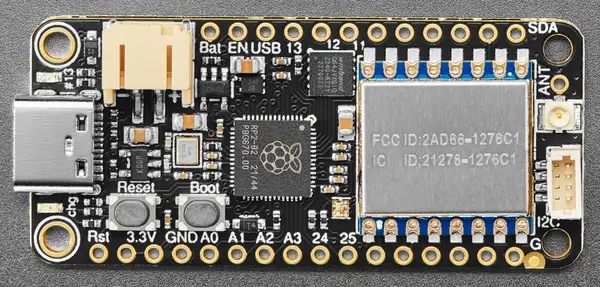

<!-- Copyright 2015-2026 Zephyr Project members and individual contributors. -->
<!-- SPDX-License-Identifier: Apache-2.0 -->
<!-- 中文翻译；编号、导航与译注为本地新增。 -->

<a id="adafruit_feather_rfm95_rp2040"></a>

# 第6章\_Feather RP2040 RFM95 LoRa

原文：[官方页面](https://docs.zephyrproject.org/latest/boards/adafruit/feather_rfm95_rp2040/doc/index.html)。读取日期：2026-10-16；来源摘要见[来源记录](../SOURCES.md)。

开发板概览（Board Overview）

<a id="id1"></a>

[](images/adafruit_feather_rfm95_rp2040.webp)

Feather RP2040 RFM95 LoRa

名称（Name）：

`adafruit_feather_rfm95_rp2040`

厂商（Vendor）：

[Adafruit Industries, LLC](https://docs.zephyrproject.org/latest/boards/index.html#vendor=adafruit)

状态（Status）：

当前未积极维护（Not Actively Maintained）

架构（Architecture）：

[arm](https://docs.zephyrproject.org/latest/boards/index.html#arch=arm)

片上系统（SoC）：

[rp2040](https://docs.zephyrproject.org/latest/boards/index.html#soc=rp2040)

<a id="board-github-link"></a>

[浏览开发板源码（Browse Board Sources）](https://github.com/zephyrproject-rtos/zephyr/blob/main//boards/adafruit/feather_rfm95_rp2040/doc/index.rst/../..)<a id="overview"></a>

## 概述（Overview）

<a id="id3"></a>

[Adafruit Feather RP2040 with RFM95 LoRa Radio](https://learn.adafruit.com/feather-rp2040-rfm95)[注1](#id2)开发板采用Raspberry Pi Ltd.的RP2040微控制器（Microcontroller）。板上配备工作于915 MHz的RFM95 LoRa无线电（Radio），以及便于连接传感器的STEMMA QT接口。它兼容Feather开发板外形规格（Form Factor），并配有USB Type-C接口。

<a id="hardware"></a>

## 硬件（Hardware）


- Raspberry Pi RP2040微控制器（Microcontroller），最高频率133 MHz
- 双ARM Cortex-M0+内核
- 264 kByte静态随机存储器（SRAM）
- 8 Mbyte四线SPI闪存（QSPI Flash）
- 17个通用输入输出（GPIO）引脚
- 4个模数转换器（ADC）引脚
- 集成电路间总线（I2C）
- 串行外设接口（SPI）
- 通用异步收发器（UART）
- USB Type-C接口
- 复位和启动按键（Reset / Boot Buttons）
- 红色LED（Red LED）
- RGB发光二极管（LED，NeoPixel）
- STEMMA QT I2C接口
- RFM95 LoRa 915 MHz无线电（Radio），带天线接口
- 内置锂离子电池充电器（Lithium-ion Battery Charger）

<a id="default-zephyr-peripheral-mapping"></a>

### Zephyr默认外设映射（Default Peripheral Mapping）


- `A0 ADC0 : GPIO26`
- `A1 ADC1 : GPIO27`
- `A2 ADC2 : GPIO28`
- `A3 ADC3 : GPIO29`
- `D24 : GPIO24`
- `D25 : GPIO25`
- `SCK SPI1 SCK : GPIO14`
- `MO SPI1 MOSI : GPIO15`
- `MI SPI1 MISO : GPIO8`
- `RX UART0 : GPIO1`
- `TX UART0 : GPIO0`
- 地（GND）：—
- `SDA I2C1 : GPIO2`
- `SCL I2C1 : GPIO3`
- `D5 : GPIO5`
- `D6 : GPIO6`
- `D9 : GPIO9`
- `D10 : GPIO10`
- `D11 : GPIO11`
- `D12 : GPIO12`
- D13及红色LED：GPIO13
- 启动按键（BOOT）：GPIO7
- RGB LED（NeoPixel）信号：GPIO4
- LoRa无线电片选（CS）：GPIO16
- LoRa无线电复位（RESET）：GPIO17
- LoRa无线电IO0：GPIO21
- LoRa无线电IO1：GPIO22
- LoRa无线电IO2：GPIO23
- LoRa无线电IO3：GPIO19
- LoRa无线电IO4：GPIO20
- LoRa无线电IO5：GPIO18

LoRa无线电也连接到SPI1的SCK、MOSI和MISO引脚。

<a id="id5"></a>

<a id="id7"></a>

另请参阅[引脚分配（Pinout）](https://learn.adafruit.com/feather-rp2040-rfm95/pinouts)[注2](#id4)和[原理图（Schematic）](https://learn.adafruit.com/feather-rp2040-rfm95/downloads)[注3](#id6)。

<a id="supported-features"></a>

### 支持的功能（Supported Features）

`adafruit_feather_rfm95_rp2040`开发板支持下表所列的硬件功能。

片上／板载（On-Chip / On-Board）

功能集成在片上系统（SoC）内／位于开发板上。

2 / 2

分别表示已启用／已禁用的实例数。点击数量标签，可查看开发板或SoC设备树源码（DTS）中该功能的第一个实例。

`vnd,foo`

与此功能匹配的设备树绑定兼容字符串（Compatible String）；点击链接可查看绑定文档。

<a id="adafruit_feather_rfm95_rp2040-hw-features"></a>

<a id="adafruit_feather_rfm95_rp2040-adafruit_feather_rfm95_rp2040/rp2040-hw-features-section"></a>

#### `adafruit_feather_rfm95_rp2040/rp2040`目标（Target）

<a id="adafruit_feather_rfm95_rp2040-adafruit_feather_rfm95_rp2040/rp2040-hw-features-panel"></a>

<a id="adafruit_feather_rfm95_rp2040-adafruit_feather_rfm95_rp2040/rp2040-hw-features-memory"></a>

该开发板目标的片上存储容量：264 KiB RAM、8 MiB Flash。

<a id="adafruit_feather_rfm95_rp2040-adafruit_feather_rfm95_rp2040/rp2040-hw-features-table"></a>

<table>
<tr>
<th>类型（Type）</th>
<th>位置（Location）</th>
<th>说明（Description）</th>
<th>兼容字符串（Compatible）</th>
</tr>
<tr>
<td rowspan="1">中央处理器（CPU）</td>
<td>片上（On-Chip）</td>
<td>ARM Cortex-M0+处理器（CPU）（<a href="https://github.com/zephyrproject-rtos/zephyr/blob/main/dts/arm/raspberrypi/rpi_pico/rp2040.dtsi?plain=1#L35">已启用：2</a>）</td>
<td><a href="../cpu_arm_riscv_binding_reference/P017_arm_cortex-m0+.md#std-dtcompatible-arm-cortex-m0"><code>arm,cortex-m0+</code></a></td>
</tr>
<tr>
<td rowspan="1">模数转换器（ADC）</td>
<td>片上（On-Chip）</td>
<td>Raspberry Pi Pico模数转换器（ADC）（<a href="https://github.com/zephyrproject-rtos/zephyr/blob/main/dts/arm/raspberrypi/rpi_pico/rp2040.dtsi?plain=1#L309">已启用：1</a>）</td>
<td><a href="../hardware/P894_RaspberryPiPico模数转换器绑定.md#dtbinding-raspberrypi-pico-adc"><code>raspberrypi,pico-adc</code></a></td>
</tr>
<tr>
<td rowspan="5">时钟控制（Clock Control）</td>
<td>片上（On-Chip）</td>
<td>Raspberry Pi Pico时钟控制器（Clock Controller）节点（<a href="https://github.com/zephyrproject-rtos/zephyr/blob/main/dts/arm/raspberrypi/rpi_pico/rp2040.dtsi?plain=1#L220">已启用：1</a>）</td>
<td><a href="../clock_nxp_pico_realtek_renesas_binding_reference/P016_raspberrypi_pico-clock-controller.md#std-dtcompatible-raspberrypi-pico-clock-controller"><code>raspberrypi,pico-clock-controller</code></a></td>
</tr>
<tr>
<td>片上（On-Chip）</td>
<td>Raspberry Pi Pico时钟（Clock）的表示（<a href="https://github.com/zephyrproject-rtos/zephyr/blob/main/dts/arm/raspberrypi/rpi_pico/rp2040.dtsi?plain=1#L47">已启用：11</a>；<a href="https://github.com/zephyrproject-rtos/zephyr/blob/main/dts/arm/raspberrypi/rpi_pico/rp2040.dtsi?plain=1#L174">已禁用：2</a>）</td>
<td><a href="../clock_nxp_pico_realtek_renesas_binding_reference/P017_raspberrypi_pico-clock.md#std-dtcompatible-raspberrypi-pico-clock"><code>raspberrypi,pico-clock</code></a></td>
</tr>
<tr>
<td>片上（On-Chip）</td>
<td>Raspberry Pi Pico锁相环（PLL）的表示（<a href="https://github.com/zephyrproject-rtos/zephyr/blob/main/dts/arm/raspberrypi/rpi_pico/rp2040.dtsi?plain=1#L128">已启用：2</a>）</td>
<td><a href="../clock_nxp_pico_realtek_renesas_binding_reference/P018_raspberrypi_pico-pll.md#std-dtcompatible-raspberrypi-pico-pll"><code>raspberrypi,pico-pll</code></a></td>
</tr>
<tr>
<td>片上（On-Chip）</td>
<td>Raspberry Pi Pico环形振荡器（Ring Oscillator）的表示（<a href="https://github.com/zephyrproject-rtos/zephyr/blob/main/dts/arm/raspberrypi/rpi_pico/rp2040.dtsi?plain=1#L150">已启用：1</a>）</td>
<td><a href="../clock_nxp_pico_realtek_renesas_binding_reference/P019_raspberrypi_pico-rosc.md#std-dtcompatible-raspberrypi-pico-rosc"><code>raspberrypi,pico-rosc</code></a></td>
</tr>
<tr>
<td>片上（On-Chip）</td>
<td>Raspberry Pi Pico外部振荡器（External Oscillator）的表示（<a href="https://github.com/zephyrproject-rtos/zephyr/blob/main/dts/arm/raspberrypi/rpi_pico/rp2040.dtsi?plain=1#L168">已启用：1</a>）</td>
<td><a href="../clock_nxp_pico_realtek_renesas_binding_reference/P020_raspberrypi_pico-xosc.md#std-dtcompatible-raspberrypi-pico-xosc"><code>raspberrypi,pico-xosc</code></a></td>
</tr>
<tr>
<td rowspan="1">计数器（Counter）</td>
<td>片上（On-Chip）</td>
<td>Raspberry Pi Pico定时器（Timer）（<a href="https://github.com/zephyrproject-rtos/zephyr/blob/main/dts/arm/raspberrypi/rpi_pico/rp2040.dtsi?plain=1#L373">已启用：1</a>）</td>
<td><a href="../renesas_realtek_counter_binding_reference/P008_raspberrypi_pico-timer.md#std-dtcompatible-raspberrypi-pico-timer"><code>raspberrypi,pico-timer</code></a></td>
</tr>
<tr>
<td rowspan="1">直接存储器访问（DMA）</td>
<td>片上（On-Chip）</td>
<td>Raspberry Pi Pico直接存储器访问（DMA）（<a href="https://github.com/zephyrproject-rtos/zephyr/blob/main/dts/arm/raspberrypi/rpi_pico/rp2040.dtsi?plain=1#L389">已禁用：1</a>）</td>
<td><a href="../nxp_realtek_renesas_dma_binding_reference/P009_raspberrypi_pico-dma.md#std-dtcompatible-raspberrypi-pico-dma"><code>raspberrypi,pico-dma</code></a></td>
</tr>
<tr>
<td rowspan="1">闪存控制器（Flash Controller）</td>
<td>片上（On-Chip）</td>
<td>Raspberry Pi Pico闪存控制器（Flash Controller）（<a href="https://github.com/zephyrproject-rtos/zephyr/blob/main/dts/arm/raspberrypi/rpi_pico/rp2040.dtsi?plain=1#L197">已启用：1</a>）</td>
<td><a href="../flash_nuvoton_nxp_renesas_binding_reference/P021_raspberrypi_pico-flash-controller.md#std-dtcompatible-raspberrypi-pico-flash-controller"><code>raspberrypi,pico-flash-controller</code></a></td>
</tr>
<tr>
<td rowspan="4">通用输入输出与接插件（GPIO &amp; Headers）</td>
<td>片上（On-Chip）</td>
<td>Raspberry Pi Pico通用输入输出（GPIO）（<a href="https://github.com/zephyrproject-rtos/zephyr/blob/main/dts/arm/raspberrypi/rpi_pico/rp2040.dtsi?plain=1#L242">已启用：1</a>）</td>
<td><a href="../gpio_raspberrypi_renesas_binding_reference/P006_raspberrypi_pico-gpio.md#std-dtcompatible-raspberrypi-pico-gpio"><code>raspberrypi,pico-gpio</code></a></td>
</tr>
<tr>
<td>片上（On-Chip）</td>
<td>Raspberry Pi Pico GPIO端口（Port）（<a href="https://github.com/zephyrproject-rtos/zephyr/blob/main/dts/arm/raspberrypi/rpi_pico/rp2040.dtsi?plain=1#L255">已启用：1</a>）</td>
<td><a href="../gpio_raspberrypi_renesas_binding_reference/P005_raspberrypi_pico-gpio-port.md#std-dtcompatible-raspberrypi-pico-gpio-port"><code>raspberrypi,pico-gpio-port</code></a></td>
</tr>
<tr>
<td>板载（On-Board）</td>
<td>引出到Adafruit Feather排针（Headers）的GPIO引脚（<a href="https://github.com/zephyrproject-rtos/zephyr/blob/main/boards/adafruit/feather_rfm95_rp2040/feather_connector.dtsi?plain=1#L8">已启用：1</a>）</td>
<td><a href="../gpio_adi_headers_ambiq_binding_reference/P001_adafruit-feather-header.md#std-dtcompatible-adafruit-feather-header"><code>adafruit-feather-header</code></a></td>
</tr>
<tr>
<td>板载（On-Board）</td>
<td>STEMMA QT是一种用于I2C设备的4针JST-SH接口。（<a href="https://github.com/zephyrproject-rtos/zephyr/blob/main/boards/adafruit/feather_rfm95_rp2040/adafruit_feather_rfm95_rp2040.dts?plain=1#L62">已启用：1</a>）</td>
<td><a href="../gpio_ti_xilinx_sdl_binding_reference/P005_stemma-qt-connector.md#std-dtcompatible-stemma-qt-connector"><code>stemma-qt-connector</code></a></td>
</tr>
<tr>
<td rowspan="1">集成电路间总线（I2C）</td>
<td>片上（On-Chip）</td>
<td>Raspberry Pi Pico I2C控制器（<a href="https://github.com/zephyrproject-rtos/zephyr/blob/main/dts/arm/raspberrypi/rpi_pico/rp2040.dtsi?plain=1#L332">已启用：1</a>；<a href="https://github.com/zephyrproject-rtos/zephyr/blob/main/dts/arm/raspberrypi/rpi_pico/rp2040.dtsi?plain=1#L320">已禁用：1</a>）</td>
<td><a href="../i2c_nxp_pico_renesas_binding_reference/P008_raspberrypi_pico-i2c.md#std-dtcompatible-raspberrypi-pico-i2c"><code>raspberrypi,pico-i2c</code></a></td>
</tr>
<tr>
<td rowspan="1">输入（Input）</td>
<td>板载（On-Board）</td>
<td>一组绑定到 GPIO 的输入按键（GPIO-Bound Input Keys）（<a href="https://github.com/zephyrproject-rtos/zephyr/blob/main/boards/adafruit/feather_rfm95_rp2040/adafruit_feather_rfm95_rp2040.dts?plain=1#L52">已启用：1</a>）</td>
<td><a href="../hardware/P563_GPIO按键绑定.md#std-dtcompatible-gpio-keys"><code>gpio-keys</code></a></td>
</tr>
<tr>
<td rowspan="1">中断控制器（Interrupt Controller）</td>
<td>片上（On-Chip）</td>
<td>ARMv6-M嵌套向量中断控制器（NVIC / Nested Vectored Interrupt Controller）（<a href="https://github.com/zephyrproject-rtos/zephyr/blob/main/dts/arm/armv6-m.dtsi?plain=1#L13">已启用：1</a>）</td>
<td><a href="../arm_interrupt_timer_binding_reference/P001_ARMv6_M_NVIC.md#std-dtcompatible-arm-v6m-nvic"><code>arm,v6m-nvic</code></a></td>
</tr>
<tr>
<td rowspan="1">发光二极管（LED）</td>
<td>板载（On-Board）</td>
<td>一组由 GPIO 控制的 LED（GPIO-Controlled LEDs）（<a href="https://github.com/zephyrproject-rtos/zephyr/blob/main/boards/adafruit/feather_rfm95_rp2040/adafruit_feather_rfm95_rp2040.dts?plain=1#L43">已启用：1</a>）</td>
<td><a href="../hardware/P564_GPIO指示灯绑定.md#dtbinding-gpio-leds"><code>gpio-leds</code></a></td>
</tr>
<tr>
<td rowspan="1">灯带（LED Strip）</td>
<td>板载（On-Board）</td>
<td>配置用于WS2812的可编程输入输出（PIO）节点（<a href="https://github.com/zephyrproject-rtos/zephyr/blob/main/boards/adafruit/feather_rfm95_rp2040/adafruit_feather_rfm95_rp2040.dts?plain=1#L192">已启用：1</a>）</td>
<td><a href="../led_strip_binding_reference/P011_worldsemi_ws2812-rpi_pico-pio.md#std-dtcompatible-worldsemi-ws2812-rpi_pico-pio"><code>worldsemi,ws2812-rpi_pico-pio</code></a></td>
</tr>
<tr>
<td rowspan="1">远距离无线通信（LoRa）</td>
<td>板载（On-Board）</td>
<td>Semtech SX1276 LoRa调制解调器（Modem）（<a href="https://github.com/zephyrproject-rtos/zephyr/blob/main/boards/adafruit/feather_rfm95_rp2040/adafruit_feather_rfm95_rp2040.dts?plain=1#L126">已启用：1</a>）</td>
<td><a href="../lora_ieee802154_binding_reference/P024_semtech_sx1276.md#std-dtcompatible-semtech-sx1276"><code>semtech,sx1276</code></a></td>
</tr>
<tr>
<td rowspan="1">邮箱（Mailbox）</td>
<td>片上（On-Chip）</td>
<td>Raspberry Pi Pico处理器间邮箱（Interprocessor Mailbox）（<a href="https://github.com/zephyrproject-rtos/zephyr/blob/main/dts/arm/raspberrypi/rpi_pico/rp2040.dtsi?plain=1#L452">已禁用：2</a>）</td>
<td><a href="../intercore_reference/P050_Pico邮箱绑定.md#dtbinding-raspberrypi-pico-mbox"><code>raspberrypi,pico-mbox</code></a></td>
</tr>
<tr>
<td rowspan="2">其他绑定（Miscellaneous）</td>
<td>片上（On-Chip）</td>
<td>Raspberry Pi Pico可编程输入输出（PIO）（<a href="https://github.com/zephyrproject-rtos/zephyr/blob/main/dts/arm/raspberrypi/rpi_pico/rp2040.dtsi?plain=1#L412">已启用：1</a>；<a href="https://github.com/zephyrproject-rtos/zephyr/blob/main/dts/arm/raspberrypi/rpi_pico/rp2040.dtsi?plain=1#L423">已禁用：1</a>）</td>
<td><a href="../misc_nxp_renesas_zephyr_binding_reference/P011_raspberrypi_pico-pio.md#std-dtcompatible-raspberrypi-pico-pio"><code>raspberrypi,pico-pio</code></a></td>
</tr>
<tr>
<td>片上（On-Chip）</td>
<td>Raspberry Pi Pico单周期输入输出（SIO）（<a href="https://github.com/zephyrproject-rtos/zephyr/blob/main/dts/arm/raspberrypi/rpi_pico/rp2040.dtsi?plain=1#L444">已启用：1</a>）</td>
<td><a href="../misc_nxp_renesas_zephyr_binding_reference/P013_raspberrypi_pico-sio.md#std-dtcompatible-raspberrypi-pico-sio"><code>raspberrypi,pico-sio</code></a></td>
</tr>
<tr>
<td rowspan="1">存储技术设备（MTD）</td>
<td>片上（On-Chip）</td>
<td>闪存（Flash）节点（<a href="https://github.com/zephyrproject-rtos/zephyr/blob/main/dts/arm/raspberrypi/rpi_pico/rp2040.dtsi?plain=1#L205">已启用：1</a>）</td>
<td><a href="../mtd_nxp_st_ti_partition_binding_reference/P013_soc-nv-flash.md#std-dtcompatible-soc-nv-flash"><code>soc-nv-flash</code></a></td>
</tr>
<tr>
<td rowspan="1">引脚控制（Pin Control）</td>
<td>片上（On-Chip）</td>
<td>Raspberry Pi Pico引脚控制器（Pin Controller）（<a href="https://github.com/zephyrproject-rtos/zephyr/blob/main/dts/arm/raspberrypi/rpi_pico/rp2040.dtsi?plain=1#L492">已启用：1</a>）</td>
<td><a href="../pinctrl_nxp_pico_binding_reference/P025_raspberrypi_pico-pinctrl.md#std-dtcompatible-raspberrypi-pico-pinctrl"><code>raspberrypi,pico-pinctrl</code></a></td>
</tr>
<tr>
<td rowspan="1">脉宽调制（PWM）</td>
<td>片上（On-Chip）</td>
<td>Raspberry Pi Pico脉宽调制（PWM）（<a href="https://github.com/zephyrproject-rtos/zephyr/blob/main/dts/arm/raspberrypi/rpi_pico/rp2040.dtsi?plain=1#L362">已禁用：1</a>）</td>
<td><a href="../pwm_nxp_renesas_binding_reference/P014_raspberrypi_pico-pwm.md#std-dtcompatible-raspberrypi-pico-pwm"><code>raspberrypi,pico-pwm</code></a></td>
</tr>
<tr>
<td rowspan="1">稳压器（Regulator）</td>
<td>片上（On-Chip）</td>
<td>Raspberry Pi Pico内核电源稳压器（Core Supply Regulator）（<a href="https://github.com/zephyrproject-rtos/zephyr/blob/main/dts/arm/raspberrypi/rpi_pico/rp2040.dtsi?plain=1#L402">已启用：1</a>）</td>
<td><a href="../hardware/P654_RaspberryPi内核供电稳压器绑定.md#dtbinding-raspberrypi-core-supply-regulator"><code>raspberrypi,core-supply-regulator</code></a></td>
</tr>
<tr>
<td rowspan="1">复位控制器（Reset Controller）</td>
<td>片上（On-Chip）</td>
<td>Raspberry Pi Pico复位控制器（Reset Controller）（<a href="https://github.com/zephyrproject-rtos/zephyr/blob/main/dts/arm/raspberrypi/rpi_pico/rp2040.dtsi?plain=1#L214">已启用：1</a>）</td>
<td><a href="../reset_controller_binding_reference/P012_raspberrypi_pico-reset.md#std-dtcompatible-raspberrypi-pico-reset"><code>raspberrypi,pico-reset</code></a></td>
</tr>
<tr>
<td rowspan="1">实时时钟（RTC）</td>
<td>片上（On-Chip）</td>
<td>Raspberry Pi Pico实时时钟（RTC）（<a href="https://github.com/zephyrproject-rtos/zephyr/blob/main/dts/arm/raspberrypi/rpi_pico/rp2040.dtsi?plain=1#L434">已禁用：1</a>）</td>
<td><a href="../soc_rtc_binding_reference/P003_raspberrypi_pico-rtc.md#std-dtcompatible-raspberrypi-pico-rtc"><code>raspberrypi,pico-rtc</code></a></td>
</tr>
<tr>
<td rowspan="1">传感器（Sensors）</td>
<td>片上（On-Chip）</td>
<td>Raspberry Pi Pico系列温度传感器（Temperature Sensor）节点（<a href="https://github.com/zephyrproject-rtos/zephyr/blob/main/dts/arm/raspberrypi/rpi_pico/rp2040.dtsi?plain=1#L496">已启用：1</a>）</td>
<td><a href="../sensor_realtek_rohm_sensirion_binding_reference/P003_raspberrypi_pico-temp.md#std-dtcompatible-raspberrypi-pico-temp"><code>raspberrypi,pico-temp</code></a></td>
</tr>
<tr>
<td rowspan="1">串行控制器（Serial Controller）</td>
<td>片上（On-Chip）</td>
<td>Raspberry Pi Pico通用异步收发器（UART）（<a href="https://github.com/zephyrproject-rtos/zephyr/blob/main/dts/arm/raspberrypi/rpi_pico/rp2040.dtsi?plain=1#L265">已启用：1</a>；<a href="https://github.com/zephyrproject-rtos/zephyr/blob/main/dts/arm/raspberrypi/rpi_pico/rp2040.dtsi?plain=1#L275">已禁用：1</a>）</td>
<td><a href="../uart_raspberrypi_realtek_renesas_binding_reference/P002_raspberrypi_pico-uart.md#std-dtcompatible-raspberrypi-pico-uart"><code>raspberrypi,pico-uart</code></a></td>
</tr>
<tr>
<td rowspan="1">串行外设接口（SPI）</td>
<td>片上（On-Chip）</td>
<td>Raspberry Pi Pico串行外设接口（SPI）（<a href="https://github.com/zephyrproject-rtos/zephyr/blob/main/dts/arm/raspberrypi/rpi_pico/rp2040.dtsi?plain=1#L297">已启用：1</a>；<a href="https://github.com/zephyrproject-rtos/zephyr/blob/main/dts/arm/raspberrypi/rpi_pico/rp2040.dtsi?plain=1#L285">已禁用：1</a>）</td>
<td><a href="../spi_flexspi_nxp_renesas_binding_reference/P010_raspberrypi_pico-spi.md#std-dtcompatible-raspberrypi-pico-spi"><code>raspberrypi,pico-spi</code></a></td>
</tr>
<tr>
<td rowspan="1">静态随机存储器（SRAM）</td>
<td>片上（On-Chip）</td>
<td>通用片上静态随机存储器（SRAM）（<a href="https://github.com/zephyrproject-rtos/zephyr/blob/main/dts/arm/raspberrypi/rpi_pico/rp2040.dtsi?plain=1#L192">已启用：1</a>）</td>
<td><a href="../hardware/P567_内存映射SRAM绑定.md#dtbinding-mmio-sram"><code>mmio-sram</code></a></td>
</tr>
<tr>
<td rowspan="1">定时器（Timer）</td>
<td>片上（On-Chip）</td>
<td>ARMv6-M系统节拍（System Tick）（<a href="https://github.com/zephyrproject-rtos/zephyr/blob/main/dts/arm/armv6-m.dtsi?plain=1#L21">已启用：1</a>）</td>
<td><a href="../arm_interrupt_timer_binding_reference/P005_ARMv6_M_SysTick.md#std-dtcompatible-arm-armv6m-systick"><code>arm,armv6m-systick</code></a></td>
</tr>
<tr>
<td rowspan="1">通用串行总线（USB）</td>
<td>片上（On-Chip）</td>
<td>Raspberry Pi Pico USB设备控制器（USB Device Controller）（<a href="https://github.com/zephyrproject-rtos/zephyr/blob/main/dts/arm/raspberrypi/rpi_pico/rp2040.dtsi?plain=1#L351">已启用：1</a>）</td>
<td><a href="../usb_soc_binding_reference/P014_raspberrypi_pico-usbd.md#std-dtcompatible-raspberrypi-pico-usbd"><code>raspberrypi,pico-usbd</code></a></td>
</tr>
<tr>
<td rowspan="1">看门狗（Watchdog）</td>
<td>片上（On-Chip）</td>
<td>Raspberry Pi Pico看门狗（Watchdog）（<a href="https://github.com/zephyrproject-rtos/zephyr/blob/main/dts/arm/raspberrypi/rpi_pico/rp2040.dtsi?plain=1#L344">已启用：1</a>）</td>
<td><a href="../nxp_nordic_nuvoton_watchdog_binding_reference/P015_raspberrypi_pico-watchdog.md#std-dtcompatible-raspberrypi-pico-watchdog"><code>raspberrypi,pico-watchdog</code></a></td>
</tr>
</table>

<a id="programming-and-debugging"></a>

## 烧录与调试（Programming and Debugging）

`adafruit_feather_rfm95_rp2040`开发板支持下表所列的运行工具（Runners）及相关west命令。

<table>
<tr>
<th></th>
<th>烧录（flash）</th>
<th>调试（debug）</th>
</tr>
<tr>
<td><a href="https://docs.zephyrproject.org/latest/develop/flash_debug/host-tools.html#runner-uf2">uf2</a></td>
<td>✅（默认 / default）</td>
<td></td>
</tr>
</table>

Adafruit Feather RP2040 with RFM95 LoRa Radio开发板未引出SWDIO和SWCLK引脚，因此必须通过USB端口编程。按住BOOT按键，再按RST按键，设备便会显示为USB大容量存储设备（USB Mass Storage Unit）。构建应用后会生成`build/zephyr/zephyr.uf2`文件，将该文件拖放到USB存储设备中，即可重新编程开发板。

有关RP2040开发板编程的更多信息，请参阅编程与调试（[Programming and Debugging](https://docs.zephyrproject.org/latest/boards/raspberrypi/rpi_pico/doc/index.html#rpi-pico-programming-and-debugging)）。

<a id="flashing"></a>

### 烧录（Flashing）

运行闪灯（[Blinky](../getting_started/P004_LED闪烁示例.md#blinky)）示例：

```text
# From the root of the zephyr repository
west build -b adafruit_feather_rfm95_rp2040 samples/basic/blinky/
west flash
```

还可以尝试LED[灯带（LED Strip）](../hardware/P191_LED灯带示例.md#led-strip)、[输入事件转储（Input Dump）](../interaction/P014_输入事件转储示例.md#input-dump)、[输入事件转储（Input Dump）](../interaction/P014_输入事件转储示例.md#input-dump)、[USB CDC ACM控制台（Console over USB CDC ACM）](../usb/P055_CDCACM控制台示例.md#usb-cdc-acm-console)、[使用设备树的模数转换器（ADC with Devicetree）](../hardware/P439_ADC设备树示例.md#adc_dt)、[LoRa发送（LoRa Send）](../driver_samples/P017_LoRa发送示例.md#lora-send)和[LoRa接收（LoRa Receive）](../driver_samples/P016_LoRa接收示例.md#lora-receive)示例。

STEMMA QT接口可通过I2C读取传感器数据，例如[通用三轴加速度计轮询（Generic 3-Axis Accelerometer Polling）](../sensors/P009_三轴加速度计轮询示例.md#accel_polling)示例：

```text
# From the root of the zephyr repository
west build -b adafruit_feather_rfm95_rp2040 --shield adafruit_lis3dh samples/sensor/accel_polling
west flash
```

<a id="references"></a>

## 参考资料（References）

<a id="id2"></a>

〔[1](#id3)〕 [https://learn.adafruit.com/feather-rp2040-rfm95](https://learn.adafruit.com/feather-rp2040-rfm95)

<a id="id4"></a>

〔[2](#id5)〕 [https://learn.adafruit.com/feather-rp2040-rfm95/pinouts](https://learn.adafruit.com/feather-rp2040-rfm95/pinouts)

<a id="id6"></a>

〔[3](#id7)〕 [https://learn.adafruit.com/feather-rp2040-rfm95/downloads](https://learn.adafruit.com/feather-rp2040-rfm95/downloads)

## 译注

原文推荐示例列表连续两次列出Input dump；此处保留重复及其链接。

---

[上一章](P005_RP2040_Prop-Maker_Feather.md) · [返回大纲](大纲.md) · [全站翻译进度](../PROGRESS.md) · [下一章](P007_Feather_RP2040.md)
