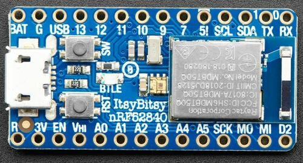

<!-- Copyright 2015-2026 Zephyr Project members and individual contributors. -->
<!-- SPDX-License-Identifier: Apache-2.0 -->
<!-- 中文翻译；编号、导航与译注为本地新增。 -->

<a id="adafruit_itsybitsy"></a>

# 第2章\_ItsyBitsy nRF52840

原文：[官方页面](https://docs.zephyrproject.org/latest/boards/adafruit/itsybitsy/doc/index.html)。读取日期：2026-10-16；来源摘要见[来源记录](../SOURCES.md)。

开发板概览（Board Overview）

<a id="id1"></a>

[](images/adafruit_itsybitsy_nrf52840.jpeg)

ItsyBitsy nRF52840

名称（Name）：

`adafruit_itsybitsy`

厂商（Vendor）：

[Adafruit Industries, LLC](https://docs.zephyrproject.org/latest/boards/index.html#vendor=adafruit)

状态（Status）：

当前未积极维护（Not Actively Maintained）

架构（Architecture）：

[arm](https://docs.zephyrproject.org/latest/boards/index.html#arch=arm)

片上系统（SoC）：

[nrf52840](https://docs.zephyrproject.org/latest/boards/index.html#soc=nrf52840)

<a id="board-github-link"></a>

[浏览开发板源码（Browse Board Sources）](https://github.com/zephyrproject-rtos/zephyr/blob/main//boards/adafruit/itsybitsy/doc/index.rst/../..)<a id="overview"></a>

## 概述（Overview）

Adafruit ItsyBitsy nRF52840 Express是一款小型ARM开发板，尺寸为36 mm × 18 mm，板载RGB LED、USB端口、2 MB四线SPI闪存（QSPI Flash），并通过21个GPIO引脚引出多种输入输出（I/O）功能。

该开发套件（Development Kit）具有以下特性：


- 模数转换器（ADC）
- 时钟（CLOCK）
- 闪存（FLASH）
- 通用输入输出（GPIO）
- 集成电路间总线（I2C）
- 集成电路间音频总线（I2S）
- 存储器保护单元（MPU）
- 嵌套向量中断控制器（NVIC）
- 脉宽调制（PWM）
- 四线串行外设接口（QSPI）
- 无线电（RADIO），支持低功耗蓝牙（Bluetooth Low Energy）和IEEE 802.15.4
- 实时时钟（RTC）
- 串行外设接口（SPI）
- 带EasyDMA的通用异步收发器（UARTE）
- 通用串行总线（USB）
- 看门狗定时器（WDT）

<a id="hardware"></a>

## 硬件（Hardware）


- nRF52840 ARM Cortex-M4F处理器，运行频率64 MHz
- 1 MB闪存（Flash）和256 KB静态随机存储器（SRAM）
- 2 MB四线SPI闪存（QSPI Flash）
- 1个用户LED（User LED）
- 1个用户开关（User Switch）
- 1个RGB DotStar LED
- 原生USB端口（Native USB Port）
- 1个复位按键（Reset Button）

<a id="supported-features"></a>

### 支持的功能（Supported Features）

`adafruit_itsybitsy`开发板支持下表所列的硬件功能。

片上／板载（On-Chip / On-Board）

功能集成在片上系统（SoC）内／位于开发板上。

2 / 2

分别表示已启用／已禁用的实例数。点击数量标签，可查看开发板或SoC设备树源码（DTS）中该功能的第一个实例。

`vnd,foo`

与此功能匹配的设备树绑定兼容字符串（Compatible String）；点击链接可查看绑定文档。

<a id="adafruit_itsybitsy-hw-features"></a>

<a id="adafruit_itsybitsy-adafruit_itsybitsy/nrf52840-hw-features-section"></a>

#### `adafruit_itsybitsy/nrf52840`目标（Target）

<a id="adafruit_itsybitsy-adafruit_itsybitsy/nrf52840-hw-features-panel"></a>

<a id="adafruit_itsybitsy-adafruit_itsybitsy/nrf52840-hw-features-memory"></a>

此开发板目标可用存储器：256 KiB RAM、1 MiB 闪存。

<a id="adafruit_itsybitsy-adafruit_itsybitsy/nrf52840-hw-features-table"></a>

<table>
<tr>
<th>类型（Type）</th>
<th>位置（Location）</th>
<th>说明（Description）</th>
<th>兼容字符串（Compatible）</th>
</tr>
<tr>
<td rowspan="1">中央处理器（CPU）</td>
<td>片上（On-Chip）</td>
<td>ARM Cortex-M4F 处理器（CPU）（<a href="https://github.com/zephyrproject-rtos/zephyr/blob/main/dts/arm/nordic/nrf52840.dtsi?plain=1#L23">已启用：1</a>）</td>
<td><a href="../cpu_arm_riscv_binding_reference/P025_arm_cortex-m4f.md#std-dtcompatible-arm-cortex-m4f"><code>arm,cortex-m4f</code></a></td>
</tr>
<tr>
<td rowspan="1">模数转换器（ADC）</td>
<td>片上（On-Chip）</td>
<td>Nordic Semiconductor nRF系列逐次逼近模数转换器（SAADC）节点（<a href="https://github.com/zephyrproject-rtos/zephyr/blob/main/dts/arm/nordic/nrf52840.dtsi?plain=1#L243">已启用：1</a>）</td>
<td><a href="../hardware/P846_NordicNRF逐次逼近ADC绑定.md#dtbinding-nordic-nrf-saadc"><code>nordic,nrf-saadc</code></a></td>
</tr>
<tr>
<td rowspan="4">ARM 架构（ARM Architecture）</td>
<td>片上（On-Chip）</td>
<td>Nordic用户信息配置寄存器（UICR / User Information Configuration Registers）（<a href="https://github.com/zephyrproject-rtos/zephyr/blob/main/dts/arm/nordic/nrf52840.dtsi?plain=1#L57">已启用：1</a>）</td>
<td><a href="../arm_nordic_nxp_control_binding_reference/P007_nordic_nrf-uicr.md#std-dtcompatible-nordic-nrf-uicr"><code>nordic,nrf-uicr</code></a></td>
</tr>
<tr>
<td>片上（On-Chip）</td>
<td>Nordic事件发生器单元（EGU / Event Generator Unit）（<a href="https://github.com/zephyrproject-rtos/zephyr/blob/main/dts/arm/nordic/nrf52840.dtsi?plain=1#L356">已启用：6</a>）</td>
<td><a href="../arm_timing_ethosu_control_binding_reference/P018_nordic_nrf-egu.md#std-dtcompatible-nordic-nrf-egu"><code>nordic,nrf-egu</code></a></td>
</tr>
<tr>
<td>片上（On-Chip）</td>
<td>Nordic nRF系列访问控制列表（ACL / Access Control List）（<a href="https://github.com/zephyrproject-rtos/zephyr/blob/main/dts/arm/nordic/nrf52840.dtsi?plain=1#L433">已启用：1</a>）</td>
<td><a href="../arm_timing_ethosu_control_binding_reference/P014_nordic_nrf-acl.md#std-dtcompatible-nordic-nrf-acl"><code>nordic,nrf-acl</code></a></td>
</tr>
<tr>
<td>片上（On-Chip）</td>
<td>Nordic nRF系列存储器监视单元（MWU / Memory Watch Unit）（<a href="https://github.com/zephyrproject-rtos/zephyr/blob/main/dts/arm/nordic/nrf52840.dtsi?plain=1#L465">已启用：1</a>）</td>
<td><a href="../arm_timing_ethosu_control_binding_reference/P022_nordic_nrf-mwu.md#std-dtcompatible-nordic-nrf-mwu"><code>nordic,nrf-mwu</code></a></td>
</tr>
<tr>
<td rowspan="1">音频（Audio）</td>
<td>片上（On-Chip）</td>
<td>Nordic脉冲密度调制接口（PDM / Pulse Density Modulation Interface）（<a href="https://github.com/zephyrproject-rtos/zephyr/blob/main/dts/arm/nordic/nrf52840.dtsi?plain=1#L426">已禁用：1</a>）</td>
<td><a href="../audio_pdm_codec_binding_reference/P012_nordic_nrf-pdm.md#std-dtcompatible-nordic-nrf-pdm"><code>nordic,nrf-pdm</code></a></td>
</tr>
<tr>
<td rowspan="4">时钟控制（Clock Control）</td>
<td>片上（On-Chip）</td>
<td>Nordic nRF时钟控制（Clock Control）节点（<a href="https://github.com/zephyrproject-rtos/zephyr/blob/main/dts/arm/nordic/nrf52840.dtsi?plain=1#L74">已启用：1</a>）</td>
<td><a href="../clock_sam_nordic_binding_reference/P015_nordic_nrf-clock.md#std-dtcompatible-nordic-nrf-clock"><code>nordic,nrf-clock</code></a></td>
</tr>
<tr>
<td>片上（On-Chip）</td>
<td>Nordic nRF高频时钟（HFCLK）控制节点（<a href="https://github.com/zephyrproject-rtos/zephyr/blob/main/dts/arm/nordic/nrf52840.dtsi?plain=1#L80">已启用：1</a>）</td>
<td><a href="../clock_sam_nordic_binding_reference/P009_nordic_nrf-clock-hfclk.md#std-dtcompatible-nordic-nrf-clock-hfclk"><code>nordic,nrf-clock-hfclk</code></a></td>
</tr>
<tr>
<td>片上（On-Chip）</td>
<td>Nordic nRF低频时钟（LFCLK）控制节点（<a href="https://github.com/zephyrproject-rtos/zephyr/blob/main/dts/arm/nordic/nrf52840.dtsi?plain=1#L85">已启用：1</a>）</td>
<td><a href="../clock_sam_nordic_binding_reference/P012_nordic_nrf-clock-lfclk.md#std-dtcompatible-nordic-nrf-clock-lfclk"><code>nordic,nrf-clock-lfclk</code></a></td>
</tr>
<tr>
<td>片上（On-Chip）</td>
<td>Nordic nRF高频晶体振荡器（High-frequency Crystal Oscillator，nRF52系列）（<a href="https://github.com/zephyrproject-rtos/zephyr/blob/main/dts/arm/nordic/nrf52840.dtsi?plain=1#L39">已启用：1</a>）</td>
<td><a href="../clock_sam_nordic_binding_reference/P022_nordic_nrf52-hfxo.md#std-dtcompatible-nordic-nrf52-hfxo"><code>nordic,nrf52-hfxo</code></a></td>
</tr>
<tr>
<td rowspan="1">比较器（Comparator）</td>
<td>片上（On-Chip）</td>
<td>Nordic nRF模拟比较器（COMP / Analog Comparator）（<a href="https://github.com/zephyrproject-rtos/zephyr/blob/main/dts/arm/nordic/nrf52840.dtsi?plain=1#L345">已禁用：1</a>）</td>
<td><a href="../hardware/P752_NordicnRF比较器绑定.md#dtbinding-nordic-nrf-comp"><code>nordic,nrf-comp</code></a></td>
</tr>
<tr>
<td rowspan="1">计数器（Counter）</td>
<td>片上（On-Chip）</td>
<td>Nordic nRF定时器（Timer）节点（<a href="https://github.com/zephyrproject-rtos/zephyr/blob/main/dts/arm/nordic/nrf52840.dtsi?plain=1#L252">已禁用：5</a>）</td>
<td><a href="../microchip_soc_counter_binding_reference/P017_nordic_nrf-timer.md#std-dtcompatible-nordic-nrf-timer"><code>nordic,nrf-timer</code></a></td>
</tr>
<tr>
<td rowspan="3">密码学加速器（Cryptographic Accelerator）</td>
<td>片上（On-Chip）</td>
<td>Nordic ECB（AES电子密码本模式加密 / Electronic Codebook Mode Encryption）（<a href="https://github.com/zephyrproject-rtos/zephyr/blob/main/dts/arm/nordic/nrf52840.dtsi?plain=1#L306">已启用：1</a>）</td>
<td><a href="../crypto_secure_engine_st_ti_binding_reference/P001_nordic_nrf-ecb.md#std-dtcompatible-nordic-nrf-ecb"><code>nordic,nrf-ecb</code></a></td>
</tr>
<tr>
<td>片上（On-Chip）</td>
<td>Nordic nRF系列CCM（AES CCM模式加密 / CCM Mode Encryption）（<a href="https://github.com/zephyrproject-rtos/zephyr/blob/main/dts/arm/nordic/nrf52840.dtsi?plain=1#L313">已启用：1</a>）</td>
<td><a href="../crypto_aes_sha_ccm_binding_reference/P020_nordic_nrf-ccm.md#std-dtcompatible-nordic-nrf-ccm"><code>nordic,nrf-ccm</code></a></td>
</tr>
<tr>
<td>片上（On-Chip）</td>
<td>ARM TrustZone CryptoCell 310密码模块（<a href="https://github.com/zephyrproject-rtos/zephyr/blob/main/dts/arm/nordic/nrf52840.dtsi?plain=1#L597">已禁用：1</a>）</td>
<td><a href="../crypto_aes_sha_ccm_binding_reference/P001_arm_cryptocell-310.md#std-dtcompatible-arm-cryptocell-310"><code>arm,cryptocell-310</code></a></td>
</tr>
<tr>
<td rowspan="1">调试（Debug）</td>
<td>片上（On-Chip）</td>
<td>ARMv7仪器化跟踪宏单元（ITM / Instrumentation Trace Macrocell）（<a href="https://github.com/zephyrproject-rtos/zephyr/blob/main/dts/arm/nordic/nrf52840.dtsi?plain=1#L30">已启用：1</a>）</td>
<td><a href="../debug_binding_reference/P001_ARMv7M_ITM调试绑定.md#std-dtcompatible-arm-armv7m-itm"><code>arm,armv7m-itm</code></a></td>
</tr>
<tr>
<td rowspan="2">闪存控制器（Flash Controller）</td>
<td>片上（On-Chip）</td>
<td>Nordic非易失性存储器控制器（NVMC / Non-Volatile Memory Controller）（<a href="https://github.com/zephyrproject-rtos/zephyr/blob/main/dts/arm/nordic/nrf52840.dtsi?plain=1#L439">已启用：1</a>）</td>
<td><a href="../flash_adi_microchip_nordic_binding_reference/P030_nordic_nrf52-flash-controller.md#std-dtcompatible-nordic-nrf52-flash-controller"><code>nordic,nrf52-flash-controller</code></a></td>
</tr>
<tr>
<td>片上（On-Chip）</td>
<td>定义Nordic四线SPI外设（QSPI Peripheral）接口的属性（<a href="https://github.com/zephyrproject-rtos/zephyr/blob/main/dts/arm/nordic/nrf52840.dtsi?plain=1#L543">已启用：1</a>）</td>
<td><a href="../flash_adi_microchip_nordic_binding_reference/P028_nordic_nrf-qspi.md#std-dtcompatible-nordic-nrf-qspi"><code>nordic,nrf-qspi</code></a></td>
</tr>
<tr>
<td rowspan="2">通用输入输出与接插件（GPIO &amp; Headers）</td>
<td>片上（On-Chip）</td>
<td>NRF5 GPIO任务与事件（GPIOTE）（<a href="https://github.com/zephyrproject-rtos/zephyr/blob/main/dts/arm/nordic/nrf52840.dtsi?plain=1#L235">已启用：1</a>）</td>
<td><a href="../gpio_microchip_nordic_nuvoton_binding_reference/P017_nordic_nrf-gpiote.md#std-dtcompatible-nordic-nrf-gpiote"><code>nordic,nrf-gpiote</code></a></td>
</tr>
<tr>
<td>片上（On-Chip）</td>
<td>NRF5通用输入输出（GPIO）（<a href="https://github.com/zephyrproject-rtos/zephyr/blob/main/dts/arm/nordic/nrf52840.dtsi?plain=1#L574">已启用：2</a>）</td>
<td><a href="../gpio_microchip_nordic_nuvoton_binding_reference/P016_nordic_nrf-gpio.md#std-dtcompatible-nordic-nrf-gpio"><code>nordic,nrf-gpio</code></a></td>
</tr>
<tr>
<td rowspan="2">集成电路间总线（I2C）</td>
<td>片上（On-Chip）</td>
<td>Nordic nRF系列双线接口（TWI，TWI主机）（<a href="https://github.com/zephyrproject-rtos/zephyr/blob/main/dts/arm/nordic/nrf52840.dtsi?plain=1#L156">已启用：1</a>）</td>
<td><a href="../i2c_infineon_ite_nordic_binding_reference/P015_nordic_nrf-twi.md#std-dtcompatible-nordic-nrf-twi"><code>nordic,nrf-twi</code></a></td>
</tr>
<tr>
<td>片上（On-Chip）</td>
<td>Nordic nRF系列TWIM（带EasyDMA的TWI主机）（<a href="https://github.com/zephyrproject-rtos/zephyr/blob/main/dts/arm/nordic/nrf52840.dtsi?plain=1#L192">已禁用：1</a>）</td>
<td><a href="../i2c_infineon_ite_nordic_binding_reference/P016_nordic_nrf-twim.md#std-dtcompatible-nordic-nrf-twim"><code>nordic,nrf-twim</code></a></td>
</tr>
<tr>
<td rowspan="1">集成电路间音频总线（I2S）</td>
<td>片上（On-Chip）</td>
<td>Nordic芯片间音频接口（I2S / Inter-IC Sound Interface）（<a href="https://github.com/zephyrproject-rtos/zephyr/blob/main/dts/arm/nordic/nrf52840.dtsi?plain=1#L515">已禁用：1</a>）</td>
<td><a href="../i2s_binding_reference/P010_nordic_nrf-i2s.md#std-dtcompatible-nordic-nrf-i2s"><code>nordic,nrf-i2s</code></a></td>
</tr>
<tr>
<td rowspan="1">低速率无线个域网（IEEE 802.15.4）</td>
<td>片上（On-Chip）</td>
<td>Nordic nRF IEEE 802.15.4节点（<a href="https://github.com/zephyrproject-rtos/zephyr/blob/main/dts/arm/nordic/nrf52840.dtsi?plain=1#L133">已启用：1</a>）</td>
<td><a href="../lora_ieee802154_binding_reference/P005_nordic_nrf-ieee802154.md#std-dtcompatible-nordic-nrf-ieee802154"><code>nordic,nrf-ieee802154</code></a></td>
</tr>
<tr>
<td rowspan="1">输入（Input）</td>
<td>板载（On-Board）</td>
<td>一组绑定到 GPIO 的输入按键（GPIO-Bound Input Keys）（<a href="https://github.com/zephyrproject-rtos/zephyr/blob/main/boards/adafruit/itsybitsy/adafruit_itsybitsy_nrf52840.dts?plain=1#L31">已启用：1</a>）</td>
<td><a href="../hardware/P563_GPIO按键绑定.md#std-dtcompatible-gpio-keys"><code>gpio-keys</code></a></td>
</tr>
<tr>
<td rowspan="1">中断控制器（Interrupt Controller）</td>
<td>片上（On-Chip）</td>
<td>ARMv7-M 嵌套向量中断控制器（Nested Vectored Interrupt Controller，NVIC）（<a href="https://github.com/zephyrproject-rtos/zephyr/blob/main/dts/arm/armv7-m.dtsi?plain=1#L13">已启用：1</a>）</td>
<td><a href="../arm_interrupt_timer_binding_reference/P002_ARMv7_M_NVIC.md#std-dtcompatible-arm-v7m-nvic"><code>arm,v7m-nvic</code></a></td>
</tr>
<tr>
<td rowspan="1">发光二极管（LED）</td>
<td>板载（On-Board）</td>
<td>一组由 GPIO 控制的 LED（GPIO-Controlled LEDs）（<a href="https://github.com/zephyrproject-rtos/zephyr/blob/main/boards/adafruit/itsybitsy/adafruit_itsybitsy_nrf52840.dts?plain=1#L22">已启用：1</a>）</td>
<td><a href="../hardware/P564_GPIO指示灯绑定.md#dtbinding-gpio-leds"><code>gpio-leds</code></a></td>
</tr>
<tr>
<td rowspan="1">灯带（LED Strip）</td>
<td>板载（On-Board）</td>
<td>APA102 SPI LED灯带（LED Strip）（<a href="https://github.com/zephyrproject-rtos/zephyr/blob/main/boards/adafruit/itsybitsy/adafruit_itsybitsy_nrf52840.dts?plain=1#L106">已启用：1</a>）</td>
<td><a href="../led_strip_binding_reference/P001_apa_apa102.md#std-dtcompatible-apa-apa102"><code>apa,apa102</code></a></td>
</tr>
<tr>
<td rowspan="2">其他绑定（Miscellaneous）</td>
<td>片上（On-Chip）</td>
<td>Nordic工厂信息配置寄存器（FICR / Factory Information Configuration Registers）（<a href="https://github.com/zephyrproject-rtos/zephyr/blob/main/dts/arm/nordic/nrf52840.dtsi?plain=1#L50">已启用：1</a>）</td>
<td><a href="../misc_adi_nordic_binding_reference/P018_nordic_nrf-ficr.md#std-dtcompatible-nordic-nrf-ficr"><code>nordic,nrf-ficr</code></a></td>
</tr>
<tr>
<td>片上（On-Chip）</td>
<td>Nordic nRF系列可编程外设互连（PPI / Programmable Peripheral Interconnect）（<a href="https://github.com/zephyrproject-rtos/zephyr/blob/main/dts/arm/nordic/nrf52840.dtsi?plain=1#L459">已启用：1</a>）</td>
<td><a href="../misc_adi_nordic_binding_reference/P020_nordic_nrf-ppi.md#std-dtcompatible-nordic-nrf-ppi"><code>nordic,nrf-ppi</code></a></td>
</tr>
<tr>
<td rowspan="3">存储技术设备（MTD）</td>
<td>片上（On-Chip）</td>
<td>闪存（Flash）节点（<a href="https://github.com/zephyrproject-rtos/zephyr/blob/main/dts/arm/nordic/nrf52840.dtsi?plain=1#L447">已启用：1</a>）</td>
<td><a href="../mtd_nxp_st_ti_partition_binding_reference/P013_soc-nv-flash.md#std-dtcompatible-soc-nv-flash"><code>soc-nv-flash</code></a></td>
</tr>
<tr>
<td>板载（On-Board）</td>
<td>支持JEDEC公共闪存接口（CFI）的QSPI NOR闪存（<a href="https://github.com/zephyrproject-rtos/zephyr/blob/main/boards/adafruit/itsybitsy/adafruit_itsybitsy_nrf52840.dts?plain=1#L123">已启用：1</a>）</td>
<td><a href="../mtd_microchip_nordic_nxp_binding_reference/P012_nordic_qspi-nor.md#std-dtcompatible-nordic-qspi-nor"><code>nordic,qspi-nor</code></a></td>
</tr>
<tr>
<td>板载（On-Board）</td>
<td>闪存或其他非易失性存储器的固定分区（Fixed Partitions）（<a href="https://github.com/zephyrproject-rtos/zephyr/blob/main/boards/adafruit/itsybitsy/adafruit_itsybitsy_nrf52840.dts?plain=1#L143">已启用：1</a>）</td>
<td><a href="../hardware/P568_固定分区绑定.md#dtbinding-fixed-partitions"><code>fixed-partitions</code></a></td>
</tr>
<tr>
<td rowspan="2">网络（Networking）</td>
<td>片上（On-Chip）</td>
<td>Nordic nRF系列无线电（RADIO）外设（<a href="https://github.com/zephyrproject-rtos/zephyr/blob/main/dts/arm/nordic/nrf52840.dtsi?plain=1#L123">已启用：1</a>）</td>
<td><a href="../network_radio_frontend_binding_reference/P009_nordic_nrf-radio.md#std-dtcompatible-nordic-nrf-radio"><code>nordic,nrf-radio</code></a></td>
</tr>
<tr>
<td>片上（On-Chip）</td>
<td>Nordic nRF系列近场通信标签（NFCT / Near Field Communication Tag）（<a href="https://github.com/zephyrproject-rtos/zephyr/blob/main/dts/arm/nordic/nrf52840.dtsi?plain=1#L228">已禁用：1</a>）</td>
<td><a href="../network_radio_frontend_binding_reference/P008_nordic_nrf-nfct.md#std-dtcompatible-nordic-nrf-nfct"><code>nordic,nrf-nfct</code></a></td>
</tr>
<tr>
<td rowspan="1">引脚控制（Pin Control）</td>
<td>片上（On-Chip）</td>
<td>Nordic nRF系列引脚控制器（Pin Controller）（<a href="https://github.com/zephyrproject-rtos/zephyr/blob/main/dts/vendor/nordic/nrf_common.dtsi?plain=1#L26">已启用：1</a>）</td>
<td><a href="../pinctrl_infineon_nordic_nxp_binding_reference/P009_nordic_nrf-pinctrl.md#std-dtcompatible-nordic-nrf-pinctrl"><code>nordic,nrf-pinctrl</code></a></td>
</tr>
<tr>
<td rowspan="1">电源管理（Power Management）</td>
<td>片上（On-Chip）</td>
<td>Nordic nRF电源控制（Power Control）节点（<a href="https://github.com/zephyrproject-rtos/zephyr/blob/main/dts/arm/nordic/nrf52840.dtsi?plain=1#L91">已启用：1</a>）</td>
<td><a href="../power_control_binding_reference/P008_nordic_nrf-power.md#std-dtcompatible-nordic-nrf-power"><code>nordic,nrf-power</code></a></td>
</tr>
<tr>
<td rowspan="2">脉宽调制（PWM）</td>
<td>片上（On-Chip）</td>
<td>nRF脉宽调制（PWM）（<a href="https://github.com/zephyrproject-rtos/zephyr/blob/main/dts/arm/nordic/nrf52840.dtsi?plain=1#L418">已禁用：4</a>）</td>
<td><a href="../pwm_intel_microchip_nxp_binding_reference/P015_nordic_nrf-pwm.md#std-dtcompatible-nordic-nrf-pwm"><code>nordic,nrf-pwm</code></a></td>
</tr>
<tr>
<td>片上（On-Chip）</td>
<td>nRFx软件脉宽调制（S/W PWM）（<a href="https://github.com/zephyrproject-rtos/zephyr/blob/main/dts/vendor/nordic/nrf_common.dtsi?plain=1#L39">已禁用：1</a>）</td>
<td><a href="../pwm_intel_microchip_nxp_binding_reference/P016_nordic_nrf-sw-pwm.md#std-dtcompatible-nordic-nrf-sw-pwm"><code>nordic,nrf-sw-pwm</code></a></td>
</tr>
<tr>
<td rowspan="2">稳压器（Regulator）</td>
<td>片上（On-Chip）</td>
<td>Nordic nRF5X稳压器（Regulator，内核供电的固定级）（<a href="https://github.com/zephyrproject-rtos/zephyr/blob/main/dts/arm/nordic/nrf52840.dtsi?plain=1#L115">已启用：1</a>）</td>
<td><a href="../hardware/P643_nRF5X稳压器绑定.md#dtbinding-nordic-nrf5x-regulator"><code>nordic,nrf5x-regulator</code></a></td>
</tr>
<tr>
<td>片上（On-Chip）</td>
<td>Nordic nRF52X稳压器（Regulator），主电源的高压级（High-voltage Stage）（<a href="https://github.com/zephyrproject-rtos/zephyr/blob/main/dts/arm/nordic/nrf52840_qiaa.dtsi?plain=1#L11">已禁用：1</a>）</td>
<td><a href="../hardware/P639_nRF52高压稳压器绑定.md#dtbinding-nordic-nrf52x-regulator-hv"><code>nordic,nrf52x-regulator-hv</code></a></td>
</tr>
<tr>
<td rowspan="1">保持存储器（Retained Memory）</td>
<td>片上（On-Chip）</td>
<td>Nordic通用保持寄存器（GPREGRET / General Purpose Register Retention）设备（<a href="https://github.com/zephyrproject-rtos/zephyr/blob/main/dts/arm/nordic/nrf52840.dtsi?plain=1#L99">已启用：2</a>）</td>
<td><a href="../hardware/P627_Nordic通用保留寄存器绑定.md#dtbinding-nordic-nrf-gpregret"><code>nordic,nrf-gpregret</code></a></td>
</tr>
<tr>
<td rowspan="1">随机数生成器（RNG）</td>
<td>片上（On-Chip）</td>
<td>Nordic nRF系列随机数发生器（RNG / Random Number Generator）（<a href="https://github.com/zephyrproject-rtos/zephyr/blob/main/dts/arm/nordic/nrf52840.dtsi?plain=1#L299">已启用：1</a>）</td>
<td><a href="../rng_binding_reference/P014_nordic_nrf-rng.md#std-dtcompatible-nordic-nrf-rng"><code>nordic,nrf-rng</code></a></td>
</tr>
<tr>
<td rowspan="1">实时时钟（RTC）</td>
<td>片上（On-Chip）</td>
<td>Nordic nRF实时时间计数器（RTC / Real-Time Counter）（<a href="https://github.com/zephyrproject-rtos/zephyr/blob/main/dts/arm/nordic/nrf52840.dtsi?plain=1#L282">已禁用：3</a>）</td>
<td><a href="../microchip_microcrystal_nxp_rtc_binding_reference/P010_nordic_nrf-rtc.md#std-dtcompatible-nordic-nrf-rtc"><code>nordic,nrf-rtc</code></a></td>
</tr>
<tr>
<td rowspan="2">传感器（Sensors）</td>
<td>片上（On-Chip）</td>
<td>Nordic nRF系列温度（TEMP）节点（<a href="https://github.com/zephyrproject-rtos/zephyr/blob/main/dts/arm/nordic/nrf52840.dtsi?plain=1#L292">已启用：1</a>）</td>
<td><a href="../sensor_microchip_nordic_nxp_binding_reference/P023_nordic_nrf-temp.md#std-dtcompatible-nordic-nrf-temp"><code>nordic,nrf-temp</code></a></td>
</tr>
<tr>
<td>片上（On-Chip）</td>
<td>Nordic nRF正交解码器（QDEC / Quadrature Decoder）节点（<a href="https://github.com/zephyrproject-rtos/zephyr/blob/main/dts/arm/nordic/nrf52840.dtsi?plain=1#L338">已禁用：1</a>）</td>
<td><a href="../sensor_microchip_nordic_nxp_binding_reference/P021_nordic_nrf-qdec.md#std-dtcompatible-nordic-nrf-qdec"><code>nordic,nrf-qdec</code></a></td>
</tr>
<tr>
<td rowspan="1">串行控制器（Serial Controller）</td>
<td>片上（On-Chip）</td>
<td>Nordic nRF系列UARTE（带EasyDMA的UART）（<a href="https://github.com/zephyrproject-rtos/zephyr/blob/main/dts/arm/nordic/nrf52840.dtsi?plain=1#L147">已禁用：2</a>）</td>
<td><a href="../uart_microchip_nordic_nxp_binding_reference/P004_nordic_nrf-uarte.md#std-dtcompatible-nordic-nrf-uarte"><code>nordic,nrf-uarte</code></a></td>
</tr>
<tr>
<td rowspan="2">串行外设接口（SPI）</td>
<td>片上（On-Chip）</td>
<td>Nordic nRF系列SPIM（带EasyDMA的SPI控制器）（<a href="https://github.com/zephyrproject-rtos/zephyr/blob/main/dts/arm/nordic/nrf52840.dtsi?plain=1#L174">已禁用：2</a>）</td>
<td><a href="../spi_microchip_nordic_nxp_binding_reference/P013_nordic_nrf-spim.md#std-dtcompatible-nordic-nrf-spim"><code>nordic,nrf-spim</code></a></td>
</tr>
<tr>
<td>片上（On-Chip）</td>
<td>Nordic nRF系列串行外设接口（SPI）控制器（<a href="https://github.com/zephyrproject-rtos/zephyr/blob/main/dts/arm/nordic/nrf52840.dtsi?plain=1#L210">已启用：2</a>）</td>
<td><a href="../spi_microchip_nordic_nxp_binding_reference/P012_nordic_nrf-spi.md#std-dtcompatible-nordic-nrf-spi"><code>nordic,nrf-spi</code></a></td>
</tr>
<tr>
<td rowspan="1">静态随机存储器（SRAM）</td>
<td>片上（On-Chip）</td>
<td>通用片上静态随机存储器（SRAM）（<a href="https://github.com/zephyrproject-rtos/zephyr/blob/main/dts/arm/nordic/nrf52840.dtsi?plain=1#L66">已启用：1</a>）</td>
<td><a href="../hardware/P567_内存映射SRAM绑定.md#dtbinding-mmio-sram"><code>mmio-sram</code></a></td>
</tr>
<tr>
<td rowspan="1">定时器（Timer）</td>
<td>片上（On-Chip）</td>
<td>ARMv7-M 系统节拍（System Tick）（<a href="https://github.com/zephyrproject-rtos/zephyr/blob/main/dts/arm/armv7-m.dtsi?plain=1#L21">已禁用：1</a>）</td>
<td><a href="../arm_interrupt_timer_binding_reference/P006_ARMv7_M_SysTick.md#std-dtcompatible-arm-armv7m-systick"><code>arm,armv7m-systick</code></a></td>
</tr>
<tr>
<td rowspan="1">通用串行总线（USB）</td>
<td>片上（On-Chip）</td>
<td>Nordic nRF52 USB设备控制器（USB Device Controller）（<a href="https://github.com/zephyrproject-rtos/zephyr/blob/main/dts/arm/nordic/nrf52840.dtsi?plain=1#L524">已启用：1</a>）</td>
<td><a href="../usb_controller_binding_reference/P018_nordic_nrf-usbd.md#std-dtcompatible-nordic-nrf-usbd"><code>nordic,nrf-usbd</code></a></td>
</tr>
<tr>
<td rowspan="1">看门狗（Watchdog）</td>
<td>片上（On-Chip）</td>
<td>Nordic nRF系列看门狗定时器（WDT / Watchdog Timer）（<a href="https://github.com/zephyrproject-rtos/zephyr/blob/main/dts/arm/nordic/nrf52840.dtsi?plain=1#L321">已启用：1</a>）</td>
<td><a href="../nxp_nordic_nuvoton_watchdog_binding_reference/P002_nordic_nrf-wdt.md#std-dtcompatible-nordic-nrf-wdt"><code>nordic,nrf-wdt</code></a></td>
</tr>
</table>

<a id="connections-and-ios"></a>

### 连接与输入输出（Connections and IOs）

<a id="id3"></a>

<a id="id5"></a>

<a id="id7"></a>

[Adafruit ItsyBitsy nRF52840 Express学习网站（Learn Site）](https://learn.adafruit.com/adafruit-itsybitsy-nrf52840-express)[注1](#id2)提供了开发板的详细信息，包括[引脚分配（Pinouts）](https://learn.adafruit.com/adafruit-itsybitsy-nrf52840-express/pinouts)[注2](#id4)和[原理图（Schematic）](https://learn.adafruit.com/adafruit-itsybitsy-nrf52840-express/downloads)[注3](#id6)。

<a id="led"></a>

#### 发光二极管（LED）


- LED0（红色 / Red）= P0.06
- LED1（Adafruit DotStar）

  > - 数据（DATA）= P0.08
  > - 时钟（CLK）= P1.09

<a id="push-buttons"></a>

#### 按键（Push Buttons）


- 开关（SWITCH）= P0.29
- 复位（RESET）= P0.18

<a id="logging"></a>

#### 日志（Logging）

[日志（Logging）](../observability/P068_基础日志示例.md#logging)通过USB CDC端口输出。可参阅日志（Logging）示例或[USB CDC ACM控制台（Console over USB CDC ACM）](../usb/P055_CDCACM控制台示例.md#usb-cdc-acm-console)示例，了解其工作方式。

<a id="testing-leds-and-buttons-on-the-adafruit-itsybitsy-nrf52840-express"></a>

## 测试Adafruit ItsyBitsy nRF52840 Express上的LED和按键（LEDs and Buttons）

[按键（Button）](../basic_samples/P003_按钮输入.md#button)示例可测试按键／开关和红色LED；[闪灯（Blinky）](../getting_started/P004_LED闪烁示例.md#blinky)示例可测试红色LED。

DotStar LED实现为SPI设备，可以通过LED[灯带（LED Strip）](../hardware/P191_LED灯带示例.md#led-strip)示例测试。

可以构建并烧录这些示例，确认Zephyr能否在开发板上正常运行。按键和LED定义位于[boards/adafruit/itsybitsy/adafruit_itsybitsy_nrf52840.dts](https://github.com/zephyrproject-rtos/zephyr/blob/main/boards/adafruit/itsybitsy/adafruit_itsybitsy_nrf52840.dts)。

<a id="programming-and-debugging"></a>

## 烧录与调试（Programming and Debugging）

`adafruit_itsybitsy`开发板支持下表所列的运行工具（Runners）及相关west命令。

<table>
<tr>
<th></th>
<th>烧录（flash）</th>
<th>调试（debug）</th>
<th>连接调试会话（attach）</th>
<th>rtt</th>
<th>debugserver</th>
<th>reset</th>
</tr>
<tr>
<td><a href="https://docs.zephyrproject.org/latest/develop/flash_debug/host-tools.html#runner-bossac">bossac</a></td>
<td>✅（默认 / default）</td>
<td></td>
<td></td>
<td></td>
<td></td>
<td></td>
</tr>
<tr>
<td><a href="https://docs.zephyrproject.org/latest/develop/flash_debug/host-tools.html#runner-jlink">jlink</a></td>
<td>✅</td>
<td>✅（默认 / default）</td>
<td>✅</td>
<td>✅</td>
<td>✅</td>
<td>✅</td>
</tr>
<tr>
<td>nrfjprog</td>
<td>✅</td>
<td></td>
<td></td>
<td></td>
<td></td>
<td></td>
</tr>
<tr>
<td>nrfutil</td>
<td>✅</td>
<td></td>
<td></td>
<td></td>
<td></td>
<td></td>
</tr>
<tr>
<td><a href="https://docs.zephyrproject.org/latest/develop/flash_debug/host-tools.html#runner-openocd">openocd</a></td>
<td>✅</td>
<td>✅</td>
<td>✅</td>
<td>✅</td>
<td>✅</td>
<td></td>
</tr>
<tr>
<td><a href="https://docs.zephyrproject.org/latest/develop/flash_debug/host-tools.html#runner-pyocd">pyocd</a></td>
<td>✅</td>
<td>✅</td>
<td>✅</td>
<td>✅</td>
<td>✅</td>
<td>✅</td>
</tr>
</table>

ItsyBitsy出厂时预装兼容BOSSA的UF2引导加载程序（Bootloader）。快速连续按两次复位按键，即可进入引导加载程序。

<a id="first-time-setup"></a>

### 首次设置（First-time Setup）

<a id="id9"></a>

<a id="id11"></a>

部分版本的开发板出厂时搭载了存在缺陷的引导加载程序（Bootloader）。请按照[Adafruit UF2引导加载程序更新（Bootloader Update）](https://learn.adafruit.com/introducing-the-adafruit-nrf52840-feather/update-bootloader)[注4](#id8)教程，确保其已更新。该教程面向Adafruit Feather nRF52840，但ItsyBitsy的更新步骤相同。ItsyBitsy的引导加载程序文件可在[Adafruit nRF52 Bootloader仓库](https://github.com/adafruit/Adafruit_nRF52_Bootloader/releases)[注5](#id10)中找到。

原文已使用UF2引导加载程序（Bootloader）0.7.0版本测试Zephyr应用的构建和烧录。

<a id="flashing"></a>

### 烧录（Flashing）

将构建得到的Zephyr UF2文件拖放到`ITSY840BOOT`存储盘，即可烧录。


1. 构建Zephyr内核和[闪灯（Blinky）](../getting_started/P004_LED闪烁示例.md#blinky)示例应用：

  ```text
  west build -b adafruit_itsybitsy/nrf52840 samples/basic/blinky
  ```
2. 使用USB将ItsyBitsy连接到主机。
3. 快速连续按两次复位按键，进入引导加载程序模式（Bootloader Mode）。
4. 烧录镜像（Flash the Image）：

  将`samples/basic/blinky/build/zephyr/zephyr.uf2`文件拖放到`ITSY840BOOT`。

设备会断开连接，随后红色LED应开始闪烁。

<a id="references"></a>

## 参考资料（References）

<a id="id2"></a>

〔[1](#id3)〕 [https://learn.adafruit.com/adafruit-itsybitsy-nrf52840-express](https://learn.adafruit.com/adafruit-itsybitsy-nrf52840-express)

<a id="id4"></a>

〔[2](#id5)〕 [https://learn.adafruit.com/adafruit-itsybitsy-nrf52840-express/pinouts](https://learn.adafruit.com/adafruit-itsybitsy-nrf52840-express/pinouts)

<a id="id6"></a>

〔[3](#id7)〕 [https://learn.adafruit.com/adafruit-itsybitsy-nrf52840-express/downloads](https://learn.adafruit.com/adafruit-itsybitsy-nrf52840-express/downloads)

<a id="id8"></a>

〔[4](#id9)〕 [https://learn.adafruit.com/introducing-the-adafruit-nrf52840-feather/update-bootloader](https://learn.adafruit.com/introducing-the-adafruit-nrf52840-feather/update-bootloader)

<a id="id10"></a>

〔[5](#id11)〕 [https://github.com/adafruit/Adafruit_nRF52_Bootloader/releases](https://github.com/adafruit/Adafruit_nRF52_Bootloader/releases)

## 译注

原文拖放示例使用samples/basic/blinky/build/zephyr/zephyr.uf2路径，正文保留该写法；实际文件位置应对应构建命令使用的构建目录。本文未进行引导加载程序更新或烧录。

---

[上一章](P001_Adafruit_Industries_LLC.md) · [返回大纲](大纲.md) · [全站翻译进度](../PROGRESS.md) · [下一章](P003_ItsyBitsy_M4_Express.md)
