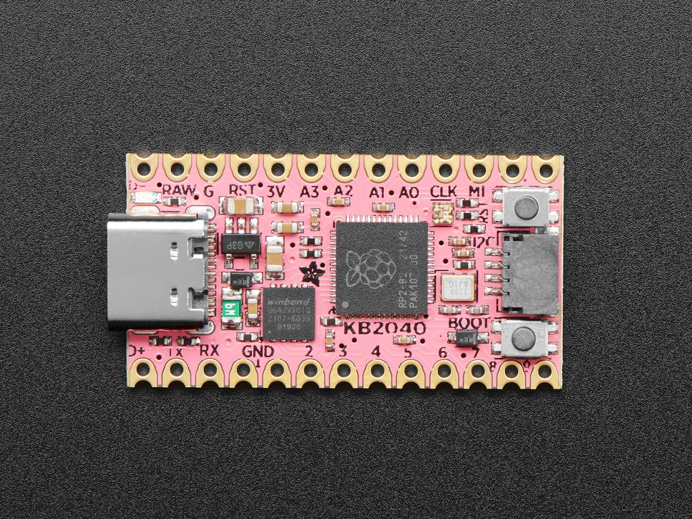

<!-- Copyright 2015-2026 Zephyr Project members and individual contributors. -->
<!-- SPDX-License-Identifier: Apache-2.0 -->
<!-- 中文翻译；编号、导航与译注为本地新增。 -->

# 第5章\_KB2040

原文：[官方页面](https://docs.zephyrproject.org/latest/boards/adafruit/kb2040/doc/index.html)。读取日期：2026-10-16；来源摘要见[来源记录](../SOURCES.md)。

开发板概览（Board Overview）

KB2040

名称（Name）：

`adafruit_kb2040`

厂商（Vendor）：

[Adafruit Industries, LLC](https://docs.zephyrproject.org/latest/boards/index.html#vendor=adafruit)

状态（Status）：

维护中（Maintained）

架构（Architecture）：

[arm](https://docs.zephyrproject.org/latest/boards/index.html#arch=arm)

片上系统（SoC）：

[rp2040](https://docs.zephyrproject.org/latest/boards/index.html#soc=rp2040)

[浏览开发板源码（Browse Board Sources）](https://github.com/zephyrproject-rtos/zephyr/blob/main//boards/adafruit/kb2040/doc/index.rst/../..)

## 概述（Overview）

Adafruit KB2040是Adafruit推出的一款小巧、低成本、用途广泛的开发板。它配有RP2040片上系统（SoC）、板载RGB NeoPixel、USB接口和STEMMA QT接口。USB引导加载程序（Bootloader）支持以拖放方式烧录，无需任何适配器。

## 硬件（Hardware）

- 双核Arm Cortex-M0+处理器，最高运行频率133 MHz
- 264 KB片上静态随机存储器（SRAM）
- 8 MB板载四线SPI闪存（QSPI Flash），支持原地执行（XIP）
- 18个通用输入输出（GPIO）引脚
- 4路模拟输入（Analog Inputs）
- 1个通用异步收发器外设（UART Peripheral）
- 1个串行外设接口控制器（SPI Controller）
- 2个I2C控制器，其中1个通过STEMMA QT接口引出
- 16个脉宽调制（PWM）通道
- USB 1.1控制器，支持主机／设备模式（Host / Device）
- 8个可编程输入输出（PIO / Programmable I/O），用于自定义外设
- 板载RGB LED
- 1个看门狗定时器外设（Watchdog Timer Peripheral）

### 支持的功能（Supported Features）

`adafruit_kb2040`开发板支持下表所列的硬件功能。

片上／板载（On-Chip / On-Board）

功能集成在片上系统（SoC）内／位于开发板上。

2 / 2

分别表示已启用／已禁用的实例数。点击数量标签，可查看开发板或SoC设备树源码（DTS）中该功能的第一个实例。

`vnd,foo`

与此功能匹配的设备树绑定兼容字符串（Compatible String）；点击链接可查看绑定文档。

#### `adafruit_kb2040/rp2040`目标（Target）

该开发板目标的片上存储容量：264 KiB RAM、8 MiB Flash。

<table>
<tr>
<th>类型（Type）</th>
<th>位置（Location）</th>
<th>说明（Description）</th>
<th>兼容字符串（Compatible）</th>
</tr>
<tr>
<td rowspan="1">中央处理器（CPU）</td>
<td>片上（On-Chip）</td>
<td>ARM Cortex-M0+处理器（CPU）（<a href="https://github.com/zephyrproject-rtos/zephyr/blob/main/dts/arm/raspberrypi/rpi_pico/rp2040.dtsi?plain=1#L35">已启用：2</a>）</td>
<td><a href="../cpu_arm_riscv_binding_reference/P017_arm_cortex-m0+.md#std-dtcompatible-arm-cortex-m0"><code>arm,cortex-m0+</code></a></td>
</tr>
<tr>
<td rowspan="1">模数转换器（ADC）</td>
<td>片上（On-Chip）</td>
<td>Raspberry Pi Pico模数转换器（ADC）（<a href="https://github.com/zephyrproject-rtos/zephyr/blob/main/dts/arm/raspberrypi/rpi_pico/rp2040.dtsi?plain=1#L309">已启用：1</a>）</td>
<td><a href="../hardware/P894_RaspberryPiPico模数转换器绑定.md#dtbinding-raspberrypi-pico-adc"><code>raspberrypi,pico-adc</code></a></td>
</tr>
<tr>
<td rowspan="5">时钟控制（Clock Control）</td>
<td>片上（On-Chip）</td>
<td>Raspberry Pi Pico时钟控制器（Clock Controller）节点（<a href="https://github.com/zephyrproject-rtos/zephyr/blob/main/dts/arm/raspberrypi/rpi_pico/rp2040.dtsi?plain=1#L220">已启用：1</a>）</td>
<td><a href="../clock_nxp_pico_realtek_renesas_binding_reference/P016_raspberrypi_pico-clock-controller.md#std-dtcompatible-raspberrypi-pico-clock-controller"><code>raspberrypi,pico-clock-controller</code></a></td>
</tr>
<tr>
<td>片上（On-Chip）</td>
<td>Raspberry Pi Pico时钟（Clock）的表示（<a href="https://github.com/zephyrproject-rtos/zephyr/blob/main/dts/arm/raspberrypi/rpi_pico/rp2040.dtsi?plain=1#L47">已启用：11</a>；<a href="https://github.com/zephyrproject-rtos/zephyr/blob/main/dts/arm/raspberrypi/rpi_pico/rp2040.dtsi?plain=1#L174">已禁用：2</a>）</td>
<td><a href="../clock_nxp_pico_realtek_renesas_binding_reference/P017_raspberrypi_pico-clock.md#std-dtcompatible-raspberrypi-pico-clock"><code>raspberrypi,pico-clock</code></a></td>
</tr>
<tr>
<td>片上（On-Chip）</td>
<td>Raspberry Pi Pico锁相环（PLL）的表示（<a href="https://github.com/zephyrproject-rtos/zephyr/blob/main/dts/arm/raspberrypi/rpi_pico/rp2040.dtsi?plain=1#L128">已启用：2</a>）</td>
<td><a href="../clock_nxp_pico_realtek_renesas_binding_reference/P018_raspberrypi_pico-pll.md#std-dtcompatible-raspberrypi-pico-pll"><code>raspberrypi,pico-pll</code></a></td>
</tr>
<tr>
<td>片上（On-Chip）</td>
<td>Raspberry Pi Pico环形振荡器（Ring Oscillator）的表示（<a href="https://github.com/zephyrproject-rtos/zephyr/blob/main/dts/arm/raspberrypi/rpi_pico/rp2040.dtsi?plain=1#L150">已启用：1</a>）</td>
<td><a href="../clock_nxp_pico_realtek_renesas_binding_reference/P019_raspberrypi_pico-rosc.md#std-dtcompatible-raspberrypi-pico-rosc"><code>raspberrypi,pico-rosc</code></a></td>
</tr>
<tr>
<td>片上（On-Chip）</td>
<td>Raspberry Pi Pico外部振荡器（External Oscillator）的表示（<a href="https://github.com/zephyrproject-rtos/zephyr/blob/main/dts/arm/raspberrypi/rpi_pico/rp2040.dtsi?plain=1#L168">已启用：1</a>）</td>
<td><a href="../clock_nxp_pico_realtek_renesas_binding_reference/P020_raspberrypi_pico-xosc.md#std-dtcompatible-raspberrypi-pico-xosc"><code>raspberrypi,pico-xosc</code></a></td>
</tr>
<tr>
<td rowspan="1">计数器（Counter）</td>
<td>片上（On-Chip）</td>
<td>Raspberry Pi Pico定时器（Timer）（<a href="https://github.com/zephyrproject-rtos/zephyr/blob/main/dts/arm/raspberrypi/rpi_pico/rp2040.dtsi?plain=1#L373">已禁用：1</a>）</td>
<td><a href="../renesas_realtek_counter_binding_reference/P008_raspberrypi_pico-timer.md#std-dtcompatible-raspberrypi-pico-timer"><code>raspberrypi,pico-timer</code></a></td>
</tr>
<tr>
<td rowspan="1">直接存储器访问（DMA）</td>
<td>片上（On-Chip）</td>
<td>Raspberry Pi Pico直接存储器访问（DMA）（<a href="https://github.com/zephyrproject-rtos/zephyr/blob/main/dts/arm/raspberrypi/rpi_pico/rp2040.dtsi?plain=1#L389">已禁用：1</a>）</td>
<td><a href="../nxp_realtek_renesas_dma_binding_reference/P009_raspberrypi_pico-dma.md#std-dtcompatible-raspberrypi-pico-dma"><code>raspberrypi,pico-dma</code></a></td>
</tr>
<tr>
<td rowspan="1">闪存控制器（Flash Controller）</td>
<td>片上（On-Chip）</td>
<td>Raspberry Pi Pico闪存控制器（Flash Controller）（<a href="https://github.com/zephyrproject-rtos/zephyr/blob/main/dts/arm/raspberrypi/rpi_pico/rp2040.dtsi?plain=1#L197">已启用：1</a>）</td>
<td><a href="../flash_nuvoton_nxp_renesas_binding_reference/P021_raspberrypi_pico-flash-controller.md#std-dtcompatible-raspberrypi-pico-flash-controller"><code>raspberrypi,pico-flash-controller</code></a></td>
</tr>
<tr>
<td rowspan="2">通用输入输出与接插件（GPIO &amp; Headers）</td>
<td>片上（On-Chip）</td>
<td>Raspberry Pi Pico通用输入输出（GPIO）（<a href="https://github.com/zephyrproject-rtos/zephyr/blob/main/dts/arm/raspberrypi/rpi_pico/rp2040.dtsi?plain=1#L242">已启用：1</a>）</td>
<td><a href="../gpio_raspberrypi_renesas_binding_reference/P006_raspberrypi_pico-gpio.md#std-dtcompatible-raspberrypi-pico-gpio"><code>raspberrypi,pico-gpio</code></a></td>
</tr>
<tr>
<td>片上（On-Chip）</td>
<td>Raspberry Pi Pico GPIO端口（Port）（<a href="https://github.com/zephyrproject-rtos/zephyr/blob/main/dts/arm/raspberrypi/rpi_pico/rp2040.dtsi?plain=1#L255">已启用：1</a>）</td>
<td><a href="../gpio_raspberrypi_renesas_binding_reference/P005_raspberrypi_pico-gpio-port.md#std-dtcompatible-raspberrypi-pico-gpio-port"><code>raspberrypi,pico-gpio-port</code></a></td>
</tr>
<tr>
<td rowspan="1">集成电路间总线（I2C）</td>
<td>片上（On-Chip）</td>
<td>Raspberry Pi Pico I2C控制器（<a href="https://github.com/zephyrproject-rtos/zephyr/blob/main/dts/arm/raspberrypi/rpi_pico/rp2040.dtsi?plain=1#L332">已启用：1</a>；<a href="https://github.com/zephyrproject-rtos/zephyr/blob/main/dts/arm/raspberrypi/rpi_pico/rp2040.dtsi?plain=1#L320">已禁用：1</a>）</td>
<td><a href="../i2c_nxp_pico_renesas_binding_reference/P008_raspberrypi_pico-i2c.md#std-dtcompatible-raspberrypi-pico-i2c"><code>raspberrypi,pico-i2c</code></a></td>
</tr>
<tr>
<td rowspan="1">中断控制器（Interrupt Controller）</td>
<td>片上（On-Chip）</td>
<td>ARMv6-M嵌套向量中断控制器（NVIC / Nested Vectored Interrupt Controller）（<a href="https://github.com/zephyrproject-rtos/zephyr/blob/main/dts/arm/armv6-m.dtsi?plain=1#L13">已启用：1</a>）</td>
<td><a href="../arm_interrupt_timer_binding_reference/P001_ARMv6_M_NVIC.md#std-dtcompatible-arm-v6m-nvic"><code>arm,v6m-nvic</code></a></td>
</tr>
<tr>
<td rowspan="1">灯带（LED Strip）</td>
<td>板载（On-Board）</td>
<td>配置用于WS2812的可编程输入输出（PIO）节点（<a href="https://github.com/zephyrproject-rtos/zephyr/blob/main/boards/adafruit/kb2040/adafruit_kb2040.dts?plain=1#L100">已启用：1</a>）</td>
<td><a href="../led_strip_binding_reference/P011_worldsemi_ws2812-rpi_pico-pio.md#std-dtcompatible-worldsemi-ws2812-rpi_pico-pio"><code>worldsemi,ws2812-rpi_pico-pio</code></a></td>
</tr>
<tr>
<td rowspan="1">邮箱（Mailbox）</td>
<td>片上（On-Chip）</td>
<td>Raspberry Pi Pico处理器间邮箱（Interprocessor Mailbox）（<a href="https://github.com/zephyrproject-rtos/zephyr/blob/main/dts/arm/raspberrypi/rpi_pico/rp2040.dtsi?plain=1#L452">已禁用：2</a>）</td>
<td><a href="../intercore_reference/P050_Pico邮箱绑定.md#dtbinding-raspberrypi-pico-mbox"><code>raspberrypi,pico-mbox</code></a></td>
</tr>
<tr>
<td rowspan="2">其他绑定（Miscellaneous）</td>
<td>片上（On-Chip）</td>
<td>Raspberry Pi Pico可编程输入输出（PIO）（<a href="https://github.com/zephyrproject-rtos/zephyr/blob/main/dts/arm/raspberrypi/rpi_pico/rp2040.dtsi?plain=1#L412">已启用：1</a>；<a href="https://github.com/zephyrproject-rtos/zephyr/blob/main/dts/arm/raspberrypi/rpi_pico/rp2040.dtsi?plain=1#L423">已禁用：1</a>）</td>
<td><a href="../misc_nxp_renesas_zephyr_binding_reference/P011_raspberrypi_pico-pio.md#std-dtcompatible-raspberrypi-pico-pio"><code>raspberrypi,pico-pio</code></a></td>
</tr>
<tr>
<td>片上（On-Chip）</td>
<td>Raspberry Pi Pico单周期输入输出（SIO）（<a href="https://github.com/zephyrproject-rtos/zephyr/blob/main/dts/arm/raspberrypi/rpi_pico/rp2040.dtsi?plain=1#L444">已启用：1</a>）</td>
<td><a href="../misc_nxp_renesas_zephyr_binding_reference/P013_raspberrypi_pico-sio.md#std-dtcompatible-raspberrypi-pico-sio"><code>raspberrypi,pico-sio</code></a></td>
</tr>
<tr>
<td rowspan="1">存储技术设备（MTD）</td>
<td>片上（On-Chip）</td>
<td>闪存（Flash）节点（<a href="https://github.com/zephyrproject-rtos/zephyr/blob/main/dts/arm/raspberrypi/rpi_pico/rp2040.dtsi?plain=1#L205">已启用：1</a>）</td>
<td><a href="../mtd_nxp_st_ti_partition_binding_reference/P013_soc-nv-flash.md#std-dtcompatible-soc-nv-flash"><code>soc-nv-flash</code></a></td>
</tr>
<tr>
<td rowspan="1">引脚控制（Pin Control）</td>
<td>片上（On-Chip）</td>
<td>Raspberry Pi Pico引脚控制器（Pin Controller）（<a href="https://github.com/zephyrproject-rtos/zephyr/blob/main/dts/arm/raspberrypi/rpi_pico/rp2040.dtsi?plain=1#L492">已启用：1</a>）</td>
<td><a href="../pinctrl_nxp_pico_binding_reference/P025_raspberrypi_pico-pinctrl.md#std-dtcompatible-raspberrypi-pico-pinctrl"><code>raspberrypi,pico-pinctrl</code></a></td>
</tr>
<tr>
<td rowspan="1">脉宽调制（PWM）</td>
<td>片上（On-Chip）</td>
<td>Raspberry Pi Pico脉宽调制（PWM）（<a href="https://github.com/zephyrproject-rtos/zephyr/blob/main/dts/arm/raspberrypi/rpi_pico/rp2040.dtsi?plain=1#L362">已禁用：1</a>）</td>
<td><a href="../pwm_nxp_renesas_binding_reference/P014_raspberrypi_pico-pwm.md#std-dtcompatible-raspberrypi-pico-pwm"><code>raspberrypi,pico-pwm</code></a></td>
</tr>
<tr>
<td rowspan="1">稳压器（Regulator）</td>
<td>片上（On-Chip）</td>
<td>Raspberry Pi Pico内核电源稳压器（Core Supply Regulator）（<a href="https://github.com/zephyrproject-rtos/zephyr/blob/main/dts/arm/raspberrypi/rpi_pico/rp2040.dtsi?plain=1#L402">已启用：1</a>）</td>
<td><a href="../hardware/P654_RaspberryPi内核供电稳压器绑定.md#dtbinding-raspberrypi-core-supply-regulator"><code>raspberrypi,core-supply-regulator</code></a></td>
</tr>
<tr>
<td rowspan="1">复位控制器（Reset Controller）</td>
<td>片上（On-Chip）</td>
<td>Raspberry Pi Pico复位控制器（Reset Controller）（<a href="https://github.com/zephyrproject-rtos/zephyr/blob/main/dts/arm/raspberrypi/rpi_pico/rp2040.dtsi?plain=1#L214">已启用：1</a>）</td>
<td><a href="../reset_controller_binding_reference/P012_raspberrypi_pico-reset.md#std-dtcompatible-raspberrypi-pico-reset"><code>raspberrypi,pico-reset</code></a></td>
</tr>
<tr>
<td rowspan="1">实时时钟（RTC）</td>
<td>片上（On-Chip）</td>
<td>Raspberry Pi Pico实时时钟（RTC）（<a href="https://github.com/zephyrproject-rtos/zephyr/blob/main/dts/arm/raspberrypi/rpi_pico/rp2040.dtsi?plain=1#L434">已禁用：1</a>）</td>
<td><a href="../soc_rtc_binding_reference/P003_raspberrypi_pico-rtc.md#std-dtcompatible-raspberrypi-pico-rtc"><code>raspberrypi,pico-rtc</code></a></td>
</tr>
<tr>
<td rowspan="1">传感器（Sensors）</td>
<td>片上（On-Chip）</td>
<td>Raspberry Pi Pico系列温度传感器（Temperature Sensor）节点（<a href="https://github.com/zephyrproject-rtos/zephyr/blob/main/dts/arm/raspberrypi/rpi_pico/rp2040.dtsi?plain=1#L496">已禁用：1</a>）</td>
<td><a href="../sensor_realtek_rohm_sensirion_binding_reference/P003_raspberrypi_pico-temp.md#std-dtcompatible-raspberrypi-pico-temp"><code>raspberrypi,pico-temp</code></a></td>
</tr>
<tr>
<td rowspan="1">串行控制器（Serial Controller）</td>
<td>片上（On-Chip）</td>
<td>Raspberry Pi Pico通用异步收发器（UART）（<a href="https://github.com/zephyrproject-rtos/zephyr/blob/main/dts/arm/raspberrypi/rpi_pico/rp2040.dtsi?plain=1#L265">已启用：1</a>；<a href="https://github.com/zephyrproject-rtos/zephyr/blob/main/dts/arm/raspberrypi/rpi_pico/rp2040.dtsi?plain=1#L275">已禁用：1</a>）</td>
<td><a href="../uart_raspberrypi_realtek_renesas_binding_reference/P002_raspberrypi_pico-uart.md#std-dtcompatible-raspberrypi-pico-uart"><code>raspberrypi,pico-uart</code></a></td>
</tr>
<tr>
<td rowspan="1">串行外设接口（SPI）</td>
<td>片上（On-Chip）</td>
<td>Raspberry Pi Pico串行外设接口（SPI）（<a href="https://github.com/zephyrproject-rtos/zephyr/blob/main/dts/arm/raspberrypi/rpi_pico/rp2040.dtsi?plain=1#L285">已启用：1</a>；<a href="https://github.com/zephyrproject-rtos/zephyr/blob/main/dts/arm/raspberrypi/rpi_pico/rp2040.dtsi?plain=1#L297">已禁用：1</a>）</td>
<td><a href="../spi_flexspi_nxp_renesas_binding_reference/P010_raspberrypi_pico-spi.md#std-dtcompatible-raspberrypi-pico-spi"><code>raspberrypi,pico-spi</code></a></td>
</tr>
<tr>
<td rowspan="1">静态随机存储器（SRAM）</td>
<td>片上（On-Chip）</td>
<td>通用片上静态随机存储器（SRAM）（<a href="https://github.com/zephyrproject-rtos/zephyr/blob/main/dts/arm/raspberrypi/rpi_pico/rp2040.dtsi?plain=1#L192">已启用：1</a>）</td>
<td><a href="../hardware/P567_内存映射SRAM绑定.md#dtbinding-mmio-sram"><code>mmio-sram</code></a></td>
</tr>
<tr>
<td rowspan="1">定时器（Timer）</td>
<td>片上（On-Chip）</td>
<td>ARMv6-M系统节拍（System Tick）（<a href="https://github.com/zephyrproject-rtos/zephyr/blob/main/dts/arm/armv6-m.dtsi?plain=1#L21">已启用：1</a>）</td>
<td><a href="../arm_interrupt_timer_binding_reference/P005_ARMv6_M_SysTick.md#std-dtcompatible-arm-armv6m-systick"><code>arm,armv6m-systick</code></a></td>
</tr>
<tr>
<td rowspan="1">通用串行总线（USB）</td>
<td>片上（On-Chip）</td>
<td>Raspberry Pi Pico USB设备控制器（USB Device Controller）（<a href="https://github.com/zephyrproject-rtos/zephyr/blob/main/dts/arm/raspberrypi/rpi_pico/rp2040.dtsi?plain=1#L351">已启用：1</a>）</td>
<td><a href="../usb_soc_binding_reference/P014_raspberrypi_pico-usbd.md#std-dtcompatible-raspberrypi-pico-usbd"><code>raspberrypi,pico-usbd</code></a></td>
</tr>
<tr>
<td rowspan="1">看门狗（Watchdog）</td>
<td>片上（On-Chip）</td>
<td>Raspberry Pi Pico看门狗（Watchdog）（<a href="https://github.com/zephyrproject-rtos/zephyr/blob/main/dts/arm/raspberrypi/rpi_pico/rp2040.dtsi?plain=1#L344">已启用：1</a>）</td>
<td><a href="../nxp_nordic_nuvoton_watchdog_binding_reference/P015_raspberrypi_pico-watchdog.md#std-dtcompatible-raspberrypi-pico-watchdog"><code>raspberrypi,pico-watchdog</code></a></td>
</tr>
</table>

### 引脚映射（Pin Mapping）

RP2040片上系统（SoC）的外设可路由到开发板的不同引脚。这些路由配置可通过设备树源文件（DTS）修改；各外设可用的路由方式请参阅数据手册（Datasheet）。

#### Zephyr 默认外设映射（Peripheral Mapping）：

- `UART0_TX : P0`
- `UART0_RX : P1`
- `I2C1_SDA : P2`
- `I2C1_SCL : P3`
- `SPI0_RX : P20`
- `SPI0_SCK : P18`
- `SPI0_TX : P19`

## 烧录与调试（Programming and Debugging）

`adafruit_kb2040`开发板支持下表所列的运行工具（Runners）及相关west命令。

<table>
<tr>
<th></th>
<th>烧录（flash）</th>
<th>调试（debug）</th>
</tr>
<tr>
<td><a href="https://docs.zephyrproject.org/latest/develop/flash_debug/host-tools.html#runner-uf2">uf2</a></td>
<td>✅（默认 / default）</td>
<td></td>
</tr>
</table>

### 烧录（Flashing）

#### 使用UF2（Using UF2）

Adafruit KB2040未引出SWD引脚，因此必须使用UF2文件烧录。为该开发板构建应用时，默认会生成`build/zephyr/zephyr.uf2`文件。按住BOOTSEL按键并上电后，KB2040会在主机上显示为大容量存储设备（Mass Storage Device）。将UF2文件拖放到该设备中，即可完成烧录。

---

[上一章](P004_Itsybitsy_RP2040.md) · [返回大纲](大纲.md) · [全站翻译进度](../PROGRESS.md) · [下一章](P006_Adafruit_MacroPad_RP2040.md)
