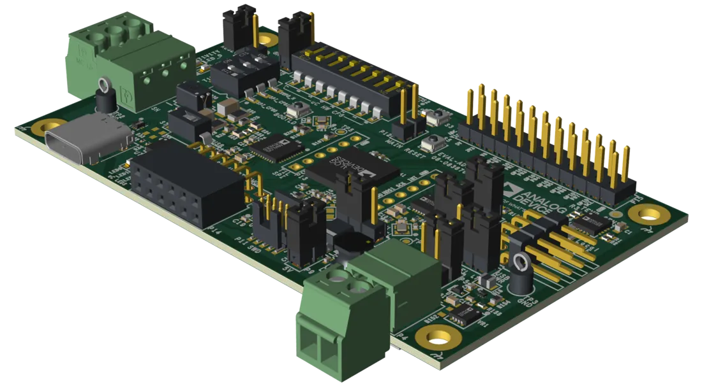

<!-- Copyright 2015-2026 Zephyr Project members and individual contributors. -->
<!-- SPDX-License-Identifier: Apache-2.0 -->
<!-- 中文翻译；编号、导航与译注为本地新增。 -->

<a id="adi_eval_adin1140d1z"></a>

# 第4章\_EVAL-ADIN1140D1Z

原文：[官方页面](https://docs.zephyrproject.org/latest/boards/adi/eval_adin1140d1z/doc/index.html)。读取日期：2026-10-16；来源摘要见[来源记录](../SOURCES.md)。

开发板概览（Board Overview）

<a id="id1"></a>

[](images/adi_eval_adin1140d1z.webp)

EVAL-ADIN1140D1Z

名称（Name）：

`adi_eval_adin1140d1z`

厂商（Vendor）：

[Analog Devices, Inc.](https://docs.zephyrproject.org/latest/boards/index.html#vendor=adi)

状态（Status）：

维护中（Maintained）

架构（Architecture）：

[arm](https://docs.zephyrproject.org/latest/boards/index.html#arch=arm)

片上系统（SoC）：

[max32690](https://docs.zephyrproject.org/latest/boards/index.html#soc=max32690)

<a id="board-github-link"></a>

[浏览开发板源码（Browse Board Sources）](https://github.com/zephyrproject-rtos/zephyr/blob/main//boards/adi/eval_adin1140d1z/doc/index.rst/../..)<a id="overview"></a>

## 概述（Overview）

EVAL-ADIN1140D1Z是ADIN1140 10BASE-T1S MAC-PHY的评估平台。它集成了板载Arm Cortex-M4 MAX32690微控制器作为主机（Host），支持评估USB到10BASE-T1S桥接（Bridge）。

<a id="hardware"></a>

## 硬件（Hardware）


- MAX32690 Arm Cortex-M4主机微控制器（Host Microcontroller）
- ADIN1140 10BASE-T1S MAC-PHY，通过SPI连接
- ADIN1110 10BASE-T1L MAC-PHY，通过SPI连接

ADIN1140提供10BASE-T1S多点接口（Multidrop Interface），ADIN1110提供10BASE-T1L点对点接口（Point-to-point Interface）。二者均为稳健、低功耗的以太网MAC-PHY，通过SPI使用Open Alliance TC6协议（10BASE-T1x MAC-PHY串行接口 / Serial Interface）连接MAX32690主机。二者配合可使开发板完成10BASE-T1S与10BASE-T1L之间的介质转换（Media Conversion）；未来将通过专用Zephyr示例提供支持。

<a id="supported-features"></a>

### 支持的功能（Supported Features）

`adi_eval_adin1140d1z`开发板支持下表所列的硬件功能。

片上／板载（On-Chip / On-Board）

功能集成在片上系统（SoC）内／位于开发板上。

2 / 2

分别表示已启用／已禁用的实例数。点击数量标签，可查看开发板或SoC设备树源码（DTS）中该功能的第一个实例。

`vnd,foo`

与此功能匹配的设备树绑定兼容字符串（Compatible String）；点击链接可查看绑定文档。

<a id="adi_eval_adin1140d1z-hw-features"></a>

<a id="adi_eval_adin1140d1z-adi_eval_adin1140d1z/max32690/m4-hw-features-section"></a>

#### `adi_eval_adin1140d1z/max32690/m4`目标（Target）

<a id="adi_eval_adin1140d1z-adi_eval_adin1140d1z/max32690/m4-hw-features-panel"></a>

<a id="adi_eval_adin1140d1z-adi_eval_adin1140d1z/max32690/m4-hw-features-memory"></a>

该开发板目标的片上存储容量：128 KiB RAM、3 MiB Flash。

<a id="adi_eval_adin1140d1z-adi_eval_adin1140d1z/max32690/m4-hw-features-table"></a>

<table>
<tr>
<th>类型（Type）</th>
<th>位置（Location）</th>
<th>说明（Description）</th>
<th>兼容字符串（Compatible）</th>
</tr>
<tr>
<td rowspan="2">中央处理器（CPU）</td>
<td>片上（On-Chip）</td>
<td>ARM Cortex-M4F 处理器（CPU）（<a href="https://github.com/zephyrproject-rtos/zephyr/blob/main/dts/vendor/adi/max32/max32xxx.dtsi?plain=1#L25">已启用：1</a>）</td>
<td><a href="../cpu_arm_riscv_binding_reference/P025_arm_cortex-m4f.md#std-dtcompatible-arm-cortex-m4f"><code>arm,cortex-m4f</code></a></td>
</tr>
<tr>
<td>片上（On-Chip）</td>
<td>MAX32 RV32内核（Core）（<a href="https://github.com/zephyrproject-rtos/zephyr/blob/main/dts/vendor/adi/max32/max32xxx.dtsi?plain=1#L32">已启用：1</a>）</td>
<td><a href="../cpu_arm_riscv_binding_reference/P002_adi_max32-rv32.md#std-dtcompatible-adi-max32-rv32"><code>adi,max32-rv32</code></a></td>
</tr>
<tr>
<td rowspan="1">模数转换器（ADC）</td>
<td>片上（On-Chip）</td>
<td>ADI MAX32逐次逼近模数转换器（SAR ADC）（<a href="https://github.com/zephyrproject-rtos/zephyr/blob/main/dts/vendor/adi/max32/max32xxx.dtsi?plain=1#L241">已禁用：1</a>）</td>
<td><a href="../hardware/P863_ADIMAX32逐次逼近ADC绑定.md#dtbinding-adi-max32-adc-sar"><code>adi,max32-adc-sar</code></a></td>
</tr>
<tr>
<td rowspan="1">控制器局域网（CAN）</td>
<td>片上（On-Chip）</td>
<td>ADI MAX32控制器局域网（CAN）节点（<a href="https://github.com/zephyrproject-rtos/zephyr/blob/main/dts/vendor/adi/max32/max32690.dtsi?plain=1#L203">已禁用：2</a>）</td>
<td><a href="../can_adi_atmel_nxp_binding_reference/P001_adi_max32-can.md#std-dtcompatible-adi-max32-can"><code>adi,max32-can</code></a></td>
</tr>
<tr>
<td rowspan="2">时钟控制（Clock Control）</td>
<td>片上（On-Chip）</td>
<td>通用固定频率时钟提供者（Fixed-Rate Clock Provider）（<a href="https://github.com/zephyrproject-rtos/zephyr/blob/main/dts/vendor/adi/max32/max32xxx.dtsi?plain=1#L64">已启用：2</a>；<a href="https://github.com/zephyrproject-rtos/zephyr/blob/main/dts/vendor/adi/max32/max32xxx.dtsi?plain=1#L71">已禁用：6</a>）</td>
<td><a href="../hardware/P566_固定时钟绑定.md#dtbinding-fixed-clock"><code>fixed-clock</code></a></td>
</tr>
<tr>
<td>片上（On-Chip）</td>
<td>MAX32全局控制（Global Control）（<a href="https://github.com/zephyrproject-rtos/zephyr/blob/main/dts/vendor/adi/max32/max32xxx.dtsi?plain=1#L130">已启用：1</a>）</td>
<td><a href="../clock_adi_atmel_bflb_binding_reference/P004_adi_max32-gcr.md#std-dtcompatible-adi-max32-gcr"><code>adi,max32-gcr</code></a></td>
</tr>
<tr>
<td rowspan="3">计数器（Counter）</td>
<td>片上（On-Chip）</td>
<td>ADI MAX32计数器（Counter）（<a href="https://github.com/zephyrproject-rtos/zephyr/blob/main/dts/vendor/adi/max32/max32xxx.dtsi?plain=1#L260">已禁用：6</a>）</td>
<td><a href="../counter_binding_reference/P001_adi_max32-counter.md#std-dtcompatible-adi-max32-counter"><code>adi,max32-counter</code></a></td>
</tr>
<tr>
<td>片上（On-Chip）</td>
<td>ADI MAX32兼容实时时钟计数器（Counter RTC）（<a href="https://github.com/zephyrproject-rtos/zephyr/blob/main/dts/vendor/adi/max32/max32xxx.dtsi?plain=1#L332">已禁用：1</a>）</td>
<td><a href="../counter_binding_reference/P002_adi_max32-rtc-counter.md#std-dtcompatible-adi-max32-rtc-counter"><code>adi,max32-rtc-counter</code></a></td>
</tr>
<tr>
<td>片上（On-Chip）</td>
<td>ADI MAX32唤醒定时器（Wake-Up Timer）是一个特殊的32位定时器实例，能够从睡眠（Sleep）、待机（Standby）和备份（Backup）模式唤醒设备。（<a href="https://github.com/zephyrproject-rtos/zephyr/blob/main/dts/vendor/adi/max32/max32690.dtsi?plain=1#L234">已禁用：2</a>）</td>
<td><a href="../counter_binding_reference/P003_adi_max32-wut.md#std-dtcompatible-adi-max32-wut"><code>adi,max32-wut</code></a></td>
</tr>
<tr>
<td rowspan="1">直接存储器访问（DMA）</td>
<td>片上（On-Chip）</td>
<td>ADI MAX32直接存储器访问（DMA）（<a href="https://github.com/zephyrproject-rtos/zephyr/blob/main/dts/vendor/adi/max32/max32690.dtsi?plain=1#L150">已启用：1</a>）</td>
<td><a href="../dma_binding_reference/P002_adi_max32-dma.md#std-dtcompatible-adi-max32-dma"><code>adi,max32-dma</code></a></td>
</tr>
<tr>
<td rowspan="6">以太网（Ethernet）</td>
<td>板载（On-Board）</td>
<td>带SPI接口的ADIN1140 10BASE-T1S以太网MAC-PHY（<a href="https://github.com/zephyrproject-rtos/zephyr/blob/main/boards/adi/eval_adin1140d1z/adi_eval_adin1140d1z_max32690_m4.dts?plain=1#L144">已启用：1</a>）</td>
<td><a href="../ethernet_mac_mdio_binding_reference/P002_adi_adin1140.md#std-dtcompatible-adi-adin1140"><code>adi,adin1140</code></a></td>
</tr>
<tr>
<td>板载（On-Board）</td>
<td>ADIN1140管理数据输入输出（MDIO）驱动节点（<a href="https://github.com/zephyrproject-rtos/zephyr/blob/main/boards/adi/eval_adin1140d1z/adi_eval_adin1140d1z_max32690_m4.dts?plain=1#L154">已启用：1</a>）</td>
<td><a href="../ethernet_mac_mdio_binding_reference/P014_adi_adin1140-mdio.md#std-dtcompatible-adi-adin1140-mdio"><code>adi,adin1140-mdio</code></a></td>
</tr>
<tr>
<td>板载（On-Board）</td>
<td>ADIN1140物理层（PHY）（<a href="https://github.com/zephyrproject-rtos/zephyr/blob/main/boards/adi/eval_adin1140d1z/adi_eval_adin1140d1z_max32690_m4.dts?plain=1#L159">已启用：1</a>）</td>
<td><a href="../ethernet_nxp_phy_binding_reference/P015_adi_adin1140-phy.md#std-dtcompatible-adi-adin1140-phy"><code>adi,adin1140-phy</code></a></td>
</tr>
<tr>
<td>板载（On-Board）</td>
<td>ADIN1110独立10BASE-T1L以太网控制器（Ethernet Controller），带SPI接口（<a href="https://github.com/zephyrproject-rtos/zephyr/blob/main/boards/adi/eval_adin1140d1z/adi_eval_adin1140d1z_max32690_m4.dts?plain=1#L195">已启用：1</a>）</td>
<td><a href="../ethernet_mac_mdio_binding_reference/P001_adi_adin1110.md#std-dtcompatible-adi-adin1110"><code>adi,adin1110</code></a></td>
</tr>
<tr>
<td>板载（On-Board）</td>
<td>ADIN2111管理数据输入输出（MDIO）驱动节点（<a href="https://github.com/zephyrproject-rtos/zephyr/blob/main/boards/adi/eval_adin1140d1z/adi_eval_adin1140d1z_max32690_m4.dts?plain=1#L207">已启用：1</a>）</td>
<td><a href="../ethernet_mac_mdio_binding_reference/P015_adi_adin2111-mdio.md#std-dtcompatible-adi-adin2111-mdio"><code>adi,adin2111-mdio</code></a></td>
</tr>
<tr>
<td>板载（On-Board）</td>
<td>ADIN2111物理层（PHY）（<a href="https://github.com/zephyrproject-rtos/zephyr/blob/main/boards/adi/eval_adin1140d1z/adi_eval_adin1140d1z_max32690_m4.dts?plain=1#L212">已启用：1</a>）</td>
<td><a href="../ethernet_nxp_phy_binding_reference/P016_adi_adin2111-phy.md#std-dtcompatible-adi-adin2111-phy"><code>adi,adin2111-phy</code></a></td>
</tr>
<tr>
<td rowspan="1">闪存控制器（Flash Controller）</td>
<td>片上（On-Chip）</td>
<td>MAX32XXX闪存控制器（Flash Controller）（<a href="https://github.com/zephyrproject-rtos/zephyr/blob/main/dts/vendor/adi/max32/max32xxx.dtsi?plain=1#L111">已启用：2</a>）</td>
<td><a href="../flash_adi_microchip_nordic_binding_reference/P001_adi_max32-flash-controller.md#std-dtcompatible-adi-max32-flash-controller"><code>adi,max32-flash-controller</code></a></td>
</tr>
<tr>
<td rowspan="1">通用输入输出与接插件（GPIO &amp; Headers）</td>
<td>片上（On-Chip）</td>
<td>MAX32通用输入输出（GPIO）（<a href="https://github.com/zephyrproject-rtos/zephyr/blob/main/dts/vendor/adi/max32/max32xxx.dtsi?plain=1#L175">已启用：5</a>）</td>
<td><a href="../gpio_adi_headers_ambiq_binding_reference/P011_adi_max32-gpio.md#std-dtcompatible-adi-max32-gpio"><code>adi,max32-gpio</code></a></td>
</tr>
<tr>
<td rowspan="1">集成电路间总线（I2C）</td>
<td>片上（On-Chip）</td>
<td>ADI MAX32 I2C控制器（<a href="https://github.com/zephyrproject-rtos/zephyr/blob/main/dts/vendor/adi/max32/max32xxx.dtsi?plain=1#L139">已启用：2</a>；<a href="https://github.com/zephyrproject-rtos/zephyr/blob/main/dts/vendor/adi/max32/max32xxx.dtsi?plain=1#L159">已禁用：1</a>）</td>
<td><a href="../i2c_adi_atmel_esp_binding_reference/P001_adi_max32-i2c.md#std-dtcompatible-adi-max32-i2c"><code>adi,max32-i2c</code></a></td>
</tr>
<tr>
<td rowspan="1">集成电路间音频总线（I2S）</td>
<td>片上（On-Chip）</td>
<td>Analog Devices MAX32系列I2S控制器（<a href="https://github.com/zephyrproject-rtos/zephyr/blob/main/dts/vendor/adi/max32/max32690.dtsi?plain=1#L217">已禁用：1</a>）</td>
<td><a href="../i2s_binding_reference/P001_adi_max32-i2s.md#std-dtcompatible-adi-max32-i2s"><code>adi,max32-i2s</code></a></td>
</tr>
<tr>
<td rowspan="1">输入（Input）</td>
<td>板载（On-Board）</td>
<td>一组绑定到 GPIO 的输入按键（GPIO-Bound Input Keys）（<a href="https://github.com/zephyrproject-rtos/zephyr/blob/main/boards/adi/eval_adin1140d1z/adi_eval_adin1140d1z_max32690_m4.dts?plain=1#L54">已启用：1</a>）</td>
<td><a href="../hardware/P563_GPIO按键绑定.md#std-dtcompatible-gpio-keys"><code>gpio-keys</code></a></td>
</tr>
<tr>
<td rowspan="1">中断控制器（Interrupt Controller）</td>
<td>片上（On-Chip）</td>
<td>ARMv7-M 嵌套向量中断控制器（Nested Vectored Interrupt Controller，NVIC）（<a href="https://github.com/zephyrproject-rtos/zephyr/blob/main/dts/arm/armv7-m.dtsi?plain=1#L13">已启用：1</a>）</td>
<td><a href="../arm_interrupt_timer_binding_reference/P002_ARMv7_M_NVIC.md#std-dtcompatible-arm-v7m-nvic"><code>arm,v7m-nvic</code></a></td>
</tr>
<tr>
<td rowspan="1">发光二极管（LED）</td>
<td>板载（On-Board）</td>
<td>一组由 GPIO 控制的 LED（GPIO-Controlled LEDs）（<a href="https://github.com/zephyrproject-rtos/zephyr/blob/main/boards/adi/eval_adin1140d1z/adi_eval_adin1140d1z_max32690_m4.dts?plain=1#L25">已启用：1</a>）</td>
<td><a href="../hardware/P564_GPIO指示灯绑定.md#dtbinding-gpio-leds"><code>gpio-leds</code></a></td>
</tr>
<tr>
<td rowspan="1">邮箱（Mailbox）</td>
<td>片上（On-Chip）</td>
<td>ADI MAX32 SEMA邮箱（Mailbox）（<a href="https://github.com/zephyrproject-rtos/zephyr/blob/main/dts/vendor/adi/max32/max32xxx.dtsi?plain=1#L194">已禁用：1</a>）</td>
<td><a href="../intercore_reference/P032_ADI硬件信号量邮箱绑定.md#dtbinding-adi-mbox-max32-sema"><code>adi,mbox-max32-sema</code></a></td>
</tr>
<tr>
<td rowspan="1">存储器控制器（Memory Controller）</td>
<td>片上（On-Chip）</td>
<td>MAX32 HyperBus存储器控制器接口（HPB / HyperBus Memory Controller Interface）（<a href="https://github.com/zephyrproject-rtos/zephyr/blob/main/dts/vendor/adi/max32/max32690-m4.dtsi?plain=1#L66">已禁用：1</a>）</td>
<td><a href="../memory_controller_hyperbus_smc_binding_reference/P002_adi_max32-hpb.md#std-dtcompatible-adi-max32-hpb"><code>adi,max32-hpb</code></a></td>
</tr>
<tr>
<td rowspan="2">存储技术设备（MTD）</td>
<td>片上（On-Chip）</td>
<td>闪存（Flash）节点（<a href="https://github.com/zephyrproject-rtos/zephyr/blob/main/dts/vendor/adi/max32/max32xxx.dtsi?plain=1#L119">已启用：2</a>）</td>
<td><a href="../mtd_nxp_st_ti_partition_binding_reference/P013_soc-nv-flash.md#std-dtcompatible-soc-nv-flash"><code>soc-nv-flash</code></a></td>
</tr>
<tr>
<td>板载（On-Board）</td>
<td>兼容Atmel AT24系列的I2C电可擦除可编程只读存储器（EEPROM）（<a href="https://github.com/zephyrproject-rtos/zephyr/blob/main/boards/adi/eval_adin1140d1z/adi_eval_adin1140d1z_max32690_m4.dts?plain=1#L258">已启用：1</a>）</td>
<td><a href="../mtd_atmel_bouffalo_binding_reference/P004_atmel_at24.md#std-dtcompatible-atmel-at24"><code>atmel,at24</code></a></td>
</tr>
<tr>
<td rowspan="1">引脚控制（Pin Control）</td>
<td>片上（On-Chip）</td>
<td>MAX32引脚控制器（Pin Controller）（<a href="https://github.com/zephyrproject-rtos/zephyr/blob/main/dts/vendor/adi/max32/max32xxx.dtsi?plain=1#L169">已启用：1</a>）</td>
<td><a href="../pinctrl_adi_ambiq_arm_binding_reference/P001_adi_max32-pinctrl.md#std-dtcompatible-adi-max32-pinctrl"><code>adi,max32-pinctrl</code></a></td>
</tr>
<tr>
<td rowspan="1">脉宽调制（PWM）</td>
<td>片上（On-Chip）</td>
<td>ADI MAX32脉宽调制（PWM）（<a href="https://github.com/zephyrproject-rtos/zephyr/blob/main/dts/vendor/adi/max32/max32xxx.dtsi?plain=1#L265">已禁用：4</a>）</td>
<td><a href="../pwm_adi_esp_infineon_binding_reference/P003_adi_max32-pwm.md#std-dtcompatible-adi-max32-pwm"><code>adi,max32-pwm</code></a></td>
</tr>
<tr>
<td rowspan="1">四线串行外设接口（QSPI）</td>
<td>片上（On-Chip）</td>
<td>MAX32 SPIXF设备表示（Device Representation）（<a href="https://github.com/zephyrproject-rtos/zephyr/blob/main/dts/vendor/adi/max32/max32690-m4.dtsi?plain=1#L53">已禁用：1</a>）</td>
<td><a href="../qspi_ospi_xspi_binding_reference/P003_adi_max32-spixf.md#std-dtcompatible-adi-max32-spixf"><code>adi,max32-spixf</code></a></td>
</tr>
<tr>
<td rowspan="1">随机数生成器（RNG）</td>
<td>片上（On-Chip）</td>
<td>ADI MAX32XXX真随机数发生器（TRNG）（<a href="https://github.com/zephyrproject-rtos/zephyr/blob/main/dts/vendor/adi/max32/max32xxx.dtsi?plain=1#L226">已启用：1</a>）</td>
<td><a href="../rng_binding_reference/P001_adi_max32-trng.md#std-dtcompatible-adi-max32-trng"><code>adi,max32-trng</code></a></td>
</tr>
<tr>
<td rowspan="1">传感器（Sensors）</td>
<td>板载（On-Board）</td>
<td>ADT7420 16位数字I2C温度传感器（Temperature Sensor）（<a href="https://github.com/zephyrproject-rtos/zephyr/blob/main/boards/adi/eval_adin1140d1z/adi_eval_adin1140d1z_max32690_m4.dts?plain=1#L247">已启用：1</a>）</td>
<td><a href="../sensor_adi_accel_bioz_binding_reference/P007_adi_adt7420.md#std-dtcompatible-adi-adt7420"><code>adi,adt7420</code></a></td>
</tr>
<tr>
<td rowspan="1">串行控制器（Serial Controller）</td>
<td>片上（On-Chip）</td>
<td>MAX32通用异步收发器（UART）（<a href="https://github.com/zephyrproject-rtos/zephyr/blob/main/dts/vendor/adi/max32/max32xxx.dtsi?plain=1#L202">已启用：1</a>；<a href="https://github.com/zephyrproject-rtos/zephyr/blob/main/dts/vendor/adi/max32/max32xxx.dtsi?plain=1#L210">已禁用：3</a>）</td>
<td><a href="../uart_adi_arm_atmel_binding_reference/P001_adi_max32-uart.md#std-dtcompatible-adi-max32-uart"><code>adi,max32-uart</code></a></td>
</tr>
<tr>
<td rowspan="1">串行外设接口（SPI）</td>
<td>片上（On-Chip）</td>
<td>ADI MAX32串行外设接口（SPI）（<a href="https://github.com/zephyrproject-rtos/zephyr/blob/main/dts/vendor/adi/max32/max32690.dtsi?plain=1#L115">已启用：2</a>；<a href="https://github.com/zephyrproject-rtos/zephyr/blob/main/dts/vendor/adi/max32/max32690.dtsi?plain=1#L124">已禁用：3</a>）</td>
<td><a href="../spi_adi_atmel_esp_binding_reference/P001_adi_max32-spi.md#std-dtcompatible-adi-max32-spi"><code>adi,max32-spi</code></a></td>
</tr>
<tr>
<td rowspan="1">静态随机存储器（SRAM）</td>
<td>片上（On-Chip）</td>
<td>通用片上静态随机存储器（SRAM）（<a href="https://github.com/zephyrproject-rtos/zephyr/blob/main/dts/vendor/adi/max32/max32690.dtsi?plain=1#L110">已启用：9</a>）</td>
<td><a href="../hardware/P567_内存映射SRAM绑定.md#dtbinding-mmio-sram"><code>mmio-sram</code></a></td>
</tr>
<tr>
<td rowspan="2">定时器（Timer）</td>
<td>片上（On-Chip）</td>
<td>ADI MAX32定时器（Timer）（<a href="https://github.com/zephyrproject-rtos/zephyr/blob/main/dts/vendor/adi/max32/max32xxx.dtsi?plain=1#L252">已禁用：8</a>）</td>
<td><a href="../system_timer_binding_reference/P002_adi_max32-timer.md#std-dtcompatible-adi-max32-timer"><code>adi,max32-timer</code></a></td>
</tr>
<tr>
<td>片上（On-Chip）</td>
<td>ARMv7-M 系统节拍（System Tick）（<a href="https://github.com/zephyrproject-rtos/zephyr/blob/main/dts/arm/armv7-m.dtsi?plain=1#L21">已启用：1</a>）</td>
<td><a href="../arm_interrupt_timer_binding_reference/P006_ARMv7_M_SysTick.md#std-dtcompatible-arm-armv7m-systick"><code>arm,armv7m-systick</code></a></td>
</tr>
<tr>
<td rowspan="1">通用串行总线（USB）</td>
<td>片上（On-Chip）</td>
<td>ADI MAX32高速USB（USBHS）（<a href="https://github.com/zephyrproject-rtos/zephyr/blob/main/dts/vendor/adi/max32/max32690-m4.dtsi?plain=1#L95">已禁用：1</a>）</td>
<td><a href="../usb_controller_binding_reference/P001_adi_max32-usbhs.md#std-dtcompatible-adi-max32-usbhs"><code>adi,max32-usbhs</code></a></td>
</tr>
<tr>
<td rowspan="1">单线总线（1-Wire）</td>
<td>片上（On-Chip）</td>
<td>ADI MAX32xxx微控制器（MCU）的1-Wire单总线主机（Master）（<a href="https://github.com/zephyrproject-rtos/zephyr/blob/main/dts/vendor/adi/max32/max32690.dtsi?plain=1#L196">已禁用：1</a>）</td>
<td><a href="../mux_w1_binding_reference/P006_adi_max32-w1.md#std-dtcompatible-adi-max32-w1"><code>adi,max32-w1</code></a></td>
</tr>
<tr>
<td rowspan="1">看门狗（Watchdog）</td>
<td>片上（On-Chip）</td>
<td>MAX32XXX看门狗（Watchdog）（<a href="https://github.com/zephyrproject-rtos/zephyr/blob/main/dts/vendor/adi/max32/max32xxx.dtsi?plain=1#L233">已禁用：2</a>）</td>
<td><a href="../watchdog_binding_reference/P001_adi_max32-watchdog.md#std-dtcompatible-adi-max32-watchdog"><code>adi,max32-watchdog</code></a></td>
</tr>
</table>

<a id="connections-and-ios"></a>

### 连接与输入输出（Connections and IOs）

MAX32690主机外设与板载组件的连接如下。引脚名称采用MAX32690的`P<port>_<pin>`记法。

<a id="programming-and-debugging"></a>

## 烧录与调试（Programming and Debugging）

`adi_eval_adin1140d1z`开发板支持下表所列的运行工具（Runners）及相关west命令。

<table>
<tr>
<th></th>
<th>烧录（flash）</th>
<th>调试（debug）</th>
<th>连接调试会话（attach）</th>
<th>rtt</th>
<th>debugserver</th>
<th>reset</th>
</tr>
<tr>
<td><a href="https://docs.zephyrproject.org/latest/develop/flash_debug/host-tools.html#runner-jlink">jlink</a></td>
<td>✅</td>
<td>✅</td>
<td>✅</td>
<td>✅</td>
<td>✅</td>
<td>✅</td>
</tr>
<tr>
<td><a href="https://docs.zephyrproject.org/latest/develop/flash_debug/host-tools.html#runner-openocd">openocd</a></td>
<td>✅（默认 / default）</td>
<td>✅（默认 / default）</td>
<td>✅</td>
<td>✅</td>
<td>✅</td>
<td></td>
</tr>
</table>

<a id="flashing"></a>

### 烧录（Flashing）

将外部调试探针（Debug Probe）连接到SWD端口，即可烧录MAX32690微控制器（MCU）。SWD调试通过Cortex 10针接口P9接入，逻辑电平为1.8 V或3.3 V，由P3选择。

将调试探针连接到主机后，执行`west flash`命令即可将固件镜像写入闪存（Flash）。

注意（Note）

该开发板默认使用OpenOCD调试接口。也可覆盖运行工具（Runner），在west命令后添加`--runner jlink`，使用Segger J-Link及其原生工具。应通过合适的适配板和线缆，将J-Link连接到标准2 × 5针调试接口P9。

<a id="debugging"></a>

### 调试（Debugging）

请参考[烧录（Flashing）](#flashing)一节，并将`west flash`替换为`west debug`执行调试。

<a id="running-the-zperf-sample"></a>

## 运行zperf示例（Running the zperf Sample）

可以使用[zperf：网络流量生成器（Network Traffic Generator）](../networking/P097_zperf网络流量生成器示例.md#zperf)网络吞吐量示例，对该开发板的两路以太网接口进行基准测试：10BASE-T1S链路（ADIN1140）和10BASE-T1L链路（ADIN1110）。

<a id="building-and-flashing"></a>

### 构建与烧录（Building and Flashing）

为此开发板目标构建并烧录示例：

```text
# From the root of the zephyr repository
west build -b adi_eval_adin1140d1z/max32690/m4 -p always samples/net/zperf
west flash
```

<a id="network-interfaces-and-addressing"></a>

### 网络接口与地址分配（Network Interfaces and Addressing）

开发板提供两个以太网接口。每个接口必须位于不同的IPv4子网（Subnet），否则IPv4协议栈无法确定应通过哪个接口路由给定的数据包（Packet）。

<table>
<tr>
<th>接口（Interface）</th>
<th>介质（Media）</th>
<th>开发板地址（Board Address）</th>
<th>对端地址（Peer Address）</th>
</tr>
<tr>
<td>ADIN1140（T1S）</td>
<td>10BASE-T1S</td>
<td>192.0.2.2/24</td>
<td>192.0.2.1/24</td>
</tr>
<tr>
<td>ADIN1110（T1L）</td>
<td>10BASE-T1L</td>
<td>192.0.3.2/24</td>
<td>192.0.3.1/24</td>
</tr>
</table>

示例根据[`CONFIG_NET_CONFIG_MY_IPV4_ADDR`](https://docs.zephyrproject.org/latest/kconfig.html#CONFIG_NET_CONFIG_MY_IPV4_ADDR)自动配置默认接口。第二个接口可以在运行时通过Shell分配地址，其中`<index>`是`net iface`显示的接口编号：

```text
net ipv4 add <index> 192.0.3.2 255.255.255.0
net iface
```

注意（Note）

同一时间只能运行一个zperf UDP或TCP服务器实例（Server Instance）。测试每条链路时，先将服务器绑定（Bind）到待测接口地址，测试后停止服务器，再将其重新绑定（Rebind）到另一个接口地址。

<a id="testing-the-10base-t1s-interface-adin1140"></a>

### 测试10BASE-T1S接口（ADIN1140）

在开发板上启动zperf UDP服务器，并绑定到ADIN1140地址：

```text
zperf udp download 5001 192.0.2.2
```

在连接10BASE-T1S链路的主机上执行：

```text
iperf -c 192.0.2.2 -u -p 5001 -b 10M -t 10 -l 1000
```

<a id="testing-the-10base-t1l-interface-adin1110"></a>

### 测试10BASE-T1L接口（ADIN1110）

停止前一个服务器，并重新绑定到ADIN1110地址：

```text
zperf udp download stop
zperf udp download 5001 192.0.3.2
```

在连接10BASE-T1L链路的主机上执行：

```text
iperf -c 192.0.3.2 -u -p 5001 -b 10M -t 10 -l 1000
```

<a id="references"></a>

## 参考资料（References）


- [EVAL-ADIN1140D1Z产品页（Product Page）](https://www.analog.com/en/resources/evaluation-hardware-and-software/evaluation-boards-kits/eval-adin1140d1z.html)
- [ADIN1140产品页（Product Page）](https://www.analog.com/en/products/adin1140.html)
- [ADIN1110产品页（Product Page）](https://www.analog.com/en/products/adin1110.html)

---

[上一章](P003_EVAL-ADIN1110EVB_Evaluation_board.md) · [返回大纲](大纲.md) · [全站翻译进度](../PROGRESS.md) · [下一章](P005_EVAL-ADIN2111D1Z.md)
