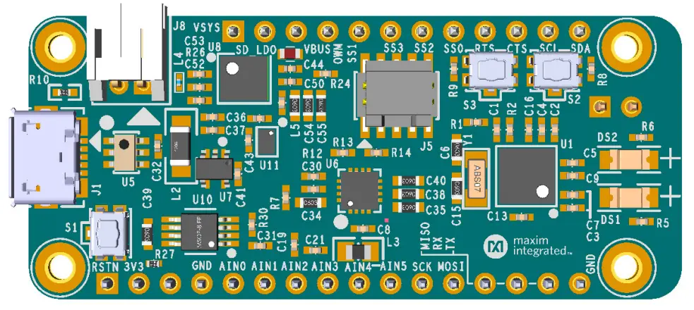

<!-- Copyright 2015-2026 Zephyr Project members and individual contributors. -->
<!-- SPDX-License-Identifier: Apache-2.0 -->
<!-- 中文翻译；编号、导航与译注为本地新增。 -->

# 第2章\_MAX32650FTHR

原文：[官方页面](https://docs.zephyrproject.org/latest/boards/adi/max32650fthr/doc/index.html)。读取日期：2026-10-16；来源摘要见[来源记录](../SOURCES.md)。

开发板概览（Board Overview）

MAX32650FTHR

名称（Name）：

`max32650fthr`

厂商（Vendor）：

[Analog Devices, Inc.](https://docs.zephyrproject.org/latest/boards/index.html#vendor=adi)

状态（Status）：

维护中（Maintained）

架构（Architecture）：

[arm](https://docs.zephyrproject.org/latest/boards/index.html#arch=arm)

片上系统（SoC）：

[max32650](https://docs.zephyrproject.org/latest/boards/index.html#soc=max32650)

[浏览开发板源码（Browse Board Sources）](https://github.com/zephyrproject-rtos/zephyr/blob/main//boards/adi/max32650fthr/doc/index.rst/../..)

## 概述（Overview）

MAX32650FTHR评估套件提供一个平台，用于评估MAX32650超低功耗、存储器可扩展微控制器（Memory-scalable Microcontroller）的能力。该器件专为高性能电池供电应用设计。

Zephyr移植版本运行在MAX32650微控制器（MCU）上。

## 硬件（Hardware）

- MAX32650微控制器（MCU）：

  - 适用于电池供电应用的高能效微控制器（Ultra Efficient Microcontroller）

    - 120 MHz Arm Cortex-M4，带浮点单元（FPU）
    - SmartDMA支持后台存储器传输（Background Memory Transfers）及可编程数据处理（Programmable Data Processing）
    - 120 MHz高速振荡器（High-speed Oscillator）和50 MHz低功耗振荡器（Low-power Oscillator）
    - 7.3728 MHz低功耗振荡器（Low Power Oscillators）
    - 32.768 kHz及实时时钟（RTC）时钟，需要外部晶体
    - 8 kHz始终开启的超低功耗振荡器（Always-on Ultra-Low-Power Oscillator）
    - 3 MB内部闪存（Flash）、1 MB内部静态随机存储器（SRAM）
    - 在1.1 V下从缓存（Cache）执行时，功耗为104 µW/MHz
    - 五种低功耗模式：活动（Active）、睡眠（Sleep）、后台（Background）、深度睡眠（Deep-Sleep）和备份（Backup）
    - 1.8 V和3.3 V输入输出（I/O），无需电平转换器（Level Translators）
    - 烧录与调试（Programming and Debugging）
  - 可扩展的带缓存外部存储器接口（Cached External Memory Interfaces）

    - 120 MB/s HyperBus/Xccela双倍数据率接口（DDR Interface）
    - SPIXF/SPIXR接口，用于扩展外部闪存／RAM
    - 240 Mbps SDHC / eMMC / SDIO / microSD接口
  - 通过合理的外设组合提供平台扩展能力（Platform Scalability）

    - 16通道直接存储器访问（DMA）
    - 3路SPI主机（60 MHz）／从机（48 MHz）
    - 1路QuadSPI主机（60 MHz）／从机（48 MHz）
    - 最多3路4 Mbaud UART，带流控制（Flow Control）
    - 2路1 MHz I2C主机／从机
    - I2S从机（Slave）
    - 四通道、7.8 ksps、10位Δ-Σ模数转换器（Delta-Sigma ADC）
    - USB 2.0高速设备接口（Hi-Speed Device Interface），带物理层（PHY）
    - 16个脉冲串发生器（Pulse Train Generators）
    - 六个32位定时器，具有8 mA大电流驱动能力（Hi-Drive）
    - 1-Wire®单总线主机（Master）
  - 信任保护单元（TPU / Trust Protection Unit），用于知识产权／数据保护与安全（IP/Data and Security）

    - 模运算加速器（MAA / Modular Arithmetic Accelerator）、真随机数发生器（TRNG）
    - 安全非易失性密钥存储（Secure Nonvolatile Key Storage），支持SHA-256和AES-128/192/256
    - 存储器解密完整性单元（Memory Decryption Integrity Unit）、安全启动ROM（Secure Boot ROM）
- MAX32650FTHR连接的外部器件：

  > - 电池连接器与充电电路（Battery Connector / Charging Circuit）
  > - Micro-SD卡接口
  > - USB 2.0全速设备接口（Full-Speed Device Interface）
  > - MAX11261六通道、24位、16 ksps模数转换器（ADC）
  > - 兼容Adafruit® Feather开发板

### 支持的功能（Supported Features）

`max32650fthr`开发板支持下表所列的硬件功能。

片上／板载（On-Chip / On-Board）

功能集成在片上系统（SoC）内／位于开发板上。

2 / 2

分别表示已启用／已禁用的实例数。点击数量标签，可查看开发板或SoC设备树源码（DTS）中该功能的第一个实例。

`vnd,foo`

与此功能匹配的设备树绑定兼容字符串（Compatible String）；点击链接可查看绑定文档。

#### `max32650fthr/max32650`目标（Target）

该开发板目标的片上存储容量：256 KiB RAM、3 MiB Flash。

<table>
<tr>
<th>类型（Type）</th>
<th>位置（Location）</th>
<th>说明（Description）</th>
<th>兼容字符串（Compatible）</th>
</tr>
<tr>
<td rowspan="2">中央处理器（CPU）</td>
<td>片上（On-Chip）</td>
<td>ARM Cortex-M4F 处理器（CPU）（<a href="https://github.com/zephyrproject-rtos/zephyr/blob/main/dts/vendor/adi/max32/max32xxx.dtsi?plain=1#L25">已启用：1</a>）</td>
<td><a href="../cpu_arm_riscv_binding_reference/P025_arm_cortex-m4f.md#std-dtcompatible-arm-cortex-m4f"><code>arm,cortex-m4f</code></a></td>
</tr>
<tr>
<td>片上（On-Chip）</td>
<td>MAX32 RV32内核（Core）（<a href="https://github.com/zephyrproject-rtos/zephyr/blob/main/dts/vendor/adi/max32/max32xxx.dtsi?plain=1#L32">已禁用：1</a>）</td>
<td><a href="../cpu_arm_riscv_binding_reference/P002_adi_max32-rv32.md#std-dtcompatible-adi-max32-rv32"><code>adi,max32-rv32</code></a></td>
</tr>
<tr>
<td rowspan="1">模数转换器（ADC）</td>
<td>片上（On-Chip）</td>
<td>ADI MAX32 10位模数转换器（ADC）（<a href="https://github.com/zephyrproject-rtos/zephyr/blob/main/dts/vendor/adi/max32/max32xxx.dtsi?plain=1#L241">已禁用：1</a>）</td>
<td><a href="../hardware/P861_ADIMAX32十位ADC绑定.md#dtbinding-adi-max32-adc-10b"><code>adi,max32-adc-10b</code></a></td>
</tr>
<tr>
<td rowspan="2">时钟控制（Clock Control）</td>
<td>片上（On-Chip）</td>
<td>通用固定频率时钟提供者（Fixed-Rate Clock Provider）（<a href="https://github.com/zephyrproject-rtos/zephyr/blob/main/dts/vendor/adi/max32/max32xxx.dtsi?plain=1#L64">已启用：2</a>；<a href="https://github.com/zephyrproject-rtos/zephyr/blob/main/dts/vendor/adi/max32/max32xxx.dtsi?plain=1#L71">已禁用：3</a>）</td>
<td><a href="../hardware/P566_固定时钟绑定.md#dtbinding-fixed-clock"><code>fixed-clock</code></a></td>
</tr>
<tr>
<td>片上（On-Chip）</td>
<td>MAX32全局控制（Global Control）（<a href="https://github.com/zephyrproject-rtos/zephyr/blob/main/dts/vendor/adi/max32/max32xxx.dtsi?plain=1#L130">已启用：1</a>）</td>
<td><a href="../clock_adi_atmel_bflb_binding_reference/P004_adi_max32-gcr.md#std-dtcompatible-adi-max32-gcr"><code>adi,max32-gcr</code></a></td>
</tr>
<tr>
<td rowspan="2">计数器（Counter）</td>
<td>片上（On-Chip）</td>
<td>ADI MAX32计数器（Counter）（<a href="https://github.com/zephyrproject-rtos/zephyr/blob/main/dts/vendor/adi/max32/max32xxx.dtsi?plain=1#L260">已禁用：6</a>）</td>
<td><a href="../counter_binding_reference/P001_adi_max32-counter.md#std-dtcompatible-adi-max32-counter"><code>adi,max32-counter</code></a></td>
</tr>
<tr>
<td>片上（On-Chip）</td>
<td>ADI MAX32兼容实时时钟计数器（Counter RTC）（<a href="https://github.com/zephyrproject-rtos/zephyr/blob/main/dts/vendor/adi/max32/max32xxx.dtsi?plain=1#L332">已启用：1</a>）</td>
<td><a href="../counter_binding_reference/P002_adi_max32-rtc-counter.md#std-dtcompatible-adi-max32-rtc-counter"><code>adi,max32-rtc-counter</code></a></td>
</tr>
<tr>
<td rowspan="1">直接存储器访问（DMA）</td>
<td>片上（On-Chip）</td>
<td>ADI MAX32直接存储器访问（DMA）（<a href="https://github.com/zephyrproject-rtos/zephyr/blob/main/dts/arm/adi/max32/max32650.dtsi?plain=1#L199">已启用：1</a>）</td>
<td><a href="../dma_binding_reference/P002_adi_max32-dma.md#std-dtcompatible-adi-max32-dma"><code>adi,max32-dma</code></a></td>
</tr>
<tr>
<td rowspan="1">闪存控制器（Flash Controller）</td>
<td>片上（On-Chip）</td>
<td>MAX32XXX闪存控制器（Flash Controller）（<a href="https://github.com/zephyrproject-rtos/zephyr/blob/main/dts/vendor/adi/max32/max32xxx.dtsi?plain=1#L111">已启用：1</a>）</td>
<td><a href="../flash_adi_microchip_nordic_binding_reference/P001_adi_max32-flash-controller.md#std-dtcompatible-adi-max32-flash-controller"><code>adi,max32-flash-controller</code></a></td>
</tr>
<tr>
<td rowspan="1">通用输入输出与接插件（GPIO &amp; Headers）</td>
<td>片上（On-Chip）</td>
<td>MAX32通用输入输出（GPIO）（<a href="https://github.com/zephyrproject-rtos/zephyr/blob/main/dts/vendor/adi/max32/max32xxx.dtsi?plain=1#L175">已启用：4</a>）</td>
<td><a href="../gpio_adi_headers_ambiq_binding_reference/P011_adi_max32-gpio.md#std-dtcompatible-adi-max32-gpio"><code>adi,max32-gpio</code></a></td>
</tr>
<tr>
<td rowspan="1">集成电路间总线（I2C）</td>
<td>片上（On-Chip）</td>
<td>ADI MAX32 I2C控制器（<a href="https://github.com/zephyrproject-rtos/zephyr/blob/main/dts/vendor/adi/max32/max32xxx.dtsi?plain=1#L139">已禁用：2</a>）</td>
<td><a href="../i2c_adi_atmel_esp_binding_reference/P001_adi_max32-i2c.md#std-dtcompatible-adi-max32-i2c"><code>adi,max32-i2c</code></a></td>
</tr>
<tr>
<td rowspan="1">输入（Input）</td>
<td>板载（On-Board）</td>
<td>一组绑定到 GPIO 的输入按键（GPIO-Bound Input Keys）（<a href="https://github.com/zephyrproject-rtos/zephyr/blob/main/boards/adi/max32650fthr/max32650fthr.dts?plain=1#L39">已启用：1</a>）</td>
<td><a href="../hardware/P563_GPIO按键绑定.md#std-dtcompatible-gpio-keys"><code>gpio-keys</code></a></td>
</tr>
<tr>
<td rowspan="1">中断控制器（Interrupt Controller）</td>
<td>片上（On-Chip）</td>
<td>ARMv7-M 嵌套向量中断控制器（Nested Vectored Interrupt Controller，NVIC）（<a href="https://github.com/zephyrproject-rtos/zephyr/blob/main/dts/arm/armv7-m.dtsi?plain=1#L13">已启用：1</a>）</td>
<td><a href="../arm_interrupt_timer_binding_reference/P002_ARMv7_M_NVIC.md#std-dtcompatible-arm-v7m-nvic"><code>arm,v7m-nvic</code></a></td>
</tr>
<tr>
<td rowspan="1">发光二极管（LED）</td>
<td>板载（On-Board）</td>
<td>一组由 GPIO 控制的 LED（GPIO-Controlled LEDs）（<a href="https://github.com/zephyrproject-rtos/zephyr/blob/main/boards/adi/max32650fthr/max32650fthr.dts?plain=1#L25">已启用：1</a>）</td>
<td><a href="../hardware/P564_GPIO指示灯绑定.md#dtbinding-gpio-leds"><code>gpio-leds</code></a></td>
</tr>
<tr>
<td rowspan="1">邮箱（Mailbox）</td>
<td>片上（On-Chip）</td>
<td>ADI MAX32 SEMA邮箱（Mailbox）（<a href="https://github.com/zephyrproject-rtos/zephyr/blob/main/dts/vendor/adi/max32/max32xxx.dtsi?plain=1#L194">已禁用：1</a>）</td>
<td><a href="../intercore_reference/P032_ADI硬件信号量邮箱绑定.md#dtbinding-adi-mbox-max32-sema"><code>adi,mbox-max32-sema</code></a></td>
</tr>
<tr>
<td rowspan="1">存储器控制器（Memory Controller）</td>
<td>片上（On-Chip）</td>
<td>MAX32 HyperBus存储器控制器接口（HPB / HyperBus Memory Controller Interface）（<a href="https://github.com/zephyrproject-rtos/zephyr/blob/main/dts/arm/adi/max32/max32650.dtsi?plain=1#L222">已禁用：1</a>）</td>
<td><a href="../memory_controller_hyperbus_smc_binding_reference/P002_adi_max32-hpb.md#std-dtcompatible-adi-max32-hpb"><code>adi,max32-hpb</code></a></td>
</tr>
<tr>
<td rowspan="1">存储技术设备（MTD）</td>
<td>片上（On-Chip）</td>
<td>闪存（Flash）节点（<a href="https://github.com/zephyrproject-rtos/zephyr/blob/main/dts/vendor/adi/max32/max32xxx.dtsi?plain=1#L119">已启用：1</a>）</td>
<td><a href="../mtd_nxp_st_ti_partition_binding_reference/P013_soc-nv-flash.md#std-dtcompatible-soc-nv-flash"><code>soc-nv-flash</code></a></td>
</tr>
<tr>
<td rowspan="1">引脚控制（Pin Control）</td>
<td>片上（On-Chip）</td>
<td>MAX32引脚控制器（Pin Controller）（<a href="https://github.com/zephyrproject-rtos/zephyr/blob/main/dts/vendor/adi/max32/max32xxx.dtsi?plain=1#L169">已启用：1</a>）</td>
<td><a href="../pinctrl_adi_ambiq_arm_binding_reference/P001_adi_max32-pinctrl.md#std-dtcompatible-adi-max32-pinctrl"><code>adi,max32-pinctrl</code></a></td>
</tr>
<tr>
<td rowspan="1">脉宽调制（PWM）</td>
<td>片上（On-Chip）</td>
<td>ADI MAX32脉宽调制（PWM）（<a href="https://github.com/zephyrproject-rtos/zephyr/blob/main/dts/vendor/adi/max32/max32xxx.dtsi?plain=1#L265">已禁用：6</a>）</td>
<td><a href="../pwm_adi_esp_infineon_binding_reference/P003_adi_max32-pwm.md#std-dtcompatible-adi-max32-pwm"><code>adi,max32-pwm</code></a></td>
</tr>
<tr>
<td rowspan="1">随机数生成器（RNG）</td>
<td>片上（On-Chip）</td>
<td>ADI MAX32XXX真随机数发生器（TRNG）（<a href="https://github.com/zephyrproject-rtos/zephyr/blob/main/dts/arm/adi/max32/max32650.dtsi?plain=1#L94">已禁用：1</a>）</td>
<td><a href="../rng_binding_reference/P001_adi_max32-trng.md#std-dtcompatible-adi-max32-trng"><code>adi,max32-trng</code></a></td>
</tr>
<tr>
<td rowspan="1">串行控制器（Serial Controller）</td>
<td>片上（On-Chip）</td>
<td>MAX32通用异步收发器（UART）（<a href="https://github.com/zephyrproject-rtos/zephyr/blob/main/dts/vendor/adi/max32/max32xxx.dtsi?plain=1#L202">已启用：1</a>；<a href="https://github.com/zephyrproject-rtos/zephyr/blob/main/dts/vendor/adi/max32/max32xxx.dtsi?plain=1#L210">已禁用：2</a>）</td>
<td><a href="../uart_adi_arm_atmel_binding_reference/P001_adi_max32-uart.md#std-dtcompatible-adi-max32-uart"><code>adi,max32-uart</code></a></td>
</tr>
<tr>
<td rowspan="1">串行外设接口（SPI）</td>
<td>片上（On-Chip）</td>
<td>ADI MAX32串行外设接口（SPI）（<a href="https://github.com/zephyrproject-rtos/zephyr/blob/main/dts/arm/adi/max32/max32650.dtsi?plain=1#L153">已启用：1</a>；<a href="https://github.com/zephyrproject-rtos/zephyr/blob/main/dts/arm/adi/max32/max32650.dtsi?plain=1#L143">已禁用：3</a>）</td>
<td><a href="../spi_adi_atmel_esp_binding_reference/P001_adi_max32-spi.md#std-dtcompatible-adi-max32-spi"><code>adi,max32-spi</code></a></td>
</tr>
<tr>
<td rowspan="1">静态随机存储器（SRAM）</td>
<td>片上（On-Chip）</td>
<td>通用片上静态随机存储器（SRAM）（<a href="https://github.com/zephyrproject-rtos/zephyr/blob/main/dts/arm/adi/max32/max32650.dtsi?plain=1#L59">已启用：7</a>）</td>
<td><a href="../hardware/P567_内存映射SRAM绑定.md#dtbinding-mmio-sram"><code>mmio-sram</code></a></td>
</tr>
<tr>
<td rowspan="2">定时器（Timer）</td>
<td>片上（On-Chip）</td>
<td>ADI MAX32定时器（Timer）（<a href="https://github.com/zephyrproject-rtos/zephyr/blob/main/dts/vendor/adi/max32/max32xxx.dtsi?plain=1#L252">已禁用：6</a>）</td>
<td><a href="../system_timer_binding_reference/P002_adi_max32-timer.md#std-dtcompatible-adi-max32-timer"><code>adi,max32-timer</code></a></td>
</tr>
<tr>
<td>片上（On-Chip）</td>
<td>ARMv7-M 系统节拍（System Tick）（<a href="https://github.com/zephyrproject-rtos/zephyr/blob/main/dts/arm/armv7-m.dtsi?plain=1#L21">已启用：1</a>）</td>
<td><a href="../arm_interrupt_timer_binding_reference/P006_ARMv7_M_SysTick.md#std-dtcompatible-arm-armv7m-systick"><code>arm,armv7m-systick</code></a></td>
</tr>
<tr>
<td rowspan="1">通用串行总线（USB）</td>
<td>片上（On-Chip）</td>
<td>ADI MAX32高速USB（USBHS）（<a href="https://github.com/zephyrproject-rtos/zephyr/blob/main/dts/arm/adi/max32/max32650.dtsi?plain=1#L210">已禁用：1</a>）</td>
<td><a href="../usb_controller_binding_reference/P001_adi_max32-usbhs.md#std-dtcompatible-adi-max32-usbhs"><code>adi,max32-usbhs</code></a></td>
</tr>
<tr>
<td rowspan="1">看门狗（Watchdog）</td>
<td>片上（On-Chip）</td>
<td>MAX32XXX看门狗（Watchdog）（<a href="https://github.com/zephyrproject-rtos/zephyr/blob/main/dts/arm/adi/max32/max32650.dtsi?plain=1#L183">已启用：1</a>；<a href="https://github.com/zephyrproject-rtos/zephyr/blob/main/dts/arm/adi/max32/max32650.dtsi?plain=1#L191">已禁用：1</a>）</td>
<td><a href="../watchdog_binding_reference/P001_adi_max32-watchdog.md#std-dtcompatible-adi-max32-watchdog"><code>adi,max32-watchdog</code></a></td>
</tr>
</table>

## 烧录与调试（Programming and Debugging）

`max32650fthr`开发板支持下表所列的运行工具（Runners）及相关west命令。

<table>
<tr>
<th></th>
<th>烧录（flash）</th>
<th>调试（debug）</th>
<th>连接调试会话（attach）</th>
<th>实时传输（rtt）</th>
<th>调试服务器（debugserver）</th>
<th>复位（reset）</th>
</tr>
<tr>
<td><a href="https://docs.zephyrproject.org/latest/develop/flash_debug/host-tools.html#runner-jlink"><code>jlink</code></a></td>
<td>✅</td>
<td>✅</td>
<td>✅</td>
<td>✅</td>
<td>✅</td>
<td>✅</td>
</tr>
<tr>
<td><a href="https://docs.zephyrproject.org/latest/develop/flash_debug/host-tools.html#runner-openocd">openocd</a></td>
<td>✅（默认 / default）</td>
<td>✅（默认 / default）</td>
<td>✅</td>
<td>✅</td>
<td>✅</td>
<td></td>
</tr>
</table>

### 烧录（Flashing）

将外部调试探针（Debug Probe）连接到SWD端口，即可烧录MAX32650微控制器（MCU）。SWD调试通过Cortex 10针接口J5接入，逻辑电平固定为VDDIO，即1.8 V。

将调试探针连接到主机后，执行`west flash`命令即可将固件镜像写入闪存（Flash）。

注意（Note）

该开发板默认使用OpenOCD调试接口。也可覆盖运行工具（Runner），在west命令后添加`--runner jlink`，使用Segger J-Link及其原生工具。应通过合适的适配板和线缆，将J-Link连接到标准2 × 5针调试接口J5。

### 调试（Debugging）

请参考[烧录（Flashing）](#flashing)一节，并将`west flash`替换为`west debug`执行调试。

## 参考资料（References）

- [MAX32650FTHR网页（Web Page）](https://www.analog.com/en/resources/evaluation-hardware-and-software/evaluation-boards-kits/max32650fthr.html)

## 译注

概述中的物理SRAM容量与自动生成目标表中的RAM容量分别依照原文保留，不能将目标可用存储器数量直接当成器件总容量。

---

[上一章](P001_MAX32650EVKIT.md) · [返回大纲](大纲.md) · [全站翻译进度](../PROGRESS.md) · [下一章](P003_MAX32651EVKIT.md)
