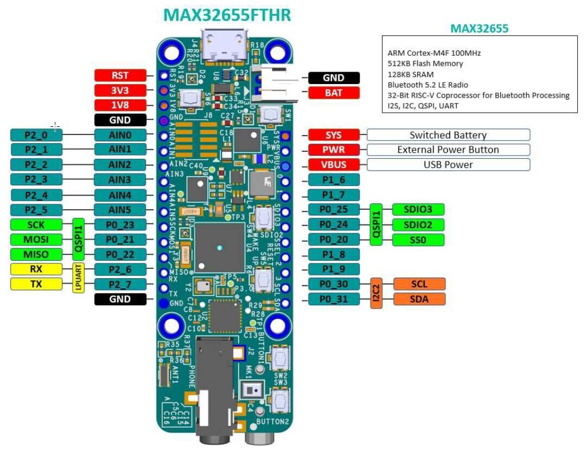
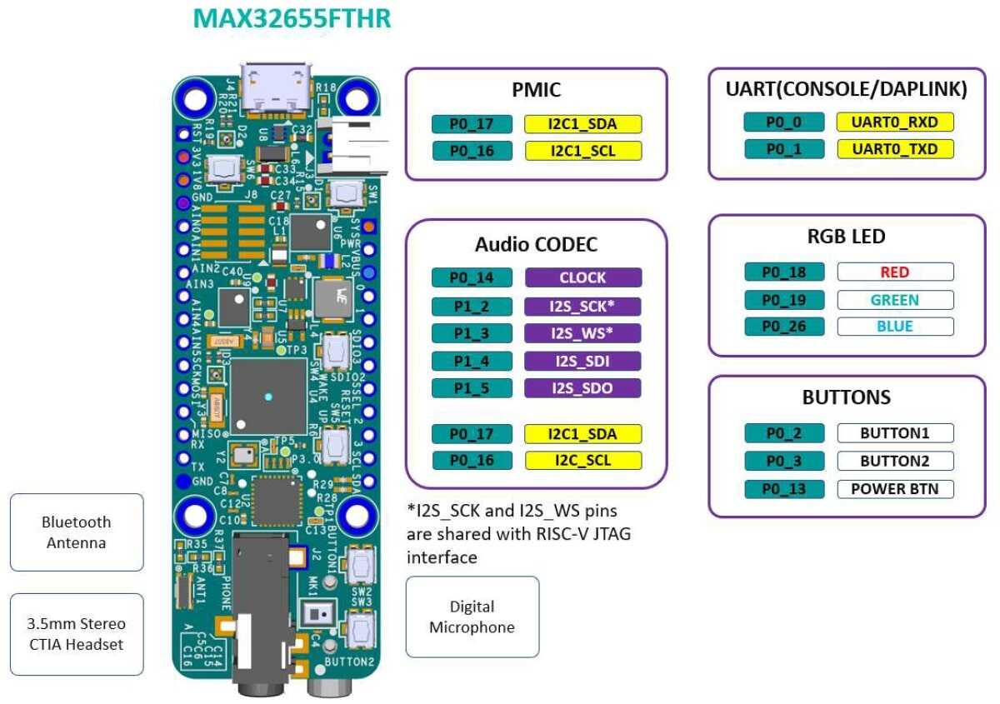
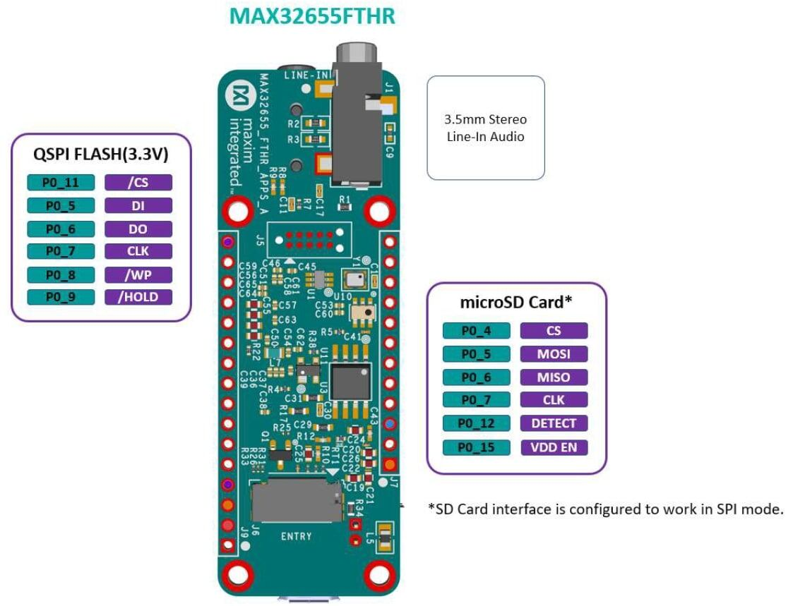

<!-- Copyright 2015-2026 Zephyr Project members and individual contributors. -->
<!-- SPDX-License-Identifier: Apache-2.0 -->
<!-- 中文翻译；编号、导航与译注为本地新增。 -->

<a id="max32655fthr"></a>

# 第5章\_MAX32655FTHR

原文：[官方页面](https://docs.zephyrproject.org/latest/boards/adi/max32655fthr/doc/index.html)。读取日期：2026-10-16；来源摘要见[来源记录](../SOURCES.md)。

开发板概览（Board Overview）

<a id="id1"></a>

[](images/max32655fthr_img3.jpg)

MAX32655FTHR

名称（Name）：

`max32655fthr`

厂商（Vendor）：

[Analog Devices, Inc.](https://docs.zephyrproject.org/latest/boards/index.html#vendor=adi)

状态（Status）：

维护中（Maintained）

架构（Architecture）：

RISC-V、Arm架构（[riscv](https://docs.zephyrproject.org/latest/boards/index.html#arch=riscv), [arm](https://docs.zephyrproject.org/latest/boards/index.html#arch=arm)）

片上系统（SoC）：

[max32655](https://docs.zephyrproject.org/latest/boards/index.html#soc=max32655)

<a id="board-github-link"></a>

[浏览开发板源码（Browse Board Sources）](https://github.com/zephyrproject-rtos/zephyr/blob/main//boards/adi/max32655fthr/doc/index.rst/../..)<a id="overview"></a>

## 概述（Overview）

MAX32655FTHR是一个快速开发平台，可帮助工程师使用MAX32655 Arm© Cortex®-M4F和Bluetooth® 5.2低功耗（LE）快速实现超低功耗无线方案。开发板还配有MAX20303电源管理集成电路（PMIC），用于电池和电源管理。它采用0.9 × 2.6英寸的小型双排排针布局（Dual-row Header Footprint），兼容Adafruit Feather Wing外设扩展板。板载外设包括数字麦克风、低功耗立体声音频编解码器（CODEC）、128 MB QSPI闪存、microSD卡接口、RGB指示LED和按键。MAX32655FTHR提供经过功耗优化的灵活平台，便于快速进行概念验证（Proof-of-Concepts）和早期软件开发，从而缩短上市时间。访问[https://www.analog.com/MAX32655FTHR](https://www.analog.com/MAX32655FTHR)开始使用该开发板。

Zephyr移植版本运行在MAX32655微控制器（MCU）上。







<a id="hardware"></a>

## 硬件（Hardware）

MAX32655微控制器（MCU）：

超低功耗无线微控制器（Ultra-Low-Power Wireless Microcontroller）


- 内部100 MHz振荡器（Oscillator）
- 灵活的低功耗模式，可选择7.3728 MHz系统时钟
- 512 KB闪存（Flash）和128 KB SRAM；其中一个32 KB SRAM存储区（Bank）可选启用纠错码（ECC）
- 16 KB指令缓存（Instruction Cache）

Bluetooth 5.2低功耗无线电（LE Radio）


- 专用超低功耗32位RISC-V协处理器（Coprocessor），用于分担时序敏感的蓝牙处理任务
- 提供完全开源的Bluetooth 5.2协议栈（Stack）
- 支持到达角（AoA）、发射角（AoD）、低功耗音频（LE Audio）和网状网络（Mesh）
- 高吞吐模式（High-throughput Mode），2 Mbps
- 远距离模式（Long-range Modes），125 kbps和500 kbps
- 接收灵敏度（Rx Sensitivity）：−97.5 dBm；发射功率（Tx Power）：+4.5 dBm
- 单端天线连接（Single-ended Antenna Connection），50 Ω

通过电源管理（Power Management）尽可能延长电池续航


- 2.0–3.6 V供电电压范围（Supply Voltage Range）
- 集成单电感多输出电源稳压器（SIMO Power Regulator）
- 动态电压调节（DVS / Dynamic Voltage Scaling）
- 3.0 V时活动电流（Active Current）为23.8 μA/MHz
- 3.0 V时保留32 KB数据的保持电流（Retention Current）为4.4 μA
- 低功耗模式下可选择保留SRAM并运行实时时钟（RTC）

多种系统控制外设（Peripherals for System Control）


- 最多两路高速SPI主机／从机（Master/Slave）
- 最多三路高速I2C主机／从机，3.4 Mbps
- 最多四路UART和一路I2S主机／从机
- 最多8路输入、10位Σ-Δ模数转换器（Sigma-Delta ADC），7.8 ksps
- 最多四个微功耗比较器（Micro-Power Comparators）
- 定时器：原文写作“Up to Two Four”的32位定时器、两个低功耗（LP）定时器和两个看门狗定时器（Watchdog Timers）
- 1-Wire®单总线主机（Master）
- 最多四个脉冲串引擎（Pulse Train / PWM Engines）
- 带唤醒定时器（Wake-Up Timer）的实时时钟（RTC）
- 最多52个通用输入输出（GPIO）

安全与完整性（Security and Integrity）


- 可用的安全启动（Secure Boot）
- 真随机数（TRNG）种子发生器（Seed Generator）
- AES 128/192/256硬件加速引擎（Hardware Acceleration Engine）

MAX32655FTHR连接的外部器件：


- 立体声音频编解码器接口（Audio Stereo Codec Interface）
- 数字麦克风（Digital Microphone）
- 电源管理集成电路（PMIC）和电池充电器（Battery Charger）
- 128 Mb四线SPI闪存（QSPI Flash）
- Micro SD卡接口
- RGB彩色LED
- 按键（Push Buttons）

<a id="supported-features"></a>

### 支持的功能（Supported Features）

`max32655fthr`开发板支持下表所列的硬件功能。

片上／板载（On-Chip / On-Board）

功能集成在片上系统（SoC）内／位于开发板上。

2 / 2

分别表示已启用／已禁用的实例数。点击数量标签，可查看开发板或SoC设备树源码（DTS）中该功能的第一个实例。

`vnd,foo`

与此功能匹配的设备树绑定兼容字符串（Compatible String）；点击链接可查看绑定文档。

<a id="max32655fthr-hw-features"></a>

<a id="max32655fthr-max32655fthr/max32655/m4-hw-features-section"></a>

#### `max32655fthr/max32655/m4`目标（Target）

<a id="max32655fthr-max32655fthr/max32655/m4-hw-features-panel"></a>

<a id="max32655fthr-max32655fthr/max32655/m4-hw-features-memory"></a>

该开发板目标的片上存储容量：64 KiB RAM、512 KiB Flash。

<a id="max32655fthr-max32655fthr/max32655/m4-hw-features-table"></a>

<table>
<tr>
<th>类型（Type）</th>
<th>位置（Location）</th>
<th>说明（Description）</th>
<th>兼容字符串（Compatible）</th>
</tr>
<tr>
<td rowspan="2">中央处理器（CPU）</td>
<td>片上（On-Chip）</td>
<td>ARM Cortex-M4F 处理器（CPU）（<a href="https://github.com/zephyrproject-rtos/zephyr/blob/main/dts/vendor/adi/max32/max32xxx.dtsi?plain=1#L25">已启用：1</a>）</td>
<td><a href="../cpu_arm_riscv_binding_reference/P025_arm_cortex-m4f.md#std-dtcompatible-arm-cortex-m4f"><code>arm,cortex-m4f</code></a></td>
</tr>
<tr>
<td>片上（On-Chip）</td>
<td>MAX32 RV32内核（Core）（<a href="https://github.com/zephyrproject-rtos/zephyr/blob/main/dts/vendor/adi/max32/max32xxx.dtsi?plain=1#L32">已启用：1</a>）</td>
<td><a href="../cpu_arm_riscv_binding_reference/P002_adi_max32-rv32.md#std-dtcompatible-adi-max32-rv32"><code>adi,max32-rv32</code></a></td>
</tr>
<tr>
<td rowspan="1">模数转换器（ADC）</td>
<td>片上（On-Chip）</td>
<td>ADI MAX32 10位模数转换器（ADC）（<a href="https://github.com/zephyrproject-rtos/zephyr/blob/main/dts/vendor/adi/max32/max32xxx.dtsi?plain=1#L241">已禁用：1</a>）</td>
<td><a href="../hardware/P861_ADIMAX32十位ADC绑定.md#dtbinding-adi-max32-adc-10b"><code>adi,max32-adc-10b</code></a></td>
</tr>
<tr>
<td rowspan="2">时钟控制（Clock Control）</td>
<td>片上（On-Chip）</td>
<td>通用固定频率时钟提供者（Fixed-Rate Clock Provider）（<a href="https://github.com/zephyrproject-rtos/zephyr/blob/main/dts/vendor/adi/max32/max32xxx.dtsi?plain=1#L64">已启用：3</a>；<a href="https://github.com/zephyrproject-rtos/zephyr/blob/main/dts/vendor/adi/max32/max32xxx.dtsi?plain=1#L71">已禁用：5</a>）</td>
<td><a href="../hardware/P566_固定时钟绑定.md#dtbinding-fixed-clock"><code>fixed-clock</code></a></td>
</tr>
<tr>
<td>片上（On-Chip）</td>
<td>MAX32全局控制（Global Control）（<a href="https://github.com/zephyrproject-rtos/zephyr/blob/main/dts/vendor/adi/max32/max32xxx.dtsi?plain=1#L130">已启用：1</a>）</td>
<td><a href="../clock_adi_atmel_bflb_binding_reference/P004_adi_max32-gcr.md#std-dtcompatible-adi-max32-gcr"><code>adi,max32-gcr</code></a></td>
</tr>
<tr>
<td rowspan="3">计数器（Counter）</td>
<td>片上（On-Chip）</td>
<td>ADI MAX32计数器（Counter）（<a href="https://github.com/zephyrproject-rtos/zephyr/blob/main/dts/vendor/adi/max32/max32xxx.dtsi?plain=1#L260">已禁用：6</a>）</td>
<td><a href="../counter_binding_reference/P001_adi_max32-counter.md#std-dtcompatible-adi-max32-counter"><code>adi,max32-counter</code></a></td>
</tr>
<tr>
<td>片上（On-Chip）</td>
<td>ADI MAX32兼容实时时钟计数器（Counter RTC）（<a href="https://github.com/zephyrproject-rtos/zephyr/blob/main/dts/vendor/adi/max32/max32xxx.dtsi?plain=1#L332">已启用：1</a>）</td>
<td><a href="../counter_binding_reference/P002_adi_max32-rtc-counter.md#std-dtcompatible-adi-max32-rtc-counter"><code>adi,max32-rtc-counter</code></a></td>
</tr>
<tr>
<td>片上（On-Chip）</td>
<td>ADI MAX32唤醒定时器（Wake-Up Timer）是一个特殊的32位定时器实例，能够从睡眠（Sleep）、待机（Standby）和备份（Backup）模式唤醒设备。（<a href="https://github.com/zephyrproject-rtos/zephyr/blob/main/dts/vendor/adi/max32/max32655.dtsi?plain=1#L162">已禁用：1</a>）</td>
<td><a href="../counter_binding_reference/P003_adi_max32-wut.md#std-dtcompatible-adi-max32-wut"><code>adi,max32-wut</code></a></td>
</tr>
<tr>
<td rowspan="1">直接存储器访问（DMA）</td>
<td>片上（On-Chip）</td>
<td>ADI MAX32直接存储器访问（DMA）（<a href="https://github.com/zephyrproject-rtos/zephyr/blob/main/dts/vendor/adi/max32/max32655.dtsi?plain=1#L88">已启用：1</a>）</td>
<td><a href="../dma_binding_reference/P002_adi_max32-dma.md#std-dtcompatible-adi-max32-dma"><code>adi,max32-dma</code></a></td>
</tr>
<tr>
<td rowspan="1">闪存控制器（Flash Controller）</td>
<td>片上（On-Chip）</td>
<td>MAX32XXX闪存控制器（Flash Controller）（<a href="https://github.com/zephyrproject-rtos/zephyr/blob/main/dts/vendor/adi/max32/max32xxx.dtsi?plain=1#L111">已启用：1</a>）</td>
<td><a href="../flash_adi_microchip_nordic_binding_reference/P001_adi_max32-flash-controller.md#std-dtcompatible-adi-max32-flash-controller"><code>adi,max32-flash-controller</code></a></td>
</tr>
<tr>
<td rowspan="2">通用输入输出与接插件（GPIO &amp; Headers）</td>
<td>片上（On-Chip）</td>
<td>MAX32通用输入输出（GPIO）（<a href="https://github.com/zephyrproject-rtos/zephyr/blob/main/dts/vendor/adi/max32/max32xxx.dtsi?plain=1#L175">已启用：4</a>）</td>
<td><a href="../gpio_adi_headers_ambiq_binding_reference/P011_adi_max32-gpio.md#std-dtcompatible-adi-max32-gpio"><code>adi,max32-gpio</code></a></td>
</tr>
<tr>
<td>板载（On-Board）</td>
<td>引出到Adafruit Feather排针（Headers）的GPIO引脚（<a href="https://github.com/zephyrproject-rtos/zephyr/blob/main/boards/adi/max32655fthr/max32655fthr.dtsi?plain=1#L86">已启用：1</a>）</td>
<td><a href="../gpio_adi_headers_ambiq_binding_reference/P001_adafruit-feather-header.md#std-dtcompatible-adafruit-feather-header"><code>adafruit-feather-header</code></a></td>
</tr>
<tr>
<td rowspan="1">集成电路间总线（I2C）</td>
<td>片上（On-Chip）</td>
<td>ADI MAX32 I2C控制器（<a href="https://github.com/zephyrproject-rtos/zephyr/blob/main/dts/vendor/adi/max32/max32xxx.dtsi?plain=1#L149">已启用：2</a>；<a href="https://github.com/zephyrproject-rtos/zephyr/blob/main/dts/vendor/adi/max32/max32xxx.dtsi?plain=1#L139">已禁用：1</a>）</td>
<td><a href="../i2c_adi_atmel_esp_binding_reference/P001_adi_max32-i2c.md#std-dtcompatible-adi-max32-i2c"><code>adi,max32-i2c</code></a></td>
</tr>
<tr>
<td rowspan="1">集成电路间音频总线（I2S）</td>
<td>片上（On-Chip）</td>
<td>Analog Devices MAX32系列I2S控制器（<a href="https://github.com/zephyrproject-rtos/zephyr/blob/main/dts/vendor/adi/max32/max32655.dtsi?plain=1#L168">已启用：1</a>）</td>
<td><a href="../i2s_binding_reference/P001_adi_max32-i2s.md#std-dtcompatible-adi-max32-i2s"><code>adi,max32-i2s</code></a></td>
</tr>
<tr>
<td rowspan="1">输入（Input）</td>
<td>板载（On-Board）</td>
<td>一组绑定到 GPIO 的输入按键（GPIO-Bound Input Keys）（<a href="https://github.com/zephyrproject-rtos/zephyr/blob/main/boards/adi/max32655fthr/max32655fthr.dtsi?plain=1#L52">已启用：1</a>）</td>
<td><a href="../hardware/P563_GPIO按键绑定.md#std-dtcompatible-gpio-keys"><code>gpio-keys</code></a></td>
</tr>
<tr>
<td rowspan="1">中断控制器（Interrupt Controller）</td>
<td>片上（On-Chip）</td>
<td>ARMv7-M 嵌套向量中断控制器（Nested Vectored Interrupt Controller，NVIC）（<a href="https://github.com/zephyrproject-rtos/zephyr/blob/main/dts/arm/armv7-m.dtsi?plain=1#L13">已启用：1</a>）</td>
<td><a href="../arm_interrupt_timer_binding_reference/P002_ARMv7_M_NVIC.md#std-dtcompatible-arm-v7m-nvic"><code>arm,v7m-nvic</code></a></td>
</tr>
<tr>
<td rowspan="1">发光二极管（LED）</td>
<td>板载（On-Board）</td>
<td>一组由 GPIO 控制的 LED（GPIO-Controlled LEDs）（<a href="https://github.com/zephyrproject-rtos/zephyr/blob/main/boards/adi/max32655fthr/max32655fthr.dtsi?plain=1#L33">已启用：1</a>）</td>
<td><a href="../hardware/P564_GPIO指示灯绑定.md#dtbinding-gpio-leds"><code>gpio-leds</code></a></td>
</tr>
<tr>
<td rowspan="1">邮箱（Mailbox）</td>
<td>片上（On-Chip）</td>
<td>ADI MAX32 SEMA邮箱（Mailbox）（<a href="https://github.com/zephyrproject-rtos/zephyr/blob/main/dts/vendor/adi/max32/max32xxx.dtsi?plain=1#L194">已禁用：1</a>）</td>
<td><a href="../intercore_reference/P032_ADI硬件信号量邮箱绑定.md#dtbinding-adi-mbox-max32-sema"><code>adi,mbox-max32-sema</code></a></td>
</tr>
<tr>
<td rowspan="2">存储技术设备（MTD）</td>
<td>片上（On-Chip）</td>
<td>闪存（Flash）节点（<a href="https://github.com/zephyrproject-rtos/zephyr/blob/main/dts/vendor/adi/max32/max32xxx.dtsi?plain=1#L119">已启用：1</a>）</td>
<td><a href="../mtd_nxp_st_ti_partition_binding_reference/P013_soc-nv-flash.md#std-dtcompatible-soc-nv-flash"><code>soc-nv-flash</code></a></td>
</tr>
<tr>
<td>板载（On-Board）</td>
<td>这些属性用于支持Zephyr的<code>spi-nor</code>闪存驱动通过Zephyr SPI API，使用基于M25P80的标准命令集控制串行闪存（Serial Flash Memory）。（<a href="https://github.com/zephyrproject-rtos/zephyr/blob/main/boards/adi/max32655fthr/max32655fthr_max32655_m4.dts?plain=1#L105">已启用：1</a>）</td>
<td><a href="../mtd_microchip_nordic_nxp_binding_reference/P002_jedec_spi-nor.md#std-dtcompatible-jedec-spi-nor"><code>jedec,spi-nor</code></a></td>
</tr>
<tr>
<td rowspan="1">引脚控制（Pin Control）</td>
<td>片上（On-Chip）</td>
<td>MAX32引脚控制器（Pin Controller）（<a href="https://github.com/zephyrproject-rtos/zephyr/blob/main/dts/vendor/adi/max32/max32xxx.dtsi?plain=1#L169">已启用：1</a>）</td>
<td><a href="../pinctrl_adi_ambiq_arm_binding_reference/P001_adi_max32-pinctrl.md#std-dtcompatible-adi-max32-pinctrl"><code>adi,max32-pinctrl</code></a></td>
</tr>
<tr>
<td rowspan="1">脉宽调制（PWM）</td>
<td>片上（On-Chip）</td>
<td>ADI MAX32脉宽调制（PWM）（<a href="https://github.com/zephyrproject-rtos/zephyr/blob/main/dts/vendor/adi/max32/max32xxx.dtsi?plain=1#L265">已禁用：4</a>）</td>
<td><a href="../pwm_adi_esp_infineon_binding_reference/P003_adi_max32-pwm.md#std-dtcompatible-adi-max32-pwm"><code>adi,max32-pwm</code></a></td>
</tr>
<tr>
<td rowspan="1">随机数生成器（RNG）</td>
<td>片上（On-Chip）</td>
<td>ADI MAX32XXX真随机数发生器（TRNG）（<a href="https://github.com/zephyrproject-rtos/zephyr/blob/main/dts/vendor/adi/max32/max32xxx.dtsi?plain=1#L226">已启用：1</a>）</td>
<td><a href="../rng_binding_reference/P001_adi_max32-trng.md#std-dtcompatible-adi-max32-trng"><code>adi,max32-trng</code></a></td>
</tr>
<tr>
<td rowspan="1">串行控制器（Serial Controller）</td>
<td>片上（On-Chip）</td>
<td>MAX32通用异步收发器（UART）（<a href="https://github.com/zephyrproject-rtos/zephyr/blob/main/dts/vendor/adi/max32/max32xxx.dtsi?plain=1#L202">已启用：2</a>；<a href="https://github.com/zephyrproject-rtos/zephyr/blob/main/dts/vendor/adi/max32/max32xxx.dtsi?plain=1#L210">已禁用：2</a>）</td>
<td><a href="../uart_adi_arm_atmel_binding_reference/P001_adi_max32-uart.md#std-dtcompatible-adi-max32-uart"><code>adi,max32-uart</code></a></td>
</tr>
<tr>
<td rowspan="1">串行外设接口（SPI）</td>
<td>片上（On-Chip）</td>
<td>ADI MAX32串行外设接口（SPI）（<a href="https://github.com/zephyrproject-rtos/zephyr/blob/main/dts/vendor/adi/max32/max32655.dtsi?plain=1#L107">已启用：2</a>）</td>
<td><a href="../spi_adi_atmel_esp_binding_reference/P001_adi_max32-spi.md#std-dtcompatible-adi-max32-spi"><code>adi,max32-spi</code></a></td>
</tr>
<tr>
<td rowspan="1">静态随机存储器（SRAM）</td>
<td>片上（On-Chip）</td>
<td>通用片上静态随机存储器（SRAM）（<a href="https://github.com/zephyrproject-rtos/zephyr/blob/main/dts/vendor/adi/max32/max32655.dtsi?plain=1#L59">已启用：4</a>）</td>
<td><a href="../hardware/P567_内存映射SRAM绑定.md#dtbinding-mmio-sram"><code>mmio-sram</code></a></td>
</tr>
<tr>
<td rowspan="2">定时器（Timer）</td>
<td>片上（On-Chip）</td>
<td>ADI MAX32定时器（Timer）（<a href="https://github.com/zephyrproject-rtos/zephyr/blob/main/dts/vendor/adi/max32/max32xxx.dtsi?plain=1#L252">已禁用：7</a>）</td>
<td><a href="../system_timer_binding_reference/P002_adi_max32-timer.md#std-dtcompatible-adi-max32-timer"><code>adi,max32-timer</code></a></td>
</tr>
<tr>
<td>片上（On-Chip）</td>
<td>ARMv7-M 系统节拍（System Tick）（<a href="https://github.com/zephyrproject-rtos/zephyr/blob/main/dts/arm/armv7-m.dtsi?plain=1#L21">已启用：1</a>）</td>
<td><a href="../arm_interrupt_timer_binding_reference/P006_ARMv7_M_SysTick.md#std-dtcompatible-arm-armv7m-systick"><code>arm,armv7m-systick</code></a></td>
</tr>
<tr>
<td rowspan="1">单线总线（1-Wire）</td>
<td>片上（On-Chip）</td>
<td>ADI MAX32xxx微控制器（MCU）的1-Wire单总线主机（Master）（<a href="https://github.com/zephyrproject-rtos/zephyr/blob/main/dts/vendor/adi/max32/max32655.dtsi?plain=1#L147">已禁用：1</a>）</td>
<td><a href="../mux_w1_binding_reference/P006_adi_max32-w1.md#std-dtcompatible-adi-max32-w1"><code>adi,max32-w1</code></a></td>
</tr>
<tr>
<td rowspan="1">看门狗（Watchdog）</td>
<td>片上（On-Chip）</td>
<td>MAX32XXX看门狗（Watchdog）（<a href="https://github.com/zephyrproject-rtos/zephyr/blob/main/dts/vendor/adi/max32/max32xxx.dtsi?plain=1#L233">已启用：1</a>；<a href="https://github.com/zephyrproject-rtos/zephyr/blob/main/dts/vendor/adi/max32/max32655.dtsi?plain=1#L98">已禁用：1</a>）</td>
<td><a href="../watchdog_binding_reference/P001_adi_max32-watchdog.md#std-dtcompatible-adi-max32-watchdog"><code>adi,max32-watchdog</code></a></td>
</tr>
</table>

<a id="max32655fthr-max32655fthr/max32655/rv32-hw-features-section"></a>

#### `max32655fthr/max32655/rv32`目标（Target）

<a id="max32655fthr-max32655fthr/max32655/rv32-hw-features-panel"></a>

<a id="max32655fthr-max32655fthr/max32655/rv32-hw-features-memory"></a>

该开发板目标的片上存储容量：64 KiB RAM、512 KiB Flash。

<a id="max32655fthr-max32655fthr/max32655/rv32-hw-features-table"></a>

<table>
<tr>
<th>类型（Type）</th>
<th>位置（Location）</th>
<th>说明（Description）</th>
<th>兼容字符串（Compatible）</th>
</tr>
<tr>
<td rowspan="1">中央处理器（CPU）</td>
<td>片上（On-Chip）</td>
<td>MAX32 RV32内核（Core）（<a href="https://github.com/zephyrproject-rtos/zephyr/blob/main/dts/vendor/adi/max32/max32xxx.dtsi?plain=1#L32">已启用：1</a>）</td>
<td><a href="../cpu_arm_riscv_binding_reference/P002_adi_max32-rv32.md#std-dtcompatible-adi-max32-rv32"><code>adi,max32-rv32</code></a></td>
</tr>
<tr>
<td rowspan="1">模数转换器（ADC）</td>
<td>片上（On-Chip）</td>
<td>ADI MAX32 10位模数转换器（ADC）（<a href="https://github.com/zephyrproject-rtos/zephyr/blob/main/dts/vendor/adi/max32/max32xxx.dtsi?plain=1#L241">已禁用：1</a>）</td>
<td><a href="../hardware/P861_ADIMAX32十位ADC绑定.md#dtbinding-adi-max32-adc-10b"><code>adi,max32-adc-10b</code></a></td>
</tr>
<tr>
<td rowspan="2">时钟控制（Clock Control）</td>
<td>片上（On-Chip）</td>
<td>通用固定频率时钟提供者（Fixed-Rate Clock Provider）（<a href="https://github.com/zephyrproject-rtos/zephyr/blob/main/dts/vendor/adi/max32/max32xxx.dtsi?plain=1#L64">已启用：3</a>；<a href="https://github.com/zephyrproject-rtos/zephyr/blob/main/dts/vendor/adi/max32/max32xxx.dtsi?plain=1#L78">已禁用：5</a>）</td>
<td><a href="../hardware/P566_固定时钟绑定.md#dtbinding-fixed-clock"><code>fixed-clock</code></a></td>
</tr>
<tr>
<td>片上（On-Chip）</td>
<td>MAX32全局控制（Global Control）（<a href="https://github.com/zephyrproject-rtos/zephyr/blob/main/dts/vendor/adi/max32/max32xxx.dtsi?plain=1#L130">已启用：1</a>）</td>
<td><a href="../clock_adi_atmel_bflb_binding_reference/P004_adi_max32-gcr.md#std-dtcompatible-adi-max32-gcr"><code>adi,max32-gcr</code></a></td>
</tr>
<tr>
<td rowspan="3">计数器（Counter）</td>
<td>片上（On-Chip）</td>
<td>ADI MAX32计数器（Counter）（<a href="https://github.com/zephyrproject-rtos/zephyr/blob/main/dts/vendor/adi/max32/max32xxx.dtsi?plain=1#L260">已禁用：6</a>）</td>
<td><a href="../counter_binding_reference/P001_adi_max32-counter.md#std-dtcompatible-adi-max32-counter"><code>adi,max32-counter</code></a></td>
</tr>
<tr>
<td>片上（On-Chip）</td>
<td>ADI MAX32兼容实时时钟计数器（Counter RTC）（<a href="https://github.com/zephyrproject-rtos/zephyr/blob/main/dts/vendor/adi/max32/max32xxx.dtsi?plain=1#L332">已禁用：1</a>）</td>
<td><a href="../counter_binding_reference/P002_adi_max32-rtc-counter.md#std-dtcompatible-adi-max32-rtc-counter"><code>adi,max32-rtc-counter</code></a></td>
</tr>
<tr>
<td>片上（On-Chip）</td>
<td>ADI MAX32唤醒定时器（Wake-Up Timer）是一个特殊的32位定时器实例，能够从睡眠（Sleep）、待机（Standby）和备份（Backup）模式唤醒设备。（<a href="https://github.com/zephyrproject-rtos/zephyr/blob/main/dts/vendor/adi/max32/max32655.dtsi?plain=1#L162">已禁用：1</a>）</td>
<td><a href="../counter_binding_reference/P003_adi_max32-wut.md#std-dtcompatible-adi-max32-wut"><code>adi,max32-wut</code></a></td>
</tr>
<tr>
<td rowspan="1">直接存储器访问（DMA）</td>
<td>片上（On-Chip）</td>
<td>ADI MAX32直接存储器访问（DMA）（<a href="https://github.com/zephyrproject-rtos/zephyr/blob/main/dts/vendor/adi/max32/max32655.dtsi?plain=1#L88">已禁用：1</a>）</td>
<td><a href="../dma_binding_reference/P002_adi_max32-dma.md#std-dtcompatible-adi-max32-dma"><code>adi,max32-dma</code></a></td>
</tr>
<tr>
<td rowspan="1">闪存控制器（Flash Controller）</td>
<td>片上（On-Chip）</td>
<td>MAX32XXX闪存控制器（Flash Controller）（<a href="https://github.com/zephyrproject-rtos/zephyr/blob/main/dts/vendor/adi/max32/max32xxx.dtsi?plain=1#L111">已禁用：1</a>）</td>
<td><a href="../flash_adi_microchip_nordic_binding_reference/P001_adi_max32-flash-controller.md#std-dtcompatible-adi-max32-flash-controller"><code>adi,max32-flash-controller</code></a></td>
</tr>
<tr>
<td rowspan="2">通用输入输出与接插件（GPIO &amp; Headers）</td>
<td>片上（On-Chip）</td>
<td>MAX32通用输入输出（GPIO）（<a href="https://github.com/zephyrproject-rtos/zephyr/blob/main/dts/vendor/adi/max32/max32xxx.dtsi?plain=1#L175">已启用：4</a>）</td>
<td><a href="../gpio_adi_headers_ambiq_binding_reference/P011_adi_max32-gpio.md#std-dtcompatible-adi-max32-gpio"><code>adi,max32-gpio</code></a></td>
</tr>
<tr>
<td>板载（On-Board）</td>
<td>引出到Adafruit Feather排针（Headers）的GPIO引脚（<a href="https://github.com/zephyrproject-rtos/zephyr/blob/main/boards/adi/max32655fthr/max32655fthr.dtsi?plain=1#L86">已启用：1</a>）</td>
<td><a href="../gpio_adi_headers_ambiq_binding_reference/P001_adafruit-feather-header.md#std-dtcompatible-adafruit-feather-header"><code>adafruit-feather-header</code></a></td>
</tr>
<tr>
<td rowspan="1">集成电路间总线（I2C）</td>
<td>片上（On-Chip）</td>
<td>ADI MAX32 I2C控制器（<a href="https://github.com/zephyrproject-rtos/zephyr/blob/main/dts/vendor/adi/max32/max32xxx.dtsi?plain=1#L149">已启用：2</a>；<a href="https://github.com/zephyrproject-rtos/zephyr/blob/main/dts/vendor/adi/max32/max32xxx.dtsi?plain=1#L139">已禁用：1</a>）</td>
<td><a href="../i2c_adi_atmel_esp_binding_reference/P001_adi_max32-i2c.md#std-dtcompatible-adi-max32-i2c"><code>adi,max32-i2c</code></a></td>
</tr>
<tr>
<td rowspan="1">集成电路间音频总线（I2S）</td>
<td>片上（On-Chip）</td>
<td>Analog Devices MAX32系列I2S控制器（<a href="https://github.com/zephyrproject-rtos/zephyr/blob/main/dts/vendor/adi/max32/max32655.dtsi?plain=1#L168">已启用：1</a>）</td>
<td><a href="../i2s_binding_reference/P001_adi_max32-i2s.md#std-dtcompatible-adi-max32-i2s"><code>adi,max32-i2s</code></a></td>
</tr>
<tr>
<td rowspan="1">输入（Input）</td>
<td>板载（On-Board）</td>
<td>一组绑定到 GPIO 的输入按键（GPIO-Bound Input Keys）（<a href="https://github.com/zephyrproject-rtos/zephyr/blob/main/boards/adi/max32655fthr/max32655fthr.dtsi?plain=1#L52">已启用：1</a>）</td>
<td><a href="../hardware/P563_GPIO按键绑定.md#std-dtcompatible-gpio-keys"><code>gpio-keys</code></a></td>
</tr>
<tr>
<td rowspan="1">中断控制器（Interrupt Controller）</td>
<td>片上（On-Chip）</td>
<td>MAX32 RV32内核中断控制器（Core Interrupt Controller）（<a href="https://github.com/zephyrproject-rtos/zephyr/blob/main/dts/vendor/adi/max32/max32xxx-rv32.dtsi?plain=1#L20">已启用：1</a>）</td>
<td><a href="../soc_interrupt_binding_reference/P001_adi_max32-rv32-intc.md#std-dtcompatible-adi-max32-rv32-intc"><code>adi,max32-rv32-intc</code></a></td>
</tr>
<tr>
<td rowspan="1">发光二极管（LED）</td>
<td>板载（On-Board）</td>
<td>一组由 GPIO 控制的 LED（GPIO-Controlled LEDs）（<a href="https://github.com/zephyrproject-rtos/zephyr/blob/main/boards/adi/max32655fthr/max32655fthr.dtsi?plain=1#L33">已启用：1</a>）</td>
<td><a href="../hardware/P564_GPIO指示灯绑定.md#dtbinding-gpio-leds"><code>gpio-leds</code></a></td>
</tr>
<tr>
<td rowspan="1">邮箱（Mailbox）</td>
<td>片上（On-Chip）</td>
<td>ADI MAX32 SEMA邮箱（Mailbox）（<a href="https://github.com/zephyrproject-rtos/zephyr/blob/main/dts/vendor/adi/max32/max32xxx.dtsi?plain=1#L194">已禁用：1</a>）</td>
<td><a href="../intercore_reference/P032_ADI硬件信号量邮箱绑定.md#dtbinding-adi-mbox-max32-sema"><code>adi,mbox-max32-sema</code></a></td>
</tr>
<tr>
<td rowspan="1">存储技术设备（MTD）</td>
<td>片上（On-Chip）</td>
<td>闪存（Flash）节点（<a href="https://github.com/zephyrproject-rtos/zephyr/blob/main/dts/vendor/adi/max32/max32xxx.dtsi?plain=1#L119">已启用：1</a>）</td>
<td><a href="../mtd_nxp_st_ti_partition_binding_reference/P013_soc-nv-flash.md#std-dtcompatible-soc-nv-flash"><code>soc-nv-flash</code></a></td>
</tr>
<tr>
<td rowspan="1">引脚控制（Pin Control）</td>
<td>片上（On-Chip）</td>
<td>MAX32引脚控制器（Pin Controller）（<a href="https://github.com/zephyrproject-rtos/zephyr/blob/main/dts/vendor/adi/max32/max32xxx.dtsi?plain=1#L169">已启用：1</a>）</td>
<td><a href="../pinctrl_adi_ambiq_arm_binding_reference/P001_adi_max32-pinctrl.md#std-dtcompatible-adi-max32-pinctrl"><code>adi,max32-pinctrl</code></a></td>
</tr>
<tr>
<td rowspan="1">脉宽调制（PWM）</td>
<td>片上（On-Chip）</td>
<td>ADI MAX32脉宽调制（PWM）（<a href="https://github.com/zephyrproject-rtos/zephyr/blob/main/dts/vendor/adi/max32/max32xxx.dtsi?plain=1#L265">已禁用：4</a>）</td>
<td><a href="../pwm_adi_esp_infineon_binding_reference/P003_adi_max32-pwm.md#std-dtcompatible-adi-max32-pwm"><code>adi,max32-pwm</code></a></td>
</tr>
<tr>
<td rowspan="1">随机数生成器（RNG）</td>
<td>片上（On-Chip）</td>
<td>ADI MAX32XXX真随机数发生器（TRNG）（<a href="https://github.com/zephyrproject-rtos/zephyr/blob/main/dts/vendor/adi/max32/max32xxx.dtsi?plain=1#L226">已禁用：1</a>）</td>
<td><a href="../rng_binding_reference/P001_adi_max32-trng.md#std-dtcompatible-adi-max32-trng"><code>adi,max32-trng</code></a></td>
</tr>
<tr>
<td rowspan="1">串行控制器（Serial Controller）</td>
<td>片上（On-Chip）</td>
<td>MAX32通用异步收发器（UART）（<a href="https://github.com/zephyrproject-rtos/zephyr/blob/main/dts/vendor/adi/max32/max32xxx.dtsi?plain=1#L202">已启用：2</a>；<a href="https://github.com/zephyrproject-rtos/zephyr/blob/main/dts/vendor/adi/max32/max32xxx.dtsi?plain=1#L210">已禁用：2</a>）</td>
<td><a href="../uart_adi_arm_atmel_binding_reference/P001_adi_max32-uart.md#std-dtcompatible-adi-max32-uart"><code>adi,max32-uart</code></a></td>
</tr>
<tr>
<td rowspan="1">串行外设接口（SPI）</td>
<td>片上（On-Chip）</td>
<td>ADI MAX32串行外设接口（SPI）（<a href="https://github.com/zephyrproject-rtos/zephyr/blob/main/dts/vendor/adi/max32/max32655.dtsi?plain=1#L107">已启用：1</a>）</td>
<td><a href="../spi_adi_atmel_esp_binding_reference/P001_adi_max32-spi.md#std-dtcompatible-adi-max32-spi"><code>adi,max32-spi</code></a></td>
</tr>
<tr>
<td rowspan="1">静态随机存储器（SRAM）</td>
<td>片上（On-Chip）</td>
<td>通用片上静态随机存储器（SRAM）（<a href="https://github.com/zephyrproject-rtos/zephyr/blob/main/dts/vendor/adi/max32/max32655.dtsi?plain=1#L59">已启用：4</a>）</td>
<td><a href="../hardware/P567_内存映射SRAM绑定.md#dtbinding-mmio-sram"><code>mmio-sram</code></a></td>
</tr>
<tr>
<td rowspan="2">定时器（Timer）</td>
<td>片上（On-Chip）</td>
<td>ADI MAX32定时器（Timer）（<a href="https://github.com/zephyrproject-rtos/zephyr/blob/main/dts/vendor/adi/max32/max32xxx.dtsi?plain=1#L252">已禁用：6</a>）</td>
<td><a href="../system_timer_binding_reference/P002_adi_max32-timer.md#std-dtcompatible-adi-max32-timer"><code>adi,max32-timer</code></a></td>
</tr>
<tr>
<td>片上（On-Chip）</td>
<td>ADI MAX32 RV32系统定时器（System Timer）（<a href="https://github.com/zephyrproject-rtos/zephyr/blob/main/dts/vendor/adi/max32/max32xxx.dtsi?plain=1#L312">已启用：1</a>）</td>
<td><a href="../system_timer_binding_reference/P001_adi_max32-rv32-sys-timer.md#std-dtcompatible-adi-max32-rv32-sys-timer"><code>adi,max32-rv32-sys-timer</code></a></td>
</tr>
<tr>
<td rowspan="1">单线总线（1-Wire）</td>
<td>片上（On-Chip）</td>
<td>ADI MAX32xxx微控制器（MCU）的1-Wire单总线主机（Master）（<a href="https://github.com/zephyrproject-rtos/zephyr/blob/main/dts/vendor/adi/max32/max32655.dtsi?plain=1#L147">已禁用：1</a>）</td>
<td><a href="../mux_w1_binding_reference/P006_adi_max32-w1.md#std-dtcompatible-adi-max32-w1"><code>adi,max32-w1</code></a></td>
</tr>
<tr>
<td rowspan="1">看门狗（Watchdog）</td>
<td>片上（On-Chip）</td>
<td>MAX32XXX看门狗（Watchdog）（<a href="https://github.com/zephyrproject-rtos/zephyr/blob/main/dts/vendor/adi/max32/max32xxx.dtsi?plain=1#L233">已启用：1</a>；<a href="https://github.com/zephyrproject-rtos/zephyr/blob/main/dts/vendor/adi/max32/max32655.dtsi?plain=1#L98">已禁用：1</a>）</td>
<td><a href="../watchdog_binding_reference/P001_adi_max32-watchdog.md#std-dtcompatible-adi-max32-watchdog"><code>adi,max32-watchdog</code></a></td>
</tr>
</table>

<a id="push-buttons"></a>

## 按键（Push Buttons）

MAX32655FTHR开发板上有六个按键

<a id="sw1"></a>

### SW1

PMIC电源按键：开发板处于上电状态时，按住此键12秒会执行硬关机（Hard Powerdown）；关机状态下按下此键会为开发板上电。MAX32655固件也可以读取该按键：连接到Port 0.13的PMIC_PFN2信号是按键状态的缓冲输入。按下按键时，该信号变为逻辑低电平。

<a id="sw2"></a>

### SW2

用户可编程功能按键，通过去抖芯片（Debouncer IC）连接到MAX32655 Port 0.2。

<a id="sw3"></a>

### SW3

用户可编程功能按键，通过去抖芯片（Debouncer IC）连接到MAX32655 Port 0.3。

<a id="sw4"></a>

### SW4

唤醒按键（Wake-up Button），连接到MAX32655 Port 3.1。

<a id="sw5"></a>

### SW5

通过MAX32655的RSTN输入复位MAX32655。

<a id="sw6"></a>

### SW6

DAPLink适配器按键。为开发板上电时持续按住此键，可使板载MAX32625 DAPLink适配器进入维护模式（MAINTENANCE），用于更新DAPLink固件。

<a id="leds"></a>

## 发光二极管（LEDs）

MAX32655FTHR开发板上有三个RGB LED

<a id="led1-d1"></a>

### LED1（D1）

连接到MAX32655FTHR的GPIO端口。此LED可由用户固件控制：Port 0.18为红色，Port 0.19为绿色，Port 0.26为蓝色。

<a id="led2-d2"></a>

### LED2（D2）

连接到MAX20303 PMIC的LEDx输出。这些LED可通过I2C命令控制，也可以通过I2C命令配置为充电状态指示灯（Charge Status Indicators）。

<a id="led3-d3"></a>

### LED3（D3）

DAPLink适配器MAX32625的状态LED，由DAPLink适配器控制，不能用作用户LED。

<a id="programming-and-debugging"></a>

## 烧录与调试（Programming and Debugging）

`max32655fthr`开发板支持下表所列的运行工具（Runners）及相关west命令。

<table>
<tr>
<th></th>
<th>烧录（flash）</th>
<th>调试（debug）</th>
<th>连接调试会话（attach）</th>
<th>实时传输（rtt）</th>
<th>调试服务器（debugserver）</th>
</tr>
<tr>
<td><a href="https://docs.zephyrproject.org/latest/develop/flash_debug/host-tools.html#runner-openocd">openocd</a></td>
<td>✅（默认 / default）</td>
<td>✅（默认 / default）</td>
<td>✅</td>
<td>✅</td>
<td>✅</td>
</tr>
</table>

<a id="flashing"></a>

### 烧录（Flashing）

板载MAX32625微控制器出厂时已烧录DAPLink固件，可通过USB对MAX32655 Arm内核进行调试和烧录。

将USB线缆连接到主机后，执行`west flash`即可将固件镜像写入闪存（Flash）。要执行整片擦除（Full Erase），在运行`west flash`时传入`--erase`选项。

<a id="debugging"></a>

### 调试（Debugging）

请参考[烧录（Flashing）](#flashing)一节，并将`west flash`替换为`west debug`执行调试。

<a id="rv32-risc-v-core"></a>

### RV32 RISC-V内核（Core）

MAX32655 SoC的次级RV32（RISC-V）内核由`max32655fthr/max32655/rv32`开发板限定符（Board Qualifiers）支持。默认情况下，该内核使用Feather的TX/RX引脚作为控制台。使用Sysbuild构建多个开发板目标的Hello World应用提供了为两个内核构建的示例。目前，要正确烧录两个内核，需要使用`jlink`运行工具（Runner），并连接JLink编程器。（[使用Sysbuild构建多个开发板目标的Hello World示例](../basic_samples/P064_Sysbuild多板目标问候示例.md#sysbuild_hello_world)）

```text
# From the root of the zephyr repository
west build -b max32655fthr/max32655/m4 samples/sysbuild/hello_world
west flash --runner jlink
```

<a id="references"></a>

## 参考资料（References）


- [MAX32655FTHR网页（Web Page）](https://www.analog.com/en/design-center/evaluation-hardware-and-software/evaluation-boards-kits/max32655fthr.html)

## 译注

MAX32655功能列表中的定时器数量原文写作“Up to Two Four”，语义不明确，译文保留疑点。不同段落的Bluetooth版本及Mb/MB容量单位也分别按原文保留。

---

[上一章](P004_MAX32655EVKIT.md) · [返回大纲](大纲.md) · [全站翻译进度](../PROGRESS.md) · [下一章](P006_MAX32657EVKIT.md)
