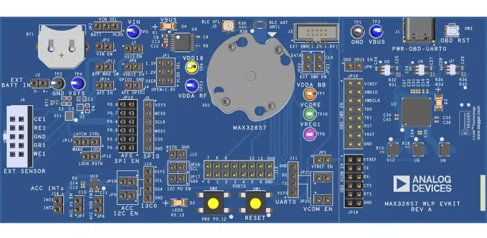

<!-- Copyright 2015-2026 Zephyr Project members and individual contributors. -->
<!-- SPDX-License-Identifier: Apache-2.0 -->
<!-- 中文翻译；编号、导航与译注为本地新增。 -->

<a id="max32657evkit"></a>

# 第6章\_MAX32657EVKIT

原文：[官方页面](https://docs.zephyrproject.org/latest/boards/adi/max32657evkit/doc/index.html)。读取日期：2026-10-16；来源摘要见[来源记录](../SOURCES.md)。

开发板概览（Board Overview）

<a id="id2"></a>

[](images/max32657evkit.webp)

MAX32657EVKIT

名称（Name）：

`max32657evkit`

厂商（Vendor）：

[Analog Devices, Inc.](https://docs.zephyrproject.org/latest/boards/index.html#vendor=adi)

状态（Status）：

维护中（Maintained）

架构（Architecture）：

[arm](https://docs.zephyrproject.org/latest/boards/index.html#arch=arm)

片上系统（SoC）：

[max32657](https://docs.zephyrproject.org/latest/boards/index.html#soc=max32657)

<a id="board-github-link"></a>

[浏览开发板源码（Browse Board Sources）](https://github.com/zephyrproject-rtos/zephyr/blob/main//boards/adi/max32657evkit/doc/index.rst/../..)<a id="overview"></a>

## 概述（Overview）

MAX32657微控制器（MCU）是一款先进的片上系统（SoC），采用Arm® Cortex®-M33内核，配有支持单精度浮点运算的浮点单元（FPU）及数字信号处理（DSP）指令、大容量闪存和SRAM，以及新一代Bluetooth® 5.4低功耗（LE）无线电。纳瓦级功耗模式（Nano-power Modes）可显著延长电池续航。

MAX32657额定工作温度范围为−20 °C至+85 °C。Bluetooth 5.4 LE无线电支持网状网络（Mesh）、远距离编码模式（Long-range / Coded）和高吞吐模式（High-throughput）。密码工具箱（CTB / Cryptographic Toolbox）提供先进的信任根（Root of Trust）安全功能，包括高级加密标准（AES）引擎、真随机数发生器（TRNG）和安全启动（Secure Boot）。M33内核还包含TrustZone。器件支持多种高速接口，包括多路SPI、UART以及I3C/I2C串行接口；所有接口均支持由DMA驱动的高效外设与存储器之间传输。

Zephyr移植版本运行在MAX32657微控制器（MCU）上。

<a id="hardware"></a>

## 硬件（Hardware）


- MAX32657微控制器（MCU）：


  - Arm Cortex-M33 CPU，带TrustZone®和浮点单元（FPU）
  - 集成升压直流转换器（Boost DC-DC Converter）的输入范围为1.2–1.6 V
  - 50 MHz低功耗振荡器（Low Power Oscillator）
  - 支持外部晶体（External Crystal）


    - 低功耗蓝牙（BLE）需要32 MHz晶体
  - 1 MB内部闪存（Flash），带纠错码（ECC）
  - 256 kB内部静态随机存储器（SRAM）
  - 8 kB缓存（Cache）
  - 32.768 kHz实时时钟（RTC）外部晶体
  - 典型电气特性（Typical Electrical Characteristics）


    - 活动模式（ACTIVE）：Arm Cortex-M33在50 MHz下运行Coremark时为50 μA/MHz
  - Bluetooth 5.4低功耗（LE）无线电


    - 接收灵敏度（Rx Sensitivity）：−96 dBm；发射功率（Tx Power）：+4.5 dBm
    - 输入1.5 V、发射电平0 dBm时，发射功耗（Tx Power）为15 mW
    - 输入1.5 V时，接收功耗（Rx Power）为14 mW
    - 单端天线连接（Single-ended Antenna Connection），50 Ω
    - 支持802.15.4和低功耗音频（LE Audio）
    - 高吞吐模式（High-throughput Mode），2 Mbps
    - 远距离模式（Long-range Modes），125 kbps和500 kbps
  - 通过合理的外设组合提供平台扩展能力（Platform Scalability）


    - 两个DMA控制器，分别用于安全（Secure）和非安全（Non-Secure）状态
    - 一路SPI控制器／外设（Controller/Peripheral）
    - 一路I2C/I3C
    - 一路低功耗UART（LPUART）
    - 六个带脉宽调制（PWM）的32位低功耗定时器
    - 14个可配置GPIO，带内部上拉／下拉电阻（Pullup/Pulldown Resistors）
  - 用于知识产权／数据安全（IP/Data Security）的密码工具箱（CTB / Cryptographic Tool Box）


    - 真随机数发生器（TRNG / True Random Number Generator）
    - AES-128/192/256
    - 唯一标识（Unique ID）
  - 安全启动ROM（Secure Boot ROM）

<a id="supported-features"></a>

### 支持的功能（Supported Features）

`max32657evkit`开发板支持下表所列的硬件功能。

片上／板载（On-Chip / On-Board）

功能集成在片上系统（SoC）内／位于开发板上。

2 / 2

分别表示已启用／已禁用的实例数。点击数量标签，可查看开发板或SoC设备树源码（DTS）中该功能的第一个实例。

`vnd,foo`

与此功能匹配的设备树绑定兼容字符串（Compatible String）；点击链接可查看绑定文档。

<a id="max32657evkit-hw-features"></a>

<a id="max32657evkit-max32657evkit/max32657-hw-features-section"></a>

#### `max32657evkit/max32657`目标（Target）

<a id="max32657evkit-max32657evkit/max32657-hw-features-panel"></a>

<a id="max32657evkit-max32657evkit/max32657-hw-features-memory"></a>

此开发板目标可用存储器：256 KiB RAM、1 MiB 闪存。

<a id="max32657evkit-max32657evkit/max32657-hw-features-table"></a>

<table>
<tr>
<th>类型（Type）</th>
<th>位置（Location）</th>
<th>说明（Description）</th>
<th>兼容字符串（Compatible）</th>
</tr>
<tr>
<td rowspan="1">中央处理器（CPU）</td>
<td>片上（On-Chip）</td>
<td>ARM Cortex-M33处理器（CPU）（<a href="https://github.com/zephyrproject-rtos/zephyr/blob/main/dts/arm/adi/max32/max32657_common.dtsi?plain=1#L22">已启用：1</a>）</td>
<td><a href="../cpu_arm_riscv_binding_reference/P022_arm_cortex-m33.md#std-dtcompatible-arm-cortex-m33"><code>arm,cortex-m33</code></a></td>
</tr>
<tr>
<td rowspan="4">时钟控制（Clock Control）</td>
<td>片上（On-Chip）</td>
<td>MAX32全局控制（Global Control）（<a href="https://github.com/zephyrproject-rtos/zephyr/blob/main/dts/arm/adi/max32/max32657_common.dtsi?plain=1#L160">已启用：1</a>）</td>
<td><a href="../clock_adi_atmel_bflb_binding_reference/P004_adi_max32-gcr.md#std-dtcompatible-adi-max32-gcr"><code>adi,max32-gcr</code></a></td>
</tr>
<tr>
<td>片上（On-Chip）</td>
<td>通用固定频率时钟提供者（Fixed-Rate Clock Provider）（<a href="https://github.com/zephyrproject-rtos/zephyr/blob/main/dts/arm/adi/max32/max32657_common.dtsi?plain=1#L73">已启用：3</a>；<a href="https://github.com/zephyrproject-rtos/zephyr/blob/main/dts/arm/adi/max32/max32657_common.dtsi?plain=1#L87">已禁用：2</a>）</td>
<td><a href="../hardware/P566_固定时钟绑定.md#dtbinding-fixed-clock"><code>fixed-clock</code></a></td>
</tr>
<tr>
<td>片上（On-Chip）</td>
<td>通用固定频率时钟提供者（Fixed-Rate Clock Provider）（<a href="https://github.com/zephyrproject-rtos/zephyr/blob/main/dts/arm/adi/max32/max32657_common.dtsi?plain=1#L101">已禁用：1</a>）</td>
<td><a href="../clock_adi_atmel_bflb_binding_reference/P002_adi_max32-erfo.md#std-dtcompatible-adi-max32-erfo"><code>adi,max32-erfo</code></a></td>
</tr>
<tr>
<td>片上（On-Chip）</td>
<td>Analog Device MAX32外部时钟（External Clock）（<a href="https://github.com/zephyrproject-rtos/zephyr/blob/main/dts/arm/adi/max32/max32657_common.dtsi?plain=1#L109">已禁用：1</a>）</td>
<td><a href="../clock_adi_atmel_bflb_binding_reference/P003_adi_max32-extclk.md#std-dtcompatible-adi-max32-extclk"><code>adi,max32-extclk</code></a></td>
</tr>
<tr>
<td rowspan="3">计数器（Counter）</td>
<td>片上（On-Chip）</td>
<td>ADI MAX32计数器（Counter）（<a href="https://github.com/zephyrproject-rtos/zephyr/blob/main/dts/arm/adi/max32/max32657_common.dtsi?plain=1#L238">已禁用：6</a>）</td>
<td><a href="../counter_binding_reference/P001_adi_max32-counter.md#std-dtcompatible-adi-max32-counter"><code>adi,max32-counter</code></a></td>
</tr>
<tr>
<td>片上（On-Chip）</td>
<td>ADI MAX32唤醒定时器（Wake-Up Timer）是一个特殊的32位定时器实例，能够从睡眠（Sleep）、待机（Standby）和备份（Backup）模式唤醒设备。（<a href="https://github.com/zephyrproject-rtos/zephyr/blob/main/dts/arm/adi/max32/max32657_common.dtsi?plain=1#L387">已启用：1</a>；<a href="https://github.com/zephyrproject-rtos/zephyr/blob/main/dts/arm/adi/max32/max32657_common.dtsi?plain=1#L368">已禁用：1</a>）</td>
<td><a href="../counter_binding_reference/P003_adi_max32-wut.md#std-dtcompatible-adi-max32-wut"><code>adi,max32-wut</code></a></td>
</tr>
<tr>
<td>片上（On-Chip）</td>
<td>ADI MAX32兼容实时时钟计数器（Counter RTC）（<a href="https://github.com/zephyrproject-rtos/zephyr/blob/main/dts/arm/adi/max32/max32657_common.dtsi?plain=1#L399">已启用：1</a>）</td>
<td><a href="../counter_binding_reference/P002_adi_max32-rtc-counter.md#std-dtcompatible-adi-max32-rtc-counter"><code>adi,max32-rtc-counter</code></a></td>
</tr>
<tr>
<td rowspan="1">直接存储器访问（DMA）</td>
<td>片上（On-Chip）</td>
<td>ADI MAX32直接存储器访问（DMA）（<a href="https://github.com/zephyrproject-rtos/zephyr/blob/main/dts/arm/adi/max32/max32657.dtsi?plain=1#L26">已启用：1</a>）</td>
<td><a href="../dma_binding_reference/P002_adi_max32-dma.md#std-dtcompatible-adi-max32-dma"><code>adi,max32-dma</code></a></td>
</tr>
<tr>
<td rowspan="1">闪存控制器（Flash Controller）</td>
<td>片上（On-Chip）</td>
<td>MAX32XXX闪存控制器（Flash Controller）（<a href="https://github.com/zephyrproject-rtos/zephyr/blob/main/dts/arm/adi/max32/max32657.dtsi?plain=1#L37">已启用：1</a>）</td>
<td><a href="../flash_adi_microchip_nordic_binding_reference/P001_adi_max32-flash-controller.md#std-dtcompatible-adi-max32-flash-controller"><code>adi,max32-flash-controller</code></a></td>
</tr>
<tr>
<td rowspan="1">通用输入输出与接插件（GPIO &amp; Headers）</td>
<td>片上（On-Chip）</td>
<td>MAX32通用输入输出（GPIO）（<a href="https://github.com/zephyrproject-rtos/zephyr/blob/main/dts/arm/adi/max32/max32657_common.dtsi?plain=1#L175">已启用：1</a>）</td>
<td><a href="../gpio_adi_headers_ambiq_binding_reference/P011_adi_max32-gpio.md#std-dtcompatible-adi-max32-gpio"><code>adi,max32-gpio</code></a></td>
</tr>
<tr>
<td rowspan="1">改进型集成电路间总线（I3C）</td>
<td>片上（On-Chip）</td>
<td>ADI MAX32 I3C控制器（<a href="https://github.com/zephyrproject-rtos/zephyr/blob/main/dts/arm/adi/max32/max32657_common.dtsi?plain=1#L186">已启用：1</a>）</td>
<td><a href="../i3c_smbus_binding_reference/P001_adi_max32-i3c.md#std-dtcompatible-adi-max32-i3c"><code>adi,max32-i3c</code></a></td>
</tr>
<tr>
<td rowspan="1">输入（Input）</td>
<td>板载（On-Board）</td>
<td>一组绑定到 GPIO 的输入按键（GPIO-Bound Input Keys）（<a href="https://github.com/zephyrproject-rtos/zephyr/blob/main/boards/adi/max32657evkit/max32657evkit_max32657_common.dtsi?plain=1#L31">已启用：1</a>）</td>
<td><a href="../hardware/P563_GPIO按键绑定.md#std-dtcompatible-gpio-keys"><code>gpio-keys</code></a></td>
</tr>
<tr>
<td rowspan="1">中断控制器（Interrupt Controller）</td>
<td>片上（On-Chip）</td>
<td>ARMv8-M嵌套向量中断控制器（NVIC / Nested Vectored Interrupt Controller）（<a href="https://github.com/zephyrproject-rtos/zephyr/blob/main/dts/arm/armv8-m.dtsi?plain=1#L13">已启用：1</a>）</td>
<td><a href="../arm_interrupt_timer_binding_reference/P003_ARMv8_M_NVIC.md#std-dtcompatible-arm-v8m-nvic"><code>arm,v8m-nvic</code></a></td>
</tr>
<tr>
<td rowspan="1">发光二极管（LED）</td>
<td>板载（On-Board）</td>
<td>一组由 GPIO 控制的 LED（GPIO-Controlled LEDs）（<a href="https://github.com/zephyrproject-rtos/zephyr/blob/main/boards/adi/max32657evkit/max32657evkit_max32657_common.dtsi?plain=1#L22">已启用：1</a>）</td>
<td><a href="../hardware/P564_GPIO指示灯绑定.md#dtbinding-gpio-leds"><code>gpio-leds</code></a></td>
</tr>
<tr>
<td rowspan="1">存储器控制器（Memory Controller）</td>
<td>片上（On-Chip）</td>
<td>ADI MAX32备份SRAM（Backup SRAM）（<a href="https://github.com/zephyrproject-rtos/zephyr/blob/main/dts/arm/adi/max32/max32657_common.dtsi?plain=1#L130">已启用：5</a>）</td>
<td><a href="../memory_controller_hyperbus_smc_binding_reference/P001_adi_max32-backup-sram.md#std-dtcompatible-adi-max32-backup-sram"><code>adi,max32-backup-sram</code></a></td>
</tr>
<tr>
<td rowspan="1">内存管理单元／内存保护单元（MMU / MPU）</td>
<td>片上（On-Chip）</td>
<td>ARMv8-M存储器保护单元（MPU / Memory Protection Unit）（<a href="https://github.com/zephyrproject-rtos/zephyr/blob/main/dts/arm/adi/max32/max32657_common.dtsi?plain=1#L30">已启用：1</a>）</td>
<td><a href="../memory_protection_binding_reference/P007_arm_armv8m-mpu.md#std-dtcompatible-arm-armv8m-mpu"><code>arm,armv8m-mpu</code></a></td>
</tr>
<tr>
<td rowspan="1">存储技术设备（MTD）</td>
<td>片上（On-Chip）</td>
<td>闪存（Flash）节点（<a href="https://github.com/zephyrproject-rtos/zephyr/blob/main/dts/arm/adi/max32/max32657.dtsi?plain=1#L45">已启用：1</a>）</td>
<td><a href="../mtd_nxp_st_ti_partition_binding_reference/P013_soc-nv-flash.md#std-dtcompatible-soc-nv-flash"><code>soc-nv-flash</code></a></td>
</tr>
<tr>
<td rowspan="1">引脚控制（Pin Control）</td>
<td>片上（On-Chip）</td>
<td>MAX32引脚控制器（Pin Controller）（<a href="https://github.com/zephyrproject-rtos/zephyr/blob/main/dts/arm/adi/max32/max32657.dtsi?plain=1#L22">已启用：1</a>）</td>
<td><a href="../pinctrl_adi_ambiq_arm_binding_reference/P001_adi_max32-pinctrl.md#std-dtcompatible-adi-max32-pinctrl"><code>adi,max32-pinctrl</code></a></td>
</tr>
<tr>
<td rowspan="1">脉宽调制（PWM）</td>
<td>片上（On-Chip）</td>
<td>ADI MAX32脉宽调制（PWM）（<a href="https://github.com/zephyrproject-rtos/zephyr/blob/main/dts/arm/adi/max32/max32657_common.dtsi?plain=1#L232">已禁用：6</a>）</td>
<td><a href="../pwm_adi_esp_infineon_binding_reference/P003_adi_max32-pwm.md#std-dtcompatible-adi-max32-pwm"><code>adi,max32-pwm</code></a></td>
</tr>
<tr>
<td rowspan="1">随机数生成器（RNG）</td>
<td>片上（On-Chip）</td>
<td>ADI MAX32XXX真随机数发生器（TRNG）（<a href="https://github.com/zephyrproject-rtos/zephyr/blob/main/dts/arm/adi/max32/max32657_common.dtsi?plain=1#L207">已启用：1</a>）</td>
<td><a href="../rng_binding_reference/P001_adi_max32-trng.md#std-dtcompatible-adi-max32-trng"><code>adi,max32-trng</code></a></td>
</tr>
<tr>
<td rowspan="1">传感器（Sensors）</td>
<td>板载（On-Board）</td>
<td>ADXL367三轴纳瓦级功耗加速度计（Nanopower Accelerometer），通过I2C总线访问（<a href="https://github.com/zephyrproject-rtos/zephyr/blob/main/boards/adi/max32657evkit/max32657evkit_max32657_common.dtsi?plain=1#L98">已启用：1</a>）</td>
<td><a href="../compatible_binding_reference/P005_adi_adxl367.md#std-dtcompatible-adi-adxl367"><code>adi,adxl367</code></a></td>
</tr>
<tr>
<td rowspan="1">串行控制器（Serial Controller）</td>
<td>片上（On-Chip）</td>
<td>MAX32通用异步收发器（UART）（<a href="https://github.com/zephyrproject-rtos/zephyr/blob/main/dts/arm/adi/max32/max32657_common.dtsi?plain=1#L197">已启用：1</a>）</td>
<td><a href="../uart_adi_arm_atmel_binding_reference/P001_adi_max32-uart.md#std-dtcompatible-adi-max32-uart"><code>adi,max32-uart</code></a></td>
</tr>
<tr>
<td rowspan="1">串行外设接口（SPI）</td>
<td>片上（On-Chip）</td>
<td>ADI MAX32串行外设接口（SPI）（<a href="https://github.com/zephyrproject-rtos/zephyr/blob/main/dts/arm/adi/max32/max32657_common.dtsi?plain=1#L406">已启用：1</a>）</td>
<td><a href="../spi_adi_atmel_esp_binding_reference/P001_adi_max32-spi.md#std-dtcompatible-adi-max32-spi"><code>adi,max32-spi</code></a></td>
</tr>
<tr>
<td rowspan="3">定时器（Timer）</td>
<td>片上（On-Chip）</td>
<td>ARMv8-M系统节拍（System Tick）（<a href="https://github.com/zephyrproject-rtos/zephyr/blob/main/dts/arm/armv8-m.dtsi?plain=1#L21">已启用：1</a>）</td>
<td><a href="../arm_interrupt_timer_binding_reference/P007_ARMv8_M_SysTick.md#std-dtcompatible-arm-armv8m-systick"><code>arm,armv8m-systick</code></a></td>
</tr>
<tr>
<td>片上（On-Chip）</td>
<td>ADI MAX32定时器（Timer）（<a href="https://github.com/zephyrproject-rtos/zephyr/blob/main/dts/arm/adi/max32/max32657_common.dtsi?plain=1#L380">已启用：1</a>；<a href="https://github.com/zephyrproject-rtos/zephyr/blob/main/dts/arm/adi/max32/max32657_common.dtsi?plain=1#L223">已禁用：7</a>）</td>
<td><a href="../system_timer_binding_reference/P002_adi_max32-timer.md#std-dtcompatible-adi-max32-timer"><code>adi,max32-timer</code></a></td>
</tr>
<tr>
<td>片上（On-Chip）</td>
<td>ADI MAX32唤醒定时器（WUT）系统时钟驱动（System Clock Driver）（<a href="https://github.com/zephyrproject-rtos/zephyr/blob/main/dts/arm/adi/max32/max32657_common.dtsi?plain=1#L374">已禁用：2</a>）</td>
<td><a href="../system_timer_binding_reference/P003_adi_max32-wut-timer.md#std-dtcompatible-adi-max32-wut-timer"><code>adi,max32-wut-timer</code></a></td>
</tr>
<tr>
<td rowspan="1">看门狗（Watchdog）</td>
<td>片上（On-Chip）</td>
<td>MAX32XXX看门狗（Watchdog）（<a href="https://github.com/zephyrproject-rtos/zephyr/blob/main/dts/arm/adi/max32/max32657_common.dtsi?plain=1#L214">已启用：1</a>）</td>
<td><a href="../watchdog_binding_reference/P001_adi_max32-watchdog.md#std-dtcompatible-adi-max32-watchdog"><code>adi,max32-watchdog</code></a></td>
</tr>
</table>

<a id="max32657evkit-max32657evkit/max32657/ns-hw-features-section"></a>

#### `max32657evkit/max32657/ns`目标（Target）

<a id="max32657evkit-max32657evkit/max32657/ns-hw-features-panel"></a>

<a id="max32657evkit-max32657evkit/max32657/ns-hw-features-memory"></a>

该开发板目标的片上存储容量：192 KiB RAM、1 MiB Flash。

<a id="max32657evkit-max32657evkit/max32657/ns-hw-features-table"></a>

<table>
<tr>
<th>类型（Type）</th>
<th>位置（Location）</th>
<th>说明（Description）</th>
<th>兼容字符串（Compatible）</th>
</tr>
<tr>
<td rowspan="1">中央处理器（CPU）</td>
<td>片上（On-Chip）</td>
<td>ARM Cortex-M33处理器（CPU）（<a href="https://github.com/zephyrproject-rtos/zephyr/blob/main/dts/arm/adi/max32/max32657_common.dtsi?plain=1#L22">已启用：1</a>）</td>
<td><a href="../cpu_arm_riscv_binding_reference/P022_arm_cortex-m33.md#std-dtcompatible-arm-cortex-m33"><code>arm,cortex-m33</code></a></td>
</tr>
<tr>
<td rowspan="4">时钟控制（Clock Control）</td>
<td>片上（On-Chip）</td>
<td>MAX32全局控制（Global Control）（<a href="https://github.com/zephyrproject-rtos/zephyr/blob/main/dts/arm/adi/max32/max32657_common.dtsi?plain=1#L160">已启用：1</a>）</td>
<td><a href="../clock_adi_atmel_bflb_binding_reference/P004_adi_max32-gcr.md#std-dtcompatible-adi-max32-gcr"><code>adi,max32-gcr</code></a></td>
</tr>
<tr>
<td>片上（On-Chip）</td>
<td>通用固定频率时钟提供者（Fixed-Rate Clock Provider）（<a href="https://github.com/zephyrproject-rtos/zephyr/blob/main/dts/arm/adi/max32/max32657_common.dtsi?plain=1#L73">已启用：3</a>；<a href="https://github.com/zephyrproject-rtos/zephyr/blob/main/dts/arm/adi/max32/max32657_common.dtsi?plain=1#L87">已禁用：2</a>）</td>
<td><a href="../hardware/P566_固定时钟绑定.md#dtbinding-fixed-clock"><code>fixed-clock</code></a></td>
</tr>
<tr>
<td>片上（On-Chip）</td>
<td>通用固定频率时钟提供者（Fixed-Rate Clock Provider）（<a href="https://github.com/zephyrproject-rtos/zephyr/blob/main/dts/arm/adi/max32/max32657_common.dtsi?plain=1#L101">已禁用：1</a>）</td>
<td><a href="../clock_adi_atmel_bflb_binding_reference/P002_adi_max32-erfo.md#std-dtcompatible-adi-max32-erfo"><code>adi,max32-erfo</code></a></td>
</tr>
<tr>
<td>片上（On-Chip）</td>
<td>Analog Device MAX32外部时钟（External Clock）（<a href="https://github.com/zephyrproject-rtos/zephyr/blob/main/dts/arm/adi/max32/max32657_common.dtsi?plain=1#L109">已禁用：1</a>）</td>
<td><a href="../clock_adi_atmel_bflb_binding_reference/P003_adi_max32-extclk.md#std-dtcompatible-adi-max32-extclk"><code>adi,max32-extclk</code></a></td>
</tr>
<tr>
<td rowspan="3">计数器（Counter）</td>
<td>片上（On-Chip）</td>
<td>ADI MAX32计数器（Counter）（<a href="https://github.com/zephyrproject-rtos/zephyr/blob/main/dts/arm/adi/max32/max32657_common.dtsi?plain=1#L238">已禁用：6</a>）</td>
<td><a href="../counter_binding_reference/P001_adi_max32-counter.md#std-dtcompatible-adi-max32-counter"><code>adi,max32-counter</code></a></td>
</tr>
<tr>
<td>片上（On-Chip）</td>
<td>ADI MAX32唤醒定时器（Wake-Up Timer）是一个特殊的32位定时器实例，能够从睡眠（Sleep）、待机（Standby）和备份（Backup）模式唤醒设备。（<a href="https://github.com/zephyrproject-rtos/zephyr/blob/main/dts/arm/adi/max32/max32657_common.dtsi?plain=1#L387">已启用：1</a>；<a href="https://github.com/zephyrproject-rtos/zephyr/blob/main/dts/arm/adi/max32/max32657_common.dtsi?plain=1#L368">已禁用：1</a>）</td>
<td><a href="../counter_binding_reference/P003_adi_max32-wut.md#std-dtcompatible-adi-max32-wut"><code>adi,max32-wut</code></a></td>
</tr>
<tr>
<td>片上（On-Chip）</td>
<td>ADI MAX32兼容实时时钟计数器（Counter RTC）（<a href="https://github.com/zephyrproject-rtos/zephyr/blob/main/dts/arm/adi/max32/max32657_common.dtsi?plain=1#L399">已启用：1</a>）</td>
<td><a href="../counter_binding_reference/P002_adi_max32-rtc-counter.md#std-dtcompatible-adi-max32-rtc-counter"><code>adi,max32-rtc-counter</code></a></td>
</tr>
<tr>
<td rowspan="1">直接存储器访问（DMA）</td>
<td>片上（On-Chip）</td>
<td>ADI MAX32直接存储器访问（DMA）（<a href="https://github.com/zephyrproject-rtos/zephyr/blob/main/dts/arm/adi/max32/max32657_ns.dtsi?plain=1#L24">已启用：1</a>）</td>
<td><a href="../dma_binding_reference/P002_adi_max32-dma.md#std-dtcompatible-adi-max32-dma"><code>adi,max32-dma</code></a></td>
</tr>
<tr>
<td rowspan="1">闪存控制器（Flash Controller）</td>
<td>片上（On-Chip）</td>
<td>MAX32XXX闪存控制器（Flash Controller）（<a href="https://github.com/zephyrproject-rtos/zephyr/blob/main/dts/arm/adi/max32/max32657_ns.dtsi?plain=1#L35">已禁用：1</a>）</td>
<td><a href="../flash_adi_microchip_nordic_binding_reference/P001_adi_max32-flash-controller.md#std-dtcompatible-adi-max32-flash-controller"><code>adi,max32-flash-controller</code></a></td>
</tr>
<tr>
<td rowspan="1">通用输入输出与接插件（GPIO &amp; Headers）</td>
<td>片上（On-Chip）</td>
<td>MAX32通用输入输出（GPIO）（<a href="https://github.com/zephyrproject-rtos/zephyr/blob/main/dts/arm/adi/max32/max32657_common.dtsi?plain=1#L175">已启用：1</a>）</td>
<td><a href="../gpio_adi_headers_ambiq_binding_reference/P011_adi_max32-gpio.md#std-dtcompatible-adi-max32-gpio"><code>adi,max32-gpio</code></a></td>
</tr>
<tr>
<td rowspan="1">改进型集成电路间总线（I3C）</td>
<td>片上（On-Chip）</td>
<td>ADI MAX32 I3C控制器（<a href="https://github.com/zephyrproject-rtos/zephyr/blob/main/dts/arm/adi/max32/max32657_common.dtsi?plain=1#L186">已启用：1</a>）</td>
<td><a href="../i3c_smbus_binding_reference/P001_adi_max32-i3c.md#std-dtcompatible-adi-max32-i3c"><code>adi,max32-i3c</code></a></td>
</tr>
<tr>
<td rowspan="1">输入（Input）</td>
<td>板载（On-Board）</td>
<td>一组绑定到 GPIO 的输入按键（GPIO-Bound Input Keys）（<a href="https://github.com/zephyrproject-rtos/zephyr/blob/main/boards/adi/max32657evkit/max32657evkit_max32657_common.dtsi?plain=1#L31">已启用：1</a>）</td>
<td><a href="../hardware/P563_GPIO按键绑定.md#std-dtcompatible-gpio-keys"><code>gpio-keys</code></a></td>
</tr>
<tr>
<td rowspan="1">中断控制器（Interrupt Controller）</td>
<td>片上（On-Chip）</td>
<td>ARMv8-M嵌套向量中断控制器（NVIC / Nested Vectored Interrupt Controller）（<a href="https://github.com/zephyrproject-rtos/zephyr/blob/main/dts/arm/armv8-m.dtsi?plain=1#L13">已启用：1</a>）</td>
<td><a href="../arm_interrupt_timer_binding_reference/P003_ARMv8_M_NVIC.md#std-dtcompatible-arm-v8m-nvic"><code>arm,v8m-nvic</code></a></td>
</tr>
<tr>
<td rowspan="1">发光二极管（LED）</td>
<td>板载（On-Board）</td>
<td>一组由 GPIO 控制的 LED（GPIO-Controlled LEDs）（<a href="https://github.com/zephyrproject-rtos/zephyr/blob/main/boards/adi/max32657evkit/max32657evkit_max32657_common.dtsi?plain=1#L22">已启用：1</a>）</td>
<td><a href="../hardware/P564_GPIO指示灯绑定.md#dtbinding-gpio-leds"><code>gpio-leds</code></a></td>
</tr>
<tr>
<td rowspan="1">存储器控制器（Memory Controller）</td>
<td>片上（On-Chip）</td>
<td>ADI MAX32备份SRAM（Backup SRAM）（<a href="https://github.com/zephyrproject-rtos/zephyr/blob/main/dts/arm/adi/max32/max32657_common.dtsi?plain=1#L130">已启用：5</a>）</td>
<td><a href="../memory_controller_hyperbus_smc_binding_reference/P001_adi_max32-backup-sram.md#std-dtcompatible-adi-max32-backup-sram"><code>adi,max32-backup-sram</code></a></td>
</tr>
<tr>
<td rowspan="1">内存管理单元／内存保护单元（MMU / MPU）</td>
<td>片上（On-Chip）</td>
<td>ARMv8-M存储器保护单元（MPU / Memory Protection Unit）（<a href="https://github.com/zephyrproject-rtos/zephyr/blob/main/dts/arm/adi/max32/max32657_common.dtsi?plain=1#L30">已启用：1</a>）</td>
<td><a href="../memory_protection_binding_reference/P007_arm_armv8m-mpu.md#std-dtcompatible-arm-armv8m-mpu"><code>arm,armv8m-mpu</code></a></td>
</tr>
<tr>
<td rowspan="1">存储技术设备（MTD）</td>
<td>片上（On-Chip）</td>
<td>闪存（Flash）节点（<a href="https://github.com/zephyrproject-rtos/zephyr/blob/main/dts/arm/adi/max32/max32657_ns.dtsi?plain=1#L43">已启用：1</a>）</td>
<td><a href="../mtd_nxp_st_ti_partition_binding_reference/P013_soc-nv-flash.md#std-dtcompatible-soc-nv-flash"><code>soc-nv-flash</code></a></td>
</tr>
<tr>
<td rowspan="1">引脚控制（Pin Control）</td>
<td>片上（On-Chip）</td>
<td>MAX32引脚控制器（Pin Controller）（<a href="https://github.com/zephyrproject-rtos/zephyr/blob/main/dts/arm/adi/max32/max32657_ns.dtsi?plain=1#L20">已启用：1</a>）</td>
<td><a href="../pinctrl_adi_ambiq_arm_binding_reference/P001_adi_max32-pinctrl.md#std-dtcompatible-adi-max32-pinctrl"><code>adi,max32-pinctrl</code></a></td>
</tr>
<tr>
<td rowspan="1">脉宽调制（PWM）</td>
<td>片上（On-Chip）</td>
<td>ADI MAX32脉宽调制（PWM）（<a href="https://github.com/zephyrproject-rtos/zephyr/blob/main/dts/arm/adi/max32/max32657_common.dtsi?plain=1#L232">已禁用：6</a>）</td>
<td><a href="../pwm_adi_esp_infineon_binding_reference/P003_adi_max32-pwm.md#std-dtcompatible-adi-max32-pwm"><code>adi,max32-pwm</code></a></td>
</tr>
<tr>
<td rowspan="1">随机数生成器（RNG）</td>
<td>片上（On-Chip）</td>
<td>ADI MAX32XXX真随机数发生器（TRNG）（<a href="https://github.com/zephyrproject-rtos/zephyr/blob/main/dts/arm/adi/max32/max32657_common.dtsi?plain=1#L207">已禁用：1</a>）</td>
<td><a href="../rng_binding_reference/P001_adi_max32-trng.md#std-dtcompatible-adi-max32-trng"><code>adi,max32-trng</code></a></td>
</tr>
<tr>
<td rowspan="1">传感器（Sensors）</td>
<td>板载（On-Board）</td>
<td>ADXL367三轴纳瓦级功耗加速度计（Nanopower Accelerometer），通过I2C总线访问（<a href="https://github.com/zephyrproject-rtos/zephyr/blob/main/boards/adi/max32657evkit/max32657evkit_max32657_common.dtsi?plain=1#L98">已启用：1</a>）</td>
<td><a href="../compatible_binding_reference/P005_adi_adxl367.md#std-dtcompatible-adi-adxl367"><code>adi,adxl367</code></a></td>
</tr>
<tr>
<td rowspan="1">串行控制器（Serial Controller）</td>
<td>片上（On-Chip）</td>
<td>MAX32通用异步收发器（UART）（<a href="https://github.com/zephyrproject-rtos/zephyr/blob/main/dts/arm/adi/max32/max32657_common.dtsi?plain=1#L197">已启用：1</a>）</td>
<td><a href="../uart_adi_arm_atmel_binding_reference/P001_adi_max32-uart.md#std-dtcompatible-adi-max32-uart"><code>adi,max32-uart</code></a></td>
</tr>
<tr>
<td rowspan="1">串行外设接口（SPI）</td>
<td>片上（On-Chip）</td>
<td>ADI MAX32串行外设接口（SPI）（<a href="https://github.com/zephyrproject-rtos/zephyr/blob/main/dts/arm/adi/max32/max32657_common.dtsi?plain=1#L406">已启用：1</a>）</td>
<td><a href="../spi_adi_atmel_esp_binding_reference/P001_adi_max32-spi.md#std-dtcompatible-adi-max32-spi"><code>adi,max32-spi</code></a></td>
</tr>
<tr>
<td rowspan="3">定时器（Timer）</td>
<td>片上（On-Chip）</td>
<td>ARMv8-M系统节拍（System Tick）（<a href="https://github.com/zephyrproject-rtos/zephyr/blob/main/dts/arm/armv8-m.dtsi?plain=1#L21">已启用：1</a>）</td>
<td><a href="../arm_interrupt_timer_binding_reference/P007_ARMv8_M_SysTick.md#std-dtcompatible-arm-armv8m-systick"><code>arm,armv8m-systick</code></a></td>
</tr>
<tr>
<td>片上（On-Chip）</td>
<td>ADI MAX32定时器（Timer）（<a href="https://github.com/zephyrproject-rtos/zephyr/blob/main/dts/arm/adi/max32/max32657_common.dtsi?plain=1#L380">已启用：1</a>；<a href="https://github.com/zephyrproject-rtos/zephyr/blob/main/dts/arm/adi/max32/max32657_common.dtsi?plain=1#L223">已禁用：7</a>）</td>
<td><a href="../system_timer_binding_reference/P002_adi_max32-timer.md#std-dtcompatible-adi-max32-timer"><code>adi,max32-timer</code></a></td>
</tr>
<tr>
<td>片上（On-Chip）</td>
<td>ADI MAX32唤醒定时器（WUT）系统时钟驱动（System Clock Driver）（<a href="https://github.com/zephyrproject-rtos/zephyr/blob/main/dts/arm/adi/max32/max32657_common.dtsi?plain=1#L374">已禁用：2</a>）</td>
<td><a href="../system_timer_binding_reference/P003_adi_max32-wut-timer.md#std-dtcompatible-adi-max32-wut-timer"><code>adi,max32-wut-timer</code></a></td>
</tr>
<tr>
<td rowspan="1">看门狗（Watchdog）</td>
<td>片上（On-Chip）</td>
<td>MAX32XXX看门狗（Watchdog）（<a href="https://github.com/zephyrproject-rtos/zephyr/blob/main/dts/arm/adi/max32/max32657_common.dtsi?plain=1#L214">已启用：1</a>）</td>
<td><a href="../watchdog_binding_reference/P001_adi_max32-watchdog.md#std-dtcompatible-adi-max32-watchdog"><code>adi,max32-watchdog</code></a></td>
</tr>
</table>

<a id="connections-and-ios"></a>

### 连接与输入输出（Connections and IOs）

<table>
<tr>
<th>名称（Name）</th>
<th>名称（Name）</th>
<th>设置（Settings）</th>
<th>说明（Description）</th>
</tr>
<tr>
<td>JP1</td>
<td>VLDO选择（VLDO SEL）</td>
<td><table><tr><td>1-2</td></tr><tr><td>3-4</td></tr><tr><td>5-6</td></tr><tr><td>开路（Open）</td></tr></table></td>
<td><table><tr><td>根据电阻R4的值，设置用作系统电源的低压差稳压器（LDO）输出。</td></tr><tr><td>将用作系统电源的LDO输出设置为1.2 V。</td></tr><tr><td>将用作系统电源的LDO输出设置为1.5 V。</td></tr><tr><td>将用作系统电源的LDO输出设置为1.6 V。</td></tr></table></td>
</tr>
<tr>
<td>JP2</td>
<td>VIN选择（VIN SEL）</td>
<td><table><tr><td>1-2</td></tr><tr><td>2-3</td></tr></table></td>
<td><table><tr><td>VIN由低压差稳压器（LDO）供电，USB Type-C接口作为开发板电源。</td></tr><tr><td>VIN由电池（Battery）供电</td></tr></table></td>
</tr>
<tr>
<td>JP3</td>
<td>VIN使能（VIN EN）</td>
<td><table><tr><td>1-2</td></tr><tr><td>开路（Open）</td></tr></table></td>
<td><table><tr><td>连接VIN与VSYS_IN，将开发板电源接入系统电源。</td></tr><tr><td>断开VIN与VSYS_IN，切断系统电源。</td></tr></table></td>
</tr>
<tr>
<td>JP4</td>
<td>VDD12使能（VDD12 EN）</td>
<td><table><tr><td>1-2</td></tr><tr><td>开路（Open）</td></tr></table></td>
<td><table><tr><td>连接VDD12与VSYS_OUT，为MAX32657接入系统电源。</td></tr><tr><td>断开VDD12与VSYS_OUT，切断MAX32657的系统电源。</td></tr></table></td>
</tr>
<tr>
<td>JP5</td>
<td>参考电压使能（VTREF EN）</td>
<td><table><tr><td>1-2</td></tr><tr><td>开路（Open）</td></tr></table></td>
<td><table><tr><td>向板载调试（OBD）电路接入参考电压（Reference Voltage）。</td></tr><tr><td>断开板载调试（OBD）电路的参考电压。</td></tr></table></td>
</tr>
<tr>
<td>JP6</td>
<td>板载调试VBUS使能（OBD VBUS EN）</td>
<td><table><tr><td>1-2</td></tr><tr><td>开路（Open）</td></tr></table></td>
<td><table><tr><td>连接OBD_VBUS与VBUS，启用板载调试（OBD）。</td></tr><tr><td>断开OBD_VBUS与VBUS，禁用板载调试（OBD）。</td></tr></table></td>
</tr>
<tr>
<td>J7</td>
<td>VSYS使能（VSYS EN）</td>
<td><table><tr><td>1-2</td></tr><tr><td>开路（Open）</td></tr></table></td>
<td><table><tr><td>连接VSYS与VSYS_OUT，为所有外设接入系统电源。</td></tr><tr><td>断开VSYS与VSYS_OUT，切断所有外设的系统电源。</td></tr></table></td>
</tr>
<tr>
<td>JP7</td>
<td>加速度计VS使能（ACC VS EN）</td>
<td><table><tr><td>1-2</td></tr><tr><td>开路（Open）</td></tr></table></td>
<td><table><tr><td>将加速度计（Accelerometer）的供电引脚VS连接到VSYS，以启用加速度计。</td></tr><tr><td>断开加速度计供电引脚VS与VSYS的连接，以禁用加速度计。</td></tr></table></td>
</tr>
<tr>
<td>JP8</td>
<td>加速度计VDD使能（ACC VDD EN）</td>
<td><table><tr><td>1-2</td></tr><tr><td>开路（Open）</td></tr></table></td>
<td><table><tr><td>将加速度计的VDDIO引脚连接到VSYS，以启用加速度计。</td></tr><tr><td>断开加速度计VDDIO引脚与VSYS的连接，以禁用加速度计。</td></tr></table></td>
</tr>
<tr>
<td>JP9</td>
<td>加速度计I2C使能（ACC I2C EN）</td>
<td><table><tr><td>1-2</td></tr><tr><td>开路（Open）</td></tr></table></td>
<td><table><tr><td>加速度计SDA引脚连接到MAX32657 I2C0_SDA。</td></tr><tr><td>加速度计SDA引脚与MAX32657 I2C0_SDA断开。</td></tr></table></td>
</tr>
<tr>
<td>JP10</td>
<td>加速度计I2C使能（ACC I2C EN）</td>
<td><table><tr><td>1-2</td></tr><tr><td>开路（Open）</td></tr></table></td>
<td><table><tr><td>加速度计SCL引脚连接到MAX32657 I2C0_SCL。</td></tr><tr><td>加速度计SCL引脚与MAX32657 I2C0_SCL断开。</td></tr></table></td>
</tr>
<tr>
<td>JP11</td>
<td>旁路磁开关（BYP MAG SW）</td>
<td><table><tr><td>1-2</td></tr><tr><td>开路（Open）</td></tr></table></td>
<td><table><tr><td>旁路磁开关（Magnetic Switch）。</td></tr><tr><td>启用磁开关（Magnetic Switch），开关输出由AFE引脚控制。</td></tr></table></td>
</tr>
<tr>
<td>JP12</td>
<td>锁定复位（LOCK RSTN）</td>
<td><table><tr><td>1-2</td></tr><tr><td>开路（Open）</td></tr></table></td>
<td><table><tr><td>模拟前端（AFE）的Lock引脚连接到MAX32657 RSTN引脚。</td></tr><tr><td>模拟前端（AFE）的Lock引脚与MAX32657 RSTN引脚断开。</td></tr></table></td>
</tr>
<tr>
<td>JP13</td>
<td>锁存控制（LATCH CTRL）</td>
<td><table><tr><td>1-2</td></tr><tr><td>2-3</td></tr></table></td>
<td><table><tr><td>将模拟前端AFE的LOCK连接到磁开关的OUTPUT LATCH CONTROL输出锁存控制端。</td></tr><tr><td>将模拟前端AFE的WAKE连接到磁开关的OUTPUT LATCH CONTROL输出锁存控制端。</td></tr></table></td>
</tr>
<tr>
<td>JP14</td>
<td>模拟前端使能（AFE EN）</td>
<td><table><tr><td>1-2</td></tr><tr><td>开路（Open）</td></tr></table></td>
<td><table><tr><td>将AFE的VBAT连接到VSYS，以启用模拟前端（AFE）。</td></tr><tr><td>断开AFE的VBAT与VSYS的连接，以禁用模拟前端（AFE）。</td></tr></table></td>
</tr>
<tr>
<td>JP15</td>
<td>模拟前端SPI使能（AFE SPI EN）</td>
<td><table><tr><td>1-2</td></tr><tr><td>3-4</td></tr><tr><td>5-6</td></tr><tr><td>7-8</td></tr><tr><td>9-10</td></tr><tr><td>11-12</td></tr><tr><td>全部开路（Open All）</td></tr></table></td>
<td><table><tr><td>AFE CSB连接到MAX32657 SPI0_CS0。</td></tr><tr><td>AFE SDI连接到MAX32657 SPI0_MOSI。</td></tr><tr><td>AFE SCLK连接到MAX32657 SPI0_SCK。</td></tr><tr><td>AFE SDO连接到MAX32657 SPI0_MISO。</td></tr><tr><td>AFE INTB连接到MAX32657 P0.7。</td></tr><tr><td>AFE GPIO2连接到MAX32657 P0.8。</td></tr><tr><td>断开SPI接口与MAX32657的连接。</td></tr></table></td>
</tr>
<tr>
<td>JP16</td>
<td>I2C上拉使能（I2C PU EN）</td>
<td><table><tr><td>1-2</td></tr><tr><td>开路（Open）</td></tr></table></td>
<td><table><tr><td>启用SCL上拉电阻（PU Resistor）。</td></tr><tr><td>禁用SCL上拉电阻（PU Resistor）。</td></tr></table></td>
</tr>
<tr>
<td>JP17</td>
<td>I2C上拉使能（I2C PU EN）</td>
<td><table><tr><td>1-2</td></tr><tr><td>开路（Open）</td></tr></table></td>
<td><table><tr><td>启用SDA上拉电阻（PU Resistor）。</td></tr><tr><td>禁用SDA上拉电阻（PU Resistor）。</td></tr></table></td>
</tr>
<tr>
<td>JP18</td>
<td>板载SWD调试使能（OBD SWD EN）</td>
<td><table><tr><td>3-4</td></tr><tr><td>5-6</td></tr><tr><td>7-8</td></tr><tr><td>9-10</td></tr><tr><td>11-12</td></tr><tr><td>13-14</td></tr><tr><td>全部开路（Open All）</td></tr></table></td>
<td><table><tr><td>OBD SWDIO连接到MAX32657 SWDIO。</td></tr><tr><td>OBD SWCLK连接到MAX32657 SWCLK。</td></tr><tr><td>板载调试（OBD）的JTAG TDO使能跳线，在MAX32657上不使用。</td></tr><tr><td>板载调试（OBD）的JTAG TDI使能跳线，在MAX32657上不使用。</td></tr><tr><td>OBD RSTN连接到MAX32657 RSTN。</td></tr><tr><td>板载调试（OBD）的JTAG TRST使能跳线，在MAX32657上不使用。</td></tr><tr><td>断开板载调试（OBD）的SWD与MAX32657的连接。</td></tr></table></td>
</tr>
<tr>
<td>JP19</td>
<td>板载虚拟串口使能（OBD VCOM EN）</td>
<td><table><tr><td>3-4</td></tr><tr><td>5-6</td></tr><tr><td>7-8</td></tr><tr><td>9-10</td></tr><tr><td>开路（Open）</td></tr></table></td>
<td><table><tr><td>OBD VCOM TXD连接到VCOM EN RX跳线。</td></tr><tr><td>OBD VCOM RXD连接到VCOM EN TX跳线。</td></tr><tr><td>板载调试（OBD）的虚拟串口（VCOM）CTS使能跳线，在MAX32657上不使用。</td></tr><tr><td>板载调试（OBD）的虚拟串口（VCOM）RTS使能跳线，在MAX32657上不使用。</td></tr><tr><td>断开板载调试（OBD）的虚拟串口（VCOM）与MAX32657的连接。</td></tr></table></td>
</tr>
<tr>
<td>JP20</td>
<td>虚拟串口使能（VCOM EN）</td>
<td><table><tr><td>1-2</td></tr><tr><td>开路（Open）</td></tr></table></td>
<td><table><tr><td>将OBD VCOM RXD连接到MAX32657 UART0A_TX。</td></tr><tr><td>断开OBD VCOM RXD与MAX32657 UART0A_TX。</td></tr></table></td>
</tr>
<tr>
<td>JP21</td>
<td>虚拟串口使能（VCOM EN）</td>
<td><table><tr><td>1-2</td></tr><tr><td>开路（Open）</td></tr></table></td>
<td><table><tr><td>将OBD VCOM TXD连接到MAX32657 UART0A_RX。</td></tr><tr><td>断开OBD VCOM TXD与MAX32657 UART0A_RX。</td></tr></table></td>
</tr>
<tr>
<td>JP22</td>
<td>外部SWD使能（EXT SWD EN）</td>
<td><table><tr><td>1-2</td></tr><tr><td>开路（Open）</td></tr></table></td>
<td><table><tr><td>将外部SWD接口的数据信号（Data Signals）连接到MAX32657 SWDIO引脚。</td></tr><tr><td>断开外部SWD接口的数据信号与MAX32657 SWDIO引脚。</td></tr></table></td>
</tr>
<tr>
<td>JP23</td>
<td>外部SWD使能（EXT SWD EN）</td>
<td><table><tr><td>1-2</td></tr><tr><td>开路（Open）</td></tr></table></td>
<td><table><tr><td>将外部SWD接口的时钟信号（Clock Signals）连接到MAX32657 SWDCLK引脚。</td></tr><tr><td>断开外部SWD接口的时钟信号与MAX32657 SWDCLK引脚。</td></tr></table></td>
</tr>
</table>

<a id="zephyr-board-options"></a>

## Zephyr开发板选项（Board Options）

MAX32657微控制器（MCU）是一款采用ARM Cortex-M33架构的先进片上系统（SoC）。其提供的TrustZone技术可以定义安全（Secure）和非安全（Non-Secure）应用。Zephyr支持构建安全（S）和非安全（NS）固件。

`BOARD`选项汇总如下：

<table>
<tr>
<th>开发板目标（BOARD）</th>
<th>说明（Description）</th>
</tr>
<tr>
<td><code>max32657evkit/max32657</code></td>
<td>用于构建禁用TrustZone的固件（Trust Zone Disabled）</td>
</tr>
<tr>
<td><code>max32657evkit/max32657/ns</code></td>
<td>使用TF-M构建，包含非安全与安全镜像（NS+S Images）</td>
</tr>
</table>

<a id="board-max32657evkit-max32657"></a>

### 开发板目标（BOARD）：`max32657evkit/max32657`

为`max32657evkit/max32657`开发板目标构建Zephyr应用，会生成Zephyr安全固件（Secure Firmware）。此配置使用960 KB闪存存放代码，64 KB用于存储区（Storage Section）。在此模式下关闭TF-M并开启安全模式标志，即`[CONFIG_TRUSTED_EXECUTION_SECURE](https://docs.zephyrproject.org/latest/kconfig.html#CONFIG_TRUSTED_EXECUTION_SECURE)=y`、`[CONFIG_BUILD_WITH_TFM](https://docs.zephyrproject.org/latest/kconfig.html#CONFIG_BUILD_WITH_TFM)=n`。

<table>
<tr>
<th>名称（Name）</th>
<th>Address[Size]</th>
<th>备注（Comment）</th>
</tr>
<tr>
<td>slot0</td>
<td>0x1000000[960k]</td>
<td>安全Zephyr镜像（Secure Zephyr Image）</td>
</tr>
<tr>
<td>storage</td>
<td>0x10f0000[64k]</td>
<td>文件系统与持久存储（File System / Persistent Storage）</td>
</tr>
</table>

以下以[Blinky](../getting_started/P004_LED闪烁示例.md#blinky)示例说明如何使用安全配置（Secure Configuration）构建Zephyr：

```text
# From the root of the zephyr repository
west build -b max32657evkit/max32657 samples/basic/blinky/
```

<a id="board-max32657evkit-max32657-ns"></a>

### 开发板目标（BOARD）：`max32657evkit/max32657/ns`

`max32657evkit/max32657/ns`开发板目标使用TF-M构建安全固件镜像（`[CONFIG_BUILD_WITH_TFM](https://docs.zephyrproject.org/latest/kconfig.html#CONFIG_BUILD_WITH_TFM)=y`），并使用Zephyr构建非安全固件镜像（`[CONFIG_TRUSTED_EXECUTION_NONSECURE](https://docs.zephyrproject.org/latest/kconfig.html#CONFIG_TRUSTED_EXECUTION_NONSECURE)=y`）。

以下以[Blinky](../getting_started/P004_LED闪烁示例.md#blinky)示例说明如何使用非安全配置（Non-Secure Configuration）构建Zephyr：

```text
# From the root of the zephyr repository
west build -b max32657evkit/max32657/ns samples/basic/blinky/
```

上述命令将执行：


- 构建引导加载程序镜像（Bootloader Image），使用MCUboot
- 构建TF-M安全固件镜像（Secure Firmware Image）
- 将Zephyr应用构建为非安全固件镜像（Non-Secure Firmware Image）
- 将这些镜像合并为包含全部镜像的`tfm_merged.hex`。

Note:

Zephyr以[`CONFIG_TFM_PROFILE_TYPE_NOT_SET`](https://docs.zephyrproject.org/latest/kconfig.html#CONFIG_TFM_PROFILE_TYPE_NOT_SET)模式构建TF-M，可满足多数使用场景，尤其是BLE相关应用。如果TF-M小型配置（Small Profile）已满足应用要求，可以设置`[CONFIG_TFM_PROFILE_TYPE_SMALL](https://docs.zephyrproject.org/latest/kconfig.html#CONFIG_TFM_PROFILE_TYPE_SMALL)=y`，减小TF-M的RAM和闪存占用。

<a id="memory-mappings"></a>

#### 存储器映射（Memory Mappings）

MAX32657的1 MB闪存和256 KB RAM划分为MCUboot、TF-M（S）、Zephyr（NS）和存储区（Storage），后者用于安全服务与配置。下表列出MAX32657的默认布局。

<table>
<tr>
<th>名称（Name）</th>
<th>Address[Size]</th>
<th>备注（Comment）</th>
</tr>
<tr>
<td>boot</td>
<td>0x1000000[64K]</td>
<td>MCU引导加载程序（Bootloader）</td>
</tr>
<tr>
<td>slot0</td>
<td>0x1010000[320k]</td>
<td>安全镜像槽0（Secure Image Slot0），TF-M</td>
</tr>
<tr>
<td>slot0_ns</td>
<td>0x1060000[576k]</td>
<td>非安全镜像槽0（Non-secure Image Slot0），Zephyr</td>
</tr>
<tr>
<td>slot1</td>
<td>0x10F0000[0k]</td>
<td>用于更新slot0镜像（Updates Slot0 Image）</td>
</tr>
<tr>
<td>slot1_ns</td>
<td>0x10F0000[0k]</td>
<td>用于更新slot0_ns镜像（Updates Slot0_ns Image）</td>
</tr>
<tr>
<td>storage</td>
<td>0x10f0000[64k]</td>
<td>持久存储（Persistent Storage）</td>
</tr>
</table>

<table>
<tr>
<th>随机存取存储器（RAM）</th>
<th>Address[Size]</th>
<th>备注（Comment）</th>
</tr>
<tr>
<td>secure_ram</td>
<td>0x20000000[64k]</td>
<td>安全存储器（Secure Memory）</td>
</tr>
<tr>
<td>non_secure_ram</td>
<td>0x20010000[192k]</td>
<td>非安全存储器（Non-Secure Memory）</td>
</tr>
</table>

闪存布局（Flash Memory Layout）同时定义在Zephyr开发板文件和[可信固件M（TF-M / Trusted Firmware M）](https://tf-m.docs.trustedfirmware.org/en/latest/building/tfm_build_instruction.html)项目中，两者必须一致。Zephyr在[boards/adi/max32657evkit/max32657evkit_max32657_common.dtsi](https://github.com/zephyrproject-rtos/zephyr/blob/main/boards/adi/max32657evkit/max32657evkit_max32657_common.dtsi)的flash节定义布局；TF-M在`<zephyr_path>../modules/tee/tf-m/trusted-firmware-m/platform/ext/target/adi/max32657/partition/flash_layout.h`中定义。若需要为应用调整闪存区域，必须修改这些文件的相应部分。

此外，如果需要固件更新（Firmware Update）功能，必须定义slot1和slot1_ns区域。由于默认不要求固件更新，这两个区域默认大小为0。

<a id="peripherals-and-memory-ownership"></a>

#### 外设与存储器归属（Peripherals and Memory Ownership）

ARM安全扩展模型（Security Extensions Model）允许系统开发者划分硬件与软件资源，使其处于安全子系统使用的安全世界（Secure World），或其他功能使用的普通世界（Normal World）。正确的系统设计可以确保普通世界无法访问安全世界的资产。安全设计将所有敏感资源置于安全世界，并应运行稳健的软件，以抵御各种可能的软件攻击，保护这些资产（[1](https://developer.arm.com/documentation/100935/0100/The-TrustZone-hardware-architecture-)）。

存储器保护控制器（MPC / Memory Protection Controller）和外设保护控制器（PPC / Peripheral Protection Controller）可以保护存储器与外设。需要时，可在`<zephyr_path>../modules/tee/tf-m/trusted-firmware-m/platform/ext/target/adi/max32657/s_ns_access.cmake`中将CMake标志改为ON或OFF，以调整外设和闪存的归属（Ownership）。

例如，下列配置将使非安全世界无法访问TRNG、SRAM_0和SRAM_1，而其他资源均可由非安全（NS）世界访问。

```text
set(ADI_NS_PRPH_GCR         ON         CACHE BOOL "")
set(ADI_NS_PRPH_SIR         ON         CACHE BOOL "")
set(ADI_NS_PRPH_FCR         ON         CACHE BOOL "")
set(ADI_NS_PRPH_WDT         ON         CACHE BOOL "")
set(ADI_NS_PRPH_AES         OFF        CACHE BOOL "")
set(ADI_NS_PRPH_AESKEY      OFF        CACHE BOOL "")
set(ADI_NS_PRPH_CRC         ON         CACHE BOOL "")
set(ADI_NS_PRPH_GPIO0       ON         CACHE BOOL "")
set(ADI_NS_PRPH_TIMER0      ON         CACHE BOOL "")
set(ADI_NS_PRPH_TIMER1      ON         CACHE BOOL "")
set(ADI_NS_PRPH_TIMER2      ON         CACHE BOOL "")
set(ADI_NS_PRPH_TIMER3      ON         CACHE BOOL "")
set(ADI_NS_PRPH_TIMER4      ON         CACHE BOOL "")
set(ADI_NS_PRPH_TIMER5      ON         CACHE BOOL "")
set(ADI_NS_PRPH_I3C         ON         CACHE BOOL "")
set(ADI_NS_PRPH_UART        ON         CACHE BOOL "")
set(ADI_NS_PRPH_SPI         ON         CACHE BOOL "")
set(ADI_NS_PRPH_TRNG        OFF        CACHE BOOL "")
set(ADI_NS_PRPH_BTLE_DBB    ON         CACHE BOOL "")
set(ADI_NS_PRPH_BTLE_RFFE   ON         CACHE BOOL "")
set(ADI_NS_PRPH_RSTZ        ON         CACHE BOOL "")
set(ADI_NS_PRPH_BOOST       ON         CACHE BOOL "")
set(ADI_NS_PRPH_BBSIR       ON         CACHE BOOL "")
set(ADI_NS_PRPH_BBFCR       ON         CACHE BOOL "")
set(ADI_NS_PRPH_RTC         ON         CACHE BOOL "")
set(ADI_NS_PRPH_WUT0        ON         CACHE BOOL "")
set(ADI_NS_PRPH_WUT1        ON         CACHE BOOL "")
set(ADI_NS_PRPH_PWR         ON         CACHE BOOL "")
set(ADI_NS_PRPH_MCR         ON         CACHE BOOL "")

# SRAMs
set(ADI_NS_SRAM_0           OFF        CACHE BOOL "Size: 32KB")
set(ADI_NS_SRAM_1           OFF        CACHE BOOL "Size: 32KB")
set(ADI_NS_SRAM_2           ON         CACHE BOOL "Size: 64KB")
set(ADI_NS_SRAM_3           ON         CACHE BOOL "Size: 64KB")
set(ADI_NS_SRAM_4           ON         CACHE BOOL "Size: 64KB")

# Ramfuncs section size
set(ADI_S_RAM_CODE_SIZE     "0x800"    CACHE STRING "Default: 2KB")

# Flash: BL2, TFM and Zephyr are contiguous sections.
set(ADI_FLASH_AREA_BL2_SIZE        "0x10000"  CACHE STRING "Default: 64KB")
set(ADI_FLASH_S_PARTITION_SIZE     "0x50000"  CACHE STRING "Default: 320KB")
set(ADI_FLASH_NS_PARTITION_SIZE    "0x90000"  CACHE STRING "Default: 576KB")
set(ADI_FLASH_PS_AREA_SIZE         "0x4000"   CACHE STRING "Default: 16KB")
set(ADI_FLASH_ITS_AREA_SIZE        "0x4000"   CACHE STRING "Default: 16KB")

#
# Allow user set S-NS resources ownership by overlay file
#
if(EXISTS "${CMAKE_BINARY_DIR}/../../s_ns_access_overlay.cmake")
  include(${CMAKE_BINARY_DIR}/../../s_ns_access_overlay.cmake)
endif()
```

另一种推荐方法是通过CMake覆盖文件（Overlay File）配置外设归属，无需修改TF-M源文件。在项目根目录创建`s_ns_access_overlay.cmake`，并在其中列出希望由安全世界访问的外设或存储器。

例如，将下列配置写入`s_ns_access_overlay.cmake`后，TRNG、SRAM_0和SRAM_1将仅能由安全世界访问。

```text
set(ADI_NS_PRPH_TRNG        OFF        CACHE BOOL "")
set(ADI_NS_SRAM_0           OFF        CACHE BOOL "Size: 32KB")
set(ADI_NS_SRAM_1           OFF        CACHE BOOL "Size: 32KB")
```

<a id="programming-and-debugging"></a>

## 烧录与调试（Programming and Debugging）

`max32657evkit`开发板支持下表所列的运行工具（Runners）及相关west命令。

<table>
<tr>
<th></th>
<th>烧录（flash）</th>
<th>调试（debug）</th>
<th>连接调试会话（attach）</th>
<th>实时传输（rtt）</th>
<th>调试服务器（debugserver）</th>
<th>复位（reset）</th>
</tr>
<tr>
<td><a href="https://docs.zephyrproject.org/latest/develop/flash_debug/host-tools.html#runner-jlink"><code>jlink</code></a></td>
<td>✅</td>
<td>✅</td>
<td>✅</td>
<td>✅</td>
<td>✅</td>
<td>✅</td>
</tr>
<tr>
<td><a href="https://docs.zephyrproject.org/latest/develop/flash_debug/host-tools.html#runner-openocd">openocd</a></td>
<td>✅（默认 / default）</td>
<td>✅（默认 / default）</td>
<td>✅</td>
<td>✅</td>
<td>✅</td>
<td></td>
</tr>
</table>

<a id="flashing"></a>

### 烧录（Flashing）

以下以[Hello World](../getting_started/P005_HelloWorld示例.md#hello_world)应用为例，默认使用[J-Link主机调试工具（Debug Host Tools）](https://docs.zephyrproject.org/latest/develop/flash_debug/host-tools.html#jlink-debug-host-tools)。

```text
# From the root of the zephyr repository
west build -b max32657evkit/max32657 samples/hello_world
west flash
```

打开串口终端，复位开发板（按下RESET按键），应能在终端中看到以下消息：

```text
***** Booting Zephyr OS build v4.1.0 *****
Hello World! max32657evkit/max32657
```

<a id="building-and-flashing-secure-non-secure-with-arm-trustzone"></a>

#### 使用Arm® TrustZone®构建与烧录安全／非安全固件（Secure/Non-Secure）

TF-M集成示例可使用`max32657evkit/max32657/ns`开发板目标运行。运行前，需要使用J-Link按以下方式手动烧录生成的`tfm_merged.hex`镜像；其中reset和erase用于恢复被锁定的内核（Locked Core）：

```text
# From the root of the zephyr repository
west build -b max32657evkit/max32657/ns samples/hello_world
```

```text
west flash --hex-file build/zephyr/tfm_merged.hex
```

```text
[INF] Starting bootloader
[WRN] This device was provisioned with dummy keys. This device is NOT SECURE
[INF] PSA Crypto init done, sig_type: RSA-3072
[WRN] Cannot upgrade: slots have non-compatible sectors
[WRN] Cannot upgrade: slots have non-compatible sectors
[INF] Bootloader chainload address offset: 0x10000
[INF] Jumping to the first image slot
***** Booting Zephyr OS build v4.1.0 *****
Hello World! max32657evkit/max32657/ns
```

<a id="debugging"></a>

### 调试（Debugging）

以下以[Hello World](../getting_started/P005_HelloWorld示例.md#hello_world)应用为例，默认使用[J-Link主机调试工具（Debug Host Tools）](https://docs.zephyrproject.org/latest/develop/flash_debug/host-tools.html#jlink-debug-host-tools)。

```text
# From the root of the zephyr repository
west build -b max32657evkit/max32657 samples/hello_world
west debug
```

打开串口终端，在调试器中单步运行应用，应能在终端中看到以下消息：

```text
***** Booting Zephyr OS build v4.1.0 *****
Hello World! max32657evkit/max32657
```

<a id="references"></a>

## 参考资料（References）

## 译注

原文一处将无TF-M构建称为Trust Zone Disabled，随后说明仍开启CONFIG_TRUSTED_EXECUTION_SECURE。译文保留标题与配置各自的表述，不将二者合并改写。原文路径中的`<zephyr_path>`是占位符，不是本机绝对地址；TF-M路径与命令均按本页原文保留。

## 原文外链核对

2026-10-16核对并重试以下原文外链时未能确认可访问性，保留原始目标，不将访问失败解释为原文内容有误。

- [The-TrustZone-hardware-architecture-](https://developer.arm.com/documentation/100935/0100/The-TrustZone-hardware-architecture-)：<urlopen error [SSL: CERTIFICATE_VERIFY_FAILED] certificate verify failed: unable to get local issuer certificate (_ssl.c:1010)>。

---

[上一章](P005_MAX32655FTHR.md) · [返回大纲](大纲.md) · [全站翻译进度](../PROGRESS.md) · [下一章](P007_MAX32658EVKIT.md)
