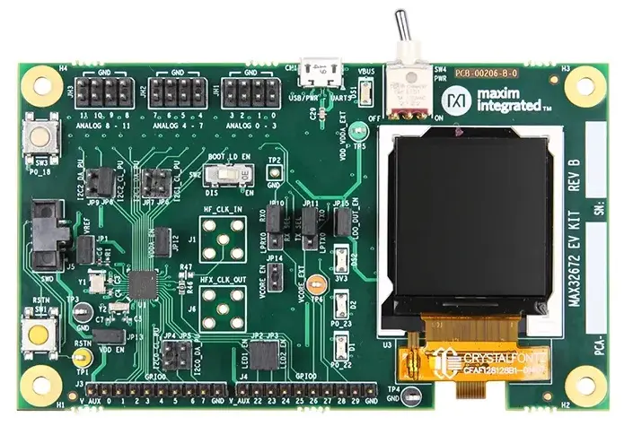

<!-- Copyright 2015-2026 Zephyr Project members and individual contributors. -->
<!-- SPDX-License-Identifier: Apache-2.0 -->
<!-- 中文翻译；编号、导航与译注为本地新增。 -->

# 第13章\_MAX32672EVKIT

原文：[官方页面](https://docs.zephyrproject.org/latest/boards/adi/max32672evkit/doc/index.html)。读取日期：2026-10-16；来源摘要见[来源记录](../SOURCES.md)。

开发板概览（Board Overview）

MAX32672EVKIT

名称（Name）：

`max32672evkit`

厂商（Vendor）：

[Analog Devices, Inc.](https://docs.zephyrproject.org/latest/boards/index.html#vendor=adi)

状态（Status）：

维护中（Maintained）

架构（Architecture）：

[arm](https://docs.zephyrproject.org/latest/boards/index.html#arch=arm)

片上系统（SoC）：

[max32672](https://docs.zephyrproject.org/latest/boards/index.html#soc=max32672)

[浏览开发板源码（Browse Board Sources）](https://github.com/zephyrproject-rtos/zephyr/blob/main//boards/adi/max32672evkit/doc/index.rst/../..)

## 概述（Overview）

MAX32672评估套件（EV Kit）提供一个平台，用于评估MAX32672微控制器。该器件是一款小型、高可靠性、超低功耗的32位微控制器。MAX32672为运动／电机控制、工业传感器和电池供电医疗设备提供安全、经济的方案，也为基于8位或16位微控制器的既有设计提供便捷、成本优化的升级路径。

Zephyr移植版本运行在MAX32672微控制器（MCU）上。

## 硬件（Hardware）

- MAX32672微控制器（MCU）：

  - 面向低功耗、高可靠性设备的高能效微控制器

    - Arm Cortex-M4处理器，带浮点单元（FPU），最高100 MHz
    - 1 MB双存储区闪存（Dual-Bank Flash），带纠错功能（Error Correction）
    - 200 KB SRAM，启用ECC时为160 KB，可选择在最低功耗模式下保留内容
    - 在闪存中模拟电可擦除可编程只读存储器（EEPROM Emulation）
    - 16 KB统一缓存（Unified Cache），带纠错码（ECC）
    - 资源保护单元（RPU / Resource Protection Unit）和存储器保护单元（MPU）
    - 支持双电源或单电源运行，电压范围1.7–3.6 V
    - 宽工作温度范围：−40 °C至+105 °C
  - 灵活的时钟方案（Clocking Schemes）

    - 内部100 MHz高速振荡器（High-Speed Oscillator）
    - 内部7.3728 MHz低功耗和80 kHz超低功耗振荡器（Oscillators）
    - 16–32 MHz振荡器和32.768 kHz振荡器，均需要外部晶体
    - CPU、LPUART和LPTMR的外部时钟输入
  - 通过电源管理（Power Management）尽可能延长电池供电应用的运行时间

    - 活动模式（ACTIVE）下，0.9 V、最高12 MHz运行CoreMark®时为59.8 μA/MHz
    - 活动模式（ACTIVE）下，1.1 V、最高100 MHz运行While(1)时为56.6 μA/MHz
    - VDD = 1.8 V时，备份模式（BACKUP）下完整存储器保持电流为3.09 μA
    - 350 nA超低功耗实时时钟（RTC）；原文“at”之后未给出条件
    - 由低功耗UART（LPUART）或低功耗定时器（LPTMR）唤醒
  - 通过合理的外设组合提供平台扩展能力（Platform Scalability）

    - 最多42个通用输入输出（I/O）引脚
    - 最多三路SPI主机／从机，最高50 Mbps
    - 最多三路四线UART
    - 最多三路I2C主机／从机，支持3.4 Mbps高速模式
    - 最多四个32位定时器（TMR）
    - 最多两个32位低功耗定时器（LPTMR）
    - 一路I2S主机／从机，用于数字音频接口
    - 12通道、12位、1 Msps逐次逼近模数转换器（SAR ADC），带片上温度传感器（On-Die Temperature Sensor）
  - 安全与完整性（Security and Integrity）

    - ROM中可选基于ECDSA密码算法的安全引导加载程序（Secure Bootloader）
    - 用于椭圆曲线（Elliptic Curve）的安全密码加速器（Cryptographic Accelerator）
    - AES-128/192/256硬件加速引擎（Hardware Acceleration Engine）
- MAX32672EVKIT的优势与功能（Benefits and Features）：

  - 可选板载高精度参考电压（High-Precision Voltage Reference）
  - 128 × 128、1.45英寸彩色TFT显示屏，带SPI接口
  - 兼容面包板的排针（Breadboard-Compatible Headers）
  - USB 2.0 Micro-B转串行UART
  - 通过板载跳线选择UART0或LPUART0接口
  - 通过0.1英寸间距排针访问全部GPIO信号
  - 通过0.1英寸间距排针访问12路模拟输入，提供可选滤波（Filtering）
  - 10针Arm® Cortex®串行线调试接口（SWD Connector）
  - USB端口为开发板供电
  - 板载3.3 V低压差稳压器（LDO Regulator）
  - 提供测试环（Test Loops），可从外部接入可选的VCORE电源
  - 通过跳线分别测量所有芯片供电轨（IC Rails）的功耗
  - 两个通用LED和一个通用按键开关（Pushbutton Switch）

### 支持的功能（Supported Features）

`max32672evkit`开发板支持下表所列的硬件功能。

片上／板载（On-Chip / On-Board）

功能集成在片上系统（SoC）内／位于开发板上。

2 / 2

分别表示已启用／已禁用的实例数。点击数量标签，可查看开发板或SoC设备树源码（DTS）中该功能的第一个实例。

`vnd,foo`

与此功能匹配的设备树绑定兼容字符串（Compatible String）；点击链接可查看绑定文档。

#### `max32672evkit/max32672`目标（Target）

该开发板目标的片上存储容量：64 KiB RAM、512 KiB Flash。

<table>
<tr>
<th>类型（Type）</th>
<th>位置（Location）</th>
<th>说明（Description）</th>
<th>兼容字符串（Compatible）</th>
</tr>
<tr>
<td rowspan="2">中央处理器（CPU）</td>
<td>片上（On-Chip）</td>
<td>ARM Cortex-M4F 处理器（CPU）（<a href="https://github.com/zephyrproject-rtos/zephyr/blob/main/dts/vendor/adi/max32/max32xxx.dtsi?plain=1#L25">已启用：1</a>）</td>
<td><a href="../cpu_arm_riscv_binding_reference/P025_arm_cortex-m4f.md#std-dtcompatible-arm-cortex-m4f"><code>arm,cortex-m4f</code></a></td>
</tr>
<tr>
<td>片上（On-Chip）</td>
<td>MAX32 RV32内核（Core）（<a href="https://github.com/zephyrproject-rtos/zephyr/blob/main/dts/vendor/adi/max32/max32xxx.dtsi?plain=1#L32">已禁用：1</a>）</td>
<td><a href="../cpu_arm_riscv_binding_reference/P002_adi_max32-rv32.md#std-dtcompatible-adi-max32-rv32"><code>adi,max32-rv32</code></a></td>
</tr>
<tr>
<td rowspan="1">模数转换器（ADC）</td>
<td>片上（On-Chip）</td>
<td>ADI MAX32逐次逼近模数转换器（SAR ADC）（<a href="https://github.com/zephyrproject-rtos/zephyr/blob/main/dts/vendor/adi/max32/max32xxx.dtsi?plain=1#L241">已禁用：1</a>）</td>
<td><a href="../hardware/P863_ADIMAX32逐次逼近ADC绑定.md#dtbinding-adi-max32-adc-sar"><code>adi,max32-adc-sar</code></a></td>
</tr>
<tr>
<td rowspan="2">时钟控制（Clock Control）</td>
<td>片上（On-Chip）</td>
<td>通用固定频率时钟提供者（Fixed-Rate Clock Provider）（<a href="https://github.com/zephyrproject-rtos/zephyr/blob/main/dts/vendor/adi/max32/max32xxx.dtsi?plain=1#L64">已启用：2</a>；<a href="https://github.com/zephyrproject-rtos/zephyr/blob/main/dts/vendor/adi/max32/max32xxx.dtsi?plain=1#L78">已禁用：4</a>）</td>
<td><a href="../hardware/P566_固定时钟绑定.md#dtbinding-fixed-clock"><code>fixed-clock</code></a></td>
</tr>
<tr>
<td>片上（On-Chip）</td>
<td>MAX32全局控制（Global Control）（<a href="https://github.com/zephyrproject-rtos/zephyr/blob/main/dts/vendor/adi/max32/max32xxx.dtsi?plain=1#L130">已启用：1</a>）</td>
<td><a href="../clock_adi_atmel_bflb_binding_reference/P004_adi_max32-gcr.md#std-dtcompatible-adi-max32-gcr"><code>adi,max32-gcr</code></a></td>
</tr>
<tr>
<td rowspan="2">计数器（Counter）</td>
<td>片上（On-Chip）</td>
<td>ADI MAX32计数器（Counter）（<a href="https://github.com/zephyrproject-rtos/zephyr/blob/main/dts/vendor/adi/max32/max32xxx.dtsi?plain=1#L260">已禁用：6</a>）</td>
<td><a href="../counter_binding_reference/P001_adi_max32-counter.md#std-dtcompatible-adi-max32-counter"><code>adi,max32-counter</code></a></td>
</tr>
<tr>
<td>片上（On-Chip）</td>
<td>ADI MAX32兼容实时时钟计数器（Counter RTC）（<a href="https://github.com/zephyrproject-rtos/zephyr/blob/main/dts/arm/adi/max32/max32672.dtsi?plain=1#L194">已启用：1</a>）</td>
<td><a href="../counter_binding_reference/P002_adi_max32-rtc-counter.md#std-dtcompatible-adi-max32-rtc-counter"><code>adi,max32-rtc-counter</code></a></td>
</tr>
<tr>
<td rowspan="1">显示（Display）</td>
<td>板载（On-Board）</td>
<td>Sitronix ST7735X显示控制器（Display Controller）（<a href="https://github.com/zephyrproject-rtos/zephyr/blob/main/boards/adi/max32672evkit/max32672evkit.dts?plain=1#L70">已启用：1</a>）</td>
<td><a href="../display_sinowealth_sitronix_solomon_binding_reference/P010_sitronix_st7735r.md#std-dtcompatible-sitronix-st7735r"><code>sitronix,st7735r</code></a></td>
</tr>
<tr>
<td rowspan="1">直接存储器访问（DMA）</td>
<td>片上（On-Chip）</td>
<td>ADI MAX32直接存储器访问（DMA）（<a href="https://github.com/zephyrproject-rtos/zephyr/blob/main/dts/arm/adi/max32/max32672.dtsi?plain=1#L114">已启用：1</a>）</td>
<td><a href="../dma_binding_reference/P002_adi_max32-dma.md#std-dtcompatible-adi-max32-dma"><code>adi,max32-dma</code></a></td>
</tr>
<tr>
<td rowspan="1">闪存控制器（Flash Controller）</td>
<td>片上（On-Chip）</td>
<td>MAX32XXX闪存控制器（Flash Controller）（<a href="https://github.com/zephyrproject-rtos/zephyr/blob/main/dts/vendor/adi/max32/max32xxx.dtsi?plain=1#L111">已启用：2</a>）</td>
<td><a href="../flash_adi_microchip_nordic_binding_reference/P001_adi_max32-flash-controller.md#std-dtcompatible-adi-max32-flash-controller"><code>adi,max32-flash-controller</code></a></td>
</tr>
<tr>
<td rowspan="1">通用输入输出与接插件（GPIO &amp; Headers）</td>
<td>片上（On-Chip）</td>
<td>MAX32通用输入输出（GPIO）（<a href="https://github.com/zephyrproject-rtos/zephyr/blob/main/dts/vendor/adi/max32/max32xxx.dtsi?plain=1#L175">已启用：2</a>）</td>
<td><a href="../gpio_adi_headers_ambiq_binding_reference/P011_adi_max32-gpio.md#std-dtcompatible-adi-max32-gpio"><code>adi,max32-gpio</code></a></td>
</tr>
<tr>
<td rowspan="1">集成电路间总线（I2C）</td>
<td>片上（On-Chip）</td>
<td>ADI MAX32 I2C控制器（<a href="https://github.com/zephyrproject-rtos/zephyr/blob/main/dts/vendor/adi/max32/max32xxx.dtsi?plain=1#L139">已启用：1</a>；<a href="https://github.com/zephyrproject-rtos/zephyr/blob/main/dts/vendor/adi/max32/max32xxx.dtsi?plain=1#L149">已禁用：2</a>）</td>
<td><a href="../i2c_adi_atmel_esp_binding_reference/P001_adi_max32-i2c.md#std-dtcompatible-adi-max32-i2c"><code>adi,max32-i2c</code></a></td>
</tr>
<tr>
<td rowspan="1">输入（Input）</td>
<td>板载（On-Board）</td>
<td>一组绑定到 GPIO 的输入按键（GPIO-Bound Input Keys）（<a href="https://github.com/zephyrproject-rtos/zephyr/blob/main/boards/adi/max32672evkit/max32672evkit.dts?plain=1#L42">已启用：1</a>）</td>
<td><a href="../hardware/P563_GPIO按键绑定.md#std-dtcompatible-gpio-keys"><code>gpio-keys</code></a></td>
</tr>
<tr>
<td rowspan="1">中断控制器（Interrupt Controller）</td>
<td>片上（On-Chip）</td>
<td>ARMv7-M 嵌套向量中断控制器（Nested Vectored Interrupt Controller，NVIC）（<a href="https://github.com/zephyrproject-rtos/zephyr/blob/main/dts/arm/armv7-m.dtsi?plain=1#L13">已启用：1</a>）</td>
<td><a href="../arm_interrupt_timer_binding_reference/P002_ARMv7_M_NVIC.md#std-dtcompatible-arm-v7m-nvic"><code>arm,v7m-nvic</code></a></td>
</tr>
<tr>
<td rowspan="1">发光二极管（LED）</td>
<td>板载（On-Board）</td>
<td>一组由 GPIO 控制的 LED（GPIO-Controlled LEDs）（<a href="https://github.com/zephyrproject-rtos/zephyr/blob/main/boards/adi/max32672evkit/max32672evkit.dts?plain=1#L28">已启用：1</a>）</td>
<td><a href="../hardware/P564_GPIO指示灯绑定.md#dtbinding-gpio-leds"><code>gpio-leds</code></a></td>
</tr>
<tr>
<td rowspan="1">邮箱（Mailbox）</td>
<td>片上（On-Chip）</td>
<td>ADI MAX32 SEMA邮箱（Mailbox）（<a href="https://github.com/zephyrproject-rtos/zephyr/blob/main/dts/vendor/adi/max32/max32xxx.dtsi?plain=1#L194">已禁用：1</a>）</td>
<td><a href="../intercore_reference/P032_ADI硬件信号量邮箱绑定.md#dtbinding-adi-mbox-max32-sema"><code>adi,mbox-max32-sema</code></a></td>
</tr>
<tr>
<td rowspan="1">存储技术设备（MTD）</td>
<td>片上（On-Chip）</td>
<td>闪存（Flash）节点（<a href="https://github.com/zephyrproject-rtos/zephyr/blob/main/dts/vendor/adi/max32/max32xxx.dtsi?plain=1#L119">已启用：2</a>）</td>
<td><a href="../mtd_nxp_st_ti_partition_binding_reference/P013_soc-nv-flash.md#std-dtcompatible-soc-nv-flash"><code>soc-nv-flash</code></a></td>
</tr>
<tr>
<td rowspan="1">引脚控制（Pin Control）</td>
<td>片上（On-Chip）</td>
<td>MAX32引脚控制器（Pin Controller）（<a href="https://github.com/zephyrproject-rtos/zephyr/blob/main/dts/vendor/adi/max32/max32xxx.dtsi?plain=1#L169">已启用：1</a>）</td>
<td><a href="../pinctrl_adi_ambiq_arm_binding_reference/P001_adi_max32-pinctrl.md#std-dtcompatible-adi-max32-pinctrl"><code>adi,max32-pinctrl</code></a></td>
</tr>
<tr>
<td rowspan="1">脉宽调制（PWM）</td>
<td>片上（On-Chip）</td>
<td>ADI MAX32脉宽调制（PWM）（<a href="https://github.com/zephyrproject-rtos/zephyr/blob/main/dts/vendor/adi/max32/max32xxx.dtsi?plain=1#L265">已禁用：4</a>）</td>
<td><a href="../pwm_adi_esp_infineon_binding_reference/P003_adi_max32-pwm.md#std-dtcompatible-adi-max32-pwm"><code>adi,max32-pwm</code></a></td>
</tr>
<tr>
<td rowspan="1">随机数生成器（RNG）</td>
<td>片上（On-Chip）</td>
<td>ADI MAX32XXX真随机数发生器（TRNG）（<a href="https://github.com/zephyrproject-rtos/zephyr/blob/main/dts/vendor/adi/max32/max32xxx.dtsi?plain=1#L226">已启用：1</a>）</td>
<td><a href="../rng_binding_reference/P001_adi_max32-trng.md#std-dtcompatible-adi-max32-trng"><code>adi,max32-trng</code></a></td>
</tr>
<tr>
<td rowspan="1">串行控制器（Serial Controller）</td>
<td>片上（On-Chip）</td>
<td>MAX32通用异步收发器（UART）（<a href="https://github.com/zephyrproject-rtos/zephyr/blob/main/dts/vendor/adi/max32/max32xxx.dtsi?plain=1#L202">已启用：1</a>；<a href="https://github.com/zephyrproject-rtos/zephyr/blob/main/dts/vendor/adi/max32/max32xxx.dtsi?plain=1#L210">已禁用：3</a>）</td>
<td><a href="../uart_adi_arm_atmel_binding_reference/P001_adi_max32-uart.md#std-dtcompatible-adi-max32-uart"><code>adi,max32-uart</code></a></td>
</tr>
<tr>
<td rowspan="1">串行外设接口（SPI）</td>
<td>片上（On-Chip）</td>
<td>ADI MAX32串行外设接口（SPI）（<a href="https://github.com/zephyrproject-rtos/zephyr/blob/main/dts/arm/adi/max32/max32672.dtsi?plain=1#L134">已启用：2</a>；<a href="https://github.com/zephyrproject-rtos/zephyr/blob/main/dts/arm/adi/max32/max32672.dtsi?plain=1#L154">已禁用：1</a>）</td>
<td><a href="../spi_adi_atmel_esp_binding_reference/P001_adi_max32-spi.md#std-dtcompatible-adi-max32-spi"><code>adi,max32-spi</code></a></td>
</tr>
<tr>
<td rowspan="1">静态随机存储器（SRAM）</td>
<td>片上（On-Chip）</td>
<td>通用片上静态随机存储器（SRAM）（<a href="https://github.com/zephyrproject-rtos/zephyr/blob/main/dts/arm/adi/max32/max32672.dtsi?plain=1#L49">已启用：8</a>）</td>
<td><a href="../hardware/P567_内存映射SRAM绑定.md#dtbinding-mmio-sram"><code>mmio-sram</code></a></td>
</tr>
<tr>
<td rowspan="2">定时器（Timer）</td>
<td>片上（On-Chip）</td>
<td>ADI MAX32定时器（Timer）（<a href="https://github.com/zephyrproject-rtos/zephyr/blob/main/dts/vendor/adi/max32/max32xxx.dtsi?plain=1#L252">已禁用：6</a>）</td>
<td><a href="../system_timer_binding_reference/P002_adi_max32-timer.md#std-dtcompatible-adi-max32-timer"><code>adi,max32-timer</code></a></td>
</tr>
<tr>
<td>片上（On-Chip）</td>
<td>ARMv7-M 系统节拍（System Tick）（<a href="https://github.com/zephyrproject-rtos/zephyr/blob/main/dts/arm/armv7-m.dtsi?plain=1#L21">已启用：1</a>）</td>
<td><a href="../arm_interrupt_timer_binding_reference/P006_ARMv7_M_SysTick.md#std-dtcompatible-arm-armv7m-systick"><code>arm,armv7m-systick</code></a></td>
</tr>
<tr>
<td rowspan="1">看门狗（Watchdog）</td>
<td>片上（On-Chip）</td>
<td>MAX32XXX看门狗（Watchdog）（<a href="https://github.com/zephyrproject-rtos/zephyr/blob/main/dts/vendor/adi/max32/max32xxx.dtsi?plain=1#L233">已启用：1</a>；<a href="https://github.com/zephyrproject-rtos/zephyr/blob/main/dts/arm/adi/max32/max32672.dtsi?plain=1#L125">已禁用：1</a>）</td>
<td><a href="../watchdog_binding_reference/P001_adi_max32-watchdog.md#std-dtcompatible-adi-max32-watchdog"><code>adi,max32-watchdog</code></a></td>
</tr>
</table>

### 连接与输入输出（Connections and IOs）

<table>
<tr>
<th>名称（Name）</th>
<th>名称（Name）</th>
<th>设置（Settings）</th>
<th>说明（Description）</th>
</tr>
<tr>
<td>JP1</td>
<td>VREF</td>
<td><table><tr><td>开路（Open）</td></tr><tr><td>闭合（Closed）</td></tr></table></td>
<td><table><tr><td>断开板载高精度参考电压（High-Precision Voltage Reference）。</td></tr><tr><td>连接板载高精度参考电压（High-Precision Voltage Reference）。</td></tr></table></td>
</tr>
<tr>
<td>JP2</td>
<td>P0_22</td>
<td><table><tr><td>开路（Open）</td></tr><tr><td>闭合（Closed）</td></tr></table></td>
<td><table><tr><td>断开红色LED D1与P0_22。</td></tr><tr><td>将红色LED D1连接到P0_22。</td></tr></table></td>
</tr>
<tr>
<td>JP3</td>
<td>P0_23</td>
<td><table><tr><td>开路（Open）</td></tr><tr><td>闭合（Closed）</td></tr></table></td>
<td><table><tr><td>断开绿色LED D2与P0_23。</td></tr><tr><td>将绿色LED D2连接到P0_23。</td></tr></table></td>
</tr>
<tr>
<td>JP4</td>
<td>I2C0_SCL</td>
<td><table><tr><td>开路（Open）</td></tr><tr><td>闭合（Closed）</td></tr></table></td>
<td><table><tr><td>断开由3V3供电的2.2 kΩ上拉电阻与I2C0_SCL。</td></tr><tr><td>将由3V3供电的2.2 kΩ上拉电阻连接到I2C0_SCL。</td></tr></table></td>
</tr>
<tr>
<td>JP5</td>
<td>I2C0_SDA</td>
<td><table><tr><td>开路（Open）</td></tr><tr><td>闭合（Closed）</td></tr></table></td>
<td><table><tr><td>断开由3V3供电的2.2 kΩ上拉电阻与I2C0_SDA。</td></tr><tr><td>将由3V3供电的2.2 kΩ上拉电阻连接到I2C0_SDA。</td></tr></table></td>
</tr>
<tr>
<td>JP6</td>
<td>I2C1_SCL</td>
<td><table><tr><td>开路（Open）</td></tr><tr><td>闭合（Closed）</td></tr></table></td>
<td><table><tr><td>断开由3V3供电的2.2 kΩ上拉电阻与I2C1_SCL。</td></tr><tr><td>将由3V3供电的2.2 kΩ上拉电阻连接到I2C1_SCL。</td></tr></table></td>
</tr>
<tr>
<td>JP7</td>
<td>I2C1_SDA</td>
<td><table><tr><td>开路（Open）</td></tr><tr><td>闭合（Closed）</td></tr></table></td>
<td><table><tr><td>断开由3V3供电的2.2 kΩ上拉电阻与I2C1_SDA。</td></tr><tr><td>将由3V3供电的2.2 kΩ上拉电阻连接到I2C1_SDA。</td></tr></table></td>
</tr>
<tr>
<td>JP8</td>
<td>I2C2_SCL</td>
<td><table><tr><td>开路（Open）</td></tr><tr><td>闭合（Closed）</td></tr></table></td>
<td><table><tr><td>断开由3V3供电的2.2 kΩ上拉电阻与I2C2_SCL。</td></tr><tr><td>将由3V3供电的2.2 kΩ上拉电阻连接到I2C2_SCL。</td></tr></table></td>
</tr>
<tr>
<td>JP9</td>
<td>I2C2_SDA</td>
<td><table><tr><td>开路（Open）</td></tr><tr><td>闭合（Closed）</td></tr></table></td>
<td><table><tr><td>断开由3V3供电的2.2 kΩ上拉电阻与I2C2_SDA。</td></tr><tr><td>将由3V3供电的2.2 kΩ上拉电阻连接到I2C2_SDA。</td></tr></table></td>
</tr>
<tr>
<td>JP10</td>
<td>UART_RX</td>
<td><table><tr><td>2-1</td></tr><tr><td>2-3</td></tr></table></td>
<td><table><tr><td>将USB串口桥（USB Serial Bridge）连接到UART0_RX（P0.8）。</td></tr><tr><td>将USB串口桥（USB Serial Bridge）连接到LUART0_RX（P0.26），信号名按原文保留。</td></tr></table></td>
</tr>
<tr>
<td>JP11</td>
<td>UART_TX</td>
<td><table><tr><td>2-1</td></tr><tr><td>2-3</td></tr></table></td>
<td><table><tr><td>将USB串口桥（USB Serial Bridge）连接到UART0_TX（P0.9）。</td></tr><tr><td>将USB串口桥（USB Serial Bridge）连接到LUART0_TX（P0.27），信号名按原文保留。</td></tr></table></td>
</tr>
<tr>
<td>JP12</td>
<td>VDDA</td>
<td><table><tr><td>开路（Open）</td></tr><tr><td>闭合（Closed）</td></tr></table></td>
<td><table><tr><td>断开VDDA的电源。</td></tr><tr><td>为VDDA接通电源。</td></tr></table></td>
</tr>
<tr>
<td>JP13</td>
<td>VDD</td>
<td><table><tr><td>开路（Open）</td></tr><tr><td>闭合（Closed）</td></tr></table></td>
<td><table><tr><td>断开VDD的电源。</td></tr><tr><td>为VDD接通电源。</td></tr></table></td>
</tr>
<tr>
<td>JP14</td>
<td>VCORE</td>
<td><table><tr><td>开路（Open）</td></tr><tr><td>闭合（Closed）</td></tr></table></td>
<td><table><tr><td>断开经测试环TP6向VCORE提供的外部电源。</td></tr><tr><td>经测试环TP6向VCORE接入外部电源。</td></tr></table></td>
</tr>
<tr>
<td>JP15</td>
<td>被测器件低压差稳压器（LDO DUT）</td>
<td><table><tr><td>开路（Open）</td></tr><tr><td>闭合（Closed）</td></tr></table></td>
<td><table><tr><td>断开3.3 V LDO的电源。</td></tr><tr><td>接通3.3 V LDO的电源。</td></tr></table></td>
</tr>
</table>

### 硬件详细说明（Detailed Description of Hardware）

## 电源（Power Supply）

评估套件由+5 V供电，电源通过Micro USB Type-B接口CN1的VBUS接入。开发板上电后，蓝色VBUS LED（DS1）和绿色3.3 V LED会亮起。

## 单电源或双电源运行（Single- or Dual-Supply Operation）

评估套件配置为单电源运行。如需双电源运行，在JP14上安装跳线帽，并将外部电源连接到TP6（VCORE_EXT）及地。允许的电压值请参阅MAX32672数据手册（Data Sheet）。

## 电流监测（Current Monitoring）

双针排针为VDDA EN（JP12）、VDD EN（JP13）和VCORE EN（JP14）提供方便的电流监测点。只有从外部向VCORE供电时，JP14才用于电流测量。

## 低功耗模式电流测量（Low-Power Mode Current Measurements）

为了准确测得低功耗电流，必须配置评估套件，使上拉电阻、外部时钟、调试器连接等外部因素不会导致GPIO产生拉电流或灌电流（Source or Sink Current）。测量时需按以下方式配置开发板：

1. 移除JP2至JP11的跳线帽。
2. 将SW2置于DIS位置，并移除电阻R12。
3. 拔下SWD连接器。

## 时钟配置（Clocking）

MAX32672的时钟由外部16 MHz晶体Y1提供。

## 外部参考电压（External Voltage Reference）

ADC的外部参考电压输入VREF可由高精度外部参考源MAX6071提供。VREF跳线JP1允许断开该外部参考源，从而改由内部VDDA为VREF提供参考。

## UART接口（UART Interface）

评估套件提供USB转UART桥接芯片（Bridge Chip）FTDI FT230XS-R，无需物理RS-232 COM端口；通过Micro USB Type-B接口CN1即可访问芯片的UART。USB转UART桥可通过跳线JP10（RX0）和JP11（TX0）连接到UART0或LPUART0。虚拟COM端口驱动和Windows®驱动安装指南可在FTDI Chip网站获取。

## 引导加载程序（Boot Loader）

引导加载使能滑动开关（Boot-Load-Enable Slide Switch）SW2用于启动引导加载程序。它将P0_10拉低，随后重新上电或复位时，器件进入引导加载模式（Boot Loader Mode）。

## GPIO与复用功能排针（Alternate Function Headers）

可通过0.1英寸间距排针J3和J4访问MAX32672的GPIO及复用功能信号。

## 模拟信号排针（Analog Headers）

可通过0.1英寸间距排针JH1、JH2和JH3访问12路模拟输入。

## I2C上拉（Pullups）

I2C端口可分别通过JP4（I2C0_CL_PU）和JP5（I2C0_DA_PU）、JP6（I2C1_CL_PU）和JP7（I2C1_DA_PU）、JP8（I2C2_CL_PU）和JP9（I2C2_DA_PU）上拉至V_AUX，默认3.3 V。

## 烧录与调试（Programming and Debugging）

`max32672evkit`开发板支持下表所列的运行工具（Runners）及相关west命令。

<table>
<tr>
<th></th>
<th>烧录（flash）</th>
<th>调试（debug）</th>
<th>连接调试会话（attach）</th>
<th>实时传输（rtt）</th>
<th>调试服务器（debugserver）</th>
<th>复位（reset）</th>
</tr>
<tr>
<td><a href="https://docs.zephyrproject.org/latest/develop/flash_debug/host-tools.html#runner-jlink"><code>jlink</code></a></td>
<td>✅</td>
<td>✅</td>
<td>✅</td>
<td>✅</td>
<td>✅</td>
<td>✅</td>
</tr>
<tr>
<td><a href="https://docs.zephyrproject.org/latest/develop/flash_debug/host-tools.html#runner-openocd">openocd</a></td>
<td>✅（默认 / default）</td>
<td>✅（默认 / default）</td>
<td>✅</td>
<td>✅</td>
<td>✅</td>
<td></td>
</tr>
</table>

可通过按键SW1复位芯片。

### 烧录（Flashing）

可通过Arm Cortex 10针接口J5访问SWD调试。逻辑电平默认为3V3；若从外部为TP5（VDD_VDDA_EXT）供电，也可设置为1.8 V。从外部为VDD和VDDA供电时，务必移除跳线JP15（LDO_DUT_EN），以断开3.3 V低压差稳压器（LDO）。

将调试探针连接到主机后，执行`west flash`即可将固件镜像写入闪存（Flash）。要执行整片擦除（Full Erase），在`west flash`命令中加入`--erase`选项。

注意（Note）

该开发板默认使用OpenOCD调试接口。也可覆盖运行工具（Runner），在west命令后添加`--runner jlink`，使用Segger J-Link及其原生工具。应通过合适的适配板和线缆，将J-Link连接到标准2 × 5针调试接口JH2。

### 调试（Debugging）

请参考[烧录（Flashing）](#flashing)一节，并将`west flash`替换为`west debug`执行调试。

## 参考资料（References）

- [MAX32672EVKIT网页（Web Page）](https://www.analog.com/en/design-center/evaluation-hardware-and-software/evaluation-boards-kits/max32672evkit.html)

## 译注

原文350 nA RTC条目在at之后缺少工作条件；部分跳线条目使用LUART0，而正文使用LPUART0。译文保留这些差异，未补造条件或替换信号名。

---

[上一章](P012_MAX32670EVKIT.md) · [返回大纲](大纲.md) · [全站翻译进度](../PROGRESS.md) · [下一章](P014_MAX32672FTHR.md)
