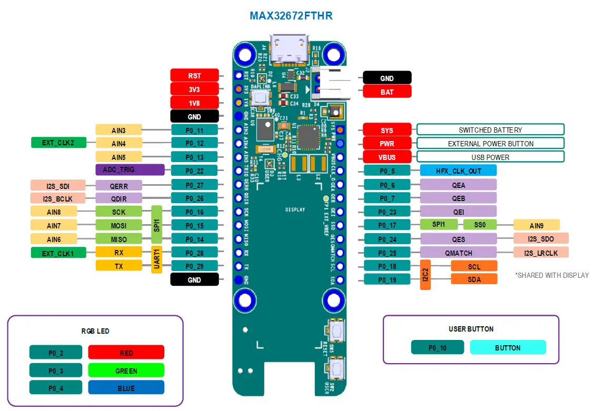
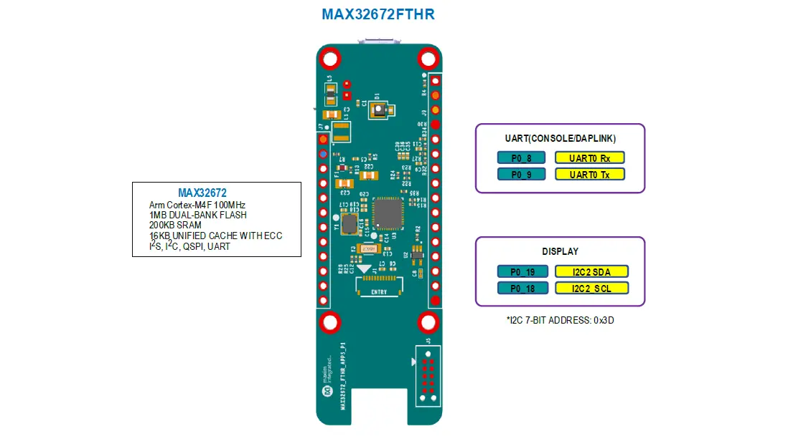

<!-- Copyright 2015-2026 Zephyr Project members and individual contributors. -->
<!-- SPDX-License-Identifier: Apache-2.0 -->
<!-- 中文翻译；编号、导航与译注为本地新增。 -->

# 第14章\_MAX32672FTHR

原文：[官方页面](https://docs.zephyrproject.org/latest/boards/adi/max32672fthr/doc/index.html)。读取日期：2026-10-16；来源摘要见[来源记录](../SOURCES.md)。

开发板概览（Board Overview）

MAX32672FTHR

名称（Name）：

`max32672fthr`

厂商（Vendor）：

[Analog Devices, Inc.](https://docs.zephyrproject.org/latest/boards/index.html#vendor=adi)

状态（Status）：

维护中（Maintained）

架构（Architecture）：

[arm](https://docs.zephyrproject.org/latest/boards/index.html#arch=arm)

片上系统（SoC）：

[max32672](https://docs.zephyrproject.org/latest/boards/index.html#soc=max32672)

[浏览开发板源码（Browse Board Sources）](https://github.com/zephyrproject-rtos/zephyr/blob/main//boards/adi/max32672fthr/doc/index.rst/../..)

## 概述（Overview）

MAX32672FTHR是一个快速开发平台，可帮助工程师使用MAX32672 Arm® Cortex®-M4快速实现复杂的传感器方案。开发板还配有MAX8819电源管理集成电路（PMIC），用于电池与电源管理。它采用0.9 × 2.6英寸的小型双排排针布局，兼容Adafruit® FeatherWing外设扩展板。板上包含OLED显示屏、RGB指示LED和用户按键。MAX32672FTHR提供经过功耗优化的灵活平台，便于快速进行概念验证和早期软件开发，以缩短上市时间。

Zephyr移植版本运行在MAX32672微控制器（MCU）上。

## 硬件（Hardware）

- MAX32672微控制器（MCU）：

  - 面向低功耗、高可靠性设备的高能效微控制器

    - Arm Cortex-M4处理器，带浮点单元（FPU），最高100 MHz
    - 1 MB双存储区闪存（Dual-Bank Flash），带纠错功能（Error Correction）
    - 200 KB SRAM，启用ECC时为160 KB，可选择在最低功耗模式下保留内容
    - 在闪存中模拟电可擦除可编程只读存储器（EEPROM Emulation）
    - 16 KB统一缓存（Unified Cache），带纠错码（ECC）
    - 资源保护单元（RPU / Resource Protection Unit）和存储器保护单元（MPU）
    - 支持双电源或单电源运行，电压范围1.7–3.6 V
    - 宽工作温度范围：−40 °C至+105 °C
  - 灵活的时钟方案（Clocking Schemes）

    - 内部100 MHz高速振荡器（High-Speed Oscillator）
    - 内部7.3728 MHz低功耗和80 kHz超低功耗振荡器（Oscillators）
    - 16–32 MHz振荡器和32.768 kHz振荡器，均需要外部晶体
    - CPU、LPUART和LPTMR的外部时钟输入
  - 通过电源管理（Power Management）尽可能延长电池供电应用的运行时间

    - 活动模式（ACTIVE）下，0.9 V、最高12 MHz运行CoreMark®时为59.8 μA/MHz
    - 活动模式（ACTIVE）下，1.1 V、最高100 MHz运行While(1)时为56.6 μA/MHz
    - VDD = 1.8 V时，备份模式（BACKUP）下完整存储器保持电流为3.09 μA
    - 350 nA超低功耗实时时钟（RTC）；原文“at”之后未给出条件
    - 由低功耗UART（LPUART）或低功耗定时器（LPTMR）唤醒
  - 通过合理的外设组合提供平台扩展能力（Platform Scalability）

    - 最多42个通用输入输出（I/O）引脚
    - 最多三路SPI主机／从机，最高50 Mbps
    - 最多三路四线UART
    - 最多三路I2C主机／从机，支持3.4 Mbps高速模式
    - 最多四个32位定时器（TMR）
    - 最多两个32位低功耗定时器（LPTMR）
    - 一路I2S主机／从机，用于数字音频接口
    - 12通道、12位、1 Msps逐次逼近模数转换器（SAR ADC），带片上温度传感器（On-Die Temperature Sensor）
  - 安全与完整性（Security and Integrity）

    - ROM中可选基于ECDSA密码算法的安全引导加载程序（Secure Bootloader）
    - 用于椭圆曲线（Elliptic Curve）的安全密码加速器（Cryptographic Accelerator）
    - AES-128/192/256硬件加速引擎（Hardware Acceleration Engine）
- MAX32672FTHR的优势与功能（Benefits and Features）：

  - MAX8819电源管理集成电路（PMIC），带集成充电器（Integrated Charger）
  - 面向Arm Cortex-M4的板载DAPLink调试与编程接口（Debug and Programming Interface）
  - 兼容面包板的排针（Breadboard-Compatible Headers）
  - Micro USB接口（Connector）
  - RGB指示LED
  - 用户按键（User Pushbutton）
  - 有机发光二极管显示屏（OLED Display）
  - 串行线调试器（SWD Debugger）
  - 虚拟UART控制台（Virtual UART Console）

### 支持的功能（Supported Features）

`max32672fthr`开发板支持下表所列的硬件功能。

片上／板载（On-Chip / On-Board）

功能集成在片上系统（SoC）内／位于开发板上。

2 / 2

分别表示已启用／已禁用的实例数。点击数量标签，可查看开发板或SoC设备树源码（DTS）中该功能的第一个实例。

`vnd,foo`

与此功能匹配的设备树绑定兼容字符串（Compatible String）；点击链接可查看绑定文档。

#### `max32672fthr/max32672`目标（Target）

该开发板目标的片上存储容量：64 KiB RAM、512 KiB Flash。

<table>
<tr>
<th>类型（Type）</th>
<th>位置（Location）</th>
<th>说明（Description）</th>
<th>兼容字符串（Compatible）</th>
</tr>
<tr>
<td rowspan="2">中央处理器（CPU）</td>
<td>片上（On-Chip）</td>
<td>ARM Cortex-M4F 处理器（CPU）（<a href="https://github.com/zephyrproject-rtos/zephyr/blob/main/dts/vendor/adi/max32/max32xxx.dtsi?plain=1#L25">已启用：1</a>）</td>
<td><a href="../cpu_arm_riscv_binding_reference/P025_arm_cortex-m4f.md#std-dtcompatible-arm-cortex-m4f"><code>arm,cortex-m4f</code></a></td>
</tr>
<tr>
<td>片上（On-Chip）</td>
<td>MAX32 RV32内核（Core）（<a href="https://github.com/zephyrproject-rtos/zephyr/blob/main/dts/vendor/adi/max32/max32xxx.dtsi?plain=1#L32">已禁用：1</a>）</td>
<td><a href="../cpu_arm_riscv_binding_reference/P002_adi_max32-rv32.md#std-dtcompatible-adi-max32-rv32"><code>adi,max32-rv32</code></a></td>
</tr>
<tr>
<td rowspan="1">模数转换器（ADC）</td>
<td>片上（On-Chip）</td>
<td>ADI MAX32逐次逼近模数转换器（SAR ADC）（<a href="https://github.com/zephyrproject-rtos/zephyr/blob/main/dts/vendor/adi/max32/max32xxx.dtsi?plain=1#L241">已禁用：1</a>）</td>
<td><a href="../hardware/P863_ADIMAX32逐次逼近ADC绑定.md#dtbinding-adi-max32-adc-sar"><code>adi,max32-adc-sar</code></a></td>
</tr>
<tr>
<td rowspan="2">时钟控制（Clock Control）</td>
<td>片上（On-Chip）</td>
<td>通用固定频率时钟提供者（Fixed-Rate Clock Provider）（<a href="https://github.com/zephyrproject-rtos/zephyr/blob/main/dts/vendor/adi/max32/max32xxx.dtsi?plain=1#L64">已启用：2</a>；<a href="https://github.com/zephyrproject-rtos/zephyr/blob/main/dts/vendor/adi/max32/max32xxx.dtsi?plain=1#L78">已禁用：4</a>）</td>
<td><a href="../hardware/P566_固定时钟绑定.md#dtbinding-fixed-clock"><code>fixed-clock</code></a></td>
</tr>
<tr>
<td>片上（On-Chip）</td>
<td>MAX32全局控制（Global Control）（<a href="https://github.com/zephyrproject-rtos/zephyr/blob/main/dts/vendor/adi/max32/max32xxx.dtsi?plain=1#L130">已启用：1</a>）</td>
<td><a href="../clock_adi_atmel_bflb_binding_reference/P004_adi_max32-gcr.md#std-dtcompatible-adi-max32-gcr"><code>adi,max32-gcr</code></a></td>
</tr>
<tr>
<td rowspan="2">计数器（Counter）</td>
<td>片上（On-Chip）</td>
<td>ADI MAX32计数器（Counter）（<a href="https://github.com/zephyrproject-rtos/zephyr/blob/main/dts/vendor/adi/max32/max32xxx.dtsi?plain=1#L260">已禁用：6</a>）</td>
<td><a href="../counter_binding_reference/P001_adi_max32-counter.md#std-dtcompatible-adi-max32-counter"><code>adi,max32-counter</code></a></td>
</tr>
<tr>
<td>片上（On-Chip）</td>
<td>ADI MAX32兼容实时时钟计数器（Counter RTC）（<a href="https://github.com/zephyrproject-rtos/zephyr/blob/main/dts/arm/adi/max32/max32672.dtsi?plain=1#L194">已启用：1</a>）</td>
<td><a href="../counter_binding_reference/P002_adi_max32-rtc-counter.md#std-dtcompatible-adi-max32-rtc-counter"><code>adi,max32-rtc-counter</code></a></td>
</tr>
<tr>
<td rowspan="1">显示（Display）</td>
<td>板载（On-Board）</td>
<td>I2C总线上的Solomon SSD1306显示控制器（Display Controller）（<a href="https://github.com/zephyrproject-rtos/zephyr/blob/main/boards/adi/max32672fthr/max32672fthr.dts?plain=1#L133">已启用：1</a>）</td>
<td><a href="../compatible_binding_reference/P061_solomon_ssd1306.md#std-dtcompatible-solomon-ssd1306"><code>solomon,ssd1306</code></a></td>
</tr>
<tr>
<td rowspan="1">直接存储器访问（DMA）</td>
<td>片上（On-Chip）</td>
<td>ADI MAX32直接存储器访问（DMA）（<a href="https://github.com/zephyrproject-rtos/zephyr/blob/main/dts/arm/adi/max32/max32672.dtsi?plain=1#L114">已启用：1</a>）</td>
<td><a href="../dma_binding_reference/P002_adi_max32-dma.md#std-dtcompatible-adi-max32-dma"><code>adi,max32-dma</code></a></td>
</tr>
<tr>
<td rowspan="1">闪存控制器（Flash Controller）</td>
<td>片上（On-Chip）</td>
<td>MAX32XXX闪存控制器（Flash Controller）（<a href="https://github.com/zephyrproject-rtos/zephyr/blob/main/dts/vendor/adi/max32/max32xxx.dtsi?plain=1#L111">已启用：2</a>）</td>
<td><a href="../flash_adi_microchip_nordic_binding_reference/P001_adi_max32-flash-controller.md#std-dtcompatible-adi-max32-flash-controller"><code>adi,max32-flash-controller</code></a></td>
</tr>
<tr>
<td rowspan="2">通用输入输出与接插件（GPIO &amp; Headers）</td>
<td>片上（On-Chip）</td>
<td>MAX32通用输入输出（GPIO）（<a href="https://github.com/zephyrproject-rtos/zephyr/blob/main/dts/vendor/adi/max32/max32xxx.dtsi?plain=1#L175">已启用：2</a>）</td>
<td><a href="../gpio_adi_headers_ambiq_binding_reference/P011_adi_max32-gpio.md#std-dtcompatible-adi-max32-gpio"><code>adi,max32-gpio</code></a></td>
</tr>
<tr>
<td>板载（On-Board）</td>
<td>引出到Adafruit Feather排针（Headers）的GPIO引脚（<a href="https://github.com/zephyrproject-rtos/zephyr/blob/main/boards/adi/max32672fthr/max32672fthr.dts?plain=1#L66">已启用：1</a>）</td>
<td><a href="../gpio_adi_headers_ambiq_binding_reference/P001_adafruit-feather-header.md#std-dtcompatible-adafruit-feather-header"><code>adafruit-feather-header</code></a></td>
</tr>
<tr>
<td rowspan="1">集成电路间总线（I2C）</td>
<td>片上（On-Chip）</td>
<td>ADI MAX32 I2C控制器（<a href="https://github.com/zephyrproject-rtos/zephyr/blob/main/dts/vendor/adi/max32/max32xxx.dtsi?plain=1#L159">已启用：1</a>；<a href="https://github.com/zephyrproject-rtos/zephyr/blob/main/dts/vendor/adi/max32/max32xxx.dtsi?plain=1#L139">已禁用：2</a>）</td>
<td><a href="../i2c_adi_atmel_esp_binding_reference/P001_adi_max32-i2c.md#std-dtcompatible-adi-max32-i2c"><code>adi,max32-i2c</code></a></td>
</tr>
<tr>
<td rowspan="1">输入（Input）</td>
<td>板载（On-Board）</td>
<td>一组绑定到 GPIO 的输入按键（GPIO-Bound Input Keys）（<a href="https://github.com/zephyrproject-rtos/zephyr/blob/main/boards/adi/max32672fthr/max32672fthr.dts?plain=1#L46">已启用：1</a>）</td>
<td><a href="../hardware/P563_GPIO按键绑定.md#std-dtcompatible-gpio-keys"><code>gpio-keys</code></a></td>
</tr>
<tr>
<td rowspan="1">中断控制器（Interrupt Controller）</td>
<td>片上（On-Chip）</td>
<td>ARMv7-M 嵌套向量中断控制器（Nested Vectored Interrupt Controller，NVIC）（<a href="https://github.com/zephyrproject-rtos/zephyr/blob/main/dts/arm/armv7-m.dtsi?plain=1#L13">已启用：1</a>）</td>
<td><a href="../arm_interrupt_timer_binding_reference/P002_ARMv7_M_NVIC.md#std-dtcompatible-arm-v7m-nvic"><code>arm,v7m-nvic</code></a></td>
</tr>
<tr>
<td rowspan="1">发光二极管（LED）</td>
<td>板载（On-Board）</td>
<td>一组由 GPIO 控制的 LED（GPIO-Controlled LEDs）（<a href="https://github.com/zephyrproject-rtos/zephyr/blob/main/boards/adi/max32672fthr/max32672fthr.dts?plain=1#L27">已启用：1</a>）</td>
<td><a href="../hardware/P564_GPIO指示灯绑定.md#dtbinding-gpio-leds"><code>gpio-leds</code></a></td>
</tr>
<tr>
<td rowspan="1">邮箱（Mailbox）</td>
<td>片上（On-Chip）</td>
<td>ADI MAX32 SEMA邮箱（Mailbox）（<a href="https://github.com/zephyrproject-rtos/zephyr/blob/main/dts/vendor/adi/max32/max32xxx.dtsi?plain=1#L194">已禁用：1</a>）</td>
<td><a href="../intercore_reference/P032_ADI硬件信号量邮箱绑定.md#dtbinding-adi-mbox-max32-sema"><code>adi,mbox-max32-sema</code></a></td>
</tr>
<tr>
<td rowspan="1">存储技术设备（MTD）</td>
<td>片上（On-Chip）</td>
<td>闪存（Flash）节点（<a href="https://github.com/zephyrproject-rtos/zephyr/blob/main/dts/vendor/adi/max32/max32xxx.dtsi?plain=1#L119">已启用：2</a>）</td>
<td><a href="../mtd_nxp_st_ti_partition_binding_reference/P013_soc-nv-flash.md#std-dtcompatible-soc-nv-flash"><code>soc-nv-flash</code></a></td>
</tr>
<tr>
<td rowspan="1">引脚控制（Pin Control）</td>
<td>片上（On-Chip）</td>
<td>MAX32引脚控制器（Pin Controller）（<a href="https://github.com/zephyrproject-rtos/zephyr/blob/main/dts/vendor/adi/max32/max32xxx.dtsi?plain=1#L169">已启用：1</a>）</td>
<td><a href="../pinctrl_adi_ambiq_arm_binding_reference/P001_adi_max32-pinctrl.md#std-dtcompatible-adi-max32-pinctrl"><code>adi,max32-pinctrl</code></a></td>
</tr>
<tr>
<td rowspan="1">脉宽调制（PWM）</td>
<td>片上（On-Chip）</td>
<td>ADI MAX32脉宽调制（PWM）（<a href="https://github.com/zephyrproject-rtos/zephyr/blob/main/dts/vendor/adi/max32/max32xxx.dtsi?plain=1#L265">已禁用：4</a>）</td>
<td><a href="../pwm_adi_esp_infineon_binding_reference/P003_adi_max32-pwm.md#std-dtcompatible-adi-max32-pwm"><code>adi,max32-pwm</code></a></td>
</tr>
<tr>
<td rowspan="1">随机数生成器（RNG）</td>
<td>片上（On-Chip）</td>
<td>ADI MAX32XXX真随机数发生器（TRNG）（<a href="https://github.com/zephyrproject-rtos/zephyr/blob/main/dts/vendor/adi/max32/max32xxx.dtsi?plain=1#L226">已启用：1</a>）</td>
<td><a href="../rng_binding_reference/P001_adi_max32-trng.md#std-dtcompatible-adi-max32-trng"><code>adi,max32-trng</code></a></td>
</tr>
<tr>
<td rowspan="1">串行控制器（Serial Controller）</td>
<td>片上（On-Chip）</td>
<td>MAX32通用异步收发器（UART）（<a href="https://github.com/zephyrproject-rtos/zephyr/blob/main/dts/vendor/adi/max32/max32xxx.dtsi?plain=1#L202">已启用：1</a>；<a href="https://github.com/zephyrproject-rtos/zephyr/blob/main/dts/vendor/adi/max32/max32xxx.dtsi?plain=1#L210">已禁用：3</a>）</td>
<td><a href="../uart_adi_arm_atmel_binding_reference/P001_adi_max32-uart.md#std-dtcompatible-adi-max32-uart"><code>adi,max32-uart</code></a></td>
</tr>
<tr>
<td rowspan="1">串行外设接口（SPI）</td>
<td>片上（On-Chip）</td>
<td>ADI MAX32串行外设接口（SPI）（<a href="https://github.com/zephyrproject-rtos/zephyr/blob/main/dts/arm/adi/max32/max32672.dtsi?plain=1#L144">已启用：1</a>；<a href="https://github.com/zephyrproject-rtos/zephyr/blob/main/dts/arm/adi/max32/max32672.dtsi?plain=1#L134">已禁用：2</a>）</td>
<td><a href="../spi_adi_atmel_esp_binding_reference/P001_adi_max32-spi.md#std-dtcompatible-adi-max32-spi"><code>adi,max32-spi</code></a></td>
</tr>
<tr>
<td rowspan="1">静态随机存储器（SRAM）</td>
<td>片上（On-Chip）</td>
<td>通用片上静态随机存储器（SRAM）（<a href="https://github.com/zephyrproject-rtos/zephyr/blob/main/dts/arm/adi/max32/max32672.dtsi?plain=1#L49">已启用：8</a>）</td>
<td><a href="../hardware/P567_内存映射SRAM绑定.md#dtbinding-mmio-sram"><code>mmio-sram</code></a></td>
</tr>
<tr>
<td rowspan="2">定时器（Timer）</td>
<td>片上（On-Chip）</td>
<td>ADI MAX32定时器（Timer）（<a href="https://github.com/zephyrproject-rtos/zephyr/blob/main/dts/vendor/adi/max32/max32xxx.dtsi?plain=1#L252">已禁用：6</a>）</td>
<td><a href="../system_timer_binding_reference/P002_adi_max32-timer.md#std-dtcompatible-adi-max32-timer"><code>adi,max32-timer</code></a></td>
</tr>
<tr>
<td>片上（On-Chip）</td>
<td>ARMv7-M 系统节拍（System Tick）（<a href="https://github.com/zephyrproject-rtos/zephyr/blob/main/dts/arm/armv7-m.dtsi?plain=1#L21">已启用：1</a>）</td>
<td><a href="../arm_interrupt_timer_binding_reference/P006_ARMv7_M_SysTick.md#std-dtcompatible-arm-armv7m-systick"><code>arm,armv7m-systick</code></a></td>
</tr>
<tr>
<td rowspan="1">看门狗（Watchdog）</td>
<td>片上（On-Chip）</td>
<td>MAX32XXX看门狗（Watchdog）（<a href="https://github.com/zephyrproject-rtos/zephyr/blob/main/dts/vendor/adi/max32/max32xxx.dtsi?plain=1#L233">已启用：1</a>；<a href="https://github.com/zephyrproject-rtos/zephyr/blob/main/dts/arm/adi/max32/max32672.dtsi?plain=1#L125">已禁用：1</a>）</td>
<td><a href="../watchdog_binding_reference/P001_adi_max32-watchdog.md#std-dtcompatible-adi-max32-watchdog"><code>adi,max32-watchdog</code></a></td>
</tr>
</table>

### 连接与输入输出（Connections and IOs）

## J9引脚分配（Pinout）

<table>
<tr>
<th>引脚（Pin）</th>
<th>名称（Name）</th>
<th>说明（Description）</th>
</tr>
<tr>
<td>1</td>
<td>复位（RST）</td>
<td>主复位信号（Master Reset Signal）</td>
</tr>
<tr>
<td>2</td>
<td>3V3</td>
<td>3.3 V输出，通常用于向连接到扩展排针的外设提供3.3 V电源。</td>
</tr>
<tr>
<td>3</td>
<td>1V8</td>
<td>1.8 V输出，通常用于向连接到扩展排针的外设提供1.8 V电源。</td>
</tr>
<tr>
<td>4</td>
<td>地（GND）</td>
<td>地（Ground）</td>
</tr>
<tr>
<td>5</td>
<td>P0_11</td>
<td>GPIO或模拟输入（Analog Input），AIN3通道。</td>
</tr>
<tr>
<td>6</td>
<td>P0_12</td>
<td>GPIO或模拟输入（Analog Input），AIN4通道。</td>
</tr>
<tr>
<td>7</td>
<td>P0_13</td>
<td>GPIO或模拟输入（Analog Input），AIN5通道。</td>
</tr>
<tr>
<td>8</td>
<td>P0_22</td>
<td>GPIO或ADC_TRIG触发信号。</td>
</tr>
<tr>
<td>9</td>
<td>P0_27</td>
<td>GPIO或QERR信号。</td>
</tr>
<tr>
<td>10</td>
<td>P0_26</td>
<td>GPIO或QDIR信号。</td>
</tr>
<tr>
<td>11</td>
<td>P0_16</td>
<td>GPIO或SPI1时钟信号（Clock）。</td>
</tr>
<tr>
<td>12</td>
<td>P0_15</td>
<td>GPIO或SPI1主出从入信号（MOSI）。</td>
</tr>
<tr>
<td>13</td>
<td>P0_14</td>
<td>GPIO或SPI1主入从出信号（MISO）。</td>
</tr>
<tr>
<td>14</td>
<td>P0_28</td>
<td>GPIO或UART1接收信号（Rx）。</td>
</tr>
<tr>
<td>15</td>
<td>P0_29</td>
<td>GPIO或UART1发送信号（Tx）。</td>
</tr>
<tr>
<td>16</td>
<td>地（GND）</td>
<td>地（Ground）</td>
</tr>
</table>

## J7引脚分配（Pinout）

<table>
<tr>
<th>引脚（Pin）</th>
<th>名称（Name）</th>
<th>说明（Description）</th>
</tr>
<tr>
<td>1</td>
<td>SYS</td>
<td>SYS是与电池连接的可切换电源。这是主要系统电源，在电池电压和可用的USB电源之间自动切换。</td>
</tr>
<tr>
<td>2</td>
<td>电源（PWR）</td>
<td>电池供电模式下，短接到地会关闭电源管理集成电路（PMIC）。</td>
</tr>
<tr>
<td>3</td>
<td>VBUS</td>
<td>USB VBUS信号。连接USB时，可用作5 V电源；此引脚也可作为输入为开发板供电。</td>
</tr>
<tr>
<td>4</td>
<td>P0_5</td>
<td>GPIO或HFX_CLK_OUT信号。</td>
</tr>
<tr>
<td>5</td>
<td>P0_6</td>
<td>GPIO或QEA信号。</td>
</tr>
<tr>
<td>6</td>
<td>P0_7</td>
<td>GPIO或QEB信号。</td>
</tr>
<tr>
<td>7</td>
<td>P0_23</td>
<td>GPIO或QEI信号。</td>
</tr>
<tr>
<td>8</td>
<td>P0_17</td>
<td>GPIO或SPI1从机选择信号（Slave Select）。</td>
</tr>
<tr>
<td>9</td>
<td>P0_24</td>
<td>GPIO或QES信号。</td>
</tr>
<tr>
<td>10</td>
<td>P0_25</td>
<td>GPIO或QMATCH信号。</td>
</tr>
<tr>
<td>11</td>
<td>P0_18</td>
<td>GPIO或I2C2串行时钟信号（SCL）。</td>
</tr>
<tr>
<td>12</td>
<td>P0_19</td>
<td>GPIO或I2C2串行数据信号（SDA）。</td>
</tr>
</table>

## 烧录与调试（Programming and Debugging）

`max32672fthr`开发板支持下表所列的运行工具（Runners）及相关west命令。

<table>
<tr>
<th></th>
<th>烧录（flash）</th>
<th>调试（debug）</th>
<th>连接调试会话（attach）</th>
<th>实时传输（rtt）</th>
<th>调试服务器（debugserver）</th>
</tr>
<tr>
<td><a href="https://docs.zephyrproject.org/latest/develop/flash_debug/host-tools.html#runner-openocd">openocd</a></td>
<td>✅（默认 / default）</td>
<td>✅（默认 / default）</td>
<td>✅</td>
<td>✅</td>
<td>✅</td>
</tr>
</table>

### 烧录（Flashing）

板载MAX32625微控制器出厂时已烧录DAPLink固件，可通过USB调试和烧录MAX32672 Arm内核。

将调试探针连接到主机后，执行`west flash`即可将固件镜像写入闪存（Flash）。要执行整片擦除（Full Erase），在`west flash`命令中加入`--erase`选项。

### 调试（Debugging）

请参考[烧录（Flashing）](#flashing)一节，并将`west flash`替换为`west debug`执行调试。

## 参考资料（References）

- [MAX32672FTHR网页（Web Page）](https://www.analog.com/en/design-center/evaluation-hardware-and-software/evaluation-boards-kits/max32672fthr.html)

---

[上一章](P013_MAX32672EVKIT.md) · [返回大纲](大纲.md) · [全站翻译进度](../PROGRESS.md) · [下一章](P015_MAX32675EVKIT.md)
