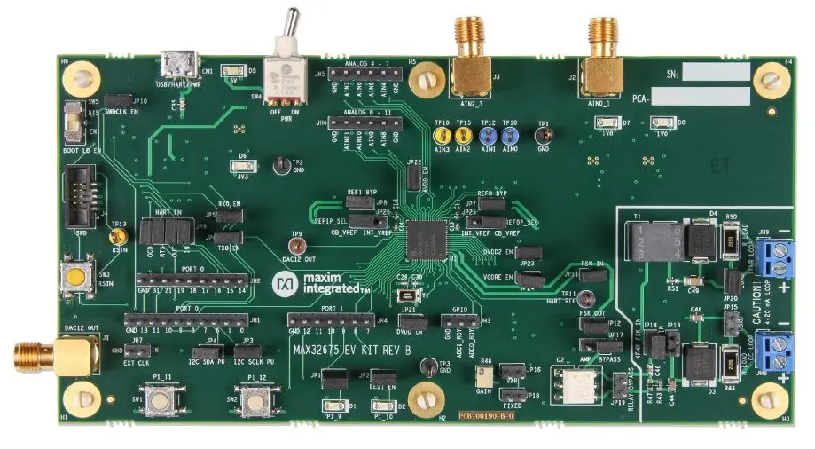

<!-- Copyright 2015-2026 Zephyr Project members and individual contributors. -->
<!-- SPDX-License-Identifier: Apache-2.0 -->
<!-- 中文翻译；编号、导航与译注为本地新增。 -->

# 第15章\_MAX32675EVKIT

原文：[官方页面](https://docs.zephyrproject.org/latest/boards/adi/max32675evkit/doc/index.html)。读取日期：2026-10-16；来源摘要见[来源记录](../SOURCES.md)。

开发板概览（Board Overview）

MAX32675EVKIT

名称（Name）：

`max32675evkit`

厂商（Vendor）：

[Analog Devices, Inc.](https://docs.zephyrproject.org/latest/boards/index.html#vendor=adi)

状态（Status）：

维护中（Maintained）

架构（Architecture）：

[arm](https://docs.zephyrproject.org/latest/boards/index.html#arch=arm)

片上系统（SoC）：

[max32675](https://docs.zephyrproject.org/latest/boards/index.html#soc=max32675)

[浏览开发板源码（Browse Board Sources）](https://github.com/zephyrproject-rtos/zephyr/blob/main//boards/adi/max32675evkit/doc/index.rst/../..)

## 概述（Overview）

MAX32675评估套件（EV Kit）提供一个平台，用于评估MAX32675微控制器。该器件是一款面向工业与医疗传感器的高集成度、混合信号（Mixed-Signal）、超低功耗微控制器。其集成的低功耗HART调制解调器（Modem）可以通过电流环（Current Loop）与工业传感器双向交换数字数据，用于配置和诊断。

Zephyr移植版本运行在MAX32675微控制器（MCU）上。

## 硬件（Hardware）

- MAX32675微控制器（MCU）：

  - 面向工业应用的低功耗、高性能设计

    - 100 MHz Arm Cortex-M4，带浮点单元（FPU）
    - 384 KB内部闪存（Flash）
    - 160 KB静态随机存储器（SRAM）
    - 启用纠错码（ECC）时为128 kB
    - 活动模式（ACTIVE）下，0.9 V、最高12 MHz运行Coremark®时为44.1 μA/MHz
    - 活动模式（ACTIVE）下，1.1 V、最高100 MHz运行Coremark时为64.5 μA/MHz
    - VDDIO = 3.3 V时，备份模式（BACKUP）下完整存储器保持电流为2.84 μA
    - 超低功耗模拟外设（Analog Peripherals）
  - 通过合理的外设组合提供平台扩展能力（Platform Scalability）

    - 两个Σ-Δ模数转换器（Sigma-Delta ADCs）
    - 12个通道，可分配给任一ADC
    - 灵活的分辨率和采样率（Resolution / Sample Rates）：24位时0.4 ksps，16位时4 ksps
    - 12位数模转换器（DAC）
    - 片上温度传感器（On-Die Temperature Sensor）
    - SPI主机／从机（M/S）
    - 最多两路I2C
    - 最多两路UART
    - 最多23个GPIO
    - 最多五个32位定时器（Timers）
    - 两个窗口看门狗定时器（Windowed Watchdog Timers）
    - 八通道标准DMA控制器
    - 一路I2S从机（Slave），用于数字音频接口
  - 稳健的安全与可靠性（Security and Reliability）

    - 符合SP800-90B的真随机数发生器（TRNG）
    - 安全非易失性密钥存储（Secure Nonvolatile Key Storage）及AES-128/192/256
    - 用于保护知识产权／固件（IP/Firmware）的安全引导加载程序（Secure Bootloader）
    - 宽工作温度范围：−40 °C至+105 °C
- MAX32675EVKIT的优势与功能（Benefits and Features）：

  > - 兼容HART的次主机（Secondary Master），能够接入既有4–20 mA电流环，并与支持HART的设备通信
  > - USB 2.0 Micro-B转串行UART
  > - 两个板载高精度参考电压（Voltage References）
  > - 通过0.1英寸间距排针访问全部GPIO信号
  > - 通过SMA接口访问配置为差分（Differential）的4路模拟输入
  > - 通过0.1英寸间距排针访问配置为单端（Single-Ended）的8路模拟输入
  > - 通过SMA接口或测试点访问数模转换器（DAC）输出
  > - 10针SWD及连接器（原文：10-Pin SWD and Connector）
  > - USB端口为开发板供电
  > - 板载1.0 V、1.8 V及3.3 V低压差稳压器（LDO Regulators）
  > - 通过跳线分别测量所有芯片供电轨（IC Rails）的功耗
  > - 两个通用LED和两个通用按键开关（General-Purpose Pushbutton Switches）

### 支持的功能（Supported Features）

`max32675evkit`开发板支持下表所列的硬件功能。

片上／板载（On-Chip / On-Board）

功能集成在片上系统（SoC）内／位于开发板上。

2 / 2

分别表示已启用／已禁用的实例数。点击数量标签，可查看开发板或SoC设备树源码（DTS）中该功能的第一个实例。

`vnd,foo`

与此功能匹配的设备树绑定兼容字符串（Compatible String）；点击链接可查看绑定文档。

#### `max32675evkit/max32675`目标（Target）

该开发板目标的片上存储容量：64 KiB RAM、384 KiB Flash。

<table>
<tr>
<th>类型（Type）</th>
<th>位置（Location）</th>
<th>说明（Description）</th>
<th>兼容字符串（Compatible）</th>
</tr>
<tr>
<td rowspan="2">中央处理器（CPU）</td>
<td>片上（On-Chip）</td>
<td>ARM Cortex-M4F 处理器（CPU）（<a href="https://github.com/zephyrproject-rtos/zephyr/blob/main/dts/vendor/adi/max32/max32xxx.dtsi?plain=1#L25">已启用：1</a>）</td>
<td><a href="../cpu_arm_riscv_binding_reference/P025_arm_cortex-m4f.md#std-dtcompatible-arm-cortex-m4f"><code>arm,cortex-m4f</code></a></td>
</tr>
<tr>
<td>片上（On-Chip）</td>
<td>MAX32 RV32内核（Core）（<a href="https://github.com/zephyrproject-rtos/zephyr/blob/main/dts/vendor/adi/max32/max32xxx.dtsi?plain=1#L32">已禁用：1</a>）</td>
<td><a href="../cpu_arm_riscv_binding_reference/P002_adi_max32-rv32.md#std-dtcompatible-adi-max32-rv32"><code>adi,max32-rv32</code></a></td>
</tr>
<tr>
<td rowspan="1">模数转换器（ADC）</td>
<td>片上（On-Chip）</td>
<td>ADI MAX32 10位模数转换器（ADC）（<a href="https://github.com/zephyrproject-rtos/zephyr/blob/main/dts/vendor/adi/max32/max32xxx.dtsi?plain=1#L241">已禁用：1</a>）</td>
<td><a href="../hardware/P861_ADIMAX32十位ADC绑定.md#dtbinding-adi-max32-adc-10b"><code>adi,max32-adc-10b</code></a></td>
</tr>
<tr>
<td rowspan="2">时钟控制（Clock Control）</td>
<td>片上（On-Chip）</td>
<td>通用固定频率时钟提供者（Fixed-Rate Clock Provider）（<a href="https://github.com/zephyrproject-rtos/zephyr/blob/main/dts/vendor/adi/max32/max32xxx.dtsi?plain=1#L64">已启用：1</a>；<a href="https://github.com/zephyrproject-rtos/zephyr/blob/main/dts/vendor/adi/max32/max32xxx.dtsi?plain=1#L78">已禁用：4</a>）</td>
<td><a href="../hardware/P566_固定时钟绑定.md#dtbinding-fixed-clock"><code>fixed-clock</code></a></td>
</tr>
<tr>
<td>片上（On-Chip）</td>
<td>MAX32全局控制（Global Control）（<a href="https://github.com/zephyrproject-rtos/zephyr/blob/main/dts/vendor/adi/max32/max32xxx.dtsi?plain=1#L130">已启用：1</a>）</td>
<td><a href="../clock_adi_atmel_bflb_binding_reference/P004_adi_max32-gcr.md#std-dtcompatible-adi-max32-gcr"><code>adi,max32-gcr</code></a></td>
</tr>
<tr>
<td rowspan="2">计数器（Counter）</td>
<td>片上（On-Chip）</td>
<td>ADI MAX32计数器（Counter）（<a href="https://github.com/zephyrproject-rtos/zephyr/blob/main/dts/vendor/adi/max32/max32xxx.dtsi?plain=1#L260">已禁用：4</a>）</td>
<td><a href="../counter_binding_reference/P001_adi_max32-counter.md#std-dtcompatible-adi-max32-counter"><code>adi,max32-counter</code></a></td>
</tr>
<tr>
<td>片上（On-Chip）</td>
<td>ADI MAX32兼容实时时钟计数器（Counter RTC）（<a href="https://github.com/zephyrproject-rtos/zephyr/blob/main/dts/arm/adi/max32/max32675.dtsi?plain=1#L100">已禁用：1</a>）</td>
<td><a href="../counter_binding_reference/P002_adi_max32-rtc-counter.md#std-dtcompatible-adi-max32-rtc-counter"><code>adi,max32-rtc-counter</code></a></td>
</tr>
<tr>
<td rowspan="1">直接存储器访问（DMA）</td>
<td>片上（On-Chip）</td>
<td>ADI MAX32直接存储器访问（DMA）（<a href="https://github.com/zephyrproject-rtos/zephyr/blob/main/dts/arm/adi/max32/max32675.dtsi?plain=1#L70">已启用：1</a>）</td>
<td><a href="../dma_binding_reference/P002_adi_max32-dma.md#std-dtcompatible-adi-max32-dma"><code>adi,max32-dma</code></a></td>
</tr>
<tr>
<td rowspan="1">闪存控制器（Flash Controller）</td>
<td>片上（On-Chip）</td>
<td>MAX32XXX闪存控制器（Flash Controller）（<a href="https://github.com/zephyrproject-rtos/zephyr/blob/main/dts/vendor/adi/max32/max32xxx.dtsi?plain=1#L111">已启用：1</a>）</td>
<td><a href="../flash_adi_microchip_nordic_binding_reference/P001_adi_max32-flash-controller.md#std-dtcompatible-adi-max32-flash-controller"><code>adi,max32-flash-controller</code></a></td>
</tr>
<tr>
<td rowspan="1">通用输入输出与接插件（GPIO &amp; Headers）</td>
<td>片上（On-Chip）</td>
<td>MAX32通用输入输出（GPIO）（<a href="https://github.com/zephyrproject-rtos/zephyr/blob/main/dts/vendor/adi/max32/max32xxx.dtsi?plain=1#L175">已启用：2</a>）</td>
<td><a href="../gpio_adi_headers_ambiq_binding_reference/P011_adi_max32-gpio.md#std-dtcompatible-adi-max32-gpio"><code>adi,max32-gpio</code></a></td>
</tr>
<tr>
<td rowspan="1">集成电路间总线（I2C）</td>
<td>片上（On-Chip）</td>
<td>ADI MAX32 I2C控制器（<a href="https://github.com/zephyrproject-rtos/zephyr/blob/main/dts/vendor/adi/max32/max32xxx.dtsi?plain=1#L159">已启用：1</a>；<a href="https://github.com/zephyrproject-rtos/zephyr/blob/main/dts/vendor/adi/max32/max32xxx.dtsi?plain=1#L139">已禁用：2</a>）</td>
<td><a href="../i2c_adi_atmel_esp_binding_reference/P001_adi_max32-i2c.md#std-dtcompatible-adi-max32-i2c"><code>adi,max32-i2c</code></a></td>
</tr>
<tr>
<td rowspan="1">输入（Input）</td>
<td>板载（On-Board）</td>
<td>一组绑定到 GPIO 的输入按键（GPIO-Bound Input Keys）（<a href="https://github.com/zephyrproject-rtos/zephyr/blob/main/boards/adi/max32675evkit/max32675evkit.dts?plain=1#L40">已启用：1</a>）</td>
<td><a href="../hardware/P563_GPIO按键绑定.md#std-dtcompatible-gpio-keys"><code>gpio-keys</code></a></td>
</tr>
<tr>
<td rowspan="1">中断控制器（Interrupt Controller）</td>
<td>片上（On-Chip）</td>
<td>ARMv7-M 嵌套向量中断控制器（Nested Vectored Interrupt Controller，NVIC）（<a href="https://github.com/zephyrproject-rtos/zephyr/blob/main/dts/arm/armv7-m.dtsi?plain=1#L13">已启用：1</a>）</td>
<td><a href="../arm_interrupt_timer_binding_reference/P002_ARMv7_M_NVIC.md#std-dtcompatible-arm-v7m-nvic"><code>arm,v7m-nvic</code></a></td>
</tr>
<tr>
<td rowspan="1">发光二极管（LED）</td>
<td>板载（On-Board）</td>
<td>一组由 GPIO 控制的 LED（GPIO-Controlled LEDs）（<a href="https://github.com/zephyrproject-rtos/zephyr/blob/main/boards/adi/max32675evkit/max32675evkit.dts?plain=1#L26">已启用：1</a>）</td>
<td><a href="../hardware/P564_GPIO指示灯绑定.md#dtbinding-gpio-leds"><code>gpio-leds</code></a></td>
</tr>
<tr>
<td rowspan="1">邮箱（Mailbox）</td>
<td>片上（On-Chip）</td>
<td>ADI MAX32 SEMA邮箱（Mailbox）（<a href="https://github.com/zephyrproject-rtos/zephyr/blob/main/dts/vendor/adi/max32/max32xxx.dtsi?plain=1#L194">已禁用：1</a>）</td>
<td><a href="../intercore_reference/P032_ADI硬件信号量邮箱绑定.md#dtbinding-adi-mbox-max32-sema"><code>adi,mbox-max32-sema</code></a></td>
</tr>
<tr>
<td rowspan="1">存储技术设备（MTD）</td>
<td>片上（On-Chip）</td>
<td>闪存（Flash）节点（<a href="https://github.com/zephyrproject-rtos/zephyr/blob/main/dts/vendor/adi/max32/max32xxx.dtsi?plain=1#L119">已启用：1</a>）</td>
<td><a href="../mtd_nxp_st_ti_partition_binding_reference/P013_soc-nv-flash.md#std-dtcompatible-soc-nv-flash"><code>soc-nv-flash</code></a></td>
</tr>
<tr>
<td rowspan="1">引脚控制（Pin Control）</td>
<td>片上（On-Chip）</td>
<td>MAX32引脚控制器（Pin Controller）（<a href="https://github.com/zephyrproject-rtos/zephyr/blob/main/dts/vendor/adi/max32/max32xxx.dtsi?plain=1#L169">已启用：1</a>）</td>
<td><a href="../pinctrl_adi_ambiq_arm_binding_reference/P001_adi_max32-pinctrl.md#std-dtcompatible-adi-max32-pinctrl"><code>adi,max32-pinctrl</code></a></td>
</tr>
<tr>
<td rowspan="1">脉宽调制（PWM）</td>
<td>片上（On-Chip）</td>
<td>ADI MAX32脉宽调制（PWM）（<a href="https://github.com/zephyrproject-rtos/zephyr/blob/main/dts/vendor/adi/max32/max32xxx.dtsi?plain=1#L265">已禁用：4</a>）</td>
<td><a href="../pwm_adi_esp_infineon_binding_reference/P003_adi_max32-pwm.md#std-dtcompatible-adi-max32-pwm"><code>adi,max32-pwm</code></a></td>
</tr>
<tr>
<td rowspan="1">随机数生成器（RNG）</td>
<td>片上（On-Chip）</td>
<td>ADI MAX32XXX真随机数发生器（TRNG）（<a href="https://github.com/zephyrproject-rtos/zephyr/blob/main/dts/vendor/adi/max32/max32xxx.dtsi?plain=1#L226">已启用：1</a>）</td>
<td><a href="../rng_binding_reference/P001_adi_max32-trng.md#std-dtcompatible-adi-max32-trng"><code>adi,max32-trng</code></a></td>
</tr>
<tr>
<td rowspan="1">串行控制器（Serial Controller）</td>
<td>片上（On-Chip）</td>
<td>MAX32通用异步收发器（UART）（<a href="https://github.com/zephyrproject-rtos/zephyr/blob/main/dts/vendor/adi/max32/max32xxx.dtsi?plain=1#L202">已启用：1</a>；<a href="https://github.com/zephyrproject-rtos/zephyr/blob/main/dts/vendor/adi/max32/max32xxx.dtsi?plain=1#L218">已禁用：1</a>）</td>
<td><a href="../uart_adi_arm_atmel_binding_reference/P001_adi_max32-uart.md#std-dtcompatible-adi-max32-uart"><code>adi,max32-uart</code></a></td>
</tr>
<tr>
<td rowspan="1">串行外设接口（SPI）</td>
<td>片上（On-Chip）</td>
<td>ADI MAX32串行外设接口（SPI）（<a href="https://github.com/zephyrproject-rtos/zephyr/blob/main/dts/arm/adi/max32/max32675.dtsi?plain=1#L80">已启用：1</a>）</td>
<td><a href="../spi_adi_atmel_esp_binding_reference/P001_adi_max32-spi.md#std-dtcompatible-adi-max32-spi"><code>adi,max32-spi</code></a></td>
</tr>
<tr>
<td rowspan="1">静态随机存储器（SRAM）</td>
<td>片上（On-Chip）</td>
<td>通用片上静态随机存储器（SRAM）（<a href="https://github.com/zephyrproject-rtos/zephyr/blob/main/dts/arm/adi/max32/max32675.dtsi?plain=1#L30">已启用：8</a>）</td>
<td><a href="../hardware/P567_内存映射SRAM绑定.md#dtbinding-mmio-sram"><code>mmio-sram</code></a></td>
</tr>
<tr>
<td rowspan="2">定时器（Timer）</td>
<td>片上（On-Chip）</td>
<td>ADI MAX32定时器（Timer）（<a href="https://github.com/zephyrproject-rtos/zephyr/blob/main/dts/vendor/adi/max32/max32xxx.dtsi?plain=1#L252">已禁用：5</a>）</td>
<td><a href="../system_timer_binding_reference/P002_adi_max32-timer.md#std-dtcompatible-adi-max32-timer"><code>adi,max32-timer</code></a></td>
</tr>
<tr>
<td>片上（On-Chip）</td>
<td>ARMv7-M 系统节拍（System Tick）（<a href="https://github.com/zephyrproject-rtos/zephyr/blob/main/dts/arm/armv7-m.dtsi?plain=1#L21">已启用：1</a>）</td>
<td><a href="../arm_interrupt_timer_binding_reference/P006_ARMv7_M_SysTick.md#std-dtcompatible-arm-armv7m-systick"><code>arm,armv7m-systick</code></a></td>
</tr>
<tr>
<td rowspan="1">看门狗（Watchdog）</td>
<td>片上（On-Chip）</td>
<td>MAX32XXX看门狗（Watchdog）（<a href="https://github.com/zephyrproject-rtos/zephyr/blob/main/dts/vendor/adi/max32/max32xxx.dtsi?plain=1#L233">已启用：1</a>）</td>
<td><a href="../watchdog_binding_reference/P001_adi_max32-watchdog.md#std-dtcompatible-adi-max32-watchdog"><code>adi,max32-watchdog</code></a></td>
</tr>
</table>

### 连接与输入输出（Connections and IOs）

<table>
<tr>
<th>名称（Name）</th>
<th>名称（Name）</th>
<th>设置（Settings）</th>
<th>说明（Description）</th>
</tr>
<tr>
<td>JP1</td>
<td>P1_9</td>
<td><table><tr><td>开路（Open）</td></tr><tr><td>闭合（Closed）</td></tr></table></td>
<td><table><tr><td>断开红色LED D1与P1_9。</td></tr><tr><td>将红色LED D1连接到P1_9。</td></tr></table></td>
</tr>
<tr>
<td>JP2</td>
<td>P1_10</td>
<td><table><tr><td>开路（Open）</td></tr><tr><td>闭合（Closed）</td></tr></table></td>
<td><table><tr><td>断开绿色LED D2与P1_10。</td></tr><tr><td>将绿色LED D2连接到P1_10。</td></tr></table></td>
</tr>
<tr>
<td>JP3</td>
<td>I2C_SCLK</td>
<td><table><tr><td>开路（Open）</td></tr><tr><td>闭合（Closed）</td></tr></table></td>
<td><table><tr><td>断开3V3与I2C_SCLK。</td></tr><tr><td>将3V3连接到I2C0_SCLK。</td></tr></table></td>
</tr>
<tr>
<td>JP4</td>
<td>I2C_SDA</td>
<td><table><tr><td>开路（Open）</td></tr><tr><td>闭合（Closed）</td></tr></table></td>
<td><table><tr><td>断开3V3与I2C_SDA。</td></tr><tr><td>将3V3连接到I2C_SDA。</td></tr></table></td>
</tr>
<tr>
<td>JP5</td>
<td>UART0_RX</td>
<td><table><tr><td>开路（Open）</td></tr><tr><td>闭合（Closed）</td></tr></table></td>
<td><table><tr><td>断开UART0_RX（P0.8）与SWD接口。</td></tr><tr><td>将UART0_RX（P0.8）连接到SWD接口。</td></tr></table></td>
</tr>
<tr>
<td>JP6</td>
<td>UART0_TX</td>
<td><table><tr><td>开路（Open）</td></tr><tr><td>闭合（Closed）</td></tr></table></td>
<td><table><tr><td>断开UART0_TX（P0.9）与SWD接口。</td></tr><tr><td>将UART0_TX（P0.9）连接到SWD接口。</td></tr></table></td>
</tr>
<tr>
<td>JP7</td>
<td>REF0N</td>
<td><table><tr><td>开路（Open）</td></tr><tr><td>闭合（Closed）</td></tr></table></td>
<td><table><tr><td>断开REF0N与地（Ground）。</td></tr><tr><td>将REF0N连接到地（Ground）。</td></tr></table></td>
</tr>
<tr>
<td>JP8</td>
<td>REF1N</td>
<td><table><tr><td>开路（Open）</td></tr><tr><td>闭合（Closed）</td></tr></table></td>
<td><table><tr><td>断开REF1N与地（Ground）。</td></tr><tr><td>将REF1N连接到地（Ground）。</td></tr></table></td>
</tr>
<tr>
<td>JP9</td>
<td><table><tr><td>HART_IN</td></tr><tr><td>HART_IN</td></tr><tr><td>HART_OUT</td></tr><tr><td>HART_OUT</td></tr><tr><td>HART_RTS</td></tr><tr><td>HART_RTS</td></tr><tr><td>HART_OCD</td></tr><tr><td>HART_OCD</td></tr></table></td>
<td><table><tr><td>开路（Open）</td></tr><tr><td>1-2</td></tr><tr><td>开路（Open）</td></tr><tr><td>3-4</td></tr><tr><td>开路（Open）</td></tr><tr><td>4-5</td></tr><tr><td>开路（Open）</td></tr><tr><td>7-8</td></tr></table></td>
<td><table><tr><td>断开USB转串口桥的TX与HART_IN（P0.15）。</td></tr><tr><td>将USB转串口桥的TX连接到HART_IN（P0.15）。</td></tr><tr><td>断开USB转串口桥的RX与HART_OUT（P0.14）。</td></tr><tr><td>将USB转串口桥的RX连接到HART_OUT（P0.14）。</td></tr><tr><td>断开USB转串口桥的RTS与HART_RTS（P1.8）。</td></tr><tr><td>将USB转串口桥的TX连接到HART_RTS（P1.8），TX名称按原文保留。</td></tr><tr><td>断开USB转串口桥的RTS与HART_OCD（P0.16）。</td></tr><tr><td>将USB转串口桥的TX连接到HART_OCD（P0.16），TX名称按原文保留。</td></tr></table></td>
</tr>
<tr>
<td>JP10</td>
<td>SWD_CLK</td>
<td><table><tr><td>开路（Open）</td></tr><tr><td>闭合（Closed）</td></tr></table></td>
<td><table><tr><td>断开引导加载使能电路（Boot Load Enable Circuit）与SWD_CLK（P0.1）。</td></tr><tr><td>将引导加载使能电路连接到SWD_CLK（P0.1）。</td></tr></table></td>
</tr>
<tr>
<td>JP11</td>
<td>FSK_IN</td>
<td><table><tr><td>开路（Open）</td></tr><tr><td>闭合（Closed）</td></tr></table></td>
<td><table><tr><td>断开FSK_IN与HART模拟电路（Analog Circuitry）。</td></tr><tr><td>将FSK_IN连接到HART模拟电路。</td></tr></table></td>
</tr>
<tr>
<td>JP12</td>
<td>FSK_OUT</td>
<td><table><tr><td>开路（Open）</td></tr><tr><td>闭合（Closed）</td></tr></table></td>
<td><table><tr><td>断开FSK_OUT与HART模拟电路。</td></tr><tr><td>将FSK_OUT连接到HART模拟电路。</td></tr></table></td>
</tr>
<tr>
<td>JP13</td>
<td>RCV_FSK</td>
<td><table><tr><td>开路（Open）</td></tr><tr><td>闭合（Closed）</td></tr></table></td>
<td><table><tr><td>断开RCV_FSK与CC LOOP电流环。</td></tr><tr><td>将RCV_FSK连接到CC LOOP电流环。</td></tr></table></td>
</tr>
<tr>
<td>JP14</td>
<td>RCV_FSK</td>
<td><table><tr><td>开路（Open）</td></tr><tr><td>闭合（Closed）</td></tr></table></td>
<td><table><tr><td>断开RCV_FSK与XFMR LOOP变压器环路。</td></tr><tr><td>将RCV_FSK连接到XFMR LOOP变压器环路。</td></tr></table></td>
</tr>
<tr>
<td>JP15</td>
<td>负载电阻（RLOAD）</td>
<td><table><tr><td>开路（Open）</td></tr><tr><td>闭合（Closed）</td></tr></table></td>
<td><table><tr><td>断开249 Ω分流电阻（Resistor Shunt）与CC LOOP电流环。</td></tr><tr><td>将249 Ω分流电阻连接到CC LOOP电流环。</td></tr></table></td>
</tr>
<tr>
<td>JP16</td>
<td>N/A</td>
<td>N/A</td>
<td>N/A</td>
</tr>
<tr>
<td>JP17</td>
<td>N/A</td>
<td>N/A</td>
<td>N/A</td>
</tr>
<tr>
<td>JP18</td>
<td>N/A</td>
<td>N/A</td>
<td>N/A</td>
</tr>
<tr>
<td>JP19</td>
<td>HART_RTS</td>
<td><table><tr><td>开路（Open）</td></tr><tr><td>闭合（Closed）</td></tr></table></td>
<td><table><tr><td>启用HART_RTS光收发器（Optical Transceiver）。</td></tr><tr><td>旁路HART_RTS光收发器（Optical Transceiver）。</td></tr></table></td>
</tr>
<tr>
<td>JP20</td>
<td>负载电阻（RLOAD）</td>
<td><table><tr><td>开路（Open）</td></tr><tr><td>闭合（Closed）</td></tr></table></td>
<td><table><tr><td>断开249 Ω分流电阻与XFMR LOOP变压器环路。</td></tr><tr><td>将249 Ω分流电阻连接到XFMR LOOP变压器环路。</td></tr></table></td>
</tr>
<tr>
<td>JP21</td>
<td>VDDIO</td>
<td><table><tr><td>开路（Open）</td></tr><tr><td>闭合（Closed）</td></tr></table></td>
<td><table><tr><td>断开VDDIO的电源。</td></tr><tr><td>为VDDIO接通电源。</td></tr></table></td>
</tr>
<tr>
<td>JP22</td>
<td>VDDA</td>
<td><table><tr><td>开路（Open）</td></tr><tr><td>闭合（Closed）</td></tr></table></td>
<td><table><tr><td>断开VDDA的电源。</td></tr><tr><td>为VDDA接通电源。</td></tr></table></td>
</tr>
<tr>
<td>JP23</td>
<td>VDD18</td>
<td><table><tr><td>开路（Open）</td></tr><tr><td>闭合（Closed）</td></tr></table></td>
<td><table><tr><td>断开VDD18的电源。</td></tr><tr><td>为VDD18接通电源。</td></tr></table></td>
</tr>
<tr>
<td>JP24</td>
<td>VCORE</td>
<td><table><tr><td>开路（Open）</td></tr><tr><td>闭合（Closed）</td></tr></table></td>
<td><table><tr><td>断开VCORE的电源。</td></tr><tr><td>为VCORE接通电源。</td></tr></table></td>
</tr>
<tr>
<td>JP25</td>
<td>REF0P</td>
<td><table><tr><td>2-1</td></tr><tr><td>2-3</td></tr></table></td>
<td><table><tr><td>将OB_VREF连接到REF0P。</td></tr><tr><td>将INT_VREF连接到REF0P。</td></tr></table></td>
</tr>
<tr>
<td>JP26</td>
<td>REF1P</td>
<td><table><tr><td>2-1</td></tr><tr><td>2-3</td></tr></table></td>
<td><table><tr><td>将OB_VREF连接到REF1P。</td></tr><tr><td>将INT_VREF连接到REF1P。</td></tr></table></td>
</tr>
</table>

### 硬件详细说明（Detailed Description of Hardware）

## HART接口（HART Interface）

HART电路作为次主机（Secondary Master）工作，可接入既有4–20 mA电流环，并与支持HART的设备通信。电容耦合环路（Capacitance Coupled Loop）通过JH8连接，变压器环路（Transformer Loop）通过JH9连接。与MAX32675的HART通信通过USB接口CN1进行。

## USB转HART接口（USB-to-HART Interface）

评估套件提供USB转HART桥接芯片FTDI FT231，无需物理RS-232 COM端口；通过Micro-USB Type-B接口CN1即可访问芯片的HART接口。虚拟COM端口驱动和Windows®驱动安装指南可在FTDI Chip网站获取。

## 电源（Power Supply）

评估套件由+5 V供电，电源通过Micro-USB Type-B接口CN1的VBUS接入。开发板上电后，蓝色LED D5亮起。绿色LED D6、D7和D8分别在3V3、1V8和1V0低压差稳压器（LDO）上电时亮起。

## 电流监测（Current Monitoring）

双针排针为VDDIO EN（JP21）、VDDA EN（JP22）、VDD18 EN（JP23）和VCORE（JP24）提供方便的电流监测点。为了准确测得低功耗电流，需配置评估套件，使上拉电阻、外部时钟、调试器连接等外部因素不会导致GPIO产生拉电流或灌电流（Source or Sink Current）。

## 时钟配置（Clocking）

MAX32675的时钟由外部16 MHz晶体Y1提供。

## 参考电压（Voltage Reference）

差分参考输入（Differential Reference Inputs）REF0和REF1可由内部参考源INT_VREF或精度更高的外部参考源MAX6071提供，通过跳线JP25和JP26选择。

## UART接口（UART Interface）

评估套件提供USB转UART桥接芯片（Bridge Chip）FTDI FT230XS-R，无需物理RS-232 COM端口；通过Micro USB Type-B接口CN1即可访问芯片的UART。USB转UART桥可通过跳线JP10（RX0）和JP11（TX0）连接到UART0或LPUART0。虚拟COM端口驱动和Windows®驱动安装指南可在FTDI Chip网站获取。

## 引导加载程序（Boot Loader）

通过引导加载使能滑动开关（Boot Load Enable Slide Switch）SW5启用引导加载。

## GPIO与复用功能排针（Alternate Function Headers）

可通过0.1英寸间距排针JH1、JH2、JH3和JH4访问MAX32675的GPIO及复用功能信号。

## 访问模拟输入（Analog Input Access）

模拟输入AIN0–AIN3可通过SMA接口J2和J3以差分方式访问，也可分别通过TP10、TP12、TP15和TP16单独访问。AIN4–AIN11可通过0.1英寸间距排针JH5和JH6访问。

## I2C上拉（Pullups）

I2C端口可分别通过JP3（I2C_SCL）和JP4（I2C_SDA）上拉到3V3。

## 复位按键（Reset Pushbutton）

可通过按键SW3复位芯片。

## 指示LED（Indicator LEDs）

通用指示LED D1为红色，连接GPIO P1.9；LED D2为绿色，连接GPIO P1.10。

## GPIO按键开关（Pushbutton Switches）

两个通用按键SW1和SW2分别连接GPIO P1.11和P1.12。按下按键时，对应端口引脚被拉低。

## 烧录与调试（Programming and Debugging）

`max32675evkit`开发板支持下表所列的运行工具（Runners）及相关west命令。

<table>
<tr>
<th></th>
<th>烧录（flash）</th>
<th>调试（debug）</th>
<th>连接调试会话（attach）</th>
<th>实时传输（rtt）</th>
<th>调试服务器（debugserver）</th>
<th>复位（reset）</th>
</tr>
<tr>
<td><a href="https://docs.zephyrproject.org/latest/develop/flash_debug/host-tools.html#runner-jlink"><code>jlink</code></a></td>
<td>✅</td>
<td>✅</td>
<td>✅</td>
<td>✅</td>
<td>✅</td>
<td>✅</td>
</tr>
<tr>
<td><a href="https://docs.zephyrproject.org/latest/develop/flash_debug/host-tools.html#runner-openocd">openocd</a></td>
<td>✅（默认 / default）</td>
<td>✅（默认 / default）</td>
<td>✅</td>
<td>✅</td>
<td>✅</td>
<td></td>
</tr>
</table>

### 烧录（Flashing）

可通过Arm Cortex 10针接口J5访问SWD调试。逻辑电平默认为3V3；若从外部为TP5（VDD_VDDA_EXT）供电，也可设置为1.8 V。从外部为VDD和VDDA供电时，务必移除跳线JP15（LDO_DUT_EN），以断开3.3 V低压差稳压器（LDO）。

将调试探针连接到主机后，执行`west flash`即可将固件镜像写入闪存（Flash）。要执行整片擦除（Full Erase），在`west flash`命令中加入`--erase`选项。

注意（Note）

该开发板默认使用OpenOCD调试接口。也可覆盖运行工具（Runner），在west命令后添加`--runner jlink`，使用Segger J-Link及其原生工具。应通过合适的适配板和线缆，将J-Link连接到标准2 × 5针调试接口JH2。

### 调试（Debugging）

请参考[烧录（Flashing）](#flashing)一节，并将`west flash`替换为`west debug`执行调试。

## 参考资料（References）

- [MAX32675EVKIT网页（Web Page）](https://www.analog.com/en/design-center/evaluation-hardware-and-software/evaluation-boards-kits/max32675evkit.html)

## 译注

部分HART跳线行在断开状态写RTS、接通状态写TX；译文分别保留原文信号名，未将其改写为已经核实的接线。

---

[上一章](P014_MAX32672FTHR.md) · [返回大纲](大纲.md) · [全站翻译进度](../PROGRESS.md) · [下一章](P016_MAX32680EVKIT.md)
