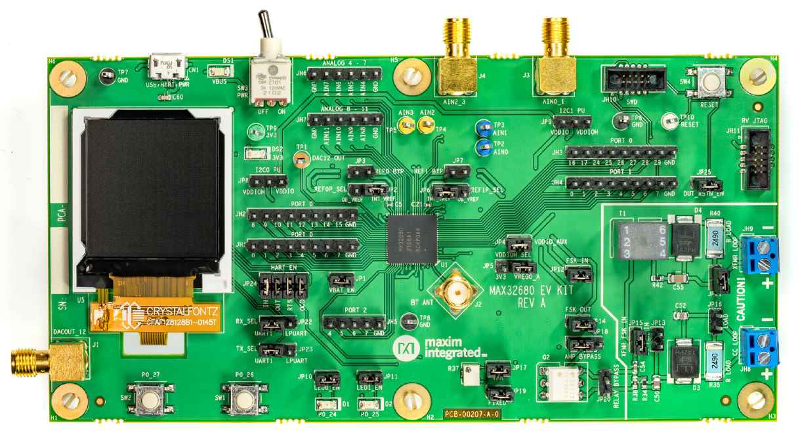

<!-- Copyright 2015-2026 Zephyr Project members and individual contributors. -->
<!-- SPDX-License-Identifier: Apache-2.0 -->
<!-- 中文翻译；编号、导航与译注为本地新增。 -->

# 第16章\_MAX32680EVKIT

原文：[官方页面](https://docs.zephyrproject.org/latest/boards/adi/max32680evkit/doc/index.html)。读取日期：2026-10-16；来源摘要见[来源记录](../SOURCES.md)。

开发板概览（Board Overview）

MAX32680EVKIT

名称（Name）：

`max32680evkit`

厂商（Vendor）：

[Analog Devices, Inc.](https://docs.zephyrproject.org/latest/boards/index.html#vendor=adi)

状态（Status）：

维护中（Maintained）

架构（Architecture）：

[arm](https://docs.zephyrproject.org/latest/boards/index.html#arch=arm)

片上系统（SoC）：

[max32680](https://docs.zephyrproject.org/latest/boards/index.html#soc=max32680)

[浏览开发板源码（Browse Board Sources）](https://github.com/zephyrproject-rtos/zephyr/blob/main//boards/adi/max32680evkit/doc/index.rst/../..)

## 概述（Overview）

MAX32680评估套件（EV Kit）提供一个平台，用于评估MAX32680微控制器。该器件是一款面向工业和医疗传感器的先进片上系统（SoC），由单电感多输出（SIMO）降压稳压系统（Buck Regulator System）提供电源稳压与管理，并配有新一代Bluetooth® 5.2低功耗（LE）无线电。

Zephyr移植版本运行在MAX32680微控制器（MCU）上。

## 硬件（Hardware）

- MAX32680微控制器（MCU）：

  - 超低功耗无线微控制器（Ultra-Low-Power Wireless Microcontroller）

    - 内部100 MHz振荡器（Oscillator）
    - 512 KB闪存和128 KB SRAM，其中一个32 KB SRAM存储区（Bank）可选启用纠错码（ECC）
  - Bluetooth 5.2低功耗无线电（LE Radio）

    - 专用超低功耗32位RISC-V协处理器（Coprocessor），用于分担处理任务

    时序敏感的蓝牙处理（Timing-Critical Bluetooth Processing）

    - 提供完全开源的Bluetooth 5.2协议栈（Stack）
    - 支持到达角（AoA）、发射角（AoD）、低功耗音频（LE Audio）和网状网络（Mesh）
    - 高吞吐（High-Throughput）2 Mbps模式，以及远距离（Long-Range）125 kbps和500 kbps模式
    - 接收灵敏度（Rx Sensitivity）：−97.5 dBm；发射功率（Tx Power）：+4.5 dBm
    - 单端天线连接（Single-ended Antenna Connection），50 Ω
  - 智能集成可减少物料清单（BOM）、成本和印制电路板（PCB）尺寸

    - 两个16至24位Σ-Δ模数转换器（Sigma-Delta ADCs）
    - 12个通道，可分配给任一ADC
    - 灵活的分辨率与采样率（Resolution / Sample Rates）
    - 24位时0.4 ksps，16位时4 ksps
    - 四路外部输入、10位Σ-Δ模数转换器（Sigma-Delta ADC），7.8 ksps
    - 12位数模转换器（DAC）
    - 片上温度传感器（On-Die Temperature Sensor）
    - 数字外设（Digital Peripherals）：两路SPI、两路I2C、最多四路UART和最多36个GPIO
    - 定时器：六个32位定时器、两个看门狗定时器、两个脉冲串发生器（Pulse Trains）以及1-Wire®单总线主机（Master）
  - 通过电源管理（Power Management）尽可能延长电池续航

    - 2.0–3.6 V供电电压范围（Supply Voltage Range）
    - 集成单电感多输出电源稳压器（SIMO Power Regulator）
    - 动态电压调节（DVS / Dynamic Voltage Scaling）
    - 3.0 V下运行Coremark®时，活动模式（ACTIVE）电流为23.8 μA/MHz
    - 3.0 V时保留32 KB SRAM的保持电流（Retention Current）为4.4 μA
    - 低功耗模式下可选择保留SRAM内容
  - 稳健的安全与可靠性（Security and Reliability）

    - 真随机数发生器（TRNG）
    - 安全非易失性密钥存储（Secure Nonvolatile Key Storage）及AES-128/192/256
    - 安全启动（Secure Boot）用于保护知识产权／固件（IP/Firmware）
    - 宽工作温度范围：−40 °C至+85 °C
- MAX32680 EVKIT连接的外部器件：

  - 用于连接外部蓝牙天线的SMA接口
  - 128 × 128、1.45英寸彩色TFT显示屏，带SPI接口
  - 两个可选板载高精度参考电压（Voltage References）
  - USB 2.0 Micro-B转串行UART
  - 通过板载跳线选择UART1或LPUART0接口
  - 通过0.1英寸间距排针访问全部GPIO信号
  - 通过SMA接口访问配置为差分（Differential）的四路模拟输入
  - 通过0.1英寸间距排针访问配置为单端（Single-End）的八路模拟输入
  - 为十二路模拟输入提供可选分立滤波器（Discrete Filter）
  - 通过SMA接口或测试点访问数模转换器（DAC）
  - 10针串行线调试接口（SWD Connector）
  - 10针RV JTAG接口
  - USB端口为开发板供电
  - 板载3.3 V低压差稳压器（LDO），用于为MAX32680内部SIMO供电
  - 提供测试环（Test Loops），可从外部接入可选的VCORE电源
  - 通过跳线分别测量所有芯片供电轨（IC Rails）的功耗
  - 两个通用LED和两个通用按键开关（Pushbutton Switches）

### 支持的功能（Supported Features）

`max32680evkit`开发板支持下表所列的硬件功能。

片上／板载（On-Chip / On-Board）

功能集成在片上系统（SoC）内／位于开发板上。

2 / 2

分别表示已启用／已禁用的实例数。点击数量标签，可查看开发板或SoC设备树源码（DTS）中该功能的第一个实例。

`vnd,foo`

与此功能匹配的设备树绑定兼容字符串（Compatible String）；点击链接可查看绑定文档。

#### `max32680evkit/max32680/m4`目标（Target）

该开发板目标的片上存储容量：48 KiB RAM、512 KiB Flash。

<table>
<tr>
<th>类型（Type）</th>
<th>位置（Location）</th>
<th>说明（Description）</th>
<th>兼容字符串（Compatible）</th>
</tr>
<tr>
<td rowspan="2">中央处理器（CPU）</td>
<td>片上（On-Chip）</td>
<td>ARM Cortex-M4F 处理器（CPU）（<a href="https://github.com/zephyrproject-rtos/zephyr/blob/main/dts/vendor/adi/max32/max32xxx.dtsi?plain=1#L25">已启用：1</a>）</td>
<td><a href="../cpu_arm_riscv_binding_reference/P025_arm_cortex-m4f.md#std-dtcompatible-arm-cortex-m4f"><code>arm,cortex-m4f</code></a></td>
</tr>
<tr>
<td>片上（On-Chip）</td>
<td>MAX32 RV32内核（Core）（<a href="https://github.com/zephyrproject-rtos/zephyr/blob/main/dts/vendor/adi/max32/max32xxx.dtsi?plain=1#L32">已启用：1</a>）</td>
<td><a href="../cpu_arm_riscv_binding_reference/P002_adi_max32-rv32.md#std-dtcompatible-adi-max32-rv32"><code>adi,max32-rv32</code></a></td>
</tr>
<tr>
<td rowspan="1">模数转换器（ADC）</td>
<td>片上（On-Chip）</td>
<td>ADI MAX32 10位模数转换器（ADC）（<a href="https://github.com/zephyrproject-rtos/zephyr/blob/main/dts/vendor/adi/max32/max32xxx.dtsi?plain=1#L241">已禁用：1</a>）</td>
<td><a href="../hardware/P861_ADIMAX32十位ADC绑定.md#dtbinding-adi-max32-adc-10b"><code>adi,max32-adc-10b</code></a></td>
</tr>
<tr>
<td rowspan="2">时钟控制（Clock Control）</td>
<td>片上（On-Chip）</td>
<td>通用固定频率时钟提供者（Fixed-Rate Clock Provider）（<a href="https://github.com/zephyrproject-rtos/zephyr/blob/main/dts/vendor/adi/max32/max32xxx.dtsi?plain=1#L64">已启用：2</a>；<a href="https://github.com/zephyrproject-rtos/zephyr/blob/main/dts/vendor/adi/max32/max32xxx.dtsi?plain=1#L71">已禁用：6</a>）</td>
<td><a href="../hardware/P566_固定时钟绑定.md#dtbinding-fixed-clock"><code>fixed-clock</code></a></td>
</tr>
<tr>
<td>片上（On-Chip）</td>
<td>MAX32全局控制（Global Control）（<a href="https://github.com/zephyrproject-rtos/zephyr/blob/main/dts/vendor/adi/max32/max32xxx.dtsi?plain=1#L130">已启用：1</a>）</td>
<td><a href="../clock_adi_atmel_bflb_binding_reference/P004_adi_max32-gcr.md#std-dtcompatible-adi-max32-gcr"><code>adi,max32-gcr</code></a></td>
</tr>
<tr>
<td rowspan="3">计数器（Counter）</td>
<td>片上（On-Chip）</td>
<td>ADI MAX32计数器（Counter）（<a href="https://github.com/zephyrproject-rtos/zephyr/blob/main/dts/vendor/adi/max32/max32xxx.dtsi?plain=1#L260">已禁用：6</a>）</td>
<td><a href="../counter_binding_reference/P001_adi_max32-counter.md#std-dtcompatible-adi-max32-counter"><code>adi,max32-counter</code></a></td>
</tr>
<tr>
<td>片上（On-Chip）</td>
<td>ADI MAX32兼容实时时钟计数器（Counter RTC）（<a href="https://github.com/zephyrproject-rtos/zephyr/blob/main/dts/vendor/adi/max32/max32xxx.dtsi?plain=1#L332">已启用：1</a>）</td>
<td><a href="../counter_binding_reference/P002_adi_max32-rtc-counter.md#std-dtcompatible-adi-max32-rtc-counter"><code>adi,max32-rtc-counter</code></a></td>
</tr>
<tr>
<td>片上（On-Chip）</td>
<td>ADI MAX32唤醒定时器（Wake-Up Timer）是一个特殊的32位定时器实例，能够从睡眠（Sleep）、待机（Standby）和备份（Backup）模式唤醒设备。（<a href="https://github.com/zephyrproject-rtos/zephyr/blob/main/dts/vendor/adi/max32/max32680.dtsi?plain=1#L136">已禁用：1</a>）</td>
<td><a href="../counter_binding_reference/P003_adi_max32-wut.md#std-dtcompatible-adi-max32-wut"><code>adi,max32-wut</code></a></td>
</tr>
<tr>
<td rowspan="1">显示（Display）</td>
<td>板载（On-Board）</td>
<td>Sitronix ST7735X显示控制器（Display Controller）（<a href="https://github.com/zephyrproject-rtos/zephyr/blob/main/boards/adi/max32680evkit/max32680evkit_max32680_m4.dts?plain=1#L77">已启用：1</a>）</td>
<td><a href="../display_sinowealth_sitronix_solomon_binding_reference/P010_sitronix_st7735r.md#std-dtcompatible-sitronix-st7735r"><code>sitronix,st7735r</code></a></td>
</tr>
<tr>
<td rowspan="1">直接存储器访问（DMA）</td>
<td>片上（On-Chip）</td>
<td>ADI MAX32直接存储器访问（DMA）（<a href="https://github.com/zephyrproject-rtos/zephyr/blob/main/dts/vendor/adi/max32/max32680.dtsi?plain=1#L69">已启用：1</a>）</td>
<td><a href="../dma_binding_reference/P002_adi_max32-dma.md#std-dtcompatible-adi-max32-dma"><code>adi,max32-dma</code></a></td>
</tr>
<tr>
<td rowspan="1">闪存控制器（Flash Controller）</td>
<td>片上（On-Chip）</td>
<td>MAX32XXX闪存控制器（Flash Controller）（<a href="https://github.com/zephyrproject-rtos/zephyr/blob/main/dts/vendor/adi/max32/max32xxx.dtsi?plain=1#L111">已启用：1</a>）</td>
<td><a href="../flash_adi_microchip_nordic_binding_reference/P001_adi_max32-flash-controller.md#std-dtcompatible-adi-max32-flash-controller"><code>adi,max32-flash-controller</code></a></td>
</tr>
<tr>
<td rowspan="1">通用输入输出与接插件（GPIO &amp; Headers）</td>
<td>片上（On-Chip）</td>
<td>MAX32通用输入输出（GPIO）（<a href="https://github.com/zephyrproject-rtos/zephyr/blob/main/dts/vendor/adi/max32/max32xxx.dtsi?plain=1#L175">已启用：3</a>；<a href="https://github.com/zephyrproject-rtos/zephyr/blob/main/dts/vendor/adi/max32/max32680.dtsi?plain=1#L45">已禁用：1</a>）</td>
<td><a href="../gpio_adi_headers_ambiq_binding_reference/P011_adi_max32-gpio.md#std-dtcompatible-adi-max32-gpio"><code>adi,max32-gpio</code></a></td>
</tr>
<tr>
<td rowspan="1">集成电路间总线（I2C）</td>
<td>片上（On-Chip）</td>
<td>ADI MAX32 I2C控制器（<a href="https://github.com/zephyrproject-rtos/zephyr/blob/main/dts/vendor/adi/max32/max32xxx.dtsi?plain=1#L139">已启用：2</a>；<a href="https://github.com/zephyrproject-rtos/zephyr/blob/main/dts/vendor/adi/max32/max32xxx.dtsi?plain=1#L159">已禁用：1</a>）</td>
<td><a href="../i2c_adi_atmel_esp_binding_reference/P001_adi_max32-i2c.md#std-dtcompatible-adi-max32-i2c"><code>adi,max32-i2c</code></a></td>
</tr>
<tr>
<td rowspan="1">输入（Input）</td>
<td>板载（On-Board）</td>
<td>一组绑定到 GPIO 的输入按键（GPIO-Bound Input Keys）（<a href="https://github.com/zephyrproject-rtos/zephyr/blob/main/boards/adi/max32680evkit/max32680evkit_max32680_m4.dts?plain=1#L42">已启用：1</a>）</td>
<td><a href="../hardware/P563_GPIO按键绑定.md#std-dtcompatible-gpio-keys"><code>gpio-keys</code></a></td>
</tr>
<tr>
<td rowspan="1">中断控制器（Interrupt Controller）</td>
<td>片上（On-Chip）</td>
<td>ARMv7-M 嵌套向量中断控制器（Nested Vectored Interrupt Controller，NVIC）（<a href="https://github.com/zephyrproject-rtos/zephyr/blob/main/dts/arm/armv7-m.dtsi?plain=1#L13">已启用：1</a>）</td>
<td><a href="../arm_interrupt_timer_binding_reference/P002_ARMv7_M_NVIC.md#std-dtcompatible-arm-v7m-nvic"><code>arm,v7m-nvic</code></a></td>
</tr>
<tr>
<td rowspan="1">发光二极管（LED）</td>
<td>板载（On-Board）</td>
<td>一组由 GPIO 控制的 LED（GPIO-Controlled LEDs）（<a href="https://github.com/zephyrproject-rtos/zephyr/blob/main/boards/adi/max32680evkit/max32680evkit_max32680_m4.dts?plain=1#L28">已启用：1</a>）</td>
<td><a href="../hardware/P564_GPIO指示灯绑定.md#dtbinding-gpio-leds"><code>gpio-leds</code></a></td>
</tr>
<tr>
<td rowspan="1">邮箱（Mailbox）</td>
<td>片上（On-Chip）</td>
<td>ADI MAX32 SEMA邮箱（Mailbox）（<a href="https://github.com/zephyrproject-rtos/zephyr/blob/main/dts/vendor/adi/max32/max32xxx.dtsi?plain=1#L194">已禁用：1</a>）</td>
<td><a href="../intercore_reference/P032_ADI硬件信号量邮箱绑定.md#dtbinding-adi-mbox-max32-sema"><code>adi,mbox-max32-sema</code></a></td>
</tr>
<tr>
<td rowspan="1">存储技术设备（MTD）</td>
<td>片上（On-Chip）</td>
<td>闪存（Flash）节点（<a href="https://github.com/zephyrproject-rtos/zephyr/blob/main/dts/vendor/adi/max32/max32xxx.dtsi?plain=1#L119">已启用：1</a>）</td>
<td><a href="../mtd_nxp_st_ti_partition_binding_reference/P013_soc-nv-flash.md#std-dtcompatible-soc-nv-flash"><code>soc-nv-flash</code></a></td>
</tr>
<tr>
<td rowspan="1">引脚控制（Pin Control）</td>
<td>片上（On-Chip）</td>
<td>MAX32引脚控制器（Pin Controller）（<a href="https://github.com/zephyrproject-rtos/zephyr/blob/main/dts/vendor/adi/max32/max32xxx.dtsi?plain=1#L169">已启用：1</a>）</td>
<td><a href="../pinctrl_adi_ambiq_arm_binding_reference/P001_adi_max32-pinctrl.md#std-dtcompatible-adi-max32-pinctrl"><code>adi,max32-pinctrl</code></a></td>
</tr>
<tr>
<td rowspan="1">脉宽调制（PWM）</td>
<td>片上（On-Chip）</td>
<td>ADI MAX32脉宽调制（PWM）（<a href="https://github.com/zephyrproject-rtos/zephyr/blob/main/dts/vendor/adi/max32/max32xxx.dtsi?plain=1#L265">已禁用：4</a>）</td>
<td><a href="../pwm_adi_esp_infineon_binding_reference/P003_adi_max32-pwm.md#std-dtcompatible-adi-max32-pwm"><code>adi,max32-pwm</code></a></td>
</tr>
<tr>
<td rowspan="1">随机数生成器（RNG）</td>
<td>片上（On-Chip）</td>
<td>ADI MAX32XXX真随机数发生器（TRNG）（<a href="https://github.com/zephyrproject-rtos/zephyr/blob/main/dts/vendor/adi/max32/max32xxx.dtsi?plain=1#L226">已启用：1</a>）</td>
<td><a href="../rng_binding_reference/P001_adi_max32-trng.md#std-dtcompatible-adi-max32-trng"><code>adi,max32-trng</code></a></td>
</tr>
<tr>
<td rowspan="1">串行控制器（Serial Controller）</td>
<td>片上（On-Chip）</td>
<td>MAX32通用异步收发器（UART）（<a href="https://github.com/zephyrproject-rtos/zephyr/blob/main/dts/vendor/adi/max32/max32xxx.dtsi?plain=1#L210">已启用：1</a>；<a href="https://github.com/zephyrproject-rtos/zephyr/blob/main/dts/vendor/adi/max32/max32xxx.dtsi?plain=1#L202">已禁用：3</a>）</td>
<td><a href="../uart_adi_arm_atmel_binding_reference/P001_adi_max32-uart.md#std-dtcompatible-adi-max32-uart"><code>adi,max32-uart</code></a></td>
</tr>
<tr>
<td rowspan="1">串行外设接口（SPI）</td>
<td>片上（On-Chip）</td>
<td>ADI MAX32串行外设接口（SPI）（<a href="https://github.com/zephyrproject-rtos/zephyr/blob/main/dts/vendor/adi/max32/max32680-m4.dtsi?plain=1#L27">已启用：1</a>；<a href="https://github.com/zephyrproject-rtos/zephyr/blob/main/dts/vendor/adi/max32/max32680.dtsi?plain=1#L86">已禁用：1</a>）</td>
<td><a href="../spi_adi_atmel_esp_binding_reference/P001_adi_max32-spi.md#std-dtcompatible-adi-max32-spi"><code>adi,max32-spi</code></a></td>
</tr>
<tr>
<td rowspan="1">静态随机存储器（SRAM）</td>
<td>片上（On-Chip）</td>
<td>通用片上静态随机存储器（SRAM）（<a href="https://github.com/zephyrproject-rtos/zephyr/blob/main/dts/vendor/adi/max32/max32680.dtsi?plain=1#L56">已启用：4</a>）</td>
<td><a href="../hardware/P567_内存映射SRAM绑定.md#dtbinding-mmio-sram"><code>mmio-sram</code></a></td>
</tr>
<tr>
<td rowspan="2">定时器（Timer）</td>
<td>片上（On-Chip）</td>
<td>ADI MAX32定时器（Timer）（<a href="https://github.com/zephyrproject-rtos/zephyr/blob/main/dts/vendor/adi/max32/max32xxx.dtsi?plain=1#L252">已禁用：7</a>）</td>
<td><a href="../system_timer_binding_reference/P002_adi_max32-timer.md#std-dtcompatible-adi-max32-timer"><code>adi,max32-timer</code></a></td>
</tr>
<tr>
<td>片上（On-Chip）</td>
<td>ARMv7-M 系统节拍（System Tick）（<a href="https://github.com/zephyrproject-rtos/zephyr/blob/main/dts/arm/armv7-m.dtsi?plain=1#L21">已启用：1</a>）</td>
<td><a href="../arm_interrupt_timer_binding_reference/P006_ARMv7_M_SysTick.md#std-dtcompatible-arm-armv7m-systick"><code>arm,armv7m-systick</code></a></td>
</tr>
<tr>
<td rowspan="1">单线总线（1-Wire）</td>
<td>片上（On-Chip）</td>
<td>ADI MAX32xxx微控制器（MCU）的1-Wire单总线主机（Master）（<a href="https://github.com/zephyrproject-rtos/zephyr/blob/main/dts/vendor/adi/max32/max32680.dtsi?plain=1#L123">已禁用：1</a>）</td>
<td><a href="../mux_w1_binding_reference/P006_adi_max32-w1.md#std-dtcompatible-adi-max32-w1"><code>adi,max32-w1</code></a></td>
</tr>
<tr>
<td rowspan="1">看门狗（Watchdog）</td>
<td>片上（On-Chip）</td>
<td>MAX32XXX看门狗（Watchdog）（<a href="https://github.com/zephyrproject-rtos/zephyr/blob/main/dts/vendor/adi/max32/max32xxx.dtsi?plain=1#L233">已启用：1</a>；<a href="https://github.com/zephyrproject-rtos/zephyr/blob/main/dts/vendor/adi/max32/max32680.dtsi?plain=1#L78">已禁用：1</a>）</td>
<td><a href="../watchdog_binding_reference/P001_adi_max32-watchdog.md#std-dtcompatible-adi-max32-watchdog"><code>adi,max32-watchdog</code></a></td>
</tr>
</table>

### 连接与输入输出（Connections and IOs）

<table>
<tr>
<th>名称（Name）</th>
<th>名称（Name）</th>
<th>设置（Settings）</th>
<th>说明（Description）</th>
</tr>
<tr>
<td>JP1</td>
<td>VREGI</td>
<td><table><tr><td>开路（Open）</td></tr><tr><td>闭合（Closed）</td></tr></table></td>
<td><table><tr><td>断开MAX32680 SIMO的3.3 V电源。</td></tr><tr><td>为MAX32680 SIMO接通3.3 V电源。</td></tr></table></td>
</tr>
<tr>
<td>JP2</td>
<td>REF0P</td>
<td><table><tr><td>2-1</td></tr><tr><td>2-3</td></tr></table></td>
<td><table><tr><td>将外部高精度参考电压连接到REF0P。</td></tr><tr><td>将内部参考电压连接到REF0P。</td></tr></table></td>
</tr>
<tr>
<td>JP3</td>
<td>REF0N</td>
<td><table><tr><td>开路（Open）</td></tr><tr><td>闭合（Closed）</td></tr></table></td>
<td><table><tr><td>断开REF0N与地（Ground）。</td></tr><tr><td>将REF0N连接到地（Ground）。</td></tr></table></td>
</tr>
<tr>
<td>JP4</td>
<td>VDDIO_AUX</td>
<td><table><tr><td>开路（Open）</td></tr><tr><td>闭合（Closed）</td></tr></table></td>
<td><table><tr><td>断开VDDIO_AUX与上拉电阻和参考电压。</td></tr><tr><td>将VDDIO_AUX连接到上拉电阻和参考电压。</td></tr></table></td>
</tr>
<tr>
<td>JP5</td>
<td>VDDIOH</td>
<td><table><tr><td>开路（Open）</td></tr><tr><td>闭合（Closed）</td></tr></table></td>
<td><table><tr><td>将VREGO_A连接到VDDIOH。</td></tr><tr><td>将外部低压差稳压器（LDO）的3.3 V输出连接到VDDIOH。</td></tr></table></td>
</tr>
<tr>
<td>JP6</td>
<td>REF1P</td>
<td><table><tr><td>2-1</td></tr><tr><td>2-3</td></tr></table></td>
<td><table><tr><td>将外部高精度参考电压连接到REF1P。</td></tr><tr><td>将内部参考电压连接到REF1P。</td></tr></table></td>
</tr>
<tr>
<td>JP7</td>
<td>REF1N</td>
<td><table><tr><td>开路（Open）</td></tr><tr><td>闭合（Closed）</td></tr></table></td>
<td><table><tr><td>断开REF1N与地（Ground）。</td></tr><tr><td>将REF1N连接到地（Ground）。</td></tr></table></td>
</tr>
<tr>
<td>JP8</td>
<td>I2C0_SDA、I2C0_SCL</td>
<td><table><tr><td>2-1</td></tr><tr><td>2-3</td></tr></table></td>
<td><table><tr><td>将I2C0上拉电阻连接到VDDIO_AUX（1.8 V）。</td></tr><tr><td>将I2C0上拉电阻连接到3.3 V。</td></tr></table></td>
</tr>
<tr>
<td>JP9</td>
<td>I2C1_SDA、I2C1_SCL</td>
<td><table><tr><td>2-1</td></tr><tr><td>2-3</td></tr></table></td>
<td><table><tr><td>将I2C1上拉电阻连接到VDDIO_AUX（1.8 V）。</td></tr><tr><td>将I2C1上拉电阻连接到3.3 V。</td></tr></table></td>
</tr>
<tr>
<td>JP10</td>
<td>P0_24</td>
<td><table><tr><td>开路（Open）</td></tr><tr><td>闭合（Closed）</td></tr></table></td>
<td><table><tr><td>断开红色LED D1与P0_24。</td></tr><tr><td>将红色LED D1连接到P0_24。</td></tr></table></td>
</tr>
<tr>
<td>JP11</td>
<td>P0_25</td>
<td><table><tr><td>开路（Open）</td></tr><tr><td>闭合（Closed）</td></tr></table></td>
<td><table><tr><td>断开绿色LED D2与P0_25。</td></tr><tr><td>将绿色LED D2连接到P0_25。</td></tr></table></td>
</tr>
<tr>
<td>JP12</td>
<td>FSK_IN</td>
<td><table><tr><td>开路（Open）</td></tr><tr><td>闭合（Closed）</td></tr></table></td>
<td><table><tr><td>断开FSK_IN与HART模拟电路（Analog Circuitry）。</td></tr><tr><td>将FSK_IN连接到HART模拟电路。</td></tr></table></td>
</tr>
<tr>
<td>JP13</td>
<td>RCV_FSK</td>
<td><table><tr><td>开路（Open）</td></tr><tr><td>闭合（Closed）</td></tr></table></td>
<td><table><tr><td>断开RCV_FSK与CC LOOP电流环。</td></tr><tr><td>将RCV_FSK连接到CC LOOP电流环。</td></tr></table></td>
</tr>
<tr>
<td>JP14</td>
<td>FSK_OUT</td>
<td><table><tr><td>开路（Open）</td></tr><tr><td>闭合（Closed）</td></tr></table></td>
<td><table><tr><td>断开FSK_OUT与HART模拟电路。</td></tr><tr><td>将FSK_OUT连接到HART模拟电路。</td></tr></table></td>
</tr>
<tr>
<td>JP15</td>
<td>RCV_FSK</td>
<td><table><tr><td>开路（Open）</td></tr><tr><td>闭合（Closed）</td></tr></table></td>
<td><table><tr><td>断开RCV_FSK与XFMR LOOP变压器环路。</td></tr><tr><td>将RCV_FSK连接到XFMR LOOP变压器环路。</td></tr></table></td>
</tr>
<tr>
<td>JP16</td>
<td>负载电阻（RLOAD）</td>
<td><table><tr><td>开路（Open）</td></tr><tr><td>闭合（Closed）</td></tr></table></td>
<td><table><tr><td>断开249 Ω分流电阻（Resistor Shunt）与CC LOOP电流环。</td></tr><tr><td>将249 Ω分流电阻连接到CC LOOP电流环。</td></tr></table></td>
</tr>
<tr>
<td>JP17</td>
<td>频移键控放大器增益（FSK AMP GAIN）</td>
<td><table><tr><td>开路（Open）</td></tr><tr><td>闭合（Closed）</td></tr></table></td>
<td><table><tr><td>启用频移键控（FSK）放大器的可变增益（Variable Gain）。</td></tr><tr><td>禁用频移键控（FSK）放大器的可变增益。</td></tr></table></td>
</tr>
<tr>
<td>JP18</td>
<td>放大器旁路（AMP BYPASS）</td>
<td><table><tr><td>2-1</td></tr><tr><td>2-3</td></tr></table></td>
<td><table><tr><td>启用频移键控（FSK）放大器。</td></tr><tr><td>旁路频移键控（FSK）放大器。</td></tr></table></td>
</tr>
<tr>
<td>JP19</td>
<td>频移键控放大器增益（FSK AMP GAIN）</td>
<td><table><tr><td>开路（Open）</td></tr><tr><td>闭合（Closed）</td></tr></table></td>
<td><table><tr><td>启用频移键控（FSK）放大器的固定增益（Fixed Gain）。</td></tr><tr><td>禁用频移键控（FSK）放大器的固定增益。</td></tr></table></td>
</tr>
<tr>
<td>JP20</td>
<td>HART_RTS</td>
<td><table><tr><td>开路（Open）</td></tr><tr><td>闭合（Closed）</td></tr></table></td>
<td><table><tr><td>启用HART_RTS光收发器（Optical Transceiver）。</td></tr><tr><td>旁路HART_RTS光收发器（Optical Transceiver）。</td></tr></table></td>
</tr>
<tr>
<td>JP21</td>
<td>负载电阻（RLOAD）</td>
<td><table><tr><td>开路（Open）</td></tr><tr><td>闭合（Closed）</td></tr></table></td>
<td><table><tr><td>断开249 Ω分流电阻与XFMR LOOP变压器环路。</td></tr><tr><td>将249 Ω分流电阻连接到XFMR LOOP变压器环路。</td></tr></table></td>
</tr>
<tr>
<td>JP22</td>
<td>UART0_RX</td>
<td><table><tr><td>2-1</td></tr><tr><td>2-3</td></tr></table></td>
<td><table><tr><td>断开USB转串口桥与UART1_RX（P0.12）。</td></tr><tr><td>将USB转串口桥连接到LPUART_RX（P2.6）。</td></tr></table></td>
</tr>
<tr>
<td>JP23</td>
<td>UART0_TX</td>
<td><table><tr><td>2-1</td></tr><tr><td>2-3</td></tr></table></td>
<td><table><tr><td>断开USB转串口桥与UART1_TX（P0.13）。</td></tr><tr><td>将USB转串口桥连接到LPUART_TX（P2.7）。</td></tr></table></td>
</tr>
<tr>
<td>JP24</td>
<td><table><tr><td>HART_IN</td></tr><tr><td>HART_IN</td></tr><tr><td>HART_OUT</td></tr><tr><td>HART_OUT</td></tr><tr><td>HART_RTS</td></tr><tr><td>HART_RTS</td></tr><tr><td>HART_OCD</td></tr><tr><td>HART_OCD</td></tr></table></td>
<td><table><tr><td>开路（Open）</td></tr><tr><td>1-2</td></tr><tr><td>开路（Open）</td></tr><tr><td>2-3</td></tr><tr><td>开路（Open）</td></tr><tr><td>3-4</td></tr><tr><td>开路（Open）</td></tr><tr><td>4-5</td></tr></table></td>
<td><table><tr><td>断开USB转串口桥的TX与HART_IN（P0.1）。</td></tr><tr><td>将USB转串口桥的TX连接到HART_IN（P0.1）。</td></tr><tr><td>断开USB转串口桥的RX与HART_OUT（P0.0）。</td></tr><tr><td>将USB转串口桥的RX连接到HART_OUT（P0.0）。</td></tr><tr><td>断开USB转串口桥的RTS与HART_RTS（P0.3）。</td></tr><tr><td>将USB转串口桥的TX连接到HART_RTS（P0.3），TX名称按原文保留。</td></tr><tr><td>断开USB转串口桥的RTS与HART_OCD（P0.2）。</td></tr><tr><td>将USB转串口桥的TX连接到HART_OCD（P0.2），TX名称按原文保留。</td></tr></table></td>
</tr>
<tr>
<td>JP25</td>
<td>低有效复位（RSTN）</td>
<td><table><tr><td>开路（Open）</td></tr><tr><td>闭合（Close）</td></tr></table></td>
<td><table><tr><td>断开DUT_3V3_RSTN与RSTN。</td></tr><tr><td>将DUT_3V3_RSTN连接到RSTN。</td></tr></table></td>
</tr>
</table>

## 烧录与调试（Programming and Debugging）

`max32680evkit`开发板支持下表所列的运行工具（Runners）及相关west命令。

<table>
<tr>
<th></th>
<th>烧录（flash）</th>
<th>调试（debug）</th>
<th>连接调试会话（attach）</th>
<th>实时传输（rtt）</th>
<th>调试服务器（debugserver）</th>
</tr>
<tr>
<td><a href="https://docs.zephyrproject.org/latest/develop/flash_debug/host-tools.html#runner-openocd">openocd</a></td>
<td>✅（默认 / default）</td>
<td>✅（默认 / default）</td>
<td>✅</td>
<td>✅</td>
<td>✅</td>
</tr>
</table>

### 烧录（Flashing）

将外部调试探针（Debug Probe）连接到SWD端口，即可烧录MAX32680微控制器（MCU）。SWD调试通过Cortex 10针接口JH10接入，逻辑电平设为1.8 V，即VDDIO_AUX。

将调试探针连接到主机后，执行`west flash`即可将固件镜像写入闪存（Flash）。要执行整片擦除（Full Erase），在`west flash`命令中加入`--erase`选项。

### 调试（Debugging）

请参考[烧录（Flashing）](#flashing)一节，并将`west flash`替换为`west debug`执行调试。

## 参考资料（References）

- [MAX32680EVKIT网页（Web Page）](https://www.analog.com/en/design-center/evaluation-hardware-and-software/evaluation-boards-kits/max32680evkit.html#eb-overview)

## 译注

部分HART跳线行在断开状态写RTS、接通状态写TX；译文分别保留原文信号名，未将其改写为已经核实的接线。

---

[上一章](P015_MAX32675EVKIT.md) · [返回大纲](大纲.md) · [全站翻译进度](../PROGRESS.md) · [下一章](P017_MAX32690EVKIT.md)
