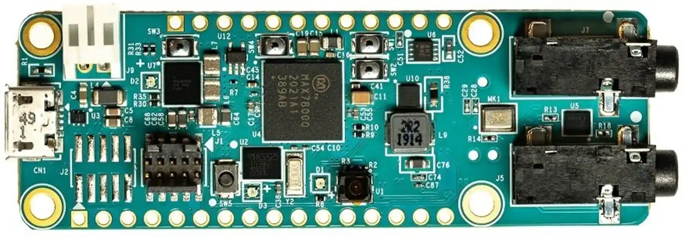

<!-- Copyright 2015-2026 Zephyr Project members and individual contributors. -->
<!-- SPDX-License-Identifier: Apache-2.0 -->
<!-- 中文翻译；编号、导航与译注为本地新增。 -->

<a id="max78000fthr"></a>

# 第20章\_MAX78000FTHR

原文：[官方页面](https://docs.zephyrproject.org/latest/boards/adi/max78000fthr/doc/index.html)。读取日期：2026-10-16；来源摘要见[来源记录](../SOURCES.md)。

开发板概览（Board Overview）

<a id="id1"></a>

[](images/max78000fthr.webp)

MAX78000FTHR

名称（Name）：

`max78000fthr`

厂商（Vendor）：

[Analog Devices, Inc.](https://docs.zephyrproject.org/latest/boards/index.html#vendor=adi)

状态（Status）：

维护中（Maintained）

架构（Architecture）：

RISC-V、Arm架构（[riscv](https://docs.zephyrproject.org/latest/boards/index.html#arch=riscv), [arm](https://docs.zephyrproject.org/latest/boards/index.html#arch=arm)）

片上系统（SoC）：

[max78000](https://docs.zephyrproject.org/latest/boards/index.html#soc=max78000)

<a id="board-github-link"></a>

[浏览开发板源码（Browse Board Sources）](https://github.com/zephyrproject-rtos/zephyr/blob/main//boards/adi/max78000fthr/doc/index.rst/../..)<a id="overview"></a>

## 概述（Overview）

MAX78000FTHR是一个快速开发平台，可帮助工程师使用集成卷积神经网络加速器（Convolutional Neural Network Accelerator）的MAX78000 Arm® Cortex®-M4F处理器，快速实现超低功耗人工智能（AI）方案。开发板还配有MAX20303电源管理集成电路（PMIC），用于电池与电源管理。其采用0.9 × 2.6英寸双排排针布局，兼容Adafruit Feather Wing外设扩展板。板载外设包括CMOS VGA图像传感器、数字麦克风、低功耗立体声音频编解码器（CODEC）、1 MB QSPI SRAM、microSD卡接口、RGB指示LED和按键。MAX78000FTHR提供经过功耗优化的灵活平台，便于快速进行概念验证和早期软件开发，以缩短上市时间。

Zephyr移植版本运行在MAX78000微控制器（MCU）上。

<a id="hardware"></a>

## 硬件（Hardware）


- MAX78000微控制器（MCU）：


  - 双核低功耗微控制器（Dual-Core Low-Power Microcontroller）


    - Arm Cortex-M4处理器，带浮点单元（FPU），最高100 MHz
    - 512 KB闪存（Flash）和128 KB SRAM
    - 通过16 KB指令缓存（Instruction Cache）优化性能
    - SRAM可选启用纠错码（ECC-SEC-DED），支持单错纠正、双错检测
    - 32位RISC-V协处理器（Coprocessor），最高60 MHz
    - 最多52个通用输入输出（I/O）引脚
    - 12位并行摄像头接口（Parallel Camera Interface）
    - 一路I2S主机／从机，用于数字音频接口
  - 神经网络加速器（Neural Network Accelerator）


    - 针对深度卷积神经网络（Deep Convolutional Neural Networks）高度优化
    - 可容纳442k个8位权重（Weights），支持1、2、4和8位权重
    - 可编程输入图像尺寸，最大1024 × 1024像素
    - 可编程网络深度（Network Depth），最多64层
    - 每层可编程网络通道宽度（Channel Widths），最多1024个通道
    - 一维与二维卷积处理（Convolution Processing）
    - 流式模式（Streaming Mode）
    - 可灵活支持其他网络类型，包括多层感知机（MLP）和循环神经网络（Recurrent Neural Networks）
  - 通过电源管理（Power Management）尽可能延长电池供电应用的运行时间


    - 集成单电感多输出（SIMO）开关电源（SMPS / Switch-Mode Power Supply）
    - SIMO供电电压范围为2.0–3.6 V
    - 动态电压调节（Dynamic Voltage Scaling）尽可能降低内核运行功耗
    - 3.0 V下从缓存执行while循环时为22.2 μA/MHz，仅CM4内核
    - 启用实时时钟（RTC）的低功耗模式下，可选择保留SRAM内容
  - 安全与完整性（Security and Integrity）


    - 可用的安全启动（Secure Boot）
    - AES 128/192/256硬件加速引擎（Hardware Acceleration Engine）
    - 真随机数发生器（TRNG）种子发生器（Seed Generator）

<a id="supported-features"></a>

### 支持的功能（Supported Features）

`max78000fthr`开发板支持下表所列的硬件功能。

片上／板载（On-Chip / On-Board）

功能集成在片上系统（SoC）内／位于开发板上。

2 / 2

分别表示已启用／已禁用的实例数。点击数量标签，可查看开发板或SoC设备树源码（DTS）中该功能的第一个实例。

`vnd,foo`

与此功能匹配的设备树绑定兼容字符串（Compatible String）；点击链接可查看绑定文档。

<a id="max78000fthr-hw-features"></a>

<a id="max78000fthr-max78000fthr/max78000/m4-hw-features-section"></a>

#### `max78000fthr/max78000/m4`目标（Target）

<a id="max78000fthr-max78000fthr/max78000/m4-hw-features-panel"></a>

<a id="max78000fthr-max78000fthr/max78000/m4-hw-features-memory"></a>

该开发板目标的片上存储容量：64 KiB RAM、512 KiB Flash。

<a id="max78000fthr-max78000fthr/max78000/m4-hw-features-table"></a>

<table>
<tr>
<th>类型（Type）</th>
<th>位置（Location）</th>
<th>说明（Description）</th>
<th>兼容字符串（Compatible）</th>
</tr>
<tr>
<td rowspan="2">中央处理器（CPU）</td>
<td>片上（On-Chip）</td>
<td>ARM Cortex-M4F 处理器（CPU）（<a href="https://github.com/zephyrproject-rtos/zephyr/blob/main/dts/vendor/adi/max32/max32xxx.dtsi?plain=1#L25">已启用：1</a>）</td>
<td><a href="../cpu_arm_riscv_binding_reference/P025_arm_cortex-m4f.md#std-dtcompatible-arm-cortex-m4f"><code>arm,cortex-m4f</code></a></td>
</tr>
<tr>
<td>片上（On-Chip）</td>
<td>MAX32 RV32内核（Core）（<a href="https://github.com/zephyrproject-rtos/zephyr/blob/main/dts/vendor/adi/max32/max32xxx.dtsi?plain=1#L32">已启用：1</a>）</td>
<td><a href="../cpu_arm_riscv_binding_reference/P002_adi_max32-rv32.md#std-dtcompatible-adi-max32-rv32"><code>adi,max32-rv32</code></a></td>
</tr>
<tr>
<td rowspan="1">模数转换器（ADC）</td>
<td>片上（On-Chip）</td>
<td>ADI MAX32 10位模数转换器（ADC）（<a href="https://github.com/zephyrproject-rtos/zephyr/blob/main/dts/vendor/adi/max32/max32xxx.dtsi?plain=1#L241">已禁用：1</a>）</td>
<td><a href="../hardware/P861_ADIMAX32十位ADC绑定.md#dtbinding-adi-max32-adc-10b"><code>adi,max32-adc-10b</code></a></td>
</tr>
<tr>
<td rowspan="2">时钟控制（Clock Control）</td>
<td>片上（On-Chip）</td>
<td>通用固定频率时钟提供者（Fixed-Rate Clock Provider）（<a href="https://github.com/zephyrproject-rtos/zephyr/blob/main/dts/vendor/adi/max32/max32xxx.dtsi?plain=1#L64">已启用：3</a>；<a href="https://github.com/zephyrproject-rtos/zephyr/blob/main/dts/vendor/adi/max32/max32xxx.dtsi?plain=1#L71">已禁用：4</a>）</td>
<td><a href="../hardware/P566_固定时钟绑定.md#dtbinding-fixed-clock"><code>fixed-clock</code></a></td>
</tr>
<tr>
<td>片上（On-Chip）</td>
<td>MAX32全局控制（Global Control）（<a href="https://github.com/zephyrproject-rtos/zephyr/blob/main/dts/vendor/adi/max32/max32xxx.dtsi?plain=1#L130">已启用：1</a>）</td>
<td><a href="../clock_adi_atmel_bflb_binding_reference/P004_adi_max32-gcr.md#std-dtcompatible-adi-max32-gcr"><code>adi,max32-gcr</code></a></td>
</tr>
<tr>
<td rowspan="2">计数器（Counter）</td>
<td>片上（On-Chip）</td>
<td>ADI MAX32计数器（Counter）（<a href="https://github.com/zephyrproject-rtos/zephyr/blob/main/dts/vendor/adi/max32/max32xxx.dtsi?plain=1#L260">已禁用：6</a>）</td>
<td><a href="../counter_binding_reference/P001_adi_max32-counter.md#std-dtcompatible-adi-max32-counter"><code>adi,max32-counter</code></a></td>
</tr>
<tr>
<td>片上（On-Chip）</td>
<td>ADI MAX32兼容实时时钟计数器（Counter RTC）（<a href="https://github.com/zephyrproject-rtos/zephyr/blob/main/dts/vendor/adi/max32/max32xxx.dtsi?plain=1#L332">已启用：1</a>）</td>
<td><a href="../counter_binding_reference/P002_adi_max32-rtc-counter.md#std-dtcompatible-adi-max32-rtc-counter"><code>adi,max32-rtc-counter</code></a></td>
</tr>
<tr>
<td rowspan="1">直接存储器访问（DMA）</td>
<td>片上（On-Chip）</td>
<td>ADI MAX32直接存储器访问（DMA）（<a href="https://github.com/zephyrproject-rtos/zephyr/blob/main/dts/vendor/adi/max32/max78000.dtsi?plain=1#L97">已启用：1</a>）</td>
<td><a href="../dma_binding_reference/P002_adi_max32-dma.md#std-dtcompatible-adi-max32-dma"><code>adi,max32-dma</code></a></td>
</tr>
<tr>
<td rowspan="1">闪存控制器（Flash Controller）</td>
<td>片上（On-Chip）</td>
<td>MAX32XXX闪存控制器（Flash Controller）（<a href="https://github.com/zephyrproject-rtos/zephyr/blob/main/dts/vendor/adi/max32/max32xxx.dtsi?plain=1#L111">已启用：1</a>）</td>
<td><a href="../flash_adi_microchip_nordic_binding_reference/P001_adi_max32-flash-controller.md#std-dtcompatible-adi-max32-flash-controller"><code>adi,max32-flash-controller</code></a></td>
</tr>
<tr>
<td rowspan="2">通用输入输出与接插件（GPIO &amp; Headers）</td>
<td>片上（On-Chip）</td>
<td>MAX32通用输入输出（GPIO）（<a href="https://github.com/zephyrproject-rtos/zephyr/blob/main/dts/vendor/adi/max32/max32xxx.dtsi?plain=1#L175">已启用：4</a>）</td>
<td><a href="../gpio_adi_headers_ambiq_binding_reference/P011_adi_max32-gpio.md#std-dtcompatible-adi-max32-gpio"><code>adi,max32-gpio</code></a></td>
</tr>
<tr>
<td>板载（On-Board）</td>
<td>引出到Adafruit Feather排针（Headers）的GPIO引脚（<a href="https://github.com/zephyrproject-rtos/zephyr/blob/main/boards/adi/max78000fthr/max78000fthr_max78000_m4.dts?plain=1#L43">已启用：1</a>）</td>
<td><a href="../gpio_adi_headers_ambiq_binding_reference/P001_adafruit-feather-header.md#std-dtcompatible-adafruit-feather-header"><code>adafruit-feather-header</code></a></td>
</tr>
<tr>
<td rowspan="1">集成电路间总线（I2C）</td>
<td>片上（On-Chip）</td>
<td>ADI MAX32 I2C控制器（<a href="https://github.com/zephyrproject-rtos/zephyr/blob/main/dts/vendor/adi/max32/max32xxx.dtsi?plain=1#L139">已启用：2</a>；<a href="https://github.com/zephyrproject-rtos/zephyr/blob/main/dts/vendor/adi/max32/max32xxx.dtsi?plain=1#L159">已禁用：1</a>）</td>
<td><a href="../i2c_adi_atmel_esp_binding_reference/P001_adi_max32-i2c.md#std-dtcompatible-adi-max32-i2c"><code>adi,max32-i2c</code></a></td>
</tr>
<tr>
<td rowspan="1">输入（Input）</td>
<td>板载（On-Board）</td>
<td>一组绑定到 GPIO 的输入按键（GPIO-Bound Input Keys）（<a href="https://github.com/zephyrproject-rtos/zephyr/blob/main/boards/adi/max78000fthr/max78000fthr.dtsi?plain=1#L53">已启用：1</a>）</td>
<td><a href="../hardware/P563_GPIO按键绑定.md#std-dtcompatible-gpio-keys"><code>gpio-keys</code></a></td>
</tr>
<tr>
<td rowspan="1">中断控制器（Interrupt Controller）</td>
<td>片上（On-Chip）</td>
<td>ARMv7-M 嵌套向量中断控制器（Nested Vectored Interrupt Controller，NVIC）（<a href="https://github.com/zephyrproject-rtos/zephyr/blob/main/dts/arm/armv7-m.dtsi?plain=1#L13">已启用：1</a>）</td>
<td><a href="../arm_interrupt_timer_binding_reference/P002_ARMv7_M_NVIC.md#std-dtcompatible-arm-v7m-nvic"><code>arm,v7m-nvic</code></a></td>
</tr>
<tr>
<td rowspan="1">发光二极管（LED）</td>
<td>板载（On-Board）</td>
<td>一组由 GPIO 控制的 LED（GPIO-Controlled LEDs）（<a href="https://github.com/zephyrproject-rtos/zephyr/blob/main/boards/adi/max78000fthr/max78000fthr.dtsi?plain=1#L34">已启用：1</a>）</td>
<td><a href="../hardware/P564_GPIO指示灯绑定.md#dtbinding-gpio-leds"><code>gpio-leds</code></a></td>
</tr>
<tr>
<td rowspan="1">邮箱（Mailbox）</td>
<td>片上（On-Chip）</td>
<td>ADI MAX32 SEMA邮箱（Mailbox）（<a href="https://github.com/zephyrproject-rtos/zephyr/blob/main/dts/vendor/adi/max32/max32xxx.dtsi?plain=1#L194">已禁用：1</a>）</td>
<td><a href="../intercore_reference/P032_ADI硬件信号量邮箱绑定.md#dtbinding-adi-mbox-max32-sema"><code>adi,mbox-max32-sema</code></a></td>
</tr>
<tr>
<td rowspan="1">存储技术设备（MTD）</td>
<td>片上（On-Chip）</td>
<td>闪存（Flash）节点（<a href="https://github.com/zephyrproject-rtos/zephyr/blob/main/dts/vendor/adi/max32/max32xxx.dtsi?plain=1#L119">已启用：1</a>）</td>
<td><a href="../mtd_nxp_st_ti_partition_binding_reference/P013_soc-nv-flash.md#std-dtcompatible-soc-nv-flash"><code>soc-nv-flash</code></a></td>
</tr>
<tr>
<td rowspan="1">引脚控制（Pin Control）</td>
<td>片上（On-Chip）</td>
<td>MAX32引脚控制器（Pin Controller）（<a href="https://github.com/zephyrproject-rtos/zephyr/blob/main/dts/vendor/adi/max32/max32xxx.dtsi?plain=1#L169">已启用：1</a>）</td>
<td><a href="../pinctrl_adi_ambiq_arm_binding_reference/P001_adi_max32-pinctrl.md#std-dtcompatible-adi-max32-pinctrl"><code>adi,max32-pinctrl</code></a></td>
</tr>
<tr>
<td rowspan="1">脉宽调制（PWM）</td>
<td>片上（On-Chip）</td>
<td>ADI MAX32脉宽调制（PWM）（<a href="https://github.com/zephyrproject-rtos/zephyr/blob/main/dts/vendor/adi/max32/max32xxx.dtsi?plain=1#L265">已禁用：6</a>）</td>
<td><a href="../pwm_adi_esp_infineon_binding_reference/P003_adi_max32-pwm.md#std-dtcompatible-adi-max32-pwm"><code>adi,max32-pwm</code></a></td>
</tr>
<tr>
<td rowspan="1">随机数生成器（RNG）</td>
<td>片上（On-Chip）</td>
<td>ADI MAX32XXX真随机数发生器（TRNG）（<a href="https://github.com/zephyrproject-rtos/zephyr/blob/main/dts/vendor/adi/max32/max32xxx.dtsi?plain=1#L226">已启用：1</a>）</td>
<td><a href="../rng_binding_reference/P001_adi_max32-trng.md#std-dtcompatible-adi-max32-trng"><code>adi,max32-trng</code></a></td>
</tr>
<tr>
<td rowspan="1">串行控制器（Serial Controller）</td>
<td>片上（On-Chip）</td>
<td>MAX32通用异步收发器（UART）（<a href="https://github.com/zephyrproject-rtos/zephyr/blob/main/dts/vendor/adi/max32/max32xxx.dtsi?plain=1#L202">已启用：1</a>；<a href="https://github.com/zephyrproject-rtos/zephyr/blob/main/dts/vendor/adi/max32/max32xxx.dtsi?plain=1#L210">已禁用：3</a>）</td>
<td><a href="../uart_adi_arm_atmel_binding_reference/P001_adi_max32-uart.md#std-dtcompatible-adi-max32-uart"><code>adi,max32-uart</code></a></td>
</tr>
<tr>
<td rowspan="1">串行外设接口（SPI）</td>
<td>片上（On-Chip）</td>
<td>ADI MAX32串行外设接口（SPI）（<a href="https://github.com/zephyrproject-rtos/zephyr/blob/main/dts/vendor/adi/max32/max78000-m4.dtsi?plain=1#L42">已启用：1</a>；<a href="https://github.com/zephyrproject-rtos/zephyr/blob/main/dts/vendor/adi/max32/max78000.dtsi?plain=1#L88">已禁用：1</a>）</td>
<td><a href="../spi_adi_atmel_esp_binding_reference/P001_adi_max32-spi.md#std-dtcompatible-adi-max32-spi"><code>adi,max32-spi</code></a></td>
</tr>
<tr>
<td rowspan="1">静态随机存储器（SRAM）</td>
<td>片上（On-Chip）</td>
<td>通用片上静态随机存储器（SRAM）（<a href="https://github.com/zephyrproject-rtos/zephyr/blob/main/dts/vendor/adi/max32/max78000.dtsi?plain=1#L70">已启用：4</a>）</td>
<td><a href="../hardware/P567_内存映射SRAM绑定.md#dtbinding-mmio-sram"><code>mmio-sram</code></a></td>
</tr>
<tr>
<td rowspan="2">定时器（Timer）</td>
<td>片上（On-Chip）</td>
<td>ADI MAX32定时器（Timer）（<a href="https://github.com/zephyrproject-rtos/zephyr/blob/main/dts/vendor/adi/max32/max32xxx.dtsi?plain=1#L252">已禁用：6</a>）</td>
<td><a href="../system_timer_binding_reference/P002_adi_max32-timer.md#std-dtcompatible-adi-max32-timer"><code>adi,max32-timer</code></a></td>
</tr>
<tr>
<td>片上（On-Chip）</td>
<td>ARMv7-M 系统节拍（System Tick）（<a href="https://github.com/zephyrproject-rtos/zephyr/blob/main/dts/arm/armv7-m.dtsi?plain=1#L21">已启用：1</a>）</td>
<td><a href="../arm_interrupt_timer_binding_reference/P006_ARMv7_M_SysTick.md#std-dtcompatible-arm-armv7m-systick"><code>arm,armv7m-systick</code></a></td>
</tr>
<tr>
<td rowspan="1">单线总线（1-Wire）</td>
<td>片上（On-Chip）</td>
<td>ADI MAX32xxx微控制器（MCU）的1-Wire单总线主机（Master）（<a href="https://github.com/zephyrproject-rtos/zephyr/blob/main/dts/vendor/adi/max32/max78000.dtsi?plain=1#L106">已禁用：1</a>）</td>
<td><a href="../mux_w1_binding_reference/P006_adi_max32-w1.md#std-dtcompatible-adi-max32-w1"><code>adi,max32-w1</code></a></td>
</tr>
<tr>
<td rowspan="1">看门狗（Watchdog）</td>
<td>片上（On-Chip）</td>
<td>MAX32XXX看门狗（Watchdog）（<a href="https://github.com/zephyrproject-rtos/zephyr/blob/main/dts/vendor/adi/max32/max32xxx.dtsi?plain=1#L233">已启用：1</a>；<a href="https://github.com/zephyrproject-rtos/zephyr/blob/main/dts/vendor/adi/max32/max78000.dtsi?plain=1#L113">已禁用：1</a>）</td>
<td><a href="../watchdog_binding_reference/P001_adi_max32-watchdog.md#std-dtcompatible-adi-max32-watchdog"><code>adi,max32-watchdog</code></a></td>
</tr>
</table>

<a id="max78000fthr-max78000fthr/max78000/rv32-hw-features-section"></a>

#### `max78000fthr/max78000/rv32`目标（Target）

<a id="max78000fthr-max78000fthr/max78000/rv32-hw-features-panel"></a>

<a id="max78000fthr-max78000fthr/max78000/rv32-hw-features-memory"></a>

该开发板目标的片上存储容量：64 KiB RAM、N/A Flash。

<a id="max78000fthr-max78000fthr/max78000/rv32-hw-features-table"></a>

<table>
<tr>
<th>类型（Type）</th>
<th>位置（Location）</th>
<th>说明（Description）</th>
<th>兼容字符串（Compatible）</th>
</tr>
<tr>
<td rowspan="1">中央处理器（CPU）</td>
<td>片上（On-Chip）</td>
<td>MAX32 RV32内核（Core）（<a href="https://github.com/zephyrproject-rtos/zephyr/blob/main/dts/vendor/adi/max32/max32xxx.dtsi?plain=1#L32">已启用：1</a>）</td>
<td><a href="../cpu_arm_riscv_binding_reference/P002_adi_max32-rv32.md#std-dtcompatible-adi-max32-rv32"><code>adi,max32-rv32</code></a></td>
</tr>
<tr>
<td rowspan="1">模数转换器（ADC）</td>
<td>片上（On-Chip）</td>
<td>ADI MAX32 10位模数转换器（ADC）（<a href="https://github.com/zephyrproject-rtos/zephyr/blob/main/dts/vendor/adi/max32/max32xxx.dtsi?plain=1#L241">已禁用：1</a>）</td>
<td><a href="../hardware/P861_ADIMAX32十位ADC绑定.md#dtbinding-adi-max32-adc-10b"><code>adi,max32-adc-10b</code></a></td>
</tr>
<tr>
<td rowspan="2">时钟控制（Clock Control）</td>
<td>片上（On-Chip）</td>
<td>通用固定频率时钟提供者（Fixed-Rate Clock Provider）（<a href="https://github.com/zephyrproject-rtos/zephyr/blob/main/dts/vendor/adi/max32/max32xxx.dtsi?plain=1#L71">已启用：2</a>；<a href="https://github.com/zephyrproject-rtos/zephyr/blob/main/dts/vendor/adi/max32/max32xxx.dtsi?plain=1#L64">已禁用：5</a>）</td>
<td><a href="../hardware/P566_固定时钟绑定.md#dtbinding-fixed-clock"><code>fixed-clock</code></a></td>
</tr>
<tr>
<td>片上（On-Chip）</td>
<td>MAX32全局控制（Global Control）（<a href="https://github.com/zephyrproject-rtos/zephyr/blob/main/dts/vendor/adi/max32/max32xxx.dtsi?plain=1#L130">已启用：1</a>）</td>
<td><a href="../clock_adi_atmel_bflb_binding_reference/P004_adi_max32-gcr.md#std-dtcompatible-adi-max32-gcr"><code>adi,max32-gcr</code></a></td>
</tr>
<tr>
<td rowspan="2">计数器（Counter）</td>
<td>片上（On-Chip）</td>
<td>ADI MAX32计数器（Counter）（<a href="https://github.com/zephyrproject-rtos/zephyr/blob/main/dts/vendor/adi/max32/max32xxx.dtsi?plain=1#L260">已禁用：6</a>）</td>
<td><a href="../counter_binding_reference/P001_adi_max32-counter.md#std-dtcompatible-adi-max32-counter"><code>adi,max32-counter</code></a></td>
</tr>
<tr>
<td>片上（On-Chip）</td>
<td>ADI MAX32兼容实时时钟计数器（Counter RTC）（<a href="https://github.com/zephyrproject-rtos/zephyr/blob/main/dts/vendor/adi/max32/max32xxx.dtsi?plain=1#L332">已禁用：1</a>）</td>
<td><a href="../counter_binding_reference/P002_adi_max32-rtc-counter.md#std-dtcompatible-adi-max32-rtc-counter"><code>adi,max32-rtc-counter</code></a></td>
</tr>
<tr>
<td rowspan="1">直接存储器访问（DMA）</td>
<td>片上（On-Chip）</td>
<td>ADI MAX32直接存储器访问（DMA）（<a href="https://github.com/zephyrproject-rtos/zephyr/blob/main/dts/vendor/adi/max32/max78000.dtsi?plain=1#L97">已禁用：1</a>）</td>
<td><a href="../dma_binding_reference/P002_adi_max32-dma.md#std-dtcompatible-adi-max32-dma"><code>adi,max32-dma</code></a></td>
</tr>
<tr>
<td rowspan="1">闪存控制器（Flash Controller）</td>
<td>片上（On-Chip）</td>
<td>MAX32XXX闪存控制器（Flash Controller）（<a href="https://github.com/zephyrproject-rtos/zephyr/blob/main/dts/vendor/adi/max32/max32xxx.dtsi?plain=1#L111">已禁用：1</a>）</td>
<td><a href="../flash_adi_microchip_nordic_binding_reference/P001_adi_max32-flash-controller.md#std-dtcompatible-adi-max32-flash-controller"><code>adi,max32-flash-controller</code></a></td>
</tr>
<tr>
<td rowspan="1">通用输入输出与接插件（GPIO &amp; Headers）</td>
<td>片上（On-Chip）</td>
<td>MAX32通用输入输出（GPIO）（<a href="https://github.com/zephyrproject-rtos/zephyr/blob/main/dts/vendor/adi/max32/max32xxx.dtsi?plain=1#L175">已启用：4</a>）</td>
<td><a href="../gpio_adi_headers_ambiq_binding_reference/P011_adi_max32-gpio.md#std-dtcompatible-adi-max32-gpio"><code>adi,max32-gpio</code></a></td>
</tr>
<tr>
<td rowspan="1">集成电路间总线（I2C）</td>
<td>片上（On-Chip）</td>
<td>ADI MAX32 I2C控制器（<a href="https://github.com/zephyrproject-rtos/zephyr/blob/main/dts/vendor/adi/max32/max32xxx.dtsi?plain=1#L139">已启用：2</a>；<a href="https://github.com/zephyrproject-rtos/zephyr/blob/main/dts/vendor/adi/max32/max32xxx.dtsi?plain=1#L159">已禁用：1</a>）</td>
<td><a href="../i2c_adi_atmel_esp_binding_reference/P001_adi_max32-i2c.md#std-dtcompatible-adi-max32-i2c"><code>adi,max32-i2c</code></a></td>
</tr>
<tr>
<td rowspan="1">输入（Input）</td>
<td>板载（On-Board）</td>
<td>一组绑定到 GPIO 的输入按键（GPIO-Bound Input Keys）（<a href="https://github.com/zephyrproject-rtos/zephyr/blob/main/boards/adi/max78000fthr/max78000fthr.dtsi?plain=1#L53">已启用：1</a>）</td>
<td><a href="../hardware/P563_GPIO按键绑定.md#std-dtcompatible-gpio-keys"><code>gpio-keys</code></a></td>
</tr>
<tr>
<td rowspan="1">中断控制器（Interrupt Controller）</td>
<td>片上（On-Chip）</td>
<td>MAX32 RV32内核中断控制器（Core Interrupt Controller）（<a href="https://github.com/zephyrproject-rtos/zephyr/blob/main/dts/vendor/adi/max32/max32xxx-rv32.dtsi?plain=1#L20">已启用：1</a>）</td>
<td><a href="../soc_interrupt_binding_reference/P001_adi_max32-rv32-intc.md#std-dtcompatible-adi-max32-rv32-intc"><code>adi,max32-rv32-intc</code></a></td>
</tr>
<tr>
<td rowspan="1">发光二极管（LED）</td>
<td>板载（On-Board）</td>
<td>一组由 GPIO 控制的 LED（GPIO-Controlled LEDs）（<a href="https://github.com/zephyrproject-rtos/zephyr/blob/main/boards/adi/max78000fthr/max78000fthr.dtsi?plain=1#L34">已启用：1</a>）</td>
<td><a href="../hardware/P564_GPIO指示灯绑定.md#dtbinding-gpio-leds"><code>gpio-leds</code></a></td>
</tr>
<tr>
<td rowspan="1">邮箱（Mailbox）</td>
<td>片上（On-Chip）</td>
<td>ADI MAX32 SEMA邮箱（Mailbox）（<a href="https://github.com/zephyrproject-rtos/zephyr/blob/main/dts/vendor/adi/max32/max32xxx.dtsi?plain=1#L194">已禁用：1</a>）</td>
<td><a href="../intercore_reference/P032_ADI硬件信号量邮箱绑定.md#dtbinding-adi-mbox-max32-sema"><code>adi,mbox-max32-sema</code></a></td>
</tr>
<tr>
<td rowspan="1">存储技术设备（MTD）</td>
<td>片上（On-Chip）</td>
<td>闪存（Flash）节点（<a href="https://github.com/zephyrproject-rtos/zephyr/blob/main/dts/vendor/adi/max32/max32xxx.dtsi?plain=1#L119">已启用：1</a>）</td>
<td><a href="../mtd_nxp_st_ti_partition_binding_reference/P013_soc-nv-flash.md#std-dtcompatible-soc-nv-flash"><code>soc-nv-flash</code></a></td>
</tr>
<tr>
<td rowspan="1">引脚控制（Pin Control）</td>
<td>片上（On-Chip）</td>
<td>MAX32引脚控制器（Pin Controller）（<a href="https://github.com/zephyrproject-rtos/zephyr/blob/main/dts/vendor/adi/max32/max32xxx.dtsi?plain=1#L169">已启用：1</a>）</td>
<td><a href="../pinctrl_adi_ambiq_arm_binding_reference/P001_adi_max32-pinctrl.md#std-dtcompatible-adi-max32-pinctrl"><code>adi,max32-pinctrl</code></a></td>
</tr>
<tr>
<td rowspan="1">脉宽调制（PWM）</td>
<td>片上（On-Chip）</td>
<td>ADI MAX32脉宽调制（PWM）（<a href="https://github.com/zephyrproject-rtos/zephyr/blob/main/dts/vendor/adi/max32/max32xxx.dtsi?plain=1#L265">已禁用：6</a>）</td>
<td><a href="../pwm_adi_esp_infineon_binding_reference/P003_adi_max32-pwm.md#std-dtcompatible-adi-max32-pwm"><code>adi,max32-pwm</code></a></td>
</tr>
<tr>
<td rowspan="1">随机数生成器（RNG）</td>
<td>片上（On-Chip）</td>
<td>ADI MAX32XXX真随机数发生器（TRNG）（<a href="https://github.com/zephyrproject-rtos/zephyr/blob/main/dts/vendor/adi/max32/max32xxx.dtsi?plain=1#L226">已启用：1</a>）</td>
<td><a href="../rng_binding_reference/P001_adi_max32-trng.md#std-dtcompatible-adi-max32-trng"><code>adi,max32-trng</code></a></td>
</tr>
<tr>
<td rowspan="1">串行控制器（Serial Controller）</td>
<td>片上（On-Chip）</td>
<td>MAX32通用异步收发器（UART）（<a href="https://github.com/zephyrproject-rtos/zephyr/blob/main/dts/vendor/adi/max32/max78000.dtsi?plain=1#L80">已启用：1</a>；<a href="https://github.com/zephyrproject-rtos/zephyr/blob/main/dts/vendor/adi/max32/max32xxx.dtsi?plain=1#L202">已禁用：3</a>）</td>
<td><a href="../uart_adi_arm_atmel_binding_reference/P001_adi_max32-uart.md#std-dtcompatible-adi-max32-uart"><code>adi,max32-uart</code></a></td>
</tr>
<tr>
<td rowspan="1">串行外设接口（SPI）</td>
<td>片上（On-Chip）</td>
<td>ADI MAX32串行外设接口（SPI）（<a href="https://github.com/zephyrproject-rtos/zephyr/blob/main/dts/vendor/adi/max32/max78000.dtsi?plain=1#L88">已禁用：1</a>）</td>
<td><a href="../spi_adi_atmel_esp_binding_reference/P001_adi_max32-spi.md#std-dtcompatible-adi-max32-spi"><code>adi,max32-spi</code></a></td>
</tr>
<tr>
<td rowspan="1">静态随机存储器（SRAM）</td>
<td>片上（On-Chip）</td>
<td>通用片上静态随机存储器（SRAM）（<a href="https://github.com/zephyrproject-rtos/zephyr/blob/main/dts/vendor/adi/max32/max78000.dtsi?plain=1#L70">已启用：3</a>）</td>
<td><a href="../hardware/P567_内存映射SRAM绑定.md#dtbinding-mmio-sram"><code>mmio-sram</code></a></td>
</tr>
<tr>
<td rowspan="2">定时器（Timer）</td>
<td>片上（On-Chip）</td>
<td>ADI MAX32定时器（Timer）（<a href="https://github.com/zephyrproject-rtos/zephyr/blob/main/dts/vendor/adi/max32/max32xxx.dtsi?plain=1#L252">已禁用：5</a>）</td>
<td><a href="../system_timer_binding_reference/P002_adi_max32-timer.md#std-dtcompatible-adi-max32-timer"><code>adi,max32-timer</code></a></td>
</tr>
<tr>
<td>片上（On-Chip）</td>
<td>ADI MAX32 RV32系统定时器（System Timer）（<a href="https://github.com/zephyrproject-rtos/zephyr/blob/main/dts/vendor/adi/max32/max32xxx.dtsi?plain=1#L312">已启用：1</a>）</td>
<td><a href="../system_timer_binding_reference/P001_adi_max32-rv32-sys-timer.md#std-dtcompatible-adi-max32-rv32-sys-timer"><code>adi,max32-rv32-sys-timer</code></a></td>
</tr>
<tr>
<td rowspan="1">单线总线（1-Wire）</td>
<td>片上（On-Chip）</td>
<td>ADI MAX32xxx微控制器（MCU）的1-Wire单总线主机（Master）（<a href="https://github.com/zephyrproject-rtos/zephyr/blob/main/dts/vendor/adi/max32/max78000.dtsi?plain=1#L106">已禁用：1</a>）</td>
<td><a href="../mux_w1_binding_reference/P006_adi_max32-w1.md#std-dtcompatible-adi-max32-w1"><code>adi,max32-w1</code></a></td>
</tr>
<tr>
<td rowspan="1">看门狗（Watchdog）</td>
<td>片上（On-Chip）</td>
<td>MAX32XXX看门狗（Watchdog）（<a href="https://github.com/zephyrproject-rtos/zephyr/blob/main/dts/vendor/adi/max32/max32xxx.dtsi?plain=1#L233">已禁用：2</a>）</td>
<td><a href="../watchdog_binding_reference/P001_adi_max32-watchdog.md#std-dtcompatible-adi-max32-watchdog"><code>adi,max32-watchdog</code></a></td>
</tr>
</table>

<a id="connections-and-ios"></a>

### 连接与输入输出（Connections and IOs）

<a id="j8-pinout"></a>

## J8引脚分配（Pinout）

<table>
<tr>
<th>引脚（Pin）</th>
<th>名称（Name）</th>
<th>说明（Description）</th>
</tr>
<tr>
<td>1</td>
<td>复位（RST）</td>
<td>主复位信号（Master Reset Signal）</td>
</tr>
<tr>
<td>2</td>
<td>3V3</td>
<td>3.3 V输出，通常用于向连接到扩展排针的外设提供3.3 V电源。</td>
</tr>
<tr>
<td>3</td>
<td>1V8</td>
<td>1.8 V输出，通常用于向连接到扩展排针的外设提供1.8 V电源。</td>
</tr>
<tr>
<td>4</td>
<td>地（GND）</td>
<td>地（Ground）</td>
</tr>
<tr>
<td>5</td>
<td>P2_3</td>
<td>GPIO或模拟输入（Analog Input），AIN3通道。</td>
</tr>
<tr>
<td>6</td>
<td>P2_4</td>
<td>GPIO或模拟输入（Analog Input），AIN4通道。</td>
</tr>
<tr>
<td>7</td>
<td>P1_1</td>
<td>GPIO或UART2发送信号（Tx）</td>
</tr>
<tr>
<td>8</td>
<td>P1_0</td>
<td>GPIO或UART2接收信号（Rx）</td>
</tr>
<tr>
<td>9</td>
<td>MPC1</td>
<td>由电源管理集成电路（PMIC）通过I2C接口控制的GPIO，可编程选择开漏（Open Drain）或推挽（Push-Pull）模式</td>
</tr>
<tr>
<td>10</td>
<td>MPC2</td>
<td>由电源管理集成电路（PMIC）通过I2C接口控制的GPIO，可编程选择开漏（Open Drain）或推挽（Push-Pull）模式</td>
</tr>
<tr>
<td>11</td>
<td>P0_7</td>
<td>GPIO或QSPI0时钟信号，与SD卡和板载QSPI SRAM共用</td>
</tr>
<tr>
<td>12</td>
<td>P0_5</td>
<td>GPIO或QSPI0主出从入信号（MOSI），与SD卡和板载QSPI SRAM共用</td>
</tr>
<tr>
<td>13</td>
<td>P0_6</td>
<td>GPIO或QSPI0主入从出信号（MISO），与SD卡和板载QSPI SRAM共用</td>
</tr>
<tr>
<td>14</td>
<td>P2_6</td>
<td>GPIO或低功耗UART（LPUART）接收信号（Rx）</td>
</tr>
<tr>
<td>15</td>
<td>P2_7</td>
<td>GPIO或低功耗UART（LPUART）发送信号（Tx）</td>
</tr>
<tr>
<td>16</td>
<td>地（GND）</td>
<td>地（Ground）</td>
</tr>
</table>

<a id="j4-pinout"></a>

## J4引脚分配（Pinout）

<table>
<tr>
<th>引脚（Pin）</th>
<th>名称（Name）</th>
<th>说明（Description）</th>
</tr>
<tr>
<td>1</td>
<td>SYS</td>
<td>SYS是与电池连接的可切换电源。这是主要系统电源，在电池电压和可用的USB电源之间自动切换。</td>
</tr>
<tr>
<td>2</td>
<td>电源（PWR）</td>
<td>短接到地13秒后关闭电源管理集成电路（PMIC），用作硬关机按键（Hard Power-Down Button）。</td>
</tr>
<tr>
<td>3</td>
<td>VBUS</td>
<td>USB VBUS信号。连接USB时，可用作5 V电源；此引脚也可作为输入为开发板供电。</td>
</tr>
<tr>
<td>4</td>
<td>P1_6</td>
<td>通用输入输出（GPIO）</td>
</tr>
<tr>
<td>5</td>
<td>MPC3</td>
<td>由电源管理集成电路（PMIC）通过I2C接口控制的GPIO，可编程选择开漏（Open Drain）或推挽（Push-Pull）模式。</td>
</tr>
<tr>
<td>6</td>
<td>P0_9</td>
<td>GPIO或QSPI0 SDIO3信号，与SD卡和板载QSPI SRAM共用。</td>
</tr>
<tr>
<td>7</td>
<td>P0_8</td>
<td>GPIO或QSPI0 SDIO2信号，与SD卡和板载QSPI SRAM共用。</td>
</tr>
<tr>
<td>8</td>
<td>P0_11</td>
<td>GPIO或QSPI0从机选择信号（Slave Select）</td>
</tr>
<tr>
<td>9</td>
<td>P0_19</td>
<td>通用输入输出（GPIO）</td>
</tr>
<tr>
<td>10</td>
<td>P3_1</td>
<td>GPIO或唤醒信号（Wake-Up），此引脚仅支持3.3 V。</td>
</tr>
<tr>
<td>11</td>
<td>P0_16</td>
<td>GPIO或I2C1串行时钟信号（SCL）。板载电平转换器（Level Shifter）允许通过电阻R15或R20选择1.8 V或3.3 V工作电压，不能同时安装两者。</td>
</tr>
<tr>
<td>12</td>
<td>P0_17</td>
<td>GPIO或I2C1串行数据信号（SDA）。板载电平转换器（Level Shifter）允许通过电阻R15或R20选择1.8 V或3.3 V工作电压，不能同时安装两者。</td>
</tr>
</table>

<a id="programming-and-debugging"></a>

## 烧录与调试（Programming and Debugging）

`max78000fthr`开发板支持下表所列的运行工具（Runners）及相关west命令。

<table>
<tr>
<th></th>
<th>烧录（flash）</th>
<th>调试（debug）</th>
<th>连接调试会话（attach）</th>
<th>实时传输（rtt）</th>
<th>调试服务器（debugserver）</th>
</tr>
<tr>
<td><a href="https://docs.zephyrproject.org/latest/develop/flash_debug/host-tools.html#runner-openocd">openocd</a></td>
<td>✅（默认 / default）</td>
<td>✅（默认 / default）</td>
<td>✅</td>
<td>✅</td>
<td>✅</td>
</tr>
</table>

<a id="flashing"></a>

### 烧录（Flashing）

板载MAX32625微控制器已预先写入DAPLink固件，可通过USB对MAX78000 Arm内核进行调试和编程。

将调试探针连接到主机后，执行`west flash`即可将固件镜像写入闪存（Flash）。要执行整片擦除（Full Erase），在`west flash`命令中加入`--erase`选项。

注意（Note）

该开发板默认使用OpenOCD调试接口。也可覆盖运行工具（Runner），在west命令后添加`--runner jlink`，使用Segger J-Link及其原生工具。应通过合适的适配板和线缆，将J-Link连接到标准2 × 5针调试接口JH5。

<a id="debugging"></a>

### 调试（Debugging）

请参考[烧录（Flashing）](#flashing)一节，并将`west flash`替换为`west debug`执行调试。

<a id="rv32-risc-v-core"></a>

### RV32 RISC-V内核（Core）

MAX78000 SoC的次级RV32（RISC-V）内核由`max78000fthr/max78000/rv32`开发板限定符（Board Qualifiers）支持。默认情况下，该内核使用Feather的TX/RX引脚作为控制台。使用Sysbuild构建多个开发板目标的Hello World应用提供了为两个内核构建的示例。目前，要正确烧录两个内核，需要使用`jlink`运行工具（Runner），并连接JLink编程器。（[使用Sysbuild构建多个开发板目标的Hello World示例](../basic_samples/P064_Sysbuild多板目标问候示例.md#sysbuild_hello_world)）

```text
# From the root of the zephyr repository
west build -b max78000fthr/max78000/m4 samples/sysbuild/hello_world
west flash --runner jlink
```

<a id="references"></a>

## 参考资料（References）


- [MAX78000FTHR网页（Web Page）](https://www.analog.com/en/resources/evaluation-hardware-and-software/evaluation-boards-kits/max78000fthr.html)

---

[上一章](P019_MAX78000EVKIT.md) · [返回大纲](大纲.md) · [全站翻译进度](../PROGRESS.md) · [下一章](P021_MAX78002EVKIT.md)
