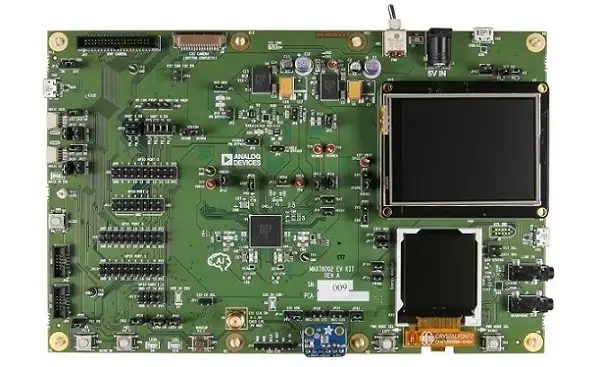
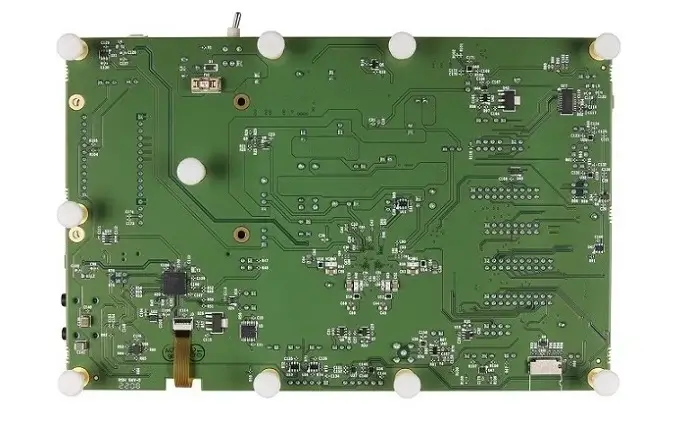

<!-- Copyright 2015-2026 Zephyr Project members and individual contributors. -->
<!-- SPDX-License-Identifier: Apache-2.0 -->
<!-- 中文翻译；编号、导航与译注为本地新增。 -->

# 第21章\_MAX78002EVKIT

原文：[官方页面](https://docs.zephyrproject.org/latest/boards/adi/max78002evkit/doc/index.html)。读取日期：2026-10-16；来源摘要见[来源记录](../SOURCES.md)。

开发板概览（Board Overview）

MAX78002EVKIT

名称（Name）：

`max78002evkit`

厂商（Vendor）：

[Analog Devices, Inc.](https://docs.zephyrproject.org/latest/boards/index.html#vendor=adi)

状态（Status）：

维护中（Maintained）

架构（Architecture）：

RISC-V、Arm架构（[riscv](https://docs.zephyrproject.org/latest/boards/index.html#arch=riscv), [arm](https://docs.zephyrproject.org/latest/boards/index.html#arch=arm)）

片上系统（SoC）：

[max78002](https://docs.zephyrproject.org/latest/boards/index.html#soc=max78002)

[浏览开发板源码（Browse Board Sources）](https://github.com/zephyrproject-rtos/zephyr/blob/main//boards/adi/max78002evkit/doc/index.rst/../..)

## 概述（Overview）

MAX78002评估套件（EV Kit）提供平台和工具，可利用器件的能力构建新一代人工智能（AI）产品。

该套件采用模块化外设架构（Modular Peripheral Architecture），可将多种输入输出设备布置在远端，提供灵活的使用方式。支持DVP和CSI摄像头、I2S音频外设、数字麦克风和模拟传感器；一对行业标准QWIIC接口可连接大量且持续增多的第三方开发板。板载立体声音频编解码器提供线路电平音频输入和输出；2.4英寸触控TFT显示屏提供触摸输入。功耗累积器（Power Accumulator）跟踪MAX78002的能耗，并在第二块TFT显示屏上展示四个通道的格式化结果。全部GPIO均可通过0.1英寸间距排针访问。标准同轴电源插孔用于电源输入，使用随附的5 V、3 A插墙式适配器。两个USB接口提供MAX78002串行访问，其中一个直接连接，另一个经USB转UART桥连接。第三个USB接口用于访问MAX78002能耗数据。此外，microSD接口支持低成本、高密度的便携数据存储。

Zephyr移植版本运行在MAX78002微控制器（MCU）上。

## 硬件（Hardware）

- MAX78002微控制器（MCU）：

  - 双核低功耗微控制器（Dual-Core Low-Power Microcontroller）

    - Arm Cortex-M4处理器，带浮点单元（FPU），最高120 MHz
    - 2.5 MB闪存、64 KB只读存储器（ROM）和384 KB SRAM
    - 通过16 KB指令缓存（Instruction Cache）优化性能
    - SRAM可选启用纠错码（ECC SEC-DED），支持单错纠正、双错检测
    - 32位RISC-V协处理器（Coprocessor），最高60 MHz
    - 最多60个通用输入输出（I/O）引脚
    - MIPI摄像头串行接口2（MIPI CSI-2）控制器V2.1
    - 支持两条数据通道（Data Lanes）
    - 12位并行摄像头接口（Parallel Camera Interface）
    - I2S控制器／目标（Controller/Target），用于数字音频接口
    - 安全数字接口（Secure Digital Interface）支持SD 3.0、SDIO 3.0和eMMC 4.51
  - 卷积神经网络加速器（CNN / Convolutional Neural Network Accelerator）

    - 针对深度卷积神经网络（Deep CNNs）高度优化
    - 可容纳200万个8位权重（Weights），支持1、2、4和8位权重
    - 1.3 MB卷积神经网络数据存储器（CNN Data Memory）
    - 可编程输入图像尺寸，最大2048 × 2048像素
    - 可编程网络深度（Network Depth），最多128层
    - 每层可编程网络通道宽度（Channel Widths），最多1024个通道
    - 一维和二维卷积处理（Convolution Processing）
    - 能够以每秒30帧（30 fps）处理VGA图像
  - 用于延长电池续航的电源管理（Power Management）

    - 集成单电感多输出（SIMO）开关电源（SMPS / Switch-Mode Power Supply）
    - 供电电压范围为2.85–3.6 V
    - 支持可选的外部辅助CNN电源（Auxiliary CNN Power Supply）
    - 动态电压调节（Dynamic Voltage Scaling）尽可能降低内核运行功耗
    - 3.3 V下从缓存执行while循环时为23.9 μA/MHz，仅CM4内核
    - 启用实时时钟（RTC）的低功耗模式下，可选择保留SRAM内容
  - 安全与完整性（Security and Integrity）

    - 可用的安全启动（Secure Boot）
    - AES 128/192/256硬件加速引擎（Hardware Acceleration Engine）
    - 真随机数发生器（TRNG）种子发生器（Seed Generator）
- MAX78002 EVKIT连接的外部器件：

  - 彩色薄膜晶体管显示屏（TFT Display）
  - 立体声音频编解码器接口（Audio Stereo Codec Interface）
  - 数字麦克风（Digital Microphone）
  - 8 Mb四线SPI随机存储器（QSPI RAM）

### 支持的功能（Supported Features）

`max78002evkit`开发板支持下表所列的硬件功能。

片上／板载（On-Chip / On-Board）

功能集成在片上系统（SoC）内／位于开发板上。

2 / 2

分别表示已启用／已禁用的实例数。点击数量标签，可查看开发板或SoC设备树源码（DTS）中该功能的第一个实例。

`vnd,foo`

与此功能匹配的设备树绑定兼容字符串（Compatible String）；点击链接可查看绑定文档。

#### `max78002evkit/max78002/m4`目标（Target）

该开发板目标的片上存储容量：64 KiB RAM、2560 KiB Flash。

<table>
<tr>
<th>类型（Type）</th>
<th>位置（Location）</th>
<th>说明（Description）</th>
<th>兼容字符串（Compatible）</th>
</tr>
<tr>
<td rowspan="2">中央处理器（CPU）</td>
<td>片上（On-Chip）</td>
<td>ARM Cortex-M4F 处理器（CPU）（<a href="https://github.com/zephyrproject-rtos/zephyr/blob/main/dts/vendor/adi/max32/max32xxx.dtsi?plain=1#L25">已启用：1</a>）</td>
<td><a href="../cpu_arm_riscv_binding_reference/P025_arm_cortex-m4f.md#std-dtcompatible-arm-cortex-m4f"><code>arm,cortex-m4f</code></a></td>
</tr>
<tr>
<td>片上（On-Chip）</td>
<td>MAX32 RV32内核（Core）（<a href="https://github.com/zephyrproject-rtos/zephyr/blob/main/dts/vendor/adi/max32/max32xxx.dtsi?plain=1#L32">已启用：1</a>）</td>
<td><a href="../cpu_arm_riscv_binding_reference/P002_adi_max32-rv32.md#std-dtcompatible-adi-max32-rv32"><code>adi,max32-rv32</code></a></td>
</tr>
<tr>
<td rowspan="1">模数转换器（ADC）</td>
<td>片上（On-Chip）</td>
<td>ADI MAX32逐次逼近模数转换器（SAR ADC）（<a href="https://github.com/zephyrproject-rtos/zephyr/blob/main/dts/vendor/adi/max32/max32xxx.dtsi?plain=1#L241">已禁用：1</a>）</td>
<td><a href="../hardware/P863_ADIMAX32逐次逼近ADC绑定.md#dtbinding-adi-max32-adc-sar"><code>adi,max32-adc-sar</code></a></td>
</tr>
<tr>
<td rowspan="2">时钟控制（Clock Control）</td>
<td>片上（On-Chip）</td>
<td>通用固定频率时钟提供者（Fixed-Rate Clock Provider）（<a href="https://github.com/zephyrproject-rtos/zephyr/blob/main/dts/vendor/adi/max32/max32xxx.dtsi?plain=1#L64">已启用：3</a>；<a href="https://github.com/zephyrproject-rtos/zephyr/blob/main/dts/vendor/adi/max32/max32xxx.dtsi?plain=1#L71">已禁用：6</a>）</td>
<td><a href="../hardware/P566_固定时钟绑定.md#dtbinding-fixed-clock"><code>fixed-clock</code></a></td>
</tr>
<tr>
<td>片上（On-Chip）</td>
<td>MAX32全局控制（Global Control）（<a href="https://github.com/zephyrproject-rtos/zephyr/blob/main/dts/vendor/adi/max32/max32xxx.dtsi?plain=1#L130">已启用：1</a>）</td>
<td><a href="../clock_adi_atmel_bflb_binding_reference/P004_adi_max32-gcr.md#std-dtcompatible-adi-max32-gcr"><code>adi,max32-gcr</code></a></td>
</tr>
<tr>
<td rowspan="3">计数器（Counter）</td>
<td>片上（On-Chip）</td>
<td>ADI MAX32计数器（Counter）（<a href="https://github.com/zephyrproject-rtos/zephyr/blob/main/dts/vendor/adi/max32/max32xxx.dtsi?plain=1#L260">已禁用：6</a>）</td>
<td><a href="../counter_binding_reference/P001_adi_max32-counter.md#std-dtcompatible-adi-max32-counter"><code>adi,max32-counter</code></a></td>
</tr>
<tr>
<td>片上（On-Chip）</td>
<td>ADI MAX32兼容实时时钟计数器（Counter RTC）（<a href="https://github.com/zephyrproject-rtos/zephyr/blob/main/dts/vendor/adi/max32/max32xxx.dtsi?plain=1#L332">已启用：1</a>）</td>
<td><a href="../counter_binding_reference/P002_adi_max32-rtc-counter.md#std-dtcompatible-adi-max32-rtc-counter"><code>adi,max32-rtc-counter</code></a></td>
</tr>
<tr>
<td>片上（On-Chip）</td>
<td>ADI MAX32唤醒定时器（Wake-Up Timer）是一个特殊的32位定时器实例，能够从睡眠（Sleep）、待机（Standby）和备份（Backup）模式唤醒设备。（<a href="https://github.com/zephyrproject-rtos/zephyr/blob/main/dts/vendor/adi/max32/max78002.dtsi?plain=1#L205">已禁用：1</a>）</td>
<td><a href="../counter_binding_reference/P003_adi_max32-wut.md#std-dtcompatible-adi-max32-wut"><code>adi,max32-wut</code></a></td>
</tr>
<tr>
<td rowspan="1">直接存储器访问（DMA）</td>
<td>片上（On-Chip）</td>
<td>ADI MAX32直接存储器访问（DMA）（<a href="https://github.com/zephyrproject-rtos/zephyr/blob/main/dts/vendor/adi/max32/max78002.dtsi?plain=1#L135">已启用：1</a>）</td>
<td><a href="../dma_binding_reference/P002_adi_max32-dma.md#std-dtcompatible-adi-max32-dma"><code>adi,max32-dma</code></a></td>
</tr>
<tr>
<td rowspan="1">闪存控制器（Flash Controller）</td>
<td>片上（On-Chip）</td>
<td>MAX32XXX闪存控制器（Flash Controller）（<a href="https://github.com/zephyrproject-rtos/zephyr/blob/main/dts/vendor/adi/max32/max32xxx.dtsi?plain=1#L111">已启用：1</a>）</td>
<td><a href="../flash_adi_microchip_nordic_binding_reference/P001_adi_max32-flash-controller.md#std-dtcompatible-adi-max32-flash-controller"><code>adi,max32-flash-controller</code></a></td>
</tr>
<tr>
<td rowspan="1">通用输入输出与接插件（GPIO &amp; Headers）</td>
<td>片上（On-Chip）</td>
<td>MAX32通用输入输出（GPIO）（<a href="https://github.com/zephyrproject-rtos/zephyr/blob/main/dts/vendor/adi/max32/max32xxx.dtsi?plain=1#L175">已启用：4</a>）</td>
<td><a href="../gpio_adi_headers_ambiq_binding_reference/P011_adi_max32-gpio.md#std-dtcompatible-adi-max32-gpio"><code>adi,max32-gpio</code></a></td>
</tr>
<tr>
<td rowspan="1">集成电路间总线（I2C）</td>
<td>片上（On-Chip）</td>
<td>ADI MAX32 I2C控制器（<a href="https://github.com/zephyrproject-rtos/zephyr/blob/main/dts/vendor/adi/max32/max32xxx.dtsi?plain=1#L139">已启用：1</a>；<a href="https://github.com/zephyrproject-rtos/zephyr/blob/main/dts/vendor/adi/max32/max32xxx.dtsi?plain=1#L149">已禁用：2</a>）</td>
<td><a href="../i2c_adi_atmel_esp_binding_reference/P001_adi_max32-i2c.md#std-dtcompatible-adi-max32-i2c"><code>adi,max32-i2c</code></a></td>
</tr>
<tr>
<td rowspan="1">输入（Input）</td>
<td>板载（On-Board）</td>
<td>一组绑定到 GPIO 的输入按键（GPIO-Bound Input Keys）（<a href="https://github.com/zephyrproject-rtos/zephyr/blob/main/boards/adi/max78002evkit/max78002evkit.dtsi?plain=1#L54">已启用：1</a>）</td>
<td><a href="../hardware/P563_GPIO按键绑定.md#std-dtcompatible-gpio-keys"><code>gpio-keys</code></a></td>
</tr>
<tr>
<td rowspan="1">中断控制器（Interrupt Controller）</td>
<td>片上（On-Chip）</td>
<td>ARMv7-M 嵌套向量中断控制器（Nested Vectored Interrupt Controller，NVIC）（<a href="https://github.com/zephyrproject-rtos/zephyr/blob/main/dts/arm/armv7-m.dtsi?plain=1#L13">已启用：1</a>）</td>
<td><a href="../arm_interrupt_timer_binding_reference/P002_ARMv7_M_NVIC.md#std-dtcompatible-arm-v7m-nvic"><code>arm,v7m-nvic</code></a></td>
</tr>
<tr>
<td rowspan="1">发光二极管（LED）</td>
<td>板载（On-Board）</td>
<td>一组由 GPIO 控制的 LED（GPIO-Controlled LEDs）（<a href="https://github.com/zephyrproject-rtos/zephyr/blob/main/boards/adi/max78002evkit/max78002evkit.dtsi?plain=1#L40">已启用：1</a>）</td>
<td><a href="../hardware/P564_GPIO指示灯绑定.md#dtbinding-gpio-leds"><code>gpio-leds</code></a></td>
</tr>
<tr>
<td rowspan="1">邮箱（Mailbox）</td>
<td>片上（On-Chip）</td>
<td>ADI MAX32 SEMA邮箱（Mailbox）（<a href="https://github.com/zephyrproject-rtos/zephyr/blob/main/dts/vendor/adi/max32/max32xxx.dtsi?plain=1#L194">已禁用：1</a>）</td>
<td><a href="../intercore_reference/P032_ADI硬件信号量邮箱绑定.md#dtbinding-adi-mbox-max32-sema"><code>adi,mbox-max32-sema</code></a></td>
</tr>
<tr>
<td rowspan="1">存储技术设备（MTD）</td>
<td>片上（On-Chip）</td>
<td>闪存（Flash）节点（<a href="https://github.com/zephyrproject-rtos/zephyr/blob/main/dts/vendor/adi/max32/max32xxx.dtsi?plain=1#L119">已启用：1</a>）</td>
<td><a href="../mtd_nxp_st_ti_partition_binding_reference/P013_soc-nv-flash.md#std-dtcompatible-soc-nv-flash"><code>soc-nv-flash</code></a></td>
</tr>
<tr>
<td rowspan="1">引脚控制（Pin Control）</td>
<td>片上（On-Chip）</td>
<td>MAX32引脚控制器（Pin Controller）（<a href="https://github.com/zephyrproject-rtos/zephyr/blob/main/dts/vendor/adi/max32/max32xxx.dtsi?plain=1#L169">已启用：1</a>）</td>
<td><a href="../pinctrl_adi_ambiq_arm_binding_reference/P001_adi_max32-pinctrl.md#std-dtcompatible-adi-max32-pinctrl"><code>adi,max32-pinctrl</code></a></td>
</tr>
<tr>
<td rowspan="1">脉宽调制（PWM）</td>
<td>片上（On-Chip）</td>
<td>ADI MAX32脉宽调制（PWM）（<a href="https://github.com/zephyrproject-rtos/zephyr/blob/main/dts/vendor/adi/max32/max32xxx.dtsi?plain=1#L265">已禁用：6</a>）</td>
<td><a href="../pwm_adi_esp_infineon_binding_reference/P003_adi_max32-pwm.md#std-dtcompatible-adi-max32-pwm"><code>adi,max32-pwm</code></a></td>
</tr>
<tr>
<td rowspan="1">随机数生成器（RNG）</td>
<td>片上（On-Chip）</td>
<td>ADI MAX32XXX真随机数发生器（TRNG）（<a href="https://github.com/zephyrproject-rtos/zephyr/blob/main/dts/vendor/adi/max32/max32xxx.dtsi?plain=1#L226">已启用：1</a>）</td>
<td><a href="../rng_binding_reference/P001_adi_max32-trng.md#std-dtcompatible-adi-max32-trng"><code>adi,max32-trng</code></a></td>
</tr>
<tr>
<td rowspan="1">串行控制器（Serial Controller）</td>
<td>片上（On-Chip）</td>
<td>MAX32通用异步收发器（UART）（<a href="https://github.com/zephyrproject-rtos/zephyr/blob/main/dts/vendor/adi/max32/max32xxx.dtsi?plain=1#L202">已启用：1</a>；<a href="https://github.com/zephyrproject-rtos/zephyr/blob/main/dts/vendor/adi/max32/max32xxx.dtsi?plain=1#L210">已禁用：3</a>）</td>
<td><a href="../uart_adi_arm_atmel_binding_reference/P001_adi_max32-uart.md#std-dtcompatible-adi-max32-uart"><code>adi,max32-uart</code></a></td>
</tr>
<tr>
<td rowspan="1">串行外设接口（SPI）</td>
<td>片上（On-Chip）</td>
<td>ADI MAX32串行外设接口（SPI）（<a href="https://github.com/zephyrproject-rtos/zephyr/blob/main/dts/vendor/adi/max32/max78002-m4.dtsi?plain=1#L40">已启用：1</a>；<a href="https://github.com/zephyrproject-rtos/zephyr/blob/main/dts/vendor/adi/max32/max78002.dtsi?plain=1#L126">已禁用：1</a>）</td>
<td><a href="../spi_adi_atmel_esp_binding_reference/P001_adi_max32-spi.md#std-dtcompatible-adi-max32-spi"><code>adi,max32-spi</code></a></td>
</tr>
<tr>
<td rowspan="1">静态随机存储器（SRAM）</td>
<td>片上（On-Chip）</td>
<td>通用片上静态随机存储器（SRAM）（<a href="https://github.com/zephyrproject-rtos/zephyr/blob/main/dts/vendor/adi/max32/max78002.dtsi?plain=1#L98">已启用：7</a>）</td>
<td><a href="../hardware/P567_内存映射SRAM绑定.md#dtbinding-mmio-sram"><code>mmio-sram</code></a></td>
</tr>
<tr>
<td rowspan="2">定时器（Timer）</td>
<td>片上（On-Chip）</td>
<td>ADI MAX32定时器（Timer）（<a href="https://github.com/zephyrproject-rtos/zephyr/blob/main/dts/vendor/adi/max32/max32xxx.dtsi?plain=1#L252">已禁用：7</a>）</td>
<td><a href="../system_timer_binding_reference/P002_adi_max32-timer.md#std-dtcompatible-adi-max32-timer"><code>adi,max32-timer</code></a></td>
</tr>
<tr>
<td>片上（On-Chip）</td>
<td>ARMv7-M 系统节拍（System Tick）（<a href="https://github.com/zephyrproject-rtos/zephyr/blob/main/dts/arm/armv7-m.dtsi?plain=1#L21">已启用：1</a>）</td>
<td><a href="../arm_interrupt_timer_binding_reference/P006_ARMv7_M_SysTick.md#std-dtcompatible-arm-armv7m-systick"><code>arm,armv7m-systick</code></a></td>
</tr>
<tr>
<td rowspan="1">单线总线（1-Wire）</td>
<td>片上（On-Chip）</td>
<td>ADI MAX32xxx微控制器（MCU）的1-Wire单总线主机（Master）（<a href="https://github.com/zephyrproject-rtos/zephyr/blob/main/dts/vendor/adi/max32/max78002.dtsi?plain=1#L192">已禁用：1</a>）</td>
<td><a href="../mux_w1_binding_reference/P006_adi_max32-w1.md#std-dtcompatible-adi-max32-w1"><code>adi,max32-w1</code></a></td>
</tr>
<tr>
<td rowspan="1">看门狗（Watchdog）</td>
<td>片上（On-Chip）</td>
<td>MAX32XXX看门狗（Watchdog）（<a href="https://github.com/zephyrproject-rtos/zephyr/blob/main/dts/vendor/adi/max32/max32xxx.dtsi?plain=1#L233">已启用：1</a>；<a href="https://github.com/zephyrproject-rtos/zephyr/blob/main/dts/vendor/adi/max32/max78002.dtsi?plain=1#L144">已禁用：1</a>）</td>
<td><a href="../watchdog_binding_reference/P001_adi_max32-watchdog.md#std-dtcompatible-adi-max32-watchdog"><code>adi,max32-watchdog</code></a></td>
</tr>
</table>

#### `max78002evkit/max78002/rv32`目标（Target）

该开发板目标的片上存储容量：128 KiB RAM、2560 KiB Flash。

<table>
<tr>
<th>类型（Type）</th>
<th>位置（Location）</th>
<th>说明（Description）</th>
<th>兼容字符串（Compatible）</th>
</tr>
<tr>
<td rowspan="1">中央处理器（CPU）</td>
<td>片上（On-Chip）</td>
<td>MAX32 RV32内核（Core）（<a href="https://github.com/zephyrproject-rtos/zephyr/blob/main/dts/vendor/adi/max32/max32xxx.dtsi?plain=1#L32">已启用：1</a>）</td>
<td><a href="../cpu_arm_riscv_binding_reference/P002_adi_max32-rv32.md#std-dtcompatible-adi-max32-rv32"><code>adi,max32-rv32</code></a></td>
</tr>
<tr>
<td rowspan="1">模数转换器（ADC）</td>
<td>片上（On-Chip）</td>
<td>ADI MAX32逐次逼近模数转换器（SAR ADC）（<a href="https://github.com/zephyrproject-rtos/zephyr/blob/main/dts/vendor/adi/max32/max32xxx.dtsi?plain=1#L241">已禁用：1</a>）</td>
<td><a href="../hardware/P863_ADIMAX32逐次逼近ADC绑定.md#dtbinding-adi-max32-adc-sar"><code>adi,max32-adc-sar</code></a></td>
</tr>
<tr>
<td rowspan="2">时钟控制（Clock Control）</td>
<td>片上（On-Chip）</td>
<td>通用固定频率时钟提供者（Fixed-Rate Clock Provider）（<a href="https://github.com/zephyrproject-rtos/zephyr/blob/main/dts/vendor/adi/max32/max32xxx.dtsi?plain=1#L64">已启用：4</a>；<a href="https://github.com/zephyrproject-rtos/zephyr/blob/main/dts/vendor/adi/max32/max32xxx.dtsi?plain=1#L78">已禁用：5</a>）</td>
<td><a href="../hardware/P566_固定时钟绑定.md#dtbinding-fixed-clock"><code>fixed-clock</code></a></td>
</tr>
<tr>
<td>片上（On-Chip）</td>
<td>MAX32全局控制（Global Control）（<a href="https://github.com/zephyrproject-rtos/zephyr/blob/main/dts/vendor/adi/max32/max32xxx.dtsi?plain=1#L130">已启用：1</a>）</td>
<td><a href="../clock_adi_atmel_bflb_binding_reference/P004_adi_max32-gcr.md#std-dtcompatible-adi-max32-gcr"><code>adi,max32-gcr</code></a></td>
</tr>
<tr>
<td rowspan="3">计数器（Counter）</td>
<td>片上（On-Chip）</td>
<td>ADI MAX32计数器（Counter）（<a href="https://github.com/zephyrproject-rtos/zephyr/blob/main/dts/vendor/adi/max32/max32xxx.dtsi?plain=1#L260">已禁用：6</a>）</td>
<td><a href="../counter_binding_reference/P001_adi_max32-counter.md#std-dtcompatible-adi-max32-counter"><code>adi,max32-counter</code></a></td>
</tr>
<tr>
<td>片上（On-Chip）</td>
<td>ADI MAX32兼容实时时钟计数器（Counter RTC）（<a href="https://github.com/zephyrproject-rtos/zephyr/blob/main/dts/vendor/adi/max32/max32xxx.dtsi?plain=1#L332">已启用：1</a>）</td>
<td><a href="../counter_binding_reference/P002_adi_max32-rtc-counter.md#std-dtcompatible-adi-max32-rtc-counter"><code>adi,max32-rtc-counter</code></a></td>
</tr>
<tr>
<td>片上（On-Chip）</td>
<td>ADI MAX32唤醒定时器（Wake-Up Timer）是一个特殊的32位定时器实例，能够从睡眠（Sleep）、待机（Standby）和备份（Backup）模式唤醒设备。（<a href="https://github.com/zephyrproject-rtos/zephyr/blob/main/dts/vendor/adi/max32/max78002.dtsi?plain=1#L205">已禁用：1</a>）</td>
<td><a href="../counter_binding_reference/P003_adi_max32-wut.md#std-dtcompatible-adi-max32-wut"><code>adi,max32-wut</code></a></td>
</tr>
<tr>
<td rowspan="1">直接存储器访问（DMA）</td>
<td>片上（On-Chip）</td>
<td>ADI MAX32直接存储器访问（DMA）（<a href="https://github.com/zephyrproject-rtos/zephyr/blob/main/dts/vendor/adi/max32/max78002.dtsi?plain=1#L135">已禁用：1</a>）</td>
<td><a href="../dma_binding_reference/P002_adi_max32-dma.md#std-dtcompatible-adi-max32-dma"><code>adi,max32-dma</code></a></td>
</tr>
<tr>
<td rowspan="1">闪存控制器（Flash Controller）</td>
<td>片上（On-Chip）</td>
<td>MAX32XXX闪存控制器（Flash Controller）（<a href="https://github.com/zephyrproject-rtos/zephyr/blob/main/dts/vendor/adi/max32/max32xxx.dtsi?plain=1#L111">已禁用：1</a>）</td>
<td><a href="../flash_adi_microchip_nordic_binding_reference/P001_adi_max32-flash-controller.md#std-dtcompatible-adi-max32-flash-controller"><code>adi,max32-flash-controller</code></a></td>
</tr>
<tr>
<td rowspan="1">通用输入输出与接插件（GPIO &amp; Headers）</td>
<td>片上（On-Chip）</td>
<td>MAX32通用输入输出（GPIO）（<a href="https://github.com/zephyrproject-rtos/zephyr/blob/main/dts/vendor/adi/max32/max32xxx.dtsi?plain=1#L175">已启用：4</a>）</td>
<td><a href="../gpio_adi_headers_ambiq_binding_reference/P011_adi_max32-gpio.md#std-dtcompatible-adi-max32-gpio"><code>adi,max32-gpio</code></a></td>
</tr>
<tr>
<td rowspan="1">集成电路间总线（I2C）</td>
<td>片上（On-Chip）</td>
<td>ADI MAX32 I2C控制器（<a href="https://github.com/zephyrproject-rtos/zephyr/blob/main/dts/vendor/adi/max32/max32xxx.dtsi?plain=1#L139">已启用：1</a>；<a href="https://github.com/zephyrproject-rtos/zephyr/blob/main/dts/vendor/adi/max32/max32xxx.dtsi?plain=1#L149">已禁用：2</a>）</td>
<td><a href="../i2c_adi_atmel_esp_binding_reference/P001_adi_max32-i2c.md#std-dtcompatible-adi-max32-i2c"><code>adi,max32-i2c</code></a></td>
</tr>
<tr>
<td rowspan="1">输入（Input）</td>
<td>板载（On-Board）</td>
<td>一组绑定到 GPIO 的输入按键（GPIO-Bound Input Keys）（<a href="https://github.com/zephyrproject-rtos/zephyr/blob/main/boards/adi/max78002evkit/max78002evkit.dtsi?plain=1#L54">已启用：1</a>）</td>
<td><a href="../hardware/P563_GPIO按键绑定.md#std-dtcompatible-gpio-keys"><code>gpio-keys</code></a></td>
</tr>
<tr>
<td rowspan="1">中断控制器（Interrupt Controller）</td>
<td>片上（On-Chip）</td>
<td>MAX32 RV32内核中断控制器（Core Interrupt Controller）（<a href="https://github.com/zephyrproject-rtos/zephyr/blob/main/dts/vendor/adi/max32/max32xxx-rv32.dtsi?plain=1#L20">已启用：1</a>）</td>
<td><a href="../soc_interrupt_binding_reference/P001_adi_max32-rv32-intc.md#std-dtcompatible-adi-max32-rv32-intc"><code>adi,max32-rv32-intc</code></a></td>
</tr>
<tr>
<td rowspan="1">发光二极管（LED）</td>
<td>板载（On-Board）</td>
<td>一组由 GPIO 控制的 LED（GPIO-Controlled LEDs）（<a href="https://github.com/zephyrproject-rtos/zephyr/blob/main/boards/adi/max78002evkit/max78002evkit.dtsi?plain=1#L40">已启用：1</a>）</td>
<td><a href="../hardware/P564_GPIO指示灯绑定.md#dtbinding-gpio-leds"><code>gpio-leds</code></a></td>
</tr>
<tr>
<td rowspan="1">邮箱（Mailbox）</td>
<td>片上（On-Chip）</td>
<td>ADI MAX32 SEMA邮箱（Mailbox）（<a href="https://github.com/zephyrproject-rtos/zephyr/blob/main/dts/vendor/adi/max32/max32xxx.dtsi?plain=1#L194">已禁用：1</a>）</td>
<td><a href="../intercore_reference/P032_ADI硬件信号量邮箱绑定.md#dtbinding-adi-mbox-max32-sema"><code>adi,mbox-max32-sema</code></a></td>
</tr>
<tr>
<td rowspan="1">存储技术设备（MTD）</td>
<td>片上（On-Chip）</td>
<td>闪存（Flash）节点（<a href="https://github.com/zephyrproject-rtos/zephyr/blob/main/dts/vendor/adi/max32/max32xxx.dtsi?plain=1#L119">已启用：1</a>）</td>
<td><a href="../mtd_nxp_st_ti_partition_binding_reference/P013_soc-nv-flash.md#std-dtcompatible-soc-nv-flash"><code>soc-nv-flash</code></a></td>
</tr>
<tr>
<td rowspan="1">引脚控制（Pin Control）</td>
<td>片上（On-Chip）</td>
<td>MAX32引脚控制器（Pin Controller）（<a href="https://github.com/zephyrproject-rtos/zephyr/blob/main/dts/vendor/adi/max32/max32xxx.dtsi?plain=1#L169">已启用：1</a>）</td>
<td><a href="../pinctrl_adi_ambiq_arm_binding_reference/P001_adi_max32-pinctrl.md#std-dtcompatible-adi-max32-pinctrl"><code>adi,max32-pinctrl</code></a></td>
</tr>
<tr>
<td rowspan="1">脉宽调制（PWM）</td>
<td>片上（On-Chip）</td>
<td>ADI MAX32脉宽调制（PWM）（<a href="https://github.com/zephyrproject-rtos/zephyr/blob/main/dts/vendor/adi/max32/max32xxx.dtsi?plain=1#L265">已禁用：6</a>）</td>
<td><a href="../pwm_adi_esp_infineon_binding_reference/P003_adi_max32-pwm.md#std-dtcompatible-adi-max32-pwm"><code>adi,max32-pwm</code></a></td>
</tr>
<tr>
<td rowspan="1">随机数生成器（RNG）</td>
<td>片上（On-Chip）</td>
<td>ADI MAX32XXX真随机数发生器（TRNG）（<a href="https://github.com/zephyrproject-rtos/zephyr/blob/main/dts/vendor/adi/max32/max32xxx.dtsi?plain=1#L226">已启用：1</a>）</td>
<td><a href="../rng_binding_reference/P001_adi_max32-trng.md#std-dtcompatible-adi-max32-trng"><code>adi,max32-trng</code></a></td>
</tr>
<tr>
<td rowspan="1">串行控制器（Serial Controller）</td>
<td>片上（On-Chip）</td>
<td>MAX32通用异步收发器（UART）（<a href="https://github.com/zephyrproject-rtos/zephyr/blob/main/dts/vendor/adi/max32/max32xxx.dtsi?plain=1#L210">已启用：1</a>；<a href="https://github.com/zephyrproject-rtos/zephyr/blob/main/dts/vendor/adi/max32/max32xxx.dtsi?plain=1#L202">已禁用：3</a>）</td>
<td><a href="../uart_adi_arm_atmel_binding_reference/P001_adi_max32-uart.md#std-dtcompatible-adi-max32-uart"><code>adi,max32-uart</code></a></td>
</tr>
<tr>
<td rowspan="1">串行外设接口（SPI）</td>
<td>片上（On-Chip）</td>
<td>ADI MAX32串行外设接口（SPI）（<a href="https://github.com/zephyrproject-rtos/zephyr/blob/main/dts/vendor/adi/max32/max78002.dtsi?plain=1#L126">已禁用：1</a>）</td>
<td><a href="../spi_adi_atmel_esp_binding_reference/P001_adi_max32-spi.md#std-dtcompatible-adi-max32-spi"><code>adi,max32-spi</code></a></td>
</tr>
<tr>
<td rowspan="1">静态随机存储器（SRAM）</td>
<td>片上（On-Chip）</td>
<td>通用片上静态随机存储器（SRAM）（<a href="https://github.com/zephyrproject-rtos/zephyr/blob/main/dts/vendor/adi/max32/max78002.dtsi?plain=1#L98">已启用：5</a>）</td>
<td><a href="../hardware/P567_内存映射SRAM绑定.md#dtbinding-mmio-sram"><code>mmio-sram</code></a></td>
</tr>
<tr>
<td rowspan="2">定时器（Timer）</td>
<td>片上（On-Chip）</td>
<td>ADI MAX32定时器（Timer）（<a href="https://github.com/zephyrproject-rtos/zephyr/blob/main/dts/vendor/adi/max32/max32xxx.dtsi?plain=1#L252">已禁用：6</a>）</td>
<td><a href="../system_timer_binding_reference/P002_adi_max32-timer.md#std-dtcompatible-adi-max32-timer"><code>adi,max32-timer</code></a></td>
</tr>
<tr>
<td>片上（On-Chip）</td>
<td>ADI MAX32 RV32系统定时器（System Timer）（<a href="https://github.com/zephyrproject-rtos/zephyr/blob/main/dts/vendor/adi/max32/max32xxx.dtsi?plain=1#L312">已启用：1</a>）</td>
<td><a href="../system_timer_binding_reference/P001_adi_max32-rv32-sys-timer.md#std-dtcompatible-adi-max32-rv32-sys-timer"><code>adi,max32-rv32-sys-timer</code></a></td>
</tr>
<tr>
<td rowspan="1">单线总线（1-Wire）</td>
<td>片上（On-Chip）</td>
<td>ADI MAX32xxx微控制器（MCU）的1-Wire单总线主机（Master）（<a href="https://github.com/zephyrproject-rtos/zephyr/blob/main/dts/vendor/adi/max32/max78002.dtsi?plain=1#L192">已禁用：1</a>）</td>
<td><a href="../mux_w1_binding_reference/P006_adi_max32-w1.md#std-dtcompatible-adi-max32-w1"><code>adi,max32-w1</code></a></td>
</tr>
<tr>
<td rowspan="1">看门狗（Watchdog）</td>
<td>片上（On-Chip）</td>
<td>MAX32XXX看门狗（Watchdog）（<a href="https://github.com/zephyrproject-rtos/zephyr/blob/main/dts/vendor/adi/max32/max32xxx.dtsi?plain=1#L233">已禁用：2</a>）</td>
<td><a href="../watchdog_binding_reference/P001_adi_max32-watchdog.md#std-dtcompatible-adi-max32-watchdog"><code>adi,max32-watchdog</code></a></td>
</tr>
</table>

### 连接与输入输出（Connections and IOs）

<table>
<tr>
<th>名称（Name）</th>
<th>名称（Name）</th>
<th>设置（Settings）</th>
<th>说明（Description）</th>
</tr>
<tr>
<td>JP1</td>
<td>3V3监测（3V3 MON）</td>
<td><table><tr><td>1-2</td></tr><tr><td>开路（Open）</td></tr></table></td>
<td><table><tr><td>与JP3的1–2短接配合，实现正常运行</td></tr><tr><td>电流测量测试接入点（Test Access Point）</td></tr></table></td>
</tr>
<tr>
<td>JP2</td>
<td>3V3 SW功率监测旁路（PM BYPASS）</td>
<td><table><tr><td>1-2</td></tr><tr><td>开路（Open）</td></tr></table></td>
<td><table><tr><td>旁路主3.3 V系统电源的功率监测分流电阻（Shunts）</td></tr><tr><td>主3.3 V输入经过分流电阻，由功耗累积器（Power Accumulator）测量</td></tr></table></td>
</tr>
<tr>
<td>JP3</td>
<td>CNN监测（CNN MON）</td>
<td><table><tr><td>1-2</td></tr><tr><td>开路（Open）</td></tr></table></td>
<td><table><tr><td>与JP6的1–2短接配合，实现正常运行</td></tr><tr><td>用于测量U4承担的VCOREA和CNN负载电流的测试接入点</td></tr></table></td>
</tr>
<tr>
<td>JP4</td>
<td>VCOREA功率监测旁路（PM BYPASS）</td>
<td><table><tr><td>1-2</td></tr><tr><td>开路（Open）</td></tr></table></td>
<td><table><tr><td>旁路U4所承担VCOREA与CNN负载的功率监测分流电阻</td></tr><tr><td>VCOREA与CNN负载经过分流电阻，供功耗累积器测量</td></tr></table></td>
</tr>
<tr>
<td>JP5</td>
<td>VCOREB功率监测旁路（PM BYPASS）</td>
<td><table><tr><td>1-2</td></tr><tr><td>开路（Open）</td></tr></table></td>
<td><table><tr><td>旁路VCOREB的功率监测分流电阻</td></tr><tr><td>VCOREB电源经过分流电阻，供功耗累积器测量</td></tr></table></td>
</tr>
<tr>
<td>JP6</td>
<td>VREGO_A功率监测旁路（PM BYPASS）</td>
<td><table><tr><td>1-2</td></tr><tr><td>开路（Open）</td></tr></table></td>
<td><table><tr><td>旁路VREGO_A的功率监测分流电阻</td></tr><tr><td>VREGO_A电源经过分流电阻，供功耗累积器测量</td></tr></table></td>
</tr>
<tr>
<td>JP7</td>
<td>VBAT</td>
<td><table><tr><td>1-2</td></tr><tr><td>开路（Open）</td></tr></table></td>
<td><table><tr><td>启用3V3 VBAT电源。</td></tr><tr><td>禁用3V3 VBAT电源。</td></tr></table></td>
</tr>
<tr>
<td>JP8</td>
<td>VREGI</td>
<td><table><tr><td>1-2</td></tr><tr><td>开路（Open）</td></tr></table></td>
<td><table><tr><td>启用3V3 VREGI电源。</td></tr><tr><td>禁用3V3 VREGI电源。</td></tr></table></td>
</tr>
<tr>
<td>JP9</td>
<td>VREGI/VBAT</td>
<td><table><tr><td>2-1</td></tr><tr><td>2-3</td></tr></table></td>
<td><table><tr><td>板载3V3_PM为VREGI/VBAT供电。</td></tr><tr><td>TP10处的外部电源为VREGI/VBAT供电。</td></tr></table></td>
</tr>
<tr>
<td>JP10</td>
<td>VDDIOH</td>
<td><table><tr><td>2-1</td></tr><tr><td>2-3</td></tr></table></td>
<td><table><tr><td>板载3V3_PM为VDDIOH供电。</td></tr><tr><td>板载3V3_SW为VDDIOH供电。</td></tr></table></td>
</tr>
<tr>
<td>JP11</td>
<td>VDDA</td>
<td><table><tr><td>1-2</td></tr><tr><td>开路（Open）</td></tr></table></td>
<td><table><tr><td>VREGO_A_PM为VDDA供电。</td></tr><tr><td>可通过TP6为VDDA供电。</td></tr></table></td>
</tr>
<tr>
<td>JP12</td>
<td>VDDIO</td>
<td><table><tr><td>1-2</td></tr><tr><td>开路（Open）</td></tr></table></td>
<td><table><tr><td>VREGO_A_PM为VDDIO供电。</td></tr><tr><td>可通过TP7为VDDIO供电。</td></tr></table></td>
</tr>
<tr>
<td>JP13</td>
<td>VCOREB</td>
<td><table><tr><td>1-2</td></tr><tr><td>开路（Open）</td></tr></table></td>
<td><table><tr><td>VREGO_B为VCOREB供电。</td></tr><tr><td>可通过TP8为VCOREB供电。</td></tr></table></td>
</tr>
<tr>
<td>JP14</td>
<td>VCOREA</td>
<td><table><tr><td>1-2</td></tr><tr><td>开路（Open）</td></tr></table></td>
<td><table><tr><td>VREGO_C连接到VCOREA网络（Net）。</td></tr><tr><td>可通过TP9为VCOREA网络供电；JP17也可用作电流测试点。</td></tr></table></td>
</tr>
<tr>
<td>JP15</td>
<td>VREF</td>
<td><table><tr><td>1-2</td></tr><tr><td>开路（Open）</td></tr></table></td>
<td><table><tr><td>被测器件（DUT）的ADC VREF由精密外部参考源提供。</td></tr><tr><td>禁用外部ADC VREF；可从JP18.1注入参考电压。</td></tr></table></td>
</tr>
<tr>
<td>JP16</td>
<td>I2C1数据（SDA）</td>
<td><table><tr><td>1-2</td></tr><tr><td>开路（Open）</td></tr></table></td>
<td><table><tr><td>I2C1数据上拉（DATA Pullup）</td></tr><tr><td>按需要闭合此跳线，以确保正确的端接（Termination）。</td></tr></table></td>
</tr>
<tr>
<td>JP17</td>
<td>I2C1时钟（SCL）</td>
<td><table><tr><td>1-2</td></tr><tr><td>开路（Open）</td></tr></table></td>
<td><table><tr><td>I2C1时钟上拉（CLOCK Pullup）</td></tr><tr><td>按需要闭合此跳线，以确保正确的端接（Termination）。</td></tr></table></td>
</tr>
<tr>
<td>JP18</td>
<td>TRIG1</td>
<td><table><tr><td>1-2</td></tr><tr><td>开路（Open）</td></tr></table></td>
<td><table><tr><td>功耗累积器（PWR Accumulator）的触发信号1连接到端口1.6。</td></tr><tr><td>禁用TRIG1，因此可以改用DVP摄像头的PCIF_D10。</td></tr></table></td>
</tr>
<tr>
<td>JP19</td>
<td>TRIG2</td>
<td><table><tr><td>1-2</td></tr><tr><td>开路（Open）</td></tr></table></td>
<td><table><tr><td>功耗累积器的触发信号2连接到端口1.7。</td></tr><tr><td>禁用TRIG2，因此可以改用DVP摄像头的PCIF_D11。</td></tr></table></td>
</tr>
<tr>
<td>JP20</td>
<td>UART0使能（UART0 EN）</td>
<td><table><tr><td>闭合（Closed）</td></tr><tr><td>开路（Open）</td></tr></table></td>
<td><table><tr><td>USB转UART桥连接到被测器件（DUT）的UART0，支持RTS和CTS。</td></tr><tr><td>断开USB转UART桥与被测器件（DUT）的UART0。</td></tr></table></td>
</tr>
<tr>
<td>JP21</td>
<td>I2C0_SDA</td>
<td><table><tr><td>1-2</td></tr><tr><td>开路（Open）</td></tr></table></td>
<td><table><tr><td>I2C0数据上拉（DATA Pull-up）</td></tr><tr><td>按需要闭合此跳线，以确保正确的端接（Termination）。</td></tr></table></td>
</tr>
<tr>
<td>JP22</td>
<td>I2C0_SCL</td>
<td><table><tr><td>1-2</td></tr><tr><td>开路（Open）</td></tr></table></td>
<td><table><tr><td>I2C0时钟上拉（CLOCK Pull-up）</td></tr><tr><td>按需要闭合此跳线，以确保正确的端接（Termination）。</td></tr></table></td>
</tr>
<tr>
<td>JP23</td>
<td>UART1使能（UART1 EN）</td>
<td><table><tr><td>闭合（Closed）</td></tr><tr><td>开路（Open）</td></tr></table></td>
<td><table><tr><td>USB转UART桥连接到被测器件（DUT）的UART1，不支持硬件流控制（HW Flow Control）。</td></tr><tr><td>断开USB转UART桥与被测器件（DUT）的UART1。</td></tr></table></td>
</tr>
<tr>
<td>JP24</td>
<td>外部I2C0使能（EXT I2C0 EN）</td>
<td><table><tr><td>1-2</td></tr><tr><td>开路（Open）</td></tr></table></td>
<td><table><tr><td>默认启用I2C0的QWIIC接口。</td></tr><tr><td>断开此跳线，使QWIIC电平转换器（Level Translator）进入高阻态（High-Z）。</td></tr></table></td>
</tr>
<tr>
<td>JP25</td>
<td>按键1上拉（PB1 PU）</td>
<td><table><tr><td>1-2</td></tr><tr><td>开路（Open）</td></tr></table></td>
<td><table><tr><td>为端口2.6的按键模式启用100 kΩ上拉电阻。</td></tr><tr><td>禁用上拉，使端口引脚可用于其他功能；此端口与AIN6共用。</td></tr></table></td>
</tr>
<tr>
<td>JP26</td>
<td>按键2上拉（PB2 PU）</td>
<td><table><tr><td>1-2</td></tr><tr><td>开路（Open）</td></tr></table></td>
<td><table><tr><td>为端口2.7的按键模式启用100 kΩ上拉电阻。</td></tr><tr><td>禁用上拉，使端口引脚可用于其他功能；此端口与AIN7共用。</td></tr></table></td>
</tr>
<tr>
<td>JP27</td>
<td>I2C2串行数据（SDA）</td>
<td><table><tr><td>1-2</td></tr><tr><td>开路（Open）</td></tr></table></td>
<td><table><tr><td>I2C2数据上拉（DATA Pull-up）</td></tr><tr><td>按需要闭合此跳线，以确保正确的端接（Termination）。</td></tr></table></td>
</tr>
<tr>
<td>JP28</td>
<td>I2C2串行时钟（SCL）</td>
<td><table><tr><td>1-2</td></tr><tr><td>开路（Open）</td></tr></table></td>
<td><table><tr><td>I2C2时钟上拉（CLOCK Pull-up）</td></tr><tr><td>按需要闭合此跳线，以确保正确的端接（Termination）。</td></tr></table></td>
</tr>
<tr>
<td>JP29</td>
<td>VDDB</td>
<td><table><tr><td>2-1</td></tr><tr><td>2-3</td></tr></table></td>
<td><table><tr><td>被测器件（DUT）的USB收发器（XCVR）VDDB由VBUS经专用3.3 V低压差稳压器（LDO）供电。</td></tr><tr><td>USB收发器（XCVR）VDDB始终由系统3V3_PM供电。</td></tr></table></td>
</tr>
<tr>
<td>JP30</td>
<td>外部I2C2使能（EXT I2C2 EN）</td>
<td><table><tr><td>1-2</td></tr><tr><td>开路（Open）</td></tr></table></td>
<td><table><tr><td>默认启用I2C2的QWIIC接口。</td></tr><tr><td>断开此跳线，使QWIIC电平转换器（Level Translator）进入高阻态（High-Z）。</td></tr></table></td>
</tr>
<tr>
<td>JP31</td>
<td>左／右声道选择（L/R SEL）</td>
<td><table><tr><td>1-2</td></tr><tr><td>开路（Open）</td></tr></table></td>
<td><table><tr><td>麦克风位于右声道（MIC ON R CH），I2S麦克风数据流</td></tr><tr><td>麦克风位于左声道（MIC ON L CH），I2S麦克风数据流</td></tr></table></td>
</tr>
<tr>
<td>JP32</td>
<td>麦克风／I2S输入输出（MIC-I2S I/O）</td>
<td><table><tr><td>1-2</td></tr><tr><td>开路（Open）</td></tr></table></td>
<td><table><tr><td>来自I2S I/O排针的外部I2S数据连接到I2S SDI。</td></tr><tr><td>来自I2S MIC排针的外部麦克风数据连接到I2S SDI。</td></tr></table></td>
</tr>
<tr>
<td>JP33</td>
<td>MIC-I2S/CODEC</td>
<td><table><tr><td>1-2</td></tr><tr><td>开路（Open）</td></tr></table></td>
<td><table><tr><td>板载编解码器（CODEC）数据连接到I2S SDI。</td></tr><tr><td>来自排针的外部I2S数据，即麦克风或从机I2S数据，连接到I2S SDI。</td></tr></table></td>
</tr>
<tr>
<td>JP34</td>
<td>I2S供电电压（I2S VDD）</td>
<td><table><tr><td>2-1</td></tr><tr><td>2-3</td></tr></table></td>
<td><table><tr><td>外部MIC和DATA I2S接口排针以1.8 V工作。</td></tr><tr><td>外部MIC和DATA I2S接口排针以3.3 V工作。</td></tr></table></td>
</tr>
<tr>
<td>JP35</td>
<td>I2C1数据（SDA）</td>
<td><table><tr><td>1-2</td></tr><tr><td>开路（Open）</td></tr></table></td>
<td><table><tr><td>I2C1数据上拉（DATA Pull-up）</td></tr><tr><td>按需要闭合此跳线，以确保正确的端接（Termination）。</td></tr></table></td>
</tr>
<tr>
<td>JP36</td>
<td>I2C1时钟（SCL）</td>
<td><table><tr><td>1-2</td></tr><tr><td>开路（Open）</td></tr></table></td>
<td><table><tr><td>I2C1时钟上拉（CLOCK Pull-up）</td></tr><tr><td>按需要闭合此跳线，以确保正确的端接（Termination）。</td></tr></table></td>
</tr>
<tr>
<td>JP37</td>
<td>I2S时钟选择（CK SEL）</td>
<td><table><tr><td>1-2</td></tr><tr><td>开路（Open）</td></tr></table></td>
<td><table><tr><td>I2S主时钟（Master Clock）来自SMA接口J6。</td></tr><tr><td>I2S主时钟来自板载晶体振荡器。</td></tr></table></td>
</tr>
<tr>
<td>JP38</td>
<td>DVP摄像头电源（DVP CAM PWR）</td>
<td><table><tr><td>2-1</td></tr><tr><td>2-3</td></tr></table></td>
<td><table><tr><td>设置DVP摄像头PWDN输入状态；OVM7692默认关闭（OFF）。</td></tr><tr><td>设置DVP摄像头PWDN输入状态；短接2–3会使OVM7692上电。</td></tr></table></td>
</tr>
<tr>
<td>JP39</td>
<td>软件控制摄像头上电（SW CAM PWUP）</td>
<td><table><tr><td>1-2</td></tr><tr><td>开路（Open）</td></tr></table></td>
<td><table><tr><td>由端口引脚控制摄像头复位与上电。</td></tr><tr><td>Digilent P5C摄像头断电，JP39可覆盖此状态。</td></tr></table></td>
</tr>
<tr>
<td>JP40</td>
<td>硬件上电／软件上电（HW PWUP / SW PWUP）</td>
<td><table><tr><td>1-2</td></tr><tr><td>开路（Open）</td></tr></table></td>
<td><table><tr><td>3.3 V达到有效电平后，摄像头立即复位并上电。</td></tr><tr><td>安装JP39时，摄像头复位与上电由端口引脚控制；否则摄像头关闭。</td></tr></table></td>
</tr>
<tr>
<td>JP41</td>
<td>CSI摄像头I2C使能（CSI CAM I2C EN）</td>
<td><table><tr><td>1-2</td></tr><tr><td>开路（Open）</td></tr></table></td>
<td><table><tr><td>CSI摄像头Digilent P5C的I2C连接到I2C1，用于设置寄存器。</td></tr><tr><td>电平转换器和I2C上拉（PU）处于高阻态（High-Z）；I2C1与P5C寄存器断开。</td></tr></table></td>
</tr>
<tr>
<td>JP42</td>
<td>TFT数据／命令（DC）</td>
<td><table><tr><td>1-2</td></tr><tr><td>开路（Open）</td></tr></table></td>
<td><table><tr><td>TFT数据／命令选择（Data/Command Select）连接到端口2.2。</td></tr><tr><td>使用AIN2时拔下跳线帽。</td></tr></table></td>
</tr>
<tr>
<td>JP43</td>
<td>TFT片选（CS）</td>
<td><table><tr><td>2-1</td></tr><tr><td>2-3</td></tr></table></td>
<td><table><tr><td>TFT CS由端口0.3驱动，与UART0 RTS共用。</td></tr><tr><td>TFT CS由端口1.7驱动，与DVP DATA 11和TRIG2共用。</td></tr></table></td>
</tr>
<tr>
<td>JP44</td>
<td>LED1使能（LED1 EN）</td>
<td><table><tr><td>1-2</td></tr><tr><td>开路（Open）</td></tr></table></td>
<td><table><tr><td>端口2.4为高电平时，LED0亮起。</td></tr><tr><td>使用AIN4时拔下跳线帽。</td></tr></table></td>
</tr>
<tr>
<td>JP45</td>
<td>LED2使能（LED2 EN）</td>
<td><table><tr><td>1-2</td></tr><tr><td>开路（Open）</td></tr></table></td>
<td><table><tr><td>端口2.5为高电平时，LED1亮起。</td></tr><tr><td>使用AIN5时拔下跳线帽。</td></tr></table></td>
</tr>
</table>

## 烧录与调试（Programming and Debugging）

`max78002evkit`开发板支持下表所列的运行工具（Runners）及相关west命令。

<table>
<tr>
<th></th>
<th>烧录（flash）</th>
<th>调试（debug）</th>
<th>连接调试会话（attach）</th>
<th>实时传输（rtt）</th>
<th>调试服务器（debugserver）</th>
<th>复位（reset）</th>
</tr>
<tr>
<td><a href="https://docs.zephyrproject.org/latest/develop/flash_debug/host-tools.html#runner-jlink"><code>jlink</code></a></td>
<td>✅</td>
<td>✅</td>
<td>✅</td>
<td>✅</td>
<td>✅</td>
<td>✅</td>
</tr>
<tr>
<td><a href="https://docs.zephyrproject.org/latest/develop/flash_debug/host-tools.html#runner-openocd">openocd</a></td>
<td>✅（默认 / default）</td>
<td>✅（默认 / default）</td>
<td>✅</td>
<td>✅</td>
<td>✅</td>
<td></td>
</tr>
</table>

### 烧录（Flashing）

将外部调试探针（Debug Probe）连接到SWD端口，即可烧录MAX78002微控制器（MCU）。SWD调试通过Cortex 10针接口JH8接入，逻辑电平固定为VDDIO，即1.8 V。

将调试探针连接到主机后，执行`west flash`即可将固件镜像写入闪存（Flash）。要执行整片擦除（Full Erase），在`west flash`命令中加入`--erase`选项。

注意（Note）

该开发板默认使用OpenOCD调试接口。也可覆盖运行工具（Runner），在west命令后添加`--runner jlink`，使用Segger J-Link及其原生工具。应通过合适的适配板和线缆，将J-Link连接到标准2 × 5针调试接口JH8。

### 调试（Debugging）

请参考[烧录（Flashing）](#flashing)一节，并将`west flash`替换为`west debug`执行调试。

## 参考资料（References）

- [MAX78002EVKIT网页（Web Page）](https://www.analog.com/en/resources/evaluation-hardware-and-software/evaluation-boards-kits/max78002evkit.html)

---

[上一章](P020_MAX78000FTHR.md) · [返回大纲](大纲.md) · [全站翻译进度](../PROGRESS.md) · [下一章](P022_SDP-K1.md)
