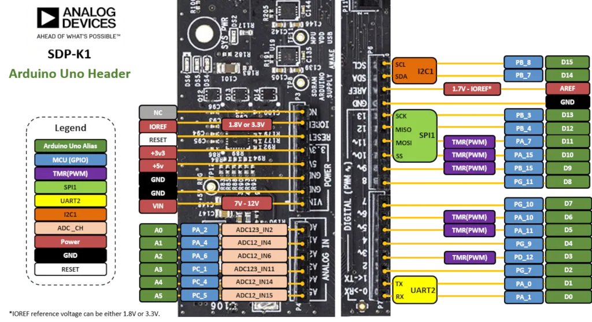
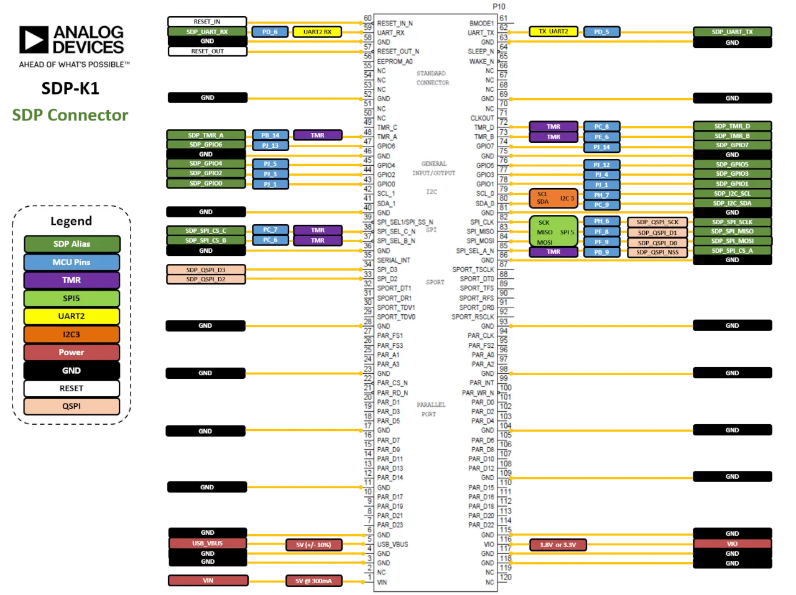

<!-- Copyright 2015-2026 Zephyr Project members and individual contributors. -->
<!-- SPDX-License-Identifier: Apache-2.0 -->
<!-- 中文翻译；编号、导航与译注为本地新增。 -->

<a id="adi_sdp_k1"></a>

# 第22章\_SDP-K1

原文：[官方页面](https://docs.zephyrproject.org/latest/boards/adi/sdp_k1/doc/index.html)。读取日期：2026-10-16；来源摘要见[来源记录](../SOURCES.md)。

开发板概览（Board Overview）

<a id="id1"></a>

[](images/adi_sdp_k1.webp)

SDP-K1

名称（Name）：

`adi_sdp_k1`

厂商（Vendor）：

[Analog Devices, Inc.](https://docs.zephyrproject.org/latest/boards/index.html#vendor=adi)

状态（Status）：

维护中（Maintained）

架构（Architecture）：

[arm](https://docs.zephyrproject.org/latest/boards/index.html#arch=arm)

片上系统（SoC）：

[stm32f469xx](https://docs.zephyrproject.org/latest/boards/index.html#soc=stm32f469xx)

<a id="board-github-link"></a>

[浏览开发板源码（Browse Board Sources）](https://github.com/zephyrproject-rtos/zephyr/blob/main//boards/adi/sdp_k1/doc/index.rst/../..)<a id="overview"></a>

## 概述（Overview）

EVAL-SDP-CK1Z（SDP-K1）控制板是Analog Devices的系统演示平台（SDP / System Demonstration Platform），用于连接包含ADI组件的评估扩展板（Evaluation Shields）。


- BGA216封装的STM32微控制器
- 带USB-C接口的USB 2.0设备
- 通过恩智浦飞思卡尔（NXP Freescale）微控制器支持CMSIS-DAP的USB调试接口
- 灵活的开发板供电方式


  - USB VBUS：5 V，最大500 mA
  - 5.5 mm直流电源插孔：7–12 V，至少300 mA
  - VIN来自兼容Arduino*的连接器
  - VIN来自120针接口：5 V，至少300 mA
- 三个彩色LED，分别为绿、橙、红色，以及一个状态LED
- 一个按键：RESET复位
- 16 MB同步动态随机存储器（SDRAM）
- Arduino UNO接口和120针SDP接口

更多开发板信息见[ADI SDP-K1网站](https://www.analog.com/en/design-center/evaluation-hardware-and-software/evaluation-boards-kits/sdp-k1.html)。

<a id="hardware"></a>

## 硬件（Hardware）

ADI SDP-K1提供以下硬件组件：


- BGA216封装的STM32F469NIH6
- 带浮点单元（FPU）的 ARM 32 位 Cortex-M4 CPU。
- CPU最高频率为180 MHz
- VDD为1.8 V或3.3 V
- 2 MB闪存（Flash）
- 384 KB静态随机存储器（SRAM）
- 支持外部中断（External Interrupt）的 GPIO。
- 液晶显示器（LCD）并行接口，支持8080/6800模式
- LCD TFT控制器，最高支持XGA分辨率
- MIPI®显示串行接口（DSI）主控制器，最高支持720p、30 Hz
- 三个12位ADC，合计24个通道
- 两个12位数模转换器（D/A Converters）
- 实时时钟（RTC）
- 高级控制定时器（Advanced-Control Timer）。
- 17个通用定时器（General Purpose Timers）
- 两个看门狗定时器（Watchdog Timers）。
- 8路USART/UART
- 3 个 I2C。
- 6路SPI
- 一路串行音频接口（SAI / Serial Audio Interface）
- SD输入输出接口（SDIO）
- 2xCAN
- USB 2.0 OTG全速（FS），带片上物理层（PHY）
- USB 2.0 OTG高速／全速（HS/FS），带专用DMA、片上全速PHY和ULPI接口
- 10/100以太网媒体访问控制器（Ethernet MAC），带专用DMA
- 8至14位并行摄像头接口（Parallel Camera）
- 循环冗余校验计算单元（CRC Calculation Unit）
- 真随机数发生器（True Random Number Generator）
- 直接存储器访问控制器（DMA Controller）。

STM32F469NI的更多信息见以下资料：


- [STM32F469NI产品页（Product Page）](https://www.st.com/en/microcontrollers/stm32f469ni.html)
- [STM32F469参考手册（Reference Manual）](https://www.st.com/resource/en/reference_manual/dm00127514.pdf)

<a id="supported-features"></a>

### 支持的功能（Supported Features）

`adi_sdp_k1`开发板支持下表所列的硬件功能。

片上／板载（On-Chip / On-Board）

功能集成在片上系统（SoC）内／位于开发板上。

2 / 2

分别表示已启用／已禁用的实例数。点击数量标签，可查看开发板或SoC设备树源码（DTS）中该功能的第一个实例。

`vnd,foo`

与此功能匹配的设备树绑定兼容字符串（Compatible String）；点击链接可查看绑定文档。

<a id="adi_sdp_k1-hw-features"></a>

<a id="adi_sdp_k1-adi_sdp_k1/stm32f469xx-hw-features-section"></a>

#### `adi_sdp_k1/stm32f469xx`目标（Target）

<a id="adi_sdp_k1-adi_sdp_k1/stm32f469xx-hw-features-panel"></a>

<a id="adi_sdp_k1-adi_sdp_k1/stm32f469xx-hw-features-memory"></a>

该开发板目标的片上存储容量：320 KiB RAM、2 MiB Flash。

<a id="adi_sdp_k1-adi_sdp_k1/stm32f469xx-hw-features-table"></a>

<table>
<tr>
<th>类型（Type）</th>
<th>位置（Location）</th>
<th>说明（Description）</th>
<th>兼容字符串（Compatible）</th>
</tr>
<tr>
<td rowspan="1">中央处理器（CPU）</td>
<td>片上（On-Chip）</td>
<td>ARM Cortex-M4F 处理器（CPU）（<a href="https://github.com/zephyrproject-rtos/zephyr/blob/main/dts/arm/st/f4/stm32f4.dtsi?plain=1#L34">已启用：1</a>）</td>
<td><a href="../cpu_arm_riscv_binding_reference/P025_arm_cortex-m4f.md#std-dtcompatible-arm-cortex-m4f"><code>arm,cortex-m4f</code></a></td>
</tr>
<tr>
<td rowspan="1">模数转换器（ADC）</td>
<td>片上（On-Chip）</td>
<td>STM32F4 模数转换器（ADC）（<a href="https://github.com/zephyrproject-rtos/zephyr/blob/main/dts/arm/st/f4/stm32f4.dtsi?plain=1#L611">已禁用：1</a>）</td>
<td><a href="../hardware/P841_STM32F4模数转换器绑定.md#dtbinding-st-stm32f4-adc"><code>st,stm32f4-adc</code></a></td>
</tr>
<tr>
<td rowspan="1">控制器局域网（CAN）</td>
<td>片上（On-Chip）</td>
<td>STM32 CAN 控制器（Controller）（<a href="https://github.com/zephyrproject-rtos/zephyr/blob/main/dts/arm/st/f4/stm32f405.dtsi?plain=1#L223">已禁用：2</a>）</td>
<td><a href="../can_nxp_renesas_stm32_ti_binding_reference/P011_st_stm32-bxcan.md#std-dtcompatible-st-stm32-bxcan"><code>st,stm32-bxcan</code></a></td>
</tr>
<tr>
<td rowspan="6">时钟控制（Clock Control）</td>
<td>片上（On-Chip）</td>
<td>STM32F4 复位与时钟控制器（Reset and Clock Controller，RCC）（<a href="https://github.com/zephyrproject-rtos/zephyr/blob/main/dts/arm/st/f4/stm32f4.dtsi?plain=1#L178">已启用：1</a>）</td>
<td><a href="../timer_reference/P127_STM32F4复位与时钟控制绑定.md#dtbinding-st-stm32f4-rcc"><code>st,stm32f4-rcc</code></a></td>
</tr>
<tr>
<td>片上（On-Chip）</td>
<td>STM32 外部高速时钟（HSE Clock）（<a href="https://github.com/zephyrproject-rtos/zephyr/blob/main/dts/arm/st/f4/stm32f4.dtsi?plain=1#L63">已启用：1</a>）</td>
<td><a href="../timer_reference/P129_STM32高速外部时钟绑定.md#dtbinding-st-stm32-hse-clock"><code>st,stm32-hse-clock</code></a></td>
</tr>
<tr>
<td>片上（On-Chip）</td>
<td>通用固定频率时钟提供者（Fixed-Rate Clock Provider）（<a href="https://github.com/zephyrproject-rtos/zephyr/blob/main/dts/arm/st/f4/stm32f4.dtsi?plain=1#L83">已启用：1</a>；<a href="https://github.com/zephyrproject-rtos/zephyr/blob/main/dts/arm/st/f4/stm32f4.dtsi?plain=1#L69">已禁用：2</a>）</td>
<td><a href="../hardware/P566_固定时钟绑定.md#dtbinding-fixed-clock"><code>fixed-clock</code></a></td>
</tr>
<tr>
<td>片上（On-Chip）</td>
<td>STM32F2、STM32F4、STM32F7 的锁相环节点绑定（PLL Node Binding）（<a href="https://github.com/zephyrproject-rtos/zephyr/blob/main/dts/arm/st/f4/stm32f4.dtsi?plain=1#L90">已启用：1</a>；<a href="https://github.com/zephyrproject-rtos/zephyr/blob/main/dts/arm/st/f4/stm32f401.dtsi?plain=1#L11">已禁用：2</a>）</td>
<td><a href="../timer_reference/P128_STM32Fx锁相环时钟绑定.md#dtbinding-st-stm32fx-pll-clock"><code>st,stm32fx-pll-clock</code></a></td>
</tr>
<tr>
<td>片上（On-Chip）</td>
<td>STM32 时钟多路复用器（Clock Multiplexer）（<a href="https://github.com/zephyrproject-rtos/zephyr/blob/main/dts/arm/st/f4/stm32f469.dtsi?plain=1#L12">已禁用：1</a>）</td>
<td><a href="../timer_reference/P133_STM32时钟多路复用绑定.md#dtbinding-st-stm32-clock-mux"><code>st,stm32-clock-mux</code></a></td>
</tr>
<tr>
<td>片上（On-Chip）</td>
<td>STM32 微控制器时钟输出（Microcontroller Clock Output，MCO）（<a href="https://github.com/zephyrproject-rtos/zephyr/blob/main/dts/arm/st/f4/stm32f4.dtsi?plain=1#L98">已禁用：2</a>）</td>
<td><a href="../timer_reference/P134_STM32时钟输出绑定.md#dtbinding-st-stm32-clock-mco"><code>st,stm32-clock-mco</code></a></td>
</tr>
<tr>
<td rowspan="1">计数器（Counter）</td>
<td>片上（On-Chip）</td>
<td>STM32 计数器（Counters）（<a href="https://github.com/zephyrproject-rtos/zephyr/blob/main/dts/arm/st/f4/stm32f4.dtsi?plain=1#L396">已禁用：14</a>）</td>
<td><a href="../stm32_ti_xilinx_counter_binding_reference/P007_st_stm32-counter.md#std-dtcompatible-st-stm32-counter"><code>st,stm32-counter</code></a></td>
</tr>
<tr>
<td rowspan="1">数模转换器（DAC）</td>
<td>片上（On-Chip）</td>
<td>STM32 系列数模转换器（DAC）（<a href="https://github.com/zephyrproject-rtos/zephyr/blob/main/dts/arm/st/f4/stm32f405.dtsi?plain=1#L279">已禁用：1</a>）</td>
<td><a href="../hardware/P760_STM32数模转换器绑定.md#dtbinding-st-stm32-dac"><code>st,stm32-dac</code></a></td>
</tr>
<tr>
<td rowspan="2">显示（Display）</td>
<td>片上（On-Chip）</td>
<td>STM32 Chrom-ART 图形加速器（Accelerator，DMA2D）（<a href="https://github.com/zephyrproject-rtos/zephyr/blob/main/dts/arm/st/f4/stm32f427.dtsi?plain=1#L146">已禁用：1</a>）</td>
<td><a href="../display_st_ultrachip_zephyr_binding_reference/P003_st_stm32-dma2d.md#std-dtcompatible-st-stm32-dma2d"><code>st,stm32-dma2d</code></a></td>
</tr>
<tr>
<td>片上（On-Chip）</td>
<td>STM32 LCD-TFT 显示控制器（Display Controller）（<a href="https://github.com/zephyrproject-rtos/zephyr/blob/main/dts/arm/st/f4/stm32f429.dtsi?plain=1#L22">已禁用：1</a>）</td>
<td><a href="../display_st_ultrachip_zephyr_binding_reference/P004_st_stm32-ltdc.md#std-dtcompatible-st-stm32-ltdc"><code>st,stm32-ltdc</code></a></td>
</tr>
<tr>
<td rowspan="1">直接存储器访问（DMA）</td>
<td>片上（On-Chip）</td>
<td>STM32 DMA 控制器（Controller，V1）（<a href="https://github.com/zephyrproject-rtos/zephyr/blob/main/dts/arm/st/f4/stm32f4.dtsi?plain=1#L636">已禁用：2</a>）</td>
<td><a href="../stm32_ti_xilinx_dma_binding_reference/P007_st_stm32-dma-v1.md#std-dtcompatible-st-stm32-dma-v1"><code>st,stm32-dma-v1</code></a></td>
</tr>
<tr>
<td rowspan="3">以太网（Ethernet）</td>
<td>片上（On-Chip）</td>
<td>ST STM32 以太网媒体访问控制器（Ethernet MAC）（<a href="https://github.com/zephyrproject-rtos/zephyr/blob/main/dts/arm/st/f4/stm32f407.dtsi?plain=1#L13">已禁用：1</a>）</td>
<td><a href="../ethernet_synopsys_st_xilinx_binding_reference/P009_st_stm32-ethernet.md#std-dtcompatible-st-stm32-ethernet"><code>st,stm32-ethernet</code></a></td>
</tr>
<tr>
<td>片上（On-Chip）</td>
<td>Synopsys DesignWare MAC 的管理数据输入输出控制器（MDIO Controller）（<a href="https://github.com/zephyrproject-rtos/zephyr/blob/main/dts/arm/st/f4/stm32f407.dtsi?plain=1#L27">已禁用：1</a>）</td>
<td><a href="../ethernet_mdio_microchip_binding_reference/P010_snps_dwmac-mdio.md#std-dtcompatible-snps-dwmac-mdio"><code>snps,dwmac-mdio</code></a></td>
</tr>
<tr>
<td>片上（On-Chip）</td>
<td>Synopsys DesignWare MAC 精确时间协议时钟（Precision Time Protocol，PTP Clock）（<a href="https://github.com/zephyrproject-rtos/zephyr/blob/main/dts/arm/st/f4/stm32f407.dtsi?plain=1#L34">已启用：1</a>）</td>
<td><a href="../ethernet_synopsys_st_xilinx_binding_reference/P006_snps_dwmac-ptp-clock.md#std-dtcompatible-snps-dwmac-ptp-clock"><code>snps,dwmac-ptp-clock</code></a></td>
</tr>
<tr>
<td rowspan="1">闪存控制器（Flash Controller）</td>
<td>片上（On-Chip）</td>
<td>STM32 系列闪存控制器（Flash Controller）（<a href="https://github.com/zephyrproject-rtos/zephyr/blob/main/dts/arm/st/f4/stm32f4.dtsi?plain=1#L112">已启用：1</a>）</td>
<td><a href="../flash_renesas_st_ti_binding_reference/P011_st_stm32-flash-controller.md#std-dtcompatible-st-stm32-flash-controller"><code>st,stm32-flash-controller</code></a></td>
</tr>
<tr>
<td rowspan="4">通用输入输出与接插件（GPIO &amp; Headers）</td>
<td>片上（On-Chip）</td>
<td>STM32 通用输入输出控制器（GPIO Controller）（<a href="https://github.com/zephyrproject-rtos/zephyr/blob/main/dts/arm/st/f4/stm32f4.dtsi?plain=1#L212">已启用：11</a>）</td>
<td><a href="../gpio_silabs_st_connectors_binding_reference/P029_st_stm32-gpio.md#std-dtcompatible-st-stm32-gpio"><code>st,stm32-gpio</code></a></td>
</tr>
<tr>
<td>板载（On-Board）</td>
<td>引出到Arduino Uno R3排针（Headers）的GPIO引脚（<a href="https://github.com/zephyrproject-rtos/zephyr/blob/main/boards/adi/sdp_k1/arduino_r3_connector.dtsi?plain=1#L10">已启用：1</a>）</td>
<td><a href="../gpio_adi_headers_ambiq_binding_reference/P023_arduino-header-r3.md#std-dtcompatible-arduino-header-r3"><code>arduino-header-r3</code></a></td>
</tr>
<tr>
<td>板载（On-Board）</td>
<td>引出到Analog Devices SDP接口的GPIO引脚（<a href="https://github.com/zephyrproject-rtos/zephyr/blob/main/boards/adi/sdp_k1/adi_sdp_120pin_connector.dtsi?plain=1#L11">已启用：1</a>）</td>
<td><a href="../gpio_adi_headers_ambiq_binding_reference/P012_adi_sdp-120.md#std-dtcompatible-adi-sdp-120"><code>adi,sdp-120</code></a></td>
</tr>
<tr>
<td>板载（On-Board）</td>
<td>引出到Digilent Pmod接口的GPIO引脚（<a href="https://github.com/zephyrproject-rtos/zephyr/blob/main/boards/adi/sdp_k1/adi_sdp_120pin_connector.dtsi?plain=1#L63">已禁用：2</a>）</td>
<td><a href="../gpio_connectors_bflb_esp_binding_reference/P015_digilent_pmod.md#std-dtcompatible-digilent-pmod"><code>digilent,pmod</code></a></td>
</tr>
<tr>
<td rowspan="1">集成电路间总线（I2C）</td>
<td>片上（On-Chip）</td>
<td>STM32 I2C V1 控制器（Controller）（<a href="https://github.com/zephyrproject-rtos/zephyr/blob/main/dts/arm/st/f4/stm32f4.dtsi?plain=1#L318">已禁用：3</a>）</td>
<td><a href="../i2c_stm32_ti_mux_binding_reference/P007_st_stm32-i2c-v1.md#std-dtcompatible-st-stm32-i2c-v1"><code>st,stm32-i2c-v1</code></a></td>
</tr>
<tr>
<td rowspan="2">集成电路间音频总线（I2S）</td>
<td>片上（On-Chip）</td>
<td>STM32 I2S 控制器（Controller）（<a href="https://github.com/zephyrproject-rtos/zephyr/blob/main/dts/arm/st/f4/stm32f401.dtsi?plain=1#L54">已禁用：2</a>）</td>
<td><a href="../i2s_binding_reference/P016_st_stm32-i2s.md#std-dtcompatible-st-stm32-i2s"><code>st,stm32-i2s</code></a></td>
</tr>
<tr>
<td>片上（On-Chip）</td>
<td>STM32 串行音频接口块控制器（SAI Block Controller）（<a href="https://github.com/zephyrproject-rtos/zephyr/blob/main/dts/arm/st/f4/stm32f427.dtsi?plain=1#L119">已禁用：1</a>）</td>
<td><a href="../i2s_binding_reference/P017_st_stm32-sai.md#std-dtcompatible-st-stm32-sai"><code>st,stm32-sai</code></a></td>
</tr>
<tr>
<td rowspan="2">中断控制器（Interrupt Controller）</td>
<td>片上（On-Chip）</td>
<td>ARMv7-M 嵌套向量中断控制器（Nested Vectored Interrupt Controller，NVIC）（<a href="https://github.com/zephyrproject-rtos/zephyr/blob/main/dts/arm/armv7-m.dtsi?plain=1#L13">已启用：1</a>）</td>
<td><a href="../arm_interrupt_timer_binding_reference/P002_ARMv7_M_NVIC.md#std-dtcompatible-arm-v7m-nvic"><code>arm,v7m-nvic</code></a></td>
</tr>
<tr>
<td>片上（On-Chip）</td>
<td>STM32 外部中断控制器（External Interrupt Controller）（<a href="https://github.com/zephyrproject-rtos/zephyr/blob/main/dts/arm/st/f4/stm32f4.dtsi?plain=1#L189">已启用：1</a>）</td>
<td><a href="../mcu_external_interrupt_binding_reference/P001_st_stm32-exti.md#std-dtcompatible-st-stm32-exti"><code>st,stm32-exti</code></a></td>
</tr>
<tr>
<td rowspan="1">发光二极管（LED）</td>
<td>板载（On-Board）</td>
<td>一组由 GPIO 控制的 LED（GPIO-Controlled LEDs）（<a href="https://github.com/zephyrproject-rtos/zephyr/blob/main/boards/adi/sdp_k1/adi_sdp_k1.dts?plain=1#L25">已启用：1</a>）</td>
<td><a href="../hardware/P564_GPIO指示灯绑定.md#dtbinding-gpio-leds"><code>gpio-leds</code></a></td>
</tr>
<tr>
<td rowspan="3">存储器控制器（Memory Controller）</td>
<td>片上（On-Chip）</td>
<td>STM32 电池备份 RAM（Battery-Backed RAM）（<a href="https://github.com/zephyrproject-rtos/zephyr/blob/main/dts/arm/st/f4/stm32f4.dtsi?plain=1#L604">已禁用：1</a>）</td>
<td><a href="../memory_controller_sdram_psram_binding_reference/P010_st_stm32-bbram.md#std-dtcompatible-st-stm32-bbram"><code>st,stm32-bbram</code></a></td>
</tr>
<tr>
<td>片上（On-Chip）</td>
<td>STM32 灵活存储器控制器（Flexible Memory Controller，FMC）（<a href="https://github.com/zephyrproject-rtos/zephyr/blob/main/dts/arm/st/f4/stm32f427.dtsi?plain=1#L105">已禁用：1</a>）</td>
<td><a href="../memory_controller_sdram_psram_binding_reference/P013_st_stm32-fmc.md#std-dtcompatible-st-stm32-fmc"><code>st,stm32-fmc</code></a></td>
</tr>
<tr>
<td>片上（On-Chip）</td>
<td>STM32 灵活存储器控制器中的 SDRAM 控制器（SDRAM Controller）（<a href="https://github.com/zephyrproject-rtos/zephyr/blob/main/dts/arm/st/f4/stm32f427.dtsi?plain=1#L111">已禁用：1</a>）</td>
<td><a href="../memory_controller_sdram_psram_binding_reference/P012_st_stm32-fmc-sdram.md#std-dtcompatible-st-stm32-fmc-sdram"><code>st,stm32-fmc-sdram</code></a></td>
</tr>
<tr>
<td rowspan="1">MIPI 显示串行接口（MIPI-DSI）</td>
<td>片上（On-Chip）</td>
<td>STM32 MIPI显示串行接口（DSI）主机（<a href="https://github.com/zephyrproject-rtos/zephyr/blob/main/dts/arm/st/f4/stm32f469.dtsi?plain=1#L38">已禁用：1</a>）</td>
<td><a href="../mipi_dbi_dsi_binding_reference/P018_st_stm32-mipi-dsi.md#std-dtcompatible-st-stm32-mipi-dsi"><code>st,stm32-mipi-dsi</code></a></td>
</tr>
<tr>
<td rowspan="1">存储技术设备（MTD）</td>
<td>片上（On-Chip）</td>
<td>STM32F4 闪存（Flash Memory）（<a href="https://github.com/zephyrproject-rtos/zephyr/blob/main/dts/arm/st/f4/stm32f4.dtsi?plain=1#L121">已启用：1</a>）</td>
<td><a href="../mtd_nxp_st_ti_partition_binding_reference/P017_st_stm32f4-nv-flash.md#std-dtcompatible-st-stm32f4-nv-flash"><code>st,stm32f4-nv-flash</code></a></td>
</tr>
<tr>
<td rowspan="1">非易失存储器（NVMEM）</td>
<td>片上（On-Chip）</td>
<td>非易失存储器固定布局（Fixed Layout for Non-Volatile Memory）（<a href="https://github.com/zephyrproject-rtos/zephyr/blob/main/dts/arm/st/f4/stm32f4.dtsi?plain=1#L152">已启用：1</a>）</td>
<td><a href="../memory_protection_binding_reference/P009_fixed-layout.md#std-dtcompatible-fixed-layout"><code>fixed-layout</code></a></td>
</tr>
<tr>
<td rowspan="1">一次性可编程存储器（OTP Memory）</td>
<td>片上（On-Chip）</td>
<td>STM32 嵌入式非易失一次性可编程存储器（NVM OTP）（<a href="https://github.com/zephyrproject-rtos/zephyr/blob/main/dts/arm/st/f4/stm32f4.dtsi?plain=1#L148">已启用：1</a>；<a href="https://github.com/zephyrproject-rtos/zephyr/blob/main/dts/arm/st/f4/stm32f4.dtsi?plain=1#L131">已禁用：1</a>）</td>
<td><a href="../otp_binding_reference/P010_st_stm32-nvm-otp.md#std-dtcompatible-st-stm32-nvm-otp"><code>st,stm32-nvm-otp</code></a></td>
</tr>
<tr>
<td rowspan="2">物理层（PHY）</td>
<td>片上（On-Chip）</td>
<td>用于所有内置于 USB IP 的 USB 收发器（USB Transceivers）的绑定。（<a href="https://github.com/zephyrproject-rtos/zephyr/blob/main/dts/arm/st/f4/stm32f4.dtsi?plain=1#L711">已启用：2</a>）</td>
<td><a href="../phy_binding_reference/P008_usb-nop-xceiv.md#std-dtcompatible-usb-nop-xceiv"><code>usb-nop-xceiv</code></a></td>
</tr>
<tr>
<td>板载（On-Board）</td>
<td>此绑定（Binding）适用于所有作为外部ULPI物理层（PHY）的USB收发器（Transceivers）（<a href="https://github.com/zephyrproject-rtos/zephyr/blob/main/boards/adi/sdp_k1/adi_sdp_k1.dts?plain=1#L49">已启用：1</a>）</td>
<td><a href="../phy_binding_reference/P009_usb-ulpi-phy.md#std-dtcompatible-usb-ulpi-phy"><code>usb-ulpi-phy</code></a></td>
</tr>
<tr>
<td rowspan="1">引脚控制（Pin Control）</td>
<td>片上（On-Chip）</td>
<td>STM32 引脚控制器（Pin Controller）（<a href="https://github.com/zephyrproject-rtos/zephyr/blob/main/dts/arm/st/f4/stm32f4.dtsi?plain=1#L205">已启用：1</a>）</td>
<td><a href="../pinctrl_stm32_ti_xilinx_binding_reference/P004_st_stm32-pinctrl.md#std-dtcompatible-st-stm32-pinctrl"><code>st,stm32-pinctrl</code></a></td>
</tr>
<tr>
<td rowspan="2">电源管理（Power Management）</td>
<td>片上（On-Chip）</td>
<td>STM32 电源控制器（Power Controller）（<a href="https://github.com/zephyrproject-rtos/zephyr/blob/main/dts/arm/st/f4/stm32f4.dtsi?plain=1#L665">已启用：1</a>）</td>
<td><a href="../stm32_soc_power_binding_reference/P010_st_stm32-pwr.md#std-dtcompatible-st-stm32-pwr"><code>st,stm32-pwr</code></a></td>
</tr>
<tr>
<td>片上（On-Chip）</td>
<td>STM32F1 风格的唤醒引脚控制器（Wake-Up Pins Controller）（<a href="https://github.com/zephyrproject-rtos/zephyr/blob/main/dts/arm/st/f4/stm32f4.dtsi?plain=1#L669">已禁用：1</a>）</td>
<td><a href="../stm32_soc_power_binding_reference/P011_st_stm32f1-pwr-wkupctrl.md#std-dtcompatible-st-stm32f1-pwr-wkupctrl"><code>st,stm32f1-pwr-wkupctrl</code></a></td>
</tr>
<tr>
<td rowspan="1">脉宽调制（PWM）</td>
<td>片上（On-Chip）</td>
<td>STM32 脉宽调制（PWM）（<a href="https://github.com/zephyrproject-rtos/zephyr/blob/main/dts/arm/st/f4/stm32f4.dtsi?plain=1#L390">已禁用：12</a>）</td>
<td><a href="../pwm_stm32_ti_generic_binding_reference/P011_st_stm32-pwm.md#std-dtcompatible-st-stm32-pwm"><code>st,stm32-pwm</code></a></td>
</tr>
<tr>
<td rowspan="1">复位控制器（Reset Controller）</td>
<td>片上（On-Chip）</td>
<td>STM32 复位与时钟控制器（Reset and Clock Control，RCC）（<a href="https://github.com/zephyrproject-rtos/zephyr/blob/main/dts/arm/st/f4/stm32f4.dtsi?plain=1#L183">已启用：1</a>）</td>
<td><a href="../reset_controller_binding_reference/P017_st_stm32-rcc-rctl.md#std-dtcompatible-st-stm32-rcc-rctl"><code>st,stm32-rcc-rctl</code></a></td>
</tr>
<tr>
<td rowspan="1">随机数生成器（RNG）</td>
<td>片上（On-Chip）</td>
<td>STM32 随机数生成器（Random Number Generator）（<a href="https://github.com/zephyrproject-rtos/zephyr/blob/main/dts/arm/st/f4/stm32f405.dtsi?plain=1#L243">已禁用：1</a>）</td>
<td><a href="../soc_rng_binding_reference/P016_st_stm32-rng.md#std-dtcompatible-st-stm32-rng"><code>st,stm32-rng</code></a></td>
</tr>
<tr>
<td rowspan="1">实时时钟（RTC）</td>
<td>片上（On-Chip）</td>
<td>STM32 实时时钟（RTC）（<a href="https://github.com/zephyrproject-rtos/zephyr/blob/main/dts/arm/st/f4/stm32f4.dtsi?plain=1#L593">已禁用：1</a>）</td>
<td><a href="../soc_rtc_binding_reference/P014_st_stm32-rtc.md#std-dtcompatible-st-stm32-rtc"><code>st,stm32-rtc</code></a></td>
</tr>
<tr>
<td rowspan="1">SD 主机控制器（SDHC）</td>
<td>片上（On-Chip）</td>
<td>STM32 SDMMC 主机控制器（Host Controller）（<a href="https://github.com/zephyrproject-rtos/zephyr/blob/main/dts/arm/st/f4/stm32f4.dtsi?plain=1#L655">已禁用：1</a>）</td>
<td><a href="../sdhc_binding_reference/P019_st_stm32-sdmmc.md#std-dtcompatible-st-stm32-sdmmc"><code>st,stm32-sdmmc</code></a></td>
</tr>
<tr>
<td rowspan="4">传感器（Sensors）</td>
<td>片上（On-Chip）</td>
<td>STM32 正交解码器（Quadrature Decoder）（<a href="https://github.com/zephyrproject-rtos/zephyr/blob/main/dts/arm/st/f4/stm32f4.dtsi?plain=1#L401">已禁用：6</a>）</td>
<td><a href="../sensor_st_lsm_stm32_binding_reference/P028_st_stm32-qdec.md#std-dtcompatible-st-stm32-qdec"><code>st,stm32-qdec</code></a></td>
</tr>
<tr>
<td>片上（On-Chip）</td>
<td>STM32 系列温度节点（TEMP），用于以两个温度点完成生产校准的传感器。（<a href="https://github.com/zephyrproject-rtos/zephyr/blob/main/dts/arm/st/f4/stm32f4.dtsi?plain=1#L685">已禁用：1</a>）</td>
<td><a href="../sensor_st_lsm_stm32_binding_reference/P029_st_stm32-temp-cal.md#std-dtcompatible-st-stm32-temp-cal"><code>st,stm32-temp-cal</code></a></td>
</tr>
<tr>
<td>片上（On-Chip）</td>
<td>STM32 参考电压（VREF+）（<a href="https://github.com/zephyrproject-rtos/zephyr/blob/main/dts/arm/st/f4/stm32f4.dtsi?plain=1#L696">已禁用：1</a>）</td>
<td><a href="../sensor_st_ti_power_capacitance_binding_reference/P003_st_stm32-vref.md#std-dtcompatible-st-stm32-vref"><code>st,stm32-vref</code></a></td>
</tr>
<tr>
<td>片上（On-Chip）</td>
<td>STM32 电池电压（VBAT）（<a href="https://github.com/zephyrproject-rtos/zephyr/blob/main/dts/arm/st/f4/stm32f4.dtsi?plain=1#L704">已禁用：1</a>）</td>
<td><a href="../sensor_st_ti_power_capacitance_binding_reference/P001_st_stm32-vbat.md#std-dtcompatible-st-stm32-vbat"><code>st,stm32-vbat</code></a></td>
</tr>
<tr>
<td rowspan="2">串行控制器（Serial Controller）</td>
<td>片上（On-Chip）</td>
<td>STM32 通用同步／异步收发器（USART）（<a href="https://github.com/zephyrproject-rtos/zephyr/blob/main/dts/arm/st/f4/stm32f4.dtsi?plain=1#L291">已禁用：4</a>）</td>
<td><a href="../uart_silabs_stm32_ti_binding_reference/P016_st_stm32-usart.md#std-dtcompatible-st-stm32-usart"><code>st,stm32-usart</code></a></td>
</tr>
<tr>
<td>片上（On-Chip）</td>
<td>STM32 通用异步收发器（UART）（<a href="https://github.com/zephyrproject-rtos/zephyr/blob/main/dts/arm/st/f4/stm32f405.dtsi?plain=1#L68">已启用：1</a>；<a href="https://github.com/zephyrproject-rtos/zephyr/blob/main/dts/arm/st/f4/stm32f405.dtsi?plain=1#L59">已禁用：3</a>）</td>
<td><a href="../uart_silabs_stm32_ti_binding_reference/P015_st_stm32-uart.md#std-dtcompatible-st-stm32-uart"><code>st,stm32-uart</code></a></td>
</tr>
<tr>
<td rowspan="1">系统管理总线（SMbus）</td>
<td>片上（On-Chip）</td>
<td>STM32 系统管理总线控制器（SMBus Controller）（<a href="https://github.com/zephyrproject-rtos/zephyr/blob/main/dts/arm/st/f4/stm32f4.dtsi?plain=1#L716">已禁用：3</a>）</td>
<td><a href="../i3c_smbus_binding_reference/P013_st_stm32-smbus.md#std-dtcompatible-st-stm32-smbus"><code>st,stm32-smbus</code></a></td>
</tr>
<tr>
<td rowspan="1">串行外设接口（SPI）</td>
<td>片上（On-Chip）</td>
<td>STM32 串行外设接口控制器（SPI Controller）（<a href="https://github.com/zephyrproject-rtos/zephyr/blob/main/dts/arm/st/f4/stm32f427.dtsi?plain=1#L80">已启用：1</a>；<a href="https://github.com/zephyrproject-rtos/zephyr/blob/main/dts/arm/st/f4/stm32f4.dtsi?plain=1#L354">已禁用：5</a>）</td>
<td><a href="../spi_stm32_ti_xilinx_binding_reference/P012_st_stm32-spi.md#std-dtcompatible-st-stm32-spi"><code>st,stm32-spi</code></a></td>
</tr>
<tr>
<td rowspan="2">定时器（Timer）</td>
<td>片上（On-Chip）</td>
<td>ARMv7-M 系统节拍（System Tick）（<a href="https://github.com/zephyrproject-rtos/zephyr/blob/main/dts/arm/armv7-m.dtsi?plain=1#L21">已启用：1</a>）</td>
<td><a href="../arm_interrupt_timer_binding_reference/P006_ARMv7_M_SysTick.md#std-dtcompatible-arm-armv7m-systick"><code>arm,armv7m-systick</code></a></td>
</tr>
<tr>
<td>片上（On-Chip）</td>
<td>STM32 定时器（Timers）（<a href="https://github.com/zephyrproject-rtos/zephyr/blob/main/dts/arm/st/f4/stm32f4.dtsi?plain=1#L379">已禁用：14</a>）</td>
<td><a href="../stm32_ti_silabs_timer_binding_reference/P008_st_stm32-timers.md#std-dtcompatible-st-stm32-timers"><code>st,stm32-timers</code></a></td>
</tr>
<tr>
<td rowspan="2">通用串行总线（USB）</td>
<td>片上（On-Chip）</td>
<td>STM32 全速 USB OTG 控制器（OTGFS Controller）（<a href="https://github.com/zephyrproject-rtos/zephyr/blob/main/dts/arm/st/f4/stm32f4.dtsi?plain=1#L365">已禁用：1</a>）</td>
<td><a href="../usb_stm32_audio_binding_reference/P004_st_stm32-otgfs.md#std-dtcompatible-st-stm32-otgfs"><code>st,stm32-otgfs</code></a></td>
</tr>
<tr>
<td>片上（On-Chip）</td>
<td>STM32 高速 USB OTG 控制器（OTGHS Controller）（<a href="https://github.com/zephyrproject-rtos/zephyr/blob/main/dts/arm/st/f4/stm32f405.dtsi?plain=1#L209">已启用：1</a>）</td>
<td><a href="../usb_stm32_audio_binding_reference/P005_st_stm32-otghs.md#std-dtcompatible-st-stm32-otghs"><code>st,stm32-otghs</code></a></td>
</tr>
<tr>
<td rowspan="2">看门狗（Watchdog）</td>
<td>片上（On-Chip）</td>
<td>STM32 看门狗（Watchdog）（<a href="https://github.com/zephyrproject-rtos/zephyr/blob/main/dts/arm/st/f4/stm32f4.dtsi?plain=1#L277">已禁用：1</a>）</td>
<td><a href="../stm32_ti_xilinx_watchdog_binding_reference/P001_st_stm32-watchdog.md#std-dtcompatible-st-stm32-watchdog"><code>st,stm32-watchdog</code></a></td>
</tr>
<tr>
<td>片上（On-Chip）</td>
<td>STM32 系统窗口看门狗（System Window Watchdog）（<a href="https://github.com/zephyrproject-rtos/zephyr/blob/main/dts/arm/st/f4/stm32f4.dtsi?plain=1#L283">已禁用：1</a>）</td>
<td><a href="../stm32_ti_xilinx_watchdog_binding_reference/P002_st_stm32-window-watchdog.md#std-dtcompatible-st-stm32-window-watchdog"><code>st,stm32-window-watchdog</code></a></td>
</tr>
</table>

<a id="pin-mapping"></a>

### 引脚映射（Pin Mapping）

更多细节请参阅[EVAL-SDP-CK1Z用户指南（User Guide）](https://www.analog.com/media/en/technical-documentation/user-guides/EVAL-SDP-CK1Z-UG-1539.pdf)。

<a id="arduino-uno-headers"></a>

#### Arduino UNO排针（Headers）

<a id="id2"></a>



ADI SDP-K1，图片来源（Credit）：Analog Devices, Inc.

<a id="pin-sdp-connector"></a>

#### 120针SDP接口（Connector）

<a id="id3"></a>



ADI SDP-K1，图片来源（Credit）：Analog Devices, Inc.

<a id="default-zephyr-peripheral-mapping"></a>

#### Zephyr 默认外设映射（Peripheral Mapping）：


- UART_5 TX/RX：P2（DAPLink USB-C）
- UART_5 TX/RX：P8（DAPLink双位通孔 / Two Position Through Hole）
- LED1：DS6（红色 / Red）
- LED2：DS5（橙色 / Orange）
- LED3：DS4（绿色 / Green）
- LED4：DS4（状态 / Status）

<a id="programming-and-debugging"></a>

## 烧录与调试（Programming and Debugging）

`adi_sdp_k1`开发板支持下表所列的运行工具（Runners）及相关west命令。

<table>
<tr>
<th></th>
<th>烧录（flash）</th>
<th>调试（debug）</th>
<th>连接调试会话（attach）</th>
<th>实时传输（rtt）</th>
<th>调试服务器（debugserver）</th>
<th>复位（reset）</th>
</tr>
<tr>
<td><a href="https://docs.zephyrproject.org/latest/develop/flash_debug/host-tools.html#runner-jlink"><code>jlink</code></a></td>
<td>✅</td>
<td>✅</td>
<td>✅</td>
<td>✅</td>
<td>✅</td>
<td>✅</td>
</tr>
<tr>
<td><a href="https://docs.zephyrproject.org/latest/develop/flash_debug/host-tools.html#runner-openocd">openocd</a></td>
<td>✅（默认 / default）</td>
<td>✅（默认 / default）</td>
<td>✅</td>
<td>✅</td>
<td>✅</td>
<td></td>
</tr>
</table>

ADI SDP-K1可以通过USB编程，使用运行于嵌入式NXP Freescale微控制器上的DAPLink固件；也可以使用连接STLINK调试器的10针DEBUG排针。

DAPLink向主机提供一个存储设备（Storage Device），以及USB人机接口设备（HID）和通信设备类（CDC）端点（Endpoints）。更多细节请参阅[DAPLink官方网站（Official DAPLink Website）](https://daplink.io/)。

<a id="flashing"></a>

### 烧录（Flashing）

<a id="flashing-an-application-with-a-stlink-debugger"></a>

#### 使用STLINK调试器烧录应用（Flashing an Application）

首先，通过Micro-USB端口将STLINK调试器连接到主机；随后，将调试器连接到SDP-K1的10针DEBUG排针；最后，通过USB-C端口将SDP-K1连接到主机。

运行主机串口程序连接开发板：

```text
$ minicom -D /dev/serial/by-id/usb-ARM_DAPLink_CMSIS-DAP_<...>
```

下面以[Hello World](../getting_started/P005_HelloWorld示例.md#hello_world)应用为例。

```text
# From the root of the zephyr repository
west build -b adi_sdp_k1 samples/hello_world
west flash
```

控制台上应显示以下消息：

```text
Hello World! adi_sdp_k1
```

<a id="debugging"></a>

### 调试（Debugging）

## 译注

概述中的物理SRAM容量与自动生成目标表中的RAM容量分别依照原文保留，不能将目标可用存储器数量直接当成器件总容量。

原文引脚列表同时将绿色LED3和状态LED4标为DS4，译文保留该重复标号。

## 原文外链核对

2026-10-16核对并重试以下原文外链时未能确认可访问性，保留原始目标，不将访问失败解释为原文内容有误。

- [stm32f469ni.html](https://www.st.com/en/microcontrollers/stm32f469ni.html)：HTTP Error 567: Unknown Status。
- [dm00127514.pdf](https://www.st.com/resource/en/reference_manual/dm00127514.pdf)：HTTP Error 567: Unknown Status。

---

[上一章](P021_MAX78002EVKIT.md) · [返回大纲](大纲.md) · [全站翻译进度](../PROGRESS.md)
