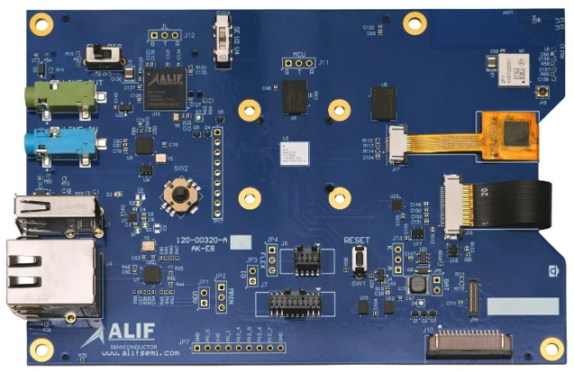

<!-- Copyright 2015-2026 Zephyr Project members and individual contributors. -->
<!-- SPDX-License-Identifier: Apache-2.0 -->
<!-- 中文翻译；编号、导航与译注为本地新增。 -->

<a id="ensemble_e8_ak"></a>

# 第5章\_Alif Ensemble E8人工智能／机器学习应用套件（AI/ML AppKit）

原文：[官方页面](https://docs.zephyrproject.org/latest/boards/alif/ensemble_e8_ak/doc/index.html)。读取日期：2026-10-16；来源摘要见[来源记录](../SOURCES.md)。

开发板概览（Board Overview）

<a id="id1"></a>

[](images/ensemble_e8_ak.webp)

Alif Ensemble E8人工智能／机器学习应用套件（AI/ML AppKit）

名称（Name）：

`ensemble_e8_ak`

厂商（Vendor）：

[Alif Semiconductor](https://docs.zephyrproject.org/latest/boards/index.html#vendor=alif)

状态（Status）：

维护中（Maintained）

架构（Architecture）：

[arm](https://docs.zephyrproject.org/latest/boards/index.html#arch=arm)

片上系统（SoC）：

[ae822fa0e5597bs0](https://docs.zephyrproject.org/latest/boards/index.html#soc=ae822fa0e5597bs0)

<a id="board-github-link"></a>

[浏览开发板源码（Browse Board Sources）](https://github.com/zephyrproject-rtos/zephyr/blob/main//boards/alif/ensemble_e8_ak/doc/index.rst/../..)<a id="overview"></a>

## 概述（Overview）

Alif Ensemble E8 AI/ML AppKit是围绕Alif Ensemble E8系列AE822FA0E5597BS0器件构建的开发平台，器件采用芯片尺寸封装（CSP），面向人工智能（AI）和机器学习（ML）应用。

Ensemble系列器件包含多个CPU集群：最多两个基于Cortex-M55的实时子系统（RTSS / Real Time SubSystems），以及一个基于Cortex-A32的应用处理器子系统（APSS / Application Processor SubSystem）。


- 高性能实时子系统（RTSS-HP / High Performance）：Cortex-M55，最高400 MHz
- 高能效实时子系统（RTSS-HE / High Efficiency）：Cortex-M55，最高160 MHz
- 应用处理器子系统（APSS）：Cortex-A32，最高800 MHz

<a id="board-identifiers"></a>

### 开发板标识（Board Identifiers）

支持以下开发板标识：

<table>
<tr>
<th>开发板标识（Board Identifier）</th>
<th>片上系统系列（SoC Series）</th>
<th>内核（Core）</th>
</tr>
<tr>
<td><code>ensemble_e8_ak/ae822fa0e5597bs0/rtss_he</code></td>
<td>E8</td>
<td>高能效实时子系统（RTSS-HE）</td>
</tr>
<tr>
<td><code>ensemble_e8_ak/ae822fa0e5597bs0/rtss_hp</code></td>
<td>E8</td>
<td>高性能实时子系统（RTSS-HP）</td>
</tr>
<tr>
<td><code>ensemble_e8_ak/ae822fa0e5597bs0/apss</code></td>
<td>E8</td>
<td>应用处理器子系统（APSS）</td>
</tr>
</table>

<a id="hardware"></a>

## 硬件（Hardware）

Ensemble E8 AI/ML AppKit提供以下硬件功能：


- 64 MB Hex SPI HyperRAM伪静态随机存储器（PSRAM）
- 128 MB八线SPI闪存（Octal SPI / xSPI Flash）
- Micro SD卡槽（Card Slot）
- 高速USB主机接口（Host Interface），Type-A
- 高速USB设备接口（Device Interface），Micro-AB
- 板载J-Link调试器，使用PRG USB高速设备Micro-AB接口
- 20针Arm CoreSight JTAG接口，1.27 mm间距
- ICM-42670-P：三轴加速度计和陀螺仪
- BMI323：三轴加速度计、陀螺仪和温度传感器
- CH201超声波测距传感器（Ultrasonic Range Sensor）
- I2S数字麦克风（Digital Microphones）
- 脉冲密度调制（PDM）数字麦克风
- 3.5 mm耳机，即线路输出（Line Out），以及线路输入（Line In）音频插孔
- 五向摇杆（5-Position Joystick）
- 复位按键（Reset Push-Button）
- 多色LED（Multicolor LED）
- 4.3英寸、480 × 800彩色TFT液晶显示屏（LCD），带电容触摸屏（Capacitive Touchscreen）
- 双通道MIPI摄像头串行接口（CSI）连接器
- 38.4 MHz晶体振荡器（Crystal Oscillator）

<a id="supported-features"></a>

### 支持的功能（Supported Features）

`ensemble_e8_ak`开发板支持下表所列的硬件功能。

片上／板载（On-Chip / On-Board）

功能集成在片上系统（SoC）内／位于开发板上。

2 / 2

分别表示已启用／已禁用的实例数。点击数量标签，可查看开发板或SoC设备树源码（DTS）中该功能的第一个实例。

`vnd,foo`

与此功能匹配的设备树绑定兼容字符串（Compatible String）；点击链接可查看绑定文档。

<a id="ensemble_e8_ak-hw-features"></a>

<a id="ensemble_e8_ak-ensemble_e8_ak/ae822fa0e5597bs0/apss-hw-features-section"></a>

#### `ensemble_e8_ak/ae822fa0e5597bs0/apss`目标（Target）

<a id="ensemble_e8_ak-ensemble_e8_ak/ae822fa0e5597bs0/apss-hw-features-panel"></a>

<a id="ensemble_e8_ak-ensemble_e8_ak/ae822fa0e5597bs0/apss-hw-features-memory"></a>

该开发板目标的片上存储容量：4 MiB RAM、5632 KiB Flash。

<a id="ensemble_e8_ak-ensemble_e8_ak/ae822fa0e5597bs0/apss-hw-features-table"></a>

<table>
<tr>
<th>类型（Type）</th>
<th>位置（Location）</th>
<th>说明（Description）</th>
<th>兼容字符串（Compatible）</th>
</tr>
<tr>
<td rowspan="1">中央处理器（CPU）</td>
<td>片上（On-Chip）</td>
<td>ARM Cortex-A32处理器（CPU）（<a href="https://github.com/zephyrproject-rtos/zephyr/blob/main/dts/arm/alif/ensemble/common/ensemble_apss.dtsi?plain=1#L15">已启用：1</a>）</td>
<td><a href="../cpu_arm_riscv_binding_reference/P005_arm_cortex-a32.md#std-dtcompatible-arm-cortex-a32"><code>arm,cortex-a32</code></a></td>
</tr>
<tr>
<td rowspan="4">时钟控制（Clock Control）</td>
<td>片上（On-Chip）</td>
<td>通用固定频率时钟提供者（Fixed-Rate Clock Provider）（<a href="https://github.com/zephyrproject-rtos/zephyr/blob/main/dts/arm/alif/ensemble/common/ensemble_common.dtsi?plain=1#L22">已启用：5</a>）</td>
<td><a href="../hardware/P566_固定时钟绑定.md#dtbinding-fixed-clock"><code>fixed-clock</code></a></td>
</tr>
<tr>
<td>片上（On-Chip）</td>
<td>Alif时钟源多路选择器（Clock Source Multiplexer）（<a href="https://github.com/zephyrproject-rtos/zephyr/blob/main/dts/arm/alif/ensemble/common/ensemble_common.dtsi?plain=1#L68">已启用：1</a>）</td>
<td><a href="../timer_reference/P115_Alif时钟多路复用绑定.md#dtbinding-alif-clock-mux"><code>alif,clock-mux</code></a></td>
</tr>
<tr>
<td>片上（On-Chip）</td>
<td>通用固定比例时钟提供器（Fixed Factor Clock Provider）（<a href="https://github.com/zephyrproject-rtos/zephyr/blob/main/dts/arm/alif/ensemble/common/ensemble_common.dtsi?plain=1#L78">已启用：1</a>）</td>
<td><a href="../timer_reference/P110_固定比例时钟绑定.md#dtbinding-fixed-factor-clock"><code>fixed-factor-clock</code></a></td>
</tr>
<tr>
<td>片上（On-Chip）</td>
<td>Alif Semiconductor时钟控制器（Clock Controller）（<a href="https://github.com/zephyrproject-rtos/zephyr/blob/main/dts/arm/alif/ensemble/common/ensemble_common.dtsi?plain=1#L95">已启用：1</a>）</td>
<td><a href="../clock_adi_atmel_bflb_binding_reference/P006_alif_clockctrl.md#std-dtcompatible-alif-clockctrl"><code>alif,clockctrl</code></a></td>
</tr>
<tr>
<td rowspan="1">计数器（Counter）</td>
<td>片上（On-Chip）</td>
<td>Synopsys DesignWare定时器驱动（Timer Driver）（<a href="https://github.com/zephyrproject-rtos/zephyr/blob/main/dts/arm/alif/ensemble/common/ensemble_common.dtsi?plain=1#L309">已启用：4</a>）</td>
<td><a href="../stm32_ti_xilinx_counter_binding_reference/P006_snps_dw-timers.md#std-dtcompatible-snps-dw-timers"><code>snps,dw-timers</code></a></td>
</tr>
<tr>
<td rowspan="1">通用输入输出与接插件（GPIO &amp; Headers）</td>
<td>片上（On-Chip）</td>
<td>Synopsys DesignWare通用输入输出（GPIO）（<a href="https://github.com/zephyrproject-rtos/zephyr/blob/main/dts/arm/alif/ensemble/common/ensemble_common.dtsi?plain=1#L237">已启用：3</a>；<a href="https://github.com/zephyrproject-rtos/zephyr/blob/main/dts/arm/alif/ensemble/common/ensemble_common.dtsi?plain=1#L174">已禁用：13</a>）</td>
<td><a href="../gpio_silabs_st_connectors_binding_reference/P021_snps_designware-gpio.md#std-dtcompatible-snps-designware-gpio"><code>snps,designware-gpio</code></a></td>
</tr>
<tr>
<td rowspan="1">集成电路间总线（I2C）</td>
<td>片上（On-Chip）</td>
<td>Synopsys DesignWare I2C（<a href="https://github.com/zephyrproject-rtos/zephyr/blob/main/dts/arm/alif/ensemble/common/ensemble_common.dtsi?plain=1#L275">已禁用：4</a>）</td>
<td><a href="../i2c_stm32_ti_mux_binding_reference/P006_snps_designware-i2c.md#std-dtcompatible-snps-designware-i2c"><code>snps,designware-i2c</code></a></td>
</tr>
<tr>
<td rowspan="1">输入（Input）</td>
<td>板载（On-Board）</td>
<td>一组绑定到 GPIO 的输入按键（GPIO-Bound Input Keys）（<a href="https://github.com/zephyrproject-rtos/zephyr/blob/main/boards/alif/ensemble_e8_ak/ensemble_e8_ak_common.dtsi?plain=1#L42">已启用：1</a>）</td>
<td><a href="../hardware/P563_GPIO按键绑定.md#std-dtcompatible-gpio-keys"><code>gpio-keys</code></a></td>
</tr>
<tr>
<td rowspan="1">中断控制器（Interrupt Controller）</td>
<td>片上（On-Chip）</td>
<td>ARM通用中断控制器（GIC）v2（<a href="https://github.com/zephyrproject-rtos/zephyr/blob/main/dts/arm/alif/ensemble/common/ensemble_apss.dtsi?plain=1#L34">已启用：1</a>）</td>
<td><a href="../interrupt_fabric_binding_reference/P003_arm_gic-v2.md#std-dtcompatible-arm-gic-v2"><code>arm,gic-v2</code></a></td>
</tr>
<tr>
<td rowspan="1">发光二极管（LED）</td>
<td>板载（On-Board）</td>
<td>一组由 GPIO 控制的 LED（GPIO-Controlled LEDs）（<a href="https://github.com/zephyrproject-rtos/zephyr/blob/main/boards/alif/ensemble_e8_ak/ensemble_e8_ak_common.dtsi?plain=1#L23">已启用：1</a>）</td>
<td><a href="../hardware/P564_GPIO指示灯绑定.md#dtbinding-gpio-leds"><code>gpio-leds</code></a></td>
</tr>
<tr>
<td rowspan="1">引脚控制（Pin Control）</td>
<td>片上（On-Chip）</td>
<td>Alif Semiconductor引脚控制器（Pin Controller）（<a href="https://github.com/zephyrproject-rtos/zephyr/blob/main/dts/arm/alif/ensemble/common/ensemble_common.dtsi?plain=1#L114">已启用：1</a>）</td>
<td><a href="../pinctrl_adi_ambiq_arm_binding_reference/P003_alif_pinctrl.md#std-dtcompatible-alif-pinctrl"><code>alif,pinctrl</code></a></td>
</tr>
<tr>
<td rowspan="1">串行控制器（Serial Controller）</td>
<td>片上（On-Chip）</td>
<td>ns16550通用异步收发器（UART）（<a href="https://github.com/zephyrproject-rtos/zephyr/blob/main/dts/arm/alif/ensemble/common/ensemble_common.dtsi?plain=1#L138">已启用：1</a>；<a href="https://github.com/zephyrproject-rtos/zephyr/blob/main/dts/arm/alif/ensemble/common/ensemble_common.dtsi?plain=1#L120">已禁用：7</a>）</td>
<td><a href="../uart_microchip_nordic_nxp_binding_reference/P005_ns16550.md#std-dtcompatible-ns16550"><code>ns16550</code></a></td>
</tr>
<tr>
<td rowspan="1">定时器（Timer）</td>
<td>片上（On-Chip）</td>
<td>每个内核独立的ARM架构定时器（Architected Timer）（<a href="https://github.com/zephyrproject-rtos/zephyr/blob/main/dts/arm/alif/ensemble/common/ensemble_apss.dtsi?plain=1#L23">已启用：1</a>）</td>
<td><a href="../arm_interrupt_timer_binding_reference/P010_ARMv8架构定时器.md#std-dtcompatible-arm-armv8-timer"><code>arm,armv8-timer</code></a></td>
</tr>
</table>

<a id="ensemble_e8_ak-ensemble_e8_ak/ae822fa0e5597bs0/rtss_he-hw-features-section"></a>

#### `ensemble_e8_ak/ae822fa0e5597bs0/rtss_he`目标（Target）

<a id="ensemble_e8_ak-ensemble_e8_ak/ae822fa0e5597bs0/rtss_he-hw-features-panel"></a>

<a id="ensemble_e8_ak-ensemble_e8_ak/ae822fa0e5597bs0/rtss_he-hw-features-memory"></a>

该开发板目标的片上存储容量：256 KiB RAM、5632 KiB Flash。

<a id="ensemble_e8_ak-ensemble_e8_ak/ae822fa0e5597bs0/rtss_he-hw-features-table"></a>

<table>
<tr>
<th>类型（Type）</th>
<th>位置（Location）</th>
<th>说明（Description）</th>
<th>兼容字符串（Compatible）</th>
</tr>
<tr>
<td rowspan="1">中央处理器（CPU）</td>
<td>片上（On-Chip）</td>
<td>ARM Cortex-M55处理器（CPU）（<a href="https://github.com/zephyrproject-rtos/zephyr/blob/main/dts/arm/alif/ensemble/common/ensemble_rtss_he.dtsi?plain=1#L15">已启用：1</a>）</td>
<td><a href="../cpu_cortex_xtensa_binding_reference/P003_arm_cortex-m55.md#std-dtcompatible-arm-cortex-m55"><code>arm,cortex-m55</code></a></td>
</tr>
<tr>
<td rowspan="4">时钟控制（Clock Control）</td>
<td>片上（On-Chip）</td>
<td>通用固定频率时钟提供者（Fixed-Rate Clock Provider）（<a href="https://github.com/zephyrproject-rtos/zephyr/blob/main/dts/arm/alif/ensemble/common/ensemble_common.dtsi?plain=1#L22">已启用：5</a>）</td>
<td><a href="../hardware/P566_固定时钟绑定.md#dtbinding-fixed-clock"><code>fixed-clock</code></a></td>
</tr>
<tr>
<td>片上（On-Chip）</td>
<td>Alif时钟源多路选择器（Clock Source Multiplexer）（<a href="https://github.com/zephyrproject-rtos/zephyr/blob/main/dts/arm/alif/ensemble/common/ensemble_common.dtsi?plain=1#L68">已启用：1</a>）</td>
<td><a href="../timer_reference/P115_Alif时钟多路复用绑定.md#dtbinding-alif-clock-mux"><code>alif,clock-mux</code></a></td>
</tr>
<tr>
<td>片上（On-Chip）</td>
<td>通用固定比例时钟提供器（Fixed Factor Clock Provider）（<a href="https://github.com/zephyrproject-rtos/zephyr/blob/main/dts/arm/alif/ensemble/common/ensemble_common.dtsi?plain=1#L78">已启用：1</a>）</td>
<td><a href="../timer_reference/P110_固定比例时钟绑定.md#dtbinding-fixed-factor-clock"><code>fixed-factor-clock</code></a></td>
</tr>
<tr>
<td>片上（On-Chip）</td>
<td>Alif Semiconductor时钟控制器（Clock Controller）（<a href="https://github.com/zephyrproject-rtos/zephyr/blob/main/dts/arm/alif/ensemble/common/ensemble_common.dtsi?plain=1#L95">已启用：1</a>）</td>
<td><a href="../clock_adi_atmel_bflb_binding_reference/P006_alif_clockctrl.md#std-dtcompatible-alif-clockctrl"><code>alif,clockctrl</code></a></td>
</tr>
<tr>
<td rowspan="1">计数器（Counter）</td>
<td>片上（On-Chip）</td>
<td>Synopsys DesignWare定时器驱动（Timer Driver）（<a href="https://github.com/zephyrproject-rtos/zephyr/blob/main/dts/arm/alif/ensemble/common/ensemble_common.dtsi?plain=1#L309">已启用：4</a>）</td>
<td><a href="../stm32_ti_xilinx_counter_binding_reference/P006_snps_dw-timers.md#std-dtcompatible-snps-dw-timers"><code>snps,dw-timers</code></a></td>
</tr>
<tr>
<td rowspan="1">通用输入输出与接插件（GPIO &amp; Headers）</td>
<td>片上（On-Chip）</td>
<td>Synopsys DesignWare通用输入输出（GPIO）（<a href="https://github.com/zephyrproject-rtos/zephyr/blob/main/dts/arm/alif/ensemble/common/ensemble_common.dtsi?plain=1#L237">已启用：3</a>；<a href="https://github.com/zephyrproject-rtos/zephyr/blob/main/dts/arm/alif/ensemble/common/ensemble_common.dtsi?plain=1#L174">已禁用：13</a>）</td>
<td><a href="../gpio_silabs_st_connectors_binding_reference/P021_snps_designware-gpio.md#std-dtcompatible-snps-designware-gpio"><code>snps,designware-gpio</code></a></td>
</tr>
<tr>
<td rowspan="1">集成电路间总线（I2C）</td>
<td>片上（On-Chip）</td>
<td>Synopsys DesignWare I2C（<a href="https://github.com/zephyrproject-rtos/zephyr/blob/main/dts/arm/alif/ensemble/common/ensemble_common.dtsi?plain=1#L275">已禁用：4</a>）</td>
<td><a href="../i2c_stm32_ti_mux_binding_reference/P006_snps_designware-i2c.md#std-dtcompatible-snps-designware-i2c"><code>snps,designware-i2c</code></a></td>
</tr>
<tr>
<td rowspan="1">输入（Input）</td>
<td>板载（On-Board）</td>
<td>一组绑定到 GPIO 的输入按键（GPIO-Bound Input Keys）（<a href="https://github.com/zephyrproject-rtos/zephyr/blob/main/boards/alif/ensemble_e8_ak/ensemble_e8_ak_common.dtsi?plain=1#L42">已启用：1</a>）</td>
<td><a href="../hardware/P563_GPIO按键绑定.md#std-dtcompatible-gpio-keys"><code>gpio-keys</code></a></td>
</tr>
<tr>
<td rowspan="1">中断控制器（Interrupt Controller）</td>
<td>片上（On-Chip）</td>
<td>ARMv8.1-M嵌套向量中断控制器（NVIC / Nested Vectored Interrupt Controller）（<a href="https://github.com/zephyrproject-rtos/zephyr/blob/main/dts/arm/armv8.1-m.dtsi?plain=1#L17">已启用：1</a>）</td>
<td><a href="../arm_interrupt_timer_binding_reference/P004_ARMv8_1_M_NVIC.md#std-dtcompatible-arm-v8.1m-nvic"><code>arm,v8.1m-nvic</code></a></td>
</tr>
<tr>
<td rowspan="1">发光二极管（LED）</td>
<td>板载（On-Board）</td>
<td>一组由 GPIO 控制的 LED（GPIO-Controlled LEDs）（<a href="https://github.com/zephyrproject-rtos/zephyr/blob/main/boards/alif/ensemble_e8_ak/ensemble_e8_ak_common.dtsi?plain=1#L23">已启用：1</a>）</td>
<td><a href="../hardware/P564_GPIO指示灯绑定.md#dtbinding-gpio-leds"><code>gpio-leds</code></a></td>
</tr>
<tr>
<td rowspan="1">内存管理单元／内存保护单元（MMU / MPU）</td>
<td>片上（On-Chip）</td>
<td>ARMv8.1-M存储器保护单元（MPU / Memory Protection Unit）（<a href="https://github.com/zephyrproject-rtos/zephyr/blob/main/dts/arm/alif/ensemble/common/ensemble_rtss_he.dtsi?plain=1#L23">已启用：1</a>）</td>
<td><a href="../memory_protection_binding_reference/P006_arm_armv8.1m-mpu.md#std-dtcompatible-arm-armv8.1m-mpu"><code>arm,armv8.1m-mpu</code></a></td>
</tr>
<tr>
<td rowspan="1">引脚控制（Pin Control）</td>
<td>片上（On-Chip）</td>
<td>Alif Semiconductor引脚控制器（Pin Controller）（<a href="https://github.com/zephyrproject-rtos/zephyr/blob/main/dts/arm/alif/ensemble/common/ensemble_common.dtsi?plain=1#L114">已启用：1</a>）</td>
<td><a href="../pinctrl_adi_ambiq_arm_binding_reference/P003_alif_pinctrl.md#std-dtcompatible-alif-pinctrl"><code>alif,pinctrl</code></a></td>
</tr>
<tr>
<td rowspan="1">串行控制器（Serial Controller）</td>
<td>片上（On-Chip）</td>
<td>ns16550通用异步收发器（UART）（<a href="https://github.com/zephyrproject-rtos/zephyr/blob/main/dts/arm/alif/ensemble/common/ensemble_common.dtsi?plain=1#L138">已启用：1</a>；<a href="https://github.com/zephyrproject-rtos/zephyr/blob/main/dts/arm/alif/ensemble/common/ensemble_common.dtsi?plain=1#L120">已禁用：7</a>）</td>
<td><a href="../uart_microchip_nordic_nxp_binding_reference/P005_ns16550.md#std-dtcompatible-ns16550"><code>ns16550</code></a></td>
</tr>
<tr>
<td rowspan="1">定时器（Timer）</td>
<td>片上（On-Chip）</td>
<td>ARMv8.1-M系统节拍（System Tick）（<a href="https://github.com/zephyrproject-rtos/zephyr/blob/main/dts/arm/armv8.1-m.dtsi?plain=1#L25">已启用：1</a>）</td>
<td><a href="../arm_interrupt_timer_binding_reference/P008_ARMv8_1_M_SysTick.md#std-dtcompatible-arm-armv8.1m-systick"><code>arm,armv8.1m-systick</code></a></td>
</tr>
</table>

<a id="ensemble_e8_ak-ensemble_e8_ak/ae822fa0e5597bs0/rtss_hp-hw-features-section"></a>

#### `ensemble_e8_ak/ae822fa0e5597bs0/rtss_hp`目标（Target）

<a id="ensemble_e8_ak-ensemble_e8_ak/ae822fa0e5597bs0/rtss_hp-hw-features-panel"></a>

<a id="ensemble_e8_ak-ensemble_e8_ak/ae822fa0e5597bs0/rtss_hp-hw-features-memory"></a>

该开发板目标的片上存储容量：1 MiB RAM、5632 KiB Flash。

<a id="ensemble_e8_ak-ensemble_e8_ak/ae822fa0e5597bs0/rtss_hp-hw-features-table"></a>

<table>
<tr>
<th>类型（Type）</th>
<th>位置（Location）</th>
<th>说明（Description）</th>
<th>兼容字符串（Compatible）</th>
</tr>
<tr>
<td rowspan="1">中央处理器（CPU）</td>
<td>片上（On-Chip）</td>
<td>ARM Cortex-M55处理器（CPU）（<a href="https://github.com/zephyrproject-rtos/zephyr/blob/main/dts/arm/alif/ensemble/common/ensemble_rtss_hp.dtsi?plain=1#L15">已启用：1</a>）</td>
<td><a href="../cpu_cortex_xtensa_binding_reference/P003_arm_cortex-m55.md#std-dtcompatible-arm-cortex-m55"><code>arm,cortex-m55</code></a></td>
</tr>
<tr>
<td rowspan="4">时钟控制（Clock Control）</td>
<td>片上（On-Chip）</td>
<td>通用固定频率时钟提供者（Fixed-Rate Clock Provider）（<a href="https://github.com/zephyrproject-rtos/zephyr/blob/main/dts/arm/alif/ensemble/common/ensemble_common.dtsi?plain=1#L22">已启用：5</a>）</td>
<td><a href="../hardware/P566_固定时钟绑定.md#dtbinding-fixed-clock"><code>fixed-clock</code></a></td>
</tr>
<tr>
<td>片上（On-Chip）</td>
<td>Alif时钟源多路选择器（Clock Source Multiplexer）（<a href="https://github.com/zephyrproject-rtos/zephyr/blob/main/dts/arm/alif/ensemble/common/ensemble_common.dtsi?plain=1#L68">已启用：1</a>）</td>
<td><a href="../timer_reference/P115_Alif时钟多路复用绑定.md#dtbinding-alif-clock-mux"><code>alif,clock-mux</code></a></td>
</tr>
<tr>
<td>片上（On-Chip）</td>
<td>通用固定比例时钟提供器（Fixed Factor Clock Provider）（<a href="https://github.com/zephyrproject-rtos/zephyr/blob/main/dts/arm/alif/ensemble/common/ensemble_common.dtsi?plain=1#L78">已启用：1</a>）</td>
<td><a href="../timer_reference/P110_固定比例时钟绑定.md#dtbinding-fixed-factor-clock"><code>fixed-factor-clock</code></a></td>
</tr>
<tr>
<td>片上（On-Chip）</td>
<td>Alif Semiconductor时钟控制器（Clock Controller）（<a href="https://github.com/zephyrproject-rtos/zephyr/blob/main/dts/arm/alif/ensemble/common/ensemble_common.dtsi?plain=1#L95">已启用：1</a>）</td>
<td><a href="../clock_adi_atmel_bflb_binding_reference/P006_alif_clockctrl.md#std-dtcompatible-alif-clockctrl"><code>alif,clockctrl</code></a></td>
</tr>
<tr>
<td rowspan="1">计数器（Counter）</td>
<td>片上（On-Chip）</td>
<td>Synopsys DesignWare定时器驱动（Timer Driver）（<a href="https://github.com/zephyrproject-rtos/zephyr/blob/main/dts/arm/alif/ensemble/common/ensemble_common.dtsi?plain=1#L309">已启用：4</a>）</td>
<td><a href="../stm32_ti_xilinx_counter_binding_reference/P006_snps_dw-timers.md#std-dtcompatible-snps-dw-timers"><code>snps,dw-timers</code></a></td>
</tr>
<tr>
<td rowspan="1">通用输入输出与接插件（GPIO &amp; Headers）</td>
<td>片上（On-Chip）</td>
<td>Synopsys DesignWare通用输入输出（GPIO）（<a href="https://github.com/zephyrproject-rtos/zephyr/blob/main/dts/arm/alif/ensemble/common/ensemble_common.dtsi?plain=1#L237">已启用：3</a>；<a href="https://github.com/zephyrproject-rtos/zephyr/blob/main/dts/arm/alif/ensemble/common/ensemble_common.dtsi?plain=1#L174">已禁用：13</a>）</td>
<td><a href="../gpio_silabs_st_connectors_binding_reference/P021_snps_designware-gpio.md#std-dtcompatible-snps-designware-gpio"><code>snps,designware-gpio</code></a></td>
</tr>
<tr>
<td rowspan="1">集成电路间总线（I2C）</td>
<td>片上（On-Chip）</td>
<td>Synopsys DesignWare I2C（<a href="https://github.com/zephyrproject-rtos/zephyr/blob/main/dts/arm/alif/ensemble/common/ensemble_common.dtsi?plain=1#L275">已禁用：4</a>）</td>
<td><a href="../i2c_stm32_ti_mux_binding_reference/P006_snps_designware-i2c.md#std-dtcompatible-snps-designware-i2c"><code>snps,designware-i2c</code></a></td>
</tr>
<tr>
<td rowspan="1">输入（Input）</td>
<td>板载（On-Board）</td>
<td>一组绑定到 GPIO 的输入按键（GPIO-Bound Input Keys）（<a href="https://github.com/zephyrproject-rtos/zephyr/blob/main/boards/alif/ensemble_e8_ak/ensemble_e8_ak_common.dtsi?plain=1#L42">已启用：1</a>）</td>
<td><a href="../hardware/P563_GPIO按键绑定.md#std-dtcompatible-gpio-keys"><code>gpio-keys</code></a></td>
</tr>
<tr>
<td rowspan="1">中断控制器（Interrupt Controller）</td>
<td>片上（On-Chip）</td>
<td>ARMv8.1-M嵌套向量中断控制器（NVIC / Nested Vectored Interrupt Controller）（<a href="https://github.com/zephyrproject-rtos/zephyr/blob/main/dts/arm/armv8.1-m.dtsi?plain=1#L17">已启用：1</a>）</td>
<td><a href="../arm_interrupt_timer_binding_reference/P004_ARMv8_1_M_NVIC.md#std-dtcompatible-arm-v8.1m-nvic"><code>arm,v8.1m-nvic</code></a></td>
</tr>
<tr>
<td rowspan="1">发光二极管（LED）</td>
<td>板载（On-Board）</td>
<td>一组由 GPIO 控制的 LED（GPIO-Controlled LEDs）（<a href="https://github.com/zephyrproject-rtos/zephyr/blob/main/boards/alif/ensemble_e8_ak/ensemble_e8_ak_common.dtsi?plain=1#L23">已启用：1</a>）</td>
<td><a href="../hardware/P564_GPIO指示灯绑定.md#dtbinding-gpio-leds"><code>gpio-leds</code></a></td>
</tr>
<tr>
<td rowspan="1">内存管理单元／内存保护单元（MMU / MPU）</td>
<td>片上（On-Chip）</td>
<td>ARMv8.1-M存储器保护单元（MPU / Memory Protection Unit）（<a href="https://github.com/zephyrproject-rtos/zephyr/blob/main/dts/arm/alif/ensemble/common/ensemble_rtss_hp.dtsi?plain=1#L23">已启用：1</a>）</td>
<td><a href="../memory_protection_binding_reference/P006_arm_armv8.1m-mpu.md#std-dtcompatible-arm-armv8.1m-mpu"><code>arm,armv8.1m-mpu</code></a></td>
</tr>
<tr>
<td rowspan="1">引脚控制（Pin Control）</td>
<td>片上（On-Chip）</td>
<td>Alif Semiconductor引脚控制器（Pin Controller）（<a href="https://github.com/zephyrproject-rtos/zephyr/blob/main/dts/arm/alif/ensemble/common/ensemble_common.dtsi?plain=1#L114">已启用：1</a>）</td>
<td><a href="../pinctrl_adi_ambiq_arm_binding_reference/P003_alif_pinctrl.md#std-dtcompatible-alif-pinctrl"><code>alif,pinctrl</code></a></td>
</tr>
<tr>
<td rowspan="1">串行控制器（Serial Controller）</td>
<td>片上（On-Chip）</td>
<td>ns16550通用异步收发器（UART）（<a href="https://github.com/zephyrproject-rtos/zephyr/blob/main/dts/arm/alif/ensemble/common/ensemble_common.dtsi?plain=1#L156">已启用：1</a>；<a href="https://github.com/zephyrproject-rtos/zephyr/blob/main/dts/arm/alif/ensemble/common/ensemble_common.dtsi?plain=1#L120">已禁用：7</a>）</td>
<td><a href="../uart_microchip_nordic_nxp_binding_reference/P005_ns16550.md#std-dtcompatible-ns16550"><code>ns16550</code></a></td>
</tr>
<tr>
<td rowspan="1">定时器（Timer）</td>
<td>片上（On-Chip）</td>
<td>ARMv8.1-M系统节拍（System Tick）（<a href="https://github.com/zephyrproject-rtos/zephyr/blob/main/dts/arm/armv8.1-m.dtsi?plain=1#L25">已启用：1</a>）</td>
<td><a href="../arm_interrupt_timer_binding_reference/P008_ARMv8_1_M_SysTick.md#std-dtcompatible-arm-armv8.1m-systick"><code>arm,armv8.1m-systick</code></a></td>
</tr>
</table>

<a id="programming-and-debugging"></a>

## 烧录与调试（Programming and Debugging）

`ensemble_e8_ak`开发板支持下表所列的运行工具（Runners）及相关west命令。

<table>
<tr>
<th></th>
<th>烧录（flash）</th>
<th>调试（debug）</th>
<th>连接调试会话（attach）</th>
<th>实时传输（rtt）</th>
<th>复位（reset）</th>
<th>调试服务器（debugserver）</th>
</tr>
<tr>
<td><a href="https://docs.zephyrproject.org/latest/develop/flash_debug/host-tools.html#runner-jlink">jlink</a></td>
<td>✅（默认 / default）</td>
<td>✅（默认 / default）</td>
<td>✅</td>
<td>✅</td>
<td>✅</td>
<td>✅</td>
</tr>
</table>

<a id="configuring-a-console"></a>

### 配置控制台（Configuring a Console）

使用USB线缆将PC连接到PRG USB接口，然后选用串口终端（如minicom或PuTTY），设置如下：


- 速率（Speed）：115200波特率
- 数据位（Data）：8位
- 奇偶校验（Parity）：无（None）
- 停止位（Stop Bits）：1位

使用三位置滑动开关SW4，选择连接到PRG USB的目标UART：

<table>
<tr>
<th><code>SW4</code></th>
<th>目标UART（Target UART）</th>
<th>开发板目标（Board Target）</th>
</tr>
<tr>
<td>上方（Top）</td>
<td>安全隔离区串口（SEUART）</td>
<td>安全隔离区（Secure Enclave），Zephyr不使用</td>
</tr>
<tr>
<td>中间（Center）</td>
<td>UART2</td>
<td><code>rtss_he</code>、<code>apss</code></td>
</tr>
<tr>
<td>下方（Bottom）</td>
<td>UART4</td>
<td><code>rtss_hp</code></td>
</tr>
</table>

<a id="flashing"></a>

### 烧录（Flashing）

<a id="id3"></a>

Alif Ensemble E8 AI/ML AppKit可使用Alif安全工具包（SETOOLS）编程。SETOOLS下载及使用它为开发板编程的详细说明，见[Alif软件与工具（Software & Tools）](https://alifsemi.com/support/software-tools/view-all/)页面[注1](#id2)。

此外，也可以通过板载J-Link调试器使用`west flash`烧录。使用USB线缆将主机连接到PRG USB接口，以下以[Hello World](../getting_started/P005_HelloWorld示例.md#hello_world)示例应用说明。

为高性能内核（RTSS-HP / High Performance）构建并烧录：

```text
# From the root of the zephyr repository
west build -b ensemble_e8_ak/ae822fa0e5597bs0/rtss_hp samples/hello_world
west flash
```

应能在串口终端看到以下消息：

```text
Hello World! ensemble_e8_ak/ae822fa0e5597bs0/rtss_hp
```

为高能效内核（RTSS-HE / High Efficiency）构建并烧录：

```text
# From the root of the zephyr repository
west build -b ensemble_e8_ak/ae822fa0e5597bs0/rtss_he samples/hello_world
west flash
```

应能在串口终端看到以下消息：

```text
Hello World! ensemble_e8_ak/ae822fa0e5597bs0/rtss_he
```

为应用处理器（APSS / Application Processor）构建：

注意（Note）

<a id="id5"></a>

在APSS（Cortex-A32）集群上，Zephyr以非安全状态（Non-Secure State）启动。Arm可信固件A（TF-A / Trusted Firmware-A）充当第一阶段引导加载程序（First-Stage Bootloader），负责初始化系统并将控制权交给Zephyr镜像。Ensemble APSS集群的TF-A移植尚未进入上游，目前维护在Alif公开仓库中，见[Alif Trusted Firmware-A](https://github.com/alifsemi/trusted-firmware-a_alif)[注2](#id4)。

生成的镜像使用Alif安全工具包（SETOOLS）编程和启动；APSS目标不支持`west flash`和`west debug`运行工具（Runners）。

```text
# From the root of the zephyr repository
west build -b ensemble_e8_ak/ae822fa0e5597bs0/apss samples/hello_world
```

<a id="debugging"></a>

### 调试（Debugging）

可以使用`west debug`调试应用：

```text
# From the root of the zephyr repository
west build -b ensemble_e8_ak/ae822fa0e5597bs0/rtss_hp samples/hello_world
west debug
```

该命令会启动GDB服务器并连接到目标。

<a id="references"></a>

## 参考资料（References）

<a id="id2"></a>

〔[1](#id3)〕 [https://alifsemi.com/support/software-tools/view-all/](https://alifsemi.com/support/software-tools/view-all/)

<a id="id4"></a>

〔[2](#id5)〕 [https://github.com/alifsemi/trusted-firmware-a_alif](https://github.com/alifsemi/trusted-firmware-a_alif)

---

[上一章](P004_Alif_Ensemble_E1C_StartKit.md) · [返回大纲](大纲.md) · [全站翻译进度](../PROGRESS.md) · [下一章](P006_Alif_Ensemble_E8_Development_Kit.md)
