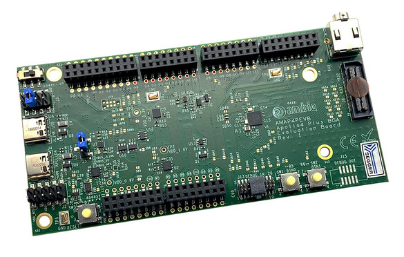

<!-- Copyright 2015-2026 Zephyr Project members and individual contributors. -->
<!-- SPDX-License-Identifier: Apache-2.0 -->
<!-- 中文翻译；编号、导航与译注为本地新增。 -->

<a id="apollo4p_evb"></a>

# 第12章\_Apollo4P评估板（EVB）

原文：[官方页面](https://docs.zephyrproject.org/latest/boards/ambiq/apollo4p_evb/doc/index.html)。读取日期：2026-10-16；来源摘要见[来源记录](../SOURCES.md)。

开发板概览（Board Overview）

<a id="id1"></a>

[](images/apollo4-plus-soc-eval-board.jpg)

Apollo4P评估板（EVB）

名称（Name）：

`apollo4p_evb`

厂商（Vendor）：

[Ambiq Micro, Inc.](https://docs.zephyrproject.org/latest/boards/index.html#vendor=ambiq)

状态（Status）：

维护中（Maintained）

架构（Architecture）：

[arm](https://docs.zephyrproject.org/latest/boards/index.html#arch=arm)

片上系统（SoC）：

[apollo4p](https://docs.zephyrproject.org/latest/boards/index.html#soc=apollo4p)

<a id="board-github-link"></a>

[浏览开发板源码（Browse Board Sources）](https://github.com/zephyrproject-rtos/zephyr/blob/main//boards/ambiq/apollo4p_evb/doc/index.rst/../..)Apollo4P EVB是Ambiq推出的开发板，采用其超低功耗Apollo4 Plus片上系统（SoC）。

<a id="hardware"></a>

## 硬件（Hardware）


- Apollo4 Plus片上系统（SoC），最高工作频率192 MHz
- ARM® Cortex®-M4F内核（Core）
- 每个内核配有64 kB两路组相联／直接映射缓存（2-Way Associative / Direct-Mapped Cache）
- 最多2 MB非易失性存储器（NVM），用于代码和数据
- 最多2.75 MB低漏电／低功耗RAM，用于代码和数据
- 384 kB紧耦合RAM（Tightly Coupled RAM）
- 384 kB扩展RAM（Extended RAM）

Apollo4 Plus片上系统及Apollo4P评估板的更多信息：


- [Apollo4 Plus网站（Website）](https://ambiq.com/apollo4-plus/)
- [Apollo4 Plus数据手册（Datasheet）](https://contentportal.ambiq.com/documents/20123/388415/Apollo4-Plus-SoC-Datasheet.pdf)
- [Apollo4P EVB网站（Website）](https://www.ambiq.top/en/apollo4-plus-soc-eval-board)

<a id="supported-features"></a>

### 支持的功能（Supported Features）

`apollo4p_evb`开发板支持下表所列的硬件功能。

片上／板载（On-Chip / On-Board）

功能集成在片上系统（SoC）内／位于开发板上。

2 / 2

分别表示已启用／已禁用的实例数。点击数量标签，可查看开发板或SoC设备树源码（DTS）中该功能的第一个实例。

`vnd,foo`

与此功能匹配的设备树绑定兼容字符串（Compatible String）；点击链接可查看绑定文档。

<a id="apollo4p_evb-hw-features"></a>

<a id="apollo4p_evb-apollo4p_evb/apollo4p-hw-features-section"></a>

#### `apollo4p_evb/apollo4p`目标（Target）

<a id="apollo4p_evb-apollo4p_evb/apollo4p-hw-features-panel"></a>

<a id="apollo4p_evb-apollo4p_evb/apollo4p-hw-features-memory"></a>

该开发板目标的片上存储容量：2752 KiB RAM、1952 KiB Flash。

<a id="apollo4p_evb-apollo4p_evb/apollo4p-hw-features-table"></a>

<table>
<tr>
<th>类型（Type）</th>
<th>位置（Location）</th>
<th>说明（Description）</th>
<th>兼容字符串（Compatible）</th>
</tr>
<tr>
<td rowspan="1">中央处理器（CPU）</td>
<td>片上（On-Chip）</td>
<td>ARM Cortex-M4F 处理器（CPU）（<a href="https://github.com/zephyrproject-rtos/zephyr/blob/main/dts/arm/ambiq/ambiq_apollo4p.dtsi?plain=1#L20">已启用：1</a>）</td>
<td><a href="../cpu_arm_riscv_binding_reference/P025_arm_cortex-m4f.md#std-dtcompatible-arm-cortex-m4f"><code>arm,cortex-m4f</code></a></td>
</tr>
<tr>
<td rowspan="1">模数转换器（ADC）</td>
<td>片上（On-Chip）</td>
<td>Ambiq模数转换器节点（ADC Node）（<a href="https://github.com/zephyrproject-rtos/zephyr/blob/main/dts/arm/ambiq/ambiq_apollo4p.dtsi?plain=1#L622">已禁用：1</a>）</td>
<td><a href="../hardware/P884_Ambiq模数转换器绑定.md#dtbinding-ambiq-adc"><code>ambiq,adc</code></a></td>
</tr>
<tr>
<td rowspan="1">计数器（Counter）</td>
<td>片上（On-Chip）</td>
<td>Ambiq定时器／计数器（Timer/Counter）（<a href="https://github.com/zephyrproject-rtos/zephyr/blob/main/dts/arm/ambiq/ambiq_apollo4p.dtsi?plain=1#L112">已禁用：16</a>）</td>
<td><a href="../counter_binding_reference/P004_ambiq_counter.md#std-dtcompatible-ambiq-counter"><code>ambiq,counter</code></a></td>
</tr>
<tr>
<td rowspan="1">调试（Debug）</td>
<td>片上（On-Chip）</td>
<td>ARMv7仪器化跟踪宏单元（ITM / Instrumentation Trace Macrocell）（<a href="https://github.com/zephyrproject-rtos/zephyr/blob/main/dts/arm/ambiq/ambiq_apollo4p.dtsi?plain=1#L27">已启用：1</a>）</td>
<td><a href="../debug_binding_reference/P001_ARMv7M_ITM调试绑定.md#std-dtcompatible-arm-armv7m-itm"><code>arm,armv7m-itm</code></a></td>
</tr>
<tr>
<td rowspan="1">闪存控制器（Flash Controller）</td>
<td>片上（On-Chip）</td>
<td>Ambiq闪存控制器（Flash Controller）（<a href="https://github.com/zephyrproject-rtos/zephyr/blob/main/dts/arm/ambiq/ambiq_apollo4p.dtsi?plain=1#L79">已启用：1</a>）</td>
<td><a href="../flash_adi_microchip_nordic_binding_reference/P005_ambiq_flash-controller.md#std-dtcompatible-ambiq-flash-controller"><code>ambiq,flash-controller</code></a></td>
</tr>
<tr>
<td rowspan="3">通用输入输出与接插件（GPIO &amp; Headers）</td>
<td>片上（On-Chip）</td>
<td>Ambiq GPIO为GPIO子节点提供引脚映射（Pin Mapping）（<a href="https://github.com/zephyrproject-rtos/zephyr/blob/main/dts/arm/ambiq/ambiq_apollo4p.dtsi?plain=1#L694">已启用：1</a>）</td>
<td><a href="../gpio_adi_headers_ambiq_binding_reference/P018_ambiq_gpio.md#std-dtcompatible-ambiq-gpio"><code>ambiq,gpio</code></a></td>
</tr>
<tr>
<td>片上（On-Chip）</td>
<td>Ambiq GPIO组（Bank）（<a href="https://github.com/zephyrproject-rtos/zephyr/blob/main/dts/arm/ambiq/ambiq_apollo4p.dtsi?plain=1#L708">已启用：4</a>）</td>
<td><a href="../gpio_adi_headers_ambiq_binding_reference/P017_ambiq_gpio-bank.md#std-dtcompatible-ambiq-gpio-bank"><code>ambiq,gpio-bank</code></a></td>
</tr>
<tr>
<td>板载（On-Board）</td>
<td>引出到Ambiq Apollo4p评估板排针的GPIO引脚（<a href="https://github.com/zephyrproject-rtos/zephyr/blob/main/boards/ambiq/apollo4p_evb/apollo4p_evb_connector.dtsi?plain=1#L8">已启用：1</a>）</td>
<td><a href="../gpio_adi_headers_ambiq_binding_reference/P019_ambiq-header.md#std-dtcompatible-ambiq-header"><code>ambiq-header</code></a></td>
</tr>
<tr>
<td rowspan="2">集成电路间总线（I2C）</td>
<td>片上（On-Chip）</td>
<td>Ambiq IOS I2C目标／从机外设（Target/Slave Peripheral）（<a href="https://github.com/zephyrproject-rtos/zephyr/blob/main/dts/arm/ambiq/ambiq_apollo4p.dtsi?plain=1#L438">已禁用：1</a>）</td>
<td><a href="../i2c_adi_atmel_esp_binding_reference/P004_ambiq_ios-i2c.md#std-dtcompatible-ambiq-ios-i2c"><code>ambiq,ios-i2c</code></a></td>
</tr>
<tr>
<td>片上（On-Chip）</td>
<td>Ambiq I2C（<a href="https://github.com/zephyrproject-rtos/zephyr/blob/main/dts/arm/ambiq/ambiq_apollo4p.dtsi?plain=1#L459">已禁用：8</a>）</td>
<td><a href="../i2c_adi_atmel_esp_binding_reference/P003_ambiq_i2c.md#std-dtcompatible-ambiq-i2c"><code>ambiq,i2c</code></a></td>
</tr>
<tr>
<td rowspan="1">输入（Input）</td>
<td>板载（On-Board）</td>
<td>一组绑定到 GPIO 的输入按键（GPIO-Bound Input Keys）（<a href="https://github.com/zephyrproject-rtos/zephyr/blob/main/boards/ambiq/apollo4p_evb/apollo4p_evb.dts?plain=1#L56">已启用：1</a>）</td>
<td><a href="../hardware/P563_GPIO按键绑定.md#std-dtcompatible-gpio-keys"><code>gpio-keys</code></a></td>
</tr>
<tr>
<td rowspan="1">中断控制器（Interrupt Controller）</td>
<td>片上（On-Chip）</td>
<td>ARMv7-M 嵌套向量中断控制器（Nested Vectored Interrupt Controller，NVIC）（<a href="https://github.com/zephyrproject-rtos/zephyr/blob/main/dts/arm/armv7-m.dtsi?plain=1#L13">已启用：1</a>）</td>
<td><a href="../arm_interrupt_timer_binding_reference/P002_ARMv7_M_NVIC.md#std-dtcompatible-arm-v7m-nvic"><code>arm,v7m-nvic</code></a></td>
</tr>
<tr>
<td rowspan="2">发光二极管（LED）</td>
<td>板载（On-Board）</td>
<td>一组由 GPIO 控制的 LED（GPIO-Controlled LEDs）（<a href="https://github.com/zephyrproject-rtos/zephyr/blob/main/boards/ambiq/apollo4p_evb/apollo4p_evb.dts?plain=1#L37">已启用：1</a>）</td>
<td><a href="../hardware/P564_GPIO指示灯绑定.md#dtbinding-gpio-leds"><code>gpio-leds</code></a></td>
</tr>
<tr>
<td>板载（On-Board）</td>
<td>一组由脉宽调制（PWM）控制的LED（<a href="https://github.com/zephyrproject-rtos/zephyr/blob/main/boards/ambiq/apollo4p_evb/apollo4p_evb.dts?plain=1#L75">已禁用：1</a>）</td>
<td><a href="../hardware/P565_PWM指示灯绑定.md#dtbinding-pwm-leds"><code>pwm-leds</code></a></td>
</tr>
<tr>
<td rowspan="2">多功能设备（Multi-Function Device）</td>
<td>片上（On-Chip）</td>
<td>Ambiq IOS外设父节点（Parent Node），用于SPI设备或I2C目标（<a href="https://github.com/zephyrproject-rtos/zephyr/blob/main/dts/arm/ambiq/ambiq_apollo4p.dtsi?plain=1#L426">已启用：1</a>）</td>
<td><a href="../hardware/P700_Ambiq输入输出从控制器绑定.md#dtbinding-ambiq-ios"><code>ambiq,ios</code></a></td>
</tr>
<tr>
<td>片上（On-Chip）</td>
<td>Ambiq SPI/I2C控制器公共属性（Common Properties）（<a href="https://github.com/zephyrproject-rtos/zephyr/blob/main/dts/arm/ambiq/ambiq_apollo4p.dtsi?plain=1#L446">已启用：8</a>）</td>
<td><a href="../hardware/P699_Ambiq输入输出主控制器绑定.md#dtbinding-ambiq-iom"><code>ambiq,iom</code></a></td>
</tr>
<tr>
<td rowspan="1">存储技术设备（MTD）</td>
<td>片上（On-Chip）</td>
<td>闪存（Flash）节点（<a href="https://github.com/zephyrproject-rtos/zephyr/blob/main/dts/arm/ambiq/ambiq_apollo4p.dtsi?plain=1#L88">已启用：1</a>）</td>
<td><a href="../mtd_nxp_st_ti_partition_binding_reference/P013_soc-nv-flash.md#std-dtcompatible-soc-nv-flash"><code>soc-nv-flash</code></a></td>
</tr>
<tr>
<td rowspan="1">引脚控制（Pin Control）</td>
<td>片上（On-Chip）</td>
<td>Ambiq Apollo4引脚控制器（Pin Controller）（<a href="https://github.com/zephyrproject-rtos/zephyr/blob/main/dts/arm/ambiq/ambiq_apollo4p.dtsi?plain=1#L688">已启用：1</a>）</td>
<td><a href="../pinctrl_adi_ambiq_arm_binding_reference/P006_ambiq_apollo4-pinctrl.md#std-dtcompatible-ambiq-apollo4-pinctrl"><code>ambiq,apollo4-pinctrl</code></a></td>
</tr>
<tr>
<td rowspan="1">脉宽调制（PWM）</td>
<td>片上（On-Chip）</td>
<td>Ambiq TIMER脉宽调制（PWM）（<a href="https://github.com/zephyrproject-rtos/zephyr/blob/main/dts/arm/ambiq/ambiq_apollo4p.dtsi?plain=1#L117">已禁用：16</a>）</td>
<td><a href="../pwm_adi_esp_infineon_binding_reference/P005_ambiq_timer-pwm.md#std-dtcompatible-ambiq-timer-pwm"><code>ambiq,timer-pwm</code></a></td>
</tr>
<tr>
<td rowspan="1">实时时钟（RTC）</td>
<td>片上（On-Chip）</td>
<td>Ambiq实时时钟（RTC）（<a href="https://github.com/zephyrproject-rtos/zephyr/blob/main/dts/arm/ambiq/ambiq_apollo4p.dtsi?plain=1#L660">已禁用：1</a>）</td>
<td><a href="../rtc_binding_reference/P003_ambiq_rtc.md#std-dtcompatible-ambiq-rtc"><code>ambiq,rtc</code></a></td>
</tr>
<tr>
<td rowspan="1">SD 主机控制器（SDHC）</td>
<td>片上（On-Chip）</td>
<td>Ambiq安全数字输入输出主机控制器（SDIO Host Controller）（<a href="https://github.com/zephyrproject-rtos/zephyr/blob/main/dts/arm/ambiq/ambiq_apollo4p.dtsi?plain=1#L668">已启用：1</a>）</td>
<td><a href="../sdhc_binding_reference/P002_ambiq_sdio.md#std-dtcompatible-ambiq-sdio"><code>ambiq,sdio</code></a></td>
</tr>
<tr>
<td rowspan="1">串行控制器（Serial Controller）</td>
<td>片上（On-Chip）</td>
<td>Ambiq通用异步收发器控制器（UART Controller）（<a href="https://github.com/zephyrproject-rtos/zephyr/blob/main/dts/arm/ambiq/ambiq_apollo4p.dtsi?plain=1#L394">已启用：1</a>；<a href="https://github.com/zephyrproject-rtos/zephyr/blob/main/dts/arm/ambiq/ambiq_apollo4p.dtsi?plain=1#L402">已禁用：3</a>）</td>
<td><a href="../uart_adi_arm_atmel_binding_reference/P006_ambiq_uart.md#std-dtcompatible-ambiq-uart"><code>ambiq,uart</code></a></td>
</tr>
<tr>
<td rowspan="3">串行外设接口（SPI）</td>
<td>片上（On-Chip）</td>
<td>Ambiq SPI设备（Device）（<a href="https://github.com/zephyrproject-rtos/zephyr/blob/main/dts/arm/ambiq/ambiq_apollo4p.dtsi?plain=1#L431">已禁用：1</a>）</td>
<td><a href="../spi_adi_atmel_esp_binding_reference/P005_ambiq_spid.md#std-dtcompatible-ambiq-spid"><code>ambiq,spid</code></a></td>
</tr>
<tr>
<td>片上（On-Chip）</td>
<td>Ambiq串行外设接口（SPI）（<a href="https://github.com/zephyrproject-rtos/zephyr/blob/main/dts/arm/ambiq/ambiq_apollo4p.dtsi?plain=1#L451">已禁用：8</a>）</td>
<td><a href="../spi_adi_atmel_esp_binding_reference/P004_ambiq_spi.md#std-dtcompatible-ambiq-spi"><code>ambiq,spi</code></a></td>
</tr>
<tr>
<td>片上（On-Chip）</td>
<td>Ambiq多线SPI（MSPI）（<a href="https://github.com/zephyrproject-rtos/zephyr/blob/main/dts/arm/ambiq/ambiq_apollo4p.dtsi?plain=1#L633">已禁用：3</a>）</td>
<td><a href="../spi_adi_atmel_esp_binding_reference/P002_ambiq_mspi.md#std-dtcompatible-ambiq-mspi"><code>ambiq,mspi</code></a></td>
</tr>
<tr>
<td rowspan="1">静态随机存储器（SRAM）</td>
<td>片上（On-Chip）</td>
<td>通用片上静态随机存储器（SRAM）（<a href="https://github.com/zephyrproject-rtos/zephyr/blob/main/dts/arm/ambiq/ambiq_apollo4p.dtsi?plain=1#L71">已启用：1</a>）</td>
<td><a href="../hardware/P567_内存映射SRAM绑定.md#dtbinding-mmio-sram"><code>mmio-sram</code></a></td>
</tr>
<tr>
<td rowspan="3">定时器（Timer）</td>
<td>片上（On-Chip）</td>
<td>ARMv7-M 系统节拍（System Tick）（<a href="https://github.com/zephyrproject-rtos/zephyr/blob/main/dts/arm/armv7-m.dtsi?plain=1#L21">已启用：1</a>）</td>
<td><a href="../arm_interrupt_timer_binding_reference/P006_ARMv7_M_SysTick.md#std-dtcompatible-arm-armv7m-systick"><code>arm,armv7m-systick</code></a></td>
</tr>
<tr>
<td>片上（On-Chip）</td>
<td>Ambiq系统定时器（STIMER）（<a href="https://github.com/zephyrproject-rtos/zephyr/blob/main/dts/arm/ambiq/ambiq_apollo4p.dtsi?plain=1#L99">已启用：1</a>）</td>
<td><a href="../mcu_timer_binding_reference/P002_ambiq_stimer.md#std-dtcompatible-ambiq-stimer"><code>ambiq,stimer</code></a></td>
</tr>
<tr>
<td>片上（On-Chip）</td>
<td>Ambiq TIMER定时器（Timer）（<a href="https://github.com/zephyrproject-rtos/zephyr/blob/main/dts/arm/ambiq/ambiq_apollo4p.dtsi?plain=1#L106">已启用：16</a>）</td>
<td><a href="../mcu_timer_binding_reference/P003_ambiq_timer.md#std-dtcompatible-ambiq-timer"><code>ambiq,timer</code></a></td>
</tr>
<tr>
<td rowspan="1">通用串行总线（USB）</td>
<td>片上（On-Chip）</td>
<td>Ambiq通用串行总线（USB）（<a href="https://github.com/zephyrproject-rtos/zephyr/blob/main/dts/arm/ambiq/ambiq_apollo4p.dtsi?plain=1#L679">已启用：1</a>）</td>
<td><a href="../usb_controller_binding_reference/P002_ambiq_usb.md#std-dtcompatible-ambiq-usb"><code>ambiq,usb</code></a></td>
</tr>
<tr>
<td rowspan="1">看门狗（Watchdog）</td>
<td>片上（On-Chip）</td>
<td>Ambiq看门狗（Watchdog）（<a href="https://github.com/zephyrproject-rtos/zephyr/blob/main/dts/arm/ambiq/ambiq_apollo4p.dtsi?plain=1#L746">已启用：1</a>）</td>
<td><a href="../watchdog_binding_reference/P003_ambiq_watchdog.md#std-dtcompatible-ambiq-watchdog"><code>ambiq,watchdog</code></a></td>
</tr>
</table>

<a id="programming-and-debugging"></a>

### 烧录与调试（Programming and Debugging）

`apollo4p_evb`开发板支持下表所列的运行工具（Runners）及相关west命令。

<table>
<tr>
<th></th>
<th>烧录（flash）</th>
<th>调试（debug）</th>
<th>连接调试会话（attach）</th>
<th>实时传输（rtt）</th>
<th>复位（reset）</th>
<th>调试服务器（debugserver）</th>
</tr>
<tr>
<td><a href="https://docs.zephyrproject.org/latest/develop/flash_debug/host-tools.html#runner-jlink">jlink</a></td>
<td>✅（默认 / default）</td>
<td>✅（默认 / default）</td>
<td>✅</td>
<td>✅</td>
<td>✅</td>
<td>✅</td>
</tr>
</table>

<a id="flashing-an-application"></a>

#### 烧录应用（Flashing an Application）

使用JLINK USB端口将设备连接到主机。以下以[Hello World](../getting_started/P005_HelloWorld示例.md#hello_world)示例应用说明：构建Zephyr内核和应用，然后烧录到设备。

```text
# From the root of the zephyr repository
west build -b apollo4p_evb samples/hello_world
west flash
```

注意（Note）

`west flash`要求主机上安装[SEGGER J-Link软件](https://www.segger.com/downloads/jlink)和[pylink](https://github.com/Square/pylink) Python模块。

打开串口终端（如minicom或PuTTY），设置如下：


- 速率（Speed）：115200波特率
- 数据位（Data）：8位
- 奇偶校验（Parity）：无（None）
- 停止位（Stop Bits）：1位

复位开发板后，应能在相应串口（Serial Port）看到以下消息：

```text
Hello World! apollo4p_evb
```

## 译注

概述中的芯片总存储容量和自动生成表格中的目标存储容量分别依照原文保留，不合并为一个数值。

---

[上一章](P011_Apollo4_Blue_Plus_KXR_EVB.md) · [返回大纲](大纲.md) · [全站翻译进度](../PROGRESS.md) · [下一章](P013_Apollo510_SOC_Evaluation_Board.md)
