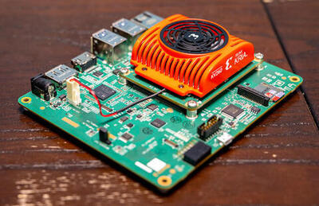

<!-- Copyright 2015-2026 Zephyr Project members and individual contributors. -->
<!-- SPDX-License-Identifier: Apache-2.0 -->
<!-- 中文翻译；编号、导航与译注为本地新增。 -->

<a id="kv260_r5"></a>

# 第5章\_KV260开发板实时处理单元（RPU）Cortex-R5

原文：[官方页面](https://docs.zephyrproject.org/latest/boards/amd/kv260_r5/doc/index.html)。读取日期：2026-10-16；来源摘要见[来源记录](../SOURCES.md)。

开发板概览（Board Overview）

<a id="id1"></a>

[](images/kv260-starter-kit.jpg)

KV260开发板实时处理单元（RPU）Cortex-R5

名称（Name）：

`kv260_r5`

厂商（Vendor）：

[Advanced Micro Devices（AMD）, Inc.](https://docs.zephyrproject.org/latest/boards/index.html#vendor=amd)

状态（Status）：

维护中（Maintained）

架构（Architecture）：

[arm](https://docs.zephyrproject.org/latest/boards/index.html#arch=arm)

片上系统（SoC）：

[`zynqmp_rpu`](https://docs.zephyrproject.org/latest/boards/index.html#soc=zynqmp_rpu)

<a id="board-github-link"></a>

[浏览开发板源码（Browse Board Sources）](https://github.com/zephyrproject-rtos/zephyr/blob/main//boards/amd/kv260_r5/doc/index.rst/../..)<a id="overview"></a>

## 概述（Overview）

此配置为Xilinx KV260开发板上的实时处理单元（RPU / Real-Time Processing Unit）提供支持，可采用以下工作方式：


- 两个独立R5内核，各自具有紧耦合存储器（TCM / Tightly Coupled Memories）
- 或者组成一个双核锁步单元（Dual Lock-Step Unit），紧耦合存储器容量加倍

该处理单元基于ARM Cortex-R5 CPU，还启用以下设备：


- ARM PL-390通用中断控制器（Generic Interrupt Controller）
- Xilinx Zynq三通道定时计数器（TTC / Cadence TTC）
- Xilinx Zynq通用异步收发器（UART）

<a id="hardware"></a>

## 硬件（Hardware）

<a id="supported-features"></a>

### 支持的功能（Supported Features）

`kv260_r5`开发板支持下表所列的硬件功能。

片上／板载（On-Chip / On-Board）

功能集成在片上系统（SoC）内／位于开发板上。

2 / 2

分别表示已启用／已禁用的实例数。点击数量标签，可查看开发板或SoC设备树源码（DTS）中该功能的第一个实例。

`vnd,foo`

与此功能匹配的设备树绑定兼容字符串（Compatible String）；点击链接可查看绑定文档。

<a id="kv260_r5-hw-features"></a>

<a id="kv260_r5-kv260_r5/zynqmp_rpu-hw-features-section"></a>

#### `kv260_r5/zynqmp_rpu`目标（Target）

<a id="kv260_r5-kv260_r5/zynqmp_rpu-hw-features-panel"></a>

<a id="kv260_r5-kv260_r5/zynqmp_rpu-hw-features-memory"></a>

该开发板目标的片上存储容量：64 MiB RAM、32 MiB Flash。

<a id="kv260_r5-kv260_r5/zynqmp_rpu-hw-features-table"></a>

<table>
<tr>
<th>类型（Type）</th>
<th>位置（Location）</th>
<th>说明（Description）</th>
<th>兼容字符串（Compatible）</th>
</tr>
<tr>
<td rowspan="1">中央处理器（CPU）</td>
<td>片上（On-Chip）</td>
<td>ARM Cortex-R5F处理器（CPU）（<a href="https://github.com/zephyrproject-rtos/zephyr/blob/main/dts/arm/xilinx/zynqmp_rpu.dtsi?plain=1#L14">已启用：1</a>）</td>
<td><a href="../cpu_cortex_xtensa_binding_reference/P012_arm_cortex-r5f.md#std-dtcompatible-arm-cortex-r5f"><code>arm,cortex-r5f</code></a></td>
</tr>
<tr>
<td rowspan="1">时钟控制（Clock Control）</td>
<td>板载（On-Board）</td>
<td>通用固定频率时钟提供者（Fixed-Rate Clock Provider）（<a href="https://github.com/zephyrproject-rtos/zephyr/blob/main/boards/amd/kv260_r5/kv260_r5.dts?plain=1#L33">已启用：1</a>）</td>
<td><a href="../hardware/P566_固定时钟绑定.md#dtbinding-fixed-clock"><code>fixed-clock</code></a></td>
</tr>
<tr>
<td rowspan="1">计数器（Counter）</td>
<td>片上（On-Chip）</td>
<td>Xilinx Zynq UltraScale+ MPSoC实时时钟（RTC）（<a href="https://github.com/zephyrproject-rtos/zephyr/blob/main/dts/arm/xilinx/zynqmp.dtsi?plain=1#L353">已启用：1</a>）</td>
<td><a href="../stm32_ti_xilinx_counter_binding_reference/P016_xlnx_zynqmp-rtc.md#std-dtcompatible-xlnx-zynqmp-rtc"><code>xlnx,zynqmp-rtc</code></a></td>
</tr>
<tr>
<td rowspan="1">错误检测与纠正（EDAC）</td>
<td>片上（On-Chip）</td>
<td>Xilinx ZynqMP双倍数据率存储器控制器（DDR Memory Controller）（<a href="https://github.com/zephyrproject-rtos/zephyr/blob/main/dts/arm/xilinx/zynqmp.dtsi?plain=1#L309">已禁用：1</a>）</td>
<td><a href="../edac_syscon_binding_reference/P005_xlnx_zynqmp-ddrc-2.40a.md#std-dtcompatible-xlnx-zynqmp-ddrc-2.40a"><code>xlnx,zynqmp-ddrc-2.40a</code></a></td>
</tr>
<tr>
<td rowspan="2">以太网（Ethernet）</td>
<td>片上（On-Chip）</td>
<td>Xilinx千兆以太网媒体访问控制器（GEM Ethernet Controller）（<a href="https://github.com/zephyrproject-rtos/zephyr/blob/main/dts/arm/xilinx/zynqmp.dtsi?plain=1#L101">已禁用：4</a>）</td>
<td><a href="../ethernet_synopsys_st_xilinx_binding_reference/P022_xlnx_gem.md#std-dtcompatible-xlnx-gem"><code>xlnx,gem</code></a></td>
</tr>
<tr>
<td>片上（On-Chip）</td>
<td>Xilinx GEM管理数据输入输出节点（MDIO Node）（<a href="https://github.com/zephyrproject-rtos/zephyr/blob/main/dts/arm/xilinx/zynqmp.dtsi?plain=1#L123">已禁用：4</a>）</td>
<td><a href="../ethernet_mdio_microchip_binding_reference/P012_xlnx_gem-mdio.md#std-dtcompatible-xlnx-gem-mdio"><code>xlnx,gem-mdio</code></a></td>
</tr>
<tr>
<td rowspan="2">通用输入输出与接插件（GPIO &amp; Headers）</td>
<td>片上（On-Chip）</td>
<td>Xilinx Zynq-7000/ZynqMP MIO/EMIO通用输入输出控制器（GPIO Controller）（<a href="https://github.com/zephyrproject-rtos/zephyr/blob/main/dts/arm/xilinx/zynqmp.dtsi?plain=1#L221">已启用：1</a>）</td>
<td><a href="../gpio_ti_xilinx_sdl_binding_reference/P030_xlnx_ps-gpio.md#std-dtcompatible-xlnx-ps-gpio"><code>xlnx,ps-gpio</code></a></td>
</tr>
<tr>
<td>片上（On-Chip）</td>
<td>Xilinx Zynq-7000/ZynqMP MIO/EMIO GPIO控制器组（Bank）（<a href="https://github.com/zephyrproject-rtos/zephyr/blob/main/dts/arm/xilinx/zynqmp.dtsi?plain=1#L232">已启用：6</a>）</td>
<td><a href="../gpio_ti_xilinx_sdl_binding_reference/P029_xlnx_ps-gpio-bank.md#std-dtcompatible-xlnx-ps-gpio-bank"><code>xlnx,ps-gpio-bank</code></a></td>
</tr>
<tr>
<td rowspan="1">集成电路间总线（I2C）</td>
<td>片上（On-Chip）</td>
<td>Cadence I2C控制器（<a href="https://github.com/zephyrproject-rtos/zephyr/blob/main/dts/arm/xilinx/zynqmp.dtsi?plain=1#L298">已启用：1</a>；<a href="https://github.com/zephyrproject-rtos/zephyr/blob/main/dts/arm/xilinx/zynqmp.dtsi?plain=1#L287">已禁用：1</a>）</td>
<td><a href="../i2c_adi_atmel_esp_binding_reference/P015_cdns_i2c.md#std-dtcompatible-cdns-i2c"><code>cdns,i2c</code></a></td>
</tr>
<tr>
<td rowspan="1">中断控制器（Interrupt Controller）</td>
<td>片上（On-Chip）</td>
<td>ARM通用中断控制器（GIC）v1（<a href="https://github.com/zephyrproject-rtos/zephyr/blob/main/dts/arm/xilinx/zynqmp_rpu.dtsi?plain=1#L100">已启用：1</a>）</td>
<td><a href="../interrupt_fabric_binding_reference/P002_arm_gic-v1.md#std-dtcompatible-arm-gic-v1"><code>arm,gic-v1</code></a></td>
</tr>
<tr>
<td rowspan="1">处理器间消息（IPM）</td>
<td>片上（On-Chip）</td>
<td>Xilinx处理器间中断（IPI / Inter Processor Interrupt）邮箱控制器（Mailbox Controller）用于管理两个Xilinx Zynq UltraScale+ MPSoC IPI代理（Agents）之间的消息传递（<a href="https://github.com/zephyrproject-rtos/zephyr/blob/main/dts/arm/xilinx/zynqmp_rpu.dtsi?plain=1#L22">已禁用：2</a>）</td>
<td><a href="../intercore_reference/P076_ZynqMP处理器间中断邮箱绑定.md#dtbinding-xlnx-zynqmp-ipi-mailbox"><code>xlnx,zynqmp-ipi-mailbox</code></a></td>
</tr>
<tr>
<td rowspan="2">存储技术设备（MTD）</td>
<td>片上（On-Chip）</td>
<td>闪存（Flash）节点（<a href="https://github.com/zephyrproject-rtos/zephyr/blob/main/dts/arm/xilinx/zynqmp.dtsi?plain=1#L19">已禁用：1</a>）</td>
<td><a href="../mtd_nxp_st_ti_partition_binding_reference/P013_soc-nv-flash.md#std-dtcompatible-soc-nv-flash"><code>soc-nv-flash</code></a></td>
</tr>
<tr>
<td>板载（On-Board）</td>
<td>兼容Atmel AT24系列的I2C电可擦除可编程只读存储器（EEPROM）（<a href="https://github.com/zephyrproject-rtos/zephyr/blob/main/boards/amd/kv260_r5/kv260_r5.dts?plain=1#L64">已启用：2</a>）</td>
<td><a href="../mtd_atmel_bouffalo_binding_reference/P004_atmel_at24.md#std-dtcompatible-atmel-at24"><code>atmel,at24</code></a></td>
</tr>
<tr>
<td rowspan="1">引脚控制（Pin Control）</td>
<td>片上（On-Chip）</td>
<td>Xilinx ZynqMP片上系统引脚控制器（SoC Pin Controller）（<a href="https://github.com/zephyrproject-rtos/zephyr/blob/main/dts/arm/xilinx/zynqmp.dtsi?plain=1#L14">已启用：1</a>）</td>
<td><a href="../pinctrl_stm32_ti_xilinx_binding_reference/P022_xlnx_pinctrl-zynqmp.md#std-dtcompatible-xlnx-pinctrl-zynqmp"><code>xlnx,pinctrl-zynqmp</code></a></td>
</tr>
<tr>
<td rowspan="1">串行控制器（Serial Controller）</td>
<td>片上（On-Chip）</td>
<td>Xilinx处理系统通用异步收发器（PS UART）（<a href="https://github.com/zephyrproject-rtos/zephyr/blob/main/dts/arm/xilinx/zynqmp.dtsi?plain=1#L40">已启用：1</a>；<a href="https://github.com/zephyrproject-rtos/zephyr/blob/main/dts/arm/xilinx/zynqmp.dtsi?plain=1#L31">已禁用：1</a>）</td>
<td><a href="../uart_ti_wch_virtual_binding_reference/P011_xlnx_xuartps.md#std-dtcompatible-xlnx-xuartps"><code>xlnx,xuartps</code></a></td>
</tr>
<tr>
<td rowspan="2">串行外设接口（SPI）</td>
<td>片上（On-Chip）</td>
<td>Cadence串行外设接口控制器（SPI Controller）（<a href="https://github.com/zephyrproject-rtos/zephyr/blob/main/dts/arm/xilinx/zynqmp.dtsi?plain=1#L317">已禁用：2</a>）</td>
<td><a href="../spi_adi_atmel_esp_binding_reference/P011_cdns_spi.md#std-dtcompatible-cdns-spi"><code>cdns,spi</code></a></td>
</tr>
<tr>
<td>片上（On-Chip）</td>
<td>Xilinx ZynqMP四线SPI接口（Quad SPI）（<a href="https://github.com/zephyrproject-rtos/zephyr/blob/main/dts/arm/xilinx/zynqmp.dtsi?plain=1#L343">已禁用：1</a>）</td>
<td><a href="../spi_stm32_ti_xilinx_binding_reference/P021_xlnx_zynqmp-qspi-1.0.md#std-dtcompatible-xlnx-zynqmp-qspi-1.0"><code>xlnx,zynqmp-qspi-1.0</code></a></td>
</tr>
<tr>
<td rowspan="1">静态随机存储器（SRAM）</td>
<td>板载（On-Board）</td>
<td>通用片上静态随机存储器（SRAM）（<a href="https://github.com/zephyrproject-rtos/zephyr/blob/main/boards/amd/kv260_r5/kv260_r5.dts?plain=1#L15">已启用：1</a>）</td>
<td><a href="../hardware/P567_内存映射SRAM绑定.md#dtbinding-mmio-sram"><code>mmio-sram</code></a></td>
</tr>
<tr>
<td rowspan="1">定时器（Timer）</td>
<td>片上（On-Chip）</td>
<td>Xilinx处理系统三通道定时计数器（PS Triple-Timer Counter）（<a href="https://github.com/zephyrproject-rtos/zephyr/blob/main/dts/arm/xilinx/zynqmp.dtsi?plain=1#L49">已启用：1</a>；<a href="https://github.com/zephyrproject-rtos/zephyr/blob/main/dts/arm/xilinx/zynqmp.dtsi?plain=1#L62">已禁用：3</a>）</td>
<td><a href="../mcu_timer_binding_reference/P014_xlnx_ttcps.md#std-dtcompatible-xlnx-ttcps"><code>xlnx,ttcps</code></a></td>
</tr>
</table>

<a id="devices"></a>

### 设备（Devices）

<a id="system-timer"></a>

#### 系统定时器（System Timer）

此开发板配置采用1000 Hz的系统定时器节拍频率（Tick Frequency）。

<a id="serial-port"></a>

#### 串口（Serial Port）

此开发板配置使用片上UART1作为唯一的串行通信通道。

<a id="memories"></a>

#### 存储器（Memories）

虽然DTS文件定义了闪存（Flash）、DDR和片上存储器（OCM）区域，但应用的全部代码和数据都加载到指向DDR存储器的`sram0`区域。目前`ocm0`区域可供使用，只是默认不在其中放置内容。

<a id="known-problems-or-limitations"></a>

### 已知问题或限制（Known Problems or Limitations）

不支持以下平台功能：


- 尚不支持双冗余内核锁步执行（DCLS / Dual-Redundant Core Lock-Step）。
- 仅支持R5子系统的第一个内核。
- Xilinx Zynq TTC驱动不支持无节拍模式（Tickless Mode）。
- Cortex-R5和Cortex-A53共用同一个UART控制器，详见下文。

<a id="programming-and-debugging"></a>

## 烧录与调试（Programming and Debugging）

`kv260_r5`开发板支持下表所列的运行工具（Runners）及相关west命令。

<table>
<tr>
<th></th>
<th>烧录（flash）</th>
<th>调试（debug）</th>
<th>调试服务器（debugserver）</th>
</tr>
<tr>
<td><a href="https://docs.zephyrproject.org/latest/develop/flash_debug/host-tools.html#runner-xsdb">xsdb</a></td>
<td>✅（默认 / default）</td>
<td>✅（默认 / default）</td>
<td>✅</td>
</tr>
</table>

目前运行此示例的推荐方式，是在运行Linux的应用处理单元（APU）上通过远程处理器框架（remoteproc），将其加载到RPU，前提是目标板运行兼容的Linux内核。可以使用Xilinx预构建的PetaLinux参考镜像作为启用remoteproc的起点，该镜像基于Xilinx维护的5.15内核，详情见：

[https://xilinx-wiki.atlassian.net/wiki/spaces/A/pages/1641152513/Kria+K26+SOM#PetaLinux](https://xilinx-wiki.atlassian.net/wiki/spaces/A/pages/1641152513/Kria+K26+SOM#PetaLinux)

另一种选择是使用OpenAMP项目的参考镜像，下方链接提供的选项中包含KV260目标：

[https://github.com/OpenAMP/openamp-ci-builds/releases/tag/v2022.12](https://github.com/OpenAMP/openamp-ci-builds/releases/tag/v2022.12)

选择`xilinx-kv260.tar.gz`，并将其解压到SD卡的目标根文件系统（rootfs）分区：

```text
$ sudo mount /dev/<user-sd> /media/rootfs
$ sudo tar -C /media/rootfs -xzf xilinx-kv260.tar.gz
$ sudo umount /media/rootfs
```

SD卡文件准备好后，将卡插入开发板的卡槽即可使用。

在目标板上运行Linux镜像后，构建Zephyr应用，例如以下Hello World示例：

```text
# From the root of the zephyr repository
west build -b kv260_r5 samples/hello_world
```

由于硬件限制，Linux和Zephyr共用同一个UART控制器。因此，Zephyr应用启动后会接管Linux控制台。

要避免该限制影响Linux Shell访问，推荐通过网络SSH连接开发板。开发板和主机应连接到同一网络，不使用板载FTDI USB接口访问Linux Shell。

假设使用Xilinx参考镜像中的默认用户`petalinux`，在主机打开终端，使用开发板IP地址（通过`ifconfig`查找）SSH登录开发板：

```text
$ ssh petalinux@<board-ip-address>
```

初始密码应为`petalinux`。在另一个终端使用`scp`或`rsync`等工具部署Zephyr应用的`.elf`文件，例如：

```text
$ scp /path/to/zephyr_app_elf_file  petalinux@<board-ip-address>:/home/petalinux
```

随后，将文件移动到`/lib/firmware`目录，即可使用以下remoteproc命令在所需RPU上启动固件：

```text
$ sudo -i # You need to operate the remoteproc as root
$ echo zephyr.elf > /sys/class/remoteproc/remoteproc0/firmware
$ echo start > /sys/class/remoteproc/remoteproc0/state
```

在主机的另一个终端连接UART1，通过板载FTDI芯片提供的某个tty端口，应能看到Zephyr应用运行：

```text
*** Booting Zephyr OS build v3.4.0  ***
Hello World kv260_r5!
```

<a id="references"></a>

## 参考资料（References）


1. ARMv7-A和ARMv7-R架构参考手册（Architecture Reference Manual），ARM DDI 0406C ID051414
2. Cortex-R5和Cortex-R5F技术参考手册（Technical Reference Manual），ARM DDI 0460C ID021511
3. Zynq UltraScale+器件技术参考手册（Technical Reference Manual），UG1085
4. Kria KV260 Vision AI入门套件用户指南（Starter Kit User Guide），UG1089

## 译注

本页Linux版本、默认用户及初始密码来自官方参考镜像示例，未在本仓库实机验证。/lib/firmware是目标Linux系统的固件目录，不是文档仓库的存放位置。

## 原文外链核对

2026-10-16核对并重试以下原文外链时未能确认可访问性，保留原始目标，不将访问失败解释为原文内容有误。

- [Kria+K26+SOM](https://xilinx-wiki.atlassian.net/wiki/spaces/A/pages/1641152513/Kria+K26+SOM#PetaLinux)：页面可访问，但未确认目标片段。

---

[上一章](P004_Advanced_Micro_Devices_AMD_Inc..md) · [返回大纲](大纲.md) · [全站翻译进度](../PROGRESS.md) · [下一章](P006_AMD_Versal_Gen_2_APU_Development_Board.md)
