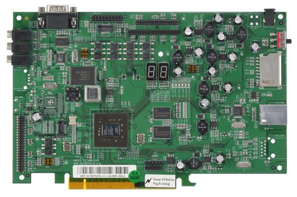
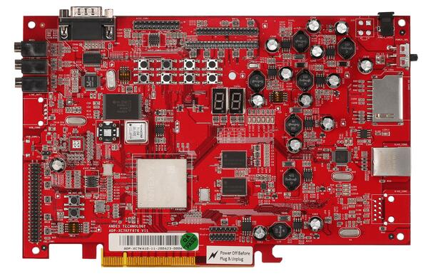
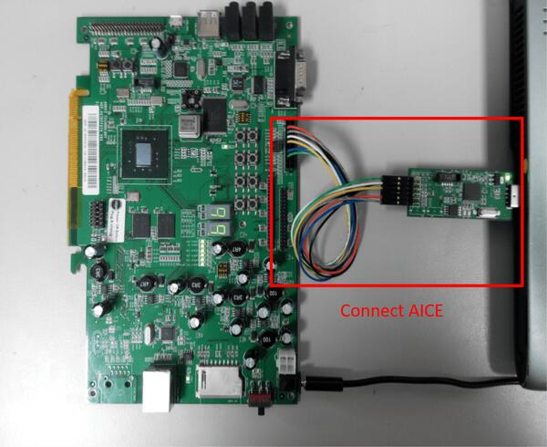

<!-- Copyright 2015-2026 Zephyr Project members and individual contributors. -->
<!-- SPDX-License-Identifier: Apache-2.0 -->
<!-- 中文翻译；编号、导航与译注为本地新增。 -->

<a id="adp_xc7k"></a>

# 第1章\_ADP-XC7K AE350

原文：[官方页面](https://docs.zephyrproject.org/latest/boards/andestech/adp_xc7k_ae350/doc/index.html)。读取日期：2026-10-16；来源摘要见[来源记录](../SOURCES.md)。

开发板概览（Board Overview）

<a id="id1"></a>

[](images/adp_xc7k160.jpg)

ADP-XC7K AE350

名称（Name）：

`adp_xc7k`

厂商（Vendor）：

[晶心科技（Andes Technology Corporation）](https://docs.zephyrproject.org/latest/boards/index.html#vendor=andestech)

状态（Status）：

维护中（Maintained）

架构（Architecture）：

[riscv](https://docs.zephyrproject.org/latest/boards/index.html#arch=riscv)

片上系统（SoC）：

[ae350](https://docs.zephyrproject.org/latest/boards/index.html#soc=ae350)

<a id="board-github-link"></a>

[浏览开发板源码（Browse Board Sources）](https://github.com/zephyrproject-rtos/zephyr/blob/main//boards/andestech/adp_xc7k_ae350/doc/index.rst/../..)<a id="overview"></a>

## 概述（Overview）

ADP-XC7K AE350开发板面向ADP-XC7K系列FPGA开发板上的AndeShape AE350平台。

ADP-XC7K系列是基于现场可编程门阵列（FPGA）的开发与原型验证板，用于评估多种AndesCore处理器及AndeShape片上系统平台IP（SoC Platform IPs）。AE350是一款RISC-V平台，可将AndesCore CPU与一组基本外设IP集成。

第一张图中绿色印制电路板（PCB）为ADP-XC7K160，第二张图中红色PCB为ADP-XC7K410。




<a id="id3"></a>

<a id="id5"></a>

更多信息见[ADP-XC7K160/410](http://www.andestech.com/en/products-solutions/andeshape-platforms/adp-xc7k160-410/)网站[注1](#id2)和[AndeShape AE350](http://www.andestech.com/en/products-solutions/andeshape-platforms/ae350-axi-based-platform-pre-integrated-with-n25f-nx25f-a25-ax25/)网站[注2](#id4)。

<a id="hardware"></a>

## 硬件（Hardware）

ADP-XC7K AE350平台集成1至4个32/64位、60 MHz RISC-V CPU内核、数字信号处理（DSP）、1 GB RAM、缓存（Cache）、SPI闪存、以太网控制器及其他外设。

ADP-XC7K AE350平台提供以下硬件组件：


- 1至4个32/64位、60 MHz AndeStar v5 RISC-V CPU内核
- 1 GB板载同步动态随机存储器（SDRAM）
- 2 MB SPI闪存，其中1 MB可用于就地执行（XIP）
- 通用异步收发器（UART）
- 集成电路间总线（I2C）
- 串行外设接口（SPI）
- 通用输入输出（GPIO）
- 脉宽调制（PWM）
- 直接存储器访问（DMA）
- 10/100以太网RJ45端口
- 液晶显示模块连接器（LCD Module Connector）
- 16 KB I2C电可擦除可编程只读存储器（EEPROM）
- SD存储卡槽（Memory Card Slot）
- 麦克风输入（MIC-In）、线路输入（Line-In）和线路输出（Line-Out），采用AC97音频编解码器（Codec）

<a id="supported-features"></a>

### 支持的功能（Supported Features）

`adp_xc7k`开发板支持下表所列的硬件功能。

片上／板载（On-Chip / On-Board）

功能集成在片上系统（SoC）内／位于开发板上。

2 / 2

分别表示已启用／已禁用的实例数。点击数量标签，可查看开发板或SoC设备树源码（DTS）中该功能的第一个实例。

`vnd,foo`

与此功能匹配的设备树绑定兼容字符串（Compatible String）；点击链接可查看绑定文档。

<a id="adp_xc7k-hw-features"></a>

<a id="adp_xc7k-adp_xc7k/ae350-hw-features-section"></a>

#### `adp_xc7k/ae350`目标（Target）

<a id="adp_xc7k-adp_xc7k/ae350-hw-features-panel"></a>

<a id="adp_xc7k-adp_xc7k/ae350-hw-features-memory"></a>

该开发板目标的片上存储容量：1 GiB RAM、N/A Flash。

<a id="adp_xc7k-adp_xc7k/ae350-hw-features-table"></a>

<table>
<tr>
<th>类型（Type）</th>
<th>位置（Location）</th>
<th>说明（Description）</th>
<th>兼容字符串（Compatible）</th>
</tr>
<tr>
<td rowspan="1">中央处理器（CPU）</td>
<td>片上（On-Chip）</td>
<td>晶心科技AndesCore v5系列RISC-V内核（<a href="https://github.com/zephyrproject-rtos/zephyr/blob/main/dts/riscv/andes/andes_v5_ae350.dtsi?plain=1#L19">已启用：8</a>）</td>
<td><a href="../cpu_arm_riscv_binding_reference/P003_andestech_andescore-v5.md#std-dtcompatible-andestech-andescore-v5"><code>andestech,andescore-v5</code></a></td>
</tr>
<tr>
<td rowspan="1">高速缓存（Cache）</td>
<td>片上（On-Chip）</td>
<td>晶心科技二级缓存（AndesTech L2 Cache）（<a href="https://github.com/zephyrproject-rtos/zephyr/blob/main/dts/riscv/andes/andes_v5_ae350.dtsi?plain=1#L266">已启用：1</a>）</td>
<td><a href="../memory_protection_binding_reference/P001_andestech_l2c.md#std-dtcompatible-andestech-l2c"><code>andestech,l2c</code></a></td>
</tr>
<tr>
<td rowspan="1">时钟控制（Clock Control）</td>
<td>片上（On-Chip）</td>
<td>通用固定频率时钟提供者（Fixed-Rate Clock Provider）（<a href="https://github.com/zephyrproject-rtos/zephyr/blob/main/dts/riscv/andes/andes_v5_ae350.dtsi?plain=1#L428">已禁用：1</a>）</td>
<td><a href="../hardware/P566_固定时钟绑定.md#dtbinding-fixed-clock"><code>fixed-clock</code></a></td>
</tr>
<tr>
<td rowspan="1">计数器（Counter）</td>
<td>片上（On-Chip）</td>
<td>晶心科技atcpit100可编程间隔定时器节点（PIT Node）的描述（<a href="https://github.com/zephyrproject-rtos/zephyr/blob/main/dts/riscv/andes/andes_v5_ae350.dtsi?plain=1#L290">已启用：1</a>）</td>
<td><a href="../counter_binding_reference/P005_andestech_atcpit100.md#std-dtcompatible-andestech-atcpit100"><code>andestech,atcpit100</code></a></td>
</tr>
<tr>
<td rowspan="1">直接存储器访问（DMA）</td>
<td>片上（On-Chip）</td>
<td>晶心科技DMA控制器通道：指向DMA控制器的节点引用（phandle），以及以下四个整数单元（Cells）：（<a href="https://github.com/zephyrproject-rtos/zephyr/blob/main/dts/riscv/andes/andes_v5_ae350.dtsi?plain=1#L361">已启用：1</a>）</td>
<td><a href="../dma_binding_reference/P008_andestech_atcdmacx00.md#std-dtcompatible-andestech-atcdmacx00"><code>andestech,atcdmacx00</code></a></td>
</tr>
<tr>
<td rowspan="1">通用输入输出与接插件（GPIO &amp; Headers）</td>
<td>片上（On-Chip）</td>
<td>晶心科技ATCGPIO100通用输入输出控制器（GPIO Controller）（<a href="https://github.com/zephyrproject-rtos/zephyr/blob/main/dts/riscv/andes/andes_v5_ae350.dtsi?plain=1#L309">已启用：1</a>）</td>
<td><a href="../gpio_adi_headers_ambiq_binding_reference/P020_andestech_atcgpio100.md#std-dtcompatible-andestech-atcgpio100"><code>andestech,atcgpio100</code></a></td>
</tr>
<tr>
<td rowspan="1">集成电路间总线（I2C）</td>
<td>片上（On-Chip）</td>
<td>晶心科技ATCIIC100 I2C（<a href="https://github.com/zephyrproject-rtos/zephyr/blob/main/dts/riscv/andes/andes_v5_ae350.dtsi?plain=1#L320">已启用：1</a>）</td>
<td><a href="../i2c_adi_atmel_esp_binding_reference/P005_andestech_atciic100.md#std-dtcompatible-andestech-atciic100"><code>andestech,atciic100</code></a></td>
</tr>
<tr>
<td rowspan="1">输入（Input）</td>
<td>板载（On-Board）</td>
<td>一组绑定到 GPIO 的输入按键（GPIO-Bound Input Keys）（<a href="https://github.com/zephyrproject-rtos/zephyr/blob/main/boards/andestech/adp_xc7k_ae350/adp_xc7k_ae350_common.dtsi?plain=1#L112">已启用：1</a>）</td>
<td><a href="../hardware/P563_GPIO按键绑定.md#std-dtcompatible-gpio-keys"><code>gpio-keys</code></a></td>
</tr>
<tr>
<td rowspan="2">中断控制器（Interrupt Controller）</td>
<td>片上（On-Chip）</td>
<td>RISC-V CPU中断控制器（Interrupt Controller）（<a href="https://github.com/zephyrproject-rtos/zephyr/blob/main/dts/riscv/andes/andes_v5_ae350.dtsi?plain=1#L32">已启用：8</a>）</td>
<td><a href="../interrupt_fabric_binding_reference/P006_riscv_cpu-intc.md#std-dtcompatible-riscv-cpu-intc"><code>riscv,cpu-intc</code></a></td>
</tr>
<tr>
<td>片上（On-Chip）</td>
<td>SiFive RISCV-V平台级中断控制器（PLIC / Platform-Local Interrupt Controller）（<a href="https://github.com/zephyrproject-rtos/zephyr/blob/main/dts/riscv/andes/andes_v5_ae350.dtsi?plain=1#L200">已启用：2</a>）</td>
<td><a href="../interrupt_fabric_binding_reference/P009_sifive_plic-1.0.0.md#std-dtcompatible-sifive-plic-1.0.0"><code>sifive,plic-1.0.0</code></a></td>
</tr>
<tr>
<td rowspan="1">发光二极管（LED）</td>
<td>板载（On-Board）</td>
<td>一组由 GPIO 控制的 LED（GPIO-Controlled LEDs）（<a href="https://github.com/zephyrproject-rtos/zephyr/blob/main/boards/andestech/adp_xc7k_ae350/adp_xc7k_ae350_common.dtsi?plain=1#L28">已启用：1</a>）</td>
<td><a href="../hardware/P564_GPIO指示灯绑定.md#dtbinding-gpio-leds"><code>gpio-leds</code></a></td>
</tr>
<tr>
<td rowspan="1">邮箱（Mailbox）</td>
<td>片上（On-Chip）</td>
<td>晶心科技PLIC软件中断邮箱（AndesTech MBOX PLIC-SW）（<a href="https://github.com/zephyrproject-rtos/zephyr/blob/main/dts/riscv/andes/andes_v5_ae350.dtsi?plain=1#L229">已启用：1</a>）</td>
<td><a href="../intercore_reference/P033_Andes软件中断邮箱绑定.md#dtbinding-andestech-mbox-plic-sw"><code>andestech,mbox-plic-sw</code></a></td>
</tr>
<tr>
<td rowspan="3">存储技术设备（MTD）</td>
<td>板载（On-Board）</td>
<td>兼容Atmel AT24系列的I2C电可擦除可编程只读存储器（EEPROM）（<a href="https://github.com/zephyrproject-rtos/zephyr/blob/main/boards/andestech/adp_xc7k_ae350/adp_xc7k_ae350_common.dtsi?plain=1#L211">已启用：1</a>）</td>
<td><a href="../mtd_atmel_bouffalo_binding_reference/P004_atmel_at24.md#std-dtcompatible-atmel-at24"><code>atmel,at24</code></a></td>
</tr>
<tr>
<td>板载（On-Board）</td>
<td>这些属性用于支持Zephyr的<code>spi-nor</code>闪存驱动通过Zephyr SPI API，使用基于M25P80的标准命令集控制串行闪存（Serial Flash Memory）。（<a href="https://github.com/zephyrproject-rtos/zephyr/blob/main/boards/andestech/adp_xc7k_ae350/adp_xc7k_ae350_common.dtsi?plain=1#L184">已启用：1</a>）</td>
<td><a href="../mtd_microchip_nordic_nxp_binding_reference/P002_jedec_spi-nor.md#std-dtcompatible-jedec-spi-nor"><code>jedec,spi-nor</code></a></td>
</tr>
<tr>
<td>板载（On-Board）</td>
<td>闪存或其他非易失性存储器的固定分区（Fixed Partitions）（<a href="https://github.com/zephyrproject-rtos/zephyr/blob/main/boards/andestech/adp_xc7k_ae350/adp_xc7k_ae350_common.dtsi?plain=1#L195">已启用：1</a>）</td>
<td><a href="../hardware/P568_固定分区绑定.md#dtbinding-fixed-partitions"><code>fixed-partitions</code></a></td>
</tr>
<tr>
<td rowspan="1">串行控制器（Serial Controller）</td>
<td>片上（On-Chip）</td>
<td>ns16550通用异步收发器（UART）（<a href="https://github.com/zephyrproject-rtos/zephyr/blob/main/dts/riscv/andes/andes_v5_ae350.dtsi?plain=1#L281">已启用：1</a>；<a href="https://github.com/zephyrproject-rtos/zephyr/blob/main/dts/riscv/andes/andes_v5_ae350.dtsi?plain=1#L272">已禁用：1</a>）</td>
<td><a href="../uart_microchip_nordic_nxp_binding_reference/P005_ns16550.md#std-dtcompatible-ns16550"><code>ns16550</code></a></td>
</tr>
<tr>
<td rowspan="1">串行外设接口（SPI）</td>
<td>片上（On-Chip）</td>
<td>此绑定（Binding）描述晶心科技ATCSPI200 SPI控制器（<a href="https://github.com/zephyrproject-rtos/zephyr/blob/main/dts/riscv/andes/andes_v5_ae350.dtsi?plain=1#L330">已启用：2</a>）</td>
<td><a href="../spi_adi_atmel_esp_binding_reference/P006_andestech_atcspi200.md#std-dtcompatible-andestech-atcspi200"><code>andestech,atcspi200</code></a></td>
</tr>
<tr>
<td rowspan="1">静态随机存储器（SRAM）</td>
<td>片上（On-Chip）</td>
<td>通用片上静态随机存储器（SRAM）（<a href="https://github.com/zephyrproject-rtos/zephyr/blob/main/dts/riscv/andes/andes_v5_ae350.dtsi?plain=1#L188">已启用：1</a>）</td>
<td><a href="../hardware/P567_内存映射SRAM绑定.md#dtbinding-mmio-sram"><code>mmio-sram</code></a></td>
</tr>
<tr>
<td rowspan="1">系统控制器（System Controller）</td>
<td>片上（On-Chip）</td>
<td>系统控制器寄存器读写（System Controller Registers R/W）（<a href="https://github.com/zephyrproject-rtos/zephyr/blob/main/dts/riscv/andes/andes_v5_ae350.dtsi?plain=1#L260">已启用：1</a>）</td>
<td><a href="../edac_syscon_binding_reference/P008_syscon.md#std-dtcompatible-syscon"><code>syscon</code></a></td>
</tr>
<tr>
<td rowspan="1">定时器（Timer）</td>
<td>片上（On-Chip）</td>
<td>RISC-V机器模式定时器（Machine Timer）（<a href="https://github.com/zephyrproject-rtos/zephyr/blob/main/dts/riscv/andes/andes_v5_ae350.dtsi?plain=1#L250">已启用：1</a>）</td>
<td><a href="../interrupt_fabric_binding_reference/P011_riscv_machine-timer.md#std-dtcompatible-riscv-machine-timer"><code>riscv,machine-timer</code></a></td>
</tr>
<tr>
<td rowspan="1">看门狗（Watchdog）</td>
<td>片上（On-Chip）</td>
<td>晶心科技看门狗驱动（Watchdog Driver）（<a href="https://github.com/zephyrproject-rtos/zephyr/blob/main/dts/riscv/andes/andes_v5_ae350.dtsi?plain=1#L392">已启用：1</a>）</td>
<td><a href="../watchdog_binding_reference/P004_andestech_atcwdt200.md#std-dtcompatible-andestech-atcwdt200"><code>andestech,atcwdt200</code></a></td>
</tr>
</table>

<a id="adp_xc7k-adp_xc7k/ae350/clic-hw-features-section"></a>

#### `adp_xc7k/ae350/clic`目标（Target）

<a id="adp_xc7k-adp_xc7k/ae350/clic-hw-features-panel"></a>

<a id="adp_xc7k-adp_xc7k/ae350/clic-hw-features-memory"></a>

该开发板目标的片上存储容量：1 GiB RAM、N/A Flash。

<a id="adp_xc7k-adp_xc7k/ae350/clic-hw-features-table"></a>

<table>
<tr>
<th>类型（Type）</th>
<th>位置（Location）</th>
<th>说明（Description）</th>
<th>兼容字符串（Compatible）</th>
</tr>
<tr>
<td rowspan="1">中央处理器（CPU）</td>
<td>片上（On-Chip）</td>
<td>晶心科技AndesCore v5系列RISC-V内核（<a href="https://github.com/zephyrproject-rtos/zephyr/blob/main/dts/riscv/andes/andes_v5_ae350.dtsi?plain=1#L19">已启用：1</a>）</td>
<td><a href="../cpu_arm_riscv_binding_reference/P003_andestech_andescore-v5.md#std-dtcompatible-andestech-andescore-v5"><code>andestech,andescore-v5</code></a></td>
</tr>
<tr>
<td rowspan="1">高速缓存（Cache）</td>
<td>片上（On-Chip）</td>
<td>晶心科技二级缓存（AndesTech L2 Cache）（<a href="https://github.com/zephyrproject-rtos/zephyr/blob/main/dts/riscv/andes/andes_v5_ae350.dtsi?plain=1#L266">已启用：1</a>）</td>
<td><a href="../memory_protection_binding_reference/P001_andestech_l2c.md#std-dtcompatible-andestech-l2c"><code>andestech,l2c</code></a></td>
</tr>
<tr>
<td rowspan="1">时钟控制（Clock Control）</td>
<td>片上（On-Chip）</td>
<td>通用固定频率时钟提供者（Fixed-Rate Clock Provider）（<a href="https://github.com/zephyrproject-rtos/zephyr/blob/main/dts/riscv/andes/andes_v5_ae350.dtsi?plain=1#L428">已禁用：1</a>）</td>
<td><a href="../hardware/P566_固定时钟绑定.md#dtbinding-fixed-clock"><code>fixed-clock</code></a></td>
</tr>
<tr>
<td rowspan="1">计数器（Counter）</td>
<td>片上（On-Chip）</td>
<td>晶心科技atcpit100可编程间隔定时器节点（PIT Node）的描述（<a href="https://github.com/zephyrproject-rtos/zephyr/blob/main/dts/riscv/andes/andes_v5_ae350.dtsi?plain=1#L290">已启用：1</a>）</td>
<td><a href="../counter_binding_reference/P005_andestech_atcpit100.md#std-dtcompatible-andestech-atcpit100"><code>andestech,atcpit100</code></a></td>
</tr>
<tr>
<td rowspan="1">直接存储器访问（DMA）</td>
<td>片上（On-Chip）</td>
<td>晶心科技DMA控制器通道：指向DMA控制器的节点引用（phandle），以及以下四个整数单元（Cells）：（<a href="https://github.com/zephyrproject-rtos/zephyr/blob/main/dts/riscv/andes/andes_v5_ae350.dtsi?plain=1#L361">已启用：1</a>）</td>
<td><a href="../dma_binding_reference/P008_andestech_atcdmacx00.md#std-dtcompatible-andestech-atcdmacx00"><code>andestech,atcdmacx00</code></a></td>
</tr>
<tr>
<td rowspan="1">通用输入输出与接插件（GPIO &amp; Headers）</td>
<td>片上（On-Chip）</td>
<td>晶心科技ATCGPIO100通用输入输出控制器（GPIO Controller）（<a href="https://github.com/zephyrproject-rtos/zephyr/blob/main/dts/riscv/andes/andes_v5_ae350.dtsi?plain=1#L309">已启用：1</a>）</td>
<td><a href="../gpio_adi_headers_ambiq_binding_reference/P020_andestech_atcgpio100.md#std-dtcompatible-andestech-atcgpio100"><code>andestech,atcgpio100</code></a></td>
</tr>
<tr>
<td rowspan="1">集成电路间总线（I2C）</td>
<td>片上（On-Chip）</td>
<td>晶心科技ATCIIC100 I2C（<a href="https://github.com/zephyrproject-rtos/zephyr/blob/main/dts/riscv/andes/andes_v5_ae350.dtsi?plain=1#L320">已启用：1</a>）</td>
<td><a href="../i2c_adi_atmel_esp_binding_reference/P005_andestech_atciic100.md#std-dtcompatible-andestech-atciic100"><code>andestech,atciic100</code></a></td>
</tr>
<tr>
<td rowspan="1">输入（Input）</td>
<td>板载（On-Board）</td>
<td>一组绑定到 GPIO 的输入按键（GPIO-Bound Input Keys）（<a href="https://github.com/zephyrproject-rtos/zephyr/blob/main/boards/andestech/adp_xc7k_ae350/adp_xc7k_ae350_common.dtsi?plain=1#L112">已启用：1</a>）</td>
<td><a href="../hardware/P563_GPIO按键绑定.md#std-dtcompatible-gpio-keys"><code>gpio-keys</code></a></td>
</tr>
<tr>
<td rowspan="1">中断控制器（Interrupt Controller）</td>
<td>片上（On-Chip）</td>
<td>RISC-V内核本地中断控制器（Core Local Interrupt Controller）（<a href="https://github.com/zephyrproject-rtos/zephyr/blob/main/dts/riscv/andes/andes_v5_ae350_clic.dtsi?plain=1#L24">已启用：1</a>）</td>
<td><a href="../riscv_interrupt_binding_reference/P006_riscv_clic.md#std-dtcompatible-riscv-clic"><code>riscv,clic</code></a></td>
</tr>
<tr>
<td rowspan="1">发光二极管（LED）</td>
<td>板载（On-Board）</td>
<td>一组由 GPIO 控制的 LED（GPIO-Controlled LEDs）（<a href="https://github.com/zephyrproject-rtos/zephyr/blob/main/boards/andestech/adp_xc7k_ae350/adp_xc7k_ae350_common.dtsi?plain=1#L28">已启用：1</a>）</td>
<td><a href="../hardware/P564_GPIO指示灯绑定.md#dtbinding-gpio-leds"><code>gpio-leds</code></a></td>
</tr>
<tr>
<td rowspan="3">存储技术设备（MTD）</td>
<td>板载（On-Board）</td>
<td>兼容Atmel AT24系列的I2C电可擦除可编程只读存储器（EEPROM）（<a href="https://github.com/zephyrproject-rtos/zephyr/blob/main/boards/andestech/adp_xc7k_ae350/adp_xc7k_ae350_common.dtsi?plain=1#L211">已启用：1</a>）</td>
<td><a href="../mtd_atmel_bouffalo_binding_reference/P004_atmel_at24.md#std-dtcompatible-atmel-at24"><code>atmel,at24</code></a></td>
</tr>
<tr>
<td>板载（On-Board）</td>
<td>这些属性用于支持Zephyr的<code>spi-nor</code>闪存驱动通过Zephyr SPI API，使用基于M25P80的标准命令集控制串行闪存（Serial Flash Memory）。（<a href="https://github.com/zephyrproject-rtos/zephyr/blob/main/boards/andestech/adp_xc7k_ae350/adp_xc7k_ae350_common.dtsi?plain=1#L184">已启用：1</a>）</td>
<td><a href="../mtd_microchip_nordic_nxp_binding_reference/P002_jedec_spi-nor.md#std-dtcompatible-jedec-spi-nor"><code>jedec,spi-nor</code></a></td>
</tr>
<tr>
<td>板载（On-Board）</td>
<td>闪存或其他非易失性存储器的固定分区（Fixed Partitions）（<a href="https://github.com/zephyrproject-rtos/zephyr/blob/main/boards/andestech/adp_xc7k_ae350/adp_xc7k_ae350_common.dtsi?plain=1#L195">已启用：1</a>）</td>
<td><a href="../hardware/P568_固定分区绑定.md#dtbinding-fixed-partitions"><code>fixed-partitions</code></a></td>
</tr>
<tr>
<td rowspan="1">串行控制器（Serial Controller）</td>
<td>片上（On-Chip）</td>
<td>ns16550通用异步收发器（UART）（<a href="https://github.com/zephyrproject-rtos/zephyr/blob/main/dts/riscv/andes/andes_v5_ae350.dtsi?plain=1#L281">已启用：1</a>；<a href="https://github.com/zephyrproject-rtos/zephyr/blob/main/dts/riscv/andes/andes_v5_ae350.dtsi?plain=1#L272">已禁用：1</a>）</td>
<td><a href="../uart_microchip_nordic_nxp_binding_reference/P005_ns16550.md#std-dtcompatible-ns16550"><code>ns16550</code></a></td>
</tr>
<tr>
<td rowspan="1">串行外设接口（SPI）</td>
<td>片上（On-Chip）</td>
<td>此绑定（Binding）描述晶心科技ATCSPI200 SPI控制器（<a href="https://github.com/zephyrproject-rtos/zephyr/blob/main/dts/riscv/andes/andes_v5_ae350.dtsi?plain=1#L330">已启用：2</a>）</td>
<td><a href="../spi_adi_atmel_esp_binding_reference/P006_andestech_atcspi200.md#std-dtcompatible-andestech-atcspi200"><code>andestech,atcspi200</code></a></td>
</tr>
<tr>
<td rowspan="1">静态随机存储器（SRAM）</td>
<td>片上（On-Chip）</td>
<td>通用片上静态随机存储器（SRAM）（<a href="https://github.com/zephyrproject-rtos/zephyr/blob/main/dts/riscv/andes/andes_v5_ae350.dtsi?plain=1#L188">已启用：1</a>）</td>
<td><a href="../hardware/P567_内存映射SRAM绑定.md#dtbinding-mmio-sram"><code>mmio-sram</code></a></td>
</tr>
<tr>
<td rowspan="1">系统控制器（System Controller）</td>
<td>片上（On-Chip）</td>
<td>系统控制器寄存器读写（System Controller Registers R/W）（<a href="https://github.com/zephyrproject-rtos/zephyr/blob/main/dts/riscv/andes/andes_v5_ae350.dtsi?plain=1#L260">已启用：1</a>）</td>
<td><a href="../edac_syscon_binding_reference/P008_syscon.md#std-dtcompatible-syscon"><code>syscon</code></a></td>
</tr>
<tr>
<td rowspan="1">定时器（Timer）</td>
<td>片上（On-Chip）</td>
<td>RISC-V机器模式定时器（Machine Timer）（<a href="https://github.com/zephyrproject-rtos/zephyr/blob/main/dts/riscv/andes/andes_v5_ae350.dtsi?plain=1#L250">已启用：1</a>）</td>
<td><a href="../interrupt_fabric_binding_reference/P011_riscv_machine-timer.md#std-dtcompatible-riscv-machine-timer"><code>riscv,machine-timer</code></a></td>
</tr>
<tr>
<td rowspan="1">看门狗（Watchdog）</td>
<td>片上（On-Chip）</td>
<td>晶心科技看门狗驱动（Watchdog Driver）（<a href="https://github.com/zephyrproject-rtos/zephyr/blob/main/dts/riscv/andes/andes_v5_ae350.dtsi?plain=1#L392">已启用：1</a>）</td>
<td><a href="../watchdog_binding_reference/P004_andestech_atcwdt200.md#std-dtcompatible-andestech-atcwdt200"><code>andestech,atcwdt200</code></a></td>
</tr>
</table>

<a id="connections-and-ios"></a>

### 连接与输入输出（Connections and IOs）

ADP-XC7K AE350平台有一个GPIO控制器，提供32位I/O，负责引脚输入／输出、上拉（Pull-Up）等功能。

GPIO控制器到ADP-XC7K开发板引脚的映射：

<table>
<tr>
<th>GPIO控制器（Controller）</th>
<th>用途／开发板引脚（Usage / Board Pins）</th>
</tr>
<tr>
<td>按键（Push Buttons）</td>
<td></td>
</tr>
<tr>
<td>GPIO.0</td>
<td>SW1</td>
</tr>
<tr>
<td>GPIO.1</td>
<td>SW2</td>
</tr>
<tr>
<td>GPIO.2</td>
<td>SW3</td>
</tr>
<tr>
<td>GPIO.3</td>
<td>SW4</td>
</tr>
<tr>
<td>GPIO.4</td>
<td>SW5</td>
</tr>
<tr>
<td>GPIO.5</td>
<td>SW6</td>
</tr>
<tr>
<td>GPIO.6</td>
<td>SW7</td>
</tr>
<tr>
<td>七段数码管LED1（7-Segment）</td>
<td></td>
</tr>
<tr>
<td>GPIO.16</td>
<td>7SEG1.A</td>
</tr>
<tr>
<td>GPIO.17</td>
<td>7SEG1.B</td>
</tr>
<tr>
<td>GPIO.18</td>
<td>7SEG1.C</td>
</tr>
<tr>
<td>GPIO.19</td>
<td>7SEG1.D</td>
</tr>
<tr>
<td>GPIO.20</td>
<td>7SEG1.E</td>
</tr>
<tr>
<td>GPIO.21</td>
<td>7SEG1.F</td>
</tr>
<tr>
<td>GPIO.22</td>
<td>7SEG1.G</td>
</tr>
<tr>
<td>GPIO.23</td>
<td>7SEG1.DP</td>
</tr>
<tr>
<td>七段数码管LED2（7-Segment）</td>
<td></td>
</tr>
<tr>
<td>GPIO.24</td>
<td>7SEG2.A</td>
</tr>
<tr>
<td>GPIO.25</td>
<td>7SEG2.B</td>
</tr>
<tr>
<td>GPIO.26</td>
<td>7SEG2.C</td>
</tr>
<tr>
<td>GPIO.27</td>
<td>7SEG2.D</td>
</tr>
<tr>
<td>GPIO.28</td>
<td>7SEG2.E</td>
</tr>
<tr>
<td>GPIO.29</td>
<td>7SEG2.F</td>
</tr>
<tr>
<td>GPIO.30</td>
<td>7SEG2.G</td>
</tr>
<tr>
<td>GPIO.31</td>
<td>7SEG2.DP</td>
</tr>
<tr>
<td>GPIO引脚（Pins）</td>
<td></td>
</tr>
<tr>
<td>GPIO.7</td>
<td>IDE_CON1.4</td>
</tr>
<tr>
<td>GPIO.8</td>
<td>IDE_CON1.6</td>
</tr>
<tr>
<td>GPIO.9</td>
<td>IDE_CON1.8</td>
</tr>
<tr>
<td>GPIO.10</td>
<td>IDE_CON1.10</td>
</tr>
<tr>
<td>GPIO.11</td>
<td>IDE_CON1.11</td>
</tr>
<tr>
<td>GPIO.12</td>
<td>IDE_CON1.12</td>
</tr>
<tr>
<td>GPIO.13</td>
<td>IDE_CON1.13</td>
</tr>
<tr>
<td>GPIO.14</td>
<td>IDE_CON1.14</td>
</tr>
<tr>
<td>GPIO.15</td>
<td>IDE_CON1.15</td>
</tr>
</table>

其他外设映射如下：

<table>
<tr>
<th>外设（Peripherals）</th>
<th>用途／开发板引脚（Usage / Board Pins）</th>
</tr>
<tr>
<td>SPI_1</td>
<td>内部连接到SPI闪存（Flash）</td>
</tr>
<tr>
<td>SPI_2_CS</td>
<td>IDE_CON1.37</td>
</tr>
<tr>
<td>SPI_2_MOSI</td>
<td>IDE_CON1.36</td>
</tr>
<tr>
<td>SPI_2_MISO</td>
<td>IDE_CON1.38</td>
</tr>
<tr>
<td>SPI_2_SCLK</td>
<td>IDE_CON1.35</td>
</tr>
<tr>
<td>I2C_SDA</td>
<td>J27.1</td>
</tr>
<tr>
<td>I2C_SCL</td>
<td>J27.2</td>
</tr>
</table>

<a id="system-clock"></a>

#### 系统时钟（System Clock）

ADP-XC7K AE350平台的内核时钟为60 MHz。

<a id="serial-port"></a>

#### 串口（Serial Port）

ADP-XC7K AE350平台有两路UART。Zephyr控制台默认分配给UART2，默认设置为115200 8N1。

<a id="programming-and-debugging"></a>

## 编程与调试（Programming and Debugging）

`adp_xc7k`开发板支持下表所列的运行工具（Runners）及相关west命令。

<table>
<tr>
<th></th>
<th>烧录（flash）</th>
<th>调试（debug）</th>
</tr>
</table>

调试Zephyr应用或将其烧录到闪存时，需要使用晶心科技在线仿真器（Andes ICE）连接主机与ADP-XC7K开发板，并在主机运行ICE管理软件ICEman。

<a id="connecting-andes-ice-aice"></a>

### 连接晶心科技在线仿真器（Andes ICE / AICE）

AICE用于烧录和调试开发板。按图所示，将AICE分别连接到ADP-XC7K开发板和主机。



<a id="id7"></a>

<a id="id9"></a>

更多信息见[AICE-MINI+](http://www.andestech.com/en/products-solutions/andeshape-platforms/aice-mini-plus/)网站[注3](#id6)和[AICE-MICRO](http://www.andestech.com/en/products-solutions/andeshape-platforms/aice-micro/)网站[注4](#id8)。

<a id="building"></a>

### 构建（Building）

可以按通常方式构建应用。以下以[Hello World](../getting_started/P005_HelloWorld示例.md#hello_world)应用为例。

```text
# From the root of the zephyr repository
west build -b adp_xc7k/ae350 samples/hello_world
```

<a id="flashing"></a>

### 烧录（Flashing）

<a id="id11"></a>

烧录前，需要从[晶心科技开发套件（Andes Development Kit）](https://github.com/andestech/Andes-Development-Kit/releases)[注5](#id10)下载ICEman，即`ice.zip`。若使用就地执行模式（XIP，`CONFIG_XIP=y`），还需下载闪存烧录程序（Flash Burner），即`flash.zip`。

烧录和调试程序时，首先运行ICEman。

```text
# Enable execute file permission of ICEman
chmod a+x ./ICEman

# Running the ICEman server
sudo ./ICEman -Z v5
```

注意（Note）

要以普通用户运行ICEman命令，需要安装`70-ndsusb-v1.rules` udev规则文件，通常将其放入`/etc/udev/rules.d`，然后拔下并重新插入AICE适配器的USB连接。

若`CONFIG_XIP=n`，可以直接将`zephyr.elf`程序加载到RAM并执行。

```text
# Check the ICEman server is running
# Load the program into RAM and execute it
riscv64-zephyr-elf-gdb build/zephyr/zephyr.elf
(gdb) target remote :1111
(gdb) monitor reset halt
(gdb) load
(gdb) quit
```

若`CONFIG_XIP=y`，需要将`zephyr.bin`程序烧录到闪存并执行。

```text
# Check the ICEman server is running
# Burn the program into flash and execute it
<FLASH>/bin/target_burn_frontend \
    -P 4444 --unlock --verify --image=build/zephyr/zephyr.bin \
    --algorithm-bin=<FLASH>/target_bin/target_SPI_v5_[32|64].bin

# Note:
#   1. Assume the flash burner is downloaded to <FLASH> directory
#   2. For algorithm-bin file, use target_SPI_v5_32.bin in RV32 platform and
#      use target_SPI_v5_64.bin in RV64 platform
```

打开串口终端，设置如下：


- 速率（Speed）：115200波特率
- 数据位（Data）：8位
- 奇偶校验（Parity）：无（None）
- 停止位（Stop Bits）：1位

应能在终端看到以下消息：

```text
***** Booting Zephyr OS v2.4.0 *****
Hello World! adp_xc7k
```

<a id="debugging"></a>

### 调试（Debugging）

```text
# Check the ICEman server is running
# Load and debug program
./riscv64-zephyr-elf-gdb build/zephyr/zephyr.elf
(gdb) target remote :1111
(gdb) monitor reset halt
(gdb) load
```

若`CONFIG_XIP=y`，请先按烧录一节将程序写入闪存。随后可使用上述命令通过GDB调试，但不要执行`load`命令，因为程序已位于闪存中。

<a id="references"></a>

## 参考资料（References）

<a id="id2"></a>

〔[1](#id3)〕 [http://www.andestech.com/en/products-solutions/andeshape-platforms/adp-xc7k160-410/](http://www.andestech.com/en/products-solutions/andeshape-platforms/adp-xc7k160-410/)

<a id="id4"></a>

〔[2](#id5)〕 [http://www.andestech.com/en/products-solutions/andeshape-platforms/ae350-axi-based-platform-pre-integrated-with-n25f-nx25f-a25-ax25/](http://www.andestech.com/en/products-solutions/andeshape-platforms/ae350-axi-based-platform-pre-integrated-with-n25f-nx25f-a25-ax25/)

<a id="id6"></a>

〔[3](#id7)〕 [http://www.andestech.com/en/products-solutions/andeshape-platforms/aice-mini-plus/](http://www.andestech.com/en/products-solutions/andeshape-platforms/aice-mini-plus/)

<a id="id8"></a>

〔[4](#id9)〕 [http://www.andestech.com/en/products-solutions/andeshape-platforms/aice-micro/](http://www.andestech.com/en/products-solutions/andeshape-platforms/aice-micro/)

<a id="id10"></a>

〔[5](#id11)〕 [https://github.com/andestech/Andes-Development-Kit/releases](https://github.com/andestech/Andes-Development-Kit/releases)

## 译注

原文/etc/udev/rules.d是Linux的udev规则目录，不是文档仓库路径。XIP与非XIP的加载、烧录和调试命令分别保留；已经烧录到Flash的程序按原文不要再次执行GDB load命令。

## 原文外链核对

2026-10-16核对并重试以下原文外链时未能确认可访问性，保留原始目标，不将访问失败解释为原文内容有误。

- [](http://www.andestech.com/en/products-solutions/andeshape-platforms/adp-xc7k160-410/)：timed out。
- [](http://www.andestech.com/en/products-solutions/andeshape-platforms/ae350-axi-based-platform-pre-integrated-with-n25f-nx25f-a25-ax25/)：timed out。
- [](http://www.andestech.com/en/products-solutions/andeshape-platforms/aice-micro/)：timed out。
- [](http://www.andestech.com/en/products-solutions/andeshape-platforms/aice-mini-plus/)：timed out。

---

[返回大纲](大纲.md) · [全站翻译进度](../PROGRESS.md) · [下一章](P002_Andes_Technology.md)
