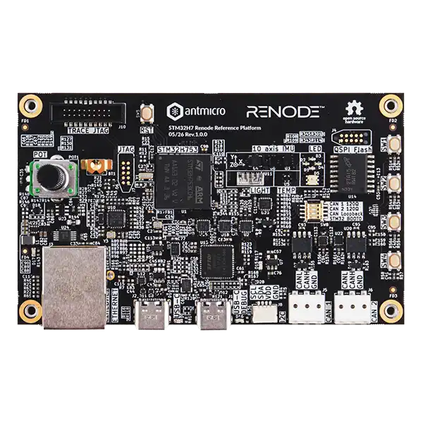

<!-- Copyright 2015-2026 Zephyr Project members and individual contributors. -->
<!-- SPDX-License-Identifier: Apache-2.0 -->
<!-- 中文翻译；编号、导航与译注为本地新增。 -->

<a id="stm32h7_renode_reference_board"></a>

# 第6章\_STM32H7 Renode参考平台（Reference Platform）

原文：[官方页面](https://docs.zephyrproject.org/latest/boards/antmicro/stm32h7_renode_reference_board/doc/index.html)。读取日期：2026-10-16；来源摘要见[来源记录](../SOURCES.md)。

开发板概览（Board Overview）

<a id="id1"></a>

[](images/stm32h7_renode_reference_board.webp)

STM32H7 Renode参考平台（Reference Platform）

名称（Name）：

`stm32h7_renode_reference_board`

厂商（Vendor）：

[Antmicro](https://docs.zephyrproject.org/latest/boards/index.html#vendor=antmicro)

状态（Status）：

维护中（Maintained）

架构（Architecture）：

[arm](https://docs.zephyrproject.org/latest/boards/index.html#arch=arm)

片上系统（SoC）：

[stm32h753xx](https://docs.zephyrproject.org/latest/boards/index.html#soc=stm32h753xx)

<a id="board-github-link"></a>

[浏览开发板源码（Browse Board Sources）](https://github.com/zephyrproject-rtos/zephyr/blob/main//boards/antmicro/stm32h7_renode_reference_board/doc/index.rst/../..)<a id="overview"></a>

## 概述（Overview）

<a id="id3"></a>

<a id="id7"></a>

STM32H7 Renode参考平台[注1](#id2)包含高性能32位STM32H753微控制器及一组传感器，采用开发套件外形。[Renode仿真框架（Simulation Framework）](https://renode.io)[注3](#id6)中提供该开发板的数字孪生（Digital Twin），便于试验和学习如何将Renode融入开发流程。（[STM32H7 Renode参考平台（Reference Platform）](https://openhardware.antmicro.com/boards/stm32h7-renode-reference-platform)）

主要特性包括：


- STM32H753XI微控制器，Cortex-M7内核、480 MHz
- 100 Mbit/s以太网（Ethernet）
- USB-C接口，用于数据和供电
- 十轴惯性测量单元（IMU）
- 功耗测量仪（Power Consumption Meter）
- 两个CAN总线接线端子（Terminal）
- 1 Gb QSPI外部闪存（Flash）
- 100 × 60 mm印制电路板（PCB）
- 五个LED，包括四个绿色LED和一个RGB LED
- 四个用户按键
- 旋转电位器（Rotary Potentiometer）
- QWIIC接口，用于外设扩展

<a id="hardware"></a>

## 硬件（Hardware）

Renode参考平台提供以下硬件：


- STM32H753XI微控制器（MCU）
- ARM Cortex-M7 CPU，带双精度浮点单元（FPU），最高480 MHz
- Memory:

  > - 2 MB闪存，带纠错码（ECC）及代码读出保护（PCROP）
  > - 1 MB RAM：192 KB紧耦合存储器（TCM，含64 KB ITCM及128 KB DTCM）、864 KB用户SRAM和4 KB备份SRAM
  > - 1 Gbit四线SPI NOR外部闪存（QSPI NOR）
- 定时器（Timers）：

  > - 一个高分辨率定时器（High-Resolution Timer），最高分辨率2.1 ns
  > - 两个32位定时器，最多四路输入捕获／输出比较／PWM（IC/OC/PWM），或脉冲计数器及正交增量编码器输入
  > - 两个16位高级电机控制定时器（Advanced Motor Control Timers）
  > - 十个16位通用定时器
  > - 五个16位低功耗定时器
  > - 两个看门狗定时器（Watchdog Timers），分别为独立看门狗和窗口看门狗
  > - 系统节拍定时器（SysTick Timer）
- 实时时钟（RTC），带硬件日历、闹钟和校准功能
- 模拟外设（Analog Peripherals）：

  > - 三个16位模数转换器（ADC），最多36个通道，支持硬件过采样（Oversampling）
  > - 两路12位数模转换器（DAC）通道
  > - 两个超低功耗比较器（Comparators）
  > - 内部温度传感器和内部参考电压源
- 通信接口（Communication Interfaces）：

  > - 两个支持灵活数据速率的FDCAN控制器
  > - 两路I2C快速增强模式（Fast Mode Plus），1 Mbit/s，支持SMBus/PMBus
  > - 一路通用同步／异步收发器（USART）
  > - USB 2.0 OTG全速及USB 2.0 OTF高速接口（OTF拼写依原文保留）
  > - 10/100 Mbit/s以太网媒体访问控制器（Ethernet MAC）
- Sensors:

  > - 十轴惯性测量单元（IMU）：
  >
  >   > - LSM6DSO加速度计与陀螺仪
  >   > - IIS2MDC磁力计（Magnetometer）
  >   > - LPS25HB气压计（Barometer）
  > - TMP108温度传感器
  > - VEML7700环境光传感器（Ambient Light Sensor）
- 其他外设（Other Peripherals）：

  > - Chrom-ART图形加速器（DMA2D）、LCD-TFT控制器和JPEG编解码器（Codec）
  > - 主DMA（MDMA）、两个DMA及基本DMA（BDMA）控制器
  > - 真随机数发生器（RNG / True Random Number Generator）
  > - 硬件密码加速器（Cryptographic Accelerator），支持AES、3DES、MD5/SHA-1/SHA-2哈希（HASH）及HMAC
  > - 循环冗余校验计算单元（CRC Calculation Unit）
  > - 开发支持：通过FTDI FT4232H提供专用USB-C端口，用于调试、烧录和UART

STM32H753XI的更多信息见：


- <a id="id9"></a>

  [ST网站上的STM32H753XI（www.st.com）](https://www.st.com/en/microcontrollers-microprocessors/stm32h753xi.html)[注4](#id8)

开发板的完整组件列表见：


- <a id="id5"></a>

  [Antmicro Designer上的STM32H7 Renode参考平台](https://designer.antmicro.com/library/devices/stm32h7-renode-reference-platform)[注2](#id4)

<a id="supported-features"></a>

### 支持的功能（Supported Features）

`stm32h7_renode_reference_board`开发板支持下表所列的硬件功能。

片上／板载（On-Chip / On-Board）

功能集成在片上系统（SoC）内／位于开发板上。

2 / 2

分别表示已启用／已禁用的实例数。点击数量标签，可查看开发板或SoC设备树源码（DTS）中该功能的第一个实例。

`vnd,foo`

与此功能匹配的设备树绑定兼容字符串（Compatible String）；点击链接可查看绑定文档。

<a id="stm32h7_renode_reference_board-hw-features"></a>

<a id="stm32h7_renode_reference_board-stm32h7_renode_reference_board/stm32h753xx-hw-features-section"></a>

#### `stm32h7_renode_reference_board/stm32h753xx`目标（Target）

<a id="stm32h7_renode_reference_board-stm32h7_renode_reference_board/stm32h753xx-hw-features-panel"></a>

<a id="stm32h7_renode_reference_board-stm32h7_renode_reference_board/stm32h753xx-hw-features-memory"></a>

该开发板目标的片上存储容量：512 KiB RAM、2 MiB Flash。

<a id="stm32h7_renode_reference_board-stm32h7_renode_reference_board/stm32h753xx-hw-features-table"></a>

<table>
<tr>
<th>类型（Type）</th>
<th>位置（Location）</th>
<th>说明（Description）</th>
<th>兼容字符串（Compatible）</th>
</tr>
<tr>
<td rowspan="1">中央处理器（CPU）</td>
<td>片上（On-Chip）</td>
<td>ARM Cortex-M7处理器（CPU）（<a href="https://github.com/zephyrproject-rtos/zephyr/blob/main/dts/arm/st/h7/stm32h7.dtsi?plain=1#L38">已启用：1</a>）</td>
<td><a href="../cpu_cortex_xtensa_binding_reference/P005_arm_cortex-m7.md#std-dtcompatible-arm-cortex-m7"><code>arm,cortex-m7</code></a></td>
</tr>
<tr>
<td rowspan="1">模数转换器（ADC）</td>
<td>片上（On-Chip）</td>
<td>STM32模数转换器（ADC）（<a href="https://github.com/zephyrproject-rtos/zephyr/blob/main/dts/arm/st/h7/stm32h7.dtsi?plain=1#L1046">已启用：1</a>；<a href="https://github.com/zephyrproject-rtos/zephyr/blob/main/dts/arm/st/h7/stm32h7.dtsi?plain=1#L1080">已禁用：1</a>）</td>
<td><a href="../hardware/P839_STM32模数转换器绑定.md#dtbinding-st-stm32-adc"><code>st,stm32-adc</code></a></td>
</tr>
<tr>
<td rowspan="2">音频（Audio）</td>
<td>片上（On-Chip）</td>
<td>意法半导体（STMicroelectronics）Σ-Δ调制器数字滤波器模块（DFSDM）（<a href="https://github.com/zephyrproject-rtos/zephyr/blob/main/dts/arm/st/h7/stm32h7.dtsi?plain=1#L994">已禁用：1</a>）</td>
<td><a href="../audio_stm32_ti_wolfson_binding_reference/P002_st_stm32-dfsdm.md#std-dtcompatible-st-stm32-dfsdm"><code>st,stm32-dfsdm</code></a></td>
</tr>
<tr>
<td>片上（On-Chip）</td>
<td>意法半导体（STMicroelectronics）DFSDM数字麦克风（DMIC）（<a href="https://github.com/zephyrproject-rtos/zephyr/blob/main/dts/arm/st/h7/stm32h7.dtsi?plain=1#L1005">已禁用：4</a>）</td>
<td><a href="../audio_stm32_ti_wolfson_binding_reference/P001_st_stm32-dfsdm-dmic.md#std-dtcompatible-st-stm32-dfsdm-dmic"><code>st,stm32-dfsdm-dmic</code></a></td>
</tr>
<tr>
<td rowspan="1">控制器局域网（CAN）</td>
<td>片上（On-Chip）</td>
<td>STM32H7系列及兼容器件的FDCAN CAN FD控制器（<a href="https://github.com/zephyrproject-rtos/zephyr/blob/main/dts/arm/st/h7/stm32h7.dtsi?plain=1#L614">已启用：2</a>）</td>
<td><a href="../can_nxp_renesas_stm32_ti_binding_reference/P013_st_stm32h7-fdcan.md#std-dtcompatible-st-stm32h7-fdcan"><code>st,stm32h7-fdcan</code></a></td>
</tr>
<tr>
<td rowspan="8">时钟控制（Clock Control）</td>
<td>片上（On-Chip）</td>
<td>STM32H7复位与时钟控制器（RCC / Reset and Clock Controller）（<a href="https://github.com/zephyrproject-rtos/zephyr/blob/main/dts/arm/st/h7/stm32h7.dtsi?plain=1#L205">已启用：1</a>）</td>
<td><a href="../timer_reference/P168_STM32H7复位与时钟控制绑定.md#dtbinding-st-stm32h7-rcc"><code>st,stm32h7-rcc</code></a></td>
</tr>
<tr>
<td>片上（On-Chip）</td>
<td>STM32 外部高速时钟（HSE Clock）（<a href="https://github.com/zephyrproject-rtos/zephyr/blob/main/dts/arm/st/h7/stm32h7.dtsi?plain=1#L75">已启用：1</a>）</td>
<td><a href="../timer_reference/P129_STM32高速外部时钟绑定.md#dtbinding-st-stm32-hse-clock"><code>st,stm32-hse-clock</code></a></td>
</tr>
<tr>
<td>片上（On-Chip）</td>
<td>STM32高速内部时钟（HSI）（<a href="https://github.com/zephyrproject-rtos/zephyr/blob/main/dts/arm/st/h7/stm32h7.dtsi?plain=1#L82">已禁用：1</a>）</td>
<td><a href="../timer_reference/P146_STM32H7内部高速时钟绑定.md#dtbinding-st-stm32h7-hsi-clock"><code>st,stm32h7-hsi-clock</code></a></td>
</tr>
<tr>
<td>片上（On-Chip）</td>
<td>通用固定频率时钟提供者（Fixed-Rate Clock Provider）（<a href="https://github.com/zephyrproject-rtos/zephyr/blob/main/dts/arm/st/h7/stm32h7.dtsi?plain=1#L90">已启用：2</a>；<a href="https://github.com/zephyrproject-rtos/zephyr/blob/main/dts/arm/st/h7/stm32h7.dtsi?plain=1#L97">已禁用：1</a>）</td>
<td><a href="../hardware/P566_固定时钟绑定.md#dtbinding-fixed-clock"><code>fixed-clock</code></a></td>
</tr>
<tr>
<td>片上（On-Chip）</td>
<td>STM32低速外部时钟（LSE Clock）（<a href="https://github.com/zephyrproject-rtos/zephyr/blob/main/dts/arm/st/h7/stm32h7.dtsi?plain=1#L104">已禁用：1</a>）</td>
<td><a href="../timer_reference/P130_STM32低速外部时钟绑定.md#dtbinding-st-stm32-lse-clock"><code>st,stm32-lse-clock</code></a></td>
</tr>
<tr>
<td>片上（On-Chip）</td>
<td>STM32H7主锁相环（Main PLL）（<a href="https://github.com/zephyrproject-rtos/zephyr/blob/main/dts/arm/st/h7/stm32h7.dtsi?plain=1#L119">已启用：2</a>；<a href="https://github.com/zephyrproject-rtos/zephyr/blob/main/dts/arm/st/h7/stm32h7.dtsi?plain=1#L133">已禁用：1</a>）</td>
<td><a href="../timer_reference/P154_STM32H7锁相环时钟绑定.md#dtbinding-st-stm32h7-pll-clock"><code>st,stm32h7-pll-clock</code></a></td>
</tr>
<tr>
<td>片上（On-Chip）</td>
<td>STM32 时钟多路复用器（Clock Multiplexer）（<a href="https://github.com/zephyrproject-rtos/zephyr/blob/main/dts/arm/st/h7/stm32h7.dtsi?plain=1#L140">已禁用：1</a>）</td>
<td><a href="../timer_reference/P133_STM32时钟多路复用绑定.md#dtbinding-st-stm32-clock-mux"><code>st,stm32-clock-mux</code></a></td>
</tr>
<tr>
<td>片上（On-Chip）</td>
<td>STM32 微控制器时钟输出（Microcontroller Clock Output，MCO）（<a href="https://github.com/zephyrproject-rtos/zephyr/blob/main/dts/arm/st/h7/stm32h7.dtsi?plain=1#L148">已禁用：2</a>）</td>
<td><a href="../timer_reference/P134_STM32时钟输出绑定.md#dtbinding-st-stm32-clock-mco"><code>st,stm32-clock-mco</code></a></td>
</tr>
<tr>
<td rowspan="1">比较器（Comparator）</td>
<td>片上（On-Chip）</td>
<td>STM32H7系列比较器（Comparator）（<a href="https://github.com/zephyrproject-rtos/zephyr/blob/main/dts/arm/st/h7/stm32h7.dtsi?plain=1#L1314">已禁用：2</a>）</td>
<td><a href="../hardware/P741_STM32H7比较器绑定.md#dtbinding-st-stm32h7-comp"><code>st,stm32h7-comp</code></a></td>
</tr>
<tr>
<td rowspan="1">计数器（Counter）</td>
<td>片上（On-Chip）</td>
<td>STM32 计数器（Counters）（<a href="https://github.com/zephyrproject-rtos/zephyr/blob/main/dts/arm/st/h7/stm32h7.dtsi?plain=1#L653">已禁用：14</a>）</td>
<td><a href="../stm32_ti_xilinx_counter_binding_reference/P007_st_stm32-counter.md#std-dtcompatible-st-stm32-counter"><code>st,stm32-counter</code></a></td>
</tr>
<tr>
<td rowspan="1">循环冗余校验（CRC）</td>
<td>片上（On-Chip）</td>
<td>STM32 CRC 计算单元（Calculation Unit）（<a href="https://github.com/zephyrproject-rtos/zephyr/blob/main/dts/arm/st/h7/stm32h7.dtsi?plain=1#L1332">已启用：1</a>）</td>
<td><a href="../crc_clock_monitor_binding_reference/P011_st_stm32-crc.md#std-dtcompatible-st-stm32-crc"><code>st,stm32-crc</code></a></td>
</tr>
<tr>
<td rowspan="2">密码学加速器（Cryptographic Accelerator）</td>
<td>片上（On-Chip）</td>
<td>STM32密码加速器（Cryptographic Accelerator）（<a href="https://github.com/zephyrproject-rtos/zephyr/blob/main/dts/arm/st/h7/stm32h750.dtsi?plain=1#L14">已启用：1</a>）</td>
<td><a href="../crypto_secure_engine_st_ti_binding_reference/P016_st_stm32-cryp.md#std-dtcompatible-st-stm32-cryp"><code>st,stm32-cryp</code></a></td>
</tr>
<tr>
<td>片上（On-Chip）</td>
<td>STM32哈希处理器（HASH Processor）（<a href="https://github.com/zephyrproject-rtos/zephyr/blob/main/dts/arm/st/h7/stm32h750.dtsi?plain=1#L23">已启用：1</a>）</td>
<td><a href="../crypto_secure_engine_st_ti_binding_reference/P017_st_stm32-hash.md#std-dtcompatible-st-stm32-hash"><code>st,stm32-hash</code></a></td>
</tr>
<tr>
<td rowspan="1">数模转换器（DAC）</td>
<td>片上（On-Chip）</td>
<td>STM32 系列数模转换器（DAC）（<a href="https://github.com/zephyrproject-rtos/zephyr/blob/main/dts/arm/st/h7/stm32h7.dtsi?plain=1#L1107">已禁用：1</a>）</td>
<td><a href="../hardware/P760_STM32数模转换器绑定.md#dtbinding-st-stm32-dac"><code>st,stm32-dac</code></a></td>
</tr>
<tr>
<td rowspan="2">显示（Display）</td>
<td>片上（On-Chip）</td>
<td>STM32 Chrom-ART 图形加速器（Accelerator，DMA2D）（<a href="https://github.com/zephyrproject-rtos/zephyr/blob/main/dts/arm/st/h7/stm32h7.dtsi?plain=1#L1349">已禁用：1</a>）</td>
<td><a href="../display_st_ultrachip_zephyr_binding_reference/P003_st_stm32-dma2d.md#std-dtcompatible-st-stm32-dma2d"><code>st,stm32-dma2d</code></a></td>
</tr>
<tr>
<td>片上（On-Chip）</td>
<td>STM32 LCD-TFT 显示控制器（Display Controller）（<a href="https://github.com/zephyrproject-rtos/zephyr/blob/main/dts/arm/st/h7/stm32h742.dtsi?plain=1#L52">已禁用：1</a>）</td>
<td><a href="../display_st_ultrachip_zephyr_binding_reference/P004_st_stm32-ltdc.md#std-dtcompatible-st-stm32-ltdc"><code>st,stm32-ltdc</code></a></td>
</tr>
<tr>
<td rowspan="3">直接存储器访问（DMA）</td>
<td>片上（On-Chip）</td>
<td>STM32 DMA 控制器（Controller，V1）（<a href="https://github.com/zephyrproject-rtos/zephyr/blob/main/dts/arm/st/h7/stm32h7.dtsi?plain=1#L1115">已启用：2</a>）</td>
<td><a href="../stm32_ti_xilinx_dma_binding_reference/P007_st_stm32-dma-v1.md#std-dtcompatible-st-stm32-dma-v1"><code>st,stm32-dma-v1</code></a></td>
</tr>
<tr>
<td>片上（On-Chip）</td>
<td>STM32基本DMA控制器（BDMA）（<a href="https://github.com/zephyrproject-rtos/zephyr/blob/main/dts/arm/st/h7/stm32h7.dtsi?plain=1#L1141">已禁用：1</a>）</td>
<td><a href="../stm32_ti_xilinx_dma_binding_reference/P006_st_stm32-bdma.md#std-dtcompatible-st-stm32-bdma"><code>st,stm32-bdma</code></a></td>
</tr>
<tr>
<td>片上（On-Chip）</td>
<td>STM32 DMA 多路复用控制器（DMAMUX Controller）（<a href="https://github.com/zephyrproject-rtos/zephyr/blob/main/dts/arm/st/h7/stm32h7.dtsi?plain=1#L1154">已禁用：2</a>）</td>
<td><a href="../stm32_ti_xilinx_dma_binding_reference/P011_st_stm32-dmamux.md#std-dtcompatible-st-stm32-dmamux"><code>st,stm32-dmamux</code></a></td>
</tr>
<tr>
<td rowspan="4">以太网（Ethernet）</td>
<td>片上（On-Chip）</td>
<td>ST STM32 以太网媒体访问控制器（Ethernet MAC）（<a href="https://github.com/zephyrproject-rtos/zephyr/blob/main/dts/arm/st/h7/stm32h7.dtsi?plain=1#L1215">已启用：1</a>）</td>
<td><a href="../ethernet_synopsys_st_xilinx_binding_reference/P011_st_stm32h7-ethernet.md#std-dtcompatible-st-stm32h7-ethernet"><code>st,stm32h7-ethernet</code></a></td>
</tr>
<tr>
<td>片上（On-Chip）</td>
<td>Synopsys DesignWare MAC 的管理数据输入输出控制器（MDIO Controller）（<a href="https://github.com/zephyrproject-rtos/zephyr/blob/main/dts/arm/st/h7/stm32h7.dtsi?plain=1#L1229">已启用：1</a>）</td>
<td><a href="../ethernet_mdio_microchip_binding_reference/P010_snps_dwmac-mdio.md#std-dtcompatible-snps-dwmac-mdio"><code>snps,dwmac-mdio</code></a></td>
</tr>
<tr>
<td>板载（On-Board）</td>
<td>通用媒体独立接口物理层（MII PHY）（<a href="https://github.com/zephyrproject-rtos/zephyr/blob/main/boards/antmicro/stm32h7_renode_reference_board/stm32h7_renode_reference_board.dts?plain=1#L355">已启用：1</a>）</td>
<td><a href="../ethernet_nxp_phy_binding_reference/P019_ethernet-phy.md#std-dtcompatible-ethernet-phy"><code>ethernet-phy</code></a></td>
</tr>
<tr>
<td>片上（On-Chip）</td>
<td>Synopsys DesignWare MAC 精确时间协议时钟（Precision Time Protocol，PTP Clock）（<a href="https://github.com/zephyrproject-rtos/zephyr/blob/main/dts/arm/st/h7/stm32h7.dtsi?plain=1#L1236">已启用：1</a>）</td>
<td><a href="../ethernet_synopsys_st_xilinx_binding_reference/P006_snps_dwmac-ptp-clock.md#std-dtcompatible-snps-dwmac-ptp-clock"><code>snps,dwmac-ptp-clock</code></a></td>
</tr>
<tr>
<td rowspan="2">闪存控制器（Flash Controller）</td>
<td>片上（On-Chip）</td>
<td>STM32 系列闪存控制器（Flash Controller）（<a href="https://github.com/zephyrproject-rtos/zephyr/blob/main/dts/arm/st/h7/stm32h7.dtsi?plain=1#L162">已启用：1</a>）</td>
<td><a href="../flash_renesas_st_ti_binding_reference/P011_st_stm32-flash-controller.md#std-dtcompatible-st-stm32-flash-controller"><code>st,stm32-flash-controller</code></a></td>
</tr>
<tr>
<td>板载（On-Board）</td>
<td>支持JEDEC公共闪存接口（CFI）的STM32四线SPI闪存控制器（QSPI Flash Controller）（<a href="https://github.com/zephyrproject-rtos/zephyr/blob/main/boards/antmicro/stm32h7_renode_reference_board/stm32h7_renode_reference_board.dts?plain=1#L369">已启用：1</a>）</td>
<td><a href="../flash_renesas_st_ti_binding_reference/P013_st_stm32-qspi-nor.md#std-dtcompatible-st-stm32-qspi-nor"><code>st,stm32-qspi-nor</code></a></td>
</tr>
<tr>
<td rowspan="1">通用输入输出与接插件（GPIO &amp; Headers）</td>
<td>片上（On-Chip）</td>
<td>STM32 通用输入输出控制器（GPIO Controller）（<a href="https://github.com/zephyrproject-rtos/zephyr/blob/main/dts/arm/st/h7/stm32h7.dtsi?plain=1#L248">已启用：11</a>）</td>
<td><a href="../gpio_silabs_st_connectors_binding_reference/P029_st_stm32-gpio.md#std-dtcompatible-st-stm32-gpio"><code>st,stm32-gpio</code></a></td>
</tr>
<tr>
<td rowspan="1">集成电路间总线（I2C）</td>
<td>片上（On-Chip）</td>
<td>STM32 I2C V2 控制器（Controller）（<a href="https://github.com/zephyrproject-rtos/zephyr/blob/main/dts/arm/st/h7/stm32h7.dtsi?plain=1#L443">已启用：2</a>；<a href="https://github.com/zephyrproject-rtos/zephyr/blob/main/dts/arm/st/h7/stm32h7.dtsi?plain=1#L467">已禁用：2</a>）</td>
<td><a href="../i2c_stm32_ti_mux_binding_reference/P008_st_stm32-i2c-v2.md#std-dtcompatible-st-stm32-i2c-v2"><code>st,stm32-i2c-v2</code></a></td>
</tr>
<tr>
<td rowspan="2">集成电路间音频总线（I2S）</td>
<td>片上（On-Chip）</td>
<td>STM32H7 I2S控制器（<a href="https://github.com/zephyrproject-rtos/zephyr/blob/main/dts/arm/st/h7/stm32h7.dtsi?plain=1#L572">已禁用：3</a>）</td>
<td><a href="../i2s_binding_reference/P018_st_stm32h7-i2s.md#std-dtcompatible-st-stm32h7-i2s"><code>st,stm32h7-i2s</code></a></td>
</tr>
<tr>
<td>片上（On-Chip）</td>
<td>STM32 串行音频接口块控制器（SAI Block Controller）（<a href="https://github.com/zephyrproject-rtos/zephyr/blob/main/dts/arm/st/h7/stm32h7.dtsi?plain=1#L1286">已禁用：2</a>）</td>
<td><a href="../i2s_binding_reference/P017_st_stm32-sai.md#std-dtcompatible-st-stm32-sai"><code>st,stm32-sai</code></a></td>
</tr>
<tr>
<td rowspan="1">输入（Input）</td>
<td>板载（On-Board）</td>
<td>一组绑定到 GPIO 的输入按键（GPIO-Bound Input Keys）（<a href="https://github.com/zephyrproject-rtos/zephyr/blob/main/boards/antmicro/stm32h7_renode_reference_board/stm32h7_renode_reference_board.dts?plain=1#L122">已启用：1</a>）</td>
<td><a href="../hardware/P563_GPIO按键绑定.md#std-dtcompatible-gpio-keys"><code>gpio-keys</code></a></td>
</tr>
<tr>
<td rowspan="2">中断控制器（Interrupt Controller）</td>
<td>片上（On-Chip）</td>
<td>ARMv7-M 嵌套向量中断控制器（Nested Vectored Interrupt Controller，NVIC）（<a href="https://github.com/zephyrproject-rtos/zephyr/blob/main/dts/arm/armv7-m.dtsi?plain=1#L13">已启用：1</a>）</td>
<td><a href="../arm_interrupt_timer_binding_reference/P002_ARMv7_M_NVIC.md#std-dtcompatible-arm-v7m-nvic"><code>arm,v7m-nvic</code></a></td>
</tr>
<tr>
<td>片上（On-Chip）</td>
<td>STM32 外部中断控制器（External Interrupt Controller）（<a href="https://github.com/zephyrproject-rtos/zephyr/blob/main/dts/arm/st/h7/stm32h7.dtsi?plain=1#L225">已启用：1</a>）</td>
<td><a href="../mcu_external_interrupt_binding_reference/P001_st_stm32-exti.md#std-dtcompatible-st-stm32-exti"><code>st,stm32-exti</code></a></td>
</tr>
<tr>
<td rowspan="3">发光二极管（LED）</td>
<td>板载（On-Board）</td>
<td>一组由 GPIO 控制的 LED（GPIO-Controlled LEDs）（<a href="https://github.com/zephyrproject-rtos/zephyr/blob/main/boards/antmicro/stm32h7_renode_reference_board/stm32h7_renode_reference_board.dts?plain=1#L77">已启用：1</a>）</td>
<td><a href="../hardware/P564_GPIO指示灯绑定.md#dtbinding-gpio-leds"><code>gpio-leds</code></a></td>
</tr>
<tr>
<td>板载（On-Board）</td>
<td>将多个单色LED组合为一个多色LED（Multi-Color LED）。（<a href="https://github.com/zephyrproject-rtos/zephyr/blob/main/boards/antmicro/stm32h7_renode_reference_board/stm32h7_renode_reference_board.dts?plain=1#L93">已启用：1</a>）</td>
<td><a href="../led_issi_nordic_nxp_binding_reference/P010_leds-group-multicolor.md#std-dtcompatible-leds-group-multicolor"><code>leds-group-multicolor</code></a></td>
</tr>
<tr>
<td>板载（On-Board）</td>
<td>一组由脉宽调制（PWM）控制的LED（<a href="https://github.com/zephyrproject-rtos/zephyr/blob/main/boards/antmicro/stm32h7_renode_reference_board/stm32h7_renode_reference_board.dts?plain=1#L102">已启用：1</a>）</td>
<td><a href="../hardware/P565_PWM指示灯绑定.md#dtbinding-pwm-leds"><code>pwm-leds</code></a></td>
</tr>
<tr>
<td rowspan="3">存储器控制器（Memory Controller）</td>
<td>片上（On-Chip）</td>
<td>STM32 电池备份 RAM（Battery-Backed RAM）（<a href="https://github.com/zephyrproject-rtos/zephyr/blob/main/dts/arm/st/h7/stm32h742.dtsi?plain=1#L63">已禁用：1</a>）</td>
<td><a href="../memory_controller_sdram_psram_binding_reference/P010_st_stm32-bbram.md#std-dtcompatible-st-stm32-bbram"><code>st,stm32-bbram</code></a></td>
</tr>
<tr>
<td>片上（On-Chip）</td>
<td>STM32H7灵活存储器控制器（FMC / Flexible Memory Controller）（<a href="https://github.com/zephyrproject-rtos/zephyr/blob/main/dts/arm/st/h7/stm32h7.dtsi?plain=1#L1241">已禁用：1</a>）</td>
<td><a href="../memory_controller_sdram_psram_binding_reference/P016_st_stm32h7-fmc.md#std-dtcompatible-st-stm32h7-fmc"><code>st,stm32h7-fmc</code></a></td>
</tr>
<tr>
<td>片上（On-Chip）</td>
<td>STM32 灵活存储器控制器中的 SDRAM 控制器（SDRAM Controller）（<a href="https://github.com/zephyrproject-rtos/zephyr/blob/main/dts/arm/st/h7/stm32h7.dtsi?plain=1#L1247">已禁用：1</a>）</td>
<td><a href="../memory_controller_sdram_psram_binding_reference/P012_st_stm32-fmc-sdram.md#std-dtcompatible-st-stm32-fmc-sdram"><code>st,stm32-fmc-sdram</code></a></td>
</tr>
<tr>
<td rowspan="1">内存管理单元／内存保护单元（MMU / MPU）</td>
<td>片上（On-Chip）</td>
<td>ARMv7-M存储器保护单元（MPU / Memory Protection Unit）（<a href="https://github.com/zephyrproject-rtos/zephyr/blob/main/dts/arm/st/h7/stm32h7.dtsi?plain=1#L45">已启用：1</a>）</td>
<td><a href="../memory_protection_binding_reference/P005_arm_armv7m-mpu.md#std-dtcompatible-arm-armv7m-mpu"><code>arm,armv7m-mpu</code></a></td>
</tr>
<tr>
<td rowspan="2">存储技术设备（MTD）</td>
<td>片上（On-Chip）</td>
<td>STM32闪存（Flash Memory）（<a href="https://github.com/zephyrproject-rtos/zephyr/blob/main/dts/arm/st/h7/stm32h742.dtsi?plain=1#L15">已启用：1</a>）</td>
<td><a href="../mtd_nxp_st_ti_partition_binding_reference/P016_st_stm32-nv-flash.md#std-dtcompatible-st-stm32-nv-flash"><code>st,stm32-nv-flash</code></a></td>
</tr>
<tr>
<td>板载（On-Board）</td>
<td>闪存或其他非易失性存储器的固定分区（Fixed Partitions）（<a href="https://github.com/zephyrproject-rtos/zephyr/blob/main/boards/antmicro/stm32h7_renode_reference_board/stm32h7_renode_reference_board.dts?plain=1#L378">已启用：1</a>）</td>
<td><a href="../hardware/P568_固定分区绑定.md#dtbinding-fixed-partitions"><code>fixed-partitions</code></a></td>
</tr>
<tr>
<td rowspan="1">非易失存储器（NVMEM）</td>
<td>片上（On-Chip）</td>
<td>非易失存储器固定布局（Fixed Layout for Non-Volatile Memory）（<a href="https://github.com/zephyrproject-rtos/zephyr/blob/main/dts/arm/st/h7/stm32h7.dtsi?plain=1#L179">已启用：1</a>）</td>
<td><a href="../memory_protection_binding_reference/P009_fixed-layout.md#std-dtcompatible-fixed-layout"><code>fixed-layout</code></a></td>
</tr>
<tr>
<td rowspan="1">一次性可编程存储器（OTP Memory）</td>
<td>片上（On-Chip）</td>
<td>STM32 嵌入式非易失一次性可编程存储器（NVM OTP）（<a href="https://github.com/zephyrproject-rtos/zephyr/blob/main/dts/arm/st/h7/stm32h7.dtsi?plain=1#L175">已启用：1</a>）</td>
<td><a href="../otp_binding_reference/P010_st_stm32-nvm-otp.md#std-dtcompatible-st-stm32-nvm-otp"><code>st,stm32-nvm-otp</code></a></td>
</tr>
<tr>
<td rowspan="2">物理层（PHY）</td>
<td>片上（On-Chip）</td>
<td>用于所有内置于 USB IP 的 USB 收发器（USB Transceivers）的绑定。（<a href="https://github.com/zephyrproject-rtos/zephyr/blob/main/dts/arm/st/h7/stm32h742.dtsi?plain=1#L137">已启用：1</a>）</td>
<td><a href="../phy_binding_reference/P008_usb-nop-xceiv.md#std-dtcompatible-usb-nop-xceiv"><code>usb-nop-xceiv</code></a></td>
</tr>
<tr>
<td>板载（On-Board）</td>
<td>由简单GPIO控制的CAN收发器（Transceiver）（<a href="https://github.com/zephyrproject-rtos/zephyr/blob/main/boards/antmicro/stm32h7_renode_reference_board/stm32h7_renode_reference_board.dts?plain=1#L63">已启用：2</a>）</td>
<td><a href="../phy_binding_reference/P001_can-transceiver-gpio.md#std-dtcompatible-can-transceiver-gpio"><code>can-transceiver-gpio</code></a></td>
</tr>
<tr>
<td rowspan="1">引脚控制（Pin Control）</td>
<td>片上（On-Chip）</td>
<td>STM32 引脚控制器（Pin Controller）（<a href="https://github.com/zephyrproject-rtos/zephyr/blob/main/dts/arm/st/h7/stm32h7.dtsi?plain=1#L241">已启用：1</a>）</td>
<td><a href="../pinctrl_stm32_ti_xilinx_binding_reference/P004_st_stm32-pinctrl.md#std-dtcompatible-st-stm32-pinctrl"><code>st,stm32-pinctrl</code></a></td>
</tr>
<tr>
<td rowspan="1">电源管理（Power Management）</td>
<td>片上（On-Chip）</td>
<td>STM32H7电源控制器（Power Controller）（<a href="https://github.com/zephyrproject-rtos/zephyr/blob/main/dts/arm/st/h7/stm32h7.dtsi?plain=1#L216">已启用：1</a>）</td>
<td><a href="../stm32_soc_power_binding_reference/P014_st_stm32h7-pwr.md#std-dtcompatible-st-stm32h7-pwr"><code>st,stm32h7-pwr</code></a></td>
</tr>
<tr>
<td rowspan="1">脉宽调制（PWM）</td>
<td>片上（On-Chip）</td>
<td>STM32 脉宽调制（PWM）（<a href="https://github.com/zephyrproject-rtos/zephyr/blob/main/dts/arm/st/h7/stm32h7.dtsi?plain=1#L705">已启用：1</a>；<a href="https://github.com/zephyrproject-rtos/zephyr/blob/main/dts/arm/st/h7/stm32h7.dtsi?plain=1#L647">已禁用：11</a>）</td>
<td><a href="../pwm_stm32_ti_generic_binding_reference/P011_st_stm32-pwm.md#std-dtcompatible-st-stm32-pwm"><code>st,stm32-pwm</code></a></td>
</tr>
<tr>
<td rowspan="1">四线串行外设接口（QSPI）</td>
<td>片上（On-Chip）</td>
<td>STM32 四线串行外设接口控制器（QSPI Controller）（<a href="https://github.com/zephyrproject-rtos/zephyr/blob/main/dts/arm/st/h7/stm32h7.dtsi?plain=1#L1263">已启用：1</a>）</td>
<td><a href="../qspi_ospi_xspi_binding_reference/P011_st_stm32-qspi.md#std-dtcompatible-st-stm32-qspi"><code>st,stm32-qspi</code></a></td>
</tr>
<tr>
<td rowspan="1">稳压器（Regulator）</td>
<td>片上（On-Chip）</td>
<td>STM32参考电压缓冲器稳压器（VREFBUF Regulator）（<a href="https://github.com/zephyrproject-rtos/zephyr/blob/main/dts/arm/st/h7/stm32h7.dtsi?plain=1#L1340">已禁用：1</a>）</td>
<td><a href="../hardware/P638_STM32参考电压缓冲器绑定.md#dtbinding-st-stm32-vrefbuf"><code>st,stm32-vrefbuf</code></a></td>
</tr>
<tr>
<td rowspan="1">复位控制器（Reset Controller）</td>
<td>片上（On-Chip）</td>
<td>STM32 复位与时钟控制器（Reset and Clock Control，RCC）（<a href="https://github.com/zephyrproject-rtos/zephyr/blob/main/dts/arm/st/h7/stm32h7.dtsi?plain=1#L210">已启用：1</a>）</td>
<td><a href="../reset_controller_binding_reference/P017_st_stm32-rcc-rctl.md#std-dtcompatible-st-stm32-rcc-rctl"><code>st,stm32-rcc-rctl</code></a></td>
</tr>
<tr>
<td rowspan="1">随机数生成器（RNG）</td>
<td>片上（On-Chip）</td>
<td>STM32 随机数生成器（Random Number Generator）（<a href="https://github.com/zephyrproject-rtos/zephyr/blob/main/dts/arm/st/h7/stm32h7.dtsi?plain=1#L1186">已启用：1</a>）</td>
<td><a href="../soc_rng_binding_reference/P016_st_stm32-rng.md#std-dtcompatible-st-stm32-rng"><code>st,stm32-rng</code></a></td>
</tr>
<tr>
<td rowspan="1">实时时钟（RTC）</td>
<td>片上（On-Chip）</td>
<td>STM32 实时时钟（RTC）（<a href="https://github.com/zephyrproject-rtos/zephyr/blob/main/dts/arm/st/h7/stm32h7.dtsi?plain=1#L432">已启用：1</a>）</td>
<td><a href="../soc_rtc_binding_reference/P014_st_stm32-rtc.md#std-dtcompatible-st-stm32-rtc"><code>st,stm32-rtc</code></a></td>
</tr>
<tr>
<td rowspan="1">SD 主机控制器（SDHC）</td>
<td>片上（On-Chip）</td>
<td>STM32 SDMMC 主机控制器（Host Controller）（<a href="https://github.com/zephyrproject-rtos/zephyr/blob/main/dts/arm/st/h7/stm32h7.dtsi?plain=1#L1194">已禁用：2</a>）</td>
<td><a href="../sdhc_binding_reference/P019_st_stm32-sdmmc.md#std-dtcompatible-st-stm32-sdmmc"><code>st,stm32-sdmmc</code></a></td>
</tr>
<tr>
<td rowspan="9">传感器（Sensors）</td>
<td>板载（On-Board）</td>
<td>Vishay VEML7700高精度环境光传感器，带I2C接口（<a href="https://github.com/zephyrproject-rtos/zephyr/blob/main/boards/antmicro/stm32h7_renode_reference_board/stm32h7_renode_reference_board.dts?plain=1#L271">已启用：1</a>）</td>
<td><a href="../sensor_ti_vishay_wurth_sensing_binding_reference/P016_vishay_veml7700.md#std-dtcompatible-vishay-veml7700"><code>vishay,veml7700</code></a></td>
</tr>
<tr>
<td>板载（On-Board）</td>
<td>通过I2C总线访问的意法半导体IIS2MDC磁力计（<a href="https://github.com/zephyrproject-rtos/zephyr/blob/main/boards/antmicro/stm32h7_renode_reference_board/stm32h7_renode_reference_board.dts?plain=1#L277">已启用：1</a>）</td>
<td><a href="../compatible_binding_reference/P073_st_iis2mdc.md#std-dtcompatible-st-iis2mdc"><code>st,iis2mdc</code></a></td>
</tr>
<tr>
<td>板载（On-Board）</td>
<td>TMP108数字温度传感器（Digital Temperature Sensor）（<a href="https://github.com/zephyrproject-rtos/zephyr/blob/main/boards/antmicro/stm32h7_renode_reference_board/stm32h7_renode_reference_board.dts?plain=1#L284">已启用：1</a>）</td>
<td><a href="../sensor_ti_vishay_wurth_sensing_binding_reference/P006_ti_tmp108.md#std-dtcompatible-ti-tmp108"><code>ti,tmp108</code></a></td>
</tr>
<tr>
<td>板载（On-Board）</td>
<td>意法半导体LPS25HB压力传感器（Pressure Sensor）（<a href="https://github.com/zephyrproject-rtos/zephyr/blob/main/boards/antmicro/stm32h7_renode_reference_board/stm32h7_renode_reference_board.dts?plain=1#L290">已启用：1</a>）</td>
<td><a href="../sensor_st_lis_lps_binding_reference/P025_st_lps25hb-press.md#std-dtcompatible-st-lps25hb-press"><code>st,lps25hb-press</code></a></td>
</tr>
<tr>
<td>板载（On-Board）</td>
<td>通过I2C总线访问的意法半导体LSM6DSO六轴惯性测量单元（IMU / Inertial Measurement Unit）（<a href="https://github.com/zephyrproject-rtos/zephyr/blob/main/boards/antmicro/stm32h7_renode_reference_board/stm32h7_renode_reference_board.dts?plain=1#L296">已启用：1</a>）</td>
<td><a href="../compatible_binding_reference/P091_st_lsm6dso.md#std-dtcompatible-st-lsm6dso"><code>st,lsm6dso</code></a></td>
</tr>
<tr>
<td>片上（On-Chip）</td>
<td>STM32 正交解码器（Quadrature Decoder）（<a href="https://github.com/zephyrproject-rtos/zephyr/blob/main/dts/arm/st/h7/stm32h7.dtsi?plain=1#L658">已禁用：6</a>）</td>
<td><a href="../sensor_st_lsm_stm32_binding_reference/P028_st_stm32-qdec.md#std-dtcompatible-st-stm32-qdec"><code>st,stm32-qdec</code></a></td>
</tr>
<tr>
<td>片上（On-Chip）</td>
<td>STM32 系列温度节点（TEMP），用于以两个温度点完成生产校准的传感器。（<a href="https://github.com/zephyrproject-rtos/zephyr/blob/main/dts/arm/st/h7/stm32h7.dtsi?plain=1#L1357">已禁用：1</a>）</td>
<td><a href="../sensor_st_lsm_stm32_binding_reference/P029_st_stm32-temp-cal.md#std-dtcompatible-st-stm32-temp-cal"><code>st,stm32-temp-cal</code></a></td>
</tr>
<tr>
<td>片上（On-Chip）</td>
<td>STM32 电池电压（VBAT）（<a href="https://github.com/zephyrproject-rtos/zephyr/blob/main/dts/arm/st/h7/stm32h7.dtsi?plain=1#L1369">已禁用：1</a>）</td>
<td><a href="../sensor_st_ti_power_capacitance_binding_reference/P001_st_stm32-vbat.md#std-dtcompatible-st-stm32-vbat"><code>st,stm32-vbat</code></a></td>
</tr>
<tr>
<td>片上（On-Chip）</td>
<td>STM32 参考电压（VREF+）（<a href="https://github.com/zephyrproject-rtos/zephyr/blob/main/dts/arm/st/h7/stm32h7.dtsi?plain=1#L1375">已禁用：1</a>）</td>
<td><a href="../sensor_st_ti_power_capacitance_binding_reference/P003_st_stm32-vref.md#std-dtcompatible-st-stm32-vref"><code>st,stm32-vref</code></a></td>
</tr>
<tr>
<td rowspan="3">串行控制器（Serial Controller）</td>
<td>片上（On-Chip）</td>
<td>STM32 通用同步／异步收发器（USART）（<a href="https://github.com/zephyrproject-rtos/zephyr/blob/main/dts/arm/st/h7/stm32h7.dtsi?plain=1#L360">已启用：1</a>；<a href="https://github.com/zephyrproject-rtos/zephyr/blob/main/dts/arm/st/h7/stm32h7.dtsi?plain=1#L351">已禁用：3</a>）</td>
<td><a href="../uart_silabs_stm32_ti_binding_reference/P016_st_stm32-usart.md#std-dtcompatible-st-stm32-usart"><code>st,stm32-usart</code></a></td>
</tr>
<tr>
<td>片上（On-Chip）</td>
<td>STM32 通用异步收发器（UART）（<a href="https://github.com/zephyrproject-rtos/zephyr/blob/main/dts/arm/st/h7/stm32h7.dtsi?plain=1#L378">已禁用：4</a>）</td>
<td><a href="../uart_silabs_stm32_ti_binding_reference/P015_st_stm32-uart.md#std-dtcompatible-st-stm32-uart"><code>st,stm32-uart</code></a></td>
</tr>
<tr>
<td>片上（On-Chip）</td>
<td>STM32低功耗通用异步收发器（LPUART）（<a href="https://github.com/zephyrproject-rtos/zephyr/blob/main/dts/arm/st/h7/stm32h7.dtsi?plain=1#L423">已禁用：1</a>）</td>
<td><a href="../uart_silabs_stm32_ti_binding_reference/P014_st_stm32-lpuart.md#std-dtcompatible-st-stm32-lpuart"><code>st,stm32-lpuart</code></a></td>
</tr>
<tr>
<td rowspan="1">系统管理总线（SMbus）</td>
<td>片上（On-Chip）</td>
<td>STM32 系统管理总线控制器（SMBus Controller）（<a href="https://github.com/zephyrproject-rtos/zephyr/blob/main/dts/arm/st/h7/stm32h7.dtsi?plain=1#L1383">已禁用：4</a>）</td>
<td><a href="../i3c_smbus_binding_reference/P013_st_stm32-smbus.md#std-dtcompatible-st-stm32-smbus"><code>st,stm32-smbus</code></a></td>
</tr>
<tr>
<td rowspan="1">串行外设接口（SPI）</td>
<td>片上（On-Chip）</td>
<td>STM32H7 串行外设接口控制器（SPI Controller）（<a href="https://github.com/zephyrproject-rtos/zephyr/blob/main/dts/arm/st/h7/stm32h7.dtsi?plain=1#L491">已禁用：6</a>）</td>
<td><a href="../spi_stm32_ti_xilinx_binding_reference/P013_st_stm32h7-spi.md#std-dtcompatible-st-stm32h7-spi"><code>st,stm32h7-spi</code></a></td>
</tr>
<tr>
<td rowspan="3">定时器（Timer）</td>
<td>片上（On-Chip）</td>
<td>ARMv7-M 系统节拍（System Tick）（<a href="https://github.com/zephyrproject-rtos/zephyr/blob/main/dts/arm/armv7-m.dtsi?plain=1#L21">已启用：1</a>）</td>
<td><a href="../arm_interrupt_timer_binding_reference/P006_ARMv7_M_SysTick.md#std-dtcompatible-arm-armv7m-systick"><code>arm,armv7m-systick</code></a></td>
</tr>
<tr>
<td>片上（On-Chip）</td>
<td>STM32 定时器（Timers）（<a href="https://github.com/zephyrproject-rtos/zephyr/blob/main/dts/arm/st/h7/stm32h7.dtsi?plain=1#L694">已启用：1</a>；<a href="https://github.com/zephyrproject-rtos/zephyr/blob/main/dts/arm/st/h7/stm32h7.dtsi?plain=1#L636">已禁用：13</a>）</td>
<td><a href="../stm32_ti_silabs_timer_binding_reference/P008_st_stm32-timers.md#std-dtcompatible-st-stm32-timers"><code>st,stm32-timers</code></a></td>
</tr>
<tr>
<td>片上（On-Chip）</td>
<td>STM32低功耗定时器（LPTIM）（<a href="https://github.com/zephyrproject-rtos/zephyr/blob/main/dts/arm/st/h7/stm32h7.dtsi?plain=1#L982">已禁用：1</a>）</td>
<td><a href="../stm32_ti_silabs_timer_binding_reference/P007_st_stm32-lptim.md#std-dtcompatible-st-stm32-lptim"><code>st,stm32-lptim</code></a></td>
</tr>
<tr>
<td rowspan="1">通用串行总线（USB）</td>
<td>片上（On-Chip）</td>
<td>STM32 全速 USB OTG 控制器（OTGFS Controller）（<a href="https://github.com/zephyrproject-rtos/zephyr/blob/main/dts/arm/st/h7/stm32h742.dtsi?plain=1#L38">已启用：1</a>）</td>
<td><a href="../usb_stm32_audio_binding_reference/P004_st_stm32-otgfs.md#std-dtcompatible-st-stm32-otgfs"><code>st,stm32-otgfs</code></a></td>
</tr>
<tr>
<td rowspan="2">视频（Video）</td>
<td>片上（On-Chip）</td>
<td>STM32数字摄像头接口（DCMI）（<a href="https://github.com/zephyrproject-rtos/zephyr/blob/main/dts/arm/st/h7/stm32h7.dtsi?plain=1#L1273">已禁用：1</a>）</td>
<td><a href="../video_st_sony_emulation_binding_reference/P004_st_stm32-dcmi.md#std-dtcompatible-st-stm32-dcmi"><code>st,stm32-dcmi</code></a></td>
</tr>
<tr>
<td>片上（On-Chip）</td>
<td>STM32 JPEG硬件编解码器（HW Codec）（<a href="https://github.com/zephyrproject-rtos/zephyr/blob/main/dts/arm/st/h7/stm32h742.dtsi?plain=1#L70">已禁用：1</a>）</td>
<td><a href="../video_st_sony_emulation_binding_reference/P006_st_stm32-jpeg.md#std-dtcompatible-st-stm32-jpeg"><code>st,stm32-jpeg</code></a></td>
</tr>
<tr>
<td rowspan="2">看门狗（Watchdog）</td>
<td>片上（On-Chip）</td>
<td>STM32 看门狗（Watchdog）（<a href="https://github.com/zephyrproject-rtos/zephyr/blob/main/dts/arm/st/h7/stm32h7.dtsi?plain=1#L337">已启用：1</a>）</td>
<td><a href="../stm32_ti_xilinx_watchdog_binding_reference/P001_st_stm32-watchdog.md#std-dtcompatible-st-stm32-watchdog"><code>st,stm32-watchdog</code></a></td>
</tr>
<tr>
<td>片上（On-Chip）</td>
<td>STM32 系统窗口看门狗（System Window Watchdog）（<a href="https://github.com/zephyrproject-rtos/zephyr/blob/main/dts/arm/st/h7/stm32h7.dtsi?plain=1#L343">已禁用：1</a>）</td>
<td><a href="../stm32_ti_xilinx_watchdog_binding_reference/P002_st_stm32-window-watchdog.md#std-dtcompatible-st-stm32-window-watchdog"><code>st,stm32-window-watchdog</code></a></td>
</tr>
</table>

<a id="connections-and-ios"></a>

### 连接与输入输出（Connections and IOs）

Antmicro STM32H7 Renode参考平台为外设提供以下默认引脚映射：


- `USART2 TX/RX : PD5/PA3`
- `I2C1 SCL/SDA : PB6/PB7`
- `I2C2 SCL/SDA : PF1/PF0`
- `FDCAN1 TX/RX : PD1/PD0`
- `FDCAN2 TX/RX : PB13/PB12`
- `CAN_SHDN : PF13`
- `QSPI CLK/NCS/IO0/IO1/IO2/IO3 : PF10/PB10/PF8/PF9/PF7/PF6`
- `ETH : PA1, PA2, PA7, PB11, PC4, PC5, PG12, PG13`
- `USB ID/D-/D+ : PA10/PA11/PA12`
- TIM3 CH1/CH2/CH3/CH4，用于LED：PB4/PC7/PC8/PB1
- `LRGB R/G/B : PD13/PD14/PD15`
- `USER SW1/SW2/SW3/SW4 : PG7/PG8/PG9/PG10`
- ADC1 INP2，用于电位器（Potentiometer）：PF11
- `JTAG TMS/TCK/TDO/TDI : PA13/PA14/PB3/PA15`

<a id="serial-port"></a>

#### 串口（Serial Port）

Zephyr控制台输出分配给USART2，它连接到USB-C DEBUG端口上的USB转UART转换器。

<a id="programming-and-debugging"></a>

## 烧录与调试（Programming and Debugging）

`stm32h7_renode_reference_board`开发板支持下表所列的运行工具（Runners）及相关west命令。

<table>
<tr>
<th></th>
<th>烧录（flash）</th>
<th>调试（debug）</th>
<th>连接调试会话（attach）</th>
<th>实时传输（rtt）</th>
<th>调试服务器（debugserver）</th>
<th>simulate</th>
<th>robot</th>
</tr>
<tr>
<td><a href="https://docs.zephyrproject.org/latest/develop/flash_debug/host-tools.html#runner-openocd">openocd</a></td>
<td>✅（默认 / default）</td>
<td>✅（默认 / default）</td>
<td>✅</td>
<td>✅</td>
<td>✅</td>
<td></td>
<td></td>
</tr>
<tr>
<td>renode</td>
<td></td>
<td></td>
<td></td>
<td></td>
<td></td>
<td>✅</td>
<td></td>
</tr>
<tr>
<td>renode-robot</td>
<td></td>
<td></td>
<td></td>
<td></td>
<td></td>
<td></td>
<td>✅</td>
</tr>
</table>

`stm32h7_renode_reference_board`开发板目标上的应用可按通常方式构建和烧录，详情见[构建应用（Building an Application）](../application/P001_应用开发.md#build-an-application)及[运行应用（Run an Application）](https://docs.zephyrproject.org/latest/develop/application/index.html#application-run)。

<a id="flashing"></a>

### 烧录（Flashing）

此开发板具有USB-JTAG接口，可使用OpenOCD。

通过USB-C DEBUG端口将开发板连接到主机，然后构建并烧录应用。以下以[Hello World](../getting_started/P005_HelloWorld示例.md#hello_world)为例。

```text
# From the root of the zephyr repository
west build -b stm32h7_renode_reference_board samples/hello_world
west flash
```

随后运行主机串口程序连接Renode参考平台，例如使用picocom：

```text
$ picocom /dev/ttyUSB2 -b 115200
```

警告（Warning）

开发板只有一个端口，同时用于编程和控制台。因此，建议将`CONFIG_BOOT_DELAY`设置为一个任意延迟值；在设备上运行Twister测试时尤其需要注意，并应同时使用`--flash-before`和`--device-flash-timeout=120`选项。

```text
$ scripts/twister --device-testing --device-serial /dev/ttyUSB2 --device-serial-baud 115200 -p stm32h7_renode_reference_board --flash-before --device-flash-timeout=120 -v
```

<a id="debugging"></a>

### 调试（Debugging）

可以按常规方式调试应用。下面以[Hello World](../getting_started/P005_HelloWorld示例.md#hello_world)应用为例。

```text
# From the root of the zephyr repository
west build -b stm32h7_renode_reference_board samples/hello_world
west debug
```

<a id="references"></a>

## 参考资料（References）

<a id="id2"></a>

〔[1](#id3)〕 [https://openhardware.antmicro.com/boards/stm32h7-renode-reference-platform](https://openhardware.antmicro.com/boards/stm32h7-renode-reference-platform)

<a id="id4"></a>

〔[2](#id5)〕 [https://designer.antmicro.com/library/devices/stm32h7-renode-reference-platform](https://designer.antmicro.com/library/devices/stm32h7-renode-reference-platform)

<a id="id6"></a>

〔[3](#id7)〕 [https://renode.io](https://renode.io)

<a id="id8"></a>

〔[4](#id9)〕 [https://www.st.com/en/microcontrollers-microprocessors/stm32h753xi.html](https://www.st.com/en/microcontrollers-microprocessors/stm32h753xi.html)

## 译注

原文RAM分项为192 KB TCM、864 KB用户SRAM和4 KB备份SRAM，与其概括的1 MB不同；USB高速条目另写OTF。译文保留这些原始数值与拼写，不自行改为推测结果。

## 原文外链核对

2026-10-16核对并重试以下原文外链时未能确认可访问性，保留原始目标，不将访问失败解释为原文内容有误。

- [stm32h753xi.html](https://www.st.com/en/microcontrollers-microprocessors/stm32h753xi.html)：HTTP Error 567: Unknown Status。

---

[上一章](P005_STM32H7_HDMI_Board.md) · [返回大纲](大纲.md) · [全站翻译进度](../PROGRESS.md)
