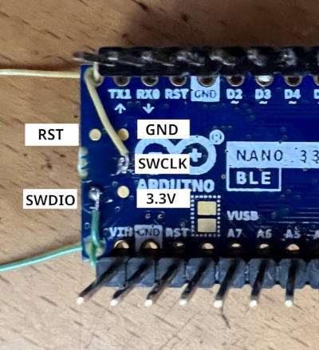

<!-- Copyright 2015-2026 Zephyr Project members and individual contributors. -->
<!-- SPDX-License-Identifier: Apache-2.0 -->
<!-- 中文翻译；编号、导航与译注为本地新增。 -->

<a id="arduino_nano_33_ble"></a>

# 第5章\_Arduino Nano 33 BLE（Sense）

原文：[官方页面](https://docs.zephyrproject.org/latest/boards/arduino/nano_33_ble/doc/index.html)。读取日期：2026-10-16；来源摘要见[来源记录](../SOURCES.md)。

开发板概览（Board Overview）

<a id="id1"></a>

[](images/arduino_nano_33_ble_sense.jpg)

Arduino Nano 33 BLE（Sense）

名称（Name）：

`arduino_nano_33_ble`

厂商（Vendor）：

[Arduino](https://docs.zephyrproject.org/latest/boards/index.html#vendor=arduino)

状态（Status）：

维护中（Maintained）

架构（Architecture）：

[arm](https://docs.zephyrproject.org/latest/boards/index.html#arch=arm)

片上系统（SoC）：

[nrf52840](https://docs.zephyrproject.org/latest/boards/index.html#soc=nrf52840)

<a id="board-github-link"></a>

[浏览开发板源码（Browse Board Sources）](https://github.com/zephyrproject-rtos/zephyr/blob/main//boards/arduino/nano_33_ble/doc/index.rst/../..)<a id="overview"></a>

## 概述（Overview）

<a id="id3"></a>

<a id="id5"></a>

Arduino Nano 33 [BLE](https://store.arduino.cc/products/nano-33-ble-rev2)围绕Nordic Semiconductor的nRF52840 ARM Cortex-M4F CPU设计。Arduino销售普通BLE型号[注1](#id2)和[BLE Sense](https://store.arduino.cc/products/nano-33-ble-sense-rev2)型号[注2](#id4)；“Sense”型号增加了更多传感器，除此之外两者相同。

原文所述当前硬件版本为Rev2，更新了惯性测量单元（IMU）以及温度／湿度传感器等器件。

<a id="hardware"></a>

## 硬件（Hardware）

<a id="supported-features"></a>

### 支持的功能（Supported Features）

`arduino_nano_33_ble`开发板支持下表所列的硬件功能。

片上／板载（On-Chip / On-Board）

功能集成在片上系统（SoC）内／位于开发板上。

2 / 2

分别表示已启用／已禁用的实例数。点击数量标签，可查看开发板或SoC设备树源码（DTS）中该功能的第一个实例。

`vnd,foo`

与此功能匹配的设备树绑定兼容字符串（Compatible String）；点击链接可查看绑定文档。

<a id="arduino_nano_33_ble-hw-features"></a>

<a id="arduino_nano_33_ble-arduino_nano_33_ble@rev1/nrf52840-hw-features-section"></a>

#### `arduino_nano_33_ble@rev1/nrf52840`目标（Target）

<a id="arduino_nano_33_ble-arduino_nano_33_ble@rev1/nrf52840-hw-features-panel"></a>

<a id="arduino_nano_33_ble-arduino_nano_33_ble@rev1/nrf52840-hw-features-memory"></a>

此开发板目标可用存储器：256 KiB RAM、1 MiB 闪存。

<a id="arduino_nano_33_ble-arduino_nano_33_ble@rev1/nrf52840-hw-features-table"></a>

<table>
<tr>
<th>类型（Type）</th>
<th>位置（Location）</th>
<th>说明（Description）</th>
<th>兼容字符串（Compatible）</th>
</tr>
<tr>
<td rowspan="1">中央处理器（CPU）</td>
<td>片上（On-Chip）</td>
<td>ARM Cortex-M4F 处理器（CPU）（<a href="https://github.com/zephyrproject-rtos/zephyr/blob/main/dts/arm/nordic/nrf52840.dtsi?plain=1#L23">已启用：1</a>）</td>
<td><a href="../cpu_arm_riscv_binding_reference/P025_arm_cortex-m4f.md#std-dtcompatible-arm-cortex-m4f"><code>arm,cortex-m4f</code></a></td>
</tr>
<tr>
<td rowspan="1">模数转换器（ADC）</td>
<td>片上（On-Chip）</td>
<td>Nordic Semiconductor nRF系列逐次逼近模数转换器（SAADC）节点（<a href="https://github.com/zephyrproject-rtos/zephyr/blob/main/dts/arm/nordic/nrf52840.dtsi?plain=1#L243">已启用：1</a>）</td>
<td><a href="../hardware/P846_NordicNRF逐次逼近ADC绑定.md#dtbinding-nordic-nrf-saadc"><code>nordic,nrf-saadc</code></a></td>
</tr>
<tr>
<td rowspan="4">ARM 架构（ARM Architecture）</td>
<td>片上（On-Chip）</td>
<td>Nordic用户信息配置寄存器（UICR / User Information Configuration Registers）（<a href="https://github.com/zephyrproject-rtos/zephyr/blob/main/dts/arm/nordic/nrf52840.dtsi?plain=1#L57">已启用：1</a>）</td>
<td><a href="../arm_nordic_nxp_control_binding_reference/P007_nordic_nrf-uicr.md#std-dtcompatible-nordic-nrf-uicr"><code>nordic,nrf-uicr</code></a></td>
</tr>
<tr>
<td>片上（On-Chip）</td>
<td>Nordic事件发生器单元（EGU / Event Generator Unit）（<a href="https://github.com/zephyrproject-rtos/zephyr/blob/main/dts/arm/nordic/nrf52840.dtsi?plain=1#L356">已启用：6</a>）</td>
<td><a href="../arm_timing_ethosu_control_binding_reference/P018_nordic_nrf-egu.md#std-dtcompatible-nordic-nrf-egu"><code>nordic,nrf-egu</code></a></td>
</tr>
<tr>
<td>片上（On-Chip）</td>
<td>Nordic nRF系列访问控制列表（ACL / Access Control List）（<a href="https://github.com/zephyrproject-rtos/zephyr/blob/main/dts/arm/nordic/nrf52840.dtsi?plain=1#L433">已启用：1</a>）</td>
<td><a href="../arm_timing_ethosu_control_binding_reference/P014_nordic_nrf-acl.md#std-dtcompatible-nordic-nrf-acl"><code>nordic,nrf-acl</code></a></td>
</tr>
<tr>
<td>片上（On-Chip）</td>
<td>Nordic nRF系列存储器监视单元（MWU / Memory Watch Unit）（<a href="https://github.com/zephyrproject-rtos/zephyr/blob/main/dts/arm/nordic/nrf52840.dtsi?plain=1#L465">已启用：1</a>）</td>
<td><a href="../arm_timing_ethosu_control_binding_reference/P022_nordic_nrf-mwu.md#std-dtcompatible-nordic-nrf-mwu"><code>nordic,nrf-mwu</code></a></td>
</tr>
<tr>
<td rowspan="1">音频（Audio）</td>
<td>片上（On-Chip）</td>
<td>Nordic脉冲密度调制接口（PDM / Pulse Density Modulation Interface）（<a href="https://github.com/zephyrproject-rtos/zephyr/blob/main/dts/arm/nordic/nrf52840.dtsi?plain=1#L426">已禁用：1</a>）</td>
<td><a href="../audio_pdm_codec_binding_reference/P012_nordic_nrf-pdm.md#std-dtcompatible-nordic-nrf-pdm"><code>nordic,nrf-pdm</code></a></td>
</tr>
<tr>
<td rowspan="4">时钟控制（Clock Control）</td>
<td>片上（On-Chip）</td>
<td>Nordic nRF时钟控制（Clock Control）节点（<a href="https://github.com/zephyrproject-rtos/zephyr/blob/main/dts/arm/nordic/nrf52840.dtsi?plain=1#L74">已启用：1</a>）</td>
<td><a href="../clock_sam_nordic_binding_reference/P015_nordic_nrf-clock.md#std-dtcompatible-nordic-nrf-clock"><code>nordic,nrf-clock</code></a></td>
</tr>
<tr>
<td>片上（On-Chip）</td>
<td>Nordic nRF高频时钟（HFCLK）控制节点（<a href="https://github.com/zephyrproject-rtos/zephyr/blob/main/dts/arm/nordic/nrf52840.dtsi?plain=1#L80">已启用：1</a>）</td>
<td><a href="../clock_sam_nordic_binding_reference/P009_nordic_nrf-clock-hfclk.md#std-dtcompatible-nordic-nrf-clock-hfclk"><code>nordic,nrf-clock-hfclk</code></a></td>
</tr>
<tr>
<td>片上（On-Chip）</td>
<td>Nordic nRF低频时钟（LFCLK）控制节点（<a href="https://github.com/zephyrproject-rtos/zephyr/blob/main/dts/arm/nordic/nrf52840.dtsi?plain=1#L85">已启用：1</a>）</td>
<td><a href="../clock_sam_nordic_binding_reference/P012_nordic_nrf-clock-lfclk.md#std-dtcompatible-nordic-nrf-clock-lfclk"><code>nordic,nrf-clock-lfclk</code></a></td>
</tr>
<tr>
<td>片上（On-Chip）</td>
<td>Nordic nRF高频晶体振荡器（High-frequency Crystal Oscillator，nRF52系列）（<a href="https://github.com/zephyrproject-rtos/zephyr/blob/main/dts/arm/nordic/nrf52840.dtsi?plain=1#L39">已启用：1</a>）</td>
<td><a href="../clock_sam_nordic_binding_reference/P022_nordic_nrf52-hfxo.md#std-dtcompatible-nordic-nrf52-hfxo"><code>nordic,nrf52-hfxo</code></a></td>
</tr>
<tr>
<td rowspan="1">比较器（Comparator）</td>
<td>片上（On-Chip）</td>
<td>Nordic nRF模拟比较器（COMP / Analog Comparator）（<a href="https://github.com/zephyrproject-rtos/zephyr/blob/main/dts/arm/nordic/nrf52840.dtsi?plain=1#L345">已禁用：1</a>）</td>
<td><a href="../hardware/P752_NordicnRF比较器绑定.md#dtbinding-nordic-nrf-comp"><code>nordic,nrf-comp</code></a></td>
</tr>
<tr>
<td rowspan="1">计数器（Counter）</td>
<td>片上（On-Chip）</td>
<td>Nordic nRF定时器（Timer）节点（<a href="https://github.com/zephyrproject-rtos/zephyr/blob/main/dts/arm/nordic/nrf52840.dtsi?plain=1#L252">已禁用：5</a>）</td>
<td><a href="../microchip_soc_counter_binding_reference/P017_nordic_nrf-timer.md#std-dtcompatible-nordic-nrf-timer"><code>nordic,nrf-timer</code></a></td>
</tr>
<tr>
<td rowspan="3">密码学加速器（Cryptographic Accelerator）</td>
<td>片上（On-Chip）</td>
<td>Nordic ECB（AES电子密码本模式加密 / Electronic Codebook Mode Encryption）（<a href="https://github.com/zephyrproject-rtos/zephyr/blob/main/dts/arm/nordic/nrf52840.dtsi?plain=1#L306">已启用：1</a>）</td>
<td><a href="../crypto_secure_engine_st_ti_binding_reference/P001_nordic_nrf-ecb.md#std-dtcompatible-nordic-nrf-ecb"><code>nordic,nrf-ecb</code></a></td>
</tr>
<tr>
<td>片上（On-Chip）</td>
<td>Nordic nRF系列CCM（AES CCM模式加密 / CCM Mode Encryption）（<a href="https://github.com/zephyrproject-rtos/zephyr/blob/main/dts/arm/nordic/nrf52840.dtsi?plain=1#L313">已启用：1</a>）</td>
<td><a href="../crypto_aes_sha_ccm_binding_reference/P020_nordic_nrf-ccm.md#std-dtcompatible-nordic-nrf-ccm"><code>nordic,nrf-ccm</code></a></td>
</tr>
<tr>
<td>片上（On-Chip）</td>
<td>ARM TrustZone CryptoCell 310密码模块（<a href="https://github.com/zephyrproject-rtos/zephyr/blob/main/dts/arm/nordic/nrf52840.dtsi?plain=1#L597">已禁用：1</a>）</td>
<td><a href="../crypto_aes_sha_ccm_binding_reference/P001_arm_cryptocell-310.md#std-dtcompatible-arm-cryptocell-310"><code>arm,cryptocell-310</code></a></td>
</tr>
<tr>
<td rowspan="1">调试（Debug）</td>
<td>片上（On-Chip）</td>
<td>ARMv7仪器化跟踪宏单元（ITM / Instrumentation Trace Macrocell）（<a href="https://github.com/zephyrproject-rtos/zephyr/blob/main/dts/arm/nordic/nrf52840.dtsi?plain=1#L30">已启用：1</a>）</td>
<td><a href="../debug_binding_reference/P001_ARMv7M_ITM调试绑定.md#std-dtcompatible-arm-armv7m-itm"><code>arm,armv7m-itm</code></a></td>
</tr>
<tr>
<td rowspan="2">闪存控制器（Flash Controller）</td>
<td>片上（On-Chip）</td>
<td>Nordic非易失性存储器控制器（NVMC / Non-Volatile Memory Controller）（<a href="https://github.com/zephyrproject-rtos/zephyr/blob/main/dts/arm/nordic/nrf52840.dtsi?plain=1#L439">已启用：1</a>）</td>
<td><a href="../flash_adi_microchip_nordic_binding_reference/P030_nordic_nrf52-flash-controller.md#std-dtcompatible-nordic-nrf52-flash-controller"><code>nordic,nrf52-flash-controller</code></a></td>
</tr>
<tr>
<td>片上（On-Chip）</td>
<td>定义Nordic四线SPI外设（QSPI Peripheral）接口的属性（<a href="https://github.com/zephyrproject-rtos/zephyr/blob/main/dts/arm/nordic/nrf52840.dtsi?plain=1#L543">已禁用：1</a>）</td>
<td><a href="../flash_adi_microchip_nordic_binding_reference/P028_nordic_nrf-qspi.md#std-dtcompatible-nordic-nrf-qspi"><code>nordic,nrf-qspi</code></a></td>
</tr>
<tr>
<td rowspan="3">通用输入输出与接插件（GPIO &amp; Headers）</td>
<td>片上（On-Chip）</td>
<td>NRF5 GPIO任务与事件（GPIOTE）（<a href="https://github.com/zephyrproject-rtos/zephyr/blob/main/dts/arm/nordic/nrf52840.dtsi?plain=1#L235">已启用：1</a>）</td>
<td><a href="../gpio_microchip_nordic_nuvoton_binding_reference/P017_nordic_nrf-gpiote.md#std-dtcompatible-nordic-nrf-gpiote"><code>nordic,nrf-gpiote</code></a></td>
</tr>
<tr>
<td>片上（On-Chip）</td>
<td>NRF5通用输入输出（GPIO）（<a href="https://github.com/zephyrproject-rtos/zephyr/blob/main/dts/arm/nordic/nrf52840.dtsi?plain=1#L574">已启用：2</a>）</td>
<td><a href="../gpio_microchip_nordic_nuvoton_binding_reference/P016_nordic_nrf-gpio.md#std-dtcompatible-nordic-nrf-gpio"><code>nordic,nrf-gpio</code></a></td>
</tr>
<tr>
<td>板载（On-Board）</td>
<td>Arduino Nano排针引出的GPIO引脚（<a href="https://github.com/zephyrproject-rtos/zephyr/blob/main/boards/arduino/nano_33_ble/arduino_nano_connector.dtsi?plain=1#L9">已启用：1</a>）</td>
<td><a href="../gpio_adi_headers_ambiq_binding_reference/P026_arduino-nano-header.md#std-dtcompatible-arduino-nano-header"><code>arduino-nano-header</code></a></td>
</tr>
<tr>
<td rowspan="1">集成电路间总线（I2C）</td>
<td>片上（On-Chip）</td>
<td>Nordic nRF系列TWIM（带EasyDMA的TWI主机）（<a href="https://github.com/zephyrproject-rtos/zephyr/blob/main/dts/arm/nordic/nrf52840.dtsi?plain=1#L156">已启用：2</a>）</td>
<td><a href="../i2c_infineon_ite_nordic_binding_reference/P016_nordic_nrf-twim.md#std-dtcompatible-nordic-nrf-twim"><code>nordic,nrf-twim</code></a></td>
</tr>
<tr>
<td rowspan="1">集成电路间音频总线（I2S）</td>
<td>片上（On-Chip）</td>
<td>Nordic芯片间音频接口（I2S / Inter-IC Sound Interface）（<a href="https://github.com/zephyrproject-rtos/zephyr/blob/main/dts/arm/nordic/nrf52840.dtsi?plain=1#L515">已禁用：1</a>）</td>
<td><a href="../i2s_binding_reference/P010_nordic_nrf-i2s.md#std-dtcompatible-nordic-nrf-i2s"><code>nordic,nrf-i2s</code></a></td>
</tr>
<tr>
<td rowspan="1">低速率无线个域网（IEEE 802.15.4）</td>
<td>片上（On-Chip）</td>
<td>Nordic nRF IEEE 802.15.4节点（<a href="https://github.com/zephyrproject-rtos/zephyr/blob/main/dts/arm/nordic/nrf52840.dtsi?plain=1#L133">已启用：1</a>）</td>
<td><a href="../lora_ieee802154_binding_reference/P005_nordic_nrf-ieee802154.md#std-dtcompatible-nordic-nrf-ieee802154"><code>nordic,nrf-ieee802154</code></a></td>
</tr>
<tr>
<td rowspan="1">中断控制器（Interrupt Controller）</td>
<td>片上（On-Chip）</td>
<td>ARMv7-M 嵌套向量中断控制器（Nested Vectored Interrupt Controller，NVIC）（<a href="https://github.com/zephyrproject-rtos/zephyr/blob/main/dts/arm/armv7-m.dtsi?plain=1#L13">已启用：1</a>）</td>
<td><a href="../arm_interrupt_timer_binding_reference/P002_ARMv7_M_NVIC.md#std-dtcompatible-arm-v7m-nvic"><code>arm,v7m-nvic</code></a></td>
</tr>
<tr>
<td rowspan="2">发光二极管（LED）</td>
<td>板载（On-Board）</td>
<td>一组由 GPIO 控制的 LED（GPIO-Controlled LEDs）（<a href="https://github.com/zephyrproject-rtos/zephyr/blob/main/boards/arduino/nano_33_ble/arduino_nano_33_ble-common.dtsi?plain=1#L20">已启用：1</a>）</td>
<td><a href="../hardware/P564_GPIO指示灯绑定.md#dtbinding-gpio-leds"><code>gpio-leds</code></a></td>
</tr>
<tr>
<td>板载（On-Board）</td>
<td>一组由脉宽调制（PWM）控制的LED（<a href="https://github.com/zephyrproject-rtos/zephyr/blob/main/boards/arduino/nano_33_ble/arduino_nano_33_ble-common.dtsi?plain=1#L50">已启用：1</a>；<a href="https://github.com/zephyrproject-rtos/zephyr/blob/main/boards/arduino/nano_33_ble/arduino_nano_33_ble-common.dtsi?plain=1#L74">已禁用：1</a>）</td>
<td><a href="../hardware/P565_PWM指示灯绑定.md#dtbinding-pwm-leds"><code>pwm-leds</code></a></td>
</tr>
<tr>
<td rowspan="2">其他绑定（Miscellaneous）</td>
<td>片上（On-Chip）</td>
<td>Nordic工厂信息配置寄存器（FICR / Factory Information Configuration Registers）（<a href="https://github.com/zephyrproject-rtos/zephyr/blob/main/dts/arm/nordic/nrf52840.dtsi?plain=1#L50">已启用：1</a>）</td>
<td><a href="../misc_adi_nordic_binding_reference/P018_nordic_nrf-ficr.md#std-dtcompatible-nordic-nrf-ficr"><code>nordic,nrf-ficr</code></a></td>
</tr>
<tr>
<td>片上（On-Chip）</td>
<td>Nordic nRF系列可编程外设互连（PPI / Programmable Peripheral Interconnect）（<a href="https://github.com/zephyrproject-rtos/zephyr/blob/main/dts/arm/nordic/nrf52840.dtsi?plain=1#L459">已启用：1</a>）</td>
<td><a href="../misc_adi_nordic_binding_reference/P020_nordic_nrf-ppi.md#std-dtcompatible-nordic-nrf-ppi"><code>nordic,nrf-ppi</code></a></td>
</tr>
<tr>
<td rowspan="1">存储技术设备（MTD）</td>
<td>片上（On-Chip）</td>
<td>闪存（Flash）节点（<a href="https://github.com/zephyrproject-rtos/zephyr/blob/main/dts/arm/nordic/nrf52840.dtsi?plain=1#L447">已启用：1</a>）</td>
<td><a href="../mtd_nxp_st_ti_partition_binding_reference/P013_soc-nv-flash.md#std-dtcompatible-soc-nv-flash"><code>soc-nv-flash</code></a></td>
</tr>
<tr>
<td rowspan="2">网络（Networking）</td>
<td>片上（On-Chip）</td>
<td>Nordic nRF系列无线电（RADIO）外设（<a href="https://github.com/zephyrproject-rtos/zephyr/blob/main/dts/arm/nordic/nrf52840.dtsi?plain=1#L123">已启用：1</a>）</td>
<td><a href="../network_radio_frontend_binding_reference/P009_nordic_nrf-radio.md#std-dtcompatible-nordic-nrf-radio"><code>nordic,nrf-radio</code></a></td>
</tr>
<tr>
<td>片上（On-Chip）</td>
<td>Nordic nRF系列近场通信标签（NFCT / Near Field Communication Tag）（<a href="https://github.com/zephyrproject-rtos/zephyr/blob/main/dts/arm/nordic/nrf52840.dtsi?plain=1#L228">已禁用：1</a>）</td>
<td><a href="../network_radio_frontend_binding_reference/P008_nordic_nrf-nfct.md#std-dtcompatible-nordic-nrf-nfct"><code>nordic,nrf-nfct</code></a></td>
</tr>
<tr>
<td rowspan="1">引脚控制（Pin Control）</td>
<td>片上（On-Chip）</td>
<td>Nordic nRF系列引脚控制器（Pin Controller）（<a href="https://github.com/zephyrproject-rtos/zephyr/blob/main/dts/vendor/nordic/nrf_common.dtsi?plain=1#L26">已启用：1</a>）</td>
<td><a href="../pinctrl_infineon_nordic_nxp_binding_reference/P009_nordic_nrf-pinctrl.md#std-dtcompatible-nordic-nrf-pinctrl"><code>nordic,nrf-pinctrl</code></a></td>
</tr>
<tr>
<td rowspan="1">电源管理（Power Management）</td>
<td>片上（On-Chip）</td>
<td>Nordic nRF电源控制（Power Control）节点（<a href="https://github.com/zephyrproject-rtos/zephyr/blob/main/dts/arm/nordic/nrf52840.dtsi?plain=1#L91">已启用：1</a>）</td>
<td><a href="../power_control_binding_reference/P008_nordic_nrf-power.md#std-dtcompatible-nordic-nrf-power"><code>nordic,nrf-power</code></a></td>
</tr>
<tr>
<td rowspan="2">脉宽调制（PWM）</td>
<td>片上（On-Chip）</td>
<td>nRF脉宽调制（PWM）（<a href="https://github.com/zephyrproject-rtos/zephyr/blob/main/dts/arm/nordic/nrf52840.dtsi?plain=1#L418">已启用：2</a>；<a href="https://github.com/zephyrproject-rtos/zephyr/blob/main/dts/arm/nordic/nrf52840.dtsi?plain=1#L479">已禁用：2</a>）</td>
<td><a href="../pwm_intel_microchip_nxp_binding_reference/P015_nordic_nrf-pwm.md#std-dtcompatible-nordic-nrf-pwm"><code>nordic,nrf-pwm</code></a></td>
</tr>
<tr>
<td>片上（On-Chip）</td>
<td>nRFx软件脉宽调制（S/W PWM）（<a href="https://github.com/zephyrproject-rtos/zephyr/blob/main/dts/vendor/nordic/nrf_common.dtsi?plain=1#L39">已禁用：1</a>）</td>
<td><a href="../pwm_intel_microchip_nxp_binding_reference/P016_nordic_nrf-sw-pwm.md#std-dtcompatible-nordic-nrf-sw-pwm"><code>nordic,nrf-sw-pwm</code></a></td>
</tr>
<tr>
<td rowspan="3">稳压器（Regulator）</td>
<td>片上（On-Chip）</td>
<td>Nordic nRF5X稳压器（Regulator，内核供电的固定级）（<a href="https://github.com/zephyrproject-rtos/zephyr/blob/main/dts/arm/nordic/nrf52840.dtsi?plain=1#L115">已启用：1</a>）</td>
<td><a href="../hardware/P643_nRF5X稳压器绑定.md#dtbinding-nordic-nrf5x-regulator"><code>nordic,nrf5x-regulator</code></a></td>
</tr>
<tr>
<td>片上（On-Chip）</td>
<td>Nordic nRF52X稳压器（Regulator），主电源的高压级（High-voltage Stage）（<a href="https://github.com/zephyrproject-rtos/zephyr/blob/main/dts/arm/nordic/nrf52840_qiaa.dtsi?plain=1#L11">已禁用：1</a>）</td>
<td><a href="../hardware/P639_nRF52高压稳压器绑定.md#dtbinding-nordic-nrf52x-regulator-hv"><code>nordic,nrf52x-regulator-hv</code></a></td>
</tr>
<tr>
<td>板载（On-Board）</td>
<td>固定电压稳压器（Fixed Voltage Regulators）（<a href="https://github.com/zephyrproject-rtos/zephyr/blob/main/boards/arduino/nano_33_ble/arduino_nano_33_ble-common.dtsi?plain=1#L85">已启用：1</a>）</td>
<td><a href="../hardware/P635_固定稳压器设备树绑定.md#dtbinding-regulator-fixed"><code>regulator-fixed</code></a></td>
</tr>
<tr>
<td rowspan="1">保持存储器（Retained Memory）</td>
<td>片上（On-Chip）</td>
<td>Nordic通用保持寄存器（GPREGRET / General Purpose Register Retention）设备（<a href="https://github.com/zephyrproject-rtos/zephyr/blob/main/dts/arm/nordic/nrf52840.dtsi?plain=1#L99">已启用：2</a>）</td>
<td><a href="../hardware/P627_Nordic通用保留寄存器绑定.md#dtbinding-nordic-nrf-gpregret"><code>nordic,nrf-gpregret</code></a></td>
</tr>
<tr>
<td rowspan="1">随机数生成器（RNG）</td>
<td>片上（On-Chip）</td>
<td>Nordic nRF系列随机数发生器（RNG / Random Number Generator）（<a href="https://github.com/zephyrproject-rtos/zephyr/blob/main/dts/arm/nordic/nrf52840.dtsi?plain=1#L299">已启用：1</a>）</td>
<td><a href="../rng_binding_reference/P014_nordic_nrf-rng.md#std-dtcompatible-nordic-nrf-rng"><code>nordic,nrf-rng</code></a></td>
</tr>
<tr>
<td rowspan="1">实时时钟（RTC）</td>
<td>片上（On-Chip）</td>
<td>Nordic nRF实时时间计数器（RTC / Real-Time Counter）（<a href="https://github.com/zephyrproject-rtos/zephyr/blob/main/dts/arm/nordic/nrf52840.dtsi?plain=1#L282">已禁用：3</a>）</td>
<td><a href="../microchip_microcrystal_nxp_rtc_binding_reference/P010_nordic_nrf-rtc.md#std-dtcompatible-nordic-nrf-rtc"><code>nordic,nrf-rtc</code></a></td>
</tr>
<tr>
<td rowspan="4">传感器（Sensors）</td>
<td>板载（On-Board）</td>
<td>通过I2C总线访问的意法半导体LSM9DS1三轴加速度计与陀螺仪（<a href="https://github.com/zephyrproject-rtos/zephyr/blob/main/boards/arduino/nano_33_ble/arduino_nano_33_ble-common.dtsi?plain=1#L182">已启用：1</a>）</td>
<td><a href="../sensor_st_lsm_stm32_binding_reference/P025_st_lsm9ds1.md#std-dtcompatible-st-lsm9ds1"><code>st,lsm9ds1</code></a></td>
</tr>
<tr>
<td>板载（On-Board）</td>
<td>通过I2C总线访问的意法半导体LSM9DS1-MAG三轴磁力计（Magnetometer）（<a href="https://github.com/zephyrproject-rtos/zephyr/blob/main/boards/arduino/nano_33_ble/arduino_nano_33_ble-common.dtsi?plain=1#L187">已启用：1</a>）</td>
<td><a href="../sensor_st_lsm_stm32_binding_reference/P026_st_lsm9ds1_mag.md#std-dtcompatible-st-lsm9ds1_mag"><code>st,lsm9ds1_mag</code></a></td>
</tr>
<tr>
<td>片上（On-Chip）</td>
<td>Nordic nRF系列温度（TEMP）节点（<a href="https://github.com/zephyrproject-rtos/zephyr/blob/main/dts/arm/nordic/nrf52840.dtsi?plain=1#L292">已启用：1</a>）</td>
<td><a href="../sensor_microchip_nordic_nxp_binding_reference/P023_nordic_nrf-temp.md#std-dtcompatible-nordic-nrf-temp"><code>nordic,nrf-temp</code></a></td>
</tr>
<tr>
<td>片上（On-Chip）</td>
<td>Nordic nRF正交解码器（QDEC / Quadrature Decoder）节点（<a href="https://github.com/zephyrproject-rtos/zephyr/blob/main/dts/arm/nordic/nrf52840.dtsi?plain=1#L338">已禁用：1</a>）</td>
<td><a href="../sensor_microchip_nordic_nxp_binding_reference/P021_nordic_nrf-qdec.md#std-dtcompatible-nordic-nrf-qdec"><code>nordic,nrf-qdec</code></a></td>
</tr>
<tr>
<td rowspan="2">串行控制器（Serial Controller）</td>
<td>片上（On-Chip）</td>
<td>Nordic nRF系列通用异步收发器（UART）（<a href="https://github.com/zephyrproject-rtos/zephyr/blob/main/dts/arm/nordic/nrf52840.dtsi?plain=1#L147">已启用：1</a>）</td>
<td><a href="../uart_microchip_nordic_nxp_binding_reference/P003_nordic_nrf-uart.md#std-dtcompatible-nordic-nrf-uart"><code>nordic,nrf-uart</code></a></td>
</tr>
<tr>
<td>片上（On-Chip）</td>
<td>Nordic nRF系列UARTE（带EasyDMA的UART）（<a href="https://github.com/zephyrproject-rtos/zephyr/blob/main/dts/arm/nordic/nrf52840.dtsi?plain=1#L536">已禁用：1</a>）</td>
<td><a href="../uart_microchip_nordic_nxp_binding_reference/P004_nordic_nrf-uarte.md#std-dtcompatible-nordic-nrf-uarte"><code>nordic,nrf-uarte</code></a></td>
</tr>
<tr>
<td rowspan="1">串行外设接口（SPI）</td>
<td>片上（On-Chip）</td>
<td>Nordic nRF系列SPIM（带EasyDMA的SPI控制器）（<a href="https://github.com/zephyrproject-rtos/zephyr/blob/main/dts/arm/nordic/nrf52840.dtsi?plain=1#L487">已启用：1</a>；<a href="https://github.com/zephyrproject-rtos/zephyr/blob/main/dts/arm/nordic/nrf52840.dtsi?plain=1#L174">已禁用：3</a>）</td>
<td><a href="../spi_microchip_nordic_nxp_binding_reference/P013_nordic_nrf-spim.md#std-dtcompatible-nordic-nrf-spim"><code>nordic,nrf-spim</code></a></td>
</tr>
<tr>
<td rowspan="1">静态随机存储器（SRAM）</td>
<td>片上（On-Chip）</td>
<td>通用片上静态随机存储器（SRAM）（<a href="https://github.com/zephyrproject-rtos/zephyr/blob/main/dts/arm/nordic/nrf52840.dtsi?plain=1#L66">已启用：1</a>）</td>
<td><a href="../hardware/P567_内存映射SRAM绑定.md#dtbinding-mmio-sram"><code>mmio-sram</code></a></td>
</tr>
<tr>
<td rowspan="1">定时器（Timer）</td>
<td>片上（On-Chip）</td>
<td>ARMv7-M 系统节拍（System Tick）（<a href="https://github.com/zephyrproject-rtos/zephyr/blob/main/dts/arm/armv7-m.dtsi?plain=1#L21">已禁用：1</a>）</td>
<td><a href="../arm_interrupt_timer_binding_reference/P006_ARMv7_M_SysTick.md#std-dtcompatible-arm-armv7m-systick"><code>arm,armv7m-systick</code></a></td>
</tr>
<tr>
<td rowspan="1">通用串行总线（USB）</td>
<td>片上（On-Chip）</td>
<td>Nordic nRF52 USB设备控制器（USB Device Controller）（<a href="https://github.com/zephyrproject-rtos/zephyr/blob/main/dts/arm/nordic/nrf52840.dtsi?plain=1#L524">已启用：1</a>）</td>
<td><a href="../usb_controller_binding_reference/P018_nordic_nrf-usbd.md#std-dtcompatible-nordic-nrf-usbd"><code>nordic,nrf-usbd</code></a></td>
</tr>
<tr>
<td rowspan="1">看门狗（Watchdog）</td>
<td>片上（On-Chip）</td>
<td>Nordic nRF系列看门狗定时器（WDT / Watchdog Timer）（<a href="https://github.com/zephyrproject-rtos/zephyr/blob/main/dts/arm/nordic/nrf52840.dtsi?plain=1#L321">已启用：1</a>）</td>
<td><a href="../nxp_nordic_nuvoton_watchdog_binding_reference/P002_nordic_nrf-wdt.md#std-dtcompatible-nordic-nrf-wdt"><code>nordic,nrf-wdt</code></a></td>
</tr>
</table>

<a id="arduino_nano_33_ble-arduino_nano_33_ble@rev1/nrf52840/sense-hw-features-section"></a>

#### `arduino_nano_33_ble@rev1/nrf52840/sense`目标（Target）

<a id="arduino_nano_33_ble-arduino_nano_33_ble@rev1/nrf52840/sense-hw-features-panel"></a>

<a id="arduino_nano_33_ble-arduino_nano_33_ble@rev1/nrf52840/sense-hw-features-memory"></a>

此开发板目标可用存储器：256 KiB RAM、1 MiB 闪存。

<a id="arduino_nano_33_ble-arduino_nano_33_ble@rev1/nrf52840/sense-hw-features-table"></a>

<table>
<tr>
<th>类型（Type）</th>
<th>位置（Location）</th>
<th>说明（Description）</th>
<th>兼容字符串（Compatible）</th>
</tr>
<tr>
<td rowspan="1">中央处理器（CPU）</td>
<td>片上（On-Chip）</td>
<td>ARM Cortex-M4F 处理器（CPU）（<a href="https://github.com/zephyrproject-rtos/zephyr/blob/main/dts/arm/nordic/nrf52840.dtsi?plain=1#L23">已启用：1</a>）</td>
<td><a href="../cpu_arm_riscv_binding_reference/P025_arm_cortex-m4f.md#std-dtcompatible-arm-cortex-m4f"><code>arm,cortex-m4f</code></a></td>
</tr>
<tr>
<td rowspan="1">模数转换器（ADC）</td>
<td>片上（On-Chip）</td>
<td>Nordic Semiconductor nRF系列逐次逼近模数转换器（SAADC）节点（<a href="https://github.com/zephyrproject-rtos/zephyr/blob/main/dts/arm/nordic/nrf52840.dtsi?plain=1#L243">已启用：1</a>）</td>
<td><a href="../hardware/P846_NordicNRF逐次逼近ADC绑定.md#dtbinding-nordic-nrf-saadc"><code>nordic,nrf-saadc</code></a></td>
</tr>
<tr>
<td rowspan="4">ARM 架构（ARM Architecture）</td>
<td>片上（On-Chip）</td>
<td>Nordic用户信息配置寄存器（UICR / User Information Configuration Registers）（<a href="https://github.com/zephyrproject-rtos/zephyr/blob/main/dts/arm/nordic/nrf52840.dtsi?plain=1#L57">已启用：1</a>）</td>
<td><a href="../arm_nordic_nxp_control_binding_reference/P007_nordic_nrf-uicr.md#std-dtcompatible-nordic-nrf-uicr"><code>nordic,nrf-uicr</code></a></td>
</tr>
<tr>
<td>片上（On-Chip）</td>
<td>Nordic事件发生器单元（EGU / Event Generator Unit）（<a href="https://github.com/zephyrproject-rtos/zephyr/blob/main/dts/arm/nordic/nrf52840.dtsi?plain=1#L356">已启用：6</a>）</td>
<td><a href="../arm_timing_ethosu_control_binding_reference/P018_nordic_nrf-egu.md#std-dtcompatible-nordic-nrf-egu"><code>nordic,nrf-egu</code></a></td>
</tr>
<tr>
<td>片上（On-Chip）</td>
<td>Nordic nRF系列访问控制列表（ACL / Access Control List）（<a href="https://github.com/zephyrproject-rtos/zephyr/blob/main/dts/arm/nordic/nrf52840.dtsi?plain=1#L433">已启用：1</a>）</td>
<td><a href="../arm_timing_ethosu_control_binding_reference/P014_nordic_nrf-acl.md#std-dtcompatible-nordic-nrf-acl"><code>nordic,nrf-acl</code></a></td>
</tr>
<tr>
<td>片上（On-Chip）</td>
<td>Nordic nRF系列存储器监视单元（MWU / Memory Watch Unit）（<a href="https://github.com/zephyrproject-rtos/zephyr/blob/main/dts/arm/nordic/nrf52840.dtsi?plain=1#L465">已启用：1</a>）</td>
<td><a href="../arm_timing_ethosu_control_binding_reference/P022_nordic_nrf-mwu.md#std-dtcompatible-nordic-nrf-mwu"><code>nordic,nrf-mwu</code></a></td>
</tr>
<tr>
<td rowspan="1">音频（Audio）</td>
<td>片上（On-Chip）</td>
<td>Nordic脉冲密度调制接口（PDM / Pulse Density Modulation Interface）（<a href="https://github.com/zephyrproject-rtos/zephyr/blob/main/dts/arm/nordic/nrf52840.dtsi?plain=1#L426">已启用：1</a>）</td>
<td><a href="../audio_pdm_codec_binding_reference/P012_nordic_nrf-pdm.md#std-dtcompatible-nordic-nrf-pdm"><code>nordic,nrf-pdm</code></a></td>
</tr>
<tr>
<td rowspan="4">时钟控制（Clock Control）</td>
<td>片上（On-Chip）</td>
<td>Nordic nRF时钟控制（Clock Control）节点（<a href="https://github.com/zephyrproject-rtos/zephyr/blob/main/dts/arm/nordic/nrf52840.dtsi?plain=1#L74">已启用：1</a>）</td>
<td><a href="../clock_sam_nordic_binding_reference/P015_nordic_nrf-clock.md#std-dtcompatible-nordic-nrf-clock"><code>nordic,nrf-clock</code></a></td>
</tr>
<tr>
<td>片上（On-Chip）</td>
<td>Nordic nRF高频时钟（HFCLK）控制节点（<a href="https://github.com/zephyrproject-rtos/zephyr/blob/main/dts/arm/nordic/nrf52840.dtsi?plain=1#L80">已启用：1</a>）</td>
<td><a href="../clock_sam_nordic_binding_reference/P009_nordic_nrf-clock-hfclk.md#std-dtcompatible-nordic-nrf-clock-hfclk"><code>nordic,nrf-clock-hfclk</code></a></td>
</tr>
<tr>
<td>片上（On-Chip）</td>
<td>Nordic nRF低频时钟（LFCLK）控制节点（<a href="https://github.com/zephyrproject-rtos/zephyr/blob/main/dts/arm/nordic/nrf52840.dtsi?plain=1#L85">已启用：1</a>）</td>
<td><a href="../clock_sam_nordic_binding_reference/P012_nordic_nrf-clock-lfclk.md#std-dtcompatible-nordic-nrf-clock-lfclk"><code>nordic,nrf-clock-lfclk</code></a></td>
</tr>
<tr>
<td>片上（On-Chip）</td>
<td>Nordic nRF高频晶体振荡器（High-frequency Crystal Oscillator，nRF52系列）（<a href="https://github.com/zephyrproject-rtos/zephyr/blob/main/dts/arm/nordic/nrf52840.dtsi?plain=1#L39">已启用：1</a>）</td>
<td><a href="../clock_sam_nordic_binding_reference/P022_nordic_nrf52-hfxo.md#std-dtcompatible-nordic-nrf52-hfxo"><code>nordic,nrf52-hfxo</code></a></td>
</tr>
<tr>
<td rowspan="1">比较器（Comparator）</td>
<td>片上（On-Chip）</td>
<td>Nordic nRF模拟比较器（COMP / Analog Comparator）（<a href="https://github.com/zephyrproject-rtos/zephyr/blob/main/dts/arm/nordic/nrf52840.dtsi?plain=1#L345">已禁用：1</a>）</td>
<td><a href="../hardware/P752_NordicnRF比较器绑定.md#dtbinding-nordic-nrf-comp"><code>nordic,nrf-comp</code></a></td>
</tr>
<tr>
<td rowspan="1">计数器（Counter）</td>
<td>片上（On-Chip）</td>
<td>Nordic nRF定时器（Timer）节点（<a href="https://github.com/zephyrproject-rtos/zephyr/blob/main/dts/arm/nordic/nrf52840.dtsi?plain=1#L252">已禁用：5</a>）</td>
<td><a href="../microchip_soc_counter_binding_reference/P017_nordic_nrf-timer.md#std-dtcompatible-nordic-nrf-timer"><code>nordic,nrf-timer</code></a></td>
</tr>
<tr>
<td rowspan="3">密码学加速器（Cryptographic Accelerator）</td>
<td>片上（On-Chip）</td>
<td>Nordic ECB（AES电子密码本模式加密 / Electronic Codebook Mode Encryption）（<a href="https://github.com/zephyrproject-rtos/zephyr/blob/main/dts/arm/nordic/nrf52840.dtsi?plain=1#L306">已启用：1</a>）</td>
<td><a href="../crypto_secure_engine_st_ti_binding_reference/P001_nordic_nrf-ecb.md#std-dtcompatible-nordic-nrf-ecb"><code>nordic,nrf-ecb</code></a></td>
</tr>
<tr>
<td>片上（On-Chip）</td>
<td>Nordic nRF系列CCM（AES CCM模式加密 / CCM Mode Encryption）（<a href="https://github.com/zephyrproject-rtos/zephyr/blob/main/dts/arm/nordic/nrf52840.dtsi?plain=1#L313">已启用：1</a>）</td>
<td><a href="../crypto_aes_sha_ccm_binding_reference/P020_nordic_nrf-ccm.md#std-dtcompatible-nordic-nrf-ccm"><code>nordic,nrf-ccm</code></a></td>
</tr>
<tr>
<td>片上（On-Chip）</td>
<td>ARM TrustZone CryptoCell 310密码模块（<a href="https://github.com/zephyrproject-rtos/zephyr/blob/main/dts/arm/nordic/nrf52840.dtsi?plain=1#L597">已禁用：1</a>）</td>
<td><a href="../crypto_aes_sha_ccm_binding_reference/P001_arm_cryptocell-310.md#std-dtcompatible-arm-cryptocell-310"><code>arm,cryptocell-310</code></a></td>
</tr>
<tr>
<td rowspan="1">调试（Debug）</td>
<td>片上（On-Chip）</td>
<td>ARMv7仪器化跟踪宏单元（ITM / Instrumentation Trace Macrocell）（<a href="https://github.com/zephyrproject-rtos/zephyr/blob/main/dts/arm/nordic/nrf52840.dtsi?plain=1#L30">已启用：1</a>）</td>
<td><a href="../debug_binding_reference/P001_ARMv7M_ITM调试绑定.md#std-dtcompatible-arm-armv7m-itm"><code>arm,armv7m-itm</code></a></td>
</tr>
<tr>
<td rowspan="2">闪存控制器（Flash Controller）</td>
<td>片上（On-Chip）</td>
<td>Nordic非易失性存储器控制器（NVMC / Non-Volatile Memory Controller）（<a href="https://github.com/zephyrproject-rtos/zephyr/blob/main/dts/arm/nordic/nrf52840.dtsi?plain=1#L439">已启用：1</a>）</td>
<td><a href="../flash_adi_microchip_nordic_binding_reference/P030_nordic_nrf52-flash-controller.md#std-dtcompatible-nordic-nrf52-flash-controller"><code>nordic,nrf52-flash-controller</code></a></td>
</tr>
<tr>
<td>片上（On-Chip）</td>
<td>定义Nordic四线SPI外设（QSPI Peripheral）接口的属性（<a href="https://github.com/zephyrproject-rtos/zephyr/blob/main/dts/arm/nordic/nrf52840.dtsi?plain=1#L543">已禁用：1</a>）</td>
<td><a href="../flash_adi_microchip_nordic_binding_reference/P028_nordic_nrf-qspi.md#std-dtcompatible-nordic-nrf-qspi"><code>nordic,nrf-qspi</code></a></td>
</tr>
<tr>
<td rowspan="3">通用输入输出与接插件（GPIO &amp; Headers）</td>
<td>片上（On-Chip）</td>
<td>NRF5 GPIO任务与事件（GPIOTE）（<a href="https://github.com/zephyrproject-rtos/zephyr/blob/main/dts/arm/nordic/nrf52840.dtsi?plain=1#L235">已启用：1</a>）</td>
<td><a href="../gpio_microchip_nordic_nuvoton_binding_reference/P017_nordic_nrf-gpiote.md#std-dtcompatible-nordic-nrf-gpiote"><code>nordic,nrf-gpiote</code></a></td>
</tr>
<tr>
<td>片上（On-Chip）</td>
<td>NRF5通用输入输出（GPIO）（<a href="https://github.com/zephyrproject-rtos/zephyr/blob/main/dts/arm/nordic/nrf52840.dtsi?plain=1#L574">已启用：2</a>）</td>
<td><a href="../gpio_microchip_nordic_nuvoton_binding_reference/P016_nordic_nrf-gpio.md#std-dtcompatible-nordic-nrf-gpio"><code>nordic,nrf-gpio</code></a></td>
</tr>
<tr>
<td>板载（On-Board）</td>
<td>Arduino Nano排针引出的GPIO引脚（<a href="https://github.com/zephyrproject-rtos/zephyr/blob/main/boards/arduino/nano_33_ble/arduino_nano_connector.dtsi?plain=1#L9">已启用：1</a>）</td>
<td><a href="../gpio_adi_headers_ambiq_binding_reference/P026_arduino-nano-header.md#std-dtcompatible-arduino-nano-header"><code>arduino-nano-header</code></a></td>
</tr>
<tr>
<td rowspan="1">集成电路间总线（I2C）</td>
<td>片上（On-Chip）</td>
<td>Nordic nRF系列TWIM（带EasyDMA的TWI主机）（<a href="https://github.com/zephyrproject-rtos/zephyr/blob/main/dts/arm/nordic/nrf52840.dtsi?plain=1#L156">已启用：2</a>）</td>
<td><a href="../i2c_infineon_ite_nordic_binding_reference/P016_nordic_nrf-twim.md#std-dtcompatible-nordic-nrf-twim"><code>nordic,nrf-twim</code></a></td>
</tr>
<tr>
<td rowspan="1">集成电路间音频总线（I2S）</td>
<td>片上（On-Chip）</td>
<td>Nordic芯片间音频接口（I2S / Inter-IC Sound Interface）（<a href="https://github.com/zephyrproject-rtos/zephyr/blob/main/dts/arm/nordic/nrf52840.dtsi?plain=1#L515">已禁用：1</a>）</td>
<td><a href="../i2s_binding_reference/P010_nordic_nrf-i2s.md#std-dtcompatible-nordic-nrf-i2s"><code>nordic,nrf-i2s</code></a></td>
</tr>
<tr>
<td rowspan="1">低速率无线个域网（IEEE 802.15.4）</td>
<td>片上（On-Chip）</td>
<td>Nordic nRF IEEE 802.15.4节点（<a href="https://github.com/zephyrproject-rtos/zephyr/blob/main/dts/arm/nordic/nrf52840.dtsi?plain=1#L133">已启用：1</a>）</td>
<td><a href="../lora_ieee802154_binding_reference/P005_nordic_nrf-ieee802154.md#std-dtcompatible-nordic-nrf-ieee802154"><code>nordic,nrf-ieee802154</code></a></td>
</tr>
<tr>
<td rowspan="1">中断控制器（Interrupt Controller）</td>
<td>片上（On-Chip）</td>
<td>ARMv7-M 嵌套向量中断控制器（Nested Vectored Interrupt Controller，NVIC）（<a href="https://github.com/zephyrproject-rtos/zephyr/blob/main/dts/arm/armv7-m.dtsi?plain=1#L13">已启用：1</a>）</td>
<td><a href="../arm_interrupt_timer_binding_reference/P002_ARMv7_M_NVIC.md#std-dtcompatible-arm-v7m-nvic"><code>arm,v7m-nvic</code></a></td>
</tr>
<tr>
<td rowspan="2">发光二极管（LED）</td>
<td>板载（On-Board）</td>
<td>一组由 GPIO 控制的 LED（GPIO-Controlled LEDs）（<a href="https://github.com/zephyrproject-rtos/zephyr/blob/main/boards/arduino/nano_33_ble/arduino_nano_33_ble-common.dtsi?plain=1#L20">已启用：1</a>）</td>
<td><a href="../hardware/P564_GPIO指示灯绑定.md#dtbinding-gpio-leds"><code>gpio-leds</code></a></td>
</tr>
<tr>
<td>板载（On-Board）</td>
<td>一组由脉宽调制（PWM）控制的LED（<a href="https://github.com/zephyrproject-rtos/zephyr/blob/main/boards/arduino/nano_33_ble/arduino_nano_33_ble-common.dtsi?plain=1#L50">已启用：1</a>；<a href="https://github.com/zephyrproject-rtos/zephyr/blob/main/boards/arduino/nano_33_ble/arduino_nano_33_ble-common.dtsi?plain=1#L74">已禁用：1</a>）</td>
<td><a href="../hardware/P565_PWM指示灯绑定.md#dtbinding-pwm-leds"><code>pwm-leds</code></a></td>
</tr>
<tr>
<td rowspan="2">其他绑定（Miscellaneous）</td>
<td>片上（On-Chip）</td>
<td>Nordic工厂信息配置寄存器（FICR / Factory Information Configuration Registers）（<a href="https://github.com/zephyrproject-rtos/zephyr/blob/main/dts/arm/nordic/nrf52840.dtsi?plain=1#L50">已启用：1</a>）</td>
<td><a href="../misc_adi_nordic_binding_reference/P018_nordic_nrf-ficr.md#std-dtcompatible-nordic-nrf-ficr"><code>nordic,nrf-ficr</code></a></td>
</tr>
<tr>
<td>片上（On-Chip）</td>
<td>Nordic nRF系列可编程外设互连（PPI / Programmable Peripheral Interconnect）（<a href="https://github.com/zephyrproject-rtos/zephyr/blob/main/dts/arm/nordic/nrf52840.dtsi?plain=1#L459">已启用：1</a>）</td>
<td><a href="../misc_adi_nordic_binding_reference/P020_nordic_nrf-ppi.md#std-dtcompatible-nordic-nrf-ppi"><code>nordic,nrf-ppi</code></a></td>
</tr>
<tr>
<td rowspan="1">存储技术设备（MTD）</td>
<td>片上（On-Chip）</td>
<td>闪存（Flash）节点（<a href="https://github.com/zephyrproject-rtos/zephyr/blob/main/dts/arm/nordic/nrf52840.dtsi?plain=1#L447">已启用：1</a>）</td>
<td><a href="../mtd_nxp_st_ti_partition_binding_reference/P013_soc-nv-flash.md#std-dtcompatible-soc-nv-flash"><code>soc-nv-flash</code></a></td>
</tr>
<tr>
<td rowspan="2">网络（Networking）</td>
<td>片上（On-Chip）</td>
<td>Nordic nRF系列无线电（RADIO）外设（<a href="https://github.com/zephyrproject-rtos/zephyr/blob/main/dts/arm/nordic/nrf52840.dtsi?plain=1#L123">已启用：1</a>）</td>
<td><a href="../network_radio_frontend_binding_reference/P009_nordic_nrf-radio.md#std-dtcompatible-nordic-nrf-radio"><code>nordic,nrf-radio</code></a></td>
</tr>
<tr>
<td>片上（On-Chip）</td>
<td>Nordic nRF系列近场通信标签（NFCT / Near Field Communication Tag）（<a href="https://github.com/zephyrproject-rtos/zephyr/blob/main/dts/arm/nordic/nrf52840.dtsi?plain=1#L228">已禁用：1</a>）</td>
<td><a href="../network_radio_frontend_binding_reference/P008_nordic_nrf-nfct.md#std-dtcompatible-nordic-nrf-nfct"><code>nordic,nrf-nfct</code></a></td>
</tr>
<tr>
<td rowspan="1">引脚控制（Pin Control）</td>
<td>片上（On-Chip）</td>
<td>Nordic nRF系列引脚控制器（Pin Controller）（<a href="https://github.com/zephyrproject-rtos/zephyr/blob/main/dts/vendor/nordic/nrf_common.dtsi?plain=1#L26">已启用：1</a>）</td>
<td><a href="../pinctrl_infineon_nordic_nxp_binding_reference/P009_nordic_nrf-pinctrl.md#std-dtcompatible-nordic-nrf-pinctrl"><code>nordic,nrf-pinctrl</code></a></td>
</tr>
<tr>
<td rowspan="1">电源管理（Power Management）</td>
<td>片上（On-Chip）</td>
<td>Nordic nRF电源控制（Power Control）节点（<a href="https://github.com/zephyrproject-rtos/zephyr/blob/main/dts/arm/nordic/nrf52840.dtsi?plain=1#L91">已启用：1</a>）</td>
<td><a href="../power_control_binding_reference/P008_nordic_nrf-power.md#std-dtcompatible-nordic-nrf-power"><code>nordic,nrf-power</code></a></td>
</tr>
<tr>
<td rowspan="2">脉宽调制（PWM）</td>
<td>片上（On-Chip）</td>
<td>nRF脉宽调制（PWM）（<a href="https://github.com/zephyrproject-rtos/zephyr/blob/main/dts/arm/nordic/nrf52840.dtsi?plain=1#L418">已启用：2</a>；<a href="https://github.com/zephyrproject-rtos/zephyr/blob/main/dts/arm/nordic/nrf52840.dtsi?plain=1#L479">已禁用：2</a>）</td>
<td><a href="../pwm_intel_microchip_nxp_binding_reference/P015_nordic_nrf-pwm.md#std-dtcompatible-nordic-nrf-pwm"><code>nordic,nrf-pwm</code></a></td>
</tr>
<tr>
<td>片上（On-Chip）</td>
<td>nRFx软件脉宽调制（S/W PWM）（<a href="https://github.com/zephyrproject-rtos/zephyr/blob/main/dts/vendor/nordic/nrf_common.dtsi?plain=1#L39">已禁用：1</a>）</td>
<td><a href="../pwm_intel_microchip_nxp_binding_reference/P016_nordic_nrf-sw-pwm.md#std-dtcompatible-nordic-nrf-sw-pwm"><code>nordic,nrf-sw-pwm</code></a></td>
</tr>
<tr>
<td rowspan="3">稳压器（Regulator）</td>
<td>片上（On-Chip）</td>
<td>Nordic nRF5X稳压器（Regulator，内核供电的固定级）（<a href="https://github.com/zephyrproject-rtos/zephyr/blob/main/dts/arm/nordic/nrf52840.dtsi?plain=1#L115">已启用：1</a>）</td>
<td><a href="../hardware/P643_nRF5X稳压器绑定.md#dtbinding-nordic-nrf5x-regulator"><code>nordic,nrf5x-regulator</code></a></td>
</tr>
<tr>
<td>片上（On-Chip）</td>
<td>Nordic nRF52X稳压器（Regulator），主电源的高压级（High-voltage Stage）（<a href="https://github.com/zephyrproject-rtos/zephyr/blob/main/dts/arm/nordic/nrf52840_qiaa.dtsi?plain=1#L11">已禁用：1</a>）</td>
<td><a href="../hardware/P639_nRF52高压稳压器绑定.md#dtbinding-nordic-nrf52x-regulator-hv"><code>nordic,nrf52x-regulator-hv</code></a></td>
</tr>
<tr>
<td>板载（On-Board）</td>
<td>固定电压稳压器（Fixed Voltage Regulators）（<a href="https://github.com/zephyrproject-rtos/zephyr/blob/main/boards/arduino/nano_33_ble/arduino_nano_33_ble-common.dtsi?plain=1#L85">已启用：2</a>）</td>
<td><a href="../hardware/P635_固定稳压器设备树绑定.md#dtbinding-regulator-fixed"><code>regulator-fixed</code></a></td>
</tr>
<tr>
<td rowspan="1">保持存储器（Retained Memory）</td>
<td>片上（On-Chip）</td>
<td>Nordic通用保持寄存器（GPREGRET / General Purpose Register Retention）设备（<a href="https://github.com/zephyrproject-rtos/zephyr/blob/main/dts/arm/nordic/nrf52840.dtsi?plain=1#L99">已启用：2</a>）</td>
<td><a href="../hardware/P627_Nordic通用保留寄存器绑定.md#dtbinding-nordic-nrf-gpregret"><code>nordic,nrf-gpregret</code></a></td>
</tr>
<tr>
<td rowspan="1">随机数生成器（RNG）</td>
<td>片上（On-Chip）</td>
<td>Nordic nRF系列随机数发生器（RNG / Random Number Generator）（<a href="https://github.com/zephyrproject-rtos/zephyr/blob/main/dts/arm/nordic/nrf52840.dtsi?plain=1#L299">已启用：1</a>）</td>
<td><a href="../rng_binding_reference/P014_nordic_nrf-rng.md#std-dtcompatible-nordic-nrf-rng"><code>nordic,nrf-rng</code></a></td>
</tr>
<tr>
<td rowspan="1">实时时钟（RTC）</td>
<td>片上（On-Chip）</td>
<td>Nordic nRF实时时间计数器（RTC / Real-Time Counter）（<a href="https://github.com/zephyrproject-rtos/zephyr/blob/main/dts/arm/nordic/nrf52840.dtsi?plain=1#L282">已禁用：3</a>）</td>
<td><a href="../microchip_microcrystal_nxp_rtc_binding_reference/P010_nordic_nrf-rtc.md#std-dtcompatible-nordic-nrf-rtc"><code>nordic,nrf-rtc</code></a></td>
</tr>
<tr>
<td rowspan="7">传感器（Sensors）</td>
<td>板载（On-Board）</td>
<td>通过I2C总线访问的意法半导体LSM9DS1三轴加速度计与陀螺仪（<a href="https://github.com/zephyrproject-rtos/zephyr/blob/main/boards/arduino/nano_33_ble/arduino_nano_33_ble-common.dtsi?plain=1#L182">已启用：1</a>）</td>
<td><a href="../sensor_st_lsm_stm32_binding_reference/P025_st_lsm9ds1.md#std-dtcompatible-st-lsm9ds1"><code>st,lsm9ds1</code></a></td>
</tr>
<tr>
<td>板载（On-Board）</td>
<td>通过I2C总线访问的意法半导体LSM9DS1-MAG三轴磁力计（Magnetometer）（<a href="https://github.com/zephyrproject-rtos/zephyr/blob/main/boards/arduino/nano_33_ble/arduino_nano_33_ble-common.dtsi?plain=1#L187">已启用：1</a>）</td>
<td><a href="../sensor_st_lsm_stm32_binding_reference/P026_st_lsm9ds1_mag.md#std-dtcompatible-st-lsm9ds1_mag"><code>st,lsm9ds1_mag</code></a></td>
</tr>
<tr>
<td>板载（On-Board）</td>
<td>I2C 总线上的 STMicroelectronics HTS221 温湿度传感器（Humidity and Temperature Sensor）（<a href="https://github.com/zephyrproject-rtos/zephyr/blob/main/boards/arduino/nano_33_ble/arduino_nano_33_ble_nrf52840_sense.dts?plain=1#L29">已启用：1</a>）</td>
<td><a href="../compatible_binding_reference/P069_st_hts221.md#std-dtcompatible-st-hts221"><code>st,hts221</code></a></td>
</tr>
<tr>
<td>板载（On-Board）</td>
<td>STMicroelectronics LPS22HB 压力传感器（Pressure Sensor）（<a href="https://github.com/zephyrproject-rtos/zephyr/blob/main/boards/arduino/nano_33_ble/arduino_nano_33_ble_nrf52840_sense.dts?plain=1#L35">已启用：1</a>）</td>
<td><a href="../sensor_st_lis_lps_binding_reference/P021_st_lps22hb-press.md#std-dtcompatible-st-lps22hb-press"><code>st,lps22hb-press</code></a></td>
</tr>
<tr>
<td>板载（On-Board）</td>
<td>APDS9960数字接近、环境光、RGB及手势传感器（Gesture Sensor）（<a href="https://github.com/zephyrproject-rtos/zephyr/blob/main/boards/arduino/nano_33_ble/arduino_nano_33_ble_nrf52840_sense.dts?plain=1#L41">已启用：1</a>）</td>
<td><a href="../sensor_ams_aosong_bosch_binding_reference/P021_avago_apds9960.md#std-dtcompatible-avago-apds9960"><code>avago,apds9960</code></a></td>
</tr>
<tr>
<td>片上（On-Chip）</td>
<td>Nordic nRF系列温度（TEMP）节点（<a href="https://github.com/zephyrproject-rtos/zephyr/blob/main/dts/arm/nordic/nrf52840.dtsi?plain=1#L292">已启用：1</a>）</td>
<td><a href="../sensor_microchip_nordic_nxp_binding_reference/P023_nordic_nrf-temp.md#std-dtcompatible-nordic-nrf-temp"><code>nordic,nrf-temp</code></a></td>
</tr>
<tr>
<td>片上（On-Chip）</td>
<td>Nordic nRF正交解码器（QDEC / Quadrature Decoder）节点（<a href="https://github.com/zephyrproject-rtos/zephyr/blob/main/dts/arm/nordic/nrf52840.dtsi?plain=1#L338">已禁用：1</a>）</td>
<td><a href="../sensor_microchip_nordic_nxp_binding_reference/P021_nordic_nrf-qdec.md#std-dtcompatible-nordic-nrf-qdec"><code>nordic,nrf-qdec</code></a></td>
</tr>
<tr>
<td rowspan="2">串行控制器（Serial Controller）</td>
<td>片上（On-Chip）</td>
<td>Nordic nRF系列通用异步收发器（UART）（<a href="https://github.com/zephyrproject-rtos/zephyr/blob/main/dts/arm/nordic/nrf52840.dtsi?plain=1#L147">已启用：1</a>）</td>
<td><a href="../uart_microchip_nordic_nxp_binding_reference/P003_nordic_nrf-uart.md#std-dtcompatible-nordic-nrf-uart"><code>nordic,nrf-uart</code></a></td>
</tr>
<tr>
<td>片上（On-Chip）</td>
<td>Nordic nRF系列UARTE（带EasyDMA的UART）（<a href="https://github.com/zephyrproject-rtos/zephyr/blob/main/dts/arm/nordic/nrf52840.dtsi?plain=1#L536">已禁用：1</a>）</td>
<td><a href="../uart_microchip_nordic_nxp_binding_reference/P004_nordic_nrf-uarte.md#std-dtcompatible-nordic-nrf-uarte"><code>nordic,nrf-uarte</code></a></td>
</tr>
<tr>
<td rowspan="1">串行外设接口（SPI）</td>
<td>片上（On-Chip）</td>
<td>Nordic nRF系列SPIM（带EasyDMA的SPI控制器）（<a href="https://github.com/zephyrproject-rtos/zephyr/blob/main/dts/arm/nordic/nrf52840.dtsi?plain=1#L487">已启用：1</a>；<a href="https://github.com/zephyrproject-rtos/zephyr/blob/main/dts/arm/nordic/nrf52840.dtsi?plain=1#L174">已禁用：3</a>）</td>
<td><a href="../spi_microchip_nordic_nxp_binding_reference/P013_nordic_nrf-spim.md#std-dtcompatible-nordic-nrf-spim"><code>nordic,nrf-spim</code></a></td>
</tr>
<tr>
<td rowspan="1">静态随机存储器（SRAM）</td>
<td>片上（On-Chip）</td>
<td>通用片上静态随机存储器（SRAM）（<a href="https://github.com/zephyrproject-rtos/zephyr/blob/main/dts/arm/nordic/nrf52840.dtsi?plain=1#L66">已启用：1</a>）</td>
<td><a href="../hardware/P567_内存映射SRAM绑定.md#dtbinding-mmio-sram"><code>mmio-sram</code></a></td>
</tr>
<tr>
<td rowspan="1">定时器（Timer）</td>
<td>片上（On-Chip）</td>
<td>ARMv7-M 系统节拍（System Tick）（<a href="https://github.com/zephyrproject-rtos/zephyr/blob/main/dts/arm/armv7-m.dtsi?plain=1#L21">已禁用：1</a>）</td>
<td><a href="../arm_interrupt_timer_binding_reference/P006_ARMv7_M_SysTick.md#std-dtcompatible-arm-armv7m-systick"><code>arm,armv7m-systick</code></a></td>
</tr>
<tr>
<td rowspan="1">通用串行总线（USB）</td>
<td>片上（On-Chip）</td>
<td>Nordic nRF52 USB设备控制器（USB Device Controller）（<a href="https://github.com/zephyrproject-rtos/zephyr/blob/main/dts/arm/nordic/nrf52840.dtsi?plain=1#L524">已启用：1</a>）</td>
<td><a href="../usb_controller_binding_reference/P018_nordic_nrf-usbd.md#std-dtcompatible-nordic-nrf-usbd"><code>nordic,nrf-usbd</code></a></td>
</tr>
<tr>
<td rowspan="1">看门狗（Watchdog）</td>
<td>片上（On-Chip）</td>
<td>Nordic nRF系列看门狗定时器（WDT / Watchdog Timer）（<a href="https://github.com/zephyrproject-rtos/zephyr/blob/main/dts/arm/nordic/nrf52840.dtsi?plain=1#L321">已启用：1</a>）</td>
<td><a href="../nxp_nordic_nuvoton_watchdog_binding_reference/P002_nordic_nrf-wdt.md#std-dtcompatible-nordic-nrf-wdt"><code>nordic,nrf-wdt</code></a></td>
</tr>
</table>

<a id="arduino_nano_33_ble-arduino_nano_33_ble@rev2/nrf52840-hw-features-section"></a>

#### `arduino_nano_33_ble@rev2/nrf52840`目标（Target）

<a id="arduino_nano_33_ble-arduino_nano_33_ble@rev2/nrf52840-hw-features-panel"></a>

<a id="arduino_nano_33_ble-arduino_nano_33_ble@rev2/nrf52840-hw-features-memory"></a>

此开发板目标可用存储器：256 KiB RAM、1 MiB 闪存。

<a id="arduino_nano_33_ble-arduino_nano_33_ble@rev2/nrf52840-hw-features-table"></a>

<table>
<tr>
<th>类型（Type）</th>
<th>位置（Location）</th>
<th>说明（Description）</th>
<th>兼容字符串（Compatible）</th>
</tr>
<tr>
<td rowspan="1">中央处理器（CPU）</td>
<td>片上（On-Chip）</td>
<td>ARM Cortex-M4F 处理器（CPU）（<a href="https://github.com/zephyrproject-rtos/zephyr/blob/main/dts/arm/nordic/nrf52840.dtsi?plain=1#L23">已启用：1</a>）</td>
<td><a href="../cpu_arm_riscv_binding_reference/P025_arm_cortex-m4f.md#std-dtcompatible-arm-cortex-m4f"><code>arm,cortex-m4f</code></a></td>
</tr>
<tr>
<td rowspan="1">模数转换器（ADC）</td>
<td>片上（On-Chip）</td>
<td>Nordic Semiconductor nRF系列逐次逼近模数转换器（SAADC）节点（<a href="https://github.com/zephyrproject-rtos/zephyr/blob/main/dts/arm/nordic/nrf52840.dtsi?plain=1#L243">已启用：1</a>）</td>
<td><a href="../hardware/P846_NordicNRF逐次逼近ADC绑定.md#dtbinding-nordic-nrf-saadc"><code>nordic,nrf-saadc</code></a></td>
</tr>
<tr>
<td rowspan="4">ARM 架构（ARM Architecture）</td>
<td>片上（On-Chip）</td>
<td>Nordic用户信息配置寄存器（UICR / User Information Configuration Registers）（<a href="https://github.com/zephyrproject-rtos/zephyr/blob/main/dts/arm/nordic/nrf52840.dtsi?plain=1#L57">已启用：1</a>）</td>
<td><a href="../arm_nordic_nxp_control_binding_reference/P007_nordic_nrf-uicr.md#std-dtcompatible-nordic-nrf-uicr"><code>nordic,nrf-uicr</code></a></td>
</tr>
<tr>
<td>片上（On-Chip）</td>
<td>Nordic事件发生器单元（EGU / Event Generator Unit）（<a href="https://github.com/zephyrproject-rtos/zephyr/blob/main/dts/arm/nordic/nrf52840.dtsi?plain=1#L356">已启用：6</a>）</td>
<td><a href="../arm_timing_ethosu_control_binding_reference/P018_nordic_nrf-egu.md#std-dtcompatible-nordic-nrf-egu"><code>nordic,nrf-egu</code></a></td>
</tr>
<tr>
<td>片上（On-Chip）</td>
<td>Nordic nRF系列访问控制列表（ACL / Access Control List）（<a href="https://github.com/zephyrproject-rtos/zephyr/blob/main/dts/arm/nordic/nrf52840.dtsi?plain=1#L433">已启用：1</a>）</td>
<td><a href="../arm_timing_ethosu_control_binding_reference/P014_nordic_nrf-acl.md#std-dtcompatible-nordic-nrf-acl"><code>nordic,nrf-acl</code></a></td>
</tr>
<tr>
<td>片上（On-Chip）</td>
<td>Nordic nRF系列存储器监视单元（MWU / Memory Watch Unit）（<a href="https://github.com/zephyrproject-rtos/zephyr/blob/main/dts/arm/nordic/nrf52840.dtsi?plain=1#L465">已启用：1</a>）</td>
<td><a href="../arm_timing_ethosu_control_binding_reference/P022_nordic_nrf-mwu.md#std-dtcompatible-nordic-nrf-mwu"><code>nordic,nrf-mwu</code></a></td>
</tr>
<tr>
<td rowspan="1">音频（Audio）</td>
<td>片上（On-Chip）</td>
<td>Nordic脉冲密度调制接口（PDM / Pulse Density Modulation Interface）（<a href="https://github.com/zephyrproject-rtos/zephyr/blob/main/dts/arm/nordic/nrf52840.dtsi?plain=1#L426">已禁用：1</a>）</td>
<td><a href="../audio_pdm_codec_binding_reference/P012_nordic_nrf-pdm.md#std-dtcompatible-nordic-nrf-pdm"><code>nordic,nrf-pdm</code></a></td>
</tr>
<tr>
<td rowspan="4">时钟控制（Clock Control）</td>
<td>片上（On-Chip）</td>
<td>Nordic nRF时钟控制（Clock Control）节点（<a href="https://github.com/zephyrproject-rtos/zephyr/blob/main/dts/arm/nordic/nrf52840.dtsi?plain=1#L74">已启用：1</a>）</td>
<td><a href="../clock_sam_nordic_binding_reference/P015_nordic_nrf-clock.md#std-dtcompatible-nordic-nrf-clock"><code>nordic,nrf-clock</code></a></td>
</tr>
<tr>
<td>片上（On-Chip）</td>
<td>Nordic nRF高频时钟（HFCLK）控制节点（<a href="https://github.com/zephyrproject-rtos/zephyr/blob/main/dts/arm/nordic/nrf52840.dtsi?plain=1#L80">已启用：1</a>）</td>
<td><a href="../clock_sam_nordic_binding_reference/P009_nordic_nrf-clock-hfclk.md#std-dtcompatible-nordic-nrf-clock-hfclk"><code>nordic,nrf-clock-hfclk</code></a></td>
</tr>
<tr>
<td>片上（On-Chip）</td>
<td>Nordic nRF低频时钟（LFCLK）控制节点（<a href="https://github.com/zephyrproject-rtos/zephyr/blob/main/dts/arm/nordic/nrf52840.dtsi?plain=1#L85">已启用：1</a>）</td>
<td><a href="../clock_sam_nordic_binding_reference/P012_nordic_nrf-clock-lfclk.md#std-dtcompatible-nordic-nrf-clock-lfclk"><code>nordic,nrf-clock-lfclk</code></a></td>
</tr>
<tr>
<td>片上（On-Chip）</td>
<td>Nordic nRF高频晶体振荡器（High-frequency Crystal Oscillator，nRF52系列）（<a href="https://github.com/zephyrproject-rtos/zephyr/blob/main/dts/arm/nordic/nrf52840.dtsi?plain=1#L39">已启用：1</a>）</td>
<td><a href="../clock_sam_nordic_binding_reference/P022_nordic_nrf52-hfxo.md#std-dtcompatible-nordic-nrf52-hfxo"><code>nordic,nrf52-hfxo</code></a></td>
</tr>
<tr>
<td rowspan="1">比较器（Comparator）</td>
<td>片上（On-Chip）</td>
<td>Nordic nRF模拟比较器（COMP / Analog Comparator）（<a href="https://github.com/zephyrproject-rtos/zephyr/blob/main/dts/arm/nordic/nrf52840.dtsi?plain=1#L345">已禁用：1</a>）</td>
<td><a href="../hardware/P752_NordicnRF比较器绑定.md#dtbinding-nordic-nrf-comp"><code>nordic,nrf-comp</code></a></td>
</tr>
<tr>
<td rowspan="1">计数器（Counter）</td>
<td>片上（On-Chip）</td>
<td>Nordic nRF定时器（Timer）节点（<a href="https://github.com/zephyrproject-rtos/zephyr/blob/main/dts/arm/nordic/nrf52840.dtsi?plain=1#L252">已禁用：5</a>）</td>
<td><a href="../microchip_soc_counter_binding_reference/P017_nordic_nrf-timer.md#std-dtcompatible-nordic-nrf-timer"><code>nordic,nrf-timer</code></a></td>
</tr>
<tr>
<td rowspan="3">密码学加速器（Cryptographic Accelerator）</td>
<td>片上（On-Chip）</td>
<td>Nordic ECB（AES电子密码本模式加密 / Electronic Codebook Mode Encryption）（<a href="https://github.com/zephyrproject-rtos/zephyr/blob/main/dts/arm/nordic/nrf52840.dtsi?plain=1#L306">已启用：1</a>）</td>
<td><a href="../crypto_secure_engine_st_ti_binding_reference/P001_nordic_nrf-ecb.md#std-dtcompatible-nordic-nrf-ecb"><code>nordic,nrf-ecb</code></a></td>
</tr>
<tr>
<td>片上（On-Chip）</td>
<td>Nordic nRF系列CCM（AES CCM模式加密 / CCM Mode Encryption）（<a href="https://github.com/zephyrproject-rtos/zephyr/blob/main/dts/arm/nordic/nrf52840.dtsi?plain=1#L313">已启用：1</a>）</td>
<td><a href="../crypto_aes_sha_ccm_binding_reference/P020_nordic_nrf-ccm.md#std-dtcompatible-nordic-nrf-ccm"><code>nordic,nrf-ccm</code></a></td>
</tr>
<tr>
<td>片上（On-Chip）</td>
<td>ARM TrustZone CryptoCell 310密码模块（<a href="https://github.com/zephyrproject-rtos/zephyr/blob/main/dts/arm/nordic/nrf52840.dtsi?plain=1#L597">已禁用：1</a>）</td>
<td><a href="../crypto_aes_sha_ccm_binding_reference/P001_arm_cryptocell-310.md#std-dtcompatible-arm-cryptocell-310"><code>arm,cryptocell-310</code></a></td>
</tr>
<tr>
<td rowspan="1">调试（Debug）</td>
<td>片上（On-Chip）</td>
<td>ARMv7仪器化跟踪宏单元（ITM / Instrumentation Trace Macrocell）（<a href="https://github.com/zephyrproject-rtos/zephyr/blob/main/dts/arm/nordic/nrf52840.dtsi?plain=1#L30">已启用：1</a>）</td>
<td><a href="../debug_binding_reference/P001_ARMv7M_ITM调试绑定.md#std-dtcompatible-arm-armv7m-itm"><code>arm,armv7m-itm</code></a></td>
</tr>
<tr>
<td rowspan="2">闪存控制器（Flash Controller）</td>
<td>片上（On-Chip）</td>
<td>Nordic非易失性存储器控制器（NVMC / Non-Volatile Memory Controller）（<a href="https://github.com/zephyrproject-rtos/zephyr/blob/main/dts/arm/nordic/nrf52840.dtsi?plain=1#L439">已启用：1</a>）</td>
<td><a href="../flash_adi_microchip_nordic_binding_reference/P030_nordic_nrf52-flash-controller.md#std-dtcompatible-nordic-nrf52-flash-controller"><code>nordic,nrf52-flash-controller</code></a></td>
</tr>
<tr>
<td>片上（On-Chip）</td>
<td>定义Nordic四线SPI外设（QSPI Peripheral）接口的属性（<a href="https://github.com/zephyrproject-rtos/zephyr/blob/main/dts/arm/nordic/nrf52840.dtsi?plain=1#L543">已禁用：1</a>）</td>
<td><a href="../flash_adi_microchip_nordic_binding_reference/P028_nordic_nrf-qspi.md#std-dtcompatible-nordic-nrf-qspi"><code>nordic,nrf-qspi</code></a></td>
</tr>
<tr>
<td rowspan="3">通用输入输出与接插件（GPIO &amp; Headers）</td>
<td>片上（On-Chip）</td>
<td>NRF5 GPIO任务与事件（GPIOTE）（<a href="https://github.com/zephyrproject-rtos/zephyr/blob/main/dts/arm/nordic/nrf52840.dtsi?plain=1#L235">已启用：1</a>）</td>
<td><a href="../gpio_microchip_nordic_nuvoton_binding_reference/P017_nordic_nrf-gpiote.md#std-dtcompatible-nordic-nrf-gpiote"><code>nordic,nrf-gpiote</code></a></td>
</tr>
<tr>
<td>片上（On-Chip）</td>
<td>NRF5通用输入输出（GPIO）（<a href="https://github.com/zephyrproject-rtos/zephyr/blob/main/dts/arm/nordic/nrf52840.dtsi?plain=1#L574">已启用：2</a>）</td>
<td><a href="../gpio_microchip_nordic_nuvoton_binding_reference/P016_nordic_nrf-gpio.md#std-dtcompatible-nordic-nrf-gpio"><code>nordic,nrf-gpio</code></a></td>
</tr>
<tr>
<td>板载（On-Board）</td>
<td>Arduino Nano排针引出的GPIO引脚（<a href="https://github.com/zephyrproject-rtos/zephyr/blob/main/boards/arduino/nano_33_ble/arduino_nano_connector.dtsi?plain=1#L9">已启用：1</a>）</td>
<td><a href="../gpio_adi_headers_ambiq_binding_reference/P026_arduino-nano-header.md#std-dtcompatible-arduino-nano-header"><code>arduino-nano-header</code></a></td>
</tr>
<tr>
<td rowspan="1">集成电路间总线（I2C）</td>
<td>片上（On-Chip）</td>
<td>Nordic nRF系列TWIM（带EasyDMA的TWI主机）（<a href="https://github.com/zephyrproject-rtos/zephyr/blob/main/dts/arm/nordic/nrf52840.dtsi?plain=1#L156">已启用：2</a>）</td>
<td><a href="../i2c_infineon_ite_nordic_binding_reference/P016_nordic_nrf-twim.md#std-dtcompatible-nordic-nrf-twim"><code>nordic,nrf-twim</code></a></td>
</tr>
<tr>
<td rowspan="1">集成电路间音频总线（I2S）</td>
<td>片上（On-Chip）</td>
<td>Nordic芯片间音频接口（I2S / Inter-IC Sound Interface）（<a href="https://github.com/zephyrproject-rtos/zephyr/blob/main/dts/arm/nordic/nrf52840.dtsi?plain=1#L515">已禁用：1</a>）</td>
<td><a href="../i2s_binding_reference/P010_nordic_nrf-i2s.md#std-dtcompatible-nordic-nrf-i2s"><code>nordic,nrf-i2s</code></a></td>
</tr>
<tr>
<td rowspan="1">低速率无线个域网（IEEE 802.15.4）</td>
<td>片上（On-Chip）</td>
<td>Nordic nRF IEEE 802.15.4节点（<a href="https://github.com/zephyrproject-rtos/zephyr/blob/main/dts/arm/nordic/nrf52840.dtsi?plain=1#L133">已启用：1</a>）</td>
<td><a href="../lora_ieee802154_binding_reference/P005_nordic_nrf-ieee802154.md#std-dtcompatible-nordic-nrf-ieee802154"><code>nordic,nrf-ieee802154</code></a></td>
</tr>
<tr>
<td rowspan="1">中断控制器（Interrupt Controller）</td>
<td>片上（On-Chip）</td>
<td>ARMv7-M 嵌套向量中断控制器（Nested Vectored Interrupt Controller，NVIC）（<a href="https://github.com/zephyrproject-rtos/zephyr/blob/main/dts/arm/armv7-m.dtsi?plain=1#L13">已启用：1</a>）</td>
<td><a href="../arm_interrupt_timer_binding_reference/P002_ARMv7_M_NVIC.md#std-dtcompatible-arm-v7m-nvic"><code>arm,v7m-nvic</code></a></td>
</tr>
<tr>
<td rowspan="2">发光二极管（LED）</td>
<td>板载（On-Board）</td>
<td>一组由 GPIO 控制的 LED（GPIO-Controlled LEDs）（<a href="https://github.com/zephyrproject-rtos/zephyr/blob/main/boards/arduino/nano_33_ble/arduino_nano_33_ble-common.dtsi?plain=1#L20">已启用：1</a>）</td>
<td><a href="../hardware/P564_GPIO指示灯绑定.md#dtbinding-gpio-leds"><code>gpio-leds</code></a></td>
</tr>
<tr>
<td>板载（On-Board）</td>
<td>一组由脉宽调制（PWM）控制的LED（<a href="https://github.com/zephyrproject-rtos/zephyr/blob/main/boards/arduino/nano_33_ble/arduino_nano_33_ble-common.dtsi?plain=1#L50">已启用：1</a>；<a href="https://github.com/zephyrproject-rtos/zephyr/blob/main/boards/arduino/nano_33_ble/arduino_nano_33_ble-common.dtsi?plain=1#L74">已禁用：1</a>）</td>
<td><a href="../hardware/P565_PWM指示灯绑定.md#dtbinding-pwm-leds"><code>pwm-leds</code></a></td>
</tr>
<tr>
<td rowspan="2">其他绑定（Miscellaneous）</td>
<td>片上（On-Chip）</td>
<td>Nordic工厂信息配置寄存器（FICR / Factory Information Configuration Registers）（<a href="https://github.com/zephyrproject-rtos/zephyr/blob/main/dts/arm/nordic/nrf52840.dtsi?plain=1#L50">已启用：1</a>）</td>
<td><a href="../misc_adi_nordic_binding_reference/P018_nordic_nrf-ficr.md#std-dtcompatible-nordic-nrf-ficr"><code>nordic,nrf-ficr</code></a></td>
</tr>
<tr>
<td>片上（On-Chip）</td>
<td>Nordic nRF系列可编程外设互连（PPI / Programmable Peripheral Interconnect）（<a href="https://github.com/zephyrproject-rtos/zephyr/blob/main/dts/arm/nordic/nrf52840.dtsi?plain=1#L459">已启用：1</a>）</td>
<td><a href="../misc_adi_nordic_binding_reference/P020_nordic_nrf-ppi.md#std-dtcompatible-nordic-nrf-ppi"><code>nordic,nrf-ppi</code></a></td>
</tr>
<tr>
<td rowspan="1">存储技术设备（MTD）</td>
<td>片上（On-Chip）</td>
<td>闪存（Flash）节点（<a href="https://github.com/zephyrproject-rtos/zephyr/blob/main/dts/arm/nordic/nrf52840.dtsi?plain=1#L447">已启用：1</a>）</td>
<td><a href="../mtd_nxp_st_ti_partition_binding_reference/P013_soc-nv-flash.md#std-dtcompatible-soc-nv-flash"><code>soc-nv-flash</code></a></td>
</tr>
<tr>
<td rowspan="2">网络（Networking）</td>
<td>片上（On-Chip）</td>
<td>Nordic nRF系列无线电（RADIO）外设（<a href="https://github.com/zephyrproject-rtos/zephyr/blob/main/dts/arm/nordic/nrf52840.dtsi?plain=1#L123">已启用：1</a>）</td>
<td><a href="../network_radio_frontend_binding_reference/P009_nordic_nrf-radio.md#std-dtcompatible-nordic-nrf-radio"><code>nordic,nrf-radio</code></a></td>
</tr>
<tr>
<td>片上（On-Chip）</td>
<td>Nordic nRF系列近场通信标签（NFCT / Near Field Communication Tag）（<a href="https://github.com/zephyrproject-rtos/zephyr/blob/main/dts/arm/nordic/nrf52840.dtsi?plain=1#L228">已禁用：1</a>）</td>
<td><a href="../network_radio_frontend_binding_reference/P008_nordic_nrf-nfct.md#std-dtcompatible-nordic-nrf-nfct"><code>nordic,nrf-nfct</code></a></td>
</tr>
<tr>
<td rowspan="1">引脚控制（Pin Control）</td>
<td>片上（On-Chip）</td>
<td>Nordic nRF系列引脚控制器（Pin Controller）（<a href="https://github.com/zephyrproject-rtos/zephyr/blob/main/dts/vendor/nordic/nrf_common.dtsi?plain=1#L26">已启用：1</a>）</td>
<td><a href="../pinctrl_infineon_nordic_nxp_binding_reference/P009_nordic_nrf-pinctrl.md#std-dtcompatible-nordic-nrf-pinctrl"><code>nordic,nrf-pinctrl</code></a></td>
</tr>
<tr>
<td rowspan="1">电源管理（Power Management）</td>
<td>片上（On-Chip）</td>
<td>Nordic nRF电源控制（Power Control）节点（<a href="https://github.com/zephyrproject-rtos/zephyr/blob/main/dts/arm/nordic/nrf52840.dtsi?plain=1#L91">已启用：1</a>）</td>
<td><a href="../power_control_binding_reference/P008_nordic_nrf-power.md#std-dtcompatible-nordic-nrf-power"><code>nordic,nrf-power</code></a></td>
</tr>
<tr>
<td rowspan="2">脉宽调制（PWM）</td>
<td>片上（On-Chip）</td>
<td>nRF脉宽调制（PWM）（<a href="https://github.com/zephyrproject-rtos/zephyr/blob/main/dts/arm/nordic/nrf52840.dtsi?plain=1#L418">已启用：2</a>；<a href="https://github.com/zephyrproject-rtos/zephyr/blob/main/dts/arm/nordic/nrf52840.dtsi?plain=1#L479">已禁用：2</a>）</td>
<td><a href="../pwm_intel_microchip_nxp_binding_reference/P015_nordic_nrf-pwm.md#std-dtcompatible-nordic-nrf-pwm"><code>nordic,nrf-pwm</code></a></td>
</tr>
<tr>
<td>片上（On-Chip）</td>
<td>nRFx软件脉宽调制（S/W PWM）（<a href="https://github.com/zephyrproject-rtos/zephyr/blob/main/dts/vendor/nordic/nrf_common.dtsi?plain=1#L39">已禁用：1</a>）</td>
<td><a href="../pwm_intel_microchip_nxp_binding_reference/P016_nordic_nrf-sw-pwm.md#std-dtcompatible-nordic-nrf-sw-pwm"><code>nordic,nrf-sw-pwm</code></a></td>
</tr>
<tr>
<td rowspan="3">稳压器（Regulator）</td>
<td>片上（On-Chip）</td>
<td>Nordic nRF5X稳压器（Regulator，内核供电的固定级）（<a href="https://github.com/zephyrproject-rtos/zephyr/blob/main/dts/arm/nordic/nrf52840.dtsi?plain=1#L115">已启用：1</a>）</td>
<td><a href="../hardware/P643_nRF5X稳压器绑定.md#dtbinding-nordic-nrf5x-regulator"><code>nordic,nrf5x-regulator</code></a></td>
</tr>
<tr>
<td>片上（On-Chip）</td>
<td>Nordic nRF52X稳压器（Regulator），主电源的高压级（High-voltage Stage）（<a href="https://github.com/zephyrproject-rtos/zephyr/blob/main/dts/arm/nordic/nrf52840_qiaa.dtsi?plain=1#L11">已禁用：1</a>）</td>
<td><a href="../hardware/P639_nRF52高压稳压器绑定.md#dtbinding-nordic-nrf52x-regulator-hv"><code>nordic,nrf52x-regulator-hv</code></a></td>
</tr>
<tr>
<td>板载（On-Board）</td>
<td>固定电压稳压器（Fixed Voltage Regulators）（<a href="https://github.com/zephyrproject-rtos/zephyr/blob/main/boards/arduino/nano_33_ble/arduino_nano_33_ble-common.dtsi?plain=1#L85">已启用：1</a>）</td>
<td><a href="../hardware/P635_固定稳压器设备树绑定.md#dtbinding-regulator-fixed"><code>regulator-fixed</code></a></td>
</tr>
<tr>
<td rowspan="1">保持存储器（Retained Memory）</td>
<td>片上（On-Chip）</td>
<td>Nordic通用保持寄存器（GPREGRET / General Purpose Register Retention）设备（<a href="https://github.com/zephyrproject-rtos/zephyr/blob/main/dts/arm/nordic/nrf52840.dtsi?plain=1#L99">已启用：2</a>）</td>
<td><a href="../hardware/P627_Nordic通用保留寄存器绑定.md#dtbinding-nordic-nrf-gpregret"><code>nordic,nrf-gpregret</code></a></td>
</tr>
<tr>
<td rowspan="1">随机数生成器（RNG）</td>
<td>片上（On-Chip）</td>
<td>Nordic nRF系列随机数发生器（RNG / Random Number Generator）（<a href="https://github.com/zephyrproject-rtos/zephyr/blob/main/dts/arm/nordic/nrf52840.dtsi?plain=1#L299">已启用：1</a>）</td>
<td><a href="../rng_binding_reference/P014_nordic_nrf-rng.md#std-dtcompatible-nordic-nrf-rng"><code>nordic,nrf-rng</code></a></td>
</tr>
<tr>
<td rowspan="1">实时时钟（RTC）</td>
<td>片上（On-Chip）</td>
<td>Nordic nRF实时时间计数器（RTC / Real-Time Counter）（<a href="https://github.com/zephyrproject-rtos/zephyr/blob/main/dts/arm/nordic/nrf52840.dtsi?plain=1#L282">已禁用：3</a>）</td>
<td><a href="../microchip_microcrystal_nxp_rtc_binding_reference/P010_nordic_nrf-rtc.md#std-dtcompatible-nordic-nrf-rtc"><code>nordic,nrf-rtc</code></a></td>
</tr>
<tr>
<td rowspan="4">传感器（Sensors）</td>
<td>板载（On-Board）</td>
<td>BMI270惯性测量单元（IMU / Inertial Measurement Unit）（<a href="https://github.com/zephyrproject-rtos/zephyr/blob/main/boards/arduino/nano_33_ble/arduino_nano_33_ble_rev2.overlay?plain=1#L21">已启用：1</a>）</td>
<td><a href="../compatible_binding_reference/P016_bosch_bmi270.md#std-dtcompatible-bosch-bmi270"><code>bosch,bmi270</code></a></td>
</tr>
<tr>
<td>板载（On-Board）</td>
<td>Bosch BMM150地磁传感器（Geomagnetic Sensor）（<a href="https://github.com/zephyrproject-rtos/zephyr/blob/main/boards/arduino/nano_33_ble/arduino_nano_33_ble_rev2.overlay?plain=1#L26">已启用：1</a>）</td>
<td><a href="../compatible_binding_reference/P018_bosch_bmm150.md#std-dtcompatible-bosch-bmm150"><code>bosch,bmm150</code></a></td>
</tr>
<tr>
<td>片上（On-Chip）</td>
<td>Nordic nRF系列温度（TEMP）节点（<a href="https://github.com/zephyrproject-rtos/zephyr/blob/main/dts/arm/nordic/nrf52840.dtsi?plain=1#L292">已启用：1</a>）</td>
<td><a href="../sensor_microchip_nordic_nxp_binding_reference/P023_nordic_nrf-temp.md#std-dtcompatible-nordic-nrf-temp"><code>nordic,nrf-temp</code></a></td>
</tr>
<tr>
<td>片上（On-Chip）</td>
<td>Nordic nRF正交解码器（QDEC / Quadrature Decoder）节点（<a href="https://github.com/zephyrproject-rtos/zephyr/blob/main/dts/arm/nordic/nrf52840.dtsi?plain=1#L338">已禁用：1</a>）</td>
<td><a href="../sensor_microchip_nordic_nxp_binding_reference/P021_nordic_nrf-qdec.md#std-dtcompatible-nordic-nrf-qdec"><code>nordic,nrf-qdec</code></a></td>
</tr>
<tr>
<td rowspan="2">串行控制器（Serial Controller）</td>
<td>片上（On-Chip）</td>
<td>Nordic nRF系列通用异步收发器（UART）（<a href="https://github.com/zephyrproject-rtos/zephyr/blob/main/dts/arm/nordic/nrf52840.dtsi?plain=1#L147">已启用：1</a>）</td>
<td><a href="../uart_microchip_nordic_nxp_binding_reference/P003_nordic_nrf-uart.md#std-dtcompatible-nordic-nrf-uart"><code>nordic,nrf-uart</code></a></td>
</tr>
<tr>
<td>片上（On-Chip）</td>
<td>Nordic nRF系列UARTE（带EasyDMA的UART）（<a href="https://github.com/zephyrproject-rtos/zephyr/blob/main/dts/arm/nordic/nrf52840.dtsi?plain=1#L536">已禁用：1</a>）</td>
<td><a href="../uart_microchip_nordic_nxp_binding_reference/P004_nordic_nrf-uarte.md#std-dtcompatible-nordic-nrf-uarte"><code>nordic,nrf-uarte</code></a></td>
</tr>
<tr>
<td rowspan="1">串行外设接口（SPI）</td>
<td>片上（On-Chip）</td>
<td>Nordic nRF系列SPIM（带EasyDMA的SPI控制器）（<a href="https://github.com/zephyrproject-rtos/zephyr/blob/main/dts/arm/nordic/nrf52840.dtsi?plain=1#L487">已启用：1</a>；<a href="https://github.com/zephyrproject-rtos/zephyr/blob/main/dts/arm/nordic/nrf52840.dtsi?plain=1#L174">已禁用：3</a>）</td>
<td><a href="../spi_microchip_nordic_nxp_binding_reference/P013_nordic_nrf-spim.md#std-dtcompatible-nordic-nrf-spim"><code>nordic,nrf-spim</code></a></td>
</tr>
<tr>
<td rowspan="1">静态随机存储器（SRAM）</td>
<td>片上（On-Chip）</td>
<td>通用片上静态随机存储器（SRAM）（<a href="https://github.com/zephyrproject-rtos/zephyr/blob/main/dts/arm/nordic/nrf52840.dtsi?plain=1#L66">已启用：1</a>）</td>
<td><a href="../hardware/P567_内存映射SRAM绑定.md#dtbinding-mmio-sram"><code>mmio-sram</code></a></td>
</tr>
<tr>
<td rowspan="1">定时器（Timer）</td>
<td>片上（On-Chip）</td>
<td>ARMv7-M 系统节拍（System Tick）（<a href="https://github.com/zephyrproject-rtos/zephyr/blob/main/dts/arm/armv7-m.dtsi?plain=1#L21">已禁用：1</a>）</td>
<td><a href="../arm_interrupt_timer_binding_reference/P006_ARMv7_M_SysTick.md#std-dtcompatible-arm-armv7m-systick"><code>arm,armv7m-systick</code></a></td>
</tr>
<tr>
<td rowspan="1">通用串行总线（USB）</td>
<td>片上（On-Chip）</td>
<td>Nordic nRF52 USB设备控制器（USB Device Controller）（<a href="https://github.com/zephyrproject-rtos/zephyr/blob/main/dts/arm/nordic/nrf52840.dtsi?plain=1#L524">已启用：1</a>）</td>
<td><a href="../usb_controller_binding_reference/P018_nordic_nrf-usbd.md#std-dtcompatible-nordic-nrf-usbd"><code>nordic,nrf-usbd</code></a></td>
</tr>
<tr>
<td rowspan="1">看门狗（Watchdog）</td>
<td>片上（On-Chip）</td>
<td>Nordic nRF系列看门狗定时器（WDT / Watchdog Timer）（<a href="https://github.com/zephyrproject-rtos/zephyr/blob/main/dts/arm/nordic/nrf52840.dtsi?plain=1#L321">已启用：1</a>）</td>
<td><a href="../nxp_nordic_nuvoton_watchdog_binding_reference/P002_nordic_nrf-wdt.md#std-dtcompatible-nordic-nrf-wdt"><code>nordic,nrf-wdt</code></a></td>
</tr>
</table>

<a id="arduino_nano_33_ble-arduino_nano_33_ble@rev2/nrf52840/sense-hw-features-section"></a>

#### `arduino_nano_33_ble@rev2/nrf52840/sense`目标（Target）

<a id="arduino_nano_33_ble-arduino_nano_33_ble@rev2/nrf52840/sense-hw-features-panel"></a>

<a id="arduino_nano_33_ble-arduino_nano_33_ble@rev2/nrf52840/sense-hw-features-memory"></a>

此开发板目标可用存储器：256 KiB RAM、1 MiB 闪存。

<a id="arduino_nano_33_ble-arduino_nano_33_ble@rev2/nrf52840/sense-hw-features-table"></a>

<table>
<tr>
<th>类型（Type）</th>
<th>位置（Location）</th>
<th>说明（Description）</th>
<th>兼容字符串（Compatible）</th>
</tr>
<tr>
<td rowspan="1">中央处理器（CPU）</td>
<td>片上（On-Chip）</td>
<td>ARM Cortex-M4F 处理器（CPU）（<a href="https://github.com/zephyrproject-rtos/zephyr/blob/main/dts/arm/nordic/nrf52840.dtsi?plain=1#L23">已启用：1</a>）</td>
<td><a href="../cpu_arm_riscv_binding_reference/P025_arm_cortex-m4f.md#std-dtcompatible-arm-cortex-m4f"><code>arm,cortex-m4f</code></a></td>
</tr>
<tr>
<td rowspan="1">模数转换器（ADC）</td>
<td>片上（On-Chip）</td>
<td>Nordic Semiconductor nRF系列逐次逼近模数转换器（SAADC）节点（<a href="https://github.com/zephyrproject-rtos/zephyr/blob/main/dts/arm/nordic/nrf52840.dtsi?plain=1#L243">已启用：1</a>）</td>
<td><a href="../hardware/P846_NordicNRF逐次逼近ADC绑定.md#dtbinding-nordic-nrf-saadc"><code>nordic,nrf-saadc</code></a></td>
</tr>
<tr>
<td rowspan="4">ARM 架构（ARM Architecture）</td>
<td>片上（On-Chip）</td>
<td>Nordic用户信息配置寄存器（UICR / User Information Configuration Registers）（<a href="https://github.com/zephyrproject-rtos/zephyr/blob/main/dts/arm/nordic/nrf52840.dtsi?plain=1#L57">已启用：1</a>）</td>
<td><a href="../arm_nordic_nxp_control_binding_reference/P007_nordic_nrf-uicr.md#std-dtcompatible-nordic-nrf-uicr"><code>nordic,nrf-uicr</code></a></td>
</tr>
<tr>
<td>片上（On-Chip）</td>
<td>Nordic事件发生器单元（EGU / Event Generator Unit）（<a href="https://github.com/zephyrproject-rtos/zephyr/blob/main/dts/arm/nordic/nrf52840.dtsi?plain=1#L356">已启用：6</a>）</td>
<td><a href="../arm_timing_ethosu_control_binding_reference/P018_nordic_nrf-egu.md#std-dtcompatible-nordic-nrf-egu"><code>nordic,nrf-egu</code></a></td>
</tr>
<tr>
<td>片上（On-Chip）</td>
<td>Nordic nRF系列访问控制列表（ACL / Access Control List）（<a href="https://github.com/zephyrproject-rtos/zephyr/blob/main/dts/arm/nordic/nrf52840.dtsi?plain=1#L433">已启用：1</a>）</td>
<td><a href="../arm_timing_ethosu_control_binding_reference/P014_nordic_nrf-acl.md#std-dtcompatible-nordic-nrf-acl"><code>nordic,nrf-acl</code></a></td>
</tr>
<tr>
<td>片上（On-Chip）</td>
<td>Nordic nRF系列存储器监视单元（MWU / Memory Watch Unit）（<a href="https://github.com/zephyrproject-rtos/zephyr/blob/main/dts/arm/nordic/nrf52840.dtsi?plain=1#L465">已启用：1</a>）</td>
<td><a href="../arm_timing_ethosu_control_binding_reference/P022_nordic_nrf-mwu.md#std-dtcompatible-nordic-nrf-mwu"><code>nordic,nrf-mwu</code></a></td>
</tr>
<tr>
<td rowspan="1">音频（Audio）</td>
<td>片上（On-Chip）</td>
<td>Nordic脉冲密度调制接口（PDM / Pulse Density Modulation Interface）（<a href="https://github.com/zephyrproject-rtos/zephyr/blob/main/dts/arm/nordic/nrf52840.dtsi?plain=1#L426">已启用：1</a>）</td>
<td><a href="../audio_pdm_codec_binding_reference/P012_nordic_nrf-pdm.md#std-dtcompatible-nordic-nrf-pdm"><code>nordic,nrf-pdm</code></a></td>
</tr>
<tr>
<td rowspan="4">时钟控制（Clock Control）</td>
<td>片上（On-Chip）</td>
<td>Nordic nRF时钟控制（Clock Control）节点（<a href="https://github.com/zephyrproject-rtos/zephyr/blob/main/dts/arm/nordic/nrf52840.dtsi?plain=1#L74">已启用：1</a>）</td>
<td><a href="../clock_sam_nordic_binding_reference/P015_nordic_nrf-clock.md#std-dtcompatible-nordic-nrf-clock"><code>nordic,nrf-clock</code></a></td>
</tr>
<tr>
<td>片上（On-Chip）</td>
<td>Nordic nRF高频时钟（HFCLK）控制节点（<a href="https://github.com/zephyrproject-rtos/zephyr/blob/main/dts/arm/nordic/nrf52840.dtsi?plain=1#L80">已启用：1</a>）</td>
<td><a href="../clock_sam_nordic_binding_reference/P009_nordic_nrf-clock-hfclk.md#std-dtcompatible-nordic-nrf-clock-hfclk"><code>nordic,nrf-clock-hfclk</code></a></td>
</tr>
<tr>
<td>片上（On-Chip）</td>
<td>Nordic nRF低频时钟（LFCLK）控制节点（<a href="https://github.com/zephyrproject-rtos/zephyr/blob/main/dts/arm/nordic/nrf52840.dtsi?plain=1#L85">已启用：1</a>）</td>
<td><a href="../clock_sam_nordic_binding_reference/P012_nordic_nrf-clock-lfclk.md#std-dtcompatible-nordic-nrf-clock-lfclk"><code>nordic,nrf-clock-lfclk</code></a></td>
</tr>
<tr>
<td>片上（On-Chip）</td>
<td>Nordic nRF高频晶体振荡器（High-frequency Crystal Oscillator，nRF52系列）（<a href="https://github.com/zephyrproject-rtos/zephyr/blob/main/dts/arm/nordic/nrf52840.dtsi?plain=1#L39">已启用：1</a>）</td>
<td><a href="../clock_sam_nordic_binding_reference/P022_nordic_nrf52-hfxo.md#std-dtcompatible-nordic-nrf52-hfxo"><code>nordic,nrf52-hfxo</code></a></td>
</tr>
<tr>
<td rowspan="1">比较器（Comparator）</td>
<td>片上（On-Chip）</td>
<td>Nordic nRF模拟比较器（COMP / Analog Comparator）（<a href="https://github.com/zephyrproject-rtos/zephyr/blob/main/dts/arm/nordic/nrf52840.dtsi?plain=1#L345">已禁用：1</a>）</td>
<td><a href="../hardware/P752_NordicnRF比较器绑定.md#dtbinding-nordic-nrf-comp"><code>nordic,nrf-comp</code></a></td>
</tr>
<tr>
<td rowspan="1">计数器（Counter）</td>
<td>片上（On-Chip）</td>
<td>Nordic nRF定时器（Timer）节点（<a href="https://github.com/zephyrproject-rtos/zephyr/blob/main/dts/arm/nordic/nrf52840.dtsi?plain=1#L252">已禁用：5</a>）</td>
<td><a href="../microchip_soc_counter_binding_reference/P017_nordic_nrf-timer.md#std-dtcompatible-nordic-nrf-timer"><code>nordic,nrf-timer</code></a></td>
</tr>
<tr>
<td rowspan="3">密码学加速器（Cryptographic Accelerator）</td>
<td>片上（On-Chip）</td>
<td>Nordic ECB（AES电子密码本模式加密 / Electronic Codebook Mode Encryption）（<a href="https://github.com/zephyrproject-rtos/zephyr/blob/main/dts/arm/nordic/nrf52840.dtsi?plain=1#L306">已启用：1</a>）</td>
<td><a href="../crypto_secure_engine_st_ti_binding_reference/P001_nordic_nrf-ecb.md#std-dtcompatible-nordic-nrf-ecb"><code>nordic,nrf-ecb</code></a></td>
</tr>
<tr>
<td>片上（On-Chip）</td>
<td>Nordic nRF系列CCM（AES CCM模式加密 / CCM Mode Encryption）（<a href="https://github.com/zephyrproject-rtos/zephyr/blob/main/dts/arm/nordic/nrf52840.dtsi?plain=1#L313">已启用：1</a>）</td>
<td><a href="../crypto_aes_sha_ccm_binding_reference/P020_nordic_nrf-ccm.md#std-dtcompatible-nordic-nrf-ccm"><code>nordic,nrf-ccm</code></a></td>
</tr>
<tr>
<td>片上（On-Chip）</td>
<td>ARM TrustZone CryptoCell 310密码模块（<a href="https://github.com/zephyrproject-rtos/zephyr/blob/main/dts/arm/nordic/nrf52840.dtsi?plain=1#L597">已禁用：1</a>）</td>
<td><a href="../crypto_aes_sha_ccm_binding_reference/P001_arm_cryptocell-310.md#std-dtcompatible-arm-cryptocell-310"><code>arm,cryptocell-310</code></a></td>
</tr>
<tr>
<td rowspan="1">调试（Debug）</td>
<td>片上（On-Chip）</td>
<td>ARMv7仪器化跟踪宏单元（ITM / Instrumentation Trace Macrocell）（<a href="https://github.com/zephyrproject-rtos/zephyr/blob/main/dts/arm/nordic/nrf52840.dtsi?plain=1#L30">已启用：1</a>）</td>
<td><a href="../debug_binding_reference/P001_ARMv7M_ITM调试绑定.md#std-dtcompatible-arm-armv7m-itm"><code>arm,armv7m-itm</code></a></td>
</tr>
<tr>
<td rowspan="2">闪存控制器（Flash Controller）</td>
<td>片上（On-Chip）</td>
<td>Nordic非易失性存储器控制器（NVMC / Non-Volatile Memory Controller）（<a href="https://github.com/zephyrproject-rtos/zephyr/blob/main/dts/arm/nordic/nrf52840.dtsi?plain=1#L439">已启用：1</a>）</td>
<td><a href="../flash_adi_microchip_nordic_binding_reference/P030_nordic_nrf52-flash-controller.md#std-dtcompatible-nordic-nrf52-flash-controller"><code>nordic,nrf52-flash-controller</code></a></td>
</tr>
<tr>
<td>片上（On-Chip）</td>
<td>定义Nordic四线SPI外设（QSPI Peripheral）接口的属性（<a href="https://github.com/zephyrproject-rtos/zephyr/blob/main/dts/arm/nordic/nrf52840.dtsi?plain=1#L543">已禁用：1</a>）</td>
<td><a href="../flash_adi_microchip_nordic_binding_reference/P028_nordic_nrf-qspi.md#std-dtcompatible-nordic-nrf-qspi"><code>nordic,nrf-qspi</code></a></td>
</tr>
<tr>
<td rowspan="3">通用输入输出与接插件（GPIO &amp; Headers）</td>
<td>片上（On-Chip）</td>
<td>NRF5 GPIO任务与事件（GPIOTE）（<a href="https://github.com/zephyrproject-rtos/zephyr/blob/main/dts/arm/nordic/nrf52840.dtsi?plain=1#L235">已启用：1</a>）</td>
<td><a href="../gpio_microchip_nordic_nuvoton_binding_reference/P017_nordic_nrf-gpiote.md#std-dtcompatible-nordic-nrf-gpiote"><code>nordic,nrf-gpiote</code></a></td>
</tr>
<tr>
<td>片上（On-Chip）</td>
<td>NRF5通用输入输出（GPIO）（<a href="https://github.com/zephyrproject-rtos/zephyr/blob/main/dts/arm/nordic/nrf52840.dtsi?plain=1#L574">已启用：2</a>）</td>
<td><a href="../gpio_microchip_nordic_nuvoton_binding_reference/P016_nordic_nrf-gpio.md#std-dtcompatible-nordic-nrf-gpio"><code>nordic,nrf-gpio</code></a></td>
</tr>
<tr>
<td>板载（On-Board）</td>
<td>Arduino Nano排针引出的GPIO引脚（<a href="https://github.com/zephyrproject-rtos/zephyr/blob/main/boards/arduino/nano_33_ble/arduino_nano_connector.dtsi?plain=1#L9">已启用：1</a>）</td>
<td><a href="../gpio_adi_headers_ambiq_binding_reference/P026_arduino-nano-header.md#std-dtcompatible-arduino-nano-header"><code>arduino-nano-header</code></a></td>
</tr>
<tr>
<td rowspan="1">集成电路间总线（I2C）</td>
<td>片上（On-Chip）</td>
<td>Nordic nRF系列TWIM（带EasyDMA的TWI主机）（<a href="https://github.com/zephyrproject-rtos/zephyr/blob/main/dts/arm/nordic/nrf52840.dtsi?plain=1#L156">已启用：2</a>）</td>
<td><a href="../i2c_infineon_ite_nordic_binding_reference/P016_nordic_nrf-twim.md#std-dtcompatible-nordic-nrf-twim"><code>nordic,nrf-twim</code></a></td>
</tr>
<tr>
<td rowspan="1">集成电路间音频总线（I2S）</td>
<td>片上（On-Chip）</td>
<td>Nordic芯片间音频接口（I2S / Inter-IC Sound Interface）（<a href="https://github.com/zephyrproject-rtos/zephyr/blob/main/dts/arm/nordic/nrf52840.dtsi?plain=1#L515">已禁用：1</a>）</td>
<td><a href="../i2s_binding_reference/P010_nordic_nrf-i2s.md#std-dtcompatible-nordic-nrf-i2s"><code>nordic,nrf-i2s</code></a></td>
</tr>
<tr>
<td rowspan="1">低速率无线个域网（IEEE 802.15.4）</td>
<td>片上（On-Chip）</td>
<td>Nordic nRF IEEE 802.15.4节点（<a href="https://github.com/zephyrproject-rtos/zephyr/blob/main/dts/arm/nordic/nrf52840.dtsi?plain=1#L133">已启用：1</a>）</td>
<td><a href="../lora_ieee802154_binding_reference/P005_nordic_nrf-ieee802154.md#std-dtcompatible-nordic-nrf-ieee802154"><code>nordic,nrf-ieee802154</code></a></td>
</tr>
<tr>
<td rowspan="1">中断控制器（Interrupt Controller）</td>
<td>片上（On-Chip）</td>
<td>ARMv7-M 嵌套向量中断控制器（Nested Vectored Interrupt Controller，NVIC）（<a href="https://github.com/zephyrproject-rtos/zephyr/blob/main/dts/arm/armv7-m.dtsi?plain=1#L13">已启用：1</a>）</td>
<td><a href="../arm_interrupt_timer_binding_reference/P002_ARMv7_M_NVIC.md#std-dtcompatible-arm-v7m-nvic"><code>arm,v7m-nvic</code></a></td>
</tr>
<tr>
<td rowspan="2">发光二极管（LED）</td>
<td>板载（On-Board）</td>
<td>一组由 GPIO 控制的 LED（GPIO-Controlled LEDs）（<a href="https://github.com/zephyrproject-rtos/zephyr/blob/main/boards/arduino/nano_33_ble/arduino_nano_33_ble-common.dtsi?plain=1#L20">已启用：1</a>）</td>
<td><a href="../hardware/P564_GPIO指示灯绑定.md#dtbinding-gpio-leds"><code>gpio-leds</code></a></td>
</tr>
<tr>
<td>板载（On-Board）</td>
<td>一组由脉宽调制（PWM）控制的LED（<a href="https://github.com/zephyrproject-rtos/zephyr/blob/main/boards/arduino/nano_33_ble/arduino_nano_33_ble-common.dtsi?plain=1#L50">已启用：1</a>；<a href="https://github.com/zephyrproject-rtos/zephyr/blob/main/boards/arduino/nano_33_ble/arduino_nano_33_ble-common.dtsi?plain=1#L74">已禁用：1</a>）</td>
<td><a href="../hardware/P565_PWM指示灯绑定.md#dtbinding-pwm-leds"><code>pwm-leds</code></a></td>
</tr>
<tr>
<td rowspan="2">其他绑定（Miscellaneous）</td>
<td>片上（On-Chip）</td>
<td>Nordic工厂信息配置寄存器（FICR / Factory Information Configuration Registers）（<a href="https://github.com/zephyrproject-rtos/zephyr/blob/main/dts/arm/nordic/nrf52840.dtsi?plain=1#L50">已启用：1</a>）</td>
<td><a href="../misc_adi_nordic_binding_reference/P018_nordic_nrf-ficr.md#std-dtcompatible-nordic-nrf-ficr"><code>nordic,nrf-ficr</code></a></td>
</tr>
<tr>
<td>片上（On-Chip）</td>
<td>Nordic nRF系列可编程外设互连（PPI / Programmable Peripheral Interconnect）（<a href="https://github.com/zephyrproject-rtos/zephyr/blob/main/dts/arm/nordic/nrf52840.dtsi?plain=1#L459">已启用：1</a>）</td>
<td><a href="../misc_adi_nordic_binding_reference/P020_nordic_nrf-ppi.md#std-dtcompatible-nordic-nrf-ppi"><code>nordic,nrf-ppi</code></a></td>
</tr>
<tr>
<td rowspan="1">存储技术设备（MTD）</td>
<td>片上（On-Chip）</td>
<td>闪存（Flash）节点（<a href="https://github.com/zephyrproject-rtos/zephyr/blob/main/dts/arm/nordic/nrf52840.dtsi?plain=1#L447">已启用：1</a>）</td>
<td><a href="../mtd_nxp_st_ti_partition_binding_reference/P013_soc-nv-flash.md#std-dtcompatible-soc-nv-flash"><code>soc-nv-flash</code></a></td>
</tr>
<tr>
<td rowspan="2">网络（Networking）</td>
<td>片上（On-Chip）</td>
<td>Nordic nRF系列无线电（RADIO）外设（<a href="https://github.com/zephyrproject-rtos/zephyr/blob/main/dts/arm/nordic/nrf52840.dtsi?plain=1#L123">已启用：1</a>）</td>
<td><a href="../network_radio_frontend_binding_reference/P009_nordic_nrf-radio.md#std-dtcompatible-nordic-nrf-radio"><code>nordic,nrf-radio</code></a></td>
</tr>
<tr>
<td>片上（On-Chip）</td>
<td>Nordic nRF系列近场通信标签（NFCT / Near Field Communication Tag）（<a href="https://github.com/zephyrproject-rtos/zephyr/blob/main/dts/arm/nordic/nrf52840.dtsi?plain=1#L228">已禁用：1</a>）</td>
<td><a href="../network_radio_frontend_binding_reference/P008_nordic_nrf-nfct.md#std-dtcompatible-nordic-nrf-nfct"><code>nordic,nrf-nfct</code></a></td>
</tr>
<tr>
<td rowspan="1">引脚控制（Pin Control）</td>
<td>片上（On-Chip）</td>
<td>Nordic nRF系列引脚控制器（Pin Controller）（<a href="https://github.com/zephyrproject-rtos/zephyr/blob/main/dts/vendor/nordic/nrf_common.dtsi?plain=1#L26">已启用：1</a>）</td>
<td><a href="../pinctrl_infineon_nordic_nxp_binding_reference/P009_nordic_nrf-pinctrl.md#std-dtcompatible-nordic-nrf-pinctrl"><code>nordic,nrf-pinctrl</code></a></td>
</tr>
<tr>
<td rowspan="1">电源管理（Power Management）</td>
<td>片上（On-Chip）</td>
<td>Nordic nRF电源控制（Power Control）节点（<a href="https://github.com/zephyrproject-rtos/zephyr/blob/main/dts/arm/nordic/nrf52840.dtsi?plain=1#L91">已启用：1</a>）</td>
<td><a href="../power_control_binding_reference/P008_nordic_nrf-power.md#std-dtcompatible-nordic-nrf-power"><code>nordic,nrf-power</code></a></td>
</tr>
<tr>
<td rowspan="2">脉宽调制（PWM）</td>
<td>片上（On-Chip）</td>
<td>nRF脉宽调制（PWM）（<a href="https://github.com/zephyrproject-rtos/zephyr/blob/main/dts/arm/nordic/nrf52840.dtsi?plain=1#L418">已启用：2</a>；<a href="https://github.com/zephyrproject-rtos/zephyr/blob/main/dts/arm/nordic/nrf52840.dtsi?plain=1#L479">已禁用：2</a>）</td>
<td><a href="../pwm_intel_microchip_nxp_binding_reference/P015_nordic_nrf-pwm.md#std-dtcompatible-nordic-nrf-pwm"><code>nordic,nrf-pwm</code></a></td>
</tr>
<tr>
<td>片上（On-Chip）</td>
<td>nRFx软件脉宽调制（S/W PWM）（<a href="https://github.com/zephyrproject-rtos/zephyr/blob/main/dts/vendor/nordic/nrf_common.dtsi?plain=1#L39">已禁用：1</a>）</td>
<td><a href="../pwm_intel_microchip_nxp_binding_reference/P016_nordic_nrf-sw-pwm.md#std-dtcompatible-nordic-nrf-sw-pwm"><code>nordic,nrf-sw-pwm</code></a></td>
</tr>
<tr>
<td rowspan="3">稳压器（Regulator）</td>
<td>片上（On-Chip）</td>
<td>Nordic nRF5X稳压器（Regulator，内核供电的固定级）（<a href="https://github.com/zephyrproject-rtos/zephyr/blob/main/dts/arm/nordic/nrf52840.dtsi?plain=1#L115">已启用：1</a>）</td>
<td><a href="../hardware/P643_nRF5X稳压器绑定.md#dtbinding-nordic-nrf5x-regulator"><code>nordic,nrf5x-regulator</code></a></td>
</tr>
<tr>
<td>片上（On-Chip）</td>
<td>Nordic nRF52X稳压器（Regulator），主电源的高压级（High-voltage Stage）（<a href="https://github.com/zephyrproject-rtos/zephyr/blob/main/dts/arm/nordic/nrf52840_qiaa.dtsi?plain=1#L11">已禁用：1</a>）</td>
<td><a href="../hardware/P639_nRF52高压稳压器绑定.md#dtbinding-nordic-nrf52x-regulator-hv"><code>nordic,nrf52x-regulator-hv</code></a></td>
</tr>
<tr>
<td>板载（On-Board）</td>
<td>固定电压稳压器（Fixed Voltage Regulators）（<a href="https://github.com/zephyrproject-rtos/zephyr/blob/main/boards/arduino/nano_33_ble/arduino_nano_33_ble-common.dtsi?plain=1#L85">已启用：2</a>）</td>
<td><a href="../hardware/P635_固定稳压器设备树绑定.md#dtbinding-regulator-fixed"><code>regulator-fixed</code></a></td>
</tr>
<tr>
<td rowspan="1">保持存储器（Retained Memory）</td>
<td>片上（On-Chip）</td>
<td>Nordic通用保持寄存器（GPREGRET / General Purpose Register Retention）设备（<a href="https://github.com/zephyrproject-rtos/zephyr/blob/main/dts/arm/nordic/nrf52840.dtsi?plain=1#L99">已启用：2</a>）</td>
<td><a href="../hardware/P627_Nordic通用保留寄存器绑定.md#dtbinding-nordic-nrf-gpregret"><code>nordic,nrf-gpregret</code></a></td>
</tr>
<tr>
<td rowspan="1">随机数生成器（RNG）</td>
<td>片上（On-Chip）</td>
<td>Nordic nRF系列随机数发生器（RNG / Random Number Generator）（<a href="https://github.com/zephyrproject-rtos/zephyr/blob/main/dts/arm/nordic/nrf52840.dtsi?plain=1#L299">已启用：1</a>）</td>
<td><a href="../rng_binding_reference/P014_nordic_nrf-rng.md#std-dtcompatible-nordic-nrf-rng"><code>nordic,nrf-rng</code></a></td>
</tr>
<tr>
<td rowspan="1">实时时钟（RTC）</td>
<td>片上（On-Chip）</td>
<td>Nordic nRF实时时间计数器（RTC / Real-Time Counter）（<a href="https://github.com/zephyrproject-rtos/zephyr/blob/main/dts/arm/nordic/nrf52840.dtsi?plain=1#L282">已禁用：3</a>）</td>
<td><a href="../microchip_microcrystal_nxp_rtc_binding_reference/P010_nordic_nrf-rtc.md#std-dtcompatible-nordic-nrf-rtc"><code>nordic,nrf-rtc</code></a></td>
</tr>
<tr>
<td rowspan="7">传感器（Sensors）</td>
<td>板载（On-Board）</td>
<td>STMicroelectronics LPS22HB 压力传感器（Pressure Sensor）（<a href="https://github.com/zephyrproject-rtos/zephyr/blob/main/boards/arduino/nano_33_ble/arduino_nano_33_ble_nrf52840_sense.dts?plain=1#L35">已启用：1</a>）</td>
<td><a href="../sensor_st_lis_lps_binding_reference/P021_st_lps22hb-press.md#std-dtcompatible-st-lps22hb-press"><code>st,lps22hb-press</code></a></td>
</tr>
<tr>
<td>板载（On-Board）</td>
<td>APDS9960数字接近、环境光、RGB及手势传感器（Gesture Sensor）（<a href="https://github.com/zephyrproject-rtos/zephyr/blob/main/boards/arduino/nano_33_ble/arduino_nano_33_ble_nrf52840_sense.dts?plain=1#L41">已启用：1</a>）</td>
<td><a href="../sensor_ams_aosong_bosch_binding_reference/P021_avago_apds9960.md#std-dtcompatible-avago-apds9960"><code>avago,apds9960</code></a></td>
</tr>
<tr>
<td>板载（On-Board）</td>
<td>BMI270惯性测量单元（IMU / Inertial Measurement Unit）（<a href="https://github.com/zephyrproject-rtos/zephyr/blob/main/boards/arduino/nano_33_ble/arduino_nano_33_ble_nrf52840_sense_rev2.overlay?plain=1#L22">已启用：1</a>）</td>
<td><a href="../compatible_binding_reference/P016_bosch_bmi270.md#std-dtcompatible-bosch-bmi270"><code>bosch,bmi270</code></a></td>
</tr>
<tr>
<td>板载（On-Board）</td>
<td>Bosch BMM150地磁传感器（Geomagnetic Sensor）（<a href="https://github.com/zephyrproject-rtos/zephyr/blob/main/boards/arduino/nano_33_ble/arduino_nano_33_ble_nrf52840_sense_rev2.overlay?plain=1#L27">已启用：1</a>）</td>
<td><a href="../compatible_binding_reference/P018_bosch_bmm150.md#std-dtcompatible-bosch-bmm150"><code>bosch,bmm150</code></a></td>
</tr>
<tr>
<td>板载（On-Board）</td>
<td>Renesas HS300x湿度与温度传感器（<a href="https://github.com/zephyrproject-rtos/zephyr/blob/main/boards/arduino/nano_33_ble/arduino_nano_33_ble_nrf52840_sense_rev2.overlay?plain=1#L32">已启用：1</a>）</td>
<td><a href="../sensor_realtek_rohm_sensirion_binding_reference/P007_renesas_hs300x.md#std-dtcompatible-renesas-hs300x"><code>renesas,hs300x</code></a></td>
</tr>
<tr>
<td>片上（On-Chip）</td>
<td>Nordic nRF系列温度（TEMP）节点（<a href="https://github.com/zephyrproject-rtos/zephyr/blob/main/dts/arm/nordic/nrf52840.dtsi?plain=1#L292">已启用：1</a>）</td>
<td><a href="../sensor_microchip_nordic_nxp_binding_reference/P023_nordic_nrf-temp.md#std-dtcompatible-nordic-nrf-temp"><code>nordic,nrf-temp</code></a></td>
</tr>
<tr>
<td>片上（On-Chip）</td>
<td>Nordic nRF正交解码器（QDEC / Quadrature Decoder）节点（<a href="https://github.com/zephyrproject-rtos/zephyr/blob/main/dts/arm/nordic/nrf52840.dtsi?plain=1#L338">已禁用：1</a>）</td>
<td><a href="../sensor_microchip_nordic_nxp_binding_reference/P021_nordic_nrf-qdec.md#std-dtcompatible-nordic-nrf-qdec"><code>nordic,nrf-qdec</code></a></td>
</tr>
<tr>
<td rowspan="2">串行控制器（Serial Controller）</td>
<td>片上（On-Chip）</td>
<td>Nordic nRF系列通用异步收发器（UART）（<a href="https://github.com/zephyrproject-rtos/zephyr/blob/main/dts/arm/nordic/nrf52840.dtsi?plain=1#L147">已启用：1</a>）</td>
<td><a href="../uart_microchip_nordic_nxp_binding_reference/P003_nordic_nrf-uart.md#std-dtcompatible-nordic-nrf-uart"><code>nordic,nrf-uart</code></a></td>
</tr>
<tr>
<td>片上（On-Chip）</td>
<td>Nordic nRF系列UARTE（带EasyDMA的UART）（<a href="https://github.com/zephyrproject-rtos/zephyr/blob/main/dts/arm/nordic/nrf52840.dtsi?plain=1#L536">已禁用：1</a>）</td>
<td><a href="../uart_microchip_nordic_nxp_binding_reference/P004_nordic_nrf-uarte.md#std-dtcompatible-nordic-nrf-uarte"><code>nordic,nrf-uarte</code></a></td>
</tr>
<tr>
<td rowspan="1">串行外设接口（SPI）</td>
<td>片上（On-Chip）</td>
<td>Nordic nRF系列SPIM（带EasyDMA的SPI控制器）（<a href="https://github.com/zephyrproject-rtos/zephyr/blob/main/dts/arm/nordic/nrf52840.dtsi?plain=1#L487">已启用：1</a>；<a href="https://github.com/zephyrproject-rtos/zephyr/blob/main/dts/arm/nordic/nrf52840.dtsi?plain=1#L174">已禁用：3</a>）</td>
<td><a href="../spi_microchip_nordic_nxp_binding_reference/P013_nordic_nrf-spim.md#std-dtcompatible-nordic-nrf-spim"><code>nordic,nrf-spim</code></a></td>
</tr>
<tr>
<td rowspan="1">静态随机存储器（SRAM）</td>
<td>片上（On-Chip）</td>
<td>通用片上静态随机存储器（SRAM）（<a href="https://github.com/zephyrproject-rtos/zephyr/blob/main/dts/arm/nordic/nrf52840.dtsi?plain=1#L66">已启用：1</a>）</td>
<td><a href="../hardware/P567_内存映射SRAM绑定.md#dtbinding-mmio-sram"><code>mmio-sram</code></a></td>
</tr>
<tr>
<td rowspan="1">定时器（Timer）</td>
<td>片上（On-Chip）</td>
<td>ARMv7-M 系统节拍（System Tick）（<a href="https://github.com/zephyrproject-rtos/zephyr/blob/main/dts/arm/armv7-m.dtsi?plain=1#L21">已禁用：1</a>）</td>
<td><a href="../arm_interrupt_timer_binding_reference/P006_ARMv7_M_SysTick.md#std-dtcompatible-arm-armv7m-systick"><code>arm,armv7m-systick</code></a></td>
</tr>
<tr>
<td rowspan="1">通用串行总线（USB）</td>
<td>片上（On-Chip）</td>
<td>Nordic nRF52 USB设备控制器（USB Device Controller）（<a href="https://github.com/zephyrproject-rtos/zephyr/blob/main/dts/arm/nordic/nrf52840.dtsi?plain=1#L524">已启用：1</a>）</td>
<td><a href="../usb_controller_binding_reference/P018_nordic_nrf-usbd.md#std-dtcompatible-nordic-nrf-usbd"><code>nordic,nrf-usbd</code></a></td>
</tr>
<tr>
<td rowspan="1">看门狗（Watchdog）</td>
<td>片上（On-Chip）</td>
<td>Nordic nRF系列看门狗定时器（WDT / Watchdog Timer）（<a href="https://github.com/zephyrproject-rtos/zephyr/blob/main/dts/arm/nordic/nrf52840.dtsi?plain=1#L321">已启用：1</a>）</td>
<td><a href="../nxp_nordic_nuvoton_watchdog_binding_reference/P002_nordic_nrf-wdt.md#std-dtcompatible-nordic-nrf-wdt"><code>nordic,nrf-wdt</code></a></td>
</tr>
</table>

<a id="connections-and-ios"></a>

### 连接与输入输出（Connections and IOs）

<a id="id7"></a>

<a id="id9"></a>

BLE型号的引脚信息见[BLE原理图](https://docs.arduino.cc/resources/schematics/ABX00071-schematics.pdf)[注3](#id6)；“Sense”型号见[BLE Sense原理图](https://docs.arduino.cc/resources/schematics/ABX00069-schematics.pdf)[注4](#id8)。

将P1.00引脚置高可启用I2C上拉电阻（Pull-Ups）。系统初始化时会自动执行此操作；该引脚在`zephyr,user`设备树节点中通过`pull-up-gpios`指定。

<a id="programming-and-debugging"></a>

## 烧录与调试（Programming and Debugging）

`arduino_nano_33_ble`开发板支持下表所列的运行工具（Runners）及相关west命令。

<table>
<tr>
<th></th>
<th>烧录（flash）</th>
<th>调试（debug）</th>
<th>连接调试会话（attach）</th>
<th>实时传输（rtt）</th>
<th>复位（reset）</th>
<th>调试服务器（debugserver）</th>
</tr>
<tr>
<td><a href="https://docs.zephyrproject.org/latest/develop/flash_debug/host-tools.html#runner-blackmagicprobe">blackmagicprobe</a></td>
<td>✅</td>
<td>✅</td>
<td>✅</td>
<td></td>
<td></td>
<td></td>
</tr>
<tr>
<td><a href="https://docs.zephyrproject.org/latest/develop/flash_debug/host-tools.html#runner-bossac">bossac</a></td>
<td>✅（默认 / default）</td>
<td></td>
<td></td>
<td></td>
<td></td>
<td></td>
</tr>
<tr>
<td><a href="https://docs.zephyrproject.org/latest/develop/flash_debug/host-tools.html#runner-pyocd">pyocd</a></td>
<td>✅</td>
<td>✅（默认 / default）</td>
<td>✅</td>
<td>✅</td>
<td>✅</td>
<td>✅</td>
</tr>
<tr>
<td><a href="https://docs.zephyrproject.org/latest/develop/flash_debug/host-tools.html#runner-trace32">trace32</a></td>
<td>✅</td>
<td>✅</td>
<td></td>
<td></td>
<td></td>
<td></td>
</tr>
</table>

此开发板需要Arduino变体的`bossac`。Zephyr SDK附带的`bossac`以及Shumatech主线版本都无法用于烧录此板。

可通过以下两种方式之一获取这个`bossac`变体：


1. 从[Arduino源码树](https://github.com/arduino/BOSSA/tree/nrf)构建二进制文件。
2. 下载Arduino集成开发环境（IDE）。


  1. 在IDE中安装开发板支持包（BSP / Board Support Package）。
  2. 修改IDE首选项，启用详细日志（Verbose Logging）。
  3. 构建并烧录一个示例应用，从日志中查找Arduino存放`bossac`的位置。
  4. 在多数Linux系统上，路径为`$HOME/.arduino15/packages/arduino/tools/bossac/1.9.1-arduino2/bossac`。

找到`bossac`后，可将其路径作为参数传给west：

```text
west flash --bossac="<path to the arduino version of bossac>"
```

例如：

```text
west flash --bossac=$HOME/.arduino15/packages/arduino/tools/bossac/1.9.1-arduino2/bossac
```

<a id="id17"></a>

在Windows上，需要使用[Arduino IDE](https://www.arduino.cc/en/Main/Software)[注8](#id16)提供的`bossac.exe`，并通过`–bossac-port`参数指定COM端口（参数中的横线字形依原文保留）：

```text
west flash --bossac=%USERPROFILE%\AppData\Local\Arduino15\packages\arduino\tools\bossac\1.9.1-arduino2\bossac.exe --bossac-port="COMx"
```

<a id="flashing"></a>

### 烧录（Flashing）

注意（Note）

开发板上印有名称及版本，可以据此识别Rev2：普通型号标为`NANO 33 BLE REV2`，“Sense”型号标为`NANO 33 BLE SENSE REV2`。为Rev2构建时必须添加`@rev2`标签。Zephyr一直支持Rev1，其构建命令保持不变；`@rev1`是默认值，可以省略。

为Rev2硬件版本构建[Blinky](../getting_started/P004_LED闪烁示例.md#blinky)：

```text
west build -b arduino_nano_33_ble@rev2 samples/basic/blinky
```

为Rev1硬件版本构建：

```text
west build -b arduino_nano_33_ble samples/basic/blinky
```

用USB线将开发板连接到电脑，快速连按两次RESET按键。开发板应先断开再重新连接，USB端口附近的橙色LED应呈呼吸闪烁状态。

随后可使用上述脚本烧录镜像。

红色LED应开始闪烁。

<a id="debugging"></a>

### 调试（Debugging）

可使用支持CMSIS-DAP的调试适配器（Debug Adapter）调试板上的应用。开发板背面的SWD接口以测试焊盘（Test Pads）形式引出，并非插接式连接器，因此焊接略有难度。至少需要焊接SWDIO和SWCLK（如图所示）。GND、3.3 V及RESET也可从双列直插（DIP）连接器引出，使用连接器可能比焊接这些焊盘更容易。



连接调试适配器后，可按通常方式调试。执行以下命令启动调试：

```text
# From the root of the zephyr repository
west build -b arduino_nano_33_ble samples/basic/blinky
west debug
```

<a id="debugging-with-trace32-gdb-front-end"></a>

### 使用TRACE32调试（GDB前端，GDB Front-End）

<a id="id11"></a>

Lauterbach提供[面向Arduino Nano 33 BLE的TRACE32 GDB调试版本](https://www.lauterbach.com/frames.html?register_arduino.php)[注5](#id10)。许可证绑定到Arduino Nano 33 BLE的硬件序列号，同样可用于Zephyr RTOS。

<a id="id13"></a>

按Arduino [Lauterbach TRACE32 GDB Front-End Debugger for Nano 33 BLE](https://docs.arduino.cc/tutorials/nano-33-ble-sense-rev2/lauterbach-debugger/)教程[注6](#id12)安装TRACE32。

安装TRACE32后，应设置环境变量`T32_DIR`。若将TRACE32安装在用户主目录中，可运行以下命令；也可以将命令放入登录脚本。

```text
export T32_DIR="~/T32Arduino"
```

<a id="id15"></a>

这里使用[TRACE32的GDB前端版本（TRACE32 as GDB Front-End）](https://www2.lauterbach.com/pdf/frontend_gdb.pdf)[注7](#id14)。启动TRACE32前，需要先使用以下命令运行GDB服务器。

```text
west build -b arduino_nano_33_ble samples/basic/blinky
west debugserver
```

启动GDB服务器后，执行以下命令运行TRACE32并连接该服务器。

```text
west debug --runner=trace32 -- gdbRemote=:3333
```

TRACE32脚本处理`--`之后的参数，可设置以下选项。

<table>
<tr>
<td>名称（Name）</td>
<td>是否必需（Required?）</td>
<td>说明（Description）</td>
</tr>
<tr>
<td>gdbRemote</td>
<td>必需（Required）</td>
<td>设置GDB服务器地址或串口设备文件。<br><br>可使用<code>&lt;hostname&gt;:&lt;port&gt;</code>或<code>&lt;devicename&gt;</code>。<br><br>例如：<code>gdbRemote=localhost:3333</code>、<code>gdbRemote=/dev/ttyACM0</code>。</td>
</tr>
<tr>
<td>terminal</td>
<td>可选（Optional）</td>
<td>设置连接到目标控制台的串口设备文件。<br><br>例如：<code>terminal=/dev/ttyACM1</code>。</td>
</tr>
<tr>
<td>userScript</td>
<td>可选（Optional）</td>
<td>设置在系统脚本执行完成后运行的用户脚本。<br><br>例如：<code>userScript=&quot;./user.cmm&quot;</code>。</td>
</tr>
</table>

<a id="references"></a>

## 参考资料（References）

<a id="id2"></a>

〔[1](#id3)〕 [https://store.arduino.cc/products/nano-33-ble-rev2](https://store.arduino.cc/products/nano-33-ble-rev2)

<a id="id4"></a>

〔[2](#id5)〕 [https://store.arduino.cc/products/nano-33-ble-sense-rev2](https://store.arduino.cc/products/nano-33-ble-sense-rev2)

<a id="id6"></a>

〔[3](#id7)〕 [https://docs.arduino.cc/resources/schematics/ABX00071-schematics.pdf](https://docs.arduino.cc/resources/schematics/ABX00071-schematics.pdf)

<a id="id8"></a>

〔[4](#id9)〕 [https://docs.arduino.cc/resources/schematics/ABX00069-schematics.pdf](https://docs.arduino.cc/resources/schematics/ABX00069-schematics.pdf)

<a id="id10"></a>

〔[5](#id11)〕 [https://www.lauterbach.com/frames.html?register_arduino.php](https://www.lauterbach.com/frames.html?register_arduino.php)

<a id="id12"></a>

〔[6](#id13)〕 [https://docs.arduino.cc/tutorials/nano-33-ble-sense-rev2/lauterbach-debugger/](https://docs.arduino.cc/tutorials/nano-33-ble-sense-rev2/lauterbach-debugger/)

<a id="id14"></a>

〔[7](#id15)〕 [https://www2.lauterbach.com/pdf/frontend_gdb.pdf](https://www2.lauterbach.com/pdf/frontend_gdb.pdf)

<a id="id16"></a>

〔[8](#id17)〕 [https://www.arduino.cc/en/Main/Software](https://www.arduino.cc/en/Main/Software)

## 译注

原文Windows说明中的–bossac-port使用排印横线，代码块中的命令另按原文完整保留；执行命令时应以实际命令行选项为准。$HOME、T32_DIR等为官方示例中的通用环境变量，不绑定文档作者的机器目录。

## 原文外链核对

2026-10-16核对并重试以下原文外链时未能确认可访问性，保留原始目标，不将访问失败解释为原文内容有误。

- [nano-33-ble-rev2](https://store.arduino.cc/products/nano-33-ble-rev2)：HTTP Error 429: Too Many Requests。
- [nano-33-ble-sense-rev2](https://store.arduino.cc/products/nano-33-ble-sense-rev2)：HTTP Error 429: Too Many Requests。

---

[上一章](P004_Arduino_MKR_Zero.md) · [返回大纲](大纲.md) · [全站翻译进度](../PROGRESS.md) · [下一章](P006_Arduino_Nano_33_IOT.md)
