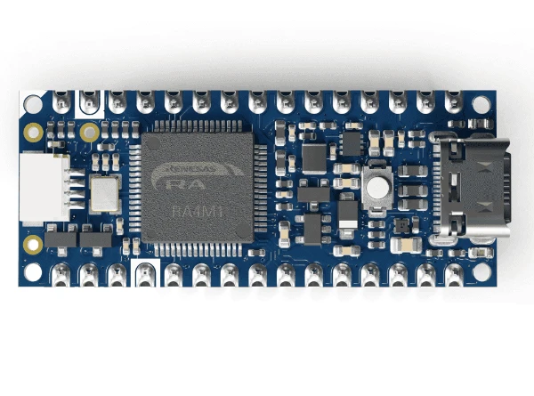

<!-- Copyright 2015-2026 Zephyr Project members and individual contributors. -->
<!-- SPDX-License-Identifier: Apache-2.0 -->
<!-- 中文翻译；编号、导航与译注为本地新增。 -->

<a id="arduino_nano_r4"></a>

# 第9章\_Arduino Nano R4

原文：[官方页面](https://docs.zephyrproject.org/latest/boards/arduino/nano_r4/doc/index.html)。读取日期：2026-10-16；来源摘要见[来源记录](../SOURCES.md)。

开发板概览（Board Overview）

<a id="id1"></a>

[](images/arduino_nano_r4.webp)

Arduino Nano R4

名称（Name）：

`arduino_nano_r4`

厂商（Vendor）：

[Arduino](https://docs.zephyrproject.org/latest/boards/index.html#vendor=arduino)

状态（Status）：

维护中（Maintained）

架构（Architecture）：

[arm](https://docs.zephyrproject.org/latest/boards/index.html#arch=arm)

片上系统（SoC）：

[r7fa4m1ab3cfm](https://docs.zephyrproject.org/latest/boards/index.html#soc=r7fa4m1ab3cfm)

<a id="board-github-link"></a>

[浏览开发板源码（Browse Board Sources）](https://github.com/zephyrproject-rtos/zephyr/blob/main//boards/arduino/nano_r4/doc/index.rst/../..)<a id="overview"></a>

## 概述（Overview）

Arduino NANO R4采用Renesas RA4M1片上系统（SoC），具有Arduino Nano外形，并兼容传统Arduino Nano。

<a id="hardware"></a>

## 硬件（Hardware）


- Renesas RA4MA1处理器（ARM Cortex-M4，48 MHz；型号依原文保留）
- 256 KiB闪存（Flash）和32 KiB随机存储器（RAM）
- 一个用户LED
- 一组由PWM驱动的RGB LED
- 1个复位按键（Reset Button）

<a id="supported-features"></a>

### 支持的功能（Supported Features）

`arduino_nano_r4`开发板支持下表所列的硬件功能。

片上／板载（On-Chip / On-Board）

功能集成在片上系统（SoC）内／位于开发板上。

2 / 2

分别表示已启用／已禁用的实例数。点击数量标签，可查看开发板或SoC设备树源码（DTS）中该功能的第一个实例。

`vnd,foo`

与此功能匹配的设备树绑定兼容字符串（Compatible String）；点击链接可查看绑定文档。

<a id="arduino_nano_r4-hw-features"></a>

<a id="arduino_nano_r4-arduino_nano_r4/r7fa4m1ab3cfm-hw-features-section"></a>

#### `arduino_nano_r4/r7fa4m1ab3cfm`目标（Target）

<a id="arduino_nano_r4-arduino_nano_r4/r7fa4m1ab3cfm-hw-features-panel"></a>

<a id="arduino_nano_r4-arduino_nano_r4/r7fa4m1ab3cfm-hw-features-memory"></a>

该开发板目标的片上存储容量：32 KiB RAM、256 KiB Flash。

<a id="arduino_nano_r4-arduino_nano_r4/r7fa4m1ab3cfm-hw-features-table"></a>

<table>
<tr>
<th>类型（Type）</th>
<th>位置（Location）</th>
<th>说明（Description）</th>
<th>兼容字符串（Compatible）</th>
</tr>
<tr>
<td rowspan="1">中央处理器（CPU）</td>
<td>片上（On-Chip）</td>
<td>ARM Cortex-M4 处理器（CPU）（<a href="https://github.com/zephyrproject-rtos/zephyr/blob/main/dts/arm/renesas/ra/ra4/ra4-cm4-common.dtsi?plain=1#L19">已启用：1</a>）</td>
<td><a href="../cpu_arm_riscv_binding_reference/P024_arm_cortex-m4.md#std-dtcompatible-arm-cortex-m4"><code>arm,cortex-m4</code></a></td>
</tr>
<tr>
<td rowspan="1">模数转换器（ADC）</td>
<td>片上（On-Chip）</td>
<td>Renesas RA 12位分辨率模数转换器（ADC12）（<a href="https://github.com/zephyrproject-rtos/zephyr/blob/main/dts/arm/renesas/ra/ra4/ra4-cm4-common.dtsi?plain=1#L281">已启用：1</a>）</td>
<td><a href="../hardware/P868_RenesasRAADC12绑定.md#dtbinding-renesas-ra-adc12"><code>renesas,ra-adc12</code></a></td>
</tr>
<tr>
<td rowspan="6">时钟控制（Clock Control）</td>
<td>片上（On-Chip）</td>
<td>Renesas RA时钟生成电路（Clock Generation Circuit）的外部时钟配置（<a href="https://github.com/zephyrproject-rtos/zephyr/blob/main/dts/arm/renesas/ra/ra4/r7fa4m1ax.dtsi?plain=1#L151">已禁用：1</a>）</td>
<td><a href="../clock_nxp_pico_realtek_renesas_binding_reference/P029_renesas_ra-cgc-external-clock.md#std-dtcompatible-renesas-ra-cgc-external-clock"><code>renesas,ra-cgc-external-clock</code></a></td>
</tr>
<tr>
<td>片上（On-Chip）</td>
<td>通用固定频率时钟提供者（Fixed-Rate Clock Provider）（<a href="https://github.com/zephyrproject-rtos/zephyr/blob/main/dts/arm/renesas/ra/ra4/r7fa4m1ax.dtsi?plain=1#L158">已启用：3</a>）</td>
<td><a href="../hardware/P566_固定时钟绑定.md#dtbinding-fixed-clock"><code>fixed-clock</code></a></td>
</tr>
<tr>
<td>片上（On-Chip）</td>
<td>Renesas RA子时钟（Sub-Clock）（<a href="https://github.com/zephyrproject-rtos/zephyr/blob/main/dts/arm/renesas/ra/ra4/r7fa4m1ax.dtsi?plain=1#L176">已禁用：1</a>）</td>
<td><a href="../clock_renesas_rockchip_sifli_silabs_binding_reference/P004_renesas_ra-cgc-subclk.md#std-dtcompatible-renesas-ra-cgc-subclk"><code>renesas,ra-cgc-subclk</code></a></td>
</tr>
<tr>
<td>片上（On-Chip）</td>
<td>Renesas RA时钟生成电路的锁相环时钟（PLL Clock）（<a href="https://github.com/zephyrproject-rtos/zephyr/blob/main/dts/arm/renesas/ra/ra4/r7fa4m1ax.dtsi?plain=1#L183">已禁用：1</a>）</td>
<td><a href="../clock_renesas_rockchip_sifli_silabs_binding_reference/P003_renesas_ra-cgc-pll.md#std-dtcompatible-renesas-ra-cgc-pll"><code>renesas,ra-cgc-pll</code></a></td>
</tr>
<tr>
<td>片上（On-Chip）</td>
<td>Renesas RA时钟控制节点的pclk模块（<a href="https://github.com/zephyrproject-rtos/zephyr/blob/main/dts/arm/renesas/ra/ra4/r7fa4m1ax.dtsi?plain=1#L193">已启用：1</a>）</td>
<td><a href="../clock_nxp_pico_realtek_renesas_binding_reference/P030_renesas_ra-cgc-pclk-block.md#std-dtcompatible-renesas-ra-cgc-pclk-block"><code>renesas,ra-cgc-pclk-block</code></a></td>
</tr>
<tr>
<td>片上（On-Chip）</td>
<td>Renesas RA时钟控制外设时钟（Peripheral Clock）（<a href="https://github.com/zephyrproject-rtos/zephyr/blob/main/dts/arm/renesas/ra/ra4/r7fa4m1ax.dtsi?plain=1#L203">已启用：6</a>；<a href="https://github.com/zephyrproject-rtos/zephyr/blob/main/dts/arm/renesas/ra/ra4/r7fa4m1ax.dtsi?plain=1#L246">已禁用：2</a>）</td>
<td><a href="../clock_renesas_rockchip_sifli_silabs_binding_reference/P001_renesas_ra-cgc-pclk.md#std-dtcompatible-renesas-ra-cgc-pclk"><code>renesas,ra-cgc-pclk</code></a></td>
</tr>
<tr>
<td rowspan="1">计数器（Counter）</td>
<td>片上（On-Chip）</td>
<td>用作计数器的Renesas RA异步通用定时器（AGT）（<a href="https://github.com/zephyrproject-rtos/zephyr/blob/main/dts/arm/renesas/ra/ra4/ra4-cm4-common.dtsi?plain=1#L260">已禁用：2</a>）</td>
<td><a href="../renesas_realtek_counter_binding_reference/P014_renesas_ra-agt-counter.md#std-dtcompatible-renesas-ra-agt-counter"><code>renesas,ra-agt-counter</code></a></td>
</tr>
<tr>
<td rowspan="1">循环冗余校验（CRC）</td>
<td>片上（On-Chip）</td>
<td>Renesas RA循环冗余校验（CRC）设备（<a href="https://github.com/zephyrproject-rtos/zephyr/blob/main/dts/arm/renesas/ra/ra4/ra4-cm4-common.dtsi?plain=1#L306">已禁用：1</a>）</td>
<td><a href="../crc_clock_monitor_binding_reference/P008_renesas_ra-crc.md#std-dtcompatible-renesas-ra-crc"><code>renesas,ra-crc</code></a></td>
</tr>
<tr>
<td rowspan="2">数模转换器（DAC）</td>
<td>片上（On-Chip）</td>
<td>Renesas RA数模转换器全局控制器（DAC Controller Global）（<a href="https://github.com/zephyrproject-rtos/zephyr/blob/main/dts/arm/renesas/ra/ra4/ra4-cm4-common.dtsi?plain=1#L291">已启用：1</a>）</td>
<td><a href="../hardware/P772_RenesasRA数模转换器全局绑定.md#dtbinding-renesas-ra-dac-global"><code>renesas,ra-dac-global</code></a></td>
</tr>
<tr>
<td>片上（On-Chip）</td>
<td>Renesas RA数模转换器（DAC）控制器（<a href="https://github.com/zephyrproject-rtos/zephyr/blob/main/dts/arm/renesas/ra/ra4/ra4-cm4-common.dtsi?plain=1#L298">已禁用：1</a>）</td>
<td><a href="../hardware/P773_RenesasRA数模转换器绑定.md#dtbinding-renesas-ra-dac"><code>renesas,ra-dac</code></a></td>
</tr>
<tr>
<td rowspan="1">直接存储器访问（DMA）</td>
<td>片上（On-Chip）</td>
<td>Renesas RA直接存储器访问（DMA）控制器（<a href="https://github.com/zephyrproject-rtos/zephyr/blob/main/dts/arm/renesas/ra/ra4/ra4-cm4-common.dtsi?plain=1#L121">已禁用：1</a>）</td>
<td><a href="../nxp_realtek_renesas_dma_binding_reference/P012_renesas_ra-dma.md#std-dtcompatible-renesas-ra-dma"><code>renesas,ra-dma</code></a></td>
</tr>
<tr>
<td rowspan="2">闪存控制器（Flash Controller）</td>
<td>片上（On-Chip）</td>
<td>Renesas RA闪存控制块（Flash Control Block）（<a href="https://github.com/zephyrproject-rtos/zephyr/blob/main/dts/arm/renesas/ra/ra4/ra4-cm4-common.dtsi?plain=1#L42">已启用：1</a>）</td>
<td><a href="../flash_nuvoton_nxp_renesas_binding_reference/P026_renesas_ra-fcb.md#std-dtcompatible-renesas-ra-fcb"><code>renesas,ra-fcb</code></a></td>
</tr>
<tr>
<td>片上（On-Chip）</td>
<td>Renesas RA系列低功耗闪存控制器（Flash Low-Power Controller）（<a href="https://github.com/zephyrproject-rtos/zephyr/blob/main/dts/arm/renesas/ra/ra4/r7fa4m1ab3cfm.dtsi?plain=1#L17">已启用：2</a>）</td>
<td><a href="../flash_nuvoton_nxp_renesas_binding_reference/P028_renesas_ra-flash-lp-controller.md#std-dtcompatible-renesas-ra-flash-lp-controller"><code>renesas,ra-flash-lp-controller</code></a></td>
</tr>
<tr>
<td rowspan="2">通用输入输出与接插件（GPIO &amp; Headers）</td>
<td>片上（On-Chip）</td>
<td>Renesas RA通用输入输出端口（GPIO I/O Port）（<a href="https://github.com/zephyrproject-rtos/zephyr/blob/main/dts/arm/renesas/ra/ra4/ra4-cm4-common.dtsi?plain=1#L50">已启用：5</a>；<a href="https://github.com/zephyrproject-rtos/zephyr/blob/main/dts/arm/renesas/ra/ra4/ra4-cm4-common.dtsi?plain=1#L111">已禁用：1</a>）</td>
<td><a href="../gpio_raspberrypi_renesas_binding_reference/P014_renesas_ra-gpio-ioport.md#std-dtcompatible-renesas-ra-gpio-ioport"><code>renesas,ra-gpio-ioport</code></a></td>
</tr>
<tr>
<td>板载（On-Board）</td>
<td>Arduino Nano排针引出的GPIO引脚（<a href="https://github.com/zephyrproject-rtos/zephyr/blob/main/boards/arduino/nano_r4/arduino_nano_connector.dtsi?plain=1#L9">已启用：1</a>）</td>
<td><a href="../gpio_adi_headers_ambiq_binding_reference/P026_arduino-nano-header.md#std-dtcompatible-arduino-nano-header"><code>arduino-nano-header</code></a></td>
</tr>
<tr>
<td rowspan="2">集成电路间总线（I2C）</td>
<td>片上（On-Chip）</td>
<td>Renesas RA串行通信接口（SCI）I2C控制器（<a href="https://github.com/zephyrproject-rtos/zephyr/blob/main/dts/arm/renesas/ra/ra4/ra4-cm4-common.dtsi?plain=1#L151">已禁用：4</a>）</td>
<td><a href="../i2c_nxp_pico_renesas_binding_reference/P013_renesas_ra-i2c-sci.md#std-dtcompatible-renesas-ra-i2c-sci"><code>renesas,ra-i2c-sci</code></a></td>
</tr>
<tr>
<td>片上（On-Chip）</td>
<td>Renesas RA I2C控制器（<a href="https://github.com/zephyrproject-rtos/zephyr/blob/main/dts/arm/renesas/ra/ra4/ra4-cm4-common.dtsi?plain=1#L322">已启用：1</a>；<a href="https://github.com/zephyrproject-rtos/zephyr/blob/main/dts/arm/renesas/ra/ra4/ra4-cm4-common.dtsi?plain=1#L313">已禁用：1</a>）</td>
<td><a href="../i2c_nxp_pico_renesas_binding_reference/P014_renesas_ra-iic.md#std-dtcompatible-renesas-ra-iic"><code>renesas,ra-iic</code></a></td>
</tr>
<tr>
<td rowspan="1">输入（Input）</td>
<td>片上（On-Chip）</td>
<td>Renesas RA电容感应单元（Capacitive Sensing Unit）（<a href="https://github.com/zephyrproject-rtos/zephyr/blob/main/dts/arm/renesas/ra/ra4/ra4-cm4-common.dtsi?plain=1#L516">已禁用：1</a>）</td>
<td><a href="../input_touch_lvgl_gesture_binding_reference/P001_renesas_ra-ctsu.md#std-dtcompatible-renesas-ra-ctsu"><code>renesas,ra-ctsu</code></a></td>
</tr>
<tr>
<td rowspan="1">中断控制器（Interrupt Controller）</td>
<td>片上（On-Chip）</td>
<td>ARMv7-M 嵌套向量中断控制器（Nested Vectored Interrupt Controller，NVIC）（<a href="https://github.com/zephyrproject-rtos/zephyr/blob/main/dts/arm/armv7-m.dtsi?plain=1#L13">已启用：1</a>）</td>
<td><a href="../arm_interrupt_timer_binding_reference/P002_ARMv7_M_NVIC.md#std-dtcompatible-arm-v7m-nvic"><code>arm,v7m-nvic</code></a></td>
</tr>
<tr>
<td rowspan="2">发光二极管（LED）</td>
<td>板载（On-Board）</td>
<td>一组由 GPIO 控制的 LED（GPIO-Controlled LEDs）（<a href="https://github.com/zephyrproject-rtos/zephyr/blob/main/boards/arduino/nano_r4/arduino_nano_r4.dts?plain=1#L40">已启用：1</a>）</td>
<td><a href="../hardware/P564_GPIO指示灯绑定.md#dtbinding-gpio-leds"><code>gpio-leds</code></a></td>
</tr>
<tr>
<td>板载（On-Board）</td>
<td>一组由脉宽调制（PWM）控制的LED（<a href="https://github.com/zephyrproject-rtos/zephyr/blob/main/boards/arduino/nano_r4/arduino_nano_r4.dts?plain=1#L60">已启用：1</a>）</td>
<td><a href="../hardware/P565_PWM指示灯绑定.md#dtbinding-pwm-leds"><code>pwm-leds</code></a></td>
</tr>
<tr>
<td rowspan="4">其他绑定（Miscellaneous）</td>
<td>片上（On-Chip）</td>
<td>Renesas RA事件链接控制器（Event Link Controller）（<a href="https://github.com/zephyrproject-rtos/zephyr/blob/main/dts/arm/renesas/ra/ra4/ra4-cm4-common.dtsi?plain=1#L34">已禁用：1</a>）</td>
<td><a href="../misc_nxp_renesas_zephyr_binding_reference/P016_renesas_ra-elc.md#std-dtcompatible-renesas-ra-elc"><code>renesas,ra-elc</code></a></td>
</tr>
<tr>
<td>片上（On-Chip）</td>
<td>Renesas RA串行通信接口（SCI）控制器（<a href="https://github.com/zephyrproject-rtos/zephyr/blob/main/dts/arm/renesas/ra/ra4/r7fa4m1ax.dtsi?plain=1#L48">已启用：1</a>；<a href="https://github.com/zephyrproject-rtos/zephyr/blob/main/dts/arm/renesas/ra/ra4/ra4-cm4-common.dtsi?plain=1#L137">已禁用：3</a>）</td>
<td><a href="../misc_nxp_renesas_zephyr_binding_reference/P020_renesas_ra-sci.md#std-dtcompatible-renesas-ra-sci"><code>renesas,ra-sci</code></a></td>
</tr>
<tr>
<td>片上（On-Chip）</td>
<td>Renesas RA异步通用定时器（AGT）（<a href="https://github.com/zephyrproject-rtos/zephyr/blob/main/dts/arm/renesas/ra/ra4/ra4-cm4-common.dtsi?plain=1#L251">已禁用：2</a>）</td>
<td><a href="../misc_nxp_renesas_zephyr_binding_reference/P014_renesas_ra-agt.md#std-dtcompatible-renesas-ra-agt"><code>renesas,ra-agt</code></a></td>
</tr>
<tr>
<td>片上（On-Chip）</td>
<td>Renesas RA外部中断（External Interrupt）（<a href="https://github.com/zephyrproject-rtos/zephyr/blob/main/dts/arm/renesas/ra/ra4/ra4-cm4-common.dtsi?plain=1#L352">已启用：2</a>；<a href="https://github.com/zephyrproject-rtos/zephyr/blob/main/dts/arm/renesas/ra/ra4/ra4-cm4-common.dtsi?plain=1#L370">已禁用：13</a>）</td>
<td><a href="../misc_nxp_renesas_zephyr_binding_reference/P017_renesas_ra-external-interrupt.md#std-dtcompatible-renesas-ra-external-interrupt"><code>renesas,ra-external-interrupt</code></a></td>
</tr>
<tr>
<td rowspan="1">内存管理单元／内存保护单元（MMU / MPU）</td>
<td>片上（On-Chip）</td>
<td>ARMv7-M存储器保护单元（MPU / Memory Protection Unit）（<a href="https://github.com/zephyrproject-rtos/zephyr/blob/main/dts/arm/renesas/ra/ra4/ra4-cm4-common.dtsi?plain=1#L26">已启用：1</a>）</td>
<td><a href="../memory_protection_binding_reference/P005_arm_armv7m-mpu.md#std-dtcompatible-arm-armv7m-mpu"><code>arm,armv7m-mpu</code></a></td>
</tr>
<tr>
<td rowspan="1">存储技术设备（MTD）</td>
<td>片上（On-Chip）</td>
<td>闪存（Flash）节点（<a href="https://github.com/zephyrproject-rtos/zephyr/blob/main/dts/arm/renesas/ra/ra4/r7fa4m1ab3cfm.dtsi?plain=1#L25">已启用：2</a>）</td>
<td><a href="../mtd_nxp_st_ti_partition_binding_reference/P013_soc-nv-flash.md#std-dtcompatible-soc-nv-flash"><code>soc-nv-flash</code></a></td>
</tr>
<tr>
<td rowspan="1">物理层（PHY）</td>
<td>片上（On-Chip）</td>
<td>用于所有内置于 USB IP 的 USB 收发器（USB Transceivers）的绑定。（<a href="https://github.com/zephyrproject-rtos/zephyr/blob/main/dts/arm/renesas/ra/ra4/ra4-cm4-common.dtsi?plain=1#L550">已启用：1</a>）</td>
<td><a href="../phy_binding_reference/P008_usb-nop-xceiv.md#std-dtcompatible-usb-nop-xceiv"><code>usb-nop-xceiv</code></a></td>
</tr>
<tr>
<td rowspan="1">引脚控制（Pin Control）</td>
<td>片上（On-Chip）</td>
<td>Renesas RA引脚控制器（Pin Controller）（<a href="https://github.com/zephyrproject-rtos/zephyr/blob/main/dts/arm/renesas/ra/ra4/ra4-cm4-common.dtsi?plain=1#L131">已启用：1</a>）</td>
<td><a href="../pinctrl_renesas_silabs_binding_reference/P006_renesas_ra-pinctrl-pfs.md#std-dtcompatible-renesas-ra-pinctrl-pfs"><code>renesas,ra-pinctrl-pfs</code></a></td>
</tr>
<tr>
<td rowspan="2">脉宽调制（PWM）</td>
<td>片上（On-Chip）</td>
<td>Renesas RA脉宽调制（PWM）（<a href="https://github.com/zephyrproject-rtos/zephyr/blob/main/dts/arm/renesas/ra/ra4/ra4-cm4-common.dtsi?plain=1#L451">已启用：4</a>；<a href="https://github.com/zephyrproject-rtos/zephyr/blob/main/dts/arm/renesas/ra/ra4/ra4-cm4-common.dtsi?plain=1#L461">已禁用：4</a>）</td>
<td><a href="../pwm_nxp_renesas_binding_reference/P019_renesas_ra-pwm.md#std-dtcompatible-renesas-ra-pwm"><code>renesas,ra-pwm</code></a></td>
</tr>
<tr>
<td>板载（On-Board）</td>
<td>Arduino排针引出的PWM通道（<a href="https://github.com/zephyrproject-rtos/zephyr/blob/main/boards/arduino/nano_r4/arduino_nano_connector.dtsi?plain=1#L51">已启用：1</a>）</td>
<td><a href="../pwm_adi_esp_infineon_binding_reference/P006_arduino-header-pwm.md#std-dtcompatible-arduino-header-pwm"><code>arduino-header-pwm</code></a></td>
</tr>
<tr>
<td rowspan="1">保留内存（Reserved Memory）</td>
<td>片上（On-Chip）</td>
<td>Renesas选项设置存储器（Option-Setting Memory）（<a href="https://github.com/zephyrproject-rtos/zephyr/blob/main/dts/arm/renesas/ra/ra4/ra4-cm4-common.dtsi?plain=1#L524">已启用：3</a>）</td>
<td><a href="../memory_protection_binding_reference/P011_renesas_ofs-memory.md#std-dtcompatible-renesas-ofs-memory"><code>renesas,ofs-memory</code></a></td>
</tr>
<tr>
<td rowspan="1">随机数生成器（RNG）</td>
<td>片上（On-Chip）</td>
<td>Renesas RA SCE5真随机数发生器（TRNG）（<a href="https://github.com/zephyrproject-rtos/zephyr/blob/main/dts/arm/renesas/ra/ra4/r7fa4m1ax.dtsi?plain=1#L121">已启用：1</a>）</td>
<td><a href="../soc_rng_binding_reference/P006_renesas_ra-sce5-rng.md#std-dtcompatible-renesas-ra-sce5-rng"><code>renesas,ra-sce5-rng</code></a></td>
</tr>
<tr>
<td rowspan="1">串行控制器（Serial Controller）</td>
<td>片上（On-Chip）</td>
<td>Renesas RA SCI UART控制器（<a href="https://github.com/zephyrproject-rtos/zephyr/blob/main/dts/arm/renesas/ra/ra4/r7fa4m1ax.dtsi?plain=1#L56">已启用：1</a>；<a href="https://github.com/zephyrproject-rtos/zephyr/blob/main/dts/arm/renesas/ra/ra4/ra4-cm4-common.dtsi?plain=1#L145">已禁用：3</a>）</td>
<td><a href="../uart_raspberrypi_realtek_renesas_binding_reference/P006_renesas_ra-sci-uart.md#std-dtcompatible-renesas-ra-sci-uart"><code>renesas,ra-sci-uart</code></a></td>
</tr>
<tr>
<td rowspan="2">串行外设接口（SPI）</td>
<td>片上（On-Chip）</td>
<td>Renesas RA SCI SPI控制器（<a href="https://github.com/zephyrproject-rtos/zephyr/blob/main/dts/arm/renesas/ra/ra4/ra4-cm4-common.dtsi?plain=1#L159">已禁用：4</a>）</td>
<td><a href="../spi_flexspi_nxp_renesas_binding_reference/P016_renesas_ra-spi-sci.md#std-dtcompatible-renesas-ra-spi-sci"><code>renesas,ra-spi-sci</code></a></td>
</tr>
<tr>
<td>片上（On-Chip）</td>
<td>Renesas RA SPI控制器（<a href="https://github.com/zephyrproject-rtos/zephyr/blob/main/dts/arm/renesas/ra/ra4/ra4-cm4-common.dtsi?plain=1#L240">已启用：1</a>；<a href="https://github.com/zephyrproject-rtos/zephyr/blob/main/dts/arm/renesas/ra/ra4/ra4-cm4-common.dtsi?plain=1#L231">已禁用：1</a>）</td>
<td><a href="../spi_flexspi_nxp_renesas_binding_reference/P017_renesas_ra-spi.md#std-dtcompatible-renesas-ra-spi"><code>renesas,ra-spi</code></a></td>
</tr>
<tr>
<td rowspan="1">静态随机存储器（SRAM）</td>
<td>片上（On-Chip）</td>
<td>通用片上静态随机存储器（SRAM）（<a href="https://github.com/zephyrproject-rtos/zephyr/blob/main/dts/arm/renesas/ra/ra4/r7fa4m1ax.dtsi?plain=1#L13">已启用：1</a>）</td>
<td><a href="../hardware/P567_内存映射SRAM绑定.md#dtbinding-mmio-sram"><code>mmio-sram</code></a></td>
</tr>
<tr>
<td rowspan="1">定时器（Timer）</td>
<td>片上（On-Chip）</td>
<td>ARMv7-M 系统节拍（System Tick）（<a href="https://github.com/zephyrproject-rtos/zephyr/blob/main/dts/arm/armv7-m.dtsi?plain=1#L21">已启用：1</a>）</td>
<td><a href="../arm_interrupt_timer_binding_reference/P006_ARMv7_M_SysTick.md#std-dtcompatible-arm-armv7m-systick"><code>arm,armv7m-systick</code></a></td>
</tr>
<tr>
<td rowspan="3">通用串行总线（USB）</td>
<td>片上（On-Chip）</td>
<td>Renesas RA USB全速控制器（Full-Speed Controller）（<a href="https://github.com/zephyrproject-rtos/zephyr/blob/main/dts/arm/renesas/ra/ra4/ra4-cm4-common.dtsi?plain=1#L331">已禁用：1</a>）</td>
<td><a href="../usb_soc_binding_reference/P018_renesas_ra-usbfs.md#std-dtcompatible-renesas-ra-usbfs"><code>renesas,ra-usbfs</code></a></td>
</tr>
<tr>
<td>片上（On-Chip）</td>
<td>Renesas RA USB设备控制器（Device Controller）（<a href="https://github.com/zephyrproject-rtos/zephyr/blob/main/dts/arm/renesas/ra/ra4/ra4-cm4-common.dtsi?plain=1#L341">已禁用：1</a>）</td>
<td><a href="../usb_soc_binding_reference/P016_renesas_ra-udc.md#std-dtcompatible-renesas-ra-udc"><code>renesas,ra-udc</code></a></td>
</tr>
<tr>
<td>片上（On-Chip）</td>
<td>Renesas RA USB主机控制器（Host Controller）（<a href="https://github.com/zephyrproject-rtos/zephyr/blob/main/dts/arm/renesas/ra/ra4/ra4-cm4-common.dtsi?plain=1#L346">已禁用：1</a>）</td>
<td><a href="../usb_soc_binding_reference/P017_renesas_ra-uhc.md#std-dtcompatible-renesas-ra-uhc"><code>renesas,ra-uhc</code></a></td>
</tr>
<tr>
<td rowspan="1">看门狗（Watchdog）</td>
<td>片上（On-Chip）</td>
<td>Renesas RA看门狗（WDT）（<a href="https://github.com/zephyrproject-rtos/zephyr/blob/main/dts/arm/renesas/ra/ra4/ra4-cm4-common.dtsi?plain=1#L509">已禁用：1</a>）</td>
<td><a href="../realtek_renesas_silabs_watchdog_binding_reference/P005_renesas_ra-wdt.md#std-dtcompatible-renesas-ra-wdt"><code>renesas,ra-wdt</code></a></td>
</tr>
</table>

<a id="programming-and-debugging"></a>

## 编程与调试（Programming and Debugging）

`arduino_nano_r4`开发板支持下表所列的运行工具（Runners）及相关west命令。

<table>
<tr>
<th></th>
<th>烧录（flash）</th>
<th>调试（debug）</th>
<th>连接调试会话（attach）</th>
<th>实时传输（rtt）</th>
<th>复位（reset）</th>
<th>调试服务器（debugserver）</th>
</tr>
<tr>
<td><a href="https://docs.zephyrproject.org/latest/develop/flash_debug/host-tools.html#runner-pyocd">pyocd</a></td>
<td>✅（默认 / default）</td>
<td>✅（默认 / default）</td>
<td>✅</td>
<td>✅</td>
<td>✅</td>
<td>✅</td>
</tr>
</table>

<a id="debug-adapter"></a>

### 调试适配器（Debug Adapter）

烧录和调试程序需要调试适配器。

需要另行准备调试适配器；此开发板适用兼容5 V的CMSIS-DAP适配器。

也可以使用[Renesas Flash Programming Tool](https://www.renesas.com/en/software-tool/renesas-flash-programmer-programming-gui#overview)。这是专有软件，下载前需要注册用户账户；该工具支持通过USB Type-C烧录。

<a id="building-flashing"></a>

### 构建与烧录（Building & Flashing）

可以通过`west flash`命令构建并烧录，更多信息见[构建应用（Building an Application）](../application/P001_应用开发.md#build-an-application)及[运行应用（Run an Application）](https://docs.zephyrproject.org/latest/develop/application/index.html#application-run)。

以下以构建并烧录[Blinky](../getting_started/P004_LED闪烁示例.md#blinky)应用为例。

```text
# From the root of the zephyr repository
west build -b arduino_nano_r4 samples/basic/blinky
west flash
```

使用Renesas Flash Programmer通过USB Type-C烧录：

首先使Nano R4进入引导加载程序编程模式。在开发板底面找到标记清晰的BOOT和GND引脚，用跳线或镊子将二者连接。在最初连接电脑的过程中，应保持此连接。

保持BOOT与GND连接，用USB-C线将Nano R4连接到电脑，然后按一次RESET按键。板载橙色LED应熄灭，只有绿色电源LED保持点亮。

随后可使用命令行界面（CLI）烧录：

```text
./rfp-cli -device RA --port /dev/ttyACM0 -p build/zephyr/zephyr.hex
```

不要使用`-e`或`-a`选项，它们会擦除Arduino引导加载程序。

<a id="debugging"></a>

### 调试（Debugging）

可使用`west debug`命令调试。以下命令调试[Blinky](../getting_started/P004_LED闪烁示例.md#blinky)应用；另请参阅所用调试服务器的专用说明。

```text
# From the root of the zephyr repository
west build -b arduino_nano_r4 samples/basic/blinky
west debug
```

<a id="using-pyocd"></a>

#### 使用pyOCD

包括CMSIS-DAP探针在内的多种调试适配器，都可以配合pyOCD调试Arduino Nano R4。默认调试配置使用pyOCD。使用pyOCD烧录或调试Arduino Nano R4前，必须安装CMSIS-Pack；若尚未安装，执行以下命令安装相应软件包。

```text
pyocd pack install r7fa4m1ab
```

<a id="restoring-arduino-bootloader"></a>

### 恢复Arduino引导加载程序（Restoring Arduino Bootloader）

若Arduino引导加载程序损坏，可用以下命令恢复。

```text
wget https://raw.githubusercontent.com/arduino/ArduinoCore-renesas/main/bootloaders/NANOR4/dfu_nano.hex
pyocd flash -e sector -a 0x0 -t r7fa4m1ab dfu_nano.hex
```

也可以按官方[Arduino指南](https://docs.arduino.cc/tutorials/nano-r4/bootloader-flashing/)，使用Renesas Flash Programmer通过USB Type-C恢复。

## 译注

原文概述为RA4M1，硬件列表写RA4MA1。保留这处型号差异。Renesas Flash Programmer命令中禁止使用-e或-a的限制、5 V兼容调试适配器条件及恢复引导加载程序流程均按原文保留。

---

[上一章](P008_Arduino_Nano_Matter.md) · [返回大纲](大纲.md) · [全站翻译进度](../PROGRESS.md) · [下一章](P010_Arduino_Nesso_N1.md)
