<!-- Copyright 2015-2026 Zephyr Project members and individual contributors. -->
<!-- SPDX-License-Identifier: Apache-2.0 -->
<!-- 中文翻译；编号、导航与译注为本地新增。 -->

<a id="fvp_baser_aemv8r"></a>

# 第2章\_FVP BaseR AEMv8-R

原文：[官方页面](https://docs.zephyrproject.org/latest/boards/arm/fvp_baser_aemv8r/doc/index.html)。读取日期：2026-10-16；来源摘要见[来源记录](../SOURCES.md)。

开发板概览（Board Overview）

<a id="id14"></a>

[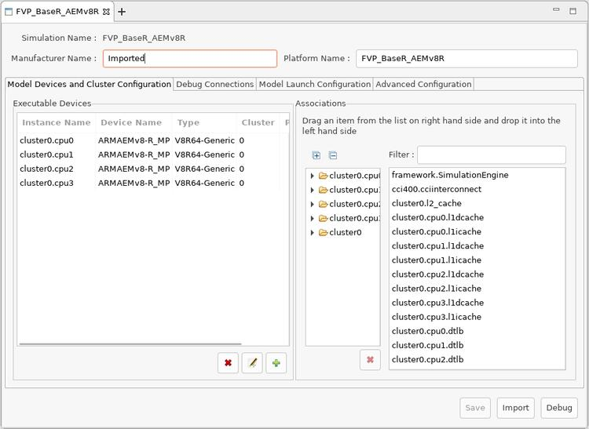](images/create-new-model-configuration_model-use-V8R64-Generic.jpg)

FVP BaseR AEMv8-R

名称（Name）：

`fvp_baser_aemv8r`

厂商（Vendor）：

[Arm公司（ARM Ltd.）](https://docs.zephyrproject.org/latest/boards/index.html#vendor=arm)

状态（Status）：

维护中（Maintained）

架构（Architecture）：

`[arm64](https://docs.zephyrproject.org/latest/boards/index.html#arch=arm64), [arm](https://docs.zephyrproject.org/latest/boards/index.html#arch=arm)`

片上系统（SoC）：

`[fvp_aemv8r_aarch32](https://docs.zephyrproject.org/latest/boards/index.html#soc=fvp_aemv8r_aarch32), [fvp_aemv8r_aarch64](https://docs.zephyrproject.org/latest/boards/index.html#soc=fvp_aemv8r_aarch64)`

<a id="board-github-link"></a>

[浏览开发板源码（Browse Board Sources）](https://github.com/zephyrproject-rtos/zephyr/blob/main//boards/arm/fvp_baser_aemv8r/doc/index.rst/../..)<a id="overview"></a>

## 概述（Overview）

<a id="id1"></a>

<a id="id2"></a>

此开发板配置使用Armv8-R AEM FVP[注1](#id9)模拟通用Armv8-R[注2](#id10)硬件平台，同时支持32位（AArch32）和64位（AArch64）架构。

固定虚拟平台（FVP）完整模拟Arm系统，包括处理器、存储器和外设。这些组件按“程序员视图”（Programmer’s View）呈现，提供用于构建及测试软件的完整模型。

<a id="id3"></a>

Armv8-R AEM FVP是免费的Armv8-R固定虚拟平台，支持最新的Armv8-R特性集。更多信息见FVP文档页面[注3](#id11)。

<a id="id4"></a>

运行FVP仿真工具前，需要从Arm开发者网站[注1](#id9)下载“Armv8-R AEM FVP”（可能需要注册用户），并安装到主机。

原文要求的最低“Armv8-R AEM FVP”版本为11.16.16。

<a id="hardware"></a>

## 硬件（Hardware）

<a id="supported-features"></a>

### 支持的功能（Supported Features）

`fvp_baser_aemv8r`开发板支持下表所列的硬件功能。

片上／板载（On-Chip / On-Board）

功能集成在片上系统（SoC）内／位于开发板上。

2 / 2

分别表示已启用／已禁用的实例数。点击数量标签，可查看开发板或SoC设备树源码（DTS）中该功能的第一个实例。

`vnd,foo`

与此功能匹配的设备树绑定兼容字符串（Compatible String）；点击链接可查看绑定文档。

<a id="fvp_baser_aemv8r-hw-features"></a>

<a id="fvp_baser_aemv8r-fvp_baser_aemv8r/fvp_aemv8r_aarch32-hw-features-section"></a>

#### `fvp_baser_aemv8r/fvp_aemv8r_aarch32`目标（Target）

<a id="fvp_baser_aemv8r-fvp_baser_aemv8r/fvp_aemv8r_aarch32-hw-features-panel"></a>

<a id="fvp_baser_aemv8r-fvp_baser_aemv8r/fvp_aemv8r_aarch32-hw-features-memory"></a>

该开发板目标的片上存储容量：128 MiB RAM、64 MiB Flash。

<a id="fvp_baser_aemv8r-fvp_baser_aemv8r/fvp_aemv8r_aarch32-hw-features-table"></a>

<table>
<tr>
<th>类型（Type）</th>
<th>位置（Location）</th>
<th>说明（Description）</th>
<th>兼容字符串（Compatible）</th>
</tr>
<tr>
<td rowspan="1">中央处理器（CPU）</td>
<td>片上（On-Chip）</td>
<td>ARM Cortex-R82处理器（CPU）（<a href="https://github.com/zephyrproject-rtos/zephyr/blob/main/dts/arm64/fvp/fvp-aemv8r.dtsi?plain=1#L17">已启用：4</a>）</td>
<td><a href="../cpu_cortex_xtensa_binding_reference/P015_arm_cortex-r82.md#std-dtcompatible-arm-cortex-r82"><code>arm,cortex-r82</code></a></td>
</tr>
<tr>
<td rowspan="1">时钟控制（Clock Control）</td>
<td>片上（On-Chip）</td>
<td>通用固定频率时钟提供者（Fixed-Rate Clock Provider）（<a href="https://github.com/zephyrproject-rtos/zephyr/blob/main/dts/arm64/fvp/fvp-aemv8r.dtsi?plain=1#L55">已启用：1</a>）</td>
<td><a href="../hardware/P566_固定时钟绑定.md#dtbinding-fixed-clock"><code>fixed-clock</code></a></td>
</tr>
<tr>
<td rowspan="3">以太网（Ethernet）</td>
<td>片上（On-Chip）</td>
<td>SMSC（现属Microchip）LAN91C111以太网控制器（<a href="https://github.com/zephyrproject-rtos/zephyr/blob/main/dts/arm64/fvp/fvp-aemv8r.dtsi?plain=1#L112">已禁用：1</a>）</td>
<td><a href="../ethernet_synopsys_st_xilinx_binding_reference/P002_smsc_lan91c111.md#std-dtcompatible-smsc-lan91c111"><code>smsc,lan91c111</code></a></td>
</tr>
<tr>
<td>片上（On-Chip）</td>
<td>SMSC（现属Microchip）LAN91C111管理数据输入输出（MDIO）驱动节点（<a href="https://github.com/zephyrproject-rtos/zephyr/blob/main/dts/arm64/fvp/fvp-aemv8r.dtsi?plain=1#L120">已禁用：1</a>）</td>
<td><a href="../ethernet_mdio_microchip_binding_reference/P008_smsc_lan91c111-mdio.md#std-dtcompatible-smsc-lan91c111-mdio"><code>smsc,lan91c111-mdio</code></a></td>
</tr>
<tr>
<td>片上（On-Chip）</td>
<td>通用媒体独立接口物理层（MII PHY）（<a href="https://github.com/zephyrproject-rtos/zephyr/blob/main/dts/arm64/fvp/fvp-aemv8r.dtsi?plain=1#L126">已禁用：1</a>）</td>
<td><a href="../ethernet_nxp_phy_binding_reference/P019_ethernet-phy.md#std-dtcompatible-ethernet-phy"><code>ethernet-phy</code></a></td>
</tr>
<tr>
<td rowspan="1">中断控制器（Interrupt Controller）</td>
<td>片上（On-Chip）</td>
<td>ARM通用中断控制器（GIC）v3（<a href="https://github.com/zephyrproject-rtos/zephyr/blob/main/dts/arm64/fvp/fvp-aemv8r.dtsi?plain=1#L64">已启用：1</a>）</td>
<td><a href="../interrupt_fabric_binding_reference/P004_arm_gic-v3.md#std-dtcompatible-arm-gic-v3"><code>arm,gic-v3</code></a></td>
</tr>
<tr>
<td rowspan="1">存储技术设备（MTD）</td>
<td>板载（On-Board）</td>
<td>闪存（Flash）节点（<a href="https://github.com/zephyrproject-rtos/zephyr/blob/main/boards/arm/fvp_baser_aemv8r/fvp_baser_aemv8r_fvp_aemv8r_aarch32.dts?plain=1#L30">已启用：1</a>）</td>
<td><a href="../mtd_nxp_st_ti_partition_binding_reference/P013_soc-nv-flash.md#std-dtcompatible-soc-nv-flash"><code>soc-nv-flash</code></a></td>
</tr>
<tr>
<td rowspan="1">电源管理 CPU 操作（Power Management CPU Operations）</td>
<td>板载（On-Board）</td>
<td>电源状态协调接口（PSCI / Power State Coordination Interface）0.2版（<a href="https://github.com/zephyrproject-rtos/zephyr/blob/main/boards/arm/fvp_baser_aemv8r/fvp_baser_aemv8r_fvp_aemv8r_aarch32.dts?plain=1#L24">已启用：1</a>）</td>
<td><a href="https://docs.zephyrproject.org/latest/build/dts/api/bindings/pm_cpu_ops/arm%2Cpsci-0.2.html#std-dtcompatible-arm-psci-0.2"><code>arm,psci-0.2</code></a></td>
</tr>
<tr>
<td rowspan="1">串行控制器（Serial Controller）</td>
<td>片上（On-Chip）</td>
<td>ARM PL011通用异步收发器（UART）（<a href="https://github.com/zephyrproject-rtos/zephyr/blob/main/dts/arm64/fvp/fvp-aemv8r.dtsi?plain=1#L73">已启用：1</a>；<a href="https://github.com/zephyrproject-rtos/zephyr/blob/main/dts/arm64/fvp/fvp-aemv8r.dtsi?plain=1#L82">已禁用：3</a>）</td>
<td><a href="../uart_adi_arm_atmel_binding_reference/P008_arm_pl011.md#std-dtcompatible-arm-pl011"><code>arm,pl011</code></a></td>
</tr>
<tr>
<td rowspan="1">定时器（Timer）</td>
<td>片上（On-Chip）</td>
<td>每个内核独立的ARM架构定时器（Architected Timer）（<a href="https://github.com/zephyrproject-rtos/zephyr/blob/main/dts/arm64/fvp/fvp-aemv8r.dtsi?plain=1#L42">已启用：1</a>）</td>
<td><a href="../arm_interrupt_timer_binding_reference/P010_ARMv8架构定时器.md#std-dtcompatible-arm-armv8-timer"><code>arm,armv8-timer</code></a></td>
</tr>
</table>

<a id="fvp_baser_aemv8r-fvp_baser_aemv8r/fvp_aemv8r_aarch32/smp-hw-features-section"></a>

#### `fvp_baser_aemv8r/fvp_aemv8r_aarch32/smp`目标（Target）

<a id="fvp_baser_aemv8r-fvp_baser_aemv8r/fvp_aemv8r_aarch32/smp-hw-features-panel"></a>

<a id="fvp_baser_aemv8r-fvp_baser_aemv8r/fvp_aemv8r_aarch32/smp-hw-features-memory"></a>

该开发板目标的片上存储容量：128 MiB RAM、64 MiB Flash。

<a id="fvp_baser_aemv8r-fvp_baser_aemv8r/fvp_aemv8r_aarch32/smp-hw-features-table"></a>

<table>
<tr>
<th>类型（Type）</th>
<th>位置（Location）</th>
<th>说明（Description）</th>
<th>兼容字符串（Compatible）</th>
</tr>
<tr>
<td rowspan="1">中央处理器（CPU）</td>
<td>片上（On-Chip）</td>
<td>ARM Cortex-R82处理器（CPU）（<a href="https://github.com/zephyrproject-rtos/zephyr/blob/main/dts/arm64/fvp/fvp-aemv8r.dtsi?plain=1#L17">已启用：4</a>）</td>
<td><a href="../cpu_cortex_xtensa_binding_reference/P015_arm_cortex-r82.md#std-dtcompatible-arm-cortex-r82"><code>arm,cortex-r82</code></a></td>
</tr>
<tr>
<td rowspan="1">时钟控制（Clock Control）</td>
<td>片上（On-Chip）</td>
<td>通用固定频率时钟提供者（Fixed-Rate Clock Provider）（<a href="https://github.com/zephyrproject-rtos/zephyr/blob/main/dts/arm64/fvp/fvp-aemv8r.dtsi?plain=1#L55">已启用：1</a>）</td>
<td><a href="../hardware/P566_固定时钟绑定.md#dtbinding-fixed-clock"><code>fixed-clock</code></a></td>
</tr>
<tr>
<td rowspan="3">以太网（Ethernet）</td>
<td>片上（On-Chip）</td>
<td>SMSC（现属Microchip）LAN91C111以太网控制器（<a href="https://github.com/zephyrproject-rtos/zephyr/blob/main/dts/arm64/fvp/fvp-aemv8r.dtsi?plain=1#L112">已禁用：1</a>）</td>
<td><a href="../ethernet_synopsys_st_xilinx_binding_reference/P002_smsc_lan91c111.md#std-dtcompatible-smsc-lan91c111"><code>smsc,lan91c111</code></a></td>
</tr>
<tr>
<td>片上（On-Chip）</td>
<td>SMSC（现属Microchip）LAN91C111管理数据输入输出（MDIO）驱动节点（<a href="https://github.com/zephyrproject-rtos/zephyr/blob/main/dts/arm64/fvp/fvp-aemv8r.dtsi?plain=1#L120">已禁用：1</a>）</td>
<td><a href="../ethernet_mdio_microchip_binding_reference/P008_smsc_lan91c111-mdio.md#std-dtcompatible-smsc-lan91c111-mdio"><code>smsc,lan91c111-mdio</code></a></td>
</tr>
<tr>
<td>片上（On-Chip）</td>
<td>通用媒体独立接口物理层（MII PHY）（<a href="https://github.com/zephyrproject-rtos/zephyr/blob/main/dts/arm64/fvp/fvp-aemv8r.dtsi?plain=1#L126">已禁用：1</a>）</td>
<td><a href="../ethernet_nxp_phy_binding_reference/P019_ethernet-phy.md#std-dtcompatible-ethernet-phy"><code>ethernet-phy</code></a></td>
</tr>
<tr>
<td rowspan="1">中断控制器（Interrupt Controller）</td>
<td>片上（On-Chip）</td>
<td>ARM通用中断控制器（GIC）v3（<a href="https://github.com/zephyrproject-rtos/zephyr/blob/main/dts/arm64/fvp/fvp-aemv8r.dtsi?plain=1#L64">已启用：1</a>）</td>
<td><a href="../interrupt_fabric_binding_reference/P004_arm_gic-v3.md#std-dtcompatible-arm-gic-v3"><code>arm,gic-v3</code></a></td>
</tr>
<tr>
<td rowspan="1">存储技术设备（MTD）</td>
<td>板载（On-Board）</td>
<td>闪存（Flash）节点（<a href="https://github.com/zephyrproject-rtos/zephyr/blob/main/boards/arm/fvp_baser_aemv8r/fvp_baser_aemv8r_fvp_aemv8r_aarch32.dts?plain=1#L30">已启用：1</a>）</td>
<td><a href="../mtd_nxp_st_ti_partition_binding_reference/P013_soc-nv-flash.md#std-dtcompatible-soc-nv-flash"><code>soc-nv-flash</code></a></td>
</tr>
<tr>
<td rowspan="1">电源管理 CPU 操作（Power Management CPU Operations）</td>
<td>板载（On-Board）</td>
<td>电源状态协调接口（PSCI / Power State Coordination Interface）0.2版（<a href="https://github.com/zephyrproject-rtos/zephyr/blob/main/boards/arm/fvp_baser_aemv8r/fvp_baser_aemv8r_fvp_aemv8r_aarch32.dts?plain=1#L24">已启用：1</a>）</td>
<td><a href="https://docs.zephyrproject.org/latest/build/dts/api/bindings/pm_cpu_ops/arm%2Cpsci-0.2.html#std-dtcompatible-arm-psci-0.2"><code>arm,psci-0.2</code></a></td>
</tr>
<tr>
<td rowspan="1">串行控制器（Serial Controller）</td>
<td>片上（On-Chip）</td>
<td>ARM PL011通用异步收发器（UART）（<a href="https://github.com/zephyrproject-rtos/zephyr/blob/main/dts/arm64/fvp/fvp-aemv8r.dtsi?plain=1#L73">已启用：1</a>；<a href="https://github.com/zephyrproject-rtos/zephyr/blob/main/dts/arm64/fvp/fvp-aemv8r.dtsi?plain=1#L82">已禁用：3</a>）</td>
<td><a href="../uart_adi_arm_atmel_binding_reference/P008_arm_pl011.md#std-dtcompatible-arm-pl011"><code>arm,pl011</code></a></td>
</tr>
<tr>
<td rowspan="1">定时器（Timer）</td>
<td>片上（On-Chip）</td>
<td>每个内核独立的ARM架构定时器（Architected Timer）（<a href="https://github.com/zephyrproject-rtos/zephyr/blob/main/dts/arm64/fvp/fvp-aemv8r.dtsi?plain=1#L42">已启用：1</a>）</td>
<td><a href="../arm_interrupt_timer_binding_reference/P010_ARMv8架构定时器.md#std-dtcompatible-arm-armv8-timer"><code>arm,armv8-timer</code></a></td>
</tr>
</table>

<a id="fvp_baser_aemv8r-fvp_baser_aemv8r/fvp_aemv8r_aarch64-hw-features-section"></a>

#### `fvp_baser_aemv8r/fvp_aemv8r_aarch64`目标（Target）

<a id="fvp_baser_aemv8r-fvp_baser_aemv8r/fvp_aemv8r_aarch64-hw-features-panel"></a>

<a id="fvp_baser_aemv8r-fvp_baser_aemv8r/fvp_aemv8r_aarch64-hw-features-memory"></a>

该开发板目标的片上存储容量：128 MiB RAM、64 MiB Flash。

<a id="fvp_baser_aemv8r-fvp_baser_aemv8r/fvp_aemv8r_aarch64-hw-features-table"></a>

<table>
<tr>
<th>类型（Type）</th>
<th>位置（Location）</th>
<th>说明（Description）</th>
<th>兼容字符串（Compatible）</th>
</tr>
<tr>
<td rowspan="1">中央处理器（CPU）</td>
<td>片上（On-Chip）</td>
<td>ARM Cortex-R82处理器（CPU）（<a href="https://github.com/zephyrproject-rtos/zephyr/blob/main/dts/arm64/fvp/fvp-aemv8r.dtsi?plain=1#L17">已启用：4</a>）</td>
<td><a href="../cpu_cortex_xtensa_binding_reference/P015_arm_cortex-r82.md#std-dtcompatible-arm-cortex-r82"><code>arm,cortex-r82</code></a></td>
</tr>
<tr>
<td rowspan="1">时钟控制（Clock Control）</td>
<td>片上（On-Chip）</td>
<td>通用固定频率时钟提供者（Fixed-Rate Clock Provider）（<a href="https://github.com/zephyrproject-rtos/zephyr/blob/main/dts/arm64/fvp/fvp-aemv8r.dtsi?plain=1#L55">已启用：1</a>）</td>
<td><a href="../hardware/P566_固定时钟绑定.md#dtbinding-fixed-clock"><code>fixed-clock</code></a></td>
</tr>
<tr>
<td rowspan="3">以太网（Ethernet）</td>
<td>片上（On-Chip）</td>
<td>SMSC（现属Microchip）LAN91C111以太网控制器（<a href="https://github.com/zephyrproject-rtos/zephyr/blob/main/dts/arm64/fvp/fvp-aemv8r.dtsi?plain=1#L112">已禁用：1</a>）</td>
<td><a href="../ethernet_synopsys_st_xilinx_binding_reference/P002_smsc_lan91c111.md#std-dtcompatible-smsc-lan91c111"><code>smsc,lan91c111</code></a></td>
</tr>
<tr>
<td>片上（On-Chip）</td>
<td>SMSC（现属Microchip）LAN91C111管理数据输入输出（MDIO）驱动节点（<a href="https://github.com/zephyrproject-rtos/zephyr/blob/main/dts/arm64/fvp/fvp-aemv8r.dtsi?plain=1#L120">已禁用：1</a>）</td>
<td><a href="../ethernet_mdio_microchip_binding_reference/P008_smsc_lan91c111-mdio.md#std-dtcompatible-smsc-lan91c111-mdio"><code>smsc,lan91c111-mdio</code></a></td>
</tr>
<tr>
<td>片上（On-Chip）</td>
<td>通用媒体独立接口物理层（MII PHY）（<a href="https://github.com/zephyrproject-rtos/zephyr/blob/main/dts/arm64/fvp/fvp-aemv8r.dtsi?plain=1#L126">已禁用：1</a>）</td>
<td><a href="../ethernet_nxp_phy_binding_reference/P019_ethernet-phy.md#std-dtcompatible-ethernet-phy"><code>ethernet-phy</code></a></td>
</tr>
<tr>
<td rowspan="1">中断控制器（Interrupt Controller）</td>
<td>片上（On-Chip）</td>
<td>ARM通用中断控制器（GIC）v3（<a href="https://github.com/zephyrproject-rtos/zephyr/blob/main/dts/arm64/fvp/fvp-aemv8r.dtsi?plain=1#L64">已启用：1</a>）</td>
<td><a href="../interrupt_fabric_binding_reference/P004_arm_gic-v3.md#std-dtcompatible-arm-gic-v3"><code>arm,gic-v3</code></a></td>
</tr>
<tr>
<td rowspan="1">存储技术设备（MTD）</td>
<td>板载（On-Board）</td>
<td>闪存（Flash）节点（<a href="https://github.com/zephyrproject-rtos/zephyr/blob/main/boards/arm/fvp_baser_aemv8r/fvp_baser_aemv8r_fvp_aemv8r_aarch64.dts?plain=1#L31">已启用：1</a>）</td>
<td><a href="../mtd_nxp_st_ti_partition_binding_reference/P013_soc-nv-flash.md#std-dtcompatible-soc-nv-flash"><code>soc-nv-flash</code></a></td>
</tr>
<tr>
<td rowspan="1">电源管理 CPU 操作（Power Management CPU Operations）</td>
<td>板载（On-Board）</td>
<td>电源状态协调接口（PSCI / Power State Coordination Interface）0.2版（<a href="https://github.com/zephyrproject-rtos/zephyr/blob/main/boards/arm/fvp_baser_aemv8r/fvp_baser_aemv8r_fvp_aemv8r_aarch64.dts?plain=1#L25">已启用：1</a>）</td>
<td><a href="https://docs.zephyrproject.org/latest/build/dts/api/bindings/pm_cpu_ops/arm%2Cpsci-0.2.html#std-dtcompatible-arm-psci-0.2"><code>arm,psci-0.2</code></a></td>
</tr>
<tr>
<td rowspan="1">串行控制器（Serial Controller）</td>
<td>片上（On-Chip）</td>
<td>ARM PL011通用异步收发器（UART）（<a href="https://github.com/zephyrproject-rtos/zephyr/blob/main/dts/arm64/fvp/fvp-aemv8r.dtsi?plain=1#L73">已启用：2</a>；<a href="https://github.com/zephyrproject-rtos/zephyr/blob/main/dts/arm64/fvp/fvp-aemv8r.dtsi?plain=1#L91">已禁用：2</a>）</td>
<td><a href="../uart_adi_arm_atmel_binding_reference/P008_arm_pl011.md#std-dtcompatible-arm-pl011"><code>arm,pl011</code></a></td>
</tr>
<tr>
<td rowspan="1">定时器（Timer）</td>
<td>片上（On-Chip）</td>
<td>每个内核独立的ARM架构定时器（Architected Timer）（<a href="https://github.com/zephyrproject-rtos/zephyr/blob/main/dts/arm64/fvp/fvp-aemv8r.dtsi?plain=1#L42">已启用：1</a>）</td>
<td><a href="../arm_interrupt_timer_binding_reference/P010_ARMv8架构定时器.md#std-dtcompatible-arm-armv8-timer"><code>arm,armv8-timer</code></a></td>
</tr>
</table>

<a id="fvp_baser_aemv8r-fvp_baser_aemv8r/fvp_aemv8r_aarch64/smp-hw-features-section"></a>

#### `fvp_baser_aemv8r/fvp_aemv8r_aarch64/smp`目标（Target）

<a id="fvp_baser_aemv8r-fvp_baser_aemv8r/fvp_aemv8r_aarch64/smp-hw-features-panel"></a>

<a id="fvp_baser_aemv8r-fvp_baser_aemv8r/fvp_aemv8r_aarch64/smp-hw-features-memory"></a>

该开发板目标的片上存储容量：128 MiB RAM、64 MiB Flash。

<a id="fvp_baser_aemv8r-fvp_baser_aemv8r/fvp_aemv8r_aarch64/smp-hw-features-table"></a>

<table>
<tr>
<th>类型（Type）</th>
<th>位置（Location）</th>
<th>说明（Description）</th>
<th>兼容字符串（Compatible）</th>
</tr>
<tr>
<td rowspan="1">中央处理器（CPU）</td>
<td>片上（On-Chip）</td>
<td>ARM Cortex-R82处理器（CPU）（<a href="https://github.com/zephyrproject-rtos/zephyr/blob/main/dts/arm64/fvp/fvp-aemv8r.dtsi?plain=1#L17">已启用：4</a>）</td>
<td><a href="../cpu_cortex_xtensa_binding_reference/P015_arm_cortex-r82.md#std-dtcompatible-arm-cortex-r82"><code>arm,cortex-r82</code></a></td>
</tr>
<tr>
<td rowspan="1">时钟控制（Clock Control）</td>
<td>片上（On-Chip）</td>
<td>通用固定频率时钟提供者（Fixed-Rate Clock Provider）（<a href="https://github.com/zephyrproject-rtos/zephyr/blob/main/dts/arm64/fvp/fvp-aemv8r.dtsi?plain=1#L55">已启用：1</a>）</td>
<td><a href="../hardware/P566_固定时钟绑定.md#dtbinding-fixed-clock"><code>fixed-clock</code></a></td>
</tr>
<tr>
<td rowspan="3">以太网（Ethernet）</td>
<td>片上（On-Chip）</td>
<td>SMSC（现属Microchip）LAN91C111以太网控制器（<a href="https://github.com/zephyrproject-rtos/zephyr/blob/main/dts/arm64/fvp/fvp-aemv8r.dtsi?plain=1#L112">已禁用：1</a>）</td>
<td><a href="../ethernet_synopsys_st_xilinx_binding_reference/P002_smsc_lan91c111.md#std-dtcompatible-smsc-lan91c111"><code>smsc,lan91c111</code></a></td>
</tr>
<tr>
<td>片上（On-Chip）</td>
<td>SMSC（现属Microchip）LAN91C111管理数据输入输出（MDIO）驱动节点（<a href="https://github.com/zephyrproject-rtos/zephyr/blob/main/dts/arm64/fvp/fvp-aemv8r.dtsi?plain=1#L120">已禁用：1</a>）</td>
<td><a href="../ethernet_mdio_microchip_binding_reference/P008_smsc_lan91c111-mdio.md#std-dtcompatible-smsc-lan91c111-mdio"><code>smsc,lan91c111-mdio</code></a></td>
</tr>
<tr>
<td>片上（On-Chip）</td>
<td>通用媒体独立接口物理层（MII PHY）（<a href="https://github.com/zephyrproject-rtos/zephyr/blob/main/dts/arm64/fvp/fvp-aemv8r.dtsi?plain=1#L126">已禁用：1</a>）</td>
<td><a href="../ethernet_nxp_phy_binding_reference/P019_ethernet-phy.md#std-dtcompatible-ethernet-phy"><code>ethernet-phy</code></a></td>
</tr>
<tr>
<td rowspan="1">中断控制器（Interrupt Controller）</td>
<td>片上（On-Chip）</td>
<td>ARM通用中断控制器（GIC）v3（<a href="https://github.com/zephyrproject-rtos/zephyr/blob/main/dts/arm64/fvp/fvp-aemv8r.dtsi?plain=1#L64">已启用：1</a>）</td>
<td><a href="../interrupt_fabric_binding_reference/P004_arm_gic-v3.md#std-dtcompatible-arm-gic-v3"><code>arm,gic-v3</code></a></td>
</tr>
<tr>
<td rowspan="1">存储技术设备（MTD）</td>
<td>板载（On-Board）</td>
<td>闪存（Flash）节点（<a href="https://github.com/zephyrproject-rtos/zephyr/blob/main/boards/arm/fvp_baser_aemv8r/fvp_baser_aemv8r_fvp_aemv8r_aarch64.dts?plain=1#L31">已启用：1</a>）</td>
<td><a href="../mtd_nxp_st_ti_partition_binding_reference/P013_soc-nv-flash.md#std-dtcompatible-soc-nv-flash"><code>soc-nv-flash</code></a></td>
</tr>
<tr>
<td rowspan="1">电源管理 CPU 操作（Power Management CPU Operations）</td>
<td>板载（On-Board）</td>
<td>电源状态协调接口（PSCI / Power State Coordination Interface）0.2版（<a href="https://github.com/zephyrproject-rtos/zephyr/blob/main/boards/arm/fvp_baser_aemv8r/fvp_baser_aemv8r_fvp_aemv8r_aarch64.dts?plain=1#L25">已启用：1</a>）</td>
<td><a href="https://docs.zephyrproject.org/latest/build/dts/api/bindings/pm_cpu_ops/arm%2Cpsci-0.2.html#std-dtcompatible-arm-psci-0.2"><code>arm,psci-0.2</code></a></td>
</tr>
<tr>
<td rowspan="1">串行控制器（Serial Controller）</td>
<td>片上（On-Chip）</td>
<td>ARM PL011通用异步收发器（UART）（<a href="https://github.com/zephyrproject-rtos/zephyr/blob/main/dts/arm64/fvp/fvp-aemv8r.dtsi?plain=1#L73">已启用：2</a>；<a href="https://github.com/zephyrproject-rtos/zephyr/blob/main/dts/arm64/fvp/fvp-aemv8r.dtsi?plain=1#L91">已禁用：2</a>）</td>
<td><a href="../uart_adi_arm_atmel_binding_reference/P008_arm_pl011.md#std-dtcompatible-arm-pl011"><code>arm,pl011</code></a></td>
</tr>
<tr>
<td rowspan="1">定时器（Timer）</td>
<td>片上（On-Chip）</td>
<td>每个内核独立的ARM架构定时器（Architected Timer）（<a href="https://github.com/zephyrproject-rtos/zephyr/blob/main/dts/arm64/fvp/fvp-aemv8r.dtsi?plain=1#L42">已启用：1</a>）</td>
<td><a href="../arm_interrupt_timer_binding_reference/P010_ARMv8架构定时器.md#std-dtcompatible-arm-armv8-timer"><code>arm,armv8-timer</code></a></td>
</tr>
</table>

<a id="id5"></a>

使用`-a, --application FILE`选项启动FVP时，内核会加载到动态随机存储器（DRAM）区域`[0x0–0x7FFFFFFF]`。详情见官方Armv8-R AEM FVP内存映射文档[注4](#id12)。

<a id="devices"></a>

### 设备（Devices）

<a id="system-clock"></a>

#### 系统时钟（System Clock）

此开发板配置的系统时钟频率为100 MHz。

<a id="serial-port"></a>

#### 串口（Serial Port）

此开发板配置使用UART0提供单路串行通信通道。

<a id="programming-and-debugging"></a>

## 烧录与调试（Programming and Debugging）

<a id="environment"></a>

### 环境（Environment）

构建前先设置环境变量`ARMFVP_BIN_PATH`。还可选择设置`ARMFVP_EXTRA_FLAGS`，向FVP传递额外参数。

```text
export ARMFVP_BIN_PATH=/path/to/fvp/directory
```

<a id="programming"></a>

### 编程（Programming）

此配置用于在Arm FVP仿真环境中构建基本Zephyr应用及内核测试。

AArch64（64位）应用可使用[基础同步（Basic Synchronization）](../basic_samples/P029_基本同步示例.md#synchronization)示例：

```text
# From the root of the zephyr repository
west build -b fvp_baser_aemv8r/fvp_aemv8r_aarch64 samples/synchronization
```

AArch32（32位）应用使用：

```text
# From the root of the zephyr repository
west build -b fvp_baser_aemv8r/fvp_aemv8r_aarch32 samples/synchronization
```

这会构建包含同步示例应用的镜像，然后可通过`west build -t run`运行。

<a id="debugging"></a>

### 调试（Debugging）

详细概述见[应用调试（Application Debugging）](https://docs.zephyrproject.org/latest/develop/debug/index.html#application-debugging)。

<a id="id6"></a>

可按以下说明使用Arm Development Studio[注5](#id13)调试。

<a id="debugging-with-arm-ds"></a>

#### 使用Arm开发工作室调试（Arm DS / Development Studio）

<a id="install-arm-ds"></a>

##### 安装Arm DS

<a id="id7"></a>

详情见官方Arm Development Studio页面[注5](#id13)。以下示例使用Version 2020.b、Build 2020110909。

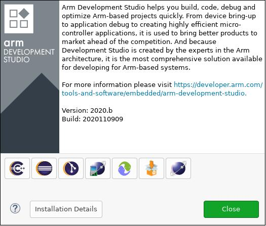

<a id="download-arm-fvp-baser-aemv8-r"></a>

##### 下载Arm FVP BaseR AEMv8-R

<a id="id8"></a>

下载方法见官方FVP页面[注1](#id9)。这里用`$FVP_D`表示FVP所在目录。

<a id="use-ds-perspective"></a>

##### 使用DS透视图（Perspective）


- 从菜单选择`Window ‣ Perspective ‣ Open Perspective ‣ Other…`：
- 在打开的窗口中选择`Development Studio (default)`：

  <a id="id15"></a>

  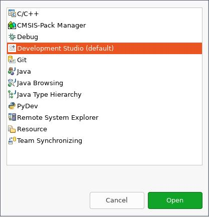

  选择Development Studio透视图（Perspective）

<a id="create-a-new-configuration-database"></a>

##### 创建新的配置数据库（Configuration Database）


- 选择`File ‣ New ‣ Other… ‣ Configuration Database`，创建配置数据库：

  <a id="id16"></a>

  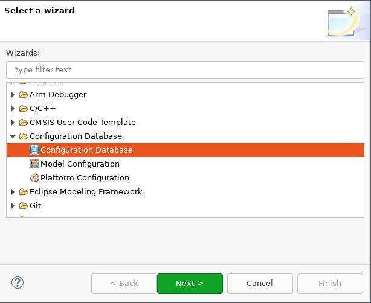

  创建配置数据库（Configuration Database）
- 为数据库取名；此处使用`Zephyr`：

  <a id="id17"></a>

  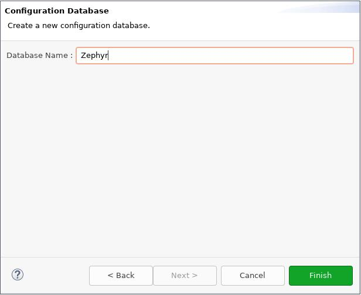

  选择数据库名称（Database Name）
- 点击`Finish`，即可在项目资源管理器（Project Explorer）中看到新的配置数据库：

  <a id="id18"></a>

  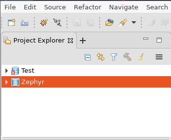

  项目资源管理器（Project Explorer）中显示新配置数据库

<a id="create-a-new-model-configuration"></a>

##### 创建新的模型配置（Model Configuration）


- 在Project Explorer中右击`Zephyr`，选择`New ‣ Model Configuration`：

  <a id="id19"></a>

  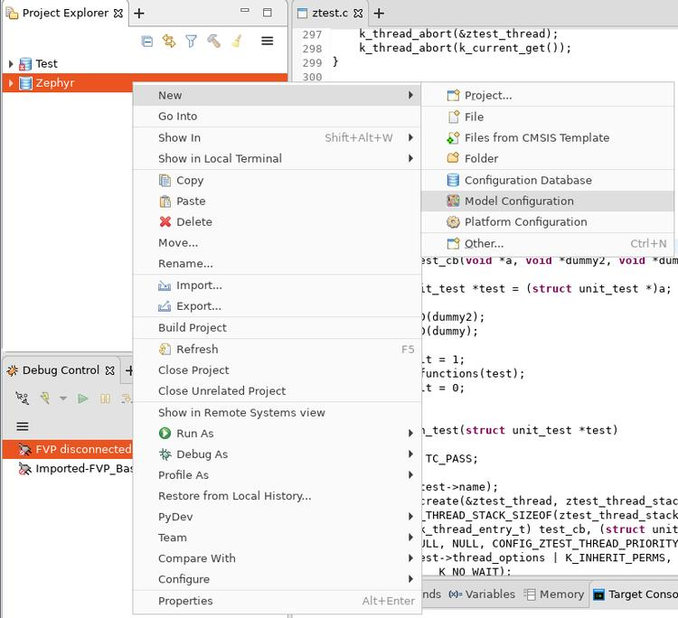

  创建模型配置（Model Configuration）
- 在打开的窗口中：


  1. 将模型接口（Model Interface）设为`Iris`，然后点击`Next >`。
  2. 选择`Launch and connect to specific model`，然后点击`Next >`。
  3. 将模型路径（Model Path）设为`$FVP_D/FVP_BaseR_AEMv8R`，然后点击`Finish`。

  <a id="id20"></a>

  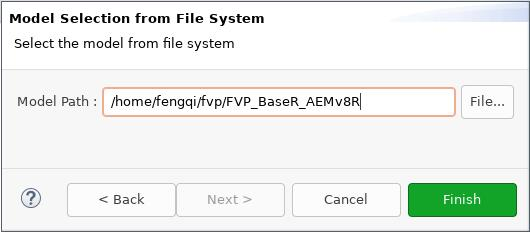

  设置模型路径（Model Path）
- 随后在`FVP_BaseR_AEMv8R`选项卡中，将`ARMAEMv8-R_`改为`V8R64-Generic`，点击`Save`，再点击`Import`：

  <a id="id21"></a>

  

  导入模型配置（Import Model Configuration）

<a id="create-a-new-launch-configuration"></a>

##### 创建新的启动配置（Launch Configuration）


- 在Project Explorer中右击`FVP_BaseR_AEMv8R`，选择`Debug as ‣ Debug configurations…`：

  <a id="id22"></a>

  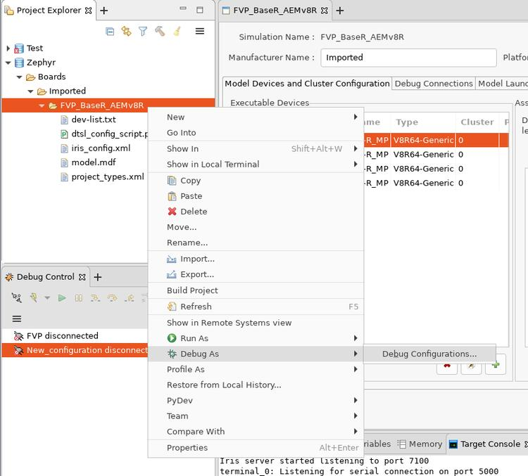

  创建启动配置：上下文菜单（Context Menu）
- 选择`Generic Arm C/C++ Application`，点击`New launch configuration`按钮。

  将创建名为`New_configuration`的新配置。


1. 在连接（Connection）选项卡中：


  - 在`Select target`框中选择`Imported -> FVP_BaseR_AEMv8R -> Bare Metal Debug -> ARMAEMv8-R_MP_0`。
  - 在`Connections`框中，将`Model parameters`设为：

    ```text
    -C bp.dram.enable_atomic_ops=1 -C bp.sram.enable_atomic_ops=1 -C bp.refcounter.non_arch_start_at_default=1 -C gic_distributor.GICD_CTLR-DS-1-means-secure-only=1 -C gic_distributor.has-two-security-states=0 -C bp.vis.disable_visualisation=1 -C cluster0.has_aarch64=1 -a <ZEPHYR_PROJECT_DIR>/build/zephyr/zephyr.elf
    ```

    这些参数在启动时传递给`FVP_BaseR_AEMv8R`。运行`FVP_BaseR_AEMv8R –help`查看所有命令行选项，运行`FVP_BaseR_AEMv8R –list-params`查看所有受支持的参数（横线字形依原文保留）。`-a`指定的`zephyr.elf`是Zephyr构建生成的二进制文件。

<a id="id23"></a>

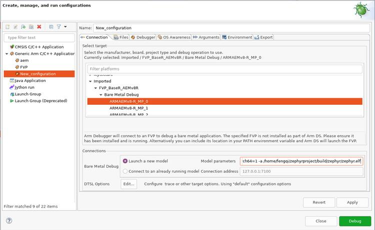

创建启动配置：连接（Connection）


1. 在文件（Files）选项卡中：

  在`Files`组中，将`Load symbols from file`设为所构建`zephyr.elf`的实际完整路径。

<a id="id24"></a>

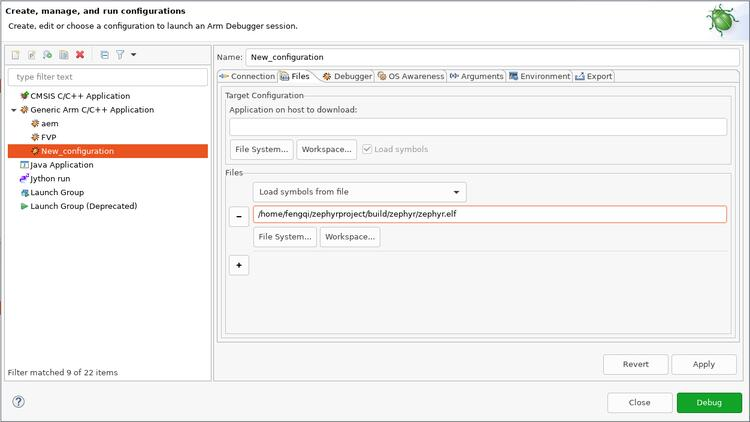

创建启动配置：文件（Files）


1. 在调试器（Debugger）选项卡中：


  - 在`Run control`框中勾选`Execute debugger commands`，填入：

    ```text
    add-symbol-file "<ZEPHYR_PROJECT_DIR>/build/zephyr/zephyr.elf" EL1S:0
    ```

    将示例中的`<ZEPHYR_PROJECT_DIR>/build/zephyr/zephyr.elf`替换为自己的本地文件路径。
  - 在`Paths`框中，将`Source search directory`设为Zephyr源码所在目录。

<a id="id25"></a>

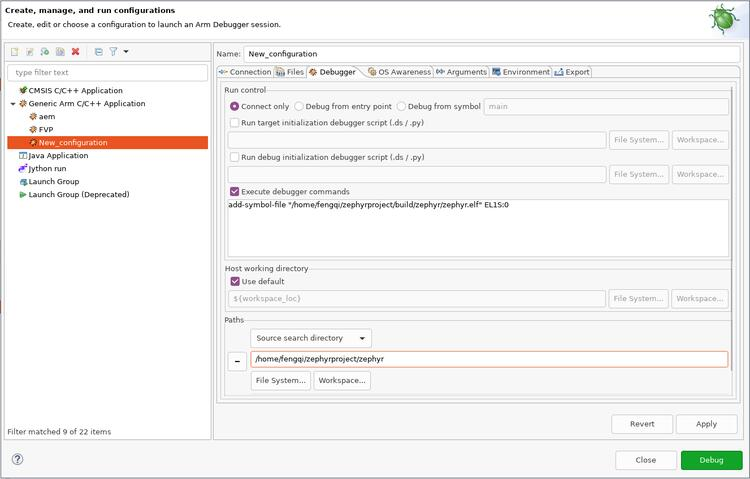

创建启动配置：调试器（Debugger）

完成上述修改后，点击`Apply`，再点击`Debug`。DS会启动并连接`FVP_BaseR_AEMv8R`，可在`Debug Control`窗口中看到已连接的新会话。

<a id="id26"></a>


Arm DS已开始工作！

<a id="references"></a>

## 参考资料（References）

<a id="id9"></a>

〔1〕 ([1](#id1),[2](#id4),[3](#id8)) [https://developer.arm.com/tools-and-software/simulation-models/fixed-virtual-platforms/arm-ecosystem-models](https://developer.arm.com/tools-and-software/simulation-models/fixed-virtual-platforms/arm-ecosystem-models)

<a id="id10"></a>

〔[2](#id2)〕 Arm架构参考手册补充文档：Armv8的Armv8-R AArch64架构配置（Architecture Profile），[https://developer.arm.com/documentation/ddi0600/latest/](https://developer.arm.com/documentation/ddi0600/latest/)

<a id="id11"></a>

〔[3](#id3)〕 [https://developer.arm.com/tools-and-software/simulation-models/fixed-virtual-platforms/docs](https://developer.arm.com/tools-and-software/simulation-models/fixed-virtual-platforms/docs)

<a id="id12"></a>

〔[4](#id5)〕 [https://developer.arm.com/documentation/100964/1114/Base-Platform/Base—memory/BaseR-Platform-memory-map](https://developer.arm.com/documentation/100964/1114/Base-Platform/Base---memory/BaseR-Platform-memory-map)

<a id="id13"></a>

〔5〕 ([1](#id6),[2](#id7)) [https://developer.arm.com/tools-and-software/embedded/arm-development-studio](https://developer.arm.com/tools-and-software/embedded/arm-development-studio)

## 译注

为避免绑定原文作者的个人目录，调试器命令中的个人主目录已统一改为<ZEPHYR_PROJECT_DIR>占位符；使用前应替换为自己项目的实际目录。其余参数按原文保留。原始界面截图保持原文件，截图中的示例路径不是本仓库链接。正文–help／–list-params的排印横线也按原文保留，实际命令应使用工具接受的选项字形。

## 原文外链核对

2026-10-16核对并重试以下原文外链时未能确认可访问性，保留原始目标，不将访问失败解释为原文内容有误。

- [BaseR-Platform-memory-map](https://developer.arm.com/documentation/100964/1114/Base-Platform/Base---memory/BaseR-Platform-memory-map)：<urlopen error [SSL: CERTIFICATE_VERIFY_FAILED] certificate verify failed: unable to get local issuer certificate (_ssl.c:1010)>。
- [](https://developer.arm.com/documentation/ddi0600/latest/)：<urlopen error [SSL: CERTIFICATE_VERIFY_FAILED] certificate verify failed: unable to get local issuer certificate (_ssl.c:1010)>。
- [arm-development-studio](https://developer.arm.com/tools-and-software/embedded/arm-development-studio)：<urlopen error [SSL: CERTIFICATE_VERIFY_FAILED] certificate verify failed: unable to get local issuer certificate (_ssl.c:1010)>。
- [arm-ecosystem-models](https://developer.arm.com/tools-and-software/simulation-models/fixed-virtual-platforms/arm-ecosystem-models)：<urlopen error [SSL: CERTIFICATE_VERIFY_FAILED] certificate verify failed: unable to get local issuer certificate (_ssl.c:1010)>。
- [docs](https://developer.arm.com/tools-and-software/simulation-models/fixed-virtual-platforms/docs)：<urlopen error [SSL: CERTIFICATE_VERIFY_FAILED] certificate verify failed: unable to get local issuer certificate (_ssl.c:1010)>。

---

[上一章](P001_BASE_RevC_2xAEM_Architectural_Envelope_Model_Fixed_Virtual_Platform.md) · [返回大纲](大纲.md) · [全站翻译进度](../PROGRESS.md) · [下一章](P003_Arm_Corstone-1000-A320_Fixed_Virtual_Platform.md)
