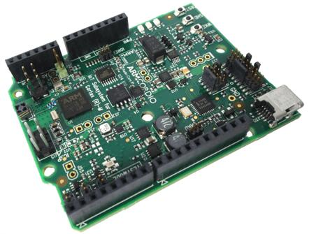

<!-- Copyright 2015-2026 Zephyr Project members and individual contributors. -->
<!-- SPDX-License-Identifier: Apache-2.0 -->
<!-- 中文翻译；编号、导航与译注为本地新增。 -->

<a id="v2m_beetle"></a>

# 第11章\_V2M Beetle

原文：[官方页面](https://docs.zephyrproject.org/latest/boards/arm/v2m_beetle/doc/index.html)。读取日期：2026-10-16；来源摘要见[来源记录](../SOURCES.md)。

开发板概览（Board Overview）

<a id="id1"></a>

[](images/v2m_beetle.jpg)

V2M Beetle

名称（Name）：

`v2m_beetle`

厂商（Vendor）：

[Arm公司（ARM Ltd.）](https://docs.zephyrproject.org/latest/boards/index.html#vendor=arm)

状态（Status）：

维护中（Maintained）

架构（Architecture）：

[arm](https://docs.zephyrproject.org/latest/boards/index.html#arch=arm)

片上系统（SoC）：

[beetle_r0](https://docs.zephyrproject.org/latest/boards/index.html#soc=beetle_r0)

<a id="board-github-link"></a>

[浏览开发板源码（Browse Board Sources）](https://github.com/zephyrproject-rtos/zephyr/blob/main//boards/arm/v2m_beetle/doc/index.rst/../..)<a id="arm-v2m-beetle"></a>

## ARM V2M Beetle

<a id="overview"></a>

### 概述（Overview）

`v2m_beetle`配置用于运行在V2M Beetle上的Zephyr应用，支持Beetle ARM Cortex-M3 CPU及以下设备：


- 嵌套向量中断控制器（NVIC / Nested Vectored Interrupt Controller）
- 系统滴答系统时钟（SYSTICK / System Tick System Clock）
- Cortex-M系统设计套件（CMSDK）GPIO
- Cortex-M系统设计套件（CMSDK）UART



更多开发板信息见[V2M Beetle网站](https://developer.arm.com/Tools%20and%20Software/Beetle%20IoT%20Evaluation%20Platform)。

<a id="hardware"></a>

### 硬件（Hardware）

ARM V2M BEETLE提供以下硬件组件：


- ARM Cortex-M3
- 面向Cortex-M的ARM物联网子系统（IoT Subsystem）
- CORDIO Bluetooth Smart蓝牙无线电（Radio）
- 存储器（Memory）


  - 256 KB嵌入式闪存（Embedded Flash）
  - 128 KB静态随机存取存储器（SRAM）
  - 2 MB外部QSPI闪存
- 调试（Debug）


  - JTAG、串行线调试（SWD）及四位跟踪（TRACE）
  - CMSIS-DAP，提供虚拟UART端口
- Arduino接口（Interface）


  - GPIO、UART、SPI及I2C
  - 模拟信号（Analog Signals）

<a id="supported-features"></a>

#### 支持的功能（Supported Features）

`v2m_beetle`开发板支持下表所列的硬件功能。

片上／板载（On-Chip / On-Board）

功能集成在片上系统（SoC）内／位于开发板上。

2 / 2

分别表示已启用／已禁用的实例数。点击数量标签，可查看开发板或SoC设备树源码（DTS）中该功能的第一个实例。

`vnd,foo`

与此功能匹配的设备树绑定兼容字符串（Compatible String）；点击链接可查看绑定文档。

<a id="v2m_beetle-hw-features"></a>

<a id="v2m_beetle-v2m_beetle/beetle_r0-hw-features-section"></a>

##### `v2m_beetle/beetle_r0`目标（Target）

<a id="v2m_beetle-v2m_beetle/beetle_r0-hw-features-panel"></a>

<a id="v2m_beetle-v2m_beetle/beetle_r0-hw-features-memory"></a>

该开发板目标的片上存储容量：128 KiB RAM、256 KiB Flash。

<a id="v2m_beetle-v2m_beetle/beetle_r0-hw-features-table"></a>

<table>
<tr>
<th>类型（Type）</th>
<th>位置（Location）</th>
<th>说明（Description）</th>
<th>兼容字符串（Compatible）</th>
</tr>
<tr>
<td rowspan="1">中央处理器（CPU）</td>
<td>板载（On-Board）</td>
<td>ARM Cortex-M3处理器（CPU）（<a href="https://github.com/zephyrproject-rtos/zephyr/blob/main/boards/arm/v2m_beetle/v2m_beetle.dts?plain=1#L27">已启用：1</a>）</td>
<td><a href="../cpu_arm_riscv_binding_reference/P021_arm_cortex-m3.md#std-dtcompatible-arm-cortex-m3"><code>arm,cortex-m3</code></a></td>
</tr>
<tr>
<td rowspan="1">ARM 架构（ARM Architecture）</td>
<td>板载（On-Board）</td>
<td>ARM V2M Beetle系统控制（System Control）（<a href="https://github.com/zephyrproject-rtos/zephyr/blob/main/boards/arm/v2m_beetle/v2m_beetle.dts?plain=1#L134">已启用：1</a>）</td>
<td><a href="../arm_timing_ethosu_control_binding_reference/P002_arm_beetle-syscon.md#std-dtcompatible-arm-beetle-syscon"><code>arm,beetle-syscon</code></a></td>
</tr>
<tr>
<td rowspan="1">时钟控制（Clock Control）</td>
<td>板载（On-Board）</td>
<td>通用固定频率时钟提供者（Fixed-Rate Clock Provider）（<a href="https://github.com/zephyrproject-rtos/zephyr/blob/main/boards/arm/v2m_beetle/v2m_beetle.dts?plain=1#L44">已启用：1</a>）</td>
<td><a href="../hardware/P566_固定时钟绑定.md#dtbinding-fixed-clock"><code>fixed-clock</code></a></td>
</tr>
<tr>
<td rowspan="2">计数器（Counter）</td>
<td>板载（On-Board）</td>
<td>ARM Cortex-M系统设计套件定时器（CMSDK Timer）（<a href="https://github.com/zephyrproject-rtos/zephyr/blob/main/boards/arm/v2m_beetle/v2m_beetle.dts?plain=1#L51">已启用：2</a>）</td>
<td><a href="../counter_binding_reference/P007_arm_cmsdk-timer.md#std-dtcompatible-arm-cmsdk-timer"><code>arm,cmsdk-timer</code></a></td>
</tr>
<tr>
<td>板载（On-Board）</td>
<td>ARM CMSDK双定时器（Dual Timer）（<a href="https://github.com/zephyrproject-rtos/zephyr/blob/main/boards/arm/v2m_beetle/v2m_beetle.dts?plain=1#L65">已启用：1</a>）</td>
<td><a href="../counter_binding_reference/P006_arm_cmsdk-dtimer.md#std-dtcompatible-arm-cmsdk-dtimer"><code>arm,cmsdk-dtimer</code></a></td>
</tr>
<tr>
<td rowspan="1">通用输入输出与接插件（GPIO &amp; Headers）</td>
<td>板载（On-Board）</td>
<td>ARM CMSDK通用输入输出（GPIO）（<a href="https://github.com/zephyrproject-rtos/zephyr/blob/main/boards/arm/v2m_beetle/v2m_beetle.dts?plain=1#L98">已启用：4</a>）</td>
<td><a href="../gpio_adi_headers_ambiq_binding_reference/P027_arm_cmsdk-gpio.md#std-dtcompatible-arm-cmsdk-gpio"><code>arm,cmsdk-gpio</code></a></td>
</tr>
<tr>
<td rowspan="1">中断控制器（Interrupt Controller）</td>
<td>片上（On-Chip）</td>
<td>ARMv7-M 嵌套向量中断控制器（Nested Vectored Interrupt Controller，NVIC）（<a href="https://github.com/zephyrproject-rtos/zephyr/blob/main/dts/arm/armv7-m.dtsi?plain=1#L13">已启用：1</a>）</td>
<td><a href="../arm_interrupt_timer_binding_reference/P002_ARMv7_M_NVIC.md#std-dtcompatible-arm-v7m-nvic"><code>arm,v7m-nvic</code></a></td>
</tr>
<tr>
<td rowspan="1">存储技术设备（MTD）</td>
<td>板载（On-Board）</td>
<td>闪存（Flash）节点（<a href="https://github.com/zephyrproject-rtos/zephyr/blob/main/boards/arm/v2m_beetle/v2m_beetle.dts?plain=1#L39">已启用：1</a>）</td>
<td><a href="../mtd_nxp_st_ti_partition_binding_reference/P013_soc-nv-flash.md#std-dtcompatible-soc-nv-flash"><code>soc-nv-flash</code></a></td>
</tr>
<tr>
<td rowspan="1">引脚控制（Pin Control）</td>
<td>板载（On-Board）</td>
<td>Arm MPS3引脚控制器（Pin Controller）（<a href="https://github.com/zephyrproject-rtos/zephyr/blob/main/boards/arm/v2m_beetle/v2m_beetle.dts?plain=1#L140">已启用：1</a>）</td>
<td><a href="../pinctrl_adi_ambiq_arm_binding_reference/P009_arm_mps3-pinctrl.md#std-dtcompatible-arm-mps3-pinctrl"><code>arm,mps3-pinctrl</code></a></td>
</tr>
<tr>
<td rowspan="1">串行控制器（Serial Controller）</td>
<td>板载（On-Board）</td>
<td>ARM CMSDK通用异步收发器（UART）（<a href="https://github.com/zephyrproject-rtos/zephyr/blob/main/boards/arm/v2m_beetle/v2m_beetle.dts?plain=1#L72">已启用：2</a>）</td>
<td><a href="../uart_adi_arm_atmel_binding_reference/P007_arm_cmsdk-uart.md#std-dtcompatible-arm-cmsdk-uart"><code>arm,cmsdk-uart</code></a></td>
</tr>
<tr>
<td rowspan="1">静态随机存储器（SRAM）</td>
<td>板载（On-Board）</td>
<td>通用片上静态随机存储器（SRAM）（<a href="https://github.com/zephyrproject-rtos/zephyr/blob/main/boards/arm/v2m_beetle/v2m_beetle.dts?plain=1#L34">已启用：1</a>）</td>
<td><a href="../hardware/P567_内存映射SRAM绑定.md#dtbinding-mmio-sram"><code>mmio-sram</code></a></td>
</tr>
<tr>
<td rowspan="1">定时器（Timer）</td>
<td>片上（On-Chip）</td>
<td>ARMv7-M 系统节拍（System Tick）（<a href="https://github.com/zephyrproject-rtos/zephyr/blob/main/dts/arm/armv7-m.dtsi?plain=1#L21">已启用：1</a>）</td>
<td><a href="../arm_interrupt_timer_binding_reference/P006_ARMv7_M_SysTick.md#std-dtcompatible-arm-armv7m-systick"><code>arm,armv7m-systick</code></a></td>
</tr>
<tr>
<td rowspan="1">看门狗（Watchdog）</td>
<td>板载（On-Board）</td>
<td>ARM CMSDK看门狗（Watchdog）（<a href="https://github.com/zephyrproject-rtos/zephyr/blob/main/boards/arm/v2m_beetle/v2m_beetle.dts?plain=1#L92">已启用：1</a>）</td>
<td><a href="../watchdog_binding_reference/P005_arm_cmsdk-watchdog.md#std-dtcompatible-arm-cmsdk-watchdog"><code>arm,cmsdk-watchdog</code></a></td>
</tr>
</table>

<a id="interrupt-controller"></a>

#### 中断控制器（Interrupt Controller）

Beetle是基于Cortex-M3的SoC，具有15个固定异常及45个IRQ。

基于Cortex-M3/4的开发板使用向量异常（Vectored Exceptions），每个异常都直接通过向量表（Vector Table）调用处理程序。

系统为异常1–6、11–12及14–15提供处理程序。下表列出各异常使用的处理程序。

<table>
<tr>
<th>异常编号（Exc#）</th>
<th>名称（Name）</th>
<th>备注（Remarks）</th>
<th>Zephyr内核中的用途（Used by Zephyr Kernel）</th>
</tr>
<tr>
<td>1</td>
<td>复位（Reset）</td>
<td></td>
<td>系统初始化（System Initialization）</td>
</tr>
<tr>
<td>2</td>
<td>不可屏蔽中断（NMI）</td>
<td></td>
<td>系统致命错误（System Fatal Error）</td>
</tr>
<tr>
<td>3</td>
<td>硬故障（Hard Fault）</td>
<td></td>
<td>系统致命错误（System Fatal Error）</td>
</tr>
<tr>
<td>4</td>
<td>存储器管理异常（MemManage）</td>
<td>内存保护单元故障（MPU Fault）</td>
<td>系统致命错误（System Fatal Error）</td>
</tr>
<tr>
<td>5</td>
<td>总线（Bus）</td>
<td></td>
<td>系统致命错误（System Fatal Error）</td>
</tr>
<tr>
<td>6</td>
<td>用法故障（Usage Fault）</td>
<td>未定义指令，或尝试切换到ARM模式</td>
<td>系统致命错误（System Fatal Error）</td>
</tr>
<tr>
<td>11</td>
<td>主管调用（SVC）</td>
<td></td>
<td>系统调用、内核运行时异常及中断卸载（IRQ Offloading）</td>
</tr>
<tr>
<td>12</td>
<td>调试监控（Debug Monitor）</td>
<td></td>
<td>系统致命错误（System Fatal Error）</td>
</tr>
<tr>
<td>14</td>
<td>可挂起系统调用（PendSV）</td>
<td></td>
<td>上下文切换（Context Switch）</td>
</tr>
<tr>
<td>15</td>
<td>系统节拍（SYSTICK）</td>
<td></td>
<td>系统时钟（System Clock）。</td>
</tr>
</table>

<a id="pin-mapping"></a>

#### 引脚映射（Pin Mapping）

ARM V2M Beetle有四个GPIO控制器，负责引脚复用、输入／输出、上拉等功能。

GPIO控制器引脚按以下编号顺序引出：


- 引脚0–15属于GPIO 0
- 引脚16–31属于GPIO 1

ARM V2M Beetle开发板引脚与GPIO控制器的映射：


- `D0 : P0_0`
- `D1 : P0_1`
- `D2 : P0_2`
- `D3 : P0_3`
- `D4 : P0_4`
- `D5 : P0_5`
- `D6 : P0_6`
- `D7 : P0_7`
- `D8 : P0_8`
- `D9 : P0_9`
- `D10 : P0_10`
- `D11 : P0_11`
- `D12 : P0_12`
- `D13 : P0_13`
- `D14 : P0_14`
- `D15 : P0_15`
- `D16 : P1_0`
- `D17 : P1_1`
- `D18 : P1_2`
- `D19 : P1_3`
- `D20 : P1_4`
- `D21 : P1_5`
- `D22 : P1_6`
- `D23 : P1_7`
- `D24 : P1_8`
- `D25 : P1_9`
- `D26 : P1_10`
- `D27 : P1_11`
- `D28 : P1_12`
- `D29 : P1_13`
- `D30 : P1_14`
- `D31 : P1_15`

外设映射（Peripheral Mapping）：


- `UART_0_RX : D0`
- `UART_0_TX : D1`
- `SPI_0_CS : D10`
- `SPI_0_MOSI : D11`
- `SPI_0_MISO : D12`
- `SPI_0_SCLK : D13`
- `I2C_0_SCL : D14`
- `I2C_0_SDA : D15`
- `UART_1_RX : D16`
- `UART_1_TX : D17`
- `SPI_1_CS : D18`
- `SPI_1_MOSI : D19`
- `SPI_1_MISO : D20`
- `SPI_1_SCK : D21`
- `I2C_1_SDA : D22`
- `I2C_1_SCL : D23`

更多细节见[Beetle技术参考手册（TRM）](https://developer.arm.com/documentation/100417/latest/)。

<a id="system-clock"></a>

#### 系统时钟（System Clock）

V2M Beetle有一个外部振荡器和两个片上振荡器。慢速时钟为32.768 kHz，主时钟为24 MHz。处理器可配置锁相环（PLL）来驱动主控时钟（Master Clock）。

<a id="serial-port"></a>

#### 串口（Serial Port）

ARM Beetle处理器有两路UART，每路只有RX/TX两根线，不支持CTS/RTS流量控制或FIFO。Zephyr控制台默认使用UART1。

<a id="programming-and-debugging"></a>

### 烧录与调试（Programming and Debugging）

<a id="flashing"></a>

#### 烧录（Flashing）

<a id="cmsis-dap"></a>

##### CMSIS调试访问端口（DAP）

V2M Beetle提供：


- 连接主机的USB接口，提供大容量存储设备（Mass Storage）和USB串口
- 串行闪存设备（Serial Flash Device），实现USB闪存盘文件存储
- 通过接口USB串口转接的物理UART连接

这些接口通过CMSIS-DAP引出。更多细节见[CMSIS-DAP网站](https://arm-software.github.io/CMSIS_5/DAP/html/index.html)。

<a id="flashing-an-application-to-v2m-beetle"></a>

##### 向V2M Beetle烧录应用

可以按通常方式构建应用。以下以[Hello World](../getting_started/P005_HelloWorld示例.md#hello_world)应用为例。

```text
# From the root of the zephyr repository
west build -b v2m_beetle samples/hello_world
```

通过USB端口将V2M Beetle连接到主机，应出现名为`MBED`的大容量存储设备及USB串口。将生成的`zephyr.bin`复制到MBED盘，复位开发板后，对应串口应显示以下消息：

```text
Hello World! arm
```

## 原文外链核对

2026-10-16核对并重试以下原文外链时未能确认可访问性，保留原始目标，不将访问失败解释为原文内容有误。

- [Beetle%20IoT%20Evaluation%20Platform](https://developer.arm.com/Tools%20and%20Software/Beetle%20IoT%20Evaluation%20Platform)：<urlopen error [SSL: CERTIFICATE_VERIFY_FAILED] certificate verify failed: unable to get local issuer certificate (_ssl.c:1010)>。
- [](https://developer.arm.com/documentation/100417/latest/)：<urlopen error [SSL: CERTIFICATE_VERIFY_FAILED] certificate verify failed: unable to get local issuer certificate (_ssl.c:1010)>。

---

[上一章](P010_MPS4_Corstone_FVP.md) · [返回大纲](大纲.md) · [全站翻译进度](../PROGRESS.md) · [下一章](P012_V2M_Musca_B1.md)
