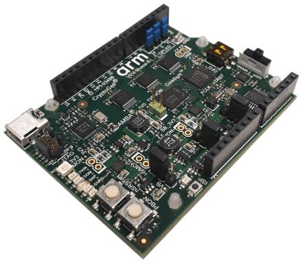
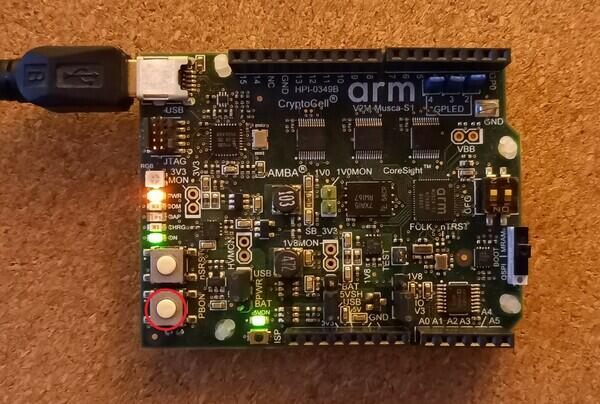

<!-- Copyright 2015-2026 Zephyr Project members and individual contributors. -->
<!-- SPDX-License-Identifier: Apache-2.0 -->
<!-- 中文翻译；编号、导航与译注为本地新增。 -->

<a id="v2m_musca_s1"></a>

# 第13章\_V2M Musca-S1

原文：[官方页面](https://docs.zephyrproject.org/latest/boards/arm/v2m_musca_s1/doc/index.html)。读取日期：2026-10-16；来源摘要见[来源记录](../SOURCES.md)。

开发板概览（Board Overview）

<a id="id1"></a>

[](images/v2m_musca_s1.jpg)

V2M Musca-S1

名称（Name）：

`v2m_musca_s1`

厂商（Vendor）：

[Arm公司（ARM Ltd.）](https://docs.zephyrproject.org/latest/boards/index.html#vendor=arm)

状态（Status）：

维护中（Maintained）

架构（Architecture）：

[arm](https://docs.zephyrproject.org/latest/boards/index.html#arch=arm)

片上系统（SoC）：

[musca_s1](https://docs.zephyrproject.org/latest/boards/index.html#soc=musca_s1)

<a id="board-github-link"></a>

[浏览开发板源码（Browse Board Sources）](https://github.com/zephyrproject-rtos/zephyr/blob/main//boards/arm/v2m_musca_s1/doc/index.rst/../..)<a id="arm-v2m-musca-s1"></a>

## ARM V2M Musca-S1

<a id="deprecated"></a>

### 已弃用（Deprecated）

此开发板已弃用（Deprecated）。非安全变体依赖TF-M，而TF-M已移除Musca-S1平台支持，因此Zephyr也已移除相应支持。安全变体仍可构建，但也已弃用，将在Zephyr v5.0中移除，以免部分支持造成混淆。

<a id="overview"></a>

### 概述（Overview）

`v2m_musca_s1`配置用于运行在V2M Musca-S1上的Zephyr应用，支持Musca-S1 ARM Cortex-M33 CPU及以下设备：


- 嵌套向量中断控制器（NVIC / Nested Vectored Interrupt Controller）
- 系统滴答系统时钟（SYSTICK / System Tick System Clock）
- Cortex-M系统设计套件（CMSDK）GPIO
- Cortex-M系统设计套件（CMSDK）UART



更多开发板信息见[V2M Musca-S1网站](https://developer.arm.com/Tools%20and%20Software/Musca-S1%20Test%20Chip%20Board)。

<a id="hardware"></a>

### 硬件（Hardware）

ARM V2M MUSCA-S1提供以下硬件组件：


- ARM Cortex-M33，带浮点单元（FPU）和数字信号处理（DSP）
- 面向Cortex-M33的ARM物联网子系统（IoT Subsystem）
- 存储器（Memory）


  - 512 KB片上系统存储器SRAM
  - 2 MB片上嵌入式磁阻随机存储器（eMRAM），非易失性
  - 32 MB外部QSPI闪存
- 调试（Debug）


  - JTAG、SWD及P-JTAG
  - DAPLink，提供虚拟UART端口
- Arduino接口（Interface）


  - 16个3.3 V或1.8 V GPIO
  - UART.
  - SPI.
  - I2C.
  - I2S.
  - 三通道脉宽调制（PWM）
  - 六通道模拟接口（Analog Interface）
- 板载外设（On-Board Peripherals）


  - 用户RGB LED
  - 陀螺仪传感器（Gyro Sensor）
  - 集成ADC／DAC／温度传感器

<a id="user-push-buttons"></a>

#### 用户按键（User Push Buttons）

`v2m_musca_s1`提供以下用户按键：


- PBON：开机／关机
- nSRST：Cortex-M33系统复位及CoreSight调试复位
- ISP：更新DAPLink固件

<a id="supported-features"></a>

#### 支持的功能（Supported Features）

`v2m_musca_s1`开发板支持下表所列的硬件功能。

片上／板载（On-Chip / On-Board）

功能集成在片上系统（SoC）内／位于开发板上。

2 / 2

分别表示已启用／已禁用的实例数。点击数量标签，可查看开发板或SoC设备树源码（DTS）中该功能的第一个实例。

`vnd,foo`

与此功能匹配的设备树绑定兼容字符串（Compatible String）；点击链接可查看绑定文档。

<a id="v2m_musca_s1-hw-features"></a>

<a id="interrupt-controller"></a>

#### 中断控制器（Interrupt Controller）

Musca-S1是基于Cortex-M33的SoC，具有15个固定异常及77个IRQ。

基于Cortex-M33的开发板使用向量异常（Vectored Exceptions），每个异常直接通过向量表调用处理程序。

Zephyr为异常1–7、11、12、14和15提供处理程序，如下表所示：

<table>
<tr>
<th>异常编号（Exc#）</th>
<th>名称（Name）</th>
<th>备注（Remarks）</th>
<th>Zephyr内核中的用途（Used by Zephyr Kernel）</th>
</tr>
<tr>
<td>1</td>
<td>复位（Reset）</td>
<td></td>
<td>系统初始化（System Initialization）</td>
</tr>
<tr>
<td>2</td>
<td>不可屏蔽中断（NMI）</td>
<td></td>
<td>系统致命错误（System Fatal Error）</td>
</tr>
<tr>
<td>3</td>
<td>硬故障（Hard Fault）</td>
<td></td>
<td>系统致命错误（System Fatal Error）</td>
</tr>
<tr>
<td>4</td>
<td>存储器管理异常（MemManage）</td>
<td>内存保护单元故障（MPU Fault）</td>
<td>系统致命错误（System Fatal Error）</td>
</tr>
<tr>
<td>5</td>
<td>总线（Bus）</td>
<td></td>
<td>系统致命错误（System Fatal Error）</td>
</tr>
<tr>
<td>6</td>
<td>用法故障（Usage Fault）</td>
<td>未定义指令，或尝试切换到ARM模式</td>
<td>系统致命错误（System Fatal Error）</td>
</tr>
<tr>
<td>7</td>
<td>安全故障（SecureFault）</td>
<td>从非安全空间（NS Space）未经授权访问安全区域</td>
<td>系统致命错误（System Fatal Error）</td>
</tr>
<tr>
<td>8</td>
<td>保留（Reserved）</td>
<td></td>
<td>未处理（Not Handled）</td>
</tr>
<tr>
<td>9</td>
<td>保留（Reserved）</td>
<td></td>
<td>未处理（Not Handled）</td>
</tr>
<tr>
<td>10</td>
<td>保留（Reserved）</td>
<td></td>
<td>未处理（Not Handled）</td>
</tr>
<tr>
<td>11</td>
<td>主管调用（SVC）</td>
<td></td>
<td>系统调用、内核运行时异常及中断卸载（IRQ Offloading）</td>
</tr>
<tr>
<td>12</td>
<td>调试监控（Debug Monitor）</td>
<td></td>
<td>系统致命错误（System Fatal Error）</td>
</tr>
<tr>
<td>13</td>
<td>保留（Reserved）</td>
<td></td>
<td>未处理（Not Handled）</td>
</tr>
<tr>
<td>14</td>
<td>可挂起系统调用（PendSV）</td>
<td></td>
<td>上下文切换（Context Switch）</td>
</tr>
<tr>
<td>15</td>
<td>系统节拍（SYSTICK）</td>
<td></td>
<td>系统时钟（System Clock）。</td>
</tr>
<tr>
<td>16</td>
<td>保留（Reserved）</td>
<td></td>
<td>未处理（Not Handled）</td>
</tr>
<tr>
<td>17</td>
<td>保留（Reserved）</td>
<td></td>
<td>未处理（Not Handled）</td>
</tr>
<tr>
<td>18</td>
<td>保留（Reserved）</td>
<td></td>
<td>未处理（Not Handled）</td>
</tr>
</table>

<a id="pin-mapping"></a>

#### 引脚映射（Pin Mapping）

ARM V2M Musca-S1的GPIO控制器负责引脚复用、输入／输出、上拉等功能，所有GPIO控制器引脚通过引脚0–15引出。

ARM V2M Musca-S1开发板引脚与GPIO控制器引脚的映射：


- `D0 : P0_0`
- `D1 : P0_1`
- `D2 : P0_2`
- `D3 : P0_3`
- `D4 : P0_4`
- `D5 : P0_5`
- `D6 : P0_6`
- `D7 : P0_7`
- `D8 : P0_8`
- `D9 : P0_9`
- `D10 : P0_10`
- `D11 : P0_11`
- `D12 : P0_12`
- `D13 : P0_13`
- `D14 : P0_14`
- `D15 : P0_15`

外设映射（Peripheral Mapping）：


- `UART_0_RX : D0`
- `UART_0_TX : D1`
- `SPI_0_CS : D10`
- `SPI_0_MOSI : D11`
- `SPI_0_MISO : D12`
- `SPI_0_SCLK : D13`
- `I2C_0_SDA : D14`
- `I2C_0_SCL : D15`

更多细节见[Musca-S1技术参考手册（TRM）](https://developer.arm.com/documentation/101835/latest)。

<a id="rgb-led"></a>

#### RGB发光二极管（LED）

Musca-S1板载RGB LED连接到`GPIO[4:2]`。


- 红色LED连接到`GPIO[2]`，可选择PWM0。
- 绿色LED连接到`GPIO[3]`，可选择PWM1。
- 蓝色LED连接到`GPIO[4]`，可选择PWM2。

注意（Note）

SCC寄存器选择`GPIO[4:2]`的引脚功能。

<a id="system-clock"></a>

#### 系统时钟（System Clock）

V2M Musca-S1具有32.768 kHz晶体时钟，经PLL倍频后驱动Cortex-M33处理器及SSE-200子系统。默认频率50 MHz，次处理器CPU1可通过软件配置提高到最高200 MHz；主处理器CPU0的最高时钟频率为50 MHz。

<a id="serial-port"></a>

#### 串口（Serial Port）

ARM Musca-S1处理器有两路UART，每路只有RX/TX两根线，不支持CTS/RTS流量控制或FIFO。Zephyr控制台默认使用UART1。

<a id="security-components"></a>

#### 安全组件（Security Components）


- 实现定义归属单元（[IDAU](https://developer.arm.com/documentation/100690/latest/Attribution-units--SAU-and-IDAU-)）用于定义安全及非安全内存映射。默认所有存储空间均仅允许安全态访问。
- 通过外设保护控制器（PPC）设置安全及非安全外设，可将外设分配为允许安全态或非安全态访问。
- 安全启动（Secure Boot）。
- 安全[AMBA®](https://developer.arm.com/architectures/system-architectures/amba)互连（Secure AMBA Interconnect）

<a id="serial-configuration-controller-scc"></a>

#### 串行配置控制器（SCC / Serial Configuration Controller）

ARM Musca-S1测试芯片实现了串行配置控制（SCC）寄存器，用于分别控制外设时钟、复位信号、中断及引脚复用。

<a id="boot-memory"></a>

#### 启动存储器（Boot Memory）

Musca-S1测试芯片默认从2 MB eMRAM启动，这是最快的启动方式。也支持从32 MB片外QSPI闪存启动，可更新DAPLink固件并设置启动选择滑动开关，以选择QSPI或eMRAM启动。

<a id="programming-and-debugging"></a>

### 烧录与调试（Programming and Debugging）

Musca-S1支持Armv8-M安全扩展，默认进入安全态启动。

构建安全／非安全应用时，安全应用必须在跳转前配置IDAU／SAU及MPC，以允许非安全应用访问。

安全固件阶段必须正确配置以下系统组件：


- AHB5 TrustZone内存保护控制器（MPC）
- AHB5 TrustZone外设保护控制器（PPC）
- 实现定义归属单元（IDAU）

更多细节见Corelink SSE-200子系统。（[Corelink SSE-200子系统（Subsystem）](https://developer.arm.com/documentation/dto0051/latest/subsystem-overview/about-the-sse-200)）

<a id="flashing"></a>

#### 烧录（Flashing）

<a id="daplink"></a>

##### DAPLink

V2M Musca-S1提供：


- 连接主机的USB接口，提供大容量存储设备（Mass Storage）和USB串口
- 串行闪存设备（Serial Flash Device），实现USB闪存盘文件存储
- 通过接口USB串口转接的物理UART连接

这些接口通过DAPLink引出，提供：


- 串行线调试（SWD / Serial Wire Debug）
- USB大容量存储设备（USBMSD / USB Mass Storage Device）
- UART.
- 远程复位（Remote Reset）

更多细节见[DAPLink网站](https://github.com/ARMmbed/DAPLink)。

<a id="building-a-secure-only-application"></a>

##### 构建仅安全态应用（Secure-Only）

可以按通常方式构建应用。以下以[Hello World](../getting_started/P005_HelloWorld示例.md#hello_world)应用为例。

```text
# From the root of the zephyr repository
west build -b v2m_musca_s1 samples/hello_world
```

打开串口终端（如minicom或PuTTY），设置如下：


- 速率（Speed）：115200波特率
- 数据位（Data）：8位
- 奇偶校验（Parity）：无（None）
- 停止位（Stop Bits）：1位

<a id="uploading-an-application-to-v2m-musca-s1"></a>

##### 向V2M Musca-S1上传应用

上传[Hello World](../getting_started/P005_HelloWorld示例.md#hello_world)应用无需额外步骤，直接上传Zephyr构建系统生成的`build/zephyr/zephyr.hex`即可。

其他情况下，向V2M Musca-S1烧录前必须先将应用转换为Intel HEX格式，也可按需在镜像前拼接引导加载程序。

eMRAM基址别名为`0xA000000`，QSPI闪存基址别名为`0x0`。镜像偏移量等于闪存偏移量加上引导加载程序分区大小（若有该分区）。

可使用第三方工具srecord拼接镜像并生成Intel HEX镜像。

更多信息见[Srecord手册](https://srecord.sourceforge.net/man/man1/srec_cat.1.html)。

```text
srec_cat $BIN_BOOTLOADER -Binary -offset $FLASH_OFFSET $BIN_APP -Binary -offset $IMAGE_OFFSET -o zephyr.hex -Intel

# For a 128K bootloader IMAGE_OFFSET = $FLASH_OFFSET + 0x20000
srec_cat $BIN_BOOTLOADER -Binary -offset 0xA000000 $BIN_APP -Binary -offset 0xA020000 -o zephyr.hex -Intel
```



上传应用时，通过USB端口将V2M Musca-S1连接到主机，并如上图所示按PBON按键上电。PWR、ON及5VON三个LED应点亮，主机应出现名为`MUSCA_S`的大容量存储设备及USB串口。随后将生成的`zephyr.hex`复制到MUSCA_S盘。

复位开发板；如果构建的是`hello_world`应用，对应串口应显示以下消息：

```text
Musca-S1 Dual Firmware Version 1.9
*** Booting Zephyr OS build zephyr-v2.4.0-2314-gadc81d188323  ***
Hello World! musca_s1
```

## 译注

本页开头的弃用说明优先反映当前支持状态：非安全变体支持已移除，安全变体计划在Zephyr v5.0移除。后文仍存在安全／非安全流程的历史描述，译文保留全部内容，不将其表述为仍受支持的操作承诺。

## 原文外链核对

2026-10-16核对并重试以下原文外链时未能确认可访问性，保留原始目标，不将访问失败解释为原文内容有误。

- [Musca-S1%20Test%20Chip%20Board](https://developer.arm.com/Tools%20and%20Software/Musca-S1%20Test%20Chip%20Board)：<urlopen error [SSL: CERTIFICATE_VERIFY_FAILED] certificate verify failed: unable to get local issuer certificate (_ssl.c:1010)>。
- [amba](https://developer.arm.com/architectures/system-architectures/amba)：<urlopen error [SSL: CERTIFICATE_VERIFY_FAILED] certificate verify failed: unable to get local issuer certificate (_ssl.c:1010)>。
- [Attribution-units--SAU-and-IDAU-](https://developer.arm.com/documentation/100690/latest/Attribution-units--SAU-and-IDAU-)：<urlopen error [SSL: CERTIFICATE_VERIFY_FAILED] certificate verify failed: unable to get local issuer certificate (_ssl.c:1010)>。
- [latest](https://developer.arm.com/documentation/101835/latest)：<urlopen error [SSL: CERTIFICATE_VERIFY_FAILED] certificate verify failed: unable to get local issuer certificate (_ssl.c:1010)>。
- [about-the-sse-200](https://developer.arm.com/documentation/dto0051/latest/subsystem-overview/about-the-sse-200)：<urlopen error [SSL: CERTIFICATE_VERIFY_FAILED] certificate verify failed: unable to get local issuer certificate (_ssl.c:1010)>。
- [srec_cat.1.html](https://srecord.sourceforge.net/man/man1/srec_cat.1.html)：HTTP Error 403: Forbidden。

---

[上一章](P012_V2M_Musca_B1.md) · [返回大纲](大纲.md) · [全站翻译进度](../PROGRESS.md)
