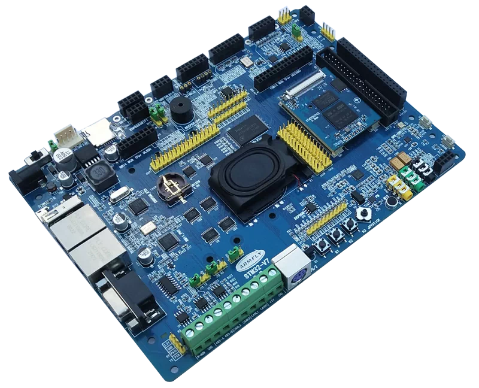

<!-- Copyright 2015-2026 Zephyr Project members and individual contributors. -->
<!-- SPDX-License-Identifier: Apache-2.0 -->
<!-- 中文翻译；编号、导航与译注为本地新增。 -->

<a id="armfly_stm32h743xih6"></a>

# 第2章\_安富莱Armfly STM32H743XIH6

原文：[官方页面](https://docs.zephyrproject.org/latest/boards/armfly/stm32h743xih6/doc/index.html)。读取日期：2026-10-16；来源摘要见[来源记录](../SOURCES.md)。

开发板概览（Board Overview）

<a id="id1"></a>

[](images/armfly_stm32h743xih6.webp)

安富莱Armfly STM32H743XIH6

名称（Name）：

`armfly_stm32h743xih6`

厂商（Vendor）：

[Armfly](https://docs.zephyrproject.org/latest/boards/index.html#vendor=armfly)

状态（Status）：

当前未积极维护（Not Actively Maintained）

架构（Architecture）：

[arm](https://docs.zephyrproject.org/latest/boards/index.html#arch=arm)

片上系统（SoC）：

[stm32h743xx](https://docs.zephyrproject.org/latest/boards/index.html#soc=stm32h743xx)

<a id="board-github-link"></a>

[浏览开发板源码（Browse Board Sources）](https://github.com/zephyrproject-rtos/zephyr/blob/main//boards/armfly/stm32h743xih6/doc/index.rst/../..)<a id="overview"></a>

## 概述（Overview）

Armfly STM32H743XIH6开发板采用意法半导体STM32H743XIH6微控制器，封装为TFBGA240。开发板将该MCU与外部同步动态随机存储器（SDRAM）、显示与触摸硬件、多种存储设备、双以太网接口、音频、传感器及丰富的板级扩展接口结合。

当前Zephyr移植为该板提供初步支持。上游描述主要覆盖基础MCU、外部SDRAM、USART1控制台、LTDC显示通路、GT911触摸控制器、SPI NOR闪存、MicroSD卡槽、以太网MAC及PHY通路、RTC、按键，以及用于板载LED的可选板级专用FMC锁存GPIO输出。

片上系统（SoC）的更多信息见：


- [STM32H743产品页面（Product Page）](https://www.st.com/en/microcontrollers-microprocessors/stm32h743-753.html)
- [STM32H743参考手册（Reference Manual）](https://www.st.com/resource/en/reference_manual/dm00314099.pdf)

<a id="hardware"></a>

## 硬件（Hardware）

完整的Armfly STM32H743XIH6开发板包含以下硬件：


- TFBGA240封装的STM32H743XIH6 MCU
- ARM Cortex-M7内核，带浮点单元（FPU）
- CPU频率最高480 MHz
- 2 MB内部闪存（Flash）
- 1 MB内部SRAM
- 通过32位灵活存储器控制器（FMC）总线连接的32 MB SDRAM
- 32 MB四线SPI闪存（QSPI Flash），支持就地执行（XIP）
- 通过八位FMC总线连接的128 MB NAND闪存
- 16 KB串行电可擦除可编程只读存储器（EEPROM）
- 8 MB SPI NOR闪存
- RGB888液晶显示接口（LCD），带I2C触摸及可调背光
- 双以太网接口（Ethernet Interfaces）：


  - 一路使用STM32内部媒体访问控制器（MAC）及DM9162物理层（PHY）
  - 一路使用连接到16位FMC总线的DM9000AEP控制器
- 一个USB全速主机端口（Full-Speed Host）
- 一个USB全速设备端口（Full-Speed Device）
- 一路RS-485接口
- 一路RS-232接口，可通过DB9及TTL UART排针接入
- 两路控制器局域网（CAN）接口
- 一个MicroSD卡槽
- 一个SDIO扩展连接器，带两个TTL串口
- WM8978全双工I2S音频编解码器（Codec）
- 板载扬声器和麦克风
- Si4704调频广播接收器（FM Radio Receiver）
- 一个PS/2键盘或鼠标连接器
- 红外接收及发射硬件
- 一个与红外发射功能共用的蜂鸣器（Buzzer）
- MPU6050运动传感器（Motion Sensor）
- BH1750环境光传感器（Ambient Light Sensor）
- BMP180气压传感器（Barometric Pressure Sensor）
- 三个用户按键及一个五向操纵杆（Joystick）
- 一个摄像头连接器
- 模数／数模转换器扩展接口（ADC / DAC）
- 兼容Armfly V5及V6扩展生态的SPI、TTL UART和I2C模块扩展排针，支持：


  - AD7705或TM7705双通道16位ADC模块
  - VS1053B音频模块
  - 全球定位系统（GPS）及通用分组无线业务（GPRS）模块
  - ESP8266 UART Wi-Fi模块
  - 八位并行接口的有机发光二极管显示模块（OLED）
  - AD7606 16位八通道ADC模块
  - ADS1256八通道24位ADC模块
  - DAC8501双通道DAC模块
  - DAC8563双通道DAC模块
  - AD9833直接数字合成波形发生器模块（DDS）
- 通过连接FMC的高速32位锁存接口（Latch Interface）实现额外的5 V及3.3 V扩展输出

Zephyr移植目前只提供初步支持。完整开发板上的许多外设尚未在上游开发板描述中建模或验证。

<a id="supported-features"></a>

### 支持的功能（Supported Features）

`armfly_stm32h743xih6`开发板支持下表所列的硬件功能。

片上／板载（On-Chip / On-Board）

功能集成在片上系统（SoC）内／位于开发板上。

2 / 2

分别表示已启用／已禁用的实例数。点击数量标签，可查看开发板或SoC设备树源码（DTS）中该功能的第一个实例。

`vnd,foo`

与此功能匹配的设备树绑定兼容字符串（Compatible String）；点击链接可查看绑定文档。

<a id="armfly_stm32h743xih6-hw-features"></a>

<a id="armfly_stm32h743xih6-armfly_stm32h743xih6/stm32h743xx-hw-features-section"></a>

#### `armfly_stm32h743xih6/stm32h743xx`目标（Target）

<a id="armfly_stm32h743xih6-armfly_stm32h743xih6/stm32h743xx-hw-features-panel"></a>

<a id="armfly_stm32h743xih6-armfly_stm32h743xih6/stm32h743xx-hw-features-memory"></a>

该开发板目标的片上存储容量：512 KiB RAM、2 MiB Flash。

<a id="armfly_stm32h743xih6-armfly_stm32h743xih6/stm32h743xx-hw-features-table"></a>

<table>
<tr>
<th>类型（Type）</th>
<th>位置（Location）</th>
<th>说明（Description）</th>
<th>兼容字符串（Compatible）</th>
</tr>
<tr>
<td rowspan="1">中央处理器（CPU）</td>
<td>片上（On-Chip）</td>
<td>ARM Cortex-M7处理器（CPU）（<a href="https://github.com/zephyrproject-rtos/zephyr/blob/main/dts/arm/st/h7/stm32h7.dtsi?plain=1#L38">已启用：1</a>）</td>
<td><a href="../cpu_cortex_xtensa_binding_reference/P005_arm_cortex-m7.md#std-dtcompatible-arm-cortex-m7"><code>arm,cortex-m7</code></a></td>
</tr>
<tr>
<td rowspan="1">模数转换器（ADC）</td>
<td>片上（On-Chip）</td>
<td>STM32模数转换器（ADC）（<a href="https://github.com/zephyrproject-rtos/zephyr/blob/main/dts/arm/st/h7/stm32h7.dtsi?plain=1#L1046">已禁用：2</a>）</td>
<td><a href="../hardware/P839_STM32模数转换器绑定.md#dtbinding-st-stm32-adc"><code>st,stm32-adc</code></a></td>
</tr>
<tr>
<td rowspan="2">音频（Audio）</td>
<td>片上（On-Chip）</td>
<td>意法半导体（STMicroelectronics）Σ-Δ调制器数字滤波器模块（DFSDM）（<a href="https://github.com/zephyrproject-rtos/zephyr/blob/main/dts/arm/st/h7/stm32h7.dtsi?plain=1#L994">已禁用：1</a>）</td>
<td><a href="../audio_stm32_ti_wolfson_binding_reference/P002_st_stm32-dfsdm.md#std-dtcompatible-st-stm32-dfsdm"><code>st,stm32-dfsdm</code></a></td>
</tr>
<tr>
<td>片上（On-Chip）</td>
<td>意法半导体（STMicroelectronics）DFSDM数字麦克风（DMIC）（<a href="https://github.com/zephyrproject-rtos/zephyr/blob/main/dts/arm/st/h7/stm32h7.dtsi?plain=1#L1005">已禁用：4</a>）</td>
<td><a href="../audio_stm32_ti_wolfson_binding_reference/P001_st_stm32-dfsdm-dmic.md#std-dtcompatible-st-stm32-dfsdm-dmic"><code>st,stm32-dfsdm-dmic</code></a></td>
</tr>
<tr>
<td rowspan="1">控制器局域网（CAN）</td>
<td>片上（On-Chip）</td>
<td>STM32H7系列及兼容器件的FDCAN CAN FD控制器（<a href="https://github.com/zephyrproject-rtos/zephyr/blob/main/dts/arm/st/h7/stm32h7.dtsi?plain=1#L614">已禁用：2</a>）</td>
<td><a href="../can_nxp_renesas_stm32_ti_binding_reference/P013_st_stm32h7-fdcan.md#std-dtcompatible-st-stm32h7-fdcan"><code>st,stm32h7-fdcan</code></a></td>
</tr>
<tr>
<td rowspan="8">时钟控制（Clock Control）</td>
<td>片上（On-Chip）</td>
<td>STM32H7复位与时钟控制器（RCC / Reset and Clock Controller）（<a href="https://github.com/zephyrproject-rtos/zephyr/blob/main/dts/arm/st/h7/stm32h7.dtsi?plain=1#L205">已启用：1</a>）</td>
<td><a href="../timer_reference/P168_STM32H7复位与时钟控制绑定.md#dtbinding-st-stm32h7-rcc"><code>st,stm32h7-rcc</code></a></td>
</tr>
<tr>
<td>片上（On-Chip）</td>
<td>STM32 外部高速时钟（HSE Clock）（<a href="https://github.com/zephyrproject-rtos/zephyr/blob/main/dts/arm/st/h7/stm32h7.dtsi?plain=1#L75">已启用：1</a>）</td>
<td><a href="../timer_reference/P129_STM32高速外部时钟绑定.md#dtbinding-st-stm32-hse-clock"><code>st,stm32-hse-clock</code></a></td>
</tr>
<tr>
<td>片上（On-Chip）</td>
<td>STM32高速内部时钟（HSI）（<a href="https://github.com/zephyrproject-rtos/zephyr/blob/main/dts/arm/st/h7/stm32h7.dtsi?plain=1#L82">已禁用：1</a>）</td>
<td><a href="../timer_reference/P146_STM32H7内部高速时钟绑定.md#dtbinding-st-stm32h7-hsi-clock"><code>st,stm32h7-hsi-clock</code></a></td>
</tr>
<tr>
<td>片上（On-Chip）</td>
<td>通用固定频率时钟提供者（Fixed-Rate Clock Provider）（<a href="https://github.com/zephyrproject-rtos/zephyr/blob/main/dts/arm/st/h7/stm32h7.dtsi?plain=1#L90">已启用：2</a>；<a href="https://github.com/zephyrproject-rtos/zephyr/blob/main/dts/arm/st/h7/stm32h7.dtsi?plain=1#L97">已禁用：1</a>）</td>
<td><a href="../hardware/P566_固定时钟绑定.md#dtbinding-fixed-clock"><code>fixed-clock</code></a></td>
</tr>
<tr>
<td>片上（On-Chip）</td>
<td>STM32低速外部时钟（LSE Clock）（<a href="https://github.com/zephyrproject-rtos/zephyr/blob/main/dts/arm/st/h7/stm32h7.dtsi?plain=1#L104">已禁用：1</a>）</td>
<td><a href="../timer_reference/P130_STM32低速外部时钟绑定.md#dtbinding-st-stm32-lse-clock"><code>st,stm32-lse-clock</code></a></td>
</tr>
<tr>
<td>片上（On-Chip）</td>
<td>STM32H7主锁相环（Main PLL）（<a href="https://github.com/zephyrproject-rtos/zephyr/blob/main/dts/arm/st/h7/stm32h7.dtsi?plain=1#L119">已启用：3</a>）</td>
<td><a href="../timer_reference/P154_STM32H7锁相环时钟绑定.md#dtbinding-st-stm32h7-pll-clock"><code>st,stm32h7-pll-clock</code></a></td>
</tr>
<tr>
<td>片上（On-Chip）</td>
<td>STM32 时钟多路复用器（Clock Multiplexer）（<a href="https://github.com/zephyrproject-rtos/zephyr/blob/main/dts/arm/st/h7/stm32h7.dtsi?plain=1#L140">已禁用：1</a>）</td>
<td><a href="../timer_reference/P133_STM32时钟多路复用绑定.md#dtbinding-st-stm32-clock-mux"><code>st,stm32-clock-mux</code></a></td>
</tr>
<tr>
<td>片上（On-Chip）</td>
<td>STM32 微控制器时钟输出（Microcontroller Clock Output，MCO）（<a href="https://github.com/zephyrproject-rtos/zephyr/blob/main/dts/arm/st/h7/stm32h7.dtsi?plain=1#L148">已禁用：2</a>）</td>
<td><a href="../timer_reference/P134_STM32时钟输出绑定.md#dtbinding-st-stm32-clock-mco"><code>st,stm32-clock-mco</code></a></td>
</tr>
<tr>
<td rowspan="1">比较器（Comparator）</td>
<td>片上（On-Chip）</td>
<td>STM32H7系列比较器（Comparator）（<a href="https://github.com/zephyrproject-rtos/zephyr/blob/main/dts/arm/st/h7/stm32h7.dtsi?plain=1#L1314">已禁用：2</a>）</td>
<td><a href="../hardware/P741_STM32H7比较器绑定.md#dtbinding-st-stm32h7-comp"><code>st,stm32h7-comp</code></a></td>
</tr>
<tr>
<td rowspan="1">计数器（Counter）</td>
<td>片上（On-Chip）</td>
<td>STM32 计数器（Counters）（<a href="https://github.com/zephyrproject-rtos/zephyr/blob/main/dts/arm/st/h7/stm32h7.dtsi?plain=1#L653">已禁用：14</a>）</td>
<td><a href="../stm32_ti_xilinx_counter_binding_reference/P007_st_stm32-counter.md#std-dtcompatible-st-stm32-counter"><code>st,stm32-counter</code></a></td>
</tr>
<tr>
<td rowspan="1">循环冗余校验（CRC）</td>
<td>片上（On-Chip）</td>
<td>STM32 CRC 计算单元（Calculation Unit）（<a href="https://github.com/zephyrproject-rtos/zephyr/blob/main/dts/arm/st/h7/stm32h7.dtsi?plain=1#L1332">已禁用：1</a>）</td>
<td><a href="../crc_clock_monitor_binding_reference/P011_st_stm32-crc.md#std-dtcompatible-st-stm32-crc"><code>st,stm32-crc</code></a></td>
</tr>
<tr>
<td rowspan="1">数模转换器（DAC）</td>
<td>片上（On-Chip）</td>
<td>STM32 系列数模转换器（DAC）（<a href="https://github.com/zephyrproject-rtos/zephyr/blob/main/dts/arm/st/h7/stm32h7.dtsi?plain=1#L1107">已禁用：1</a>）</td>
<td><a href="../hardware/P760_STM32数模转换器绑定.md#dtbinding-st-stm32-dac"><code>st,stm32-dac</code></a></td>
</tr>
<tr>
<td rowspan="2">显示（Display）</td>
<td>片上（On-Chip）</td>
<td>STM32 Chrom-ART 图形加速器（Accelerator，DMA2D）（<a href="https://github.com/zephyrproject-rtos/zephyr/blob/main/dts/arm/st/h7/stm32h7.dtsi?plain=1#L1349">已禁用：1</a>）</td>
<td><a href="../display_st_ultrachip_zephyr_binding_reference/P003_st_stm32-dma2d.md#std-dtcompatible-st-stm32-dma2d"><code>st,stm32-dma2d</code></a></td>
</tr>
<tr>
<td>片上（On-Chip）</td>
<td>STM32 LCD-TFT 显示控制器（Display Controller）（<a href="https://github.com/zephyrproject-rtos/zephyr/blob/main/dts/arm/st/h7/stm32h742.dtsi?plain=1#L52">已启用：1</a>）</td>
<td><a href="../display_st_ultrachip_zephyr_binding_reference/P004_st_stm32-ltdc.md#std-dtcompatible-st-stm32-ltdc"><code>st,stm32-ltdc</code></a></td>
</tr>
<tr>
<td rowspan="3">直接存储器访问（DMA）</td>
<td>片上（On-Chip）</td>
<td>STM32 DMA 控制器（Controller，V1）（<a href="https://github.com/zephyrproject-rtos/zephyr/blob/main/dts/arm/st/h7/stm32h7.dtsi?plain=1#L1115">已禁用：2</a>）</td>
<td><a href="../stm32_ti_xilinx_dma_binding_reference/P007_st_stm32-dma-v1.md#std-dtcompatible-st-stm32-dma-v1"><code>st,stm32-dma-v1</code></a></td>
</tr>
<tr>
<td>片上（On-Chip）</td>
<td>STM32基本DMA控制器（BDMA）（<a href="https://github.com/zephyrproject-rtos/zephyr/blob/main/dts/arm/st/h7/stm32h7.dtsi?plain=1#L1141">已禁用：1</a>）</td>
<td><a href="../stm32_ti_xilinx_dma_binding_reference/P006_st_stm32-bdma.md#std-dtcompatible-st-stm32-bdma"><code>st,stm32-bdma</code></a></td>
</tr>
<tr>
<td>片上（On-Chip）</td>
<td>STM32 DMA 多路复用控制器（DMAMUX Controller）（<a href="https://github.com/zephyrproject-rtos/zephyr/blob/main/dts/arm/st/h7/stm32h7.dtsi?plain=1#L1154">已禁用：2</a>）</td>
<td><a href="../stm32_ti_xilinx_dma_binding_reference/P011_st_stm32-dmamux.md#std-dtcompatible-st-stm32-dmamux"><code>st,stm32-dmamux</code></a></td>
</tr>
<tr>
<td rowspan="4">以太网（Ethernet）</td>
<td>片上（On-Chip）</td>
<td>ST STM32 以太网媒体访问控制器（Ethernet MAC）（<a href="https://github.com/zephyrproject-rtos/zephyr/blob/main/dts/arm/st/h7/stm32h7.dtsi?plain=1#L1215">已启用：1</a>）</td>
<td><a href="../ethernet_synopsys_st_xilinx_binding_reference/P011_st_stm32h7-ethernet.md#std-dtcompatible-st-stm32h7-ethernet"><code>st,stm32h7-ethernet</code></a></td>
</tr>
<tr>
<td>片上（On-Chip）</td>
<td>Synopsys DesignWare MAC 的管理数据输入输出控制器（MDIO Controller）（<a href="https://github.com/zephyrproject-rtos/zephyr/blob/main/dts/arm/st/h7/stm32h7.dtsi?plain=1#L1229">已启用：1</a>）</td>
<td><a href="../ethernet_mdio_microchip_binding_reference/P010_snps_dwmac-mdio.md#std-dtcompatible-snps-dwmac-mdio"><code>snps,dwmac-mdio</code></a></td>
</tr>
<tr>
<td>板载（On-Board）</td>
<td>通用媒体独立接口物理层（MII PHY）（<a href="https://github.com/zephyrproject-rtos/zephyr/blob/main/boards/armfly/stm32h743xih6/armfly_stm32h743xih6.dts?plain=1#L479">已启用：1</a>）</td>
<td><a href="../ethernet_nxp_phy_binding_reference/P019_ethernet-phy.md#std-dtcompatible-ethernet-phy"><code>ethernet-phy</code></a></td>
</tr>
<tr>
<td>片上（On-Chip）</td>
<td>Synopsys DesignWare MAC 精确时间协议时钟（Precision Time Protocol，PTP Clock）（<a href="https://github.com/zephyrproject-rtos/zephyr/blob/main/dts/arm/st/h7/stm32h7.dtsi?plain=1#L1236">已启用：1</a>）</td>
<td><a href="../ethernet_synopsys_st_xilinx_binding_reference/P006_snps_dwmac-ptp-clock.md#std-dtcompatible-snps-dwmac-ptp-clock"><code>snps,dwmac-ptp-clock</code></a></td>
</tr>
<tr>
<td rowspan="2">闪存控制器（Flash Controller）</td>
<td>片上（On-Chip）</td>
<td>STM32 系列闪存控制器（Flash Controller）（<a href="https://github.com/zephyrproject-rtos/zephyr/blob/main/dts/arm/st/h7/stm32h7.dtsi?plain=1#L162">已启用：1</a>）</td>
<td><a href="../flash_renesas_st_ti_binding_reference/P011_st_stm32-flash-controller.md#std-dtcompatible-st-stm32-flash-controller"><code>st,stm32-flash-controller</code></a></td>
</tr>
<tr>
<td>板载（On-Board）</td>
<td>支持JEDEC公共闪存接口（CFI）的STM32四线SPI闪存控制器（QSPI Flash Controller）（<a href="https://github.com/zephyrproject-rtos/zephyr/blob/main/boards/armfly/stm32h743xih6/armfly_stm32h743xih6.dts?plain=1#L275">已启用：1</a>）</td>
<td><a href="../flash_renesas_st_ti_binding_reference/P013_st_stm32-qspi-nor.md#std-dtcompatible-st-stm32-qspi-nor"><code>st,stm32-qspi-nor</code></a></td>
</tr>
<tr>
<td rowspan="2">通用输入输出与接插件（GPIO &amp; Headers）</td>
<td>片上（On-Chip）</td>
<td>STM32 通用输入输出控制器（GPIO Controller）（<a href="https://github.com/zephyrproject-rtos/zephyr/blob/main/dts/arm/st/h7/stm32h7.dtsi?plain=1#L248">已启用：11</a>）</td>
<td><a href="../gpio_silabs_st_connectors_binding_reference/P029_st_stm32-gpio.md#std-dtcompatible-st-stm32-gpio"><code>st,stm32-gpio</code></a></td>
</tr>
<tr>
<td>板载（On-Board）</td>
<td>内存映射锁存GPIO控制器（Memory-Mapped Latch GPIO Controller）（<a href="https://github.com/zephyrproject-rtos/zephyr/blob/main/boards/armfly/stm32h743xih6/armfly_stm32h743xih6.dts?plain=1#L44">已禁用：1</a>）</td>
<td><a href="../gpio_connectors_bflb_esp_binding_reference/P028_gpio-mmio-latch.md#std-dtcompatible-gpio-mmio-latch"><code>gpio-mmio-latch</code></a></td>
</tr>
<tr>
<td rowspan="1">集成电路间总线（I2C）</td>
<td>片上（On-Chip）</td>
<td>STM32 I2C V2 控制器（Controller）（<a href="https://github.com/zephyrproject-rtos/zephyr/blob/main/dts/arm/st/h7/stm32h7.dtsi?plain=1#L443">已启用：1</a>；<a href="https://github.com/zephyrproject-rtos/zephyr/blob/main/dts/arm/st/h7/stm32h7.dtsi?plain=1#L455">已禁用：3</a>）</td>
<td><a href="../i2c_stm32_ti_mux_binding_reference/P008_st_stm32-i2c-v2.md#std-dtcompatible-st-stm32-i2c-v2"><code>st,stm32-i2c-v2</code></a></td>
</tr>
<tr>
<td rowspan="2">集成电路间音频总线（I2S）</td>
<td>片上（On-Chip）</td>
<td>STM32H7 I2S控制器（<a href="https://github.com/zephyrproject-rtos/zephyr/blob/main/dts/arm/st/h7/stm32h7.dtsi?plain=1#L572">已禁用：3</a>）</td>
<td><a href="../i2s_binding_reference/P018_st_stm32h7-i2s.md#std-dtcompatible-st-stm32h7-i2s"><code>st,stm32h7-i2s</code></a></td>
</tr>
<tr>
<td>片上（On-Chip）</td>
<td>STM32 串行音频接口块控制器（SAI Block Controller）（<a href="https://github.com/zephyrproject-rtos/zephyr/blob/main/dts/arm/st/h7/stm32h7.dtsi?plain=1#L1286">已禁用：2</a>）</td>
<td><a href="../i2s_binding_reference/P017_st_stm32-sai.md#std-dtcompatible-st-stm32-sai"><code>st,stm32-sai</code></a></td>
</tr>
<tr>
<td rowspan="2">输入（Input）</td>
<td>板载（On-Board）</td>
<td>GT9xx／GT9xxx电容式触摸面板（Capacitive Touch Panels）（<a href="https://github.com/zephyrproject-rtos/zephyr/blob/main/boards/armfly/stm32h743xih6/armfly_stm32h743xih6.dts?plain=1#L224">已启用：1</a>）</td>
<td><a href="../input_adc_touch_matrix_binding_reference/P017_goodix_gt911.md#std-dtcompatible-goodix-gt911"><code>goodix,gt911</code></a></td>
</tr>
<tr>
<td>板载（On-Board）</td>
<td>一组绑定到 GPIO 的输入按键（GPIO-Bound Input Keys）（<a href="https://github.com/zephyrproject-rtos/zephyr/blob/main/boards/armfly/stm32h743xih6/armfly_stm32h743xih6.dts?plain=1#L79">已启用：1</a>）</td>
<td><a href="../hardware/P563_GPIO按键绑定.md#std-dtcompatible-gpio-keys"><code>gpio-keys</code></a></td>
</tr>
<tr>
<td rowspan="2">中断控制器（Interrupt Controller）</td>
<td>片上（On-Chip）</td>
<td>ARMv7-M 嵌套向量中断控制器（Nested Vectored Interrupt Controller，NVIC）（<a href="https://github.com/zephyrproject-rtos/zephyr/blob/main/dts/arm/armv7-m.dtsi?plain=1#L13">已启用：1</a>）</td>
<td><a href="../arm_interrupt_timer_binding_reference/P002_ARMv7_M_NVIC.md#std-dtcompatible-arm-v7m-nvic"><code>arm,v7m-nvic</code></a></td>
</tr>
<tr>
<td>片上（On-Chip）</td>
<td>STM32 外部中断控制器（External Interrupt Controller）（<a href="https://github.com/zephyrproject-rtos/zephyr/blob/main/dts/arm/st/h7/stm32h7.dtsi?plain=1#L225">已启用：1</a>）</td>
<td><a href="../mcu_external_interrupt_binding_reference/P001_st_stm32-exti.md#std-dtcompatible-st-stm32-exti"><code>st,stm32-exti</code></a></td>
</tr>
<tr>
<td rowspan="2">发光二极管（LED）</td>
<td>板载（On-Board）</td>
<td>一组由 GPIO 控制的 LED（GPIO-Controlled LEDs）（<a href="https://github.com/zephyrproject-rtos/zephyr/blob/main/boards/armfly/stm32h743xih6/armfly_stm32h743xih6.dts?plain=1#L54">已禁用：1</a>）</td>
<td><a href="../hardware/P564_GPIO指示灯绑定.md#dtbinding-gpio-leds"><code>gpio-leds</code></a></td>
</tr>
<tr>
<td>板载（On-Board）</td>
<td>一组由脉宽调制（PWM）控制的LED（<a href="https://github.com/zephyrproject-rtos/zephyr/blob/main/boards/armfly/stm32h743xih6/armfly_stm32h743xih6.dts?plain=1#L137">已启用：1</a>）</td>
<td><a href="../hardware/P565_PWM指示灯绑定.md#dtbinding-pwm-leds"><code>pwm-leds</code></a></td>
</tr>
<tr>
<td rowspan="4">存储器控制器（Memory Controller）</td>
<td>片上（On-Chip）</td>
<td>STM32 电池备份 RAM（Battery-Backed RAM）（<a href="https://github.com/zephyrproject-rtos/zephyr/blob/main/dts/arm/st/h7/stm32h742.dtsi?plain=1#L63">已禁用：1</a>）</td>
<td><a href="../memory_controller_sdram_psram_binding_reference/P010_st_stm32-bbram.md#std-dtcompatible-st-stm32-bbram"><code>st,stm32-bbram</code></a></td>
</tr>
<tr>
<td>片上（On-Chip）</td>
<td>STM32H7灵活存储器控制器（FMC / Flexible Memory Controller）（<a href="https://github.com/zephyrproject-rtos/zephyr/blob/main/dts/arm/st/h7/stm32h7.dtsi?plain=1#L1241">已启用：1</a>）</td>
<td><a href="../memory_controller_sdram_psram_binding_reference/P016_st_stm32h7-fmc.md#std-dtcompatible-st-stm32h7-fmc"><code>st,stm32h7-fmc</code></a></td>
</tr>
<tr>
<td>片上（On-Chip）</td>
<td>STM32 灵活存储器控制器中的 SDRAM 控制器（SDRAM Controller）（<a href="https://github.com/zephyrproject-rtos/zephyr/blob/main/dts/arm/st/h7/stm32h7.dtsi?plain=1#L1247">已启用：1</a>）</td>
<td><a href="../memory_controller_sdram_psram_binding_reference/P012_st_stm32-fmc-sdram.md#std-dtcompatible-st-stm32-fmc-sdram"><code>st,stm32-fmc-sdram</code></a></td>
</tr>
<tr>
<td>板载（On-Board）</td>
<td>STM32灵活存储器控制器（FMC / Flexible Memory Controller），用于NOR Flash、PSRAM和SRAM（<a href="https://github.com/zephyrproject-rtos/zephyr/blob/main/boards/armfly/stm32h743xih6/armfly_stm32h743xih6.dts?plain=1#L380">已启用：1</a>）</td>
<td><a href="../memory_controller_sdram_psram_binding_reference/P011_st_stm32-fmc-nor-psram.md#std-dtcompatible-st-stm32-fmc-nor-psram"><code>st,stm32-fmc-nor-psram</code></a></td>
</tr>
<tr>
<td rowspan="1">内存管理单元／内存保护单元（MMU / MPU）</td>
<td>片上（On-Chip）</td>
<td>ARMv7-M存储器保护单元（MPU / Memory Protection Unit）（<a href="https://github.com/zephyrproject-rtos/zephyr/blob/main/dts/arm/st/h7/stm32h7.dtsi?plain=1#L45">已启用：1</a>）</td>
<td><a href="../memory_protection_binding_reference/P005_arm_armv7m-mpu.md#std-dtcompatible-arm-armv7m-mpu"><code>arm,armv7m-mpu</code></a></td>
</tr>
<tr>
<td rowspan="4">存储技术设备（MTD）</td>
<td>片上（On-Chip）</td>
<td>STM32闪存（Flash Memory）（<a href="https://github.com/zephyrproject-rtos/zephyr/blob/main/dts/arm/st/h7/stm32h742.dtsi?plain=1#L15">已启用：1</a>）</td>
<td><a href="../mtd_nxp_st_ti_partition_binding_reference/P016_st_stm32-nv-flash.md#std-dtcompatible-st-stm32-nv-flash"><code>st,stm32-nv-flash</code></a></td>
</tr>
<tr>
<td>板载（On-Board）</td>
<td>兼容Atmel AT24系列的I2C电可擦除可编程只读存储器（EEPROM）（<a href="https://github.com/zephyrproject-rtos/zephyr/blob/main/boards/armfly/stm32h743xih6/armfly_stm32h743xih6.dts?plain=1#L255">已启用：1</a>）</td>
<td><a href="../mtd_atmel_bouffalo_binding_reference/P004_atmel_at24.md#std-dtcompatible-atmel-at24"><code>atmel,at24</code></a></td>
</tr>
<tr>
<td>板载（On-Board）</td>
<td>这些属性用于支持Zephyr的<code>spi-nor</code>闪存驱动通过Zephyr SPI API，使用基于M25P80的标准命令集控制串行闪存（Serial Flash Memory）。（<a href="https://github.com/zephyrproject-rtos/zephyr/blob/main/boards/armfly/stm32h743xih6/armfly_stm32h743xih6.dts?plain=1#L293">已启用：1</a>）</td>
<td><a href="../mtd_microchip_nordic_nxp_binding_reference/P002_jedec_spi-nor.md#std-dtcompatible-jedec-spi-nor"><code>jedec,spi-nor</code></a></td>
</tr>
<tr>
<td>板载（On-Board）</td>
<td>闪存或其他非易失性存储器的固定分区（Fixed Partitions）（<a href="https://github.com/zephyrproject-rtos/zephyr/blob/main/boards/armfly/stm32h743xih6/armfly_stm32h743xih6.dts?plain=1#L304">已启用：1</a>）</td>
<td><a href="../hardware/P568_固定分区绑定.md#dtbinding-fixed-partitions"><code>fixed-partitions</code></a></td>
</tr>
<tr>
<td rowspan="1">非易失存储器（NVMEM）</td>
<td>片上（On-Chip）</td>
<td>非易失存储器固定布局（Fixed Layout for Non-Volatile Memory）（<a href="https://github.com/zephyrproject-rtos/zephyr/blob/main/dts/arm/st/h7/stm32h7.dtsi?plain=1#L179">已启用：1</a>）</td>
<td><a href="../memory_protection_binding_reference/P009_fixed-layout.md#std-dtcompatible-fixed-layout"><code>fixed-layout</code></a></td>
</tr>
<tr>
<td rowspan="1">一次性可编程存储器（OTP Memory）</td>
<td>片上（On-Chip）</td>
<td>STM32 嵌入式非易失一次性可编程存储器（NVM OTP）（<a href="https://github.com/zephyrproject-rtos/zephyr/blob/main/dts/arm/st/h7/stm32h7.dtsi?plain=1#L175">已启用：1</a>）</td>
<td><a href="../otp_binding_reference/P010_st_stm32-nvm-otp.md#std-dtcompatible-st-stm32-nvm-otp"><code>st,stm32-nvm-otp</code></a></td>
</tr>
<tr>
<td rowspan="1">物理层（PHY）</td>
<td>片上（On-Chip）</td>
<td>用于所有内置于 USB IP 的 USB 收发器（USB Transceivers）的绑定。（<a href="https://github.com/zephyrproject-rtos/zephyr/blob/main/dts/arm/st/h7/stm32h742.dtsi?plain=1#L137">已启用：1</a>）</td>
<td><a href="../phy_binding_reference/P008_usb-nop-xceiv.md#std-dtcompatible-usb-nop-xceiv"><code>usb-nop-xceiv</code></a></td>
</tr>
<tr>
<td rowspan="1">引脚控制（Pin Control）</td>
<td>片上（On-Chip）</td>
<td>STM32 引脚控制器（Pin Controller）（<a href="https://github.com/zephyrproject-rtos/zephyr/blob/main/dts/arm/st/h7/stm32h7.dtsi?plain=1#L241">已启用：1</a>）</td>
<td><a href="../pinctrl_stm32_ti_xilinx_binding_reference/P004_st_stm32-pinctrl.md#std-dtcompatible-st-stm32-pinctrl"><code>st,stm32-pinctrl</code></a></td>
</tr>
<tr>
<td rowspan="1">电源管理（Power Management）</td>
<td>片上（On-Chip）</td>
<td>STM32H7电源控制器（Power Controller）（<a href="https://github.com/zephyrproject-rtos/zephyr/blob/main/dts/arm/st/h7/stm32h7.dtsi?plain=1#L216">已启用：1</a>）</td>
<td><a href="../stm32_soc_power_binding_reference/P014_st_stm32h7-pwr.md#std-dtcompatible-st-stm32h7-pwr"><code>st,stm32h7-pwr</code></a></td>
</tr>
<tr>
<td rowspan="1">脉宽调制（PWM）</td>
<td>片上（On-Chip）</td>
<td>STM32 脉宽调制（PWM）（<a href="https://github.com/zephyrproject-rtos/zephyr/blob/main/dts/arm/st/h7/stm32h7.dtsi?plain=1#L647">已启用：1</a>；<a href="https://github.com/zephyrproject-rtos/zephyr/blob/main/dts/arm/st/h7/stm32h7.dtsi?plain=1#L676">已禁用：11</a>）</td>
<td><a href="../pwm_stm32_ti_generic_binding_reference/P011_st_stm32-pwm.md#std-dtcompatible-st-stm32-pwm"><code>st,stm32-pwm</code></a></td>
</tr>
<tr>
<td rowspan="1">四线串行外设接口（QSPI）</td>
<td>片上（On-Chip）</td>
<td>STM32 四线串行外设接口控制器（QSPI Controller）（<a href="https://github.com/zephyrproject-rtos/zephyr/blob/main/dts/arm/st/h7/stm32h7.dtsi?plain=1#L1263">已启用：1</a>）</td>
<td><a href="../qspi_ospi_xspi_binding_reference/P011_st_stm32-qspi.md#std-dtcompatible-st-stm32-qspi"><code>st,stm32-qspi</code></a></td>
</tr>
<tr>
<td rowspan="1">稳压器（Regulator）</td>
<td>片上（On-Chip）</td>
<td>STM32参考电压缓冲器稳压器（VREFBUF Regulator）（<a href="https://github.com/zephyrproject-rtos/zephyr/blob/main/dts/arm/st/h7/stm32h7.dtsi?plain=1#L1340">已禁用：1</a>）</td>
<td><a href="../hardware/P638_STM32参考电压缓冲器绑定.md#dtbinding-st-stm32-vrefbuf"><code>st,stm32-vrefbuf</code></a></td>
</tr>
<tr>
<td rowspan="1">复位控制器（Reset Controller）</td>
<td>片上（On-Chip）</td>
<td>STM32 复位与时钟控制器（Reset and Clock Control，RCC）（<a href="https://github.com/zephyrproject-rtos/zephyr/blob/main/dts/arm/st/h7/stm32h7.dtsi?plain=1#L210">已启用：1</a>）</td>
<td><a href="../reset_controller_binding_reference/P017_st_stm32-rcc-rctl.md#std-dtcompatible-st-stm32-rcc-rctl"><code>st,stm32-rcc-rctl</code></a></td>
</tr>
<tr>
<td rowspan="1">随机数生成器（RNG）</td>
<td>片上（On-Chip）</td>
<td>STM32 随机数生成器（Random Number Generator）（<a href="https://github.com/zephyrproject-rtos/zephyr/blob/main/dts/arm/st/h7/stm32h7.dtsi?plain=1#L1186">已禁用：1</a>）</td>
<td><a href="../soc_rng_binding_reference/P016_st_stm32-rng.md#std-dtcompatible-st-stm32-rng"><code>st,stm32-rng</code></a></td>
</tr>
<tr>
<td rowspan="1">实时时钟（RTC）</td>
<td>片上（On-Chip）</td>
<td>STM32 实时时钟（RTC）（<a href="https://github.com/zephyrproject-rtos/zephyr/blob/main/dts/arm/st/h7/stm32h7.dtsi?plain=1#L432">已启用：1</a>）</td>
<td><a href="../soc_rtc_binding_reference/P014_st_stm32-rtc.md#std-dtcompatible-st-stm32-rtc"><code>st,stm32-rtc</code></a></td>
</tr>
<tr>
<td rowspan="1">SD 主机控制器（SDHC）</td>
<td>片上（On-Chip）</td>
<td>STM32 SDMMC 主机控制器（Host Controller）（<a href="https://github.com/zephyrproject-rtos/zephyr/blob/main/dts/arm/st/h7/stm32h7.dtsi?plain=1#L1194">已启用：1</a>；<a href="https://github.com/zephyrproject-rtos/zephyr/blob/main/dts/arm/st/h7/stm32h7.dtsi?plain=1#L1205">已禁用：1</a>）</td>
<td><a href="../sdhc_binding_reference/P019_st_stm32-sdmmc.md#std-dtcompatible-st-stm32-sdmmc"><code>st,stm32-sdmmc</code></a></td>
</tr>
<tr>
<td rowspan="7">传感器（Sensors）</td>
<td>板载（On-Board）</td>
<td>MPU-6000运动跟踪设备（Motion Tracking Device）（<a href="https://github.com/zephyrproject-rtos/zephyr/blob/main/boards/armfly/stm32h743xih6/armfly_stm32h743xih6.dts?plain=1#L231">已启用：1</a>）</td>
<td><a href="../sensor_invensense_6axis_pressure_binding_reference/P025_invensense_mpu6050.md#std-dtcompatible-invensense-mpu6050"><code>invensense,mpu6050</code></a></td>
</tr>
<tr>
<td>板载（On-Board）</td>
<td>Rohm BH1750环境光传感器（<a href="https://github.com/zephyrproject-rtos/zephyr/blob/main/boards/armfly/stm32h743xih6/armfly_stm32h743xih6.dts?plain=1#L240">已启用：1</a>）</td>
<td><a href="../sensor_realtek_rohm_sensirion_binding_reference/P011_rohm_bh1750.md#std-dtcompatible-rohm-bh1750"><code>rohm,bh1750</code></a></td>
</tr>
<tr>
<td>板载（On-Board）</td>
<td>通过I2C总线访问的Bosch BMP180压力传感器（<a href="https://github.com/zephyrproject-rtos/zephyr/blob/main/boards/armfly/stm32h743xih6/armfly_stm32h743xih6.dts?plain=1#L248">已启用：1</a>）</td>
<td><a href="../sensor_bosch_broadcom_espressif_binding_reference/P018_bosch_bmp180.md#std-dtcompatible-bosch-bmp180"><code>bosch,bmp180</code></a></td>
</tr>
<tr>
<td>片上（On-Chip）</td>
<td>STM32 正交解码器（Quadrature Decoder）（<a href="https://github.com/zephyrproject-rtos/zephyr/blob/main/dts/arm/st/h7/stm32h7.dtsi?plain=1#L658">已禁用：6</a>）</td>
<td><a href="../sensor_st_lsm_stm32_binding_reference/P028_st_stm32-qdec.md#std-dtcompatible-st-stm32-qdec"><code>st,stm32-qdec</code></a></td>
</tr>
<tr>
<td>片上（On-Chip）</td>
<td>STM32 系列温度节点（TEMP），用于以两个温度点完成生产校准的传感器。（<a href="https://github.com/zephyrproject-rtos/zephyr/blob/main/dts/arm/st/h7/stm32h7.dtsi?plain=1#L1357">已禁用：1</a>）</td>
<td><a href="../sensor_st_lsm_stm32_binding_reference/P029_st_stm32-temp-cal.md#std-dtcompatible-st-stm32-temp-cal"><code>st,stm32-temp-cal</code></a></td>
</tr>
<tr>
<td>片上（On-Chip）</td>
<td>STM32 电池电压（VBAT）（<a href="https://github.com/zephyrproject-rtos/zephyr/blob/main/dts/arm/st/h7/stm32h7.dtsi?plain=1#L1369">已禁用：1</a>）</td>
<td><a href="../sensor_st_ti_power_capacitance_binding_reference/P001_st_stm32-vbat.md#std-dtcompatible-st-stm32-vbat"><code>st,stm32-vbat</code></a></td>
</tr>
<tr>
<td>片上（On-Chip）</td>
<td>STM32 参考电压（VREF+）（<a href="https://github.com/zephyrproject-rtos/zephyr/blob/main/dts/arm/st/h7/stm32h7.dtsi?plain=1#L1375">已禁用：1</a>）</td>
<td><a href="../sensor_st_ti_power_capacitance_binding_reference/P003_st_stm32-vref.md#std-dtcompatible-st-stm32-vref"><code>st,stm32-vref</code></a></td>
</tr>
<tr>
<td rowspan="3">串行控制器（Serial Controller）</td>
<td>片上（On-Chip）</td>
<td>STM32 通用同步／异步收发器（USART）（<a href="https://github.com/zephyrproject-rtos/zephyr/blob/main/dts/arm/st/h7/stm32h7.dtsi?plain=1#L351">已启用：1</a>；<a href="https://github.com/zephyrproject-rtos/zephyr/blob/main/dts/arm/st/h7/stm32h7.dtsi?plain=1#L360">已禁用：3</a>）</td>
<td><a href="../uart_silabs_stm32_ti_binding_reference/P016_st_stm32-usart.md#std-dtcompatible-st-stm32-usart"><code>st,stm32-usart</code></a></td>
</tr>
<tr>
<td>片上（On-Chip）</td>
<td>STM32 通用异步收发器（UART）（<a href="https://github.com/zephyrproject-rtos/zephyr/blob/main/dts/arm/st/h7/stm32h7.dtsi?plain=1#L378">已禁用：4</a>）</td>
<td><a href="../uart_silabs_stm32_ti_binding_reference/P015_st_stm32-uart.md#std-dtcompatible-st-stm32-uart"><code>st,stm32-uart</code></a></td>
</tr>
<tr>
<td>片上（On-Chip）</td>
<td>STM32低功耗通用异步收发器（LPUART）（<a href="https://github.com/zephyrproject-rtos/zephyr/blob/main/dts/arm/st/h7/stm32h7.dtsi?plain=1#L423">已禁用：1</a>）</td>
<td><a href="../uart_silabs_stm32_ti_binding_reference/P014_st_stm32-lpuart.md#std-dtcompatible-st-stm32-lpuart"><code>st,stm32-lpuart</code></a></td>
</tr>
<tr>
<td rowspan="1">系统管理总线（SMbus）</td>
<td>片上（On-Chip）</td>
<td>STM32 系统管理总线控制器（SMBus Controller）（<a href="https://github.com/zephyrproject-rtos/zephyr/blob/main/dts/arm/st/h7/stm32h7.dtsi?plain=1#L1383">已禁用：4</a>）</td>
<td><a href="../i3c_smbus_binding_reference/P013_st_stm32-smbus.md#std-dtcompatible-st-stm32-smbus"><code>st,stm32-smbus</code></a></td>
</tr>
<tr>
<td rowspan="1">串行外设接口（SPI）</td>
<td>片上（On-Chip）</td>
<td>STM32H7 串行外设接口控制器（SPI Controller）（<a href="https://github.com/zephyrproject-rtos/zephyr/blob/main/dts/arm/st/h7/stm32h7.dtsi?plain=1#L519">已启用：1</a>；<a href="https://github.com/zephyrproject-rtos/zephyr/blob/main/dts/arm/st/h7/stm32h7.dtsi?plain=1#L491">已禁用：5</a>）</td>
<td><a href="../spi_stm32_ti_xilinx_binding_reference/P013_st_stm32h7-spi.md#std-dtcompatible-st-stm32h7-spi"><code>st,stm32h7-spi</code></a></td>
</tr>
<tr>
<td rowspan="3">定时器（Timer）</td>
<td>片上（On-Chip）</td>
<td>ARMv7-M 系统节拍（System Tick）（<a href="https://github.com/zephyrproject-rtos/zephyr/blob/main/dts/arm/armv7-m.dtsi?plain=1#L21">已启用：1</a>）</td>
<td><a href="../arm_interrupt_timer_binding_reference/P006_ARMv7_M_SysTick.md#std-dtcompatible-arm-armv7m-systick"><code>arm,armv7m-systick</code></a></td>
</tr>
<tr>
<td>片上（On-Chip）</td>
<td>STM32 定时器（Timers）（<a href="https://github.com/zephyrproject-rtos/zephyr/blob/main/dts/arm/st/h7/stm32h7.dtsi?plain=1#L636">已启用：1</a>；<a href="https://github.com/zephyrproject-rtos/zephyr/blob/main/dts/arm/st/h7/stm32h7.dtsi?plain=1#L665">已禁用：13</a>）</td>
<td><a href="../stm32_ti_silabs_timer_binding_reference/P008_st_stm32-timers.md#std-dtcompatible-st-stm32-timers"><code>st,stm32-timers</code></a></td>
</tr>
<tr>
<td>片上（On-Chip）</td>
<td>STM32低功耗定时器（LPTIM）（<a href="https://github.com/zephyrproject-rtos/zephyr/blob/main/dts/arm/st/h7/stm32h7.dtsi?plain=1#L982">已禁用：1</a>）</td>
<td><a href="../stm32_ti_silabs_timer_binding_reference/P007_st_stm32-lptim.md#std-dtcompatible-st-stm32-lptim"><code>st,stm32-lptim</code></a></td>
</tr>
<tr>
<td rowspan="1">通用串行总线（USB）</td>
<td>片上（On-Chip）</td>
<td>STM32 全速 USB OTG 控制器（OTGFS Controller）（<a href="https://github.com/zephyrproject-rtos/zephyr/blob/main/dts/arm/st/h7/stm32h742.dtsi?plain=1#L38">已禁用：1</a>）</td>
<td><a href="../usb_stm32_audio_binding_reference/P004_st_stm32-otgfs.md#std-dtcompatible-st-stm32-otgfs"><code>st,stm32-otgfs</code></a></td>
</tr>
<tr>
<td rowspan="2">视频（Video）</td>
<td>片上（On-Chip）</td>
<td>STM32数字摄像头接口（DCMI）（<a href="https://github.com/zephyrproject-rtos/zephyr/blob/main/dts/arm/st/h7/stm32h7.dtsi?plain=1#L1273">已禁用：1</a>）</td>
<td><a href="../video_st_sony_emulation_binding_reference/P004_st_stm32-dcmi.md#std-dtcompatible-st-stm32-dcmi"><code>st,stm32-dcmi</code></a></td>
</tr>
<tr>
<td>片上（On-Chip）</td>
<td>STM32 JPEG硬件编解码器（HW Codec）（<a href="https://github.com/zephyrproject-rtos/zephyr/blob/main/dts/arm/st/h7/stm32h742.dtsi?plain=1#L70">已禁用：1</a>）</td>
<td><a href="../video_st_sony_emulation_binding_reference/P006_st_stm32-jpeg.md#std-dtcompatible-st-stm32-jpeg"><code>st,stm32-jpeg</code></a></td>
</tr>
<tr>
<td rowspan="2">看门狗（Watchdog）</td>
<td>片上（On-Chip）</td>
<td>STM32 看门狗（Watchdog）（<a href="https://github.com/zephyrproject-rtos/zephyr/blob/main/dts/arm/st/h7/stm32h7.dtsi?plain=1#L337">已禁用：1</a>）</td>
<td><a href="../stm32_ti_xilinx_watchdog_binding_reference/P001_st_stm32-watchdog.md#std-dtcompatible-st-stm32-watchdog"><code>st,stm32-watchdog</code></a></td>
</tr>
<tr>
<td>片上（On-Chip）</td>
<td>STM32 系统窗口看门狗（System Window Watchdog）（<a href="https://github.com/zephyrproject-rtos/zephyr/blob/main/dts/arm/st/h7/stm32h7.dtsi?plain=1#L343">已禁用：1</a>）</td>
<td><a href="../stm32_ti_xilinx_watchdog_binding_reference/P002_st_stm32-window-watchdog.md#std-dtcompatible-st-stm32-window-watchdog"><code>st,stm32-window-watchdog</code></a></td>
</tr>
</table>

当前开发板定义启用或描述了以下硬件模块：


- STM32H743XIH6 SoC基础支持
- 内部闪存及SRAM
- FMC上的外部SDRAM
- USART1控制台
- GPIO按键
- 用于板载LED的可选板级专用FMC锁存GPIO控制器
- I2C1，连接GT911触摸控制器、MPU6050运动传感器、BH1750环境光传感器、BMP180压力传感器和AT24C128 EEPROM
- SPI3，连接SPI NOR闪存
- QUADSPI，连接QSPI NOR闪存
- 供MicroSD卡槽使用的SDMMC1
- 使用外部SDRAM的LCD-TFT显示控制器（LTDC）
- 基于PWM的LCD背光控制
- 使用低速时钟源的实时时钟（RTC）
- 以太网MAC，带MDIO及外部PHY

注意（Note）

板载LED通过FMC Bank1上的外部锁存器连接。它们默认禁用，因为访问锁存器前必须由应用启用FMC控制器。使用这些LED的应用必须启用存储器控制器支持（MEMC），并在应用设备树覆盖文件（Overlay）中启用锁存GPIO节点。

<a id="pin-mapping"></a>

### 引脚映射（Pin Mapping）

Zephyr默认外设映射（Peripheral Mapping）：


- `USART1 TX/RX: PA9 / PA10`
- `I2C1 SCL/SDA: PB6 / PB9`
- GT911中断（INT）：PH7
- `QUADSPI CLK/NCS/IO0/IO1/IO2/IO3: PF10 / PG6 / PF8 / PF9 / PF7 / PF6`
- `SPI3 SCK/MISO/MOSI: PB3 / PB4 / PB5`
- `SPI3 CS: PD13`
- `SDMMC1 D0-D3/CK/CMD: PC8 / PC9 / PC10 / PC11 / PC12 / PD2`
- SDMMC1卡检测（Card Detect）：PG12
- PWM背光控制：PA8上的TIM1 CH1
- 以太网RMII `REF_CLK/CRS_DV/TX_EN/TXD0/TXD1/RXD0/RXD1`：`PA1 / PA7 / PG11 / PG13 / PB13 / PC4 / PC5`
- 以太网`MDC/MDIO`：`PC1 / PA2`

<a id="system-clock"></a>

### 系统时钟（System Clock）

开发板装有25 MHz高速外部振荡器及供RTC使用的32.768 kHz低速外部晶体。当前Zephyr移植使用设备树中描述的复位与时钟控制器（RCC）和锁相环（PLL）配置，生成系统及外设时钟。

<a id="display-and-touch"></a>

### 显示与触摸（Display and Touch）

开发板DTS启用STM32 LTDC控制器以提供RGB显示通路，并指定外部SDRAM1区域作为帧缓冲（Framebuffer）后备存储。GT911触摸控制器连接I2C1，通过`zephyr,touch`选为开发板触摸设备。

基础开发板DTS刻意不包含LVGL指针伪设备（Pointer Pseudo-Device）。使用LVGL的应用可按需在覆盖文件中添加。

<a id="i2c-devices"></a>

### I2C设备（Devices）

开发板DTS描述了I2C1上的以下板载设备：


- GT911触摸控制器，地址`0x5d`
- MPU6050运动传感器，地址`0x68`
- BH1750环境光传感器，地址`0x23`
- BMP180压力传感器，地址`0x77`
- AT24C128 EEPROM，地址`0x50`

<a id="serial-port"></a>

### 串口（Serial Port）

Zephyr默认控制台分配给USART1，设置为115200 8N1。

<a id="programming-and-debugging"></a>

## 烧录与调试（Programming and Debugging）

`armfly_stm32h743xih6`开发板支持下表所列的运行工具（Runners）及相关west命令。

<table>
<tr>
<th></th>
<th>烧录（flash）</th>
<th>调试（debug）</th>
<th>连接调试会话（attach）</th>
<th>实时传输（rtt）</th>
<th>调试服务器（debugserver）</th>
<th>复位（reset）</th>
</tr>
<tr>
<td><a href="https://docs.zephyrproject.org/latest/develop/flash_debug/host-tools.html#runner-jlink">jlink</a></td>
<td>✅</td>
<td>✅</td>
<td>✅</td>
<td>✅</td>
<td>✅</td>
<td>✅</td>
</tr>
<tr>
<td><a href="https://docs.zephyrproject.org/latest/develop/flash_debug/host-tools.html#runner-openocd">openocd</a></td>
<td>✅</td>
<td>✅（默认 / default）</td>
<td>✅</td>
<td>✅</td>
<td>✅</td>
<td></td>
</tr>
<tr>
<td><a href="https://docs.zephyrproject.org/latest/develop/flash_debug/host-tools.html#runner-pyocd">pyocd</a></td>
<td>✅</td>
<td>✅</td>
<td>✅</td>
<td>✅</td>
<td>✅</td>
<td>✅</td>
</tr>
<tr>
<td><a href="https://docs.zephyrproject.org/latest/develop/flash_debug/host-tools.html#runner-stm32cubeprogrammer">stm32cubeprogrammer</a></td>
<td>✅（默认 / default）</td>
<td></td>
<td></td>
<td></td>
<td></td>
<td></td>
</tr>
</table>

`armfly_stm32h743xih6`应用可按通常方式构建和烧录，开发板定义提供STM32CubeProgrammer、OpenOCD、J-Link及pyOCD运行器（Runner）支持。

<a id="flashing"></a>

### 烧录（Flashing）

默认运行器为[STM32CubeProgrammer](https://www.st.com/en/development-tools/stm32cubeprog.html)，也可显式选择OpenOCD、J-Link或pyOCD：

```text
$ west flash --runner openocd
$ west flash --runner jlink
$ west flash --runner pyocd
```

[Hello World](../getting_started/P005_HelloWorld示例.md#hello_world)应用的构建和烧录命令示例：

```text
# From the root of the zephyr repository
west build -b armfly_stm32h743xih6 samples/hello_world
west flash
```

<a id="debugging"></a>

### 调试（Debugging）

可按通常方式启动调试：

```text
# From the root of the zephyr repository
west build -b armfly_stm32h743xih6 samples/hello_world
west debug
```

## 译注

本页翻译的是Zephyr官方Armfly开发板页面，其完整硬件清单不等于Zephyr已全部支持。原文明确指出移植处于初步支持阶段；FMC锁存LED默认禁用，需由应用启用MEMC及相应设备树节点，LVGL指针伪设备也需由应用按需添加。未加入本仓库实验内容。

## 原文外链核对

2026-10-16核对并重试以下原文外链时未能确认可访问性，保留原始目标，不将访问失败解释为原文内容有误。

- [stm32cubeprog.html](https://www.st.com/en/development-tools/stm32cubeprog.html)：HTTP Error 567: Unknown Status。
- [stm32h743-753.html](https://www.st.com/en/microcontrollers-microprocessors/stm32h743-753.html)：HTTP Error 567: Unknown Status。
- [dm00314099.pdf](https://www.st.com/resource/en/reference_manual/dm00314099.pdf)：HTTP Error 567: Unknown Status。

---

[上一章](P001_Armfly.md) · [返回大纲](大纲.md) · [全站翻译进度](../PROGRESS.md) · [下一章](P003_AST1030_EVB.md)
