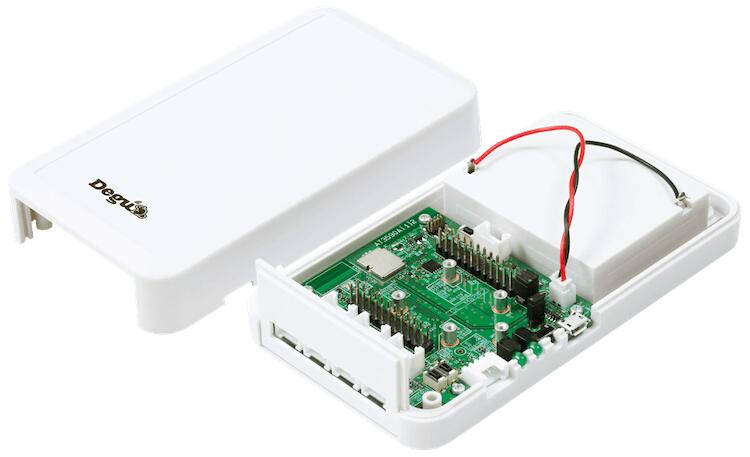

<!-- Copyright 2015-2026 Zephyr Project members and individual contributors. -->
<!-- SPDX-License-Identifier: Apache-2.0 -->
<!-- 中文翻译；编号、导航与译注为本地新增。 -->

# 第5章\_Degu评估套件（Evaluation Kit）

原文：[官方页面](https://docs.zephyrproject.org/latest/boards/atmarktechno/degu_evk/doc/index.html)。读取日期：2026-10-16；来源摘要见[来源记录](../SOURCES.md)。

开发板概览（Board Overview）

Degu评估套件（Evaluation Kit）

名称（Name）：

`degu_evk`

厂商（Vendor）：

[Atmark Techno, Inc.](https://docs.zephyrproject.org/latest/boards/index.html#vendor=atmarktechno)

状态（Status）：

当前未积极维护（Not Actively Maintained）

架构（Architecture）：

[arm](https://docs.zephyrproject.org/latest/boards/index.html#arch=arm)

片上系统（SoC）：

[nrf52840](https://docs.zephyrproject.org/latest/boards/index.html#soc=nrf52840)

[浏览开发板源码（Browse Board Sources）](https://github.com/zephyrproject-rtos/zephyr/blob/main//boards/atmarktechno/degu_evk/doc/index.rst/../..)Degu评估套件面向传感器和执行器（Actuators）的物联网设备，可连接OpenThread网状网络（Mesh Network）。套件配有Nordic nRF52840 SoC及NXP A71CH安全元件（Secure Element），可通过GPIO、ADC、I2C和UART连接部分Seeed Grove传感器。

更多信息见[Degu项目网站](https://open-degu.com/en/)。

---

[上一章](P004_ASPEED_Technology_Inc..md) · [返回大纲](大纲.md) · [全站翻译进度](../PROGRESS.md) · [下一章](P006_Atmark_Techno.md)
