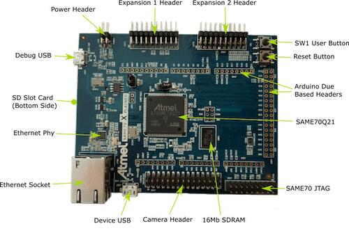

<!-- Copyright 2015-2026 Zephyr Project members and individual contributors. -->
<!-- SPDX-License-Identifier: Apache-2.0 -->
<!-- 中文翻译；编号、导航与译注为本地新增。 -->

<a id="sam_e70_xplained"></a>

# 第5章\_SAM E70(B) Xplained

原文：[官方页面](https://docs.zephyrproject.org/latest/boards/atmel/sam/sam_e70_xplained/doc/index.html)。读取日期：2026-10-16；来源摘要见[来源记录](../SOURCES.md)。

开发板概览（Board Overview）

<a id="id1"></a>

[](images/sam_e70_xplained.jpg)

SAM E70(B) Xplained

名称（Name）：

`sam_e70_xplained`

厂商（Vendor）：

[Atmel公司（Atmel Corporation）](https://docs.zephyrproject.org/latest/boards/index.html#vendor=atmel)

状态（Status）：

维护中（Maintained）

架构（Architecture）：

[arm](https://docs.zephyrproject.org/latest/boards/index.html#arch=arm)

片上系统（SoC）：

`[same70q21b](https://docs.zephyrproject.org/latest/boards/index.html#soc=same70q21b), [same70q21](https://docs.zephyrproject.org/latest/boards/index.html#soc=same70q21)`

<a id="board-github-link"></a>

[浏览开发板源码（Browse Board Sources）](https://github.com/zephyrproject-rtos/zephyr/blob/main//boards/atmel/sam/sam_e70_xplained/doc/index.rst/../..)<a id="overview"></a>

## 概述（Overview）

SAM E70 Xplained评估套件是用于评估Atmel SAM E70系列微控制器的开发平台。当前版本允许使用ATSAME70Q21A(B)两种芯片变体。

<a id="hardware"></a>

## 硬件（Hardware）


- ATSAME70Q21A(B) ARM Cortex-M7处理器
- 12 MHz晶体振荡器（Crystal Oscillator）
- 32.768 kHz晶体振荡器，未焊装（Not Populated）
- AT24MAC402电可擦除可编程只读存储器（EEPROM）
- IS42S16100E 16 Mb同步动态随机存储器（SDRAM）
- SD卡连接器（Connector）
- 以太网端口（Ethernet Port）
- Micro-AB USB设备接口（Device）
- Micro-AB USB调试接口，支持CMSIS-DAP、虚拟COM端口（Virtual COM Port）及数据网关接口（DGI / Data Gateway Interface）
- JTAG接口连接器
- 一个复位按键和一个用户按键
- 一个绿色用户LED

<a id="supported-features"></a>

### 支持的功能（Supported Features）

`sam_e70_xplained`开发板支持下表所列的硬件功能。

片上／板载（On-Chip / On-Board）

功能集成在片上系统（SoC）内／位于开发板上。

2 / 2

分别表示已启用／已禁用的实例数。点击数量标签，可查看开发板或SoC设备树源码（DTS）中该功能的第一个实例。

`vnd,foo`

与此功能匹配的设备树绑定兼容字符串（Compatible String）；点击链接可查看绑定文档。

<a id="sam_e70_xplained-hw-features"></a>

<a id="sam_e70_xplained-sam_e70_xplained/same70q21-hw-features-section"></a>

#### `sam_e70_xplained/same70q21`目标（Target）

<a id="sam_e70_xplained-sam_e70_xplained/same70q21-hw-features-panel"></a>

<a id="sam_e70_xplained-sam_e70_xplained/same70q21-hw-features-memory"></a>

该开发板目标的片上存储容量：384 KiB RAM、2 MiB Flash。

<a id="sam_e70_xplained-sam_e70_xplained/same70q21-hw-features-table"></a>

<table>
<tr>
<th>类型（Type）</th>
<th>位置（Location）</th>
<th>说明（Description）</th>
<th>兼容字符串（Compatible）</th>
</tr>
<tr>
<td rowspan="1">中央处理器（CPU）</td>
<td>片上（On-Chip）</td>
<td>ARM Cortex-M7处理器（CPU）（<a href="https://github.com/zephyrproject-rtos/zephyr/blob/main/dts/arm/atmel/samx7x.dtsi?plain=1#L32">已启用：1</a>）</td>
<td><a href="../cpu_cortex_xtensa_binding_reference/P005_arm_cortex-m7.md#std-dtcompatible-arm-cortex-m7"><code>arm,cortex-m7</code></a></td>
</tr>
<tr>
<td rowspan="1">模数转换器（ADC）</td>
<td>片上（On-Chip）</td>
<td>Atmel SAM系列模拟前端控制器（AFEC）（<a href="https://github.com/zephyrproject-rtos/zephyr/blob/main/dts/arm/atmel/samx7x.dtsi?plain=1#L222">已启用：2</a>）</td>
<td><a href="../hardware/P857_AtmelSAM模拟前端ADC绑定.md#dtbinding-atmel-sam-afec"><code>atmel,sam-afec</code></a></td>
</tr>
<tr>
<td rowspan="1">ARM 架构（ARM Architecture）</td>
<td>片上（On-Chip）</td>
<td>Atmel SAM同步串行控制器（SSC / Synchronous Serial Controller）（<a href="https://github.com/zephyrproject-rtos/zephyr/blob/main/dts/arm/atmel/samx7x.dtsi?plain=1#L58">已启用：1</a>）</td>
<td><a href="../arm_timing_ethosu_control_binding_reference/P007_atmel_sam-ssc.md#std-dtcompatible-atmel-sam-ssc"><code>atmel,sam-ssc</code></a></td>
</tr>
<tr>
<td rowspan="1">控制器局域网（CAN）</td>
<td>片上（On-Chip）</td>
<td>针对Atmel SAM定制的Bosch m_can CAN灵活数据速率控制器（CAN FD）（<a href="https://github.com/zephyrproject-rtos/zephyr/blob/main/dts/arm/atmel/samx7x.dtsi?plain=1#L184">已启用：1</a>；<a href="https://github.com/zephyrproject-rtos/zephyr/blob/main/dts/arm/atmel/samx7x.dtsi?plain=1#L196">已禁用：1</a>）</td>
<td><a href="../can_adi_atmel_nxp_binding_reference/P002_atmel_sam-can.md#std-dtcompatible-atmel-sam-can"><code>atmel,sam-can</code></a></td>
</tr>
<tr>
<td rowspan="1">时钟控制（Clock Control）</td>
<td>片上（On-Chip）</td>
<td>Atmel电源管理控制器（PMC / Power Management Controller）（<a href="https://github.com/zephyrproject-rtos/zephyr/blob/main/dts/arm/atmel/samx7x.dtsi?plain=1#L337">已启用：1</a>）</td>
<td><a href="../clock_adi_atmel_bflb_binding_reference/P009_atmel_sam-pmc.md#std-dtcompatible-atmel-sam-pmc"><code>atmel,sam-pmc</code></a></td>
</tr>
<tr>
<td rowspan="1">计数器（Counter）</td>
<td>片上（On-Chip）</td>
<td>Atmel SAM定时器／计数器（TC / Timer Counter）节点（<a href="https://github.com/zephyrproject-rtos/zephyr/blob/main/dts/arm/atmel/samx7x.dtsi?plain=1#L76">已禁用：4</a>）</td>
<td><a href="../counter_binding_reference/P010_atmel_sam-tc.md#std-dtcompatible-atmel-sam-tc"><code>atmel,sam-tc</code></a></td>
</tr>
<tr>
<td rowspan="1">数模转换器（DAC）</td>
<td>片上（On-Chip）</td>
<td>Atmel SAM系列数模转换器（DAC）（<a href="https://github.com/zephyrproject-rtos/zephyr/blob/main/dts/arm/atmel/samx7x.dtsi?plain=1#L231">已启用：1</a>）</td>
<td><a href="../hardware/P762_AtmelSAM数模转换器绑定.md#dtbinding-atmel-sam-dac"><code>atmel,sam-dac</code></a></td>
</tr>
<tr>
<td rowspan="1">直接存储器访问（DMA）</td>
<td>片上（On-Chip）</td>
<td>Atmel SAM扩展DMA控制器（XDMAC）（<a href="https://github.com/zephyrproject-rtos/zephyr/blob/main/dts/arm/atmel/samx7x.dtsi?plain=1#L328">已启用：1</a>）</td>
<td><a href="../dma_binding_reference/P010_atmel_sam-xdmac.md#std-dtcompatible-atmel-sam-xdmac"><code>atmel,sam-xdmac</code></a></td>
</tr>
<tr>
<td rowspan="4">以太网（Ethernet）</td>
<td>片上（On-Chip）</td>
<td>Microchip SAM以太网控制器（Ethernet Controller）（<a href="https://github.com/zephyrproject-rtos/zephyr/blob/main/dts/arm/atmel/samx7x.dtsi?plain=1#L240">已启用：1</a>）</td>
<td><a href="../ethernet_mdio_microchip_binding_reference/P019_microchip_sam-ethernet-controller.md#std-dtcompatible-microchip-sam-ethernet-controller"><code>microchip,sam-ethernet-controller</code></a></td>
</tr>
<tr>
<td>片上（On-Chip）</td>
<td>Atmel SAM系列千兆媒体访问控制器以太网（GMAC Ethernet）（<a href="https://github.com/zephyrproject-rtos/zephyr/blob/main/dts/arm/atmel/samx7x.dtsi?plain=1#L245">已启用：1</a>）</td>
<td><a href="../ethernet_mac_mdio_binding_reference/P004_atmel_sam-gmac.md#std-dtcompatible-atmel-sam-gmac"><code>atmel,sam-gmac</code></a></td>
</tr>
<tr>
<td>片上（On-Chip）</td>
<td>Atmel SAM系列管理数据输入输出（MDIO）驱动节点（<a href="https://github.com/zephyrproject-rtos/zephyr/blob/main/dts/arm/atmel/samx7x.dtsi?plain=1#L254">已启用：1</a>）</td>
<td><a href="../ethernet_mac_mdio_binding_reference/P016_atmel_sam-mdio.md#std-dtcompatible-atmel-sam-mdio"><code>atmel,sam-mdio</code></a></td>
</tr>
<tr>
<td>板载（On-Board）</td>
<td>通用媒体独立接口物理层（MII PHY）（<a href="https://github.com/zephyrproject-rtos/zephyr/blob/main/boards/atmel/sam/sam_e70_xplained/sam_e70_xplained-common.dtsi?plain=1#L158">已启用：1</a>）</td>
<td><a href="../ethernet_nxp_phy_binding_reference/P019_ethernet-phy.md#std-dtcompatible-ethernet-phy"><code>ethernet-phy</code></a></td>
</tr>
<tr>
<td rowspan="1">闪存控制器（Flash Controller）</td>
<td>片上（On-Chip）</td>
<td>Atmel SAM增强型嵌入式闪存控制器（EEFC / Enhanced Embedded Flash Controller）（<a href="https://github.com/zephyrproject-rtos/zephyr/blob/main/dts/arm/atmel/samx7x.dtsi?plain=1#L361">已启用：1</a>）</td>
<td><a href="../flash_adi_microchip_nordic_binding_reference/P006_atmel_sam-flash-controller.md#std-dtcompatible-atmel-sam-flash-controller"><code>atmel,sam-flash-controller</code></a></td>
</tr>
<tr>
<td rowspan="1">通用输入输出与接插件（GPIO &amp; Headers）</td>
<td>片上（On-Chip）</td>
<td>SAM通用输入输出端口（GPIO Port）（<a href="https://github.com/zephyrproject-rtos/zephyr/blob/main/dts/arm/atmel/samx7x.dtsi?plain=1#L387">已启用：5</a>）</td>
<td><a href="../gpio_adi_headers_ambiq_binding_reference/P029_atmel_sam-gpio.md#std-dtcompatible-atmel-sam-gpio"><code>atmel,sam-gpio</code></a></td>
</tr>
<tr>
<td rowspan="1">硬件信息（Hardware Information）</td>
<td>片上（On-Chip）</td>
<td>ATMEL SAM复位控制器（Reset Controller）（<a href="https://github.com/zephyrproject-rtos/zephyr/blob/main/dts/arm/atmel/samx7x.dtsi?plain=1#L438">已启用：1</a>）</td>
<td><a href="../hwinfo_binding_reference/P001_atmel_sam-rstc.md#std-dtcompatible-atmel-sam-rstc"><code>atmel,sam-rstc</code></a></td>
</tr>
<tr>
<td rowspan="1">集成电路间总线（I2C）</td>
<td>片上（On-Chip）</td>
<td>Atmel SAM系列高速双线接口（TWIHS / I2C）（<a href="https://github.com/zephyrproject-rtos/zephyr/blob/main/dts/arm/atmel/samx7x.dtsi?plain=1#L127">已启用：2</a>；<a href="https://github.com/zephyrproject-rtos/zephyr/blob/main/dts/arm/atmel/samx7x.dtsi?plain=1#L138">已禁用：1</a>）</td>
<td><a href="../i2c_adi_atmel_esp_binding_reference/P009_atmel_sam-i2c-twihs.md#std-dtcompatible-atmel-sam-i2c-twihs"><code>atmel,sam-i2c-twihs</code></a></td>
</tr>
<tr>
<td rowspan="1">输入（Input）</td>
<td>板载（On-Board）</td>
<td>一组绑定到 GPIO 的输入按键（GPIO-Bound Input Keys）（<a href="https://github.com/zephyrproject-rtos/zephyr/blob/main/boards/atmel/sam/sam_e70_xplained/sam_e70_xplained-common.dtsi?plain=1#L42">已启用：1</a>）</td>
<td><a href="../hardware/P563_GPIO按键绑定.md#std-dtcompatible-gpio-keys"><code>gpio-keys</code></a></td>
</tr>
<tr>
<td rowspan="1">中断控制器（Interrupt Controller）</td>
<td>片上（On-Chip）</td>
<td>ARMv7-M 嵌套向量中断控制器（Nested Vectored Interrupt Controller，NVIC）（<a href="https://github.com/zephyrproject-rtos/zephyr/blob/main/dts/arm/armv7-m.dtsi?plain=1#L13">已启用：1</a>）</td>
<td><a href="../arm_interrupt_timer_binding_reference/P002_ARMv7_M_NVIC.md#std-dtcompatible-arm-v7m-nvic"><code>arm,v7m-nvic</code></a></td>
</tr>
<tr>
<td rowspan="1">发光二极管（LED）</td>
<td>板载（On-Board）</td>
<td>一组由 GPIO 控制的 LED（GPIO-Controlled LEDs）（<a href="https://github.com/zephyrproject-rtos/zephyr/blob/main/boards/atmel/sam/sam_e70_xplained/sam_e70_xplained-common.dtsi?plain=1#L33">已启用：1</a>）</td>
<td><a href="../hardware/P564_GPIO指示灯绑定.md#dtbinding-gpio-leds"><code>gpio-leds</code></a></td>
</tr>
<tr>
<td rowspan="1">内存管理单元／内存保护单元（MMU / MPU）</td>
<td>片上（On-Chip）</td>
<td>ARMv7-M存储器保护单元（MPU / Memory Protection Unit）（<a href="https://github.com/zephyrproject-rtos/zephyr/blob/main/dts/arm/atmel/samx7x.dtsi?plain=1#L39">已启用：1</a>）</td>
<td><a href="../memory_protection_binding_reference/P005_arm_armv7m-mpu.md#std-dtcompatible-arm-armv7m-mpu"><code>arm,armv7m-mpu</code></a></td>
</tr>
<tr>
<td rowspan="2">存储技术设备（MTD）</td>
<td>板载（On-Board）</td>
<td>兼容Atmel AT24系列的I2C电可擦除可编程只读存储器（EEPROM）（<a href="https://github.com/zephyrproject-rtos/zephyr/blob/main/boards/atmel/sam/sam_e70_xplained/sam_e70_xplained-common.dtsi?plain=1#L84">已启用：1</a>）</td>
<td><a href="../mtd_atmel_bouffalo_binding_reference/P004_atmel_at24.md#std-dtcompatible-atmel-at24"><code>atmel,at24</code></a></td>
</tr>
<tr>
<td>片上（On-Chip）</td>
<td>此绑定（Binding）描述Atmel SAM闪存区域布局（<a href="https://github.com/zephyrproject-rtos/zephyr/blob/main/dts/arm/atmel/samx7x.dtsi?plain=1#L372">已启用：1</a>）</td>
<td><a href="../mtd_atmel_bouffalo_binding_reference/P009_atmel_sam-flash.md#std-dtcompatible-atmel-sam-flash"><code>atmel,sam-flash</code></a></td>
</tr>
<tr>
<td rowspan="1">非易失存储器（NVMEM）</td>
<td>板载（On-Board）</td>
<td>非易失存储器固定布局（Fixed Layout for Non-Volatile Memory）（<a href="https://github.com/zephyrproject-rtos/zephyr/blob/main/boards/atmel/sam/sam_e70_xplained/sam_e70_xplained-common.dtsi?plain=1#L92">已启用：1</a>）</td>
<td><a href="../memory_protection_binding_reference/P009_fixed-layout.md#std-dtcompatible-fixed-layout"><code>fixed-layout</code></a></td>
</tr>
<tr>
<td rowspan="1">引脚控制（Pin Control）</td>
<td>片上（On-Chip）</td>
<td>Atmel SAM引脚控制容器（Pinctrl Container）（<a href="https://github.com/zephyrproject-rtos/zephyr/blob/main/dts/arm/atmel/samx7x.dtsi?plain=1#L381">已启用：1</a>）</td>
<td><a href="../pinctrl_adi_ambiq_arm_binding_reference/P013_atmel_sam-pinctrl.md#std-dtcompatible-atmel-sam-pinctrl"><code>atmel,sam-pinctrl</code></a></td>
</tr>
<tr>
<td rowspan="1">电源管理（Power Management）</td>
<td>片上（On-Chip）</td>
<td>Atmel SAM电源控制器（SUPC / Supply Controller）（<a href="https://github.com/zephyrproject-rtos/zephyr/blob/main/dts/arm/atmel/samx7x.dtsi?plain=1#L445">已启用：1</a>）</td>
<td><a href="../power_control_binding_reference/P001_atmel_sam-supc.md#std-dtcompatible-atmel-sam-supc"><code>atmel,sam-supc</code></a></td>
</tr>
<tr>
<td rowspan="1">脉宽调制（PWM）</td>
<td>片上（On-Chip）</td>
<td>Atmel SAM脉宽调制（PWM）（<a href="https://github.com/zephyrproject-rtos/zephyr/blob/main/dts/arm/atmel/samx7x.dtsi?plain=1#L149">已启用：1</a>；<a href="https://github.com/zephyrproject-rtos/zephyr/blob/main/dts/arm/atmel/samx7x.dtsi?plain=1#L289">已禁用：1</a>）</td>
<td><a href="../pwm_adi_esp_infineon_binding_reference/P007_atmel_sam-pwm.md#std-dtcompatible-atmel-sam-pwm"><code>atmel,sam-pwm</code></a></td>
</tr>
<tr>
<td rowspan="1">随机数生成器（RNG）</td>
<td>片上（On-Chip）</td>
<td>Atmel SAM随机数发生器（RNG）（<a href="https://github.com/zephyrproject-rtos/zephyr/blob/main/dts/arm/atmel/samx7x.dtsi?plain=1#L320">已启用：1</a>）</td>
<td><a href="../rng_binding_reference/P004_atmel_sam-trng.md#std-dtcompatible-atmel-sam-trng"><code>atmel,sam-trng</code></a></td>
</tr>
<tr>
<td rowspan="1">实时时钟（RTC）</td>
<td>片上（On-Chip）</td>
<td>Atmel SAM系列实时时钟（RTC）设备（<a href="https://github.com/zephyrproject-rtos/zephyr/blob/main/dts/arm/atmel/samx7x.dtsi?plain=1#L460">已禁用：1</a>）</td>
<td><a href="../rtc_binding_reference/P004_atmel_sam-rtc.md#std-dtcompatible-atmel-sam-rtc"><code>atmel,sam-rtc</code></a></td>
</tr>
<tr>
<td rowspan="1">SD 主机控制器（SDHC）</td>
<td>片上（On-Chip）</td>
<td>ATMEL（Microchip）SAM高速多媒体卡接口SD主机控制器（HSMCI）（<a href="https://github.com/zephyrproject-rtos/zephyr/blob/main/dts/arm/atmel/samx7x.dtsi?plain=1#L51">已启用：1</a>）</td>
<td><a href="../sdhc_binding_reference/P003_atmel_sam-hsmci.md#std-dtcompatible-atmel-sam-hsmci"><code>atmel,sam-hsmci</code></a></td>
</tr>
<tr>
<td rowspan="1">传感器（Sensors）</td>
<td>片上（On-Chip）</td>
<td>Atmel SAM定时器／计数器（TC）的正交解码模式（QDEC）（<a href="https://github.com/zephyrproject-rtos/zephyr/blob/main/dts/arm/atmel/samx7x.dtsi?plain=1#L87">已禁用：4</a>）</td>
<td><a href="../sensor_ams_aosong_bosch_binding_reference/P018_atmel_sam-tc-qdec.md#std-dtcompatible-atmel-sam-tc-qdec"><code>atmel,sam-tc-qdec</code></a></td>
</tr>
<tr>
<td rowspan="2">串行控制器（Serial Controller）</td>
<td>片上（On-Chip）</td>
<td>Atmel SAM系列通用同步／异步收发器（USART）（<a href="https://github.com/zephyrproject-rtos/zephyr/blob/main/dts/arm/atmel/samx7x.dtsi?plain=1#L168">已启用：1</a>；<a href="https://github.com/zephyrproject-rtos/zephyr/blob/main/dts/arm/atmel/samx7x.dtsi?plain=1#L160">已禁用：2</a>）</td>
<td><a href="../uart_adi_arm_atmel_binding_reference/P011_atmel_sam-usart.md#std-dtcompatible-atmel-sam-usart"><code>atmel,sam-usart</code></a></td>
</tr>
<tr>
<td>片上（On-Chip）</td>
<td>SAM系列通用异步收发器（UART）（<a href="https://github.com/zephyrproject-rtos/zephyr/blob/main/dts/arm/atmel/samx7x.dtsi?plain=1#L345">已禁用：5</a>）</td>
<td><a href="../uart_adi_arm_atmel_binding_reference/P010_atmel_sam-uart.md#std-dtcompatible-atmel-sam-uart"><code>atmel,sam-uart</code></a></td>
</tr>
<tr>
<td rowspan="1">串行外设接口（SPI）</td>
<td>片上（On-Chip）</td>
<td>Atmel SAM SPI控制器（<a href="https://github.com/zephyrproject-rtos/zephyr/blob/main/dts/arm/atmel/samx7x.dtsi?plain=1#L66">已启用：1</a>；<a href="https://github.com/zephyrproject-rtos/zephyr/blob/main/dts/arm/atmel/samx7x.dtsi?plain=1#L279">已禁用：1</a>）</td>
<td><a href="../spi_adi_atmel_esp_binding_reference/P008_atmel_sam-spi.md#std-dtcompatible-atmel-sam-spi"><code>atmel,sam-spi</code></a></td>
</tr>
<tr>
<td rowspan="1">静态随机存储器（SRAM）</td>
<td>片上（On-Chip）</td>
<td>通用片上静态随机存储器（SRAM）（<a href="https://github.com/zephyrproject-rtos/zephyr/blob/main/dts/arm/atmel/samx7x.dtsi?plain=1#L46">已启用：1</a>）</td>
<td><a href="../hardware/P567_内存映射SRAM绑定.md#dtbinding-mmio-sram"><code>mmio-sram</code></a></td>
</tr>
<tr>
<td rowspan="1">定时器（Timer）</td>
<td>片上（On-Chip）</td>
<td>ARMv7-M 系统节拍（System Tick）（<a href="https://github.com/zephyrproject-rtos/zephyr/blob/main/dts/arm/armv7-m.dtsi?plain=1#L21">已启用：1</a>）</td>
<td><a href="../arm_interrupt_timer_binding_reference/P006_ARMv7_M_SysTick.md#std-dtcompatible-arm-armv7m-systick"><code>arm,armv7m-systick</code></a></td>
</tr>
<tr>
<td rowspan="1">通用串行总线（USB）</td>
<td>片上（On-Chip）</td>
<td>Atmel SAM系列高速USB（USBHS），设备模式（<a href="https://github.com/zephyrproject-rtos/zephyr/blob/main/dts/arm/atmel/samx7x.dtsi?plain=1#L208">已启用：1</a>）</td>
<td><a href="../usb_controller_binding_reference/P005_atmel_sam-usbhs.md#std-dtcompatible-atmel-sam-usbhs"><code>atmel,sam-usbhs</code></a></td>
</tr>
<tr>
<td rowspan="1">看门狗（Watchdog）</td>
<td>片上（On-Chip）</td>
<td>ATMEL SAM0看门狗（Watchdog）（<a href="https://github.com/zephyrproject-rtos/zephyr/blob/main/dts/arm/atmel/samx7x.dtsi?plain=1#L452">已启用：1</a>）</td>
<td><a href="../watchdog_binding_reference/P007_atmel_sam-watchdog.md#std-dtcompatible-atmel-sam-watchdog"><code>atmel,sam-watchdog</code></a></td>
</tr>
</table>

<a id="sam_e70_xplained-sam_e70_xplained/same70q21b-hw-features-section"></a>

#### `sam_e70_xplained/same70q21b`目标（Target）

<a id="sam_e70_xplained-sam_e70_xplained/same70q21b-hw-features-panel"></a>

<a id="sam_e70_xplained-sam_e70_xplained/same70q21b-hw-features-memory"></a>

该开发板目标的片上存储容量：384 KiB RAM、2 MiB Flash。

<a id="sam_e70_xplained-sam_e70_xplained/same70q21b-hw-features-table"></a>

<table>
<tr>
<th>类型（Type）</th>
<th>位置（Location）</th>
<th>说明（Description）</th>
<th>兼容字符串（Compatible）</th>
</tr>
<tr>
<td rowspan="1">中央处理器（CPU）</td>
<td>片上（On-Chip）</td>
<td>ARM Cortex-M7处理器（CPU）（<a href="https://github.com/zephyrproject-rtos/zephyr/blob/main/dts/arm/atmel/samx7x.dtsi?plain=1#L32">已启用：1</a>）</td>
<td><a href="../cpu_cortex_xtensa_binding_reference/P005_arm_cortex-m7.md#std-dtcompatible-arm-cortex-m7"><code>arm,cortex-m7</code></a></td>
</tr>
<tr>
<td rowspan="1">模数转换器（ADC）</td>
<td>片上（On-Chip）</td>
<td>Atmel SAM系列模拟前端控制器（AFEC）（<a href="https://github.com/zephyrproject-rtos/zephyr/blob/main/dts/arm/atmel/samx7x.dtsi?plain=1#L222">已启用：2</a>）</td>
<td><a href="../hardware/P857_AtmelSAM模拟前端ADC绑定.md#dtbinding-atmel-sam-afec"><code>atmel,sam-afec</code></a></td>
</tr>
<tr>
<td rowspan="1">ARM 架构（ARM Architecture）</td>
<td>片上（On-Chip）</td>
<td>Atmel SAM同步串行控制器（SSC / Synchronous Serial Controller）（<a href="https://github.com/zephyrproject-rtos/zephyr/blob/main/dts/arm/atmel/samx7x.dtsi?plain=1#L58">已启用：1</a>）</td>
<td><a href="../arm_timing_ethosu_control_binding_reference/P007_atmel_sam-ssc.md#std-dtcompatible-atmel-sam-ssc"><code>atmel,sam-ssc</code></a></td>
</tr>
<tr>
<td rowspan="1">控制器局域网（CAN）</td>
<td>片上（On-Chip）</td>
<td>针对Atmel SAM定制的Bosch m_can CAN灵活数据速率控制器（CAN FD）（<a href="https://github.com/zephyrproject-rtos/zephyr/blob/main/dts/arm/atmel/samx7x.dtsi?plain=1#L184">已启用：1</a>；<a href="https://github.com/zephyrproject-rtos/zephyr/blob/main/dts/arm/atmel/samx7x.dtsi?plain=1#L196">已禁用：1</a>）</td>
<td><a href="../can_adi_atmel_nxp_binding_reference/P002_atmel_sam-can.md#std-dtcompatible-atmel-sam-can"><code>atmel,sam-can</code></a></td>
</tr>
<tr>
<td rowspan="1">时钟控制（Clock Control）</td>
<td>片上（On-Chip）</td>
<td>Atmel电源管理控制器（PMC / Power Management Controller）（<a href="https://github.com/zephyrproject-rtos/zephyr/blob/main/dts/arm/atmel/samx7x.dtsi?plain=1#L337">已启用：1</a>）</td>
<td><a href="../clock_adi_atmel_bflb_binding_reference/P009_atmel_sam-pmc.md#std-dtcompatible-atmel-sam-pmc"><code>atmel,sam-pmc</code></a></td>
</tr>
<tr>
<td rowspan="1">计数器（Counter）</td>
<td>片上（On-Chip）</td>
<td>Atmel SAM定时器／计数器（TC / Timer Counter）节点（<a href="https://github.com/zephyrproject-rtos/zephyr/blob/main/dts/arm/atmel/samx7x.dtsi?plain=1#L76">已禁用：4</a>）</td>
<td><a href="../counter_binding_reference/P010_atmel_sam-tc.md#std-dtcompatible-atmel-sam-tc"><code>atmel,sam-tc</code></a></td>
</tr>
<tr>
<td rowspan="1">数模转换器（DAC）</td>
<td>片上（On-Chip）</td>
<td>Atmel SAM系列数模转换器（DAC）（<a href="https://github.com/zephyrproject-rtos/zephyr/blob/main/dts/arm/atmel/samx7x.dtsi?plain=1#L231">已启用：1</a>）</td>
<td><a href="../hardware/P762_AtmelSAM数模转换器绑定.md#dtbinding-atmel-sam-dac"><code>atmel,sam-dac</code></a></td>
</tr>
<tr>
<td rowspan="1">直接存储器访问（DMA）</td>
<td>片上（On-Chip）</td>
<td>Atmel SAM扩展DMA控制器（XDMAC）（<a href="https://github.com/zephyrproject-rtos/zephyr/blob/main/dts/arm/atmel/samx7x.dtsi?plain=1#L328">已启用：1</a>）</td>
<td><a href="../dma_binding_reference/P010_atmel_sam-xdmac.md#std-dtcompatible-atmel-sam-xdmac"><code>atmel,sam-xdmac</code></a></td>
</tr>
<tr>
<td rowspan="4">以太网（Ethernet）</td>
<td>片上（On-Chip）</td>
<td>Microchip SAM以太网控制器（Ethernet Controller）（<a href="https://github.com/zephyrproject-rtos/zephyr/blob/main/dts/arm/atmel/samx7x.dtsi?plain=1#L240">已启用：1</a>）</td>
<td><a href="../ethernet_mdio_microchip_binding_reference/P019_microchip_sam-ethernet-controller.md#std-dtcompatible-microchip-sam-ethernet-controller"><code>microchip,sam-ethernet-controller</code></a></td>
</tr>
<tr>
<td>片上（On-Chip）</td>
<td>Atmel SAM系列千兆媒体访问控制器以太网（GMAC Ethernet）（<a href="https://github.com/zephyrproject-rtos/zephyr/blob/main/dts/arm/atmel/samx7x.dtsi?plain=1#L245">已启用：1</a>）</td>
<td><a href="../ethernet_mac_mdio_binding_reference/P004_atmel_sam-gmac.md#std-dtcompatible-atmel-sam-gmac"><code>atmel,sam-gmac</code></a></td>
</tr>
<tr>
<td>片上（On-Chip）</td>
<td>Atmel SAM系列管理数据输入输出（MDIO）驱动节点（<a href="https://github.com/zephyrproject-rtos/zephyr/blob/main/dts/arm/atmel/samx7x.dtsi?plain=1#L254">已启用：1</a>）</td>
<td><a href="../ethernet_mac_mdio_binding_reference/P016_atmel_sam-mdio.md#std-dtcompatible-atmel-sam-mdio"><code>atmel,sam-mdio</code></a></td>
</tr>
<tr>
<td>板载（On-Board）</td>
<td>通用媒体独立接口物理层（MII PHY）（<a href="https://github.com/zephyrproject-rtos/zephyr/blob/main/boards/atmel/sam/sam_e70_xplained/sam_e70_xplained-common.dtsi?plain=1#L158">已启用：1</a>）</td>
<td><a href="../ethernet_nxp_phy_binding_reference/P019_ethernet-phy.md#std-dtcompatible-ethernet-phy"><code>ethernet-phy</code></a></td>
</tr>
<tr>
<td rowspan="1">闪存控制器（Flash Controller）</td>
<td>片上（On-Chip）</td>
<td>Atmel SAM增强型嵌入式闪存控制器（EEFC / Enhanced Embedded Flash Controller）（<a href="https://github.com/zephyrproject-rtos/zephyr/blob/main/dts/arm/atmel/samx7x.dtsi?plain=1#L361">已启用：1</a>）</td>
<td><a href="../flash_adi_microchip_nordic_binding_reference/P006_atmel_sam-flash-controller.md#std-dtcompatible-atmel-sam-flash-controller"><code>atmel,sam-flash-controller</code></a></td>
</tr>
<tr>
<td rowspan="1">通用输入输出与接插件（GPIO &amp; Headers）</td>
<td>片上（On-Chip）</td>
<td>SAM通用输入输出端口（GPIO Port）（<a href="https://github.com/zephyrproject-rtos/zephyr/blob/main/dts/arm/atmel/samx7x.dtsi?plain=1#L387">已启用：5</a>）</td>
<td><a href="../gpio_adi_headers_ambiq_binding_reference/P029_atmel_sam-gpio.md#std-dtcompatible-atmel-sam-gpio"><code>atmel,sam-gpio</code></a></td>
</tr>
<tr>
<td rowspan="1">硬件信息（Hardware Information）</td>
<td>片上（On-Chip）</td>
<td>ATMEL SAM复位控制器（Reset Controller）（<a href="https://github.com/zephyrproject-rtos/zephyr/blob/main/dts/arm/atmel/samx7x.dtsi?plain=1#L438">已启用：1</a>）</td>
<td><a href="../hwinfo_binding_reference/P001_atmel_sam-rstc.md#std-dtcompatible-atmel-sam-rstc"><code>atmel,sam-rstc</code></a></td>
</tr>
<tr>
<td rowspan="1">集成电路间总线（I2C）</td>
<td>片上（On-Chip）</td>
<td>Atmel SAM系列高速双线接口（TWIHS / I2C）（<a href="https://github.com/zephyrproject-rtos/zephyr/blob/main/dts/arm/atmel/samx7x.dtsi?plain=1#L127">已启用：2</a>；<a href="https://github.com/zephyrproject-rtos/zephyr/blob/main/dts/arm/atmel/samx7x.dtsi?plain=1#L138">已禁用：1</a>）</td>
<td><a href="../i2c_adi_atmel_esp_binding_reference/P009_atmel_sam-i2c-twihs.md#std-dtcompatible-atmel-sam-i2c-twihs"><code>atmel,sam-i2c-twihs</code></a></td>
</tr>
<tr>
<td rowspan="1">输入（Input）</td>
<td>板载（On-Board）</td>
<td>一组绑定到 GPIO 的输入按键（GPIO-Bound Input Keys）（<a href="https://github.com/zephyrproject-rtos/zephyr/blob/main/boards/atmel/sam/sam_e70_xplained/sam_e70_xplained-common.dtsi?plain=1#L42">已启用：1</a>）</td>
<td><a href="../hardware/P563_GPIO按键绑定.md#std-dtcompatible-gpio-keys"><code>gpio-keys</code></a></td>
</tr>
<tr>
<td rowspan="1">中断控制器（Interrupt Controller）</td>
<td>片上（On-Chip）</td>
<td>ARMv7-M 嵌套向量中断控制器（Nested Vectored Interrupt Controller，NVIC）（<a href="https://github.com/zephyrproject-rtos/zephyr/blob/main/dts/arm/armv7-m.dtsi?plain=1#L13">已启用：1</a>）</td>
<td><a href="../arm_interrupt_timer_binding_reference/P002_ARMv7_M_NVIC.md#std-dtcompatible-arm-v7m-nvic"><code>arm,v7m-nvic</code></a></td>
</tr>
<tr>
<td rowspan="1">发光二极管（LED）</td>
<td>板载（On-Board）</td>
<td>一组由 GPIO 控制的 LED（GPIO-Controlled LEDs）（<a href="https://github.com/zephyrproject-rtos/zephyr/blob/main/boards/atmel/sam/sam_e70_xplained/sam_e70_xplained-common.dtsi?plain=1#L33">已启用：1</a>）</td>
<td><a href="../hardware/P564_GPIO指示灯绑定.md#dtbinding-gpio-leds"><code>gpio-leds</code></a></td>
</tr>
<tr>
<td rowspan="1">内存管理单元／内存保护单元（MMU / MPU）</td>
<td>片上（On-Chip）</td>
<td>ARMv7-M存储器保护单元（MPU / Memory Protection Unit）（<a href="https://github.com/zephyrproject-rtos/zephyr/blob/main/dts/arm/atmel/samx7x.dtsi?plain=1#L39">已启用：1</a>）</td>
<td><a href="../memory_protection_binding_reference/P005_arm_armv7m-mpu.md#std-dtcompatible-arm-armv7m-mpu"><code>arm,armv7m-mpu</code></a></td>
</tr>
<tr>
<td rowspan="2">存储技术设备（MTD）</td>
<td>板载（On-Board）</td>
<td>兼容Atmel AT24系列的I2C电可擦除可编程只读存储器（EEPROM）（<a href="https://github.com/zephyrproject-rtos/zephyr/blob/main/boards/atmel/sam/sam_e70_xplained/sam_e70_xplained-common.dtsi?plain=1#L84">已启用：1</a>）</td>
<td><a href="../mtd_atmel_bouffalo_binding_reference/P004_atmel_at24.md#std-dtcompatible-atmel-at24"><code>atmel,at24</code></a></td>
</tr>
<tr>
<td>片上（On-Chip）</td>
<td>此绑定（Binding）描述Atmel SAM闪存区域布局（<a href="https://github.com/zephyrproject-rtos/zephyr/blob/main/dts/arm/atmel/samx7x.dtsi?plain=1#L372">已启用：1</a>）</td>
<td><a href="../mtd_atmel_bouffalo_binding_reference/P009_atmel_sam-flash.md#std-dtcompatible-atmel-sam-flash"><code>atmel,sam-flash</code></a></td>
</tr>
<tr>
<td rowspan="1">非易失存储器（NVMEM）</td>
<td>板载（On-Board）</td>
<td>非易失存储器固定布局（Fixed Layout for Non-Volatile Memory）（<a href="https://github.com/zephyrproject-rtos/zephyr/blob/main/boards/atmel/sam/sam_e70_xplained/sam_e70_xplained-common.dtsi?plain=1#L92">已启用：1</a>）</td>
<td><a href="../memory_protection_binding_reference/P009_fixed-layout.md#std-dtcompatible-fixed-layout"><code>fixed-layout</code></a></td>
</tr>
<tr>
<td rowspan="1">引脚控制（Pin Control）</td>
<td>片上（On-Chip）</td>
<td>Atmel SAM引脚控制容器（Pinctrl Container）（<a href="https://github.com/zephyrproject-rtos/zephyr/blob/main/dts/arm/atmel/samx7x.dtsi?plain=1#L381">已启用：1</a>）</td>
<td><a href="../pinctrl_adi_ambiq_arm_binding_reference/P013_atmel_sam-pinctrl.md#std-dtcompatible-atmel-sam-pinctrl"><code>atmel,sam-pinctrl</code></a></td>
</tr>
<tr>
<td rowspan="1">电源管理（Power Management）</td>
<td>片上（On-Chip）</td>
<td>Atmel SAM电源控制器（SUPC / Supply Controller）（<a href="https://github.com/zephyrproject-rtos/zephyr/blob/main/dts/arm/atmel/samx7x.dtsi?plain=1#L445">已启用：1</a>）</td>
<td><a href="../power_control_binding_reference/P001_atmel_sam-supc.md#std-dtcompatible-atmel-sam-supc"><code>atmel,sam-supc</code></a></td>
</tr>
<tr>
<td rowspan="1">脉宽调制（PWM）</td>
<td>片上（On-Chip）</td>
<td>Atmel SAM脉宽调制（PWM）（<a href="https://github.com/zephyrproject-rtos/zephyr/blob/main/dts/arm/atmel/samx7x.dtsi?plain=1#L149">已启用：1</a>；<a href="https://github.com/zephyrproject-rtos/zephyr/blob/main/dts/arm/atmel/samx7x.dtsi?plain=1#L289">已禁用：1</a>）</td>
<td><a href="../pwm_adi_esp_infineon_binding_reference/P007_atmel_sam-pwm.md#std-dtcompatible-atmel-sam-pwm"><code>atmel,sam-pwm</code></a></td>
</tr>
<tr>
<td rowspan="1">随机数生成器（RNG）</td>
<td>片上（On-Chip）</td>
<td>Atmel SAM随机数发生器（RNG）（<a href="https://github.com/zephyrproject-rtos/zephyr/blob/main/dts/arm/atmel/samx7x.dtsi?plain=1#L320">已启用：1</a>）</td>
<td><a href="../rng_binding_reference/P004_atmel_sam-trng.md#std-dtcompatible-atmel-sam-trng"><code>atmel,sam-trng</code></a></td>
</tr>
<tr>
<td rowspan="1">实时时钟（RTC）</td>
<td>片上（On-Chip）</td>
<td>Atmel SAM系列实时时钟（RTC）设备（<a href="https://github.com/zephyrproject-rtos/zephyr/blob/main/dts/arm/atmel/samx7x.dtsi?plain=1#L460">已禁用：1</a>）</td>
<td><a href="../rtc_binding_reference/P004_atmel_sam-rtc.md#std-dtcompatible-atmel-sam-rtc"><code>atmel,sam-rtc</code></a></td>
</tr>
<tr>
<td rowspan="1">SD 主机控制器（SDHC）</td>
<td>片上（On-Chip）</td>
<td>ATMEL（Microchip）SAM高速多媒体卡接口SD主机控制器（HSMCI）（<a href="https://github.com/zephyrproject-rtos/zephyr/blob/main/dts/arm/atmel/samx7x.dtsi?plain=1#L51">已启用：1</a>）</td>
<td><a href="../sdhc_binding_reference/P003_atmel_sam-hsmci.md#std-dtcompatible-atmel-sam-hsmci"><code>atmel,sam-hsmci</code></a></td>
</tr>
<tr>
<td rowspan="1">传感器（Sensors）</td>
<td>片上（On-Chip）</td>
<td>Atmel SAM定时器／计数器（TC）的正交解码模式（QDEC）（<a href="https://github.com/zephyrproject-rtos/zephyr/blob/main/dts/arm/atmel/samx7x.dtsi?plain=1#L87">已禁用：4</a>）</td>
<td><a href="../sensor_ams_aosong_bosch_binding_reference/P018_atmel_sam-tc-qdec.md#std-dtcompatible-atmel-sam-tc-qdec"><code>atmel,sam-tc-qdec</code></a></td>
</tr>
<tr>
<td rowspan="2">串行控制器（Serial Controller）</td>
<td>片上（On-Chip）</td>
<td>Atmel SAM系列通用同步／异步收发器（USART）（<a href="https://github.com/zephyrproject-rtos/zephyr/blob/main/dts/arm/atmel/samx7x.dtsi?plain=1#L168">已启用：1</a>；<a href="https://github.com/zephyrproject-rtos/zephyr/blob/main/dts/arm/atmel/samx7x.dtsi?plain=1#L160">已禁用：2</a>）</td>
<td><a href="../uart_adi_arm_atmel_binding_reference/P011_atmel_sam-usart.md#std-dtcompatible-atmel-sam-usart"><code>atmel,sam-usart</code></a></td>
</tr>
<tr>
<td>片上（On-Chip）</td>
<td>SAM系列通用异步收发器（UART）（<a href="https://github.com/zephyrproject-rtos/zephyr/blob/main/dts/arm/atmel/samx7x.dtsi?plain=1#L345">已禁用：5</a>）</td>
<td><a href="../uart_adi_arm_atmel_binding_reference/P010_atmel_sam-uart.md#std-dtcompatible-atmel-sam-uart"><code>atmel,sam-uart</code></a></td>
</tr>
<tr>
<td rowspan="1">串行外设接口（SPI）</td>
<td>片上（On-Chip）</td>
<td>Atmel SAM SPI控制器（<a href="https://github.com/zephyrproject-rtos/zephyr/blob/main/dts/arm/atmel/samx7x.dtsi?plain=1#L66">已启用：1</a>；<a href="https://github.com/zephyrproject-rtos/zephyr/blob/main/dts/arm/atmel/samx7x.dtsi?plain=1#L279">已禁用：1</a>）</td>
<td><a href="../spi_adi_atmel_esp_binding_reference/P008_atmel_sam-spi.md#std-dtcompatible-atmel-sam-spi"><code>atmel,sam-spi</code></a></td>
</tr>
<tr>
<td rowspan="1">静态随机存储器（SRAM）</td>
<td>片上（On-Chip）</td>
<td>通用片上静态随机存储器（SRAM）（<a href="https://github.com/zephyrproject-rtos/zephyr/blob/main/dts/arm/atmel/samx7x.dtsi?plain=1#L46">已启用：1</a>）</td>
<td><a href="../hardware/P567_内存映射SRAM绑定.md#dtbinding-mmio-sram"><code>mmio-sram</code></a></td>
</tr>
<tr>
<td rowspan="1">定时器（Timer）</td>
<td>片上（On-Chip）</td>
<td>ARMv7-M 系统节拍（System Tick）（<a href="https://github.com/zephyrproject-rtos/zephyr/blob/main/dts/arm/armv7-m.dtsi?plain=1#L21">已启用：1</a>）</td>
<td><a href="../arm_interrupt_timer_binding_reference/P006_ARMv7_M_SysTick.md#std-dtcompatible-arm-armv7m-systick"><code>arm,armv7m-systick</code></a></td>
</tr>
<tr>
<td rowspan="1">通用串行总线（USB）</td>
<td>片上（On-Chip）</td>
<td>Atmel SAM系列高速USB（USBHS），设备模式（<a href="https://github.com/zephyrproject-rtos/zephyr/blob/main/dts/arm/atmel/samx7x.dtsi?plain=1#L208">已启用：1</a>）</td>
<td><a href="../usb_controller_binding_reference/P005_atmel_sam-usbhs.md#std-dtcompatible-atmel-sam-usbhs"><code>atmel,sam-usbhs</code></a></td>
</tr>
<tr>
<td rowspan="1">看门狗（Watchdog）</td>
<td>片上（On-Chip）</td>
<td>ATMEL SAM0看门狗（Watchdog）（<a href="https://github.com/zephyrproject-rtos/zephyr/blob/main/dts/arm/atmel/samx7x.dtsi?plain=1#L452">已启用：1</a>）</td>
<td><a href="../watchdog_binding_reference/P007_atmel_sam-watchdog.md#std-dtcompatible-atmel-sam-watchdog"><code>atmel,sam-watchdog</code></a></td>
</tr>
</table>

<a id="connections-and-ios"></a>

### 连接与输入输出（Connections and IOs）

[SAME70-XPLD用户指南](http://www.atmel.com/Images/Atmel-44050-Cortex-M7-Microcontroller-SAM-E70-XPLD-Xplained_User-guide.pdf)提供开发板连接的详细信息。

<a id="system-clock"></a>

### 系统时钟（System Clock）

SAM E70 MCU使用板上的12 MHz外部振荡器，经片上PLL生成300 MHz系统时钟。

<a id="serial-port"></a>

### 串口（Serial Port）

ATSAME70Q21 MCU有五路UART及三路USART。其中一路USART配置为控制台，通过EDBG USB芯片表现为虚拟COM端口。

<a id="programming-and-debugging"></a>

## 烧录与调试（Programming and Debugging）

`sam_e70_xplained`开发板支持下表所列的运行工具（Runners）及相关west命令。

<table>
<tr>
<th></th>
<th>烧录（flash）</th>
<th>调试（debug）</th>
<th>连接调试会话（attach）</th>
<th>实时传输（rtt）</th>
<th>调试服务器（debugserver）</th>
</tr>
<tr>
<td><a href="https://docs.zephyrproject.org/latest/develop/flash_debug/host-tools.html#runner-openocd">openocd</a></td>
<td>✅（默认 / default）</td>
<td>✅（默认 / default）</td>
<td>✅</td>
<td>✅</td>
<td>✅</td>
</tr>
</table>

向SAM E70 MCU烧录Zephyr项目需要[OpenOCD工具](http://openocd.org/)。OpenOCD 0.10.0增加了Atmel SAM E系列支持；该版本已纳入Zephyr SDK 0.9.2。

全新SAM E70芯片默认启动ROM中的SAM-BA引导加载程序，而非闪存镜像。此行为由通用非易失性存储位1（GPNVM1）决定，烧录流程会将其设为1，使芯片改为从闪存启动。

如果安全位GPNVM0已置位，将无法编程闪存或通过调试接口连接芯片。清除此位的唯一方法是执行整片擦除，这会擦除所有GPNVM位及SAM E70闪存的全部内容：


- 在开发板断电时，短接J200排针上的跳线。
- 给开发板上电，随后即可移除跳线；擦除信号有效至少230 ms后，闪存擦除过程开始。

<a id="flashing"></a>

### 烧录（Flashing）


1. 运行你惯用的终端程序，监听输出。Linux下的终端设备应为`/dev/ttyACM0`，例如：

  ```text
  $ minicom -D /dev/ttyACM0 -o
  ```

  `-o`选项让`minicom`不发送调制解调器初始化字符串（Modem Initialization String）。连接参数应配置如下：


  - 速率（Speed）：115200波特率
  - 数据位（Data）：8位
  - 奇偶校验（Parity）：无（None）
  - 停止位（Stop Bits）：1位
2. 通过USB调试端口将SAM E70 Xplained连接到主机，然后构建并烧录[Hello World](../getting_started/P005_HelloWorld示例.md#hello_world)应用。

  ```text
  # From the root of the zephyr repository
  west build -b sam_e70_xplained/same70q21 samples/hello_world
  west flash
  ```

  终端应显示`Hello World! sam_e70_xplained`。
3. 若使用B版本SoC，目标应填写`sam_e70_xplained/same70q21b`。

  ```text
  # From the root of the zephyr repository
  west build -b sam_e70_xplained/same70q21b samples/hello_world
  west flash
  ```

  终端应显示`Hello World! sam_e70_xplained`。

也可将J-Link或ULINK等外部调试适配器连接到20针JTAG排针后烧录。通过环境变量`OPENOCD_INTERFACE`指定适配器名称，例如`jlink`。OpenOCD会在内部搜索路径中查找`interface/$(OPENOCD_INTERFACE).cfg`接口配置文件。

<a id="debugging"></a>

### 调试（Debugging）

可以按常规方式调试应用。下面以[Hello World](../getting_started/P005_HelloWorld示例.md#hello_world)应用为例。

```text
# From the root of the zephyr repository
west build -b sam_e70_xplained/same70q21 samples/hello_world
west debug
```

<a id="references"></a>

## 参考资料（References）

SAM E70产品页面（Product Page）：

[http://www.atmel.com/products/microcontrollers/arm/sam-e.aspx](http://www.atmel.com/products/microcontrollers/arm/sam-e.aspx)

## 译注

原文分别给出A／B芯片目标，并明确说明GPNVM0整片擦除会清除全部GPNVM位与闪存内容；目标名称、J200跳线与外部OpenOCD适配器配置均按原文保留。

## 原文外链核对

2026-10-16核对并重试以下原文外链时未能确认可访问性，保留原始目标，不将访问失败解释为原文内容有误。

- [Atmel-44050-Cortex-M7-Microcontroller-SAM-E70-XPLD-Xplained_User-guide.pdf](http://www.atmel.com/Images/Atmel-44050-Cortex-M7-Microcontroller-SAM-E70-XPLD-Xplained_User-guide.pdf)：HTTP Error 403: Forbidden。
- [sam-e.aspx](http://www.atmel.com/products/microcontrollers/arm/sam-e.aspx)：HTTP Error 403: Forbidden。

---

[上一章](P004_SAM4S_Xplained.md) · [返回大纲](大纲.md) · [全站翻译进度](../PROGRESS.md) · [下一章](P006_SAM_V71_B_Xplained_Ultra.md)
