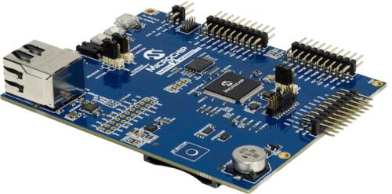
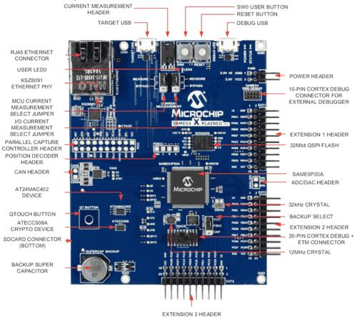

<!-- Copyright 2015-2026 Zephyr Project members and individual contributors. -->
<!-- SPDX-License-Identifier: Apache-2.0 -->
<!-- 中文翻译；编号、导航与译注为本地新增。 -->

<a id="same54_xpro"></a>

# 第10章\_SAM E54 Xplained Pro评估套件（Evaluation Kit）

原文：[官方页面](https://docs.zephyrproject.org/latest/boards/atmel/sam0/same54_xpro/doc/index.html)。读取日期：2026-10-16；来源摘要见[来源记录](../SOURCES.md)。

开发板概览（Board Overview）

<a id="id1"></a>

[](images/atsame54_xpro.jpg)

SAM E54 Xplained Pro评估套件（Evaluation Kit）

名称（Name）：

`same54_xpro`

厂商（Vendor）：

[Atmel公司（Atmel Corporation）](https://docs.zephyrproject.org/latest/boards/index.html#vendor=atmel)

状态（Status）：

维护中（Maintained）

架构（Architecture）：

[arm](https://docs.zephyrproject.org/latest/boards/index.html#arch=arm)

片上系统（SoC）：

[same54p20a](https://docs.zephyrproject.org/latest/boards/index.html#soc=same54p20a)

<a id="board-github-link"></a>

[浏览开发板源码（Browse Board Sources）](https://github.com/zephyrproject-rtos/zephyr/blob/main//boards/atmel/sam0/same54_xpro/doc/index.rst/../..)<a id="overview"></a>

## 概述（Overview）

<a id="id3"></a>

SAM E54 Xplained Pro评估套件[注1](#id2)适合评估采用Cortex®-M4F处理器的SAM E54微控制器并制作原型。套件包含Atmel嵌入式调试器（EDBG），无需额外硬件即可提供完整调试接口。（[SAM E54 Xplained Pro评估套件（Evaluation Kit）](https://www.microchip.com/en-us/development-tool/ATSAME54-XPRO)）

<a id="hardware"></a>

## 硬件（Hardware）


- SAME54P20A ARM Cortex-M4F处理器，120 MHz
- 32.768 kHz晶体振荡器（Crystal Oscillator）
- 12 MHz晶体振荡器（Crystal Oscillator）
- 1024 KiB闪存及256 KiB RAM
- 一个黄色用户LED
- 一个机械式用户按键
- 1个复位按键（Reset Button）
- 板载基于USB的EDBG单元，提供串口控制台
- 一个QTouch®外设触摸控制器按键（PTC）
- 32 MiB四线SPI闪存（QSPI Flash）
- ATECC508密码认证设备（CryptoAuthentication™）
- 带EUI-48™媒体访问控制地址（MAC Address）的AT24MAC402串行EEPROM
- 以太网（Ethernet）

  > - 内置磁性器件（Magnetics）的RJ45连接器
  > - KSZ8091RNA物理层（PHY）
  > - 符合IEE 802.3的10Base-T／100Base-TX以太网收发器（IEE拼写依原文保留）
- USB接口，支持主机及设备模式
- SD／SDIO卡连接器

<a id="supported-features"></a>

### 支持的功能（Supported Features）

`same54_xpro`开发板支持下表所列的硬件功能。

片上／板载（On-Chip / On-Board）

功能集成在片上系统（SoC）内／位于开发板上。

2 / 2

分别表示已启用／已禁用的实例数。点击数量标签，可查看开发板或SoC设备树源码（DTS）中该功能的第一个实例。

`vnd,foo`

与此功能匹配的设备树绑定兼容字符串（Compatible String）；点击链接可查看绑定文档。

<a id="same54_xpro-hw-features"></a>

<a id="same54_xpro-same54_xpro/same54p20a-hw-features-section"></a>

#### `same54_xpro/same54p20a`目标（Target）

<a id="same54_xpro-same54_xpro/same54p20a-hw-features-panel"></a>

<a id="same54_xpro-same54_xpro/same54p20a-hw-features-memory"></a>

此开发板目标可用存储器：256 KiB RAM、1 MiB 闪存。

<a id="same54_xpro-same54_xpro/same54p20a-hw-features-table"></a>

<table>
<tr>
<th>类型（Type）</th>
<th>位置（Location）</th>
<th>说明（Description）</th>
<th>兼容字符串（Compatible）</th>
</tr>
<tr>
<td rowspan="1">中央处理器（CPU）</td>
<td>片上（On-Chip）</td>
<td>ARM Cortex-M4F 处理器（CPU）（<a href="https://github.com/zephyrproject-rtos/zephyr/blob/main/dts/arm/atmel/samd5x.dtsi?plain=1#L59">已启用：1</a>）</td>
<td><a href="../cpu_arm_riscv_binding_reference/P025_arm_cortex-m4f.md#std-dtcompatible-arm-cortex-m4f"><code>arm,cortex-m4f</code></a></td>
</tr>
<tr>
<td rowspan="1">模数转换器（ADC）</td>
<td>片上（On-Chip）</td>
<td>Atmel SAM0系列模数转换器（ADC）（<a href="https://github.com/zephyrproject-rtos/zephyr/blob/main/dts/arm/atmel/samd5x.dtsi?plain=1#L346">已启用：1</a>；<a href="https://github.com/zephyrproject-rtos/zephyr/blob/main/dts/arm/atmel/samd5x.dtsi?plain=1#L371">已禁用：1</a>）</td>
<td><a href="../hardware/P858_AtmelSAM0模数转换器绑定.md#dtbinding-atmel-sam0-adc"><code>atmel,sam0-adc</code></a></td>
</tr>
<tr>
<td rowspan="2">ARM 架构（ARM Architecture）</td>
<td>片上（On-Chip）</td>
<td>用于定位Atmel SAM0设备的设备ID（Device ID，即序列号）（<a href="https://github.com/zephyrproject-rtos/zephyr/blob/main/dts/arm/atmel/samd5x.dtsi?plain=1#L86">已启用：1</a>）</td>
<td><a href="../arm_timing_ethosu_control_binding_reference/P008_atmel_sam0-id.md#std-dtcompatible-atmel-sam0-id"><code>atmel,sam0-id</code></a></td>
</tr>
<tr>
<td>片上（On-Chip）</td>
<td>Atmel SAM0多协议串行通信单元（SERCOM），支持UART、SPI和I2C（<a href="https://github.com/zephyrproject-rtos/zephyr/blob/main/dts/arm/atmel/samd5x.dtsi?plain=1#L181">已禁用：5</a>）</td>
<td><a href="../arm_timing_ethosu_control_binding_reference/P009_atmel_sam0-sercom.md#std-dtcompatible-atmel-sam0-sercom"><code>atmel,sam0-sercom</code></a></td>
</tr>
<tr>
<td rowspan="1">控制器局域网（CAN）</td>
<td>片上（On-Chip）</td>
<td>针对Atmel SAM0定制的Bosch m_can CAN FD控制器（<a href="https://github.com/zephyrproject-rtos/zephyr/blob/main/dts/arm/atmel/same5x.dtsi?plain=1#L36">已禁用：2</a>）</td>
<td><a href="../can_adi_atmel_nxp_binding_reference/P003_atmel_sam0-can.md#std-dtcompatible-atmel-sam0-can"><code>atmel,sam0-can</code></a></td>
</tr>
<tr>
<td rowspan="3">时钟控制（Clock Control）</td>
<td>片上（On-Chip）</td>
<td>Atmel SAM0主时钟控制器（MCLK / Main Clock Controller）（<a href="https://github.com/zephyrproject-rtos/zephyr/blob/main/dts/arm/atmel/samd5x.dtsi?plain=1#L94">已启用：1</a>）</td>
<td><a href="../clock_adi_atmel_bflb_binding_reference/P011_atmel_sam0-mclk.md#std-dtcompatible-atmel-sam0-mclk"><code>atmel,sam0-mclk</code></a></td>
</tr>
<tr>
<td>片上（On-Chip）</td>
<td>Atmel SAM0 32 kHz振荡器控制器（OSC32KCTRL / Oscillator Controller）（<a href="https://github.com/zephyrproject-rtos/zephyr/blob/main/dts/arm/atmel/samd5x.dtsi?plain=1#L101">已启用：1</a>）</td>
<td><a href="../clock_adi_atmel_bflb_binding_reference/P012_atmel_sam0-osc32kctrl.md#std-dtcompatible-atmel-sam0-osc32kctrl"><code>atmel,sam0-osc32kctrl</code></a></td>
</tr>
<tr>
<td>片上（On-Chip）</td>
<td>Atmel SAMD0通用时钟控制器（GCLK / Generic Clock Controller）（<a href="https://github.com/zephyrproject-rtos/zephyr/blob/main/dts/arm/atmel/samd5x.dtsi?plain=1#L108">已启用：1</a>）</td>
<td><a href="../clock_adi_atmel_bflb_binding_reference/P010_atmel_sam0-gclk.md#std-dtcompatible-atmel-sam0-gclk"><code>atmel,sam0-gclk</code></a></td>
</tr>
<tr>
<td rowspan="1">计数器（Counter）</td>
<td>片上（On-Chip）</td>
<td>以32位模式运行的Atmel SAM0基本定时器／计数器（TC / Timer Counter）（<a href="https://github.com/zephyrproject-rtos/zephyr/blob/main/dts/arm/atmel/samd5x.dtsi?plain=1#L408">已禁用：4</a>）</td>
<td><a href="../counter_binding_reference/P011_atmel_sam0-tc32.md#std-dtcompatible-atmel-sam0-tc32"><code>atmel,sam0-tc32</code></a></td>
</tr>
<tr>
<td rowspan="1">数模转换器（DAC）</td>
<td>片上（On-Chip）</td>
<td>Atmel SAMD5x/E5x系列数模转换器（DAC）（<a href="https://github.com/zephyrproject-rtos/zephyr/blob/main/dts/arm/atmel/samd5x.dtsi?plain=1#L395">已启用：1</a>）</td>
<td><a href="../hardware/P764_AtmelSAMD5x数模转换器绑定.md#dtbinding-atmel-samd5x-dac"><code>atmel,samd5x-dac</code></a></td>
</tr>
<tr>
<td rowspan="1">直接存储器访问（DMA）</td>
<td>片上（On-Chip）</td>
<td>Atmel SAM0直接存储器访问控制器（DMA Controller）（<a href="https://github.com/zephyrproject-rtos/zephyr/blob/main/dts/arm/atmel/samd5x.dtsi?plain=1#L137">已禁用：1</a>）</td>
<td><a href="../dma_binding_reference/P011_atmel_sam0-dmac.md#std-dtcompatible-atmel-sam0-dmac"><code>atmel,sam0-dmac</code></a></td>
</tr>
<tr>
<td rowspan="4">以太网（Ethernet）</td>
<td>片上（On-Chip）</td>
<td>Microchip SAM以太网控制器（Ethernet Controller）（<a href="https://github.com/zephyrproject-rtos/zephyr/blob/main/dts/arm/atmel/same5x.dtsi?plain=1#L13">已启用：1</a>）</td>
<td><a href="../ethernet_mdio_microchip_binding_reference/P019_microchip_sam-ethernet-controller.md#std-dtcompatible-microchip-sam-ethernet-controller"><code>microchip,sam-ethernet-controller</code></a></td>
</tr>
<tr>
<td>片上（On-Chip）</td>
<td>Atmel SAM0系列GMAC以太网（<a href="https://github.com/zephyrproject-rtos/zephyr/blob/main/dts/arm/atmel/same5x.dtsi?plain=1#L17">已启用：1</a>）</td>
<td><a href="../ethernet_mac_mdio_binding_reference/P005_atmel_sam0-gmac.md#std-dtcompatible-atmel-sam0-gmac"><code>atmel,sam0-gmac</code></a></td>
</tr>
<tr>
<td>片上（On-Chip）</td>
<td>Atmel SAM系列管理数据输入输出（MDIO）驱动节点（<a href="https://github.com/zephyrproject-rtos/zephyr/blob/main/dts/arm/atmel/same5x.dtsi?plain=1#L27">已启用：1</a>）</td>
<td><a href="../ethernet_mac_mdio_binding_reference/P016_atmel_sam-mdio.md#std-dtcompatible-atmel-sam-mdio"><code>atmel,sam-mdio</code></a></td>
</tr>
<tr>
<td>板载（On-Board）</td>
<td>通用媒体独立接口物理层（MII PHY）（<a href="https://github.com/zephyrproject-rtos/zephyr/blob/main/boards/atmel/sam0/same54_xpro/same54_xpro.dts?plain=1#L193">已启用：1</a>）</td>
<td><a href="../ethernet_nxp_phy_binding_reference/P019_ethernet-phy.md#std-dtcompatible-ethernet-phy"><code>ethernet-phy</code></a></td>
</tr>
<tr>
<td rowspan="1">闪存控制器（Flash Controller）</td>
<td>片上（On-Chip）</td>
<td>Atmel SAM0非易失性存储器控制器（NVMC / Non-Volatile Memory Controller）（<a href="https://github.com/zephyrproject-rtos/zephyr/blob/main/dts/arm/atmel/samd5x.dtsi?plain=1#L116">已启用：1</a>）</td>
<td><a href="../flash_adi_microchip_nordic_binding_reference/P007_atmel_sam0-nvmctrl.md#std-dtcompatible-atmel-sam0-nvmctrl"><code>atmel,sam0-nvmctrl</code></a></td>
</tr>
<tr>
<td rowspan="1">通用输入输出与接插件（GPIO &amp; Headers）</td>
<td>片上（On-Chip）</td>
<td>SAM0 GPIO端口（PORT）节点（<a href="https://github.com/zephyrproject-rtos/zephyr/blob/main/dts/arm/atmel/samd5x.dtsi?plain=1#L276">已启用：4</a>）</td>
<td><a href="../gpio_adi_headers_ambiq_binding_reference/P030_atmel_sam0-gpio.md#std-dtcompatible-atmel-sam0-gpio"><code>atmel,sam0-gpio</code></a></td>
</tr>
<tr>
<td rowspan="1">集成电路间总线（I2C）</td>
<td>片上（On-Chip）</td>
<td>Atmel SAM0系列SERCOM I2C接口（<a href="https://github.com/zephyrproject-rtos/zephyr/blob/main/dts/arm/atmel/samd5x.dtsi?plain=1#L258">已启用：1</a>）</td>
<td><a href="../i2c_adi_atmel_esp_binding_reference/P011_atmel_sam0-i2c.md#std-dtcompatible-atmel-sam0-i2c"><code>atmel,sam0-i2c</code></a></td>
</tr>
<tr>
<td rowspan="1">输入（Input）</td>
<td>板载（On-Board）</td>
<td>一组绑定到 GPIO 的输入按键（GPIO-Bound Input Keys）（<a href="https://github.com/zephyrproject-rtos/zephyr/blob/main/boards/atmel/sam0/same54_xpro/same54_xpro.dts?plain=1#L50">已启用：1</a>）</td>
<td><a href="../hardware/P563_GPIO按键绑定.md#std-dtcompatible-gpio-keys"><code>gpio-keys</code></a></td>
</tr>
<tr>
<td rowspan="2">中断控制器（Interrupt Controller）</td>
<td>片上（On-Chip）</td>
<td>ARMv7-M 嵌套向量中断控制器（Nested Vectored Interrupt Controller，NVIC）（<a href="https://github.com/zephyrproject-rtos/zephyr/blob/main/dts/arm/armv7-m.dtsi?plain=1#L13">已启用：1</a>）</td>
<td><a href="../arm_interrupt_timer_binding_reference/P002_ARMv7_M_NVIC.md#std-dtcompatible-arm-v7m-nvic"><code>arm,v7m-nvic</code></a></td>
</tr>
<tr>
<td>片上（On-Chip）</td>
<td>Atmel SAM0系列外部中断控制器（External Interrupt Controller）（<a href="https://github.com/zephyrproject-rtos/zephyr/blob/main/dts/arm/atmel/samd5x.dtsi?plain=1#L146">已启用：1</a>）</td>
<td><a href="../mcu_external_interrupt_binding_reference/P008_atmel_sam0-eic.md#std-dtcompatible-atmel-sam0-eic"><code>atmel,sam0-eic</code></a></td>
</tr>
<tr>
<td rowspan="2">发光二极管（LED）</td>
<td>板载（On-Board）</td>
<td>一组由 GPIO 控制的 LED（GPIO-Controlled LEDs）（<a href="https://github.com/zephyrproject-rtos/zephyr/blob/main/boards/atmel/sam0/same54_xpro/same54_xpro.dts?plain=1#L33">已启用：1</a>）</td>
<td><a href="../hardware/P564_GPIO指示灯绑定.md#dtbinding-gpio-leds"><code>gpio-leds</code></a></td>
</tr>
<tr>
<td>板载（On-Board）</td>
<td>一组由脉宽调制（PWM）控制的LED（<a href="https://github.com/zephyrproject-rtos/zephyr/blob/main/boards/atmel/sam0/same54_xpro/same54_xpro.dts?plain=1#L42">已启用：1</a>）</td>
<td><a href="../hardware/P565_PWM指示灯绑定.md#dtbinding-pwm-leds"><code>pwm-leds</code></a></td>
</tr>
<tr>
<td rowspan="1">内存管理单元／内存保护单元（MMU / MPU）</td>
<td>片上（On-Chip）</td>
<td>ARMv7-M存储器保护单元（MPU / Memory Protection Unit）（<a href="https://github.com/zephyrproject-rtos/zephyr/blob/main/dts/arm/atmel/samd5x.dtsi?plain=1#L68">已启用：1</a>）</td>
<td><a href="../memory_protection_binding_reference/P005_arm_armv7m-mpu.md#std-dtcompatible-arm-armv7m-mpu"><code>arm,armv7m-mpu</code></a></td>
</tr>
<tr>
<td rowspan="2">存储技术设备（MTD）</td>
<td>片上（On-Chip）</td>
<td>闪存（Flash）节点（<a href="https://github.com/zephyrproject-rtos/zephyr/blob/main/dts/arm/atmel/samd5x.dtsi?plain=1#L127">已启用：1</a>）</td>
<td><a href="../mtd_nxp_st_ti_partition_binding_reference/P013_soc-nv-flash.md#std-dtcompatible-soc-nv-flash"><code>soc-nv-flash</code></a></td>
</tr>
<tr>
<td>板载（On-Board）</td>
<td>兼容Atmel AT24系列的I2C电可擦除可编程只读存储器（EEPROM）（<a href="https://github.com/zephyrproject-rtos/zephyr/blob/main/boards/atmel/sam0/same54_xpro/same54_xpro.dts?plain=1#L119">已启用：1</a>）</td>
<td><a href="../mtd_atmel_bouffalo_binding_reference/P004_atmel_at24.md#std-dtcompatible-atmel-at24"><code>atmel,at24</code></a></td>
</tr>
<tr>
<td rowspan="1">非易失存储器（NVMEM）</td>
<td>板载（On-Board）</td>
<td>非易失存储器固定布局（Fixed Layout for Non-Volatile Memory）（<a href="https://github.com/zephyrproject-rtos/zephyr/blob/main/boards/atmel/sam0/same54_xpro/same54_xpro.dts?plain=1#L127">已启用：1</a>）</td>
<td><a href="../memory_protection_binding_reference/P009_fixed-layout.md#std-dtcompatible-fixed-layout"><code>fixed-layout</code></a></td>
</tr>
<tr>
<td rowspan="2">引脚控制（Pin Control）</td>
<td>片上（On-Chip）</td>
<td>Atmel SAM0引脚复用（PINMUX）（<a href="https://github.com/zephyrproject-rtos/zephyr/blob/main/dts/arm/atmel/samd5x.dtsi?plain=1#L155">已启用：4</a>）</td>
<td><a href="../pinctrl_adi_ambiq_arm_binding_reference/P015_atmel_sam0-pinmux.md#std-dtcompatible-atmel-sam0-pinmux"><code>atmel,sam0-pinmux</code></a></td>
</tr>
<tr>
<td>片上（On-Chip）</td>
<td>Atmel SAM0引脚控制容器（Pinctrl Container）（<a href="https://github.com/zephyrproject-rtos/zephyr/blob/main/dts/arm/atmel/samd5x.dtsi?plain=1#L269">已启用：1</a>）</td>
<td><a href="../pinctrl_adi_ambiq_arm_binding_reference/P014_atmel_sam0-pinctrl.md#std-dtcompatible-atmel-sam0-pinctrl"><code>atmel,sam0-pinctrl</code></a></td>
</tr>
<tr>
<td rowspan="1">脉宽调制（PWM）</td>
<td>片上（On-Chip）</td>
<td>脉宽调制模式（PWM Mode）下的Atmel SAM0 TCC定时器（<a href="https://github.com/zephyrproject-rtos/zephyr/blob/main/dts/arm/atmel/samd5x.dtsi?plain=1#L452">已启用：1</a>）</td>
<td><a href="../pwm_adi_esp_infineon_binding_reference/P009_atmel_sam0-tcc-pwm.md#std-dtcompatible-atmel-sam0-tcc-pwm"><code>atmel,sam0-tcc-pwm</code></a></td>
</tr>
<tr>
<td rowspan="1">随机数生成器（RNG）</td>
<td>片上（On-Chip）</td>
<td>Atmel SAM随机数发生器（RNG）（<a href="https://github.com/zephyrproject-rtos/zephyr/blob/main/dts/arm/atmel/samd5x.dtsi?plain=1#L326">已启用：1</a>）</td>
<td><a href="../rng_binding_reference/P004_atmel_sam-trng.md#std-dtcompatible-atmel-sam-trng"><code>atmel,sam-trng</code></a></td>
</tr>
<tr>
<td rowspan="1">实时时钟（RTC）</td>
<td>片上（On-Chip）</td>
<td>Atmel SAM0实时时钟（RTC）（<a href="https://github.com/zephyrproject-rtos/zephyr/blob/main/dts/arm/atmel/samd5x.dtsi?plain=1#L332">已启用：1</a>）</td>
<td><a href="../rtc_binding_reference/P005_atmel_sam0-rtc.md#std-dtcompatible-atmel-sam0-rtc"><code>atmel,sam0-rtc</code></a></td>
</tr>
<tr>
<td rowspan="1">串行控制器（Serial Controller）</td>
<td>片上（On-Chip）</td>
<td>Atmel SAM0 SERCOM UART驱动（Driver）（<a href="https://github.com/zephyrproject-rtos/zephyr/blob/main/dts/arm/atmel/samd5x.dtsi?plain=1#L203">已启用：1</a>）</td>
<td><a href="../uart_adi_arm_atmel_binding_reference/P012_atmel_sam0-uart.md#std-dtcompatible-atmel-sam0-uart"><code>atmel,sam0-uart</code></a></td>
</tr>
<tr>
<td rowspan="1">串行外设接口（SPI）</td>
<td>片上（On-Chip）</td>
<td>Atmel SAM0 SERCOM SPI控制器（Controller）（<a href="https://github.com/zephyrproject-rtos/zephyr/blob/main/dts/arm/atmel/samd5x.dtsi?plain=1#L225">已启用：1</a>）</td>
<td><a href="../spi_adi_atmel_esp_binding_reference/P009_atmel_sam0-spi.md#std-dtcompatible-atmel-sam0-spi"><code>atmel,sam0-spi</code></a></td>
</tr>
<tr>
<td rowspan="1">静态随机存储器（SRAM）</td>
<td>片上（On-Chip）</td>
<td>通用片上静态随机存储器（SRAM）（<a href="https://github.com/zephyrproject-rtos/zephyr/blob/main/dts/arm/atmel/samd5x.dtsi?plain=1#L76">已启用：2</a>）</td>
<td><a href="../hardware/P567_内存映射SRAM绑定.md#dtbinding-mmio-sram"><code>mmio-sram</code></a></td>
</tr>
<tr>
<td rowspan="1">定时器（Timer）</td>
<td>片上（On-Chip）</td>
<td>ARMv7-M 系统节拍（System Tick）（<a href="https://github.com/zephyrproject-rtos/zephyr/blob/main/dts/arm/armv7-m.dtsi?plain=1#L21">已启用：1</a>）</td>
<td><a href="../arm_interrupt_timer_binding_reference/P006_ARMv7_M_SysTick.md#std-dtcompatible-arm-armv7m-systick"><code>arm,armv7m-systick</code></a></td>
</tr>
<tr>
<td rowspan="1">通用串行总线（USB）</td>
<td>片上（On-Chip）</td>
<td>设备模式（Device Mode）下的Atmel SAM0 USB（<a href="https://github.com/zephyrproject-rtos/zephyr/blob/main/dts/arm/atmel/samd5x.dtsi?plain=1#L317">已启用：1</a>）</td>
<td><a href="../usb_controller_binding_reference/P006_atmel_sam0-usb.md#std-dtcompatible-atmel-sam0-usb"><code>atmel,sam0-usb</code></a></td>
</tr>
<tr>
<td rowspan="1">看门狗（Watchdog）</td>
<td>片上（On-Chip）</td>
<td>Atmel SAM0看门狗（Watchdog）（<a href="https://github.com/zephyrproject-rtos/zephyr/blob/main/dts/arm/atmel/samd5x.dtsi?plain=1#L175">已启用：1</a>）</td>
<td><a href="../watchdog_binding_reference/P008_atmel_sam0-watchdog.md#std-dtcompatible-atmel-sam0-watchdog"><code>atmel,sam0-watchdog</code></a></td>
</tr>
</table>

<a id="pin-mapping"></a>

### 引脚映射（Pin Mapping）

SAM E54 Xplained Pro有四个GPIO控制器，负责引脚复用、输入／输出、上拉等功能。

<a id="id5"></a>

<a id="id7"></a>

<a id="id9"></a>

更多细节见[SAM D5x/E5x系列数据手册网页版](https://onlinedocs.microchip.com/oxy/GUID-AA358083-AEED-4BA8-8511-9F986D3390A5-en-US-2/index.html)[注2](#id4)、[SAM E54 Xplained Pro蓝色PCB原理图](https://ww1.microchip.com/downloads/aemDocuments/documents/OTH/ProductDocuments/BoardDesignFiles/SAM-E54-Xplained-Pro-Design-Documentation-Rev9.zip)[注3](#id6)或红色PCB原理图[注4](#id8)。（[SAM E54 Xplained Pro红色PCB原理图](https://ww1.microchip.com/downloads/aemDocuments/documents/OTH/ProductDocuments/BoardDesignFiles/SAM-E54-Xplained-Pro-Design-Documentation-Rev11.zip)）



<a id="default-zephyr-peripheral-mapping"></a>

#### Zephyr 默认外设映射（Peripheral Mapping）：


- `SERCOM2 USART TX : PB24`
- `SERCOM2 USART RX : PB25`
- `GPIO/PWM LED0 : PC18`
- `GPIO SW0 : PB31`
- `GMAC RMII REFCK : PA14`
- `GMAC RMII TXEN : PA17`
- `GMAC RMII TXD0 : PA18`
- `GMAC RMII TXD1 : PA19`
- `GMAC RMII CRSDV : PC20`
- `GMAC RMII RXD0 : PA13`
- `GMAC RMII RXD1 : PA12`
- `GMAC RMII RXER : PA15`
- `GMAC MDIO MDC : PC11`
- `GMAC MDIO MDIO : PC12`
- `SERCOM4 SPI SCK : PB26`
- `SERCOM4 SPI MOSI : PB27`
- `SERCOM4 SPI MISO : PB29`
- `SERCOM7 I2C SDA : PD08`
- `SERCOM7 I2C SCL : PD09`
- `USB DP : PA25`
- `USB DM : PA24`

<a id="system-clock"></a>

### 系统时钟（System Clock）

SAME54 MCU使用32.768 kHz外部振荡器，经片上PLL生成48 MHz系统时钟。

<a id="serial-port"></a>

### 串口（Serial Port）

SAME54 MCU有八个基于SERCOM的USART，本BSP将其中一个配置为USART。SERCOM2是Zephyr默认控制台。


- SERCOM2：115200 8n1，连接板载Atmel嵌入式调试器（EDBG）

<a id="pwm"></a>

### 脉宽调制（PWM）

SAME54 MCU有五个基于TCC的PWM单元，每个最多六路输出，周期寄存器为24位或16位。启用`CONFIG_PWM_SAM0_TCC`时，LED0由TCC0驱动，而非GPIO。

<a id="spi-port"></a>

### SPI端口（SPI Port）

SAME54 MCU有八个基于SERCOM的SPI。

<a id="i2c-port"></a>

### I2C端口（I2C Port）

SAME54 MCU有八个基于SERCOM的I2C。SAM E54 Xplained Pro的SERCOM7连接AT24MAC402 EEPROM及ATECC508A密码认证设备。

<a id="programming-and-debugging"></a>

## 烧录与调试（Programming and Debugging）

`same54_xpro`开发板支持下表所列的运行工具（Runners）及相关west命令。

<table>
<tr>
<th></th>
<th>烧录（flash）</th>
<th>调试（debug）</th>
<th>连接调试会话（attach）</th>
<th>实时传输（rtt）</th>
<th>调试服务器（debugserver）</th>
</tr>
<tr>
<td><a href="https://docs.zephyrproject.org/latest/develop/flash_debug/host-tools.html#runner-openocd">openocd</a></td>
<td>✅（默认 / default）</td>
<td>✅（默认 / default）</td>
<td>✅</td>
<td>✅</td>
<td>✅</td>
</tr>
</table>

SAM E54 Xplained Pro自带Atmel嵌入式调试器（EDBG），为SAME54提供调试接口，受OpenOCD支持。

<a id="flashing"></a>

### 烧录（Flashing）


1. 构建Zephyr内核及`hello_world`示例应用：

  ```text
  west build -b same54_xpro samples/hello_world
  ```
2. 通过USB调试端口将SAM E54 Xplained Pro连接到主机。
3. 运行你惯用的终端程序，监听输出。Linux下的终端设备应为`/dev/ttyACM0`，例如：

  ```text
  $ minicom -D /dev/ttyACM0 -o
  ```

  `-o`选项让`minicom`不发送调制解调器初始化字符串（Modem Initialization String）。连接参数应配置如下：


  - 速率（Speed）：115200波特率
  - 数据位（Data）：8位
  - 奇偶校验（Parity）：无（None）
  - 停止位（Stop Bits）：1位
4. 烧录镜像：

  ```text
  west build -b same54_xpro samples/hello_world
  west flash
  ```

  终端应显示`Hello World! same54_xpro`。

<a id="references"></a>

## 参考资料（References）

<a id="id2"></a>

〔[1](#id3)〕 [https://www.microchip.com/en-us/development-tool/ATSAME54-XPRO](https://www.microchip.com/en-us/development-tool/ATSAME54-XPRO)

<a id="id4"></a>

〔[2](#id5)〕 [https://onlinedocs.microchip.com/oxy/GUID-AA358083-AEED-4BA8-8511-9F986D3390A5-en-US-2/index.html](https://onlinedocs.microchip.com/oxy/GUID-AA358083-AEED-4BA8-8511-9F986D3390A5-en-US-2/index.html)

<a id="id6"></a>

〔[3](#id7)〕 [https://ww1.microchip.com/downloads/aemDocuments/documents/OTH/ProductDocuments/BoardDesignFiles/SAM-E54-Xplained-Pro-Design-Documentation-Rev9.zip](https://ww1.microchip.com/downloads/aemDocuments/documents/OTH/ProductDocuments/BoardDesignFiles/SAM-E54-Xplained-Pro-Design-Documentation-Rev9.zip)

<a id="id8"></a>

〔[4](#id9)〕 [https://ww1.microchip.com/downloads/aemDocuments/documents/OTH/ProductDocuments/BoardDesignFiles/SAM-E54-Xplained-Pro-Design-Documentation-Rev11.zip](https://ww1.microchip.com/downloads/aemDocuments/documents/OTH/ProductDocuments/BoardDesignFiles/SAM-E54-Xplained-Pro-Design-Documentation-Rev11.zip)

## 译注

原文处理器规格列出120 MHz，而时钟配置段落写48 MHz；两者分别保留，不自行统一。原文以太网标准写IEE 802.3，译文也保留其拼写。蓝色与红色PCB原理图分别链接。

## 原文外链核对

2026-10-16核对并重试以下原文外链时未能确认可访问性，保留原始目标，不将访问失败解释为原文内容有误。

- [ATSAME54-XPRO](https://www.microchip.com/en-us/development-tool/ATSAME54-XPRO)：HTTP Error 403: Forbidden。

---

[上一章](P009_SAM_D21_Xplained_Pro_Evaluation_Kit.md) · [返回大纲](大纲.md) · [全站翻译进度](../PROGRESS.md) · [下一章](P011_SAM_L21_Xplained_Pro_Evaluation_Kit.md)
