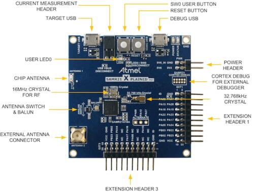

<!-- Copyright 2015-2026 Zephyr Project members and individual contributors. -->
<!-- SPDX-License-Identifier: Apache-2.0 -->
<!-- 中文翻译；编号、导航与译注为本地新增。 -->

<a id="samr21_xpro"></a>

# 第12章\_SAM R21 Xplained Pro评估套件（Evaluation Kit）

原文：[官方页面](https://docs.zephyrproject.org/latest/boards/atmel/sam0/samr21_xpro/doc/index.html)。读取日期：2026-10-16；来源摘要见[来源记录](../SOURCES.md)。

开发板概览（Board Overview）

<a id="id1"></a>

[](images/atsamr21_xpro.jpg)

SAM R21 Xplained Pro评估套件（Evaluation Kit）

名称（Name）：

`samr21_xpro`

厂商（Vendor）：

[Atmel公司（Atmel Corporation）](https://docs.zephyrproject.org/latest/boards/index.html#vendor=atmel)

状态（Status）：

维护中（Maintained）

架构（Architecture）：

[arm](https://docs.zephyrproject.org/latest/boards/index.html#arch=arm)

片上系统（SoC）：

[samr21g18a](https://docs.zephyrproject.org/latest/boards/index.html#soc=samr21g18a)

<a id="board-github-link"></a>

[浏览开发板源码（Browse Board Sources）](https://github.com/zephyrproject-rtos/zephyr/blob/main//boards/atmel/sam0/samr21_xpro/doc/index.rst/../..)<a id="overview"></a>

## 概述（Overview）

SAM R21 Xplained Pro是Atmel推出的紧凑型评估板，采用SAMR21G18A SoC。该SoC将SAMR21 ARM Cortex-M0+微控制器与Atmel AT86RF233无线电结合，后者兼容2.4 GHz IEEE 802.15.4。套件包含Atmel嵌入式调试器（EDBG），无需额外硬件即可提供完整调试接口。

<a id="hardware"></a>

## 硬件（Hardware）


- SAMR21G18A ARM Cortex-M0+处理器，48 MHz
- 32.768 kHz晶体振荡器（Crystal Oscillator）
- 256 KiB闪存（Flash）和32 KiB随机存储器（RAM）
- 一个黄色用户LED
- 一个机械式用户按键
- 1个复位按键（Reset Button）
- 板载基于USB的EDBG单元，提供串口控制台

<a id="supported-features"></a>

### 支持的功能（Supported Features）

`samr21_xpro`开发板支持下表所列的硬件功能。

片上／板载（On-Chip / On-Board）

功能集成在片上系统（SoC）内／位于开发板上。

2 / 2

分别表示已启用／已禁用的实例数。点击数量标签，可查看开发板或SoC设备树源码（DTS）中该功能的第一个实例。

`vnd,foo`

与此功能匹配的设备树绑定兼容字符串（Compatible String）；点击链接可查看绑定文档。

<a id="samr21_xpro-hw-features"></a>

<a id="samr21_xpro-samr21_xpro/samr21g18a-hw-features-section"></a>

#### `samr21_xpro/samr21g18a`目标（Target）

<a id="samr21_xpro-samr21_xpro/samr21g18a-hw-features-panel"></a>

<a id="samr21_xpro-samr21_xpro/samr21g18a-hw-features-memory"></a>

该开发板目标的片上存储容量：32 KiB RAM、256 KiB Flash。

<a id="samr21_xpro-samr21_xpro/samr21g18a-hw-features-table"></a>

<table>
<tr>
<th>类型（Type）</th>
<th>位置（Location）</th>
<th>说明（Description）</th>
<th>兼容字符串（Compatible）</th>
</tr>
<tr>
<td rowspan="1">中央处理器（CPU）</td>
<td>片上（On-Chip）</td>
<td>ARM Cortex-M0+处理器（CPU）（<a href="https://github.com/zephyrproject-rtos/zephyr/blob/main/dts/arm/atmel/samd2x.dtsi?plain=1#L45">已启用：1</a>）</td>
<td><a href="../cpu_arm_riscv_binding_reference/P017_arm_cortex-m0+.md#std-dtcompatible-arm-cortex-m0"><code>arm,cortex-m0+</code></a></td>
</tr>
<tr>
<td rowspan="1">模数转换器（ADC）</td>
<td>片上（On-Chip）</td>
<td>Atmel SAM0系列模数转换器（ADC）（<a href="https://github.com/zephyrproject-rtos/zephyr/blob/main/dts/arm/atmel/samd2x.dtsi?plain=1#L207">已启用：1</a>）</td>
<td><a href="../hardware/P858_AtmelSAM0模数转换器绑定.md#dtbinding-atmel-sam0-adc"><code>atmel,sam0-adc</code></a></td>
</tr>
<tr>
<td rowspan="2">ARM 架构（ARM Architecture）</td>
<td>片上（On-Chip）</td>
<td>Atmel SAM0多协议串行通信单元（SERCOM），支持UART、SPI和I2C（<a href="https://github.com/zephyrproject-rtos/zephyr/blob/main/dts/arm/atmel/samd2x.dtsi?plain=1#L137">已禁用：2</a>）</td>
<td><a href="../arm_timing_ethosu_control_binding_reference/P009_atmel_sam0-sercom.md#std-dtcompatible-atmel-sam0-sercom"><code>atmel,sam0-sercom</code></a></td>
</tr>
<tr>
<td>片上（On-Chip）</td>
<td>用于定位Atmel SAM0设备的设备ID（Device ID，即序列号）（<a href="https://github.com/zephyrproject-rtos/zephyr/blob/main/dts/arm/atmel/samd2x.dtsi?plain=1#L57">已启用：1</a>）</td>
<td><a href="../arm_timing_ethosu_control_binding_reference/P008_atmel_sam0-id.md#std-dtcompatible-atmel-sam0-id"><code>atmel,sam0-id</code></a></td>
</tr>
<tr>
<td rowspan="2">时钟控制（Clock Control）</td>
<td>片上（On-Chip）</td>
<td>Atmel SAM0主时钟控制器（MCLK / Main Clock Controller）（<a href="https://github.com/zephyrproject-rtos/zephyr/blob/main/dts/arm/atmel/samd2x.dtsi?plain=1#L87">已启用：1</a>）</td>
<td><a href="../clock_adi_atmel_bflb_binding_reference/P011_atmel_sam0-mclk.md#std-dtcompatible-atmel-sam0-mclk"><code>atmel,sam0-mclk</code></a></td>
</tr>
<tr>
<td>片上（On-Chip）</td>
<td>Atmel SAMD0通用时钟控制器（GCLK / Generic Clock Controller）（<a href="https://github.com/zephyrproject-rtos/zephyr/blob/main/dts/arm/atmel/samd2x.dtsi?plain=1#L95">已启用：1</a>）</td>
<td><a href="../clock_adi_atmel_bflb_binding_reference/P010_atmel_sam0-gclk.md#std-dtcompatible-atmel-sam0-gclk"><code>atmel,sam0-gclk</code></a></td>
</tr>
<tr>
<td rowspan="1">计数器（Counter）</td>
<td>片上（On-Chip）</td>
<td>以32位模式运行的Atmel SAM0基本定时器／计数器（TC / Timer Counter）（<a href="https://github.com/zephyrproject-rtos/zephyr/blob/main/dts/arm/atmel/samd2x.dtsi?plain=1#L161">已禁用：2</a>）</td>
<td><a href="../counter_binding_reference/P011_atmel_sam0-tc32.md#std-dtcompatible-atmel-sam0-tc32"><code>atmel,sam0-tc32</code></a></td>
</tr>
<tr>
<td rowspan="1">数模转换器（DAC）</td>
<td>片上（On-Chip）</td>
<td>Atmel SAM0系列数模转换器（DAC）（<a href="https://github.com/zephyrproject-rtos/zephyr/blob/main/dts/arm/atmel/samd2x.dtsi?plain=1#L217">已禁用：1</a>）</td>
<td><a href="../hardware/P763_AtmelSAM0数模转换器绑定.md#dtbinding-atmel-sam0-dac"><code>atmel,sam0-dac</code></a></td>
</tr>
<tr>
<td rowspan="1">直接存储器访问（DMA）</td>
<td>片上（On-Chip）</td>
<td>Atmel SAM0直接存储器访问控制器（DMA Controller）（<a href="https://github.com/zephyrproject-rtos/zephyr/blob/main/dts/arm/atmel/samd21.dtsi?plain=1#L29">已禁用：1</a>）</td>
<td><a href="../dma_binding_reference/P011_atmel_sam0-dmac.md#std-dtcompatible-atmel-sam0-dmac"><code>atmel,sam0-dmac</code></a></td>
</tr>
<tr>
<td rowspan="1">闪存控制器（Flash Controller）</td>
<td>片上（On-Chip）</td>
<td>Atmel SAM0非易失性存储器控制器（NVMC / Non-Volatile Memory Controller）（<a href="https://github.com/zephyrproject-rtos/zephyr/blob/main/dts/arm/atmel/samd2x.dtsi?plain=1#L66">已启用：1</a>）</td>
<td><a href="../flash_adi_microchip_nordic_binding_reference/P007_atmel_sam0-nvmctrl.md#std-dtcompatible-atmel-sam0-nvmctrl"><code>atmel,sam0-nvmctrl</code></a></td>
</tr>
<tr>
<td rowspan="2">通用输入输出与接插件（GPIO &amp; Headers）</td>
<td>片上（On-Chip）</td>
<td>SAM0 GPIO端口（PORT）节点（<a href="https://github.com/zephyrproject-rtos/zephyr/blob/main/dts/arm/atmel/samd2x.dtsi?plain=1#L174">已启用：3</a>）</td>
<td><a href="../gpio_adi_headers_ambiq_binding_reference/P030_atmel_sam0-gpio.md#std-dtcompatible-atmel-sam0-gpio"><code>atmel,sam0-gpio</code></a></td>
</tr>
<tr>
<td>板载（On-Board）</td>
<td>Atmel Xplained Pro排针引出的GPIO引脚（<a href="https://github.com/zephyrproject-rtos/zephyr/blob/main/boards/atmel/sam0/samr21_xpro/samr21_xpro.dts?plain=1#L62">已启用：2</a>）</td>
<td><a href="../gpio_connectors_bflb_esp_binding_reference/P003_atmel-xplained-pro-header.md#std-dtcompatible-atmel-xplained-pro-header"><code>atmel-xplained-pro-header</code></a></td>
</tr>
<tr>
<td rowspan="1">集成电路间总线（I2C）</td>
<td>片上（On-Chip）</td>
<td>Atmel SAM0系列SERCOM I2C接口（<a href="https://github.com/zephyrproject-rtos/zephyr/blob/main/dts/arm/atmel/samd2x.dtsi?plain=1#L131">已启用：1</a>）</td>
<td><a href="../i2c_adi_atmel_esp_binding_reference/P011_atmel_sam0-i2c.md#std-dtcompatible-atmel-sam0-i2c"><code>atmel,sam0-i2c</code></a></td>
</tr>
<tr>
<td rowspan="1">低速率无线个域网（IEEE 802.15.4）</td>
<td>板载（On-Board）</td>
<td>ATMEL AT86RF2xx IEEE 802.15.4无线收发器（Wireless Transceiver）（<a href="https://github.com/zephyrproject-rtos/zephyr/blob/main/boards/atmel/sam0/samr21_xpro/samr21_xpro.dts?plain=1#L186">已启用：1</a>）</td>
<td><a href="../lora_ieee802154_binding_reference/P001_atmel_rf2xx.md#std-dtcompatible-atmel-rf2xx"><code>atmel,rf2xx</code></a></td>
</tr>
<tr>
<td rowspan="1">输入（Input）</td>
<td>板载（On-Board）</td>
<td>一组绑定到 GPIO 的输入按键（GPIO-Bound Input Keys）（<a href="https://github.com/zephyrproject-rtos/zephyr/blob/main/boards/atmel/sam0/samr21_xpro/samr21_xpro.dts?plain=1#L52">已启用：1</a>）</td>
<td><a href="../hardware/P563_GPIO按键绑定.md#std-dtcompatible-gpio-keys"><code>gpio-keys</code></a></td>
</tr>
<tr>
<td rowspan="2">中断控制器（Interrupt Controller）</td>
<td>片上（On-Chip）</td>
<td>ARMv6-M嵌套向量中断控制器（NVIC / Nested Vectored Interrupt Controller）（<a href="https://github.com/zephyrproject-rtos/zephyr/blob/main/dts/arm/armv6-m.dtsi?plain=1#L13">已启用：1</a>）</td>
<td><a href="../arm_interrupt_timer_binding_reference/P001_ARMv6_M_NVIC.md#std-dtcompatible-arm-v6m-nvic"><code>arm,v6m-nvic</code></a></td>
</tr>
<tr>
<td>片上（On-Chip）</td>
<td>Atmel SAM0系列外部中断控制器（External Interrupt Controller）（<a href="https://github.com/zephyrproject-rtos/zephyr/blob/main/dts/arm/atmel/samd2x.dtsi?plain=1#L103">已启用：1</a>）</td>
<td><a href="../mcu_external_interrupt_binding_reference/P008_atmel_sam0-eic.md#std-dtcompatible-atmel-sam0-eic"><code>atmel,sam0-eic</code></a></td>
</tr>
<tr>
<td rowspan="2">发光二极管（LED）</td>
<td>板载（On-Board）</td>
<td>一组由 GPIO 控制的 LED（GPIO-Controlled LEDs）（<a href="https://github.com/zephyrproject-rtos/zephyr/blob/main/boards/atmel/sam0/samr21_xpro/samr21_xpro.dts?plain=1#L35">已启用：1</a>）</td>
<td><a href="../hardware/P564_GPIO指示灯绑定.md#dtbinding-gpio-leds"><code>gpio-leds</code></a></td>
</tr>
<tr>
<td>板载（On-Board）</td>
<td>一组由脉宽调制（PWM）控制的LED（<a href="https://github.com/zephyrproject-rtos/zephyr/blob/main/boards/atmel/sam0/samr21_xpro/samr21_xpro.dts?plain=1#L44">已启用：1</a>）</td>
<td><a href="../hardware/P565_PWM指示灯绑定.md#dtbinding-pwm-leds"><code>pwm-leds</code></a></td>
</tr>
<tr>
<td rowspan="1">存储技术设备（MTD）</td>
<td>片上（On-Chip）</td>
<td>闪存（Flash）节点（<a href="https://github.com/zephyrproject-rtos/zephyr/blob/main/dts/arm/atmel/samd2x.dtsi?plain=1#L77">已启用：1</a>）</td>
<td><a href="../mtd_nxp_st_ti_partition_binding_reference/P013_soc-nv-flash.md#std-dtcompatible-soc-nv-flash"><code>soc-nv-flash</code></a></td>
</tr>
<tr>
<td rowspan="2">引脚控制（Pin Control）</td>
<td>片上（On-Chip）</td>
<td>Atmel SAM0引脚复用（PINMUX）（<a href="https://github.com/zephyrproject-rtos/zephyr/blob/main/dts/arm/atmel/samd2x.dtsi?plain=1#L109">已启用：3</a>）</td>
<td><a href="../pinctrl_adi_ambiq_arm_binding_reference/P015_atmel_sam0-pinmux.md#std-dtcompatible-atmel-sam0-pinmux"><code>atmel,sam0-pinmux</code></a></td>
</tr>
<tr>
<td>片上（On-Chip）</td>
<td>Atmel SAM0引脚控制容器（Pinctrl Container）（<a href="https://github.com/zephyrproject-rtos/zephyr/blob/main/dts/arm/atmel/samd2x.dtsi?plain=1#L167">已启用：1</a>）</td>
<td><a href="../pinctrl_adi_ambiq_arm_binding_reference/P014_atmel_sam0-pinctrl.md#std-dtcompatible-atmel-sam0-pinctrl"><code>atmel,sam0-pinctrl</code></a></td>
</tr>
<tr>
<td rowspan="1">脉宽调制（PWM）</td>
<td>片上（On-Chip）</td>
<td>脉宽调制模式（PWM Mode）下的Atmel SAM0 TCC定时器（<a href="https://github.com/zephyrproject-rtos/zephyr/blob/main/dts/arm/atmel/samd21.dtsi?plain=1#L49">已启用：1</a>）</td>
<td><a href="../pwm_adi_esp_infineon_binding_reference/P009_atmel_sam0-tcc-pwm.md#std-dtcompatible-atmel-sam0-tcc-pwm"><code>atmel,sam0-tcc-pwm</code></a></td>
</tr>
<tr>
<td rowspan="1">实时时钟（RTC）</td>
<td>片上（On-Chip）</td>
<td>Atmel SAM0实时时钟（RTC）（<a href="https://github.com/zephyrproject-rtos/zephyr/blob/main/dts/arm/atmel/samd2x.dtsi?plain=1#L195">已启用：1</a>）</td>
<td><a href="../rtc_binding_reference/P005_atmel_sam0-rtc.md#std-dtcompatible-atmel-sam0-rtc"><code>atmel,sam0-rtc</code></a></td>
</tr>
<tr>
<td rowspan="1">串行控制器（Serial Controller）</td>
<td>片上（On-Chip）</td>
<td>Atmel SAM0 SERCOM UART驱动（Driver）（<a href="https://github.com/zephyrproject-rtos/zephyr/blob/main/dts/arm/atmel/samd2x.dtsi?plain=1#L125">已启用：1</a>）</td>
<td><a href="../uart_adi_arm_atmel_binding_reference/P012_atmel_sam0-uart.md#std-dtcompatible-atmel-sam0-uart"><code>atmel,sam0-uart</code></a></td>
</tr>
<tr>
<td rowspan="1">串行外设接口（SPI）</td>
<td>片上（On-Chip）</td>
<td>Atmel SAM0 SERCOM SPI控制器（Controller）（<a href="https://github.com/zephyrproject-rtos/zephyr/blob/main/dts/arm/atmel/samd2x.dtsi?plain=1#L149">已启用：2</a>）</td>
<td><a href="../spi_adi_atmel_esp_binding_reference/P009_atmel_sam0-spi.md#std-dtcompatible-atmel-sam0-spi"><code>atmel,sam0-spi</code></a></td>
</tr>
<tr>
<td rowspan="1">静态随机存储器（SRAM）</td>
<td>片上（On-Chip）</td>
<td>通用片上静态随机存储器（SRAM）（<a href="https://github.com/zephyrproject-rtos/zephyr/blob/main/dts/arm/atmel/samd2x.dtsi?plain=1#L53">已启用：1</a>）</td>
<td><a href="../hardware/P567_内存映射SRAM绑定.md#dtbinding-mmio-sram"><code>mmio-sram</code></a></td>
</tr>
<tr>
<td rowspan="1">定时器（Timer）</td>
<td>片上（On-Chip）</td>
<td>ARMv6-M系统节拍（System Tick）（<a href="https://github.com/zephyrproject-rtos/zephyr/blob/main/dts/arm/armv6-m.dtsi?plain=1#L21">已启用：1</a>）</td>
<td><a href="../arm_interrupt_timer_binding_reference/P005_ARMv6_M_SysTick.md#std-dtcompatible-arm-armv6m-systick"><code>arm,armv6m-systick</code></a></td>
</tr>
<tr>
<td rowspan="1">通用串行总线（USB）</td>
<td>片上（On-Chip）</td>
<td>设备模式（Device Mode）下的Atmel SAM0 USB（<a href="https://github.com/zephyrproject-rtos/zephyr/blob/main/dts/arm/atmel/samd21.dtsi?plain=1#L20">已启用：1</a>）</td>
<td><a href="../usb_controller_binding_reference/P006_atmel_sam0-usb.md#std-dtcompatible-atmel-sam0-usb"><code>atmel,sam0-usb</code></a></td>
</tr>
<tr>
<td rowspan="1">看门狗（Watchdog）</td>
<td>片上（On-Chip）</td>
<td>Atmel SAM0看门狗（Watchdog）（<a href="https://github.com/zephyrproject-rtos/zephyr/blob/main/dts/arm/atmel/samd2x.dtsi?plain=1#L119">已启用：1</a>）</td>
<td><a href="../watchdog_binding_reference/P008_atmel_sam0-watchdog.md#std-dtcompatible-atmel-sam0-watchdog"><code>atmel,sam0-watchdog</code></a></td>
</tr>
</table>

<a id="pin-mapping"></a>

### 引脚映射（Pin Mapping）

SAM R21 Xplained Pro有三个GPIO控制器，负责引脚复用、输入／输出、上拉等功能。

<a id="id3"></a>

<a id="id5"></a>

更多细节见[SAM R21系列数据手册](http://ww1.microchip.com/downloads/en/devicedoc/sam-r21_datasheet.pdf)[注1](#id2)及[SAM R21 Xplained Pro原理图](http://ww1.microchip.com/downloads/en/DeviceDoc/SAMR21-Xplained-Pro_Design-Documentation.zip)[注2](#id4)。



<a id="default-zephyr-peripheral-mapping"></a>

#### Zephyr 默认外设映射（Peripheral Mapping）：


- `SERCOM0 USART TX : PA5`
- `SERCOM0 USART RX : PA4`
- `SERCOM1 I2C SDA : PA16`
- `SERCOM1 I2C SCL : PA17`
- `SERCOM5 SPI MISO : PB02`
- `SERCOM5 SPI MOSI : PB22`
- `SERCOM5 SPI SCK : PB23`
- `GPIO SPI CS : PB03`
- `GPIO/PWM LED0 : PA19`

<a id="system-clock"></a>

### 系统时钟（System Clock）

SAMR21 MCU使用32.768 kHz外部振荡器，经片上PLL生成48 MHz系统时钟。

<a id="serial-port"></a>

### 串口（Serial Port）

SAMR21 MCU有六个基于SERCOM的USART，本BSP将其中两个配置为USART。SERCOM0是Zephyr默认控制台。


- SERCOM0：115200 8n1，连接板载Atmel嵌入式调试器（EDBG）

<a id="pwm"></a>

### 脉宽调制（PWM）

SAMR21 MCU有三个基于TCC的PWM单元，每个最多四路输出，周期寄存器为24位或16位。启用`CONFIG_PWM_SAM0_TCC`时，LED0由TCC0驱动，而非GPIO。

<a id="spi-port"></a>

### SPI端口（SPI Port）

SAMR21 MCU有六个基于SERCOM的SPI。


- SERCOM5通过Xplained Pro标准扩展排针（Standard Extension Header）引出。

<a id="i2c-port"></a>

### I2C端口（I2C Port）

同时将I2C设备和逻辑分析仪（Logic Analyzer）连接到I2C端口时，内部上拉电阻不足以保持总线稳定，通常需要在两条总线上加外部上拉电阻，可从10 kΩ开始尝试。


- SERCOM1通过Xplained Pro标准扩展排针引出。

<a id="radio"></a>

### 无线电（Radio）

SAMR21 SoC包含片内AT86RF233无线电，通过SPI及部分GPIO在内部连接，其行为与外接SPI设备相同。

<table>
<tr>
<th>传感器（Sensor）</th>
<th>AT86RF233</th>
</tr>
<tr>
<td>类型（Type）</td>
<td>2.4 GHz IEEE 802.15.4无线电（Radio）</td>
</tr>
<tr>
<td>厂商（Vendor）</td>
<td>Atmel</td>
</tr>
<tr>
<td>数据手册（Datasheet）</td>
<td><a href="http://www.atmel.com/images/atmel-8351-mcu_wireless-at86rf233_datasheet.pdf">数据手册（Datasheet）</a></td>
</tr>
<tr>
<td>连接到（Connected To）</td>
<td>SPI_0</td>
</tr>
<tr>
<td colspan="2">引脚配置（Pin Config）：</td>
</tr>
<tr>
<td>设备（Device）</td>
<td>SERCOM4</td>
</tr>
<tr>
<td>主机输出从机输入（MOSI）</td>
<td>PB30：输出（OUT），SPI MOSI</td>
</tr>
<tr>
<td>主机输入从机输出（MISO）</td>
<td>PC19：输入（IN），SPI MISO</td>
</tr>
<tr>
<td>串行时钟（SCLK）</td>
<td>PC18：输出（OUT），SPI SCLK</td>
</tr>
<tr>
<td>片选（CS）</td>
<td>PB31：输出（OUT），GPIO输出</td>
</tr>
<tr>
<td>中断请求（IRQ）</td>
<td>PB00：输入（IN），GPIO外部中断</td>
</tr>
<tr>
<td>低有效复位（RSTN）</td>
<td>PB15：输出（OUT），GPIO输出</td>
</tr>
<tr>
<td>SLP_TR</td>
<td>PA20：输出（OUT），GPIO输出</td>
</tr>
</table>

Zephyr提供多个使用此技术的示例，可从802.15.4“serial-radio”示例入手。也可通过IPv6服务器／客户端回显示例测试，详情见[回显服务器（高级）（Echo Server / Advanced）](../networking/P047_高级回显服务器示例.md#sockets-echo-server)及[回显客户端（高级）（Echo Client / Advanced）](../networking/P048_高级回显客户端示例.md#sockets-echo-client)。（[802.15.4串行无线电（serial-radio）](../networking/P177_IEEE802154串口无线电.md#wpan-serial)）

<a id="programming-and-debugging"></a>

## 烧录与调试（Programming and Debugging）

`samr21_xpro`开发板支持下表所列的运行工具（Runners）及相关west命令。

<table>
<tr>
<th></th>
<th>烧录（flash）</th>
<th>调试（debug）</th>
<th>连接调试会话（attach）</th>
<th>实时传输（rtt）</th>
<th>调试服务器（debugserver）</th>
</tr>
<tr>
<td><a href="https://docs.zephyrproject.org/latest/develop/flash_debug/host-tools.html#runner-openocd">openocd</a></td>
<td>✅（默认 / default）</td>
<td>✅（默认 / default）</td>
<td>✅</td>
<td>✅</td>
<td>✅</td>
</tr>
</table>

SAM R21 Xplained Pro自带Atmel嵌入式调试器（EDBG），为SAMR21提供调试接口，受OpenOCD支持。

<a id="flashing"></a>

### 烧录（Flashing）


1. 构建Zephyr内核和[Hello World](../getting_started/P005_HelloWorld示例.md#hello_world)示例应用：

  ```text
  west build -b samr21_xpro samples/hello_world
  ```
2. 通过USB调试端口将SAM R21 Xplained Pro连接到主机。
3. 运行你惯用的终端程序，监听输出。Linux下的终端设备应为`/dev/ttyACM0`，例如：

  ```text
  $ minicom -D /dev/ttyACM0 -o
  ```

  `-o`选项让`minicom`不发送调制解调器初始化字符串（Modem Initialization String）。连接参数应配置如下：


  - 速率（Speed）：115200波特率
  - 数据位（Data）：8位
  - 奇偶校验（Parity）：无（None）
  - 停止位（Stop Bits）：1位
4. 烧录镜像：

  ```text
  west build -b samr21_xpro samples/hello_world
  west flash
  ```

  终端应显示`Hello World! samr21_xpro`。

<a id="references"></a>

## 参考资料（References）

<a id="id2"></a>

〔[1](#id3)〕 [http://ww1.microchip.com/downloads/en/devicedoc/sam-r21_datasheet.pdf](http://ww1.microchip.com/downloads/en/devicedoc/sam-r21_datasheet.pdf)

<a id="id4"></a>

〔[2](#id5)〕 [http://ww1.microchip.com/downloads/en/DeviceDoc/SAMR21-Xplained-Pro_Design-Documentation.zip](http://ww1.microchip.com/downloads/en/DeviceDoc/SAMR21-Xplained-Pro_Design-Documentation.zip)

## 原文外链核对

2026-10-16核对并重试以下原文外链时未能确认可访问性，保留原始目标，不将访问失败解释为原文内容有误。

- [atmel-8351-mcu_wireless-at86rf233_datasheet.pdf](http://www.atmel.com/images/atmel-8351-mcu_wireless-at86rf233_datasheet.pdf)：HTTP Error 403: Forbidden。

---

[上一章](P011_SAM_L21_Xplained_Pro_Evaluation_Kit.md) · [返回大纲](大纲.md) · [全站翻译进度](../PROGRESS.md) · [下一章](P013_SAM_R34_Xplained_Pro_Evaluation_Kit.md)
