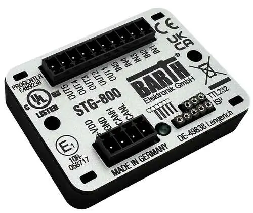

<!-- Copyright 2015-2026 Zephyr Project members and individual contributors. -->
<!-- SPDX-License-Identifier: Apache-2.0 -->
<!-- 中文翻译；编号、导航与译注为本地新增。 -->

<a id="stg_800"></a>

# 第2章\_STG-800 lococube微型可编程逻辑控制器（mini-PLC）

原文：[官方页面](https://docs.zephyrproject.org/latest/boards/barth/stg_800/doc/index.html)。读取日期：2026-10-16；来源摘要见[来源记录](../SOURCES.md)。

开发板概览（Board Overview）

<a id="id1"></a>

[](images/stg_800.webp)

STG-800 lococube微型可编程逻辑控制器（mini-PLC）

名称（Name）：

`stg_800`

厂商（Vendor）：

[Barth Elektronik GmbH](https://docs.zephyrproject.org/latest/boards/index.html#vendor=barth)

状态（Status）：

当前未积极维护（Not Actively Maintained）

架构（Architecture）：

[arm](https://docs.zephyrproject.org/latest/boards/index.html#arch=arm)

片上系统（SoC）：

[stm32f091xc](https://docs.zephyrproject.org/latest/boards/index.html#soc=stm32f091xc)

<a id="board-github-link"></a>

[浏览开发板源码（Browse Board Sources）](https://github.com/zephyrproject-rtos/zephyr/blob/main//boards/barth/stg_800/doc/index.rst/../..)<a id="overview"></a>

## 概述（Overview）

<a id="id3"></a>

[Barth Electronik STG-800 lococube mini-PLC](https://barth-elektronik.com/en/lococube-mini-PLC-STG-800/0850-0800)开发板[注1](#id2)基于意法半导体STM32F091微控制器，提供模拟及数字输入、数字功率输出和控制器局域网（CAN）接口。

警告（Warning）

向此板写入Zephyr固件会不可逆地覆盖原有miCon-L固件。

<a id="hardware"></a>

## 硬件（Hardware）


- UFQFPN48封装的STM32F091CCUx微控制器，最高频率48 MHz
- ARM Cortex M0+内核（型号依原文保留）
- 32 kByte SRAM
- 256 kByte闪存
- 通过I2C连接的8 kByte EEPROM
- 供电电压（Supply Voltage）：+7至+32 V
- 温度范围：−40至+70 °C
- 抗振及坚固密封结构（Vibration Resistant and Rugged Sealing）
- 绿色用户LED
- 三路0–30 V模拟输入，12位ADC
- 两路数字输入
- 四路高侧数字输出（High-Side），可承载1.5 A
- 一路低侧PWM数字输出（Low-Side），可承载2 A
- CAN总线接口
- 调试串口，兼容3.3 V
- 串行线调试连接器（SWD）

<a id="default-zephyr-peripheral-mapping"></a>

### Zephyr默认外设映射（Default Peripheral Mapping）

<table>
<tr>
<th>标签（Label）</th>
<th>引脚（Pin）</th>
</tr>
<tr>
<td>发光二极管（LED）</td>
<td>PA8</td>
</tr>
</table>

电可擦除可编程只读存储器（EEPROM，8 kByte）：

<table>
<tr>
<th>信号（Signal）</th>
<th>MCU引脚（Pin）</th>
<th>默认引脚复用（Default Pin Mux）</th>
</tr>
<tr>
<td>串行数据线（SDA）</td>
<td>PB14</td>
<td>I2C2</td>
</tr>
<tr>
<td>串行时钟线（SCL）</td>
<td>PB13</td>
<td>I2C2</td>
</tr>
</table>

CAN控制器（Controller）：

<table>
<tr>
<th>信号（Signal）</th>
<th>MCU引脚（Pin）</th>
<th>默认引脚复用（Default Pin Mux）</th>
</tr>
<tr>
<td>CAN_TX</td>
<td>PB9</td>
<td>CAN1</td>
</tr>
<tr>
<td>CAN_RX</td>
<td>PB8</td>
<td>CAN1</td>
</tr>
<tr>
<td>CAN_S</td>
<td>PB6</td>
<td>用于使能CAN收发器的GPIO</td>
</tr>
</table>

X1连接器：电源与CAN总线

<table>
<tr>
<th>连接器引脚（Connector Pin）</th>
<th>标签（Label）</th>
<th>说明（Description）</th>
</tr>
<tr>
<td>1</td>
<td>+VDD</td>
<td>+7至+32 V，使用额定电流不超过5 A的保险丝</td>
</tr>
<tr>
<td>2</td>
<td>地（GND）</td>
<td></td>
</tr>
<tr>
<td>3</td>
<td>CAN高线（CANH）</td>
<td></td>
</tr>
<tr>
<td>4</td>
<td>CAN低线（CANL）</td>
<td></td>
</tr>
</table>

此板未配备CAN终端电阻（Termination Resistors）。

X2连接器：输入与输出

<table>
<tr>
<th>连接器引脚（Connector Pin）</th>
<th>标签（Label）</th>
<th>MCU引脚（Pin）</th>
<th>说明（Description）</th>
<th>默认引脚复用（Default Pin Mux）</th>
</tr>
<tr>
<td>1</td>
<td>IN1</td>
<td>PA0</td>
<td>模拟输入，0–30 V</td>
<td>ADC_IN0</td>
</tr>
<tr>
<td>2</td>
<td>IN2</td>
<td>PA1</td>
<td>模拟输入，0–30 V</td>
<td>ADC_IN1</td>
</tr>
<tr>
<td>3</td>
<td>IN3</td>
<td>PA2</td>
<td>模拟输入，0–30 V</td>
<td>ADC_IN2</td>
</tr>
<tr>
<td>4</td>
<td>IN4</td>
<td>PA12</td>
<td>数字输入，最高30 V</td>
<td></td>
</tr>
<tr>
<td>5</td>
<td>IN5</td>
<td>PA15</td>
<td>数字输入，最高30 V</td>
<td></td>
</tr>
<tr>
<td>6</td>
<td>OUT1</td>
<td>PC13</td>
<td>高侧数字输出（High-Side）</td>
<td></td>
</tr>
<tr>
<td>7</td>
<td>OUT2</td>
<td>PC14</td>
<td>高侧数字输出（High-Side）</td>
<td></td>
</tr>
<tr>
<td>8</td>
<td>OUT3</td>
<td>PC15</td>
<td>高侧数字输出（High-Side）</td>
<td></td>
</tr>
<tr>
<td>9</td>
<td>OUT4</td>
<td>PA4</td>
<td>高侧数字输出（High-Side）</td>
<td></td>
</tr>
<tr>
<td>10</td>
<td>OUT5</td>
<td>PB7</td>
<td>低侧数字输出（Low-Side）</td>
<td></td>
</tr>
</table>

所有输入均有下拉电阻（Pull-Down Resistors）。由于驱动器发热，高侧数字输出OUT1–OUT4的开关频率不得超过100 Hz。

X3连接器：编程（Programming）

<table>
<tr>
<th>连接器引脚（Connector Pin）</th>
<th>MCU引脚（Pin）</th>
<th>信号（Signal）</th>
<th>ST-Link/V2引脚</th>
</tr>
<tr>
<td>引脚1，最靠近ISP字样</td>
<td></td>
<td>+3.3 V</td>
<td>1</td>
</tr>
<tr>
<td>2</td>
<td></td>
<td>地（GND）</td>
<td>4</td>
</tr>
<tr>
<td>3</td>
<td>PA13</td>
<td>串行线调试数据（SWDIO）</td>
<td>7</td>
</tr>
<tr>
<td>4</td>
<td>PA14</td>
<td>串行线调试时钟（SWCLK）</td>
<td>9</td>
</tr>
<tr>
<td>5</td>
<td></td>
<td>复位（RESET）</td>
<td>15</td>
</tr>
</table>

X4连接器：调试串口（Debug Serial Port）

<table>
<tr>
<th>引脚（Pin）</th>
<th>备注（Comment）</th>
<th>MCU引脚（Pin）</th>
<th>信号（Signal）</th>
<th>默认引脚复用（Default Pin Mux）</th>
</tr>
<tr>
<td>1</td>
<td>最靠近TTL232字样</td>
<td></td>
<td>地（GND）</td>
<td></td>
</tr>
<tr>
<td>2</td>
<td>连接主机TX</td>
<td>PA10</td>
<td>RX，3.3 V</td>
<td>USART1</td>
</tr>
<tr>
<td>3</td>
<td>连接主机RX</td>
<td>PA9</td>
<td>TX，3.3 V</td>
<td>USART1</td>
</tr>
</table>

<a id="supported-features"></a>

### 支持的功能（Supported Features）

`stg_800`开发板支持下表所列的硬件功能。

片上／板载（On-Chip / On-Board）

功能集成在片上系统（SoC）内／位于开发板上。

2 / 2

分别表示已启用／已禁用的实例数。点击数量标签，可查看开发板或SoC设备树源码（DTS）中该功能的第一个实例。

`vnd,foo`

与此功能匹配的设备树绑定兼容字符串（Compatible String）；点击链接可查看绑定文档。

<a id="stg_800-hw-features"></a>

<a id="stg_800-stg_800/stm32f091xc-hw-features-section"></a>

#### `stg_800/stm32f091xc`目标（Target）

<a id="stg_800-stg_800/stm32f091xc-hw-features-panel"></a>

<a id="stg_800-stg_800/stm32f091xc-hw-features-memory"></a>

该开发板目标的片上存储容量：32 KiB RAM、256 KiB Flash。

<a id="stg_800-stg_800/stm32f091xc-hw-features-table"></a>

<table>
<tr>
<th>类型（Type）</th>
<th>位置（Location）</th>
<th>说明（Description）</th>
<th>兼容字符串（Compatible）</th>
</tr>
<tr>
<td rowspan="1">中央处理器（CPU）</td>
<td>片上（On-Chip）</td>
<td>ARM Cortex-M0处理器（CPU）（<a href="https://github.com/zephyrproject-rtos/zephyr/blob/main/dts/arm/st/f0/stm32f0.dtsi?plain=1#L32">已启用：1</a>）</td>
<td><a href="../cpu_arm_riscv_binding_reference/P018_arm_cortex-m0.md#std-dtcompatible-arm-cortex-m0"><code>arm,cortex-m0</code></a></td>
</tr>
<tr>
<td rowspan="1">模数转换器（ADC）</td>
<td>片上（On-Chip）</td>
<td>STM32模数转换器（ADC）（<a href="https://github.com/zephyrproject-rtos/zephyr/blob/main/dts/arm/st/f0/stm32f0.dtsi?plain=1#L404">已启用：1</a>）</td>
<td><a href="../hardware/P839_STM32模数转换器绑定.md#dtbinding-st-stm32-adc"><code>st,stm32-adc</code></a></td>
</tr>
<tr>
<td rowspan="1">控制器局域网（CAN）</td>
<td>片上（On-Chip）</td>
<td>STM32 CAN 控制器（Controller）（<a href="https://github.com/zephyrproject-rtos/zephyr/blob/main/dts/arm/st/f0/stm32f091.dtsi?plain=1#L54">已启用：1</a>）</td>
<td><a href="../can_nxp_renesas_stm32_ti_binding_reference/P011_st_stm32-bxcan.md#std-dtcompatible-st-stm32-bxcan"><code>st,stm32-bxcan</code></a></td>
</tr>
<tr>
<td rowspan="6">时钟控制（Clock Control）</td>
<td>片上（On-Chip）</td>
<td>STM32F0/G0复位与时钟控制器（RCC）（<a href="https://github.com/zephyrproject-rtos/zephyr/blob/main/dts/arm/st/f0/stm32f0.dtsi?plain=1#L144">已启用：1</a>）</td>
<td><a href="../timer_reference/P171_STM32F0复位与时钟控制绑定.md#dtbinding-st-stm32f0-rcc"><code>st,stm32f0-rcc</code></a></td>
</tr>
<tr>
<td>片上（On-Chip）</td>
<td>STM32 外部高速时钟（HSE Clock）（<a href="https://github.com/zephyrproject-rtos/zephyr/blob/main/dts/arm/st/f0/stm32f0.dtsi?plain=1#L45">已启用：1</a>）</td>
<td><a href="../timer_reference/P129_STM32高速外部时钟绑定.md#dtbinding-st-stm32-hse-clock"><code>st,stm32-hse-clock</code></a></td>
</tr>
<tr>
<td>片上（On-Chip）</td>
<td>通用固定频率时钟提供者（Fixed-Rate Clock Provider）（<a href="https://github.com/zephyrproject-rtos/zephyr/blob/main/dts/arm/st/f0/stm32f0.dtsi?plain=1#L73">已启用：1</a>；<a href="https://github.com/zephyrproject-rtos/zephyr/blob/main/dts/arm/st/f0/stm32f0.dtsi?plain=1#L51">已禁用：3</a>）</td>
<td><a href="../hardware/P566_固定时钟绑定.md#dtbinding-fixed-clock"><code>fixed-clock</code></a></td>
</tr>
<tr>
<td>片上（On-Chip）</td>
<td>STM32低速外部时钟（LSE Clock）（<a href="https://github.com/zephyrproject-rtos/zephyr/blob/main/dts/arm/st/f0/stm32f0.dtsi?plain=1#L65">已禁用：1</a>）</td>
<td><a href="../timer_reference/P130_STM32低速外部时钟绑定.md#dtbinding-st-stm32-lse-clock"><code>st,stm32-lse-clock</code></a></td>
</tr>
<tr>
<td>片上（On-Chip）</td>
<td>STM32F0/F3主锁相环（Main PLL）（<a href="https://github.com/zephyrproject-rtos/zephyr/blob/main/dts/arm/st/f0/stm32f0.dtsi?plain=1#L80">已启用：1</a>）</td>
<td><a href="../timer_reference/P136_STM32F0锁相环时钟绑定.md#dtbinding-st-stm32f0-pll-clock"><code>st,stm32f0-pll-clock</code></a></td>
</tr>
<tr>
<td>片上（On-Chip）</td>
<td>STM32 微控制器时钟输出（Microcontroller Clock Output，MCO）（<a href="https://github.com/zephyrproject-rtos/zephyr/blob/main/dts/arm/st/f0/stm32f0.dtsi?plain=1#L88">已禁用：1</a>）</td>
<td><a href="../timer_reference/P134_STM32时钟输出绑定.md#dtbinding-st-stm32-clock-mco"><code>st,stm32-clock-mco</code></a></td>
</tr>
<tr>
<td rowspan="1">计数器（Counter）</td>
<td>片上（On-Chip）</td>
<td>STM32 计数器（Counters）（<a href="https://github.com/zephyrproject-rtos/zephyr/blob/main/dts/arm/st/f0/stm32f0.dtsi?plain=1#L294">已禁用：9</a>）</td>
<td><a href="../stm32_ti_xilinx_counter_binding_reference/P007_st_stm32-counter.md#std-dtcompatible-st-stm32-counter"><code>st,stm32-counter</code></a></td>
</tr>
<tr>
<td rowspan="1">循环冗余校验（CRC）</td>
<td>片上（On-Chip）</td>
<td>STM32 CRC 计算单元（Calculation Unit）（<a href="https://github.com/zephyrproject-rtos/zephyr/blob/main/dts/arm/st/f0/stm32f071.dtsi?plain=1#L91">已禁用：1</a>）</td>
<td><a href="../crc_clock_monitor_binding_reference/P011_st_stm32-crc.md#std-dtcompatible-st-stm32-crc"><code>st,stm32-crc</code></a></td>
</tr>
<tr>
<td rowspan="1">数模转换器（DAC）</td>
<td>片上（On-Chip）</td>
<td>STM32 系列数模转换器（DAC）（<a href="https://github.com/zephyrproject-rtos/zephyr/blob/main/dts/arm/st/f0/stm32f051.dtsi?plain=1#L85">已禁用：1</a>）</td>
<td><a href="../hardware/P760_STM32数模转换器绑定.md#dtbinding-st-stm32-dac"><code>st,stm32-dac</code></a></td>
</tr>
<tr>
<td rowspan="1">直接存储器访问（DMA）</td>
<td>片上（On-Chip）</td>
<td>用于stm32F0、stm32F1和stm32L1片上系统（SoC）系列的STM32直接存储器访问控制器（DMA，V2bis）（<a href="https://github.com/zephyrproject-rtos/zephyr/blob/main/dts/arm/st/f0/stm32f0.dtsi?plain=1#L428">已启用：1</a>；<a href="https://github.com/zephyrproject-rtos/zephyr/blob/main/dts/arm/st/f0/stm32f091.dtsi?plain=1#L62">已禁用：1</a>）</td>
<td><a href="../stm32_ti_xilinx_dma_binding_reference/P009_st_stm32-dma-v2bis.md#std-dtcompatible-st-stm32-dma-v2bis"><code>st,stm32-dma-v2bis</code></a></td>
</tr>
<tr>
<td rowspan="1">闪存控制器（Flash Controller）</td>
<td>片上（On-Chip）</td>
<td>STM32 系列闪存控制器（Flash Controller）（<a href="https://github.com/zephyrproject-rtos/zephyr/blob/main/dts/arm/st/f0/stm32f0.dtsi?plain=1#L96">已启用：1</a>）</td>
<td><a href="../flash_renesas_st_ti_binding_reference/P011_st_stm32-flash-controller.md#std-dtcompatible-st-stm32-flash-controller"><code>st,stm32-flash-controller</code></a></td>
</tr>
<tr>
<td rowspan="1">通用输入输出与接插件（GPIO &amp; Headers）</td>
<td>片上（On-Chip）</td>
<td>STM32 通用输入输出控制器（GPIO Controller）（<a href="https://github.com/zephyrproject-rtos/zephyr/blob/main/dts/arm/st/f0/stm32f0.dtsi?plain=1#L175">已启用：6</a>）</td>
<td><a href="../gpio_silabs_st_connectors_binding_reference/P029_st_stm32-gpio.md#std-dtcompatible-st-stm32-gpio"><code>st,stm32-gpio</code></a></td>
</tr>
<tr>
<td rowspan="1">集成电路间总线（I2C）</td>
<td>片上（On-Chip）</td>
<td>STM32 I2C V2 控制器（Controller）（<a href="https://github.com/zephyrproject-rtos/zephyr/blob/main/dts/arm/st/f0/stm32f051.dtsi?plain=1#L22">已启用：1</a>；<a href="https://github.com/zephyrproject-rtos/zephyr/blob/main/dts/arm/st/f0/stm32f0.dtsi?plain=1#L225">已禁用：1</a>）</td>
<td><a href="../i2c_stm32_ti_mux_binding_reference/P008_st_stm32-i2c-v2.md#std-dtcompatible-st-stm32-i2c-v2"><code>st,stm32-i2c-v2</code></a></td>
</tr>
<tr>
<td rowspan="1">工业输入输出（IIO）</td>
<td>板载（On-Board）</td>
<td>分压器（Voltage Divider）（<a href="https://github.com/zephyrproject-rtos/zephyr/blob/main/boards/barth/stg_800/stg_800.dts?plain=1#L44">已启用：3</a>）</td>
<td><a href="../auxdisplay_iio_tach_binding_reference/P012_voltage-divider.md#std-dtcompatible-voltage-divider"><code>voltage-divider</code></a></td>
</tr>
<tr>
<td rowspan="1">输入（Input）</td>
<td>片上（On-Chip）</td>
<td>STM32触摸感应控制器驱动（TSC；原文Tocuh拼写如此）（<a href="https://github.com/zephyrproject-rtos/zephyr/blob/main/dts/arm/st/f0/stm32f0.dtsi?plain=1#L437">已禁用：1</a>）</td>
<td><a href="../input_touch_lvgl_gesture_binding_reference/P007_st_stm32-tsc.md#std-dtcompatible-st-stm32-tsc"><code>st,stm32-tsc</code></a></td>
</tr>
<tr>
<td rowspan="2">中断控制器（Interrupt Controller）</td>
<td>片上（On-Chip）</td>
<td>ARMv6-M嵌套向量中断控制器（NVIC / Nested Vectored Interrupt Controller）（<a href="https://github.com/zephyrproject-rtos/zephyr/blob/main/dts/arm/armv6-m.dtsi?plain=1#L13">已启用：1</a>）</td>
<td><a href="../arm_interrupt_timer_binding_reference/P001_ARMv6_M_NVIC.md#std-dtcompatible-arm-v6m-nvic"><code>arm,v6m-nvic</code></a></td>
</tr>
<tr>
<td>片上（On-Chip）</td>
<td>STM32 外部中断控制器（External Interrupt Controller）（<a href="https://github.com/zephyrproject-rtos/zephyr/blob/main/dts/arm/st/f0/stm32f0.dtsi?plain=1#L155">已启用：1</a>）</td>
<td><a href="../mcu_external_interrupt_binding_reference/P001_st_stm32-exti.md#std-dtcompatible-st-stm32-exti"><code>st,stm32-exti</code></a></td>
</tr>
<tr>
<td rowspan="1">发光二极管（LED）</td>
<td>板载（On-Board）</td>
<td>一组由 GPIO 控制的 LED（GPIO-Controlled LEDs）（<a href="https://github.com/zephyrproject-rtos/zephyr/blob/main/boards/barth/stg_800/stg_800.dts?plain=1#L29">已启用：1</a>）</td>
<td><a href="../hardware/P564_GPIO指示灯绑定.md#dtbinding-gpio-leds"><code>gpio-leds</code></a></td>
</tr>
<tr>
<td rowspan="1">存储器控制器（Memory Controller）</td>
<td>片上（On-Chip）</td>
<td>STM32 电池备份 RAM（Battery-Backed RAM）（<a href="https://github.com/zephyrproject-rtos/zephyr/blob/main/dts/arm/st/f0/stm32f031.dtsi?plain=1#L43">已禁用：1</a>）</td>
<td><a href="../memory_controller_sdram_psram_binding_reference/P010_st_stm32-bbram.md#std-dtcompatible-st-stm32-bbram"><code>st,stm32-bbram</code></a></td>
</tr>
<tr>
<td rowspan="2">存储技术设备（MTD）</td>
<td>片上（On-Chip）</td>
<td>STM32闪存（Flash Memory）（<a href="https://github.com/zephyrproject-rtos/zephyr/blob/main/dts/arm/st/f0/stm32f0.dtsi?plain=1#L106">已启用：1</a>）</td>
<td><a href="../mtd_nxp_st_ti_partition_binding_reference/P016_st_stm32-nv-flash.md#std-dtcompatible-st-stm32-nv-flash"><code>st,stm32-nv-flash</code></a></td>
</tr>
<tr>
<td>板载（On-Board）</td>
<td>兼容Atmel AT24系列的I2C电可擦除可编程只读存储器（EEPROM）（<a href="https://github.com/zephyrproject-rtos/zephyr/blob/main/boards/barth/stg_800/stg_800.dts?plain=1#L110">已启用：1</a>）</td>
<td><a href="../mtd_atmel_bouffalo_binding_reference/P004_atmel_at24.md#std-dtcompatible-atmel-at24"><code>atmel,at24</code></a></td>
</tr>
<tr>
<td rowspan="1">非易失存储器（NVMEM）</td>
<td>片上（On-Chip）</td>
<td>非易失存储器固定布局（Fixed Layout for Non-Volatile Memory）（<a href="https://github.com/zephyrproject-rtos/zephyr/blob/main/dts/arm/st/f0/stm32f0.dtsi?plain=1#L124">已启用：1</a>）</td>
<td><a href="../memory_protection_binding_reference/P009_fixed-layout.md#std-dtcompatible-fixed-layout"><code>fixed-layout</code></a></td>
</tr>
<tr>
<td rowspan="1">一次性可编程存储器（OTP Memory）</td>
<td>片上（On-Chip）</td>
<td>STM32 嵌入式非易失一次性可编程存储器（NVM OTP）（<a href="https://github.com/zephyrproject-rtos/zephyr/blob/main/dts/arm/st/f0/stm32f0.dtsi?plain=1#L120">已启用：1</a>）</td>
<td><a href="../otp_binding_reference/P010_st_stm32-nvm-otp.md#std-dtcompatible-st-stm32-nvm-otp"><code>st,stm32-nvm-otp</code></a></td>
</tr>
<tr>
<td rowspan="1">物理层（PHY）</td>
<td>板载（On-Board）</td>
<td>由简单GPIO控制的CAN收发器（Transceiver）（<a href="https://github.com/zephyrproject-rtos/zephyr/blob/main/boards/barth/stg_800/stg_800.dts?plain=1#L65">已启用：1</a>）</td>
<td><a href="../phy_binding_reference/P001_can-transceiver-gpio.md#std-dtcompatible-can-transceiver-gpio"><code>can-transceiver-gpio</code></a></td>
</tr>
<tr>
<td rowspan="1">引脚控制（Pin Control）</td>
<td>片上（On-Chip）</td>
<td>STM32 引脚控制器（Pin Controller）（<a href="https://github.com/zephyrproject-rtos/zephyr/blob/main/dts/arm/st/f0/stm32f0.dtsi?plain=1#L168">已启用：1</a>）</td>
<td><a href="../pinctrl_stm32_ti_xilinx_binding_reference/P004_st_stm32-pinctrl.md#std-dtcompatible-st-stm32-pinctrl"><code>st,stm32-pinctrl</code></a></td>
</tr>
<tr>
<td rowspan="1">脉宽调制（PWM）</td>
<td>片上（On-Chip）</td>
<td>STM32 脉宽调制（PWM）（<a href="https://github.com/zephyrproject-rtos/zephyr/blob/main/dts/arm/st/f0/stm32f0.dtsi?plain=1#L288">已禁用：7</a>）</td>
<td><a href="../pwm_stm32_ti_generic_binding_reference/P011_st_stm32-pwm.md#std-dtcompatible-st-stm32-pwm"><code>st,stm32-pwm</code></a></td>
</tr>
<tr>
<td rowspan="1">复位控制器（Reset Controller）</td>
<td>片上（On-Chip）</td>
<td>STM32 复位与时钟控制器（Reset and Clock Control，RCC）（<a href="https://github.com/zephyrproject-rtos/zephyr/blob/main/dts/arm/st/f0/stm32f0.dtsi?plain=1#L149">已启用：1</a>）</td>
<td><a href="../reset_controller_binding_reference/P017_st_stm32-rcc-rctl.md#std-dtcompatible-st-stm32-rcc-rctl"><code>st,stm32-rcc-rctl</code></a></td>
</tr>
<tr>
<td rowspan="1">实时时钟（RTC）</td>
<td>片上（On-Chip）</td>
<td>STM32 实时时钟（RTC）（<a href="https://github.com/zephyrproject-rtos/zephyr/blob/main/dts/arm/st/f0/stm32f0.dtsi?plain=1#L252">已禁用：1</a>）</td>
<td><a href="../soc_rtc_binding_reference/P014_st_stm32-rtc.md#std-dtcompatible-st-stm32-rtc"><code>st,stm32-rtc</code></a></td>
</tr>
<tr>
<td rowspan="4">传感器（Sensors）</td>
<td>片上（On-Chip）</td>
<td>STM32 正交解码器（Quadrature Decoder）（<a href="https://github.com/zephyrproject-rtos/zephyr/blob/main/dts/arm/st/f0/stm32f0.dtsi?plain=1#L299">已禁用：3</a>）</td>
<td><a href="../sensor_st_lsm_stm32_binding_reference/P028_st_stm32-qdec.md#std-dtcompatible-st-stm32-qdec"><code>st,stm32-qdec</code></a></td>
</tr>
<tr>
<td>片上（On-Chip）</td>
<td>STM32 参考电压（VREF+）（<a href="https://github.com/zephyrproject-rtos/zephyr/blob/main/dts/arm/st/f0/stm32f0.dtsi?plain=1#L448">已启用：1</a>）</td>
<td><a href="../sensor_st_ti_power_capacitance_binding_reference/P003_st_stm32-vref.md#std-dtcompatible-st-stm32-vref"><code>st,stm32-vref</code></a></td>
</tr>
<tr>
<td>片上（On-Chip）</td>
<td>STM32 系列温度节点（TEMP），用于以两个温度点完成生产校准的传感器。（<a href="https://github.com/zephyrproject-rtos/zephyr/blob/main/dts/arm/st/f0/stm32f031.dtsi?plain=1#L63">已禁用：1</a>）</td>
<td><a href="../sensor_st_lsm_stm32_binding_reference/P029_st_stm32-temp-cal.md#std-dtcompatible-st-stm32-temp-cal"><code>st,stm32-temp-cal</code></a></td>
</tr>
<tr>
<td>片上（On-Chip）</td>
<td>STM32 电池电压（VBAT）（<a href="https://github.com/zephyrproject-rtos/zephyr/blob/main/dts/arm/st/f0/stm32f031.dtsi?plain=1#L75">已禁用：1</a>）</td>
<td><a href="../sensor_st_ti_power_capacitance_binding_reference/P001_st_stm32-vbat.md#std-dtcompatible-st-stm32-vbat"><code>st,stm32-vbat</code></a></td>
</tr>
<tr>
<td rowspan="1">串行控制器（Serial Controller）</td>
<td>片上（On-Chip）</td>
<td>STM32 通用同步／异步收发器（USART）（<a href="https://github.com/zephyrproject-rtos/zephyr/blob/main/dts/arm/st/f0/stm32f0.dtsi?plain=1#L216">已启用：1</a>；<a href="https://github.com/zephyrproject-rtos/zephyr/blob/main/dts/arm/st/f0/stm32f051.dtsi?plain=1#L13">已禁用：7</a>）</td>
<td><a href="../uart_silabs_stm32_ti_binding_reference/P016_st_stm32-usart.md#std-dtcompatible-st-stm32-usart"><code>st,stm32-usart</code></a></td>
</tr>
<tr>
<td rowspan="1">系统管理总线（SMbus）</td>
<td>片上（On-Chip）</td>
<td>STM32 系统管理总线控制器（SMBus Controller）（<a href="https://github.com/zephyrproject-rtos/zephyr/blob/main/dts/arm/st/f0/stm32f0.dtsi?plain=1#L456">已禁用：2</a>）</td>
<td><a href="../i3c_smbus_binding_reference/P013_st_stm32-smbus.md#std-dtcompatible-st-stm32-smbus"><code>st,stm32-smbus</code></a></td>
</tr>
<tr>
<td rowspan="1">串行外设接口（SPI）</td>
<td>片上（On-Chip）</td>
<td>带嵌入式接收和发送先进先出队列（Rx / Tx FIFOs）的STM32 SPI控制器（<a href="https://github.com/zephyrproject-rtos/zephyr/blob/main/dts/arm/st/f0/stm32f0.dtsi?plain=1#L241">已禁用：2</a>）</td>
<td><a href="../spi_stm32_ti_xilinx_binding_reference/P009_st_stm32-spi-fifo.md#std-dtcompatible-st-stm32-spi-fifo"><code>st,stm32-spi-fifo</code></a></td>
</tr>
<tr>
<td rowspan="2">定时器（Timer）</td>
<td>片上（On-Chip）</td>
<td>ARMv6-M系统节拍（System Tick）（<a href="https://github.com/zephyrproject-rtos/zephyr/blob/main/dts/arm/armv6-m.dtsi?plain=1#L21">已启用：1</a>）</td>
<td><a href="../arm_interrupt_timer_binding_reference/P005_ARMv6_M_SysTick.md#std-dtcompatible-arm-armv6m-systick"><code>arm,armv6m-systick</code></a></td>
</tr>
<tr>
<td>片上（On-Chip）</td>
<td>STM32 定时器（Timers）（<a href="https://github.com/zephyrproject-rtos/zephyr/blob/main/dts/arm/st/f0/stm32f0.dtsi?plain=1#L277">已禁用：9</a>）</td>
<td><a href="../stm32_ti_silabs_timer_binding_reference/P008_st_stm32-timers.md#std-dtcompatible-st-stm32-timers"><code>st,stm32-timers</code></a></td>
</tr>
<tr>
<td rowspan="2">看门狗（Watchdog）</td>
<td>片上（On-Chip）</td>
<td>STM32 看门狗（Watchdog）（<a href="https://github.com/zephyrproject-rtos/zephyr/blob/main/dts/arm/st/f0/stm32f0.dtsi?plain=1#L263">已启用：1</a>）</td>
<td><a href="../stm32_ti_xilinx_watchdog_binding_reference/P001_st_stm32-watchdog.md#std-dtcompatible-st-stm32-watchdog"><code>st,stm32-watchdog</code></a></td>
</tr>
<tr>
<td>片上（On-Chip）</td>
<td>STM32 系统窗口看门狗（System Window Watchdog）（<a href="https://github.com/zephyrproject-rtos/zephyr/blob/main/dts/arm/st/f0/stm32f0.dtsi?plain=1#L269">已禁用：1</a>）</td>
<td><a href="../stm32_ti_xilinx_watchdog_binding_reference/P002_st_stm32-window-watchdog.md#std-dtcompatible-st-stm32-window-watchdog"><code>st,stm32-window-watchdog</code></a></td>
</tr>
</table>

<a id="programming-and-debugging"></a>

## 烧录与调试（Programming and Debugging）

`stg_800`开发板支持下表所列的运行工具（Runners）及相关west命令。

<table>
<tr>
<th></th>
<th>烧录（flash）</th>
<th>调试（debug）</th>
<th>连接调试会话（attach）</th>
<th>实时传输（rtt）</th>
<th>调试服务器（debugserver）</th>
<th>复位（reset）</th>
</tr>
<tr>
<td><a href="https://docs.zephyrproject.org/latest/develop/flash_debug/host-tools.html#runner-jlink">jlink</a></td>
<td>✅</td>
<td>✅</td>
<td>✅</td>
<td>✅</td>
<td>✅</td>
<td>✅</td>
</tr>
<tr>
<td><a href="https://docs.zephyrproject.org/latest/develop/flash_debug/host-tools.html#runner-openocd">openocd</a></td>
<td>✅</td>
<td>✅（默认 / default）</td>
<td>✅</td>
<td>✅</td>
<td>✅</td>
<td></td>
</tr>
<tr>
<td><a href="https://docs.zephyrproject.org/latest/develop/flash_debug/host-tools.html#runner-stm32cubeprogrammer">stm32cubeprogrammer</a></td>
<td>✅（默认 / default）</td>
<td></td>
<td></td>
<td></td>
<td></td>
<td></td>
</tr>
</table>

将ST-Link/V2编程器连接到开发板X3连接器。各引脚的连接方法见上表。

<a id="id5"></a>

为向开发板写入新固件，必须擦除微控制器的选项字节（Option Bytes），以禁用读写保护。可使用[STM32CubeProgrammer](https://www.st.com/en/development-tools/stm32cubeprog.html)软件[注2](#id4)完成。

此板默认通过west的STM32CubeProgrammer运行器（Runner）烧录，因此需要安装该工具。（[installation](https://docs.zephyrproject.org/latest/develop/flash_debug/host-tools.html#stm32cubeprog-flash-host-tools)）

也可通过`--runner`（或`-r`）选项选择OpenOCD或JLink烧录：

```text
$ west flash --runner openocd
$ west flash --runner jlink
```

<a id="flashing"></a>

### 烧录（Flashing）

运行[闪灯（Blinky）](../getting_started/P004_LED闪烁示例.md#blinky)示例：

```text
# From the root of the zephyr repository
west build -b stg_800 samples/basic/blinky/
west flash
```

还可尝试[Hello World](../getting_started/P005_HelloWorld示例.md#hello_world)、使用设备树的模数转换器示例（ADC）、[EEPROM](../hardware/P043_EEPROM计数示例.md#eeprom)示例及CAN计数器示例（Controller Area Network Counter）。（[使用设备树的模数转换器（ADC with Devicetree）](../hardware/P439_ADC设备树示例.md#adc_dt)；[控制器局域网计数器（CAN Counter）](../hardware/P044_CAN计数器示例.md#can-counter)）

使用命令解释器（Shell）读取输入引脚并控制输出：

```text
# From the root of the zephyr repository
west build -b stg_800 samples/sensor/sensor_shell -- -DCONFIG_GPIO=y -DCONFIG_GPIO_SHELL=y
west flash
```

读取IN1上的模拟电压，本例约为12 V：

```text
uart:~$ sensor get input1
channel type=42(voltage) index=0 shift=4 num_samples=1 value=87626876000ns (11.984414)
```

读取IN4上的数字信号，对应引脚A12：

```text
uart:~$ gpio conf gpioa 12 ih
uart:~$ gpio get gpioa 12
1
```

将数字输出OUT1（引脚C13）设为高电平：

```text
uart:~$ gpio conf gpioc 13 oh0
uart:~$ gpio set gpioc 13 1
```

<a id="references"></a>

## 参考资料（References）

<a id="id2"></a>

〔[1](#id3)〕 [https://barth-elektronik.com/en/lococube-mini-PLC-STG-800/0850-0800](https://barth-elektronik.com/en/lococube-mini-PLC-STG-800/0850-0800)

<a id="id4"></a>

〔[2](#id5)〕 [https://www.st.com/en/development-tools/stm32cubeprog.html](https://www.st.com/en/development-tools/stm32cubeprog.html)

## 译注

原文硬件列表将内核写为Cortex M0+，自动生成目标表写Cortex-M0；两处分别保留。原有miCon-L固件会被不可逆覆盖、选项字节擦除、CAN无终端电阻、高侧输出不得超过100 Hz及各电流／电压额定条件均完整保留，未执行任何实板操作。

## 原文外链核对

2026-10-16核对并重试以下原文外链时未能确认可访问性，保留原始目标，不将访问失败解释为原文内容有误。

- [stm32cubeprog.html](https://www.st.com/en/development-tools/stm32cubeprog.html)：HTTP Error 567: Unknown Status。

---

[上一章](P001_Barth_Elektronik_GmbH.md) · [返回大纲](大纲.md) · [全站翻译进度](../PROGRESS.md) · [下一章](P003_BBC.md)
