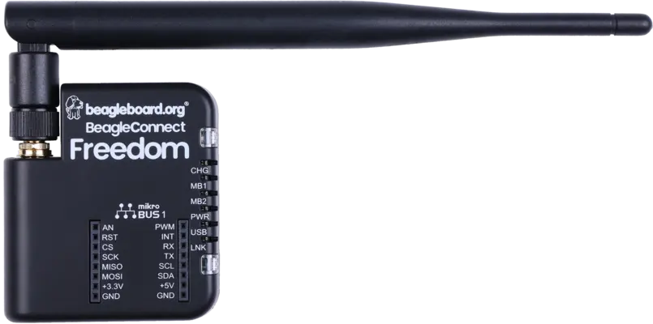
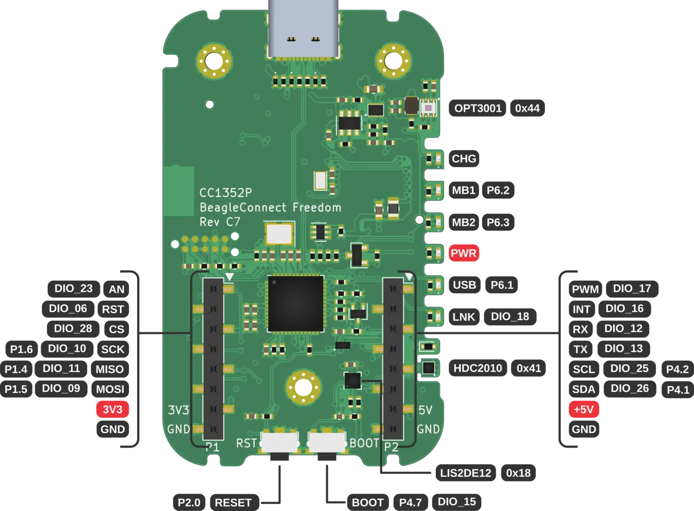
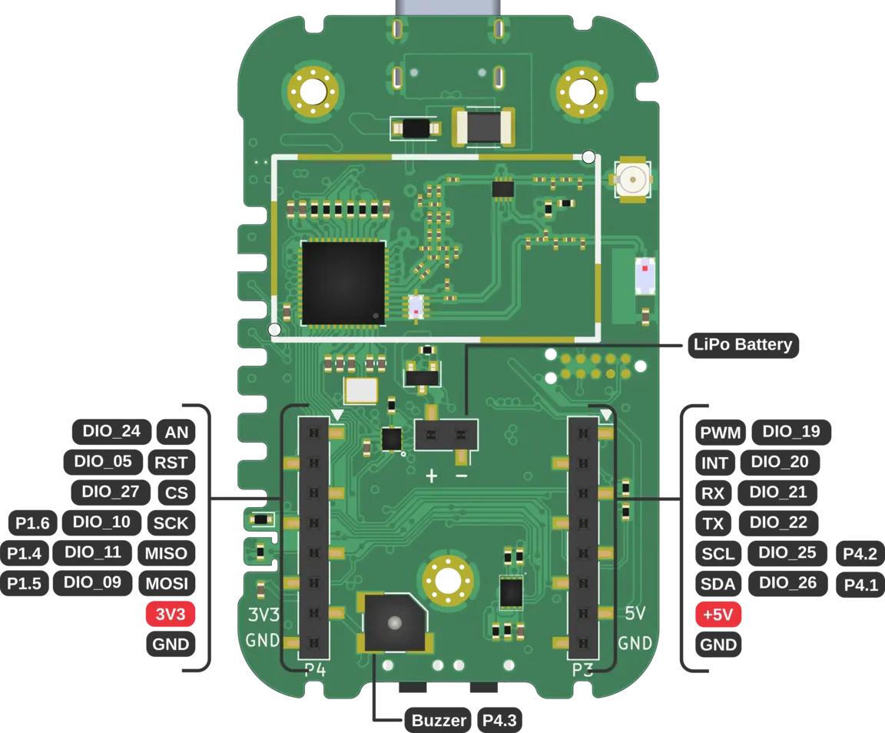

<!-- Copyright 2015-2026 Zephyr Project members and individual contributors. -->
<!-- SPDX-License-Identifier: Apache-2.0 -->
<!-- 中文翻译；编号、导航与译注为本地新增。 -->

<a id="beagleconnect_freedom"></a>

# 第3章\_BeagleConnect Freedom

原文：[官方页面](https://docs.zephyrproject.org/latest/boards/beagle/beagleconnect_freedom/doc/index.html)。读取日期：2026-10-16；来源摘要见[来源记录](../SOURCES.md)。

开发板概览（Board Overview）

<a id="id1"></a>

[](images/beagleconnect_freedom.webp)

BeagleConnect Freedom

名称（Name）：

`beagleconnect_freedom`

厂商（Vendor）：

[BeagleBoard.org基金会（Foundation）](https://docs.zephyrproject.org/latest/boards/index.html#vendor=beagle)

状态（Status）：

维护中（Maintained）

架构（Architecture）：

[arm](https://docs.zephyrproject.org/latest/boards/index.html#arch=arm)

片上系统（SoC）：

`[cc1352p](https://docs.zephyrproject.org/latest/boards/index.html#soc=cc1352p), [cc1352p7](https://docs.zephyrproject.org/latest/boards/index.html#soc=cc1352p7)`

<a id="board-github-link"></a>

[浏览开发板源码（Browse Board Sources）](https://github.com/zephyrproject-rtos/zephyr/blob/main//boards/beagle/beagleconnect_freedom/doc/index.rst/../..)<a id="overview"></a>

## 概述（Overview）

BeagleBoard.org BeagleConnect Freedom是基于SimpleLink多标准CC1352P7无线MCU的无线物联网（IoT）开发板。

<a id="hardware"></a>

## 硬件（Hardware）

BeagleBoard.org BeagleConnect Freedom搭载TI CC1352P7无线微控制器，是首款可获得的BeagleConnect方案，由开发板及外壳组成，出厂已编程，可直接使用。

BeagleConnect Freedom运行Zephyr RTOS，提供mikroBUS端口、低功耗蓝牙（BLE）及Sub-GHz无线电。

CC1352P7无线MCU具有48 MHz Arm Cortex-M4F SoC，支持低功耗蓝牙及IEEE 802.15.4。

开发板还配有TI MSP430F5503微控制器，用作USB转串口桥接及GPIO扩展器。

注意：Rev C5为量产前版本，使用TI CC1352P；量产版本Rev C7使用TI CC1352P7。

<a id="supported-features"></a>

### 支持的功能（Supported Features）

`beagleconnect_freedom`开发板支持下表所列的硬件功能。

片上／板载（On-Chip / On-Board）

功能集成在片上系统（SoC）内／位于开发板上。

2 / 2

分别表示已启用／已禁用的实例数。点击数量标签，可查看开发板或SoC设备树源码（DTS）中该功能的第一个实例。

`vnd,foo`

与此功能匹配的设备树绑定兼容字符串（Compatible String）；点击链接可查看绑定文档。

<a id="beagleconnect_freedom-hw-features"></a>

<a id="beagleconnect_freedom-beagleconnect_freedom@C5/cc1352p-hw-features-section"></a>

#### `beagleconnect_freedom@C5/cc1352p`目标（Target）

<a id="beagleconnect_freedom-beagleconnect_freedom@C5/cc1352p-hw-features-panel"></a>

<a id="beagleconnect_freedom-beagleconnect_freedom@C5/cc1352p-hw-features-memory"></a>

该开发板目标的片上存储容量：80 KiB RAM、352 KiB Flash。

<a id="beagleconnect_freedom-beagleconnect_freedom@C5/cc1352p-hw-features-table"></a>

<table>
<tr>
<th>类型（Type）</th>
<th>位置（Location）</th>
<th>说明（Description）</th>
<th>兼容字符串（Compatible）</th>
</tr>
<tr>
<td rowspan="1">中央处理器（CPU）</td>
<td>片上（On-Chip）</td>
<td>ARM Cortex-M4 处理器（CPU）（<a href="https://github.com/zephyrproject-rtos/zephyr/blob/main/dts/arm/ti/cc13xx_cc26xx.dtsi?plain=1#L24">已启用：1</a>）</td>
<td><a href="../cpu_arm_riscv_binding_reference/P024_arm_cortex-m4.md#std-dtcompatible-arm-cortex-m4"><code>arm,cortex-m4</code></a></td>
</tr>
<tr>
<td rowspan="1">模数转换器（ADC）</td>
<td>片上（On-Chip）</td>
<td>TI CC13xx／CC26xx系列模数转换器（ADC）（<a href="https://github.com/zephyrproject-rtos/zephyr/blob/main/dts/arm/ti/cc13xx_cc26xx.dtsi?plain=1#L236">已启用：1</a>）</td>
<td><a href="../hardware/P905_TICC13xxCC26xx模数转换器绑定.md#dtbinding-ti-cc13xx-cc26xx-adc"><code>ti,cc13xx-cc26xx-adc</code></a></td>
</tr>
<tr>
<td rowspan="1">时钟控制（Clock Control）</td>
<td>片上（On-Chip）</td>
<td>通用固定频率时钟提供者（Fixed-Rate Clock Provider）（<a href="https://github.com/zephyrproject-rtos/zephyr/blob/main/dts/arm/ti/cc13xx_cc26xx.dtsi?plain=1#L58">已启用：1</a>）</td>
<td><a href="../hardware/P566_固定时钟绑定.md#dtbinding-fixed-clock"><code>fixed-clock</code></a></td>
</tr>
<tr>
<td rowspan="1">闪存控制器（Flash Controller）</td>
<td>片上（On-Chip）</td>
<td>Texas Instruments CC13xx／CC26xx闪存控制器（<a href="https://github.com/zephyrproject-rtos/zephyr/blob/main/dts/arm/ti/cc13xx_cc26xx.dtsi?plain=1#L86">已启用：1</a>）</td>
<td><a href="../flash_renesas_st_ti_binding_reference/P030_ti_cc13xx-cc26xx-flash-controller.md#std-dtcompatible-ti-cc13xx-cc26xx-flash-controller"><code>ti,cc13xx-cc26xx-flash-controller</code></a></td>
</tr>
<tr>
<td rowspan="1">通用输入输出与接插件（GPIO &amp; Headers）</td>
<td>片上（On-Chip）</td>
<td>TI SimpleLink CC13xx／CC26xx GPIO（<a href="https://github.com/zephyrproject-rtos/zephyr/blob/main/dts/arm/ti/cc13xx_cc26xx.dtsi?plain=1#L70">已启用：1</a>）</td>
<td><a href="../gpio_ti_xilinx_sdl_binding_reference/P010_ti_cc13xx-cc26xx-gpio.md#std-dtcompatible-ti-cc13xx-cc26xx-gpio"><code>ti,cc13xx-cc26xx-gpio</code></a></td>
</tr>
<tr>
<td rowspan="2">集成电路间总线（I2C）</td>
<td>片上（On-Chip）</td>
<td>TI CC13xx／CC26xx I2C（<a href="https://github.com/zephyrproject-rtos/zephyr/blob/main/dts/arm/ti/cc13xx_cc26xx.dtsi?plain=1#L172">已启用：1</a>）</td>
<td><a href="../i2c_stm32_ti_mux_binding_reference/P010_ti_cc13xx-cc26xx-i2c.md#std-dtcompatible-ti-cc13xx-cc26xx-i2c"><code>ti,cc13xx-cc26xx-i2c</code></a></td>
</tr>
<tr>
<td>板载（On-Board）</td>
<td>通过GPIO使能的模拟开关（Analog Switch），用于将设备与I2C总线隔离（<a href="https://github.com/zephyrproject-rtos/zephyr/blob/main/boards/beagle/beagleconnect_freedom/beagleconnect_freedom-common.dtsi?plain=1#L75">已启用：1</a>）</td>
<td><a href="../i2c_infineon_ite_nordic_binding_reference/P001_gpio-i2c-switch.md#std-dtcompatible-gpio-i2c-switch"><code>gpio-i2c-switch</code></a></td>
</tr>
<tr>
<td rowspan="2">低速率无线个域网（IEEE 802.15.4）</td>
<td>片上（On-Chip）</td>
<td>TI SimpleLink CC13xx／CC26xx IEEE 802.15.4节点（<a href="https://github.com/zephyrproject-rtos/zephyr/blob/main/dts/arm/ti/cc13xx_cc26xx.dtsi?plain=1#L218">已禁用：1</a>）</td>
<td><a href="../lora_ieee802154_binding_reference/P014_ti_cc13xx-cc26xx-ieee802154.md#std-dtcompatible-ti-cc13xx-cc26xx-ieee802154"><code>ti,cc13xx-cc26xx-ieee802154</code></a></td>
</tr>
<tr>
<td>片上（On-Chip）</td>
<td>TI SimpleLink CC13xx／CC26xx Sub-GHz IEEE 802.15.4节点（<a href="https://github.com/zephyrproject-rtos/zephyr/blob/main/dts/arm/ti/cc13xx_cc26xx.dtsi?plain=1#L223">已启用：1</a>）</td>
<td><a href="../lora_ieee802154_binding_reference/P013_ti_cc13xx-cc26xx-ieee802154-subghz.md#std-dtcompatible-ti-cc13xx-cc26xx-ieee802154-subghz"><code>ti,cc13xx-cc26xx-ieee802154-subghz</code></a></td>
</tr>
<tr>
<td rowspan="1">输入（Input）</td>
<td>板载（On-Board）</td>
<td>一组绑定到 GPIO 的输入按键（GPIO-Bound Input Keys）（<a href="https://github.com/zephyrproject-rtos/zephyr/blob/main/boards/beagle/beagleconnect_freedom/beagleconnect_freedom-common.dtsi?plain=1#L36">已启用：1</a>）</td>
<td><a href="../hardware/P563_GPIO按键绑定.md#std-dtcompatible-gpio-keys"><code>gpio-keys</code></a></td>
</tr>
<tr>
<td rowspan="1">中断控制器（Interrupt Controller）</td>
<td>片上（On-Chip）</td>
<td>ARMv7-M 嵌套向量中断控制器（Nested Vectored Interrupt Controller，NVIC）（<a href="https://github.com/zephyrproject-rtos/zephyr/blob/main/dts/arm/armv7-m.dtsi?plain=1#L13">已启用：1</a>）</td>
<td><a href="../arm_interrupt_timer_binding_reference/P002_ARMv7_M_NVIC.md#std-dtcompatible-arm-v7m-nvic"><code>arm,v7m-nvic</code></a></td>
</tr>
<tr>
<td rowspan="1">发光二极管（LED）</td>
<td>板载（On-Board）</td>
<td>一组由 GPIO 控制的 LED（GPIO-Controlled LEDs）（<a href="https://github.com/zephyrproject-rtos/zephyr/blob/main/boards/beagle/beagleconnect_freedom/beagleconnect_freedom-common.dtsi?plain=1#L67">已启用：1</a>）</td>
<td><a href="../hardware/P564_GPIO指示灯绑定.md#dtbinding-gpio-leds"><code>gpio-leds</code></a></td>
</tr>
<tr>
<td rowspan="1">其他绑定（Miscellaneous）</td>
<td>板载（On-Board）</td>
<td>Skyworks SKY13317伪晶高电子迁移率晶体管（pHEMT）砷化镓（GaAs）单刀三掷（SP3T）天线开关（<a href="https://github.com/zephyrproject-rtos/zephyr/blob/main/boards/beagle/beagleconnect_freedom/beagleconnect_freedom-common.dtsi?plain=1#L57">已启用：1</a>）</td>
<td><a href="../misc_nxp_renesas_zephyr_binding_reference/P031_skyworks_sky13317.md#std-dtcompatible-skyworks-sky13317"><code>skyworks,sky13317</code></a></td>
</tr>
<tr>
<td rowspan="3">存储技术设备（MTD）</td>
<td>片上（On-Chip）</td>
<td>闪存（Flash）节点（<a href="https://github.com/zephyrproject-rtos/zephyr/blob/main/dts/arm/ti/cc13xx_cc26xx.dtsi?plain=1#L93">已启用：1</a>）</td>
<td><a href="../mtd_nxp_st_ti_partition_binding_reference/P013_soc-nv-flash.md#std-dtcompatible-soc-nv-flash"><code>soc-nv-flash</code></a></td>
</tr>
<tr>
<td>片上（On-Chip）</td>
<td>闪存或其他非易失性存储器的固定分区（Fixed Partitions）（<a href="https://github.com/zephyrproject-rtos/zephyr/blob/main/dts/arm/ti/cc1352r.dtsi?plain=1#L19">已启用：2</a>）</td>
<td><a href="../hardware/P568_固定分区绑定.md#dtbinding-fixed-partitions"><code>fixed-partitions</code></a></td>
</tr>
<tr>
<td>板载（On-Board）</td>
<td>这些属性用于支持Zephyr的<code>spi-nor</code>闪存驱动通过Zephyr SPI API，使用基于M25P80的标准命令集控制串行闪存（Serial Flash Memory）。（<a href="https://github.com/zephyrproject-rtos/zephyr/blob/main/boards/beagle/beagleconnect_freedom/beagleconnect_freedom-common.dtsi?plain=1#L148">已启用：1</a>）</td>
<td><a href="../mtd_microchip_nordic_nxp_binding_reference/P002_jedec_spi-nor.md#std-dtcompatible-jedec-spi-nor"><code>jedec,spi-nor</code></a></td>
</tr>
<tr>
<td rowspan="1">网络（Networking）</td>
<td>片上（On-Chip）</td>
<td>TI SimpleLink CC13xx／CC26xx无线电（Radio）（<a href="https://github.com/zephyrproject-rtos/zephyr/blob/main/dts/arm/ti/cc13xx_cc26xx.dtsi?plain=1#L208">已禁用：1</a>）</td>
<td><a href="../network_radio_frontend_binding_reference/P017_ti_cc13xx-cc26xx-radio.md#std-dtcompatible-ti-cc13xx-cc26xx-radio"><code>ti,cc13xx-cc26xx-radio</code></a></td>
</tr>
<tr>
<td rowspan="1">引脚控制（Pin Control）</td>
<td>片上（On-Chip）</td>
<td>TI SimpleLink CC13xx／CC26xx引脚控制器（<a href="https://github.com/zephyrproject-rtos/zephyr/blob/main/dts/arm/ti/cc13xx_cc26xx.dtsi?plain=1#L65">已启用：1</a>）</td>
<td><a href="../pinctrl_stm32_ti_xilinx_binding_reference/P010_ti_cc13xx-cc26xx-pinctrl.md#std-dtcompatible-ti-cc13xx-cc26xx-pinctrl"><code>ti,cc13xx-cc26xx-pinctrl</code></a></td>
</tr>
<tr>
<td rowspan="1">脉宽调制（PWM）</td>
<td>片上（On-Chip）</td>
<td>TI SimpleLink CC13xx／CC26xx通用定时器PWM控制器节点（GPT）（<a href="https://github.com/zephyrproject-rtos/zephyr/blob/main/dts/arm/ti/cc13xx_cc26xx.dtsi?plain=1#L107">已启用：2</a>；<a href="https://github.com/zephyrproject-rtos/zephyr/blob/main/dts/arm/ti/cc13xx_cc26xx.dtsi?plain=1#L135">已禁用：2</a>）</td>
<td><a href="../pwm_stm32_ti_generic_binding_reference/P015_ti_cc13xx-cc26xx-timer-pwm.md#std-dtcompatible-ti-cc13xx-cc26xx-timer-pwm"><code>ti,cc13xx-cc26xx-timer-pwm</code></a></td>
</tr>
<tr>
<td rowspan="1">随机数生成器（RNG）</td>
<td>片上（On-Chip）</td>
<td>TI SimpleLink CC13xx／CC26xx真随机数发生器（TRNG）（<a href="https://github.com/zephyrproject-rtos/zephyr/blob/main/dts/arm/ti/cc13xx_cc26xx.dtsi?plain=1#L79">已启用：1</a>）</td>
<td><a href="../soc_rng_binding_reference/P018_ti_cc13xx-cc26xx-trng.md#std-dtcompatible-ti-cc13xx-cc26xx-trng"><code>ti,cc13xx-cc26xx-trng</code></a></td>
</tr>
<tr>
<td rowspan="1">实时时钟（RTC）</td>
<td>片上（On-Chip）</td>
<td>TI SimpleLink CC13xx／CC26xx实时时钟（RTC）（<a href="https://github.com/zephyrproject-rtos/zephyr/blob/main/dts/arm/ti/cc13xx_cc26xx.dtsi?plain=1#L201">已启用：1</a>）</td>
<td><a href="../soc_rtc_binding_reference/P016_ti_cc13xx-cc26xx-rtc-timer.md#std-dtcompatible-ti-cc13xx-cc26xx-rtc-timer"><code>ti,cc13xx-cc26xx-rtc-timer</code></a></td>
</tr>
<tr>
<td rowspan="2">传感器（Sensors）</td>
<td>板载（On-Board）</td>
<td>Texas Instruments OPT3001环境光传感器（<a href="https://github.com/zephyrproject-rtos/zephyr/blob/main/boards/beagle/beagleconnect_freedom/beagleconnect_freedom-common.dtsi?plain=1#L83">已启用：1</a>）</td>
<td><a href="../sensor_st_ti_power_capacitance_binding_reference/P029_ti_opt3001.md#std-dtcompatible-ti-opt3001"><code>ti,opt3001</code></a></td>
</tr>
<tr>
<td>板载（On-Board）</td>
<td>Texas Instruments HDC2010温度与湿度传感器（<a href="https://github.com/zephyrproject-rtos/zephyr/blob/main/boards/beagle/beagleconnect_freedom/beagleconnect_freedom-common.dtsi?plain=1#L89">已启用：1</a>）</td>
<td><a href="../sensor_st_ti_power_capacitance_binding_reference/P015_ti_hdc2010.md#std-dtcompatible-ti-hdc2010"><code>ti,hdc2010</code></a></td>
</tr>
<tr>
<td rowspan="1">串行控制器（Serial Controller）</td>
<td>片上（On-Chip）</td>
<td>TI SimpleLink CC13xx／CC26xx UART节点（<a href="https://github.com/zephyrproject-rtos/zephyr/blob/main/dts/arm/ti/cc13xx_cc26xx.dtsi?plain=1#L156">已启用：2</a>）</td>
<td><a href="../uart_silabs_stm32_ti_binding_reference/P018_ti_cc13xx-cc26xx-uart.md#std-dtcompatible-ti-cc13xx-cc26xx-uart"><code>ti,cc13xx-cc26xx-uart</code></a></td>
</tr>
<tr>
<td rowspan="1">串行外设接口（SPI）</td>
<td>片上（On-Chip）</td>
<td>TI SimpleLink CC13xx／CC26xx SPI控制器（<a href="https://github.com/zephyrproject-rtos/zephyr/blob/main/dts/arm/ti/cc13xx_cc26xx.dtsi?plain=1#L182">已启用：1</a>；<a href="https://github.com/zephyrproject-rtos/zephyr/blob/main/dts/arm/ti/cc13xx_cc26xx.dtsi?plain=1#L191">已禁用：1</a>）</td>
<td><a href="../spi_stm32_ti_xilinx_binding_reference/P015_ti_cc13xx-cc26xx-spi.md#std-dtcompatible-ti-cc13xx-cc26xx-spi"><code>ti,cc13xx-cc26xx-spi</code></a></td>
</tr>
<tr>
<td rowspan="1">静态随机存储器（SRAM）</td>
<td>片上（On-Chip）</td>
<td>通用片上静态随机存储器（SRAM）（<a href="https://github.com/zephyrproject-rtos/zephyr/blob/main/dts/arm/ti/cc13xx_cc26xx.dtsi?plain=1#L47">已启用：1</a>）</td>
<td><a href="../hardware/P567_内存映射SRAM绑定.md#dtbinding-mmio-sram"><code>mmio-sram</code></a></td>
</tr>
<tr>
<td rowspan="2">定时器（Timer）</td>
<td>片上（On-Chip）</td>
<td>ARMv7-M 系统节拍（System Tick）（<a href="https://github.com/zephyrproject-rtos/zephyr/blob/main/dts/arm/armv7-m.dtsi?plain=1#L21">已禁用：1</a>）</td>
<td><a href="../arm_interrupt_timer_binding_reference/P006_ARMv7_M_SysTick.md#std-dtcompatible-arm-armv7m-systick"><code>arm,armv7m-systick</code></a></td>
</tr>
<tr>
<td>片上（On-Chip）</td>
<td>TI SimpleLink CC13xx／CC26xx定时器（<a href="https://github.com/zephyrproject-rtos/zephyr/blob/main/dts/arm/ti/cc13xx_cc26xx.dtsi?plain=1#L100">已启用：2</a>；<a href="https://github.com/zephyrproject-rtos/zephyr/blob/main/dts/arm/ti/cc13xx_cc26xx.dtsi?plain=1#L128">已禁用：2</a>）</td>
<td><a href="../stm32_ti_silabs_timer_binding_reference/P013_ti_cc13xx-cc26xx-timer.md#std-dtcompatible-ti-cc13xx-cc26xx-timer"><code>ti,cc13xx-cc26xx-timer</code></a></td>
</tr>
<tr>
<td rowspan="1">看门狗（Watchdog）</td>
<td>片上（On-Chip）</td>
<td>TI CC13xx／CC26xx看门狗（Watchdog）（<a href="https://github.com/zephyrproject-rtos/zephyr/blob/main/dts/arm/ti/cc13xx_cc26xx.dtsi?plain=1#L229">已启用：1</a>）</td>
<td><a href="../stm32_ti_xilinx_watchdog_binding_reference/P003_ti_cc13xx-cc26xx-watchdog.md#std-dtcompatible-ti-cc13xx-cc26xx-watchdog"><code>ti,cc13xx-cc26xx-watchdog</code></a></td>
</tr>
</table>

<a id="beagleconnect_freedom-beagleconnect_freedom@C7/cc1352p7-hw-features-section"></a>

#### `beagleconnect_freedom@C7/cc1352p7`目标（Target）

<a id="beagleconnect_freedom-beagleconnect_freedom@C7/cc1352p7-hw-features-panel"></a>

<a id="beagleconnect_freedom-beagleconnect_freedom@C7/cc1352p7-hw-features-memory"></a>

该开发板目标的片上存储容量：144 KiB RAM、704 KiB Flash。

<a id="beagleconnect_freedom-beagleconnect_freedom@C7/cc1352p7-hw-features-table"></a>

<table>
<tr>
<th>类型（Type）</th>
<th>位置（Location）</th>
<th>说明（Description）</th>
<th>兼容字符串（Compatible）</th>
</tr>
<tr>
<td rowspan="1">中央处理器（CPU）</td>
<td>片上（On-Chip）</td>
<td>ARM Cortex-M4 处理器（CPU）（<a href="https://github.com/zephyrproject-rtos/zephyr/blob/main/dts/arm/ti/cc13xx_cc26xx.dtsi?plain=1#L24">已启用：1</a>）</td>
<td><a href="../cpu_arm_riscv_binding_reference/P024_arm_cortex-m4.md#std-dtcompatible-arm-cortex-m4"><code>arm,cortex-m4</code></a></td>
</tr>
<tr>
<td rowspan="1">模数转换器（ADC）</td>
<td>片上（On-Chip）</td>
<td>TI CC13xx／CC26xx系列模数转换器（ADC）（<a href="https://github.com/zephyrproject-rtos/zephyr/blob/main/dts/arm/ti/cc13xx_cc26xx.dtsi?plain=1#L236">已启用：1</a>）</td>
<td><a href="../hardware/P905_TICC13xxCC26xx模数转换器绑定.md#dtbinding-ti-cc13xx-cc26xx-adc"><code>ti,cc13xx-cc26xx-adc</code></a></td>
</tr>
<tr>
<td rowspan="1">时钟控制（Clock Control）</td>
<td>片上（On-Chip）</td>
<td>通用固定频率时钟提供者（Fixed-Rate Clock Provider）（<a href="https://github.com/zephyrproject-rtos/zephyr/blob/main/dts/arm/ti/cc13xx_cc26xx.dtsi?plain=1#L58">已启用：1</a>）</td>
<td><a href="../hardware/P566_固定时钟绑定.md#dtbinding-fixed-clock"><code>fixed-clock</code></a></td>
</tr>
<tr>
<td rowspan="1">闪存控制器（Flash Controller）</td>
<td>片上（On-Chip）</td>
<td>Texas Instruments CC13xx／CC26xx闪存控制器（<a href="https://github.com/zephyrproject-rtos/zephyr/blob/main/dts/arm/ti/cc13xx_cc26xx.dtsi?plain=1#L86">已启用：1</a>）</td>
<td><a href="../flash_renesas_st_ti_binding_reference/P030_ti_cc13xx-cc26xx-flash-controller.md#std-dtcompatible-ti-cc13xx-cc26xx-flash-controller"><code>ti,cc13xx-cc26xx-flash-controller</code></a></td>
</tr>
<tr>
<td rowspan="1">通用输入输出与接插件（GPIO &amp; Headers）</td>
<td>片上（On-Chip）</td>
<td>TI SimpleLink CC13xx／CC26xx GPIO（<a href="https://github.com/zephyrproject-rtos/zephyr/blob/main/dts/arm/ti/cc13xx_cc26xx.dtsi?plain=1#L70">已启用：1</a>）</td>
<td><a href="../gpio_ti_xilinx_sdl_binding_reference/P010_ti_cc13xx-cc26xx-gpio.md#std-dtcompatible-ti-cc13xx-cc26xx-gpio"><code>ti,cc13xx-cc26xx-gpio</code></a></td>
</tr>
<tr>
<td rowspan="2">集成电路间总线（I2C）</td>
<td>片上（On-Chip）</td>
<td>TI CC13xx／CC26xx I2C（<a href="https://github.com/zephyrproject-rtos/zephyr/blob/main/dts/arm/ti/cc13xx_cc26xx.dtsi?plain=1#L172">已启用：1</a>）</td>
<td><a href="../i2c_stm32_ti_mux_binding_reference/P010_ti_cc13xx-cc26xx-i2c.md#std-dtcompatible-ti-cc13xx-cc26xx-i2c"><code>ti,cc13xx-cc26xx-i2c</code></a></td>
</tr>
<tr>
<td>板载（On-Board）</td>
<td>通过GPIO使能的模拟开关（Analog Switch），用于将设备与I2C总线隔离（<a href="https://github.com/zephyrproject-rtos/zephyr/blob/main/boards/beagle/beagleconnect_freedom/beagleconnect_freedom-common.dtsi?plain=1#L75">已启用：1</a>）</td>
<td><a href="../i2c_infineon_ite_nordic_binding_reference/P001_gpio-i2c-switch.md#std-dtcompatible-gpio-i2c-switch"><code>gpio-i2c-switch</code></a></td>
</tr>
<tr>
<td rowspan="2">低速率无线个域网（IEEE 802.15.4）</td>
<td>片上（On-Chip）</td>
<td>TI SimpleLink CC13xx／CC26xx IEEE 802.15.4节点（<a href="https://github.com/zephyrproject-rtos/zephyr/blob/main/dts/arm/ti/cc13xx_cc26xx.dtsi?plain=1#L218">已禁用：1</a>）</td>
<td><a href="../lora_ieee802154_binding_reference/P014_ti_cc13xx-cc26xx-ieee802154.md#std-dtcompatible-ti-cc13xx-cc26xx-ieee802154"><code>ti,cc13xx-cc26xx-ieee802154</code></a></td>
</tr>
<tr>
<td>片上（On-Chip）</td>
<td>TI SimpleLink CC13xx／CC26xx Sub-GHz IEEE 802.15.4节点（<a href="https://github.com/zephyrproject-rtos/zephyr/blob/main/dts/arm/ti/cc13xx_cc26xx.dtsi?plain=1#L223">已启用：1</a>）</td>
<td><a href="../lora_ieee802154_binding_reference/P013_ti_cc13xx-cc26xx-ieee802154-subghz.md#std-dtcompatible-ti-cc13xx-cc26xx-ieee802154-subghz"><code>ti,cc13xx-cc26xx-ieee802154-subghz</code></a></td>
</tr>
<tr>
<td rowspan="1">输入（Input）</td>
<td>板载（On-Board）</td>
<td>一组绑定到 GPIO 的输入按键（GPIO-Bound Input Keys）（<a href="https://github.com/zephyrproject-rtos/zephyr/blob/main/boards/beagle/beagleconnect_freedom/beagleconnect_freedom-common.dtsi?plain=1#L36">已启用：1</a>）</td>
<td><a href="../hardware/P563_GPIO按键绑定.md#std-dtcompatible-gpio-keys"><code>gpio-keys</code></a></td>
</tr>
<tr>
<td rowspan="1">中断控制器（Interrupt Controller）</td>
<td>片上（On-Chip）</td>
<td>ARMv7-M 嵌套向量中断控制器（Nested Vectored Interrupt Controller，NVIC）（<a href="https://github.com/zephyrproject-rtos/zephyr/blob/main/dts/arm/armv7-m.dtsi?plain=1#L13">已启用：1</a>）</td>
<td><a href="../arm_interrupt_timer_binding_reference/P002_ARMv7_M_NVIC.md#std-dtcompatible-arm-v7m-nvic"><code>arm,v7m-nvic</code></a></td>
</tr>
<tr>
<td rowspan="1">发光二极管（LED）</td>
<td>板载（On-Board）</td>
<td>一组由 GPIO 控制的 LED（GPIO-Controlled LEDs）（<a href="https://github.com/zephyrproject-rtos/zephyr/blob/main/boards/beagle/beagleconnect_freedom/beagleconnect_freedom-common.dtsi?plain=1#L67">已启用：1</a>）</td>
<td><a href="../hardware/P564_GPIO指示灯绑定.md#dtbinding-gpio-leds"><code>gpio-leds</code></a></td>
</tr>
<tr>
<td rowspan="1">其他绑定（Miscellaneous）</td>
<td>板载（On-Board）</td>
<td>Skyworks SKY13317伪晶高电子迁移率晶体管（pHEMT）砷化镓（GaAs）单刀三掷（SP3T）天线开关（<a href="https://github.com/zephyrproject-rtos/zephyr/blob/main/boards/beagle/beagleconnect_freedom/beagleconnect_freedom-common.dtsi?plain=1#L57">已启用：1</a>）</td>
<td><a href="../misc_nxp_renesas_zephyr_binding_reference/P031_skyworks_sky13317.md#std-dtcompatible-skyworks-sky13317"><code>skyworks,sky13317</code></a></td>
</tr>
<tr>
<td rowspan="3">存储技术设备（MTD）</td>
<td>片上（On-Chip）</td>
<td>闪存（Flash）节点（<a href="https://github.com/zephyrproject-rtos/zephyr/blob/main/dts/arm/ti/cc13xx_cc26xx.dtsi?plain=1#L93">已启用：1</a>）</td>
<td><a href="../mtd_nxp_st_ti_partition_binding_reference/P013_soc-nv-flash.md#std-dtcompatible-soc-nv-flash"><code>soc-nv-flash</code></a></td>
</tr>
<tr>
<td>片上（On-Chip）</td>
<td>闪存或其他非易失性存储器的固定分区（Fixed Partitions）（<a href="https://github.com/zephyrproject-rtos/zephyr/blob/main/dts/arm/ti/cc1352r7.dtsi?plain=1#L19">已启用：2</a>）</td>
<td><a href="../hardware/P568_固定分区绑定.md#dtbinding-fixed-partitions"><code>fixed-partitions</code></a></td>
</tr>
<tr>
<td>板载（On-Board）</td>
<td>这些属性用于支持Zephyr的<code>spi-nor</code>闪存驱动通过Zephyr SPI API，使用基于M25P80的标准命令集控制串行闪存（Serial Flash Memory）。（<a href="https://github.com/zephyrproject-rtos/zephyr/blob/main/boards/beagle/beagleconnect_freedom/beagleconnect_freedom-common.dtsi?plain=1#L148">已启用：1</a>）</td>
<td><a href="../mtd_microchip_nordic_nxp_binding_reference/P002_jedec_spi-nor.md#std-dtcompatible-jedec-spi-nor"><code>jedec,spi-nor</code></a></td>
</tr>
<tr>
<td rowspan="1">网络（Networking）</td>
<td>片上（On-Chip）</td>
<td>TI SimpleLink CC13xx／CC26xx无线电（Radio）（<a href="https://github.com/zephyrproject-rtos/zephyr/blob/main/dts/arm/ti/cc13xx_cc26xx.dtsi?plain=1#L208">已禁用：1</a>）</td>
<td><a href="../network_radio_frontend_binding_reference/P017_ti_cc13xx-cc26xx-radio.md#std-dtcompatible-ti-cc13xx-cc26xx-radio"><code>ti,cc13xx-cc26xx-radio</code></a></td>
</tr>
<tr>
<td rowspan="1">引脚控制（Pin Control）</td>
<td>片上（On-Chip）</td>
<td>TI SimpleLink CC13xx／CC26xx引脚控制器（<a href="https://github.com/zephyrproject-rtos/zephyr/blob/main/dts/arm/ti/cc13xx_cc26xx.dtsi?plain=1#L65">已启用：1</a>）</td>
<td><a href="../pinctrl_stm32_ti_xilinx_binding_reference/P010_ti_cc13xx-cc26xx-pinctrl.md#std-dtcompatible-ti-cc13xx-cc26xx-pinctrl"><code>ti,cc13xx-cc26xx-pinctrl</code></a></td>
</tr>
<tr>
<td rowspan="1">脉宽调制（PWM）</td>
<td>片上（On-Chip）</td>
<td>TI SimpleLink CC13xx／CC26xx通用定时器PWM控制器节点（GPT）（<a href="https://github.com/zephyrproject-rtos/zephyr/blob/main/dts/arm/ti/cc13xx_cc26xx.dtsi?plain=1#L107">已启用：2</a>；<a href="https://github.com/zephyrproject-rtos/zephyr/blob/main/dts/arm/ti/cc13xx_cc26xx.dtsi?plain=1#L135">已禁用：2</a>）</td>
<td><a href="../pwm_stm32_ti_generic_binding_reference/P015_ti_cc13xx-cc26xx-timer-pwm.md#std-dtcompatible-ti-cc13xx-cc26xx-timer-pwm"><code>ti,cc13xx-cc26xx-timer-pwm</code></a></td>
</tr>
<tr>
<td rowspan="1">随机数生成器（RNG）</td>
<td>片上（On-Chip）</td>
<td>TI SimpleLink CC13xx／CC26xx真随机数发生器（TRNG）（<a href="https://github.com/zephyrproject-rtos/zephyr/blob/main/dts/arm/ti/cc13xx_cc26xx.dtsi?plain=1#L79">已启用：1</a>）</td>
<td><a href="../soc_rng_binding_reference/P018_ti_cc13xx-cc26xx-trng.md#std-dtcompatible-ti-cc13xx-cc26xx-trng"><code>ti,cc13xx-cc26xx-trng</code></a></td>
</tr>
<tr>
<td rowspan="1">实时时钟（RTC）</td>
<td>片上（On-Chip）</td>
<td>TI SimpleLink CC13xx／CC26xx实时时钟（RTC）（<a href="https://github.com/zephyrproject-rtos/zephyr/blob/main/dts/arm/ti/cc13xx_cc26xx.dtsi?plain=1#L201">已启用：1</a>）</td>
<td><a href="../soc_rtc_binding_reference/P016_ti_cc13xx-cc26xx-rtc-timer.md#std-dtcompatible-ti-cc13xx-cc26xx-rtc-timer"><code>ti,cc13xx-cc26xx-rtc-timer</code></a></td>
</tr>
<tr>
<td rowspan="2">传感器（Sensors）</td>
<td>板载（On-Board）</td>
<td>Texas Instruments OPT3001环境光传感器（<a href="https://github.com/zephyrproject-rtos/zephyr/blob/main/boards/beagle/beagleconnect_freedom/beagleconnect_freedom-common.dtsi?plain=1#L83">已启用：1</a>）</td>
<td><a href="../sensor_st_ti_power_capacitance_binding_reference/P029_ti_opt3001.md#std-dtcompatible-ti-opt3001"><code>ti,opt3001</code></a></td>
</tr>
<tr>
<td>板载（On-Board）</td>
<td>Texas Instruments HDC2010温度与湿度传感器（<a href="https://github.com/zephyrproject-rtos/zephyr/blob/main/boards/beagle/beagleconnect_freedom/beagleconnect_freedom-common.dtsi?plain=1#L89">已启用：1</a>）</td>
<td><a href="../sensor_st_ti_power_capacitance_binding_reference/P015_ti_hdc2010.md#std-dtcompatible-ti-hdc2010"><code>ti,hdc2010</code></a></td>
</tr>
<tr>
<td rowspan="1">串行控制器（Serial Controller）</td>
<td>片上（On-Chip）</td>
<td>TI SimpleLink CC13xx／CC26xx UART节点（<a href="https://github.com/zephyrproject-rtos/zephyr/blob/main/dts/arm/ti/cc13xx_cc26xx.dtsi?plain=1#L156">已启用：2</a>）</td>
<td><a href="../uart_silabs_stm32_ti_binding_reference/P018_ti_cc13xx-cc26xx-uart.md#std-dtcompatible-ti-cc13xx-cc26xx-uart"><code>ti,cc13xx-cc26xx-uart</code></a></td>
</tr>
<tr>
<td rowspan="1">串行外设接口（SPI）</td>
<td>片上（On-Chip）</td>
<td>TI SimpleLink CC13xx／CC26xx SPI控制器（<a href="https://github.com/zephyrproject-rtos/zephyr/blob/main/dts/arm/ti/cc13xx_cc26xx.dtsi?plain=1#L182">已启用：1</a>；<a href="https://github.com/zephyrproject-rtos/zephyr/blob/main/dts/arm/ti/cc13xx_cc26xx.dtsi?plain=1#L191">已禁用：1</a>）</td>
<td><a href="../spi_stm32_ti_xilinx_binding_reference/P015_ti_cc13xx-cc26xx-spi.md#std-dtcompatible-ti-cc13xx-cc26xx-spi"><code>ti,cc13xx-cc26xx-spi</code></a></td>
</tr>
<tr>
<td rowspan="1">静态随机存储器（SRAM）</td>
<td>片上（On-Chip）</td>
<td>通用片上静态随机存储器（SRAM）（<a href="https://github.com/zephyrproject-rtos/zephyr/blob/main/dts/arm/ti/cc13xx_cc26xx.dtsi?plain=1#L47">已启用：1</a>）</td>
<td><a href="../hardware/P567_内存映射SRAM绑定.md#dtbinding-mmio-sram"><code>mmio-sram</code></a></td>
</tr>
<tr>
<td rowspan="2">定时器（Timer）</td>
<td>片上（On-Chip）</td>
<td>ARMv7-M 系统节拍（System Tick）（<a href="https://github.com/zephyrproject-rtos/zephyr/blob/main/dts/arm/armv7-m.dtsi?plain=1#L21">已禁用：1</a>）</td>
<td><a href="../arm_interrupt_timer_binding_reference/P006_ARMv7_M_SysTick.md#std-dtcompatible-arm-armv7m-systick"><code>arm,armv7m-systick</code></a></td>
</tr>
<tr>
<td>片上（On-Chip）</td>
<td>TI SimpleLink CC13xx／CC26xx定时器（<a href="https://github.com/zephyrproject-rtos/zephyr/blob/main/dts/arm/ti/cc13xx_cc26xx.dtsi?plain=1#L100">已启用：2</a>；<a href="https://github.com/zephyrproject-rtos/zephyr/blob/main/dts/arm/ti/cc13xx_cc26xx.dtsi?plain=1#L128">已禁用：2</a>）</td>
<td><a href="../stm32_ti_silabs_timer_binding_reference/P013_ti_cc13xx-cc26xx-timer.md#std-dtcompatible-ti-cc13xx-cc26xx-timer"><code>ti,cc13xx-cc26xx-timer</code></a></td>
</tr>
<tr>
<td rowspan="1">看门狗（Watchdog）</td>
<td>片上（On-Chip）</td>
<td>TI CC13xx／CC26xx看门狗（Watchdog）（<a href="https://github.com/zephyrproject-rtos/zephyr/blob/main/dts/arm/ti/cc13xx_cc26xx.dtsi?plain=1#L229">已启用：1</a>）</td>
<td><a href="../stm32_ti_xilinx_watchdog_binding_reference/P003_ti_cc13xx-cc26xx-watchdog.md#std-dtcompatible-ti-cc13xx-cc26xx-watchdog"><code>ti,cc13xx-cc26xx-watchdog</code></a></td>
</tr>
</table>

<a id="connections-and-ios"></a>

### 连接与输入输出（Connections and IOs）

<a id="id2"></a>

[](images/beagleconnect_freedom_front_annotated.webp)

BeagleConnect Freedom正面连接（Front Connections）

<a id="id3"></a>

[](images/beagleconnect_freedom_back_annotated.webp)

BeagleConnect Freedom背面连接（Back Connections）

<table>
<tr>
<th>引脚（Pin）</th>
<th>功能（Function）</th>
<th>用途（Usage）</th>
</tr>
<tr>
<td>DIO5</td>
<td>RST_MB2</td>
<td>复位mikroBUS端口2</td>
</tr>
<tr>
<td>DIO6</td>
<td>RST_MB1</td>
<td>复位mikroBUS端口1</td>
</tr>
<tr>
<td>DIO7</td>
<td>INT_SENSOR</td>
<td>板载传感器中断</td>
</tr>
<tr>
<td>DIO8</td>
<td>FLASH_CS</td>
<td>SPI闪存片选（Chip Select）</td>
</tr>
<tr>
<td>DIO9</td>
<td>串行数据输出／外设输入控制器输出（SDO / PICO）</td>
<td>SPI串行数据输出</td>
</tr>
<tr>
<td>DIO10</td>
<td>串行时钟（SCK）</td>
<td>SPI串行时钟</td>
</tr>
<tr>
<td>DIO11</td>
<td>串行数据输入／外设输出控制器输入（SDI / POCI）</td>
<td>SPI串行数据输入</td>
</tr>
<tr>
<td>DIO12</td>
<td>CC1352_RX</td>
<td>mikroBUS端口1或MSP430的UART RXD</td>
</tr>
<tr>
<td>DIO13</td>
<td>CC1352_TX</td>
<td>mikroBUS端口1或MSP430的UART TXD</td>
</tr>
<tr>
<td>DIO14</td>
<td>I2C_CTRL</td>
<td>使能板载传感器I2C总线</td>
</tr>
<tr>
<td>DIO15</td>
<td>USER_BOOT</td>
<td>BOOT按键状态</td>
</tr>
<tr>
<td>DIO16</td>
<td>INT_MB1</td>
<td>mikroBUS端口1的中断引脚（INTERRUPT）</td>
</tr>
<tr>
<td>DIO17</td>
<td>PWM_MB1</td>
<td>mikroBUS端口1的PWM引脚</td>
</tr>
<tr>
<td>DIO18</td>
<td>LED_LINK</td>
<td>无线链路指示LED（Radio Link Indicator）</td>
</tr>
<tr>
<td>DIO19</td>
<td>PWM_MB2</td>
<td>mikroBUS端口2的PWM引脚</td>
</tr>
<tr>
<td>DIO20</td>
<td>INT_MB2</td>
<td>mikroBUS端口2的中断引脚</td>
</tr>
<tr>
<td>DIO21</td>
<td>MB2_RX</td>
<td>mikroBUS端口2的UART RXD</td>
</tr>
<tr>
<td>DIO22</td>
<td>MB2_TX</td>
<td>mikroBUS端口2的UART TXD</td>
</tr>
<tr>
<td>DIO23</td>
<td>AN_MB1</td>
<td>mikroBUS端口1的模拟引脚（ANALOG）</td>
</tr>
<tr>
<td>DIO24</td>
<td>AN_MB2</td>
<td>mikroBUS端口2的模拟引脚</td>
</tr>
<tr>
<td>DIO25</td>
<td>串行时钟线（SCL）</td>
<td>I2C串行时钟（SCL）</td>
</tr>
<tr>
<td>DIO26</td>
<td>串行数据线（SDA）</td>
<td>I2C串行数据（SDA）</td>
</tr>
<tr>
<td>DIO27</td>
<td>CS_MB2</td>
<td>microBUS端口2的SPI片选（CS）</td>
</tr>
<tr>
<td>DIO28</td>
<td>CS_MB1</td>
<td>microBUS端口1的SPI片选（CS）</td>
</tr>
<tr>
<td>DIO29</td>
<td>REF_SW_CTRL1</td>
<td>天线复用器（Mux）的功率放大器（PA）使能</td>
</tr>
<tr>
<td>DIO30</td>
<td>REF_SW_CTRL2</td>
<td>天线复用器的Sub-GHz使能</td>
</tr>
</table>

<a id="system-requirements"></a>

### 系统要求（System Requirements）

<a id="prerequisites"></a>

#### 前置条件（Prerequisites）

使用`west flash`向BeagleConnect Freedom烧录Zephyr固件需要[CC1352 Flasher](https://pypi.org/project/cc1352-flasher/)。

```text
pip3 install cc1352-flasher
```

<a id="references"></a>

## 参考资料（References）

BeagleBoard.org BeagleConnect Freedom参考资料：

[https://beagleconnect.org](https://beagleconnect.org)

---

[上一章](P002_BeagleBone_AI-64.md) · [返回大纲](大纲.md) · [全站翻译进度](../PROGRESS.md) · [下一章](P004_BeagleConnect_Zepto.md)
