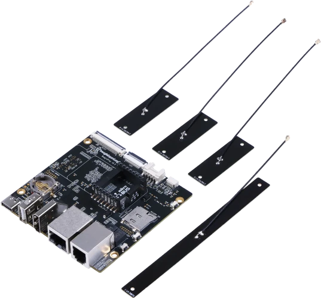

<!-- Copyright 2015-2026 Zephyr Project members and individual contributors. -->
<!-- SPDX-License-Identifier: Apache-2.0 -->
<!-- 中文翻译；编号、导航与译注为本地新增。 -->

<a id="beagleplay"></a>

# 第5章\_BeaglePlay

原文：[官方页面](https://docs.zephyrproject.org/latest/boards/beagle/beagleplay/doc/index.html)。读取日期：2026-10-16；来源摘要见[来源记录](../SOURCES.md)。

开发板概览（Board Overview）

<a id="id3"></a>

[](images/beagle_play.webp)

BeaglePlay

名称（Name）：

`beagleplay`

厂商（Vendor）：

[BeagleBoard.org基金会（Foundation）](https://docs.zephyrproject.org/latest/boards/index.html#vendor=beagle)

状态（Status）：

维护中（Maintained）

架构（Architecture）：

[arm](https://docs.zephyrproject.org/latest/boards/index.html#arch=arm)

片上系统（SoC）：

`[am6254](https://docs.zephyrproject.org/latest/boards/index.html#soc=am6254), [cc1352p7](https://docs.zephyrproject.org/latest/boards/index.html#soc=cc1352p7)`

<a id="board-github-link"></a>

[浏览开发板源码（Browse Board Sources）](https://github.com/zephyrproject-rtos/zephyr/blob/main//boards/beagle/beagleplay/doc/index.rst/../..)<a id="overview"></a>

## 概述（Overview）

BeagleBoard.org BeaglePlay是一款开放硬件单板计算机（SBC），基于TI Sitara AM6254四核ARM Cortex-A53 SoC，外接TI SimpleLink多标准CC1352P7无线MCU，提供远距离低功耗连接。

<a id="hardware"></a>

## 硬件（Hardware）


- 处理器（Processors）


  - TI Sitara AM6254片上系统（SoC）


    - 四个ARM Cortex-A53内核
    - ARM Cortex-R5
    - ARM Cortex-M4
    - 双核32位精简指令集可编程实时单元（RISC PRU / Programmable Real-Time Unit）
  - TI SimpleLink CC1352P7无线MCU


    - ARM Cortex-M4F可编程MCU
    - ARM Cortex-M0+软件定义无线电处理器（Software-Defined Radio Processor）
- 存储器（Memory）


  - 2 GB DDR4
  - 16 GB eMMC闪存
  - I2C EEPROM
- 有线连接（Wired Connectivity）


  - 千兆以太网（Gigabit Ethernet），RJ45
  - 单对线以太网（Single-Pair Ethernet），RJ11，提供5 V／250 mA数据线供电（PoDL）输出
  - 高清多媒体接口（HDMI）
  - USB Type-A，主机模式
  - USB Type-C，客户端／供电
- 无线连接（Wireless Connectivity）


  - TI WL1807，2.4 GHz／5 GHz Wi-Fi
  - 通过CC1352P7提供BLE及Sub-GHz无线连接
- 扩展（Expansion）


  - mikroBUS
  - Grove
  - QWIIC

BeaglePlay的ARM Cortex-A53 CPU通常运行Linux，CC1352P7 Cortex-M4通常运行Zephyr。

<a id="supported-features"></a>

### 支持的功能（Supported Features）

`beagleplay`开发板支持下表所列的硬件功能。

片上／板载（On-Chip / On-Board）

功能集成在片上系统（SoC）内／位于开发板上。

2 / 2

分别表示已启用／已禁用的实例数。点击数量标签，可查看开发板或SoC设备树源码（DTS）中该功能的第一个实例。

`vnd,foo`

与此功能匹配的设备树绑定兼容字符串（Compatible String）；点击链接可查看绑定文档。

<a id="beagleplay-hw-features"></a>

<a id="beagleplay-beagleplay/am6254/m4-hw-features-section"></a>

#### `beagleplay/am6254/m4`目标（Target）

<a id="beagleplay-beagleplay/am6254/m4-hw-features-panel"></a>

<a id="beagleplay-beagleplay/am6254/m4-hw-features-memory"></a>

该开发板目标的片上存储容量：64 KiB RAM、192 KiB Flash。

<a id="beagleplay-beagleplay/am6254/m4-hw-features-table"></a>

<table>
<tr>
<th>类型（Type）</th>
<th>位置（Location）</th>
<th>说明（Description）</th>
<th>兼容字符串（Compatible）</th>
</tr>
<tr>
<td rowspan="1">中央处理器（CPU）</td>
<td>片上（On-Chip）</td>
<td>ARM Cortex-M4F 处理器（CPU）（<a href="https://github.com/zephyrproject-rtos/zephyr/blob/main/dts/arm/ti/am62x_m4.dtsi?plain=1#L21">已启用：1</a>）</td>
<td><a href="../cpu_arm_riscv_binding_reference/P025_arm_cortex-m4f.md#std-dtcompatible-arm-cortex-m4f"><code>arm,cortex-m4f</code></a></td>
</tr>
<tr>
<td rowspan="1">时钟控制（Clock Control）</td>
<td>片上（On-Chip）</td>
<td>通用固定频率时钟提供者（Fixed-Rate Clock Provider）（<a href="https://github.com/zephyrproject-rtos/zephyr/blob/main/dts/arm/ti/am62x_m4.dtsi?plain=1#L54">已启用：1</a>）</td>
<td><a href="../hardware/P566_固定时钟绑定.md#dtbinding-fixed-clock"><code>fixed-clock</code></a></td>
</tr>
<tr>
<td rowspan="1">计数器（Counter）</td>
<td>片上（On-Chip）</td>
<td>TI K3代处理器中基于计数器的实时时钟（RTC）（<a href="https://github.com/zephyrproject-rtos/zephyr/blob/main/dts/vendor/ti/k3-am62-main.dtsi?plain=1#L302">已禁用：1</a>）</td>
<td><a href="../stm32_ti_xilinx_counter_binding_reference/P010_ti_k3-rtc-counter.md#std-dtcompatible-ti-k3-rtc-counter"><code>ti,k3-rtc-counter</code></a></td>
</tr>
<tr>
<td rowspan="1">通用输入输出与接插件（GPIO &amp; Headers）</td>
<td>片上（On-Chip）</td>
<td>Davinci及Keystone器件的GPIO控制器（<a href="https://github.com/zephyrproject-rtos/zephyr/blob/main/dts/vendor/ti/k3-am62-main.dtsi?plain=1#L161">已禁用：6</a>）</td>
<td><a href="../gpio_ti_xilinx_sdl_binding_reference/P014_ti_davinci-gpio.md#std-dtcompatible-ti-davinci-gpio"><code>ti,davinci-gpio</code></a></td>
</tr>
<tr>
<td rowspan="1">集成电路间总线（I2C）</td>
<td>片上（On-Chip）</td>
<td>TI OMAP I2C控制器（<a href="https://github.com/zephyrproject-rtos/zephyr/blob/main/dts/vendor/ti/k3-am62-main.dtsi?plain=1#L73">已禁用：5</a>）</td>
<td><a href="../i2c_stm32_ti_mux_binding_reference/P013_ti_omap-i2c.md#std-dtcompatible-ti-omap-i2c"><code>ti,omap-i2c</code></a></td>
</tr>
<tr>
<td rowspan="1">中断控制器（Interrupt Controller）</td>
<td>片上（On-Chip）</td>
<td>ARMv7-M 嵌套向量中断控制器（Nested Vectored Interrupt Controller，NVIC）（<a href="https://github.com/zephyrproject-rtos/zephyr/blob/main/dts/arm/armv7-m.dtsi?plain=1#L13">已启用：1</a>）</td>
<td><a href="../arm_interrupt_timer_binding_reference/P002_ARMv7_M_NVIC.md#std-dtcompatible-arm-v7m-nvic"><code>arm,v7m-nvic</code></a></td>
</tr>
<tr>
<td rowspan="1">邮箱（Mailbox）</td>
<td>片上（On-Chip）</td>
<td>TI OMAP邮箱（MAILBOX）（<a href="https://github.com/zephyrproject-rtos/zephyr/blob/main/dts/arm/ti/am62x_m4.dtsi?plain=1#L60">已启用：1</a>）</td>
<td><a href="../intercore_reference/P055_TIOMAP邮箱绑定.md#dtbinding-ti-omap-mailbox"><code>ti,omap-mailbox</code></a></td>
</tr>
<tr>
<td rowspan="1">引脚控制（Pin Control）</td>
<td>片上（On-Chip）</td>
<td>TI K3引脚控制器（Pin Controller）（<a href="https://github.com/zephyrproject-rtos/zephyr/blob/main/dts/arm/ti/am62x_m4.dtsi?plain=1#L77">已启用：1</a>）</td>
<td><a href="../pinctrl_stm32_ti_xilinx_binding_reference/P013_ti_k3-pinctrl.md#std-dtcompatible-ti-k3-pinctrl"><code>ti,k3-pinctrl</code></a></td>
</tr>
<tr>
<td rowspan="1">SD 主机控制器（SDHC）</td>
<td>片上（On-Chip）</td>
<td>TI SD／eMMC主机控制器（<a href="https://github.com/zephyrproject-rtos/zephyr/blob/main/dts/vendor/ti/k3-am62-main.dtsi?plain=1#L315">已禁用：3</a>）</td>
<td><a href="../sdhc_binding_reference/P020_ti_am654-sdhci.md#std-dtcompatible-ti-am654-sdhci"><code>ti,am654-sdhci</code></a></td>
</tr>
<tr>
<td rowspan="1">串行控制器（Serial Controller）</td>
<td>片上（On-Chip）</td>
<td>ns16550通用异步收发器（UART）（<a href="https://github.com/zephyrproject-rtos/zephyr/blob/main/dts/vendor/ti/k3-am62-main.dtsi?plain=1#L55">已启用：1</a>；<a href="https://github.com/zephyrproject-rtos/zephyr/blob/main/dts/vendor/ti/k3-am62-main.dtsi?plain=1#L10">已禁用：7</a>）</td>
<td><a href="../uart_microchip_nordic_nxp_binding_reference/P005_ns16550.md#std-dtcompatible-ns16550"><code>ns16550</code></a></td>
</tr>
<tr>
<td rowspan="1">串行外设接口（SPI）</td>
<td>片上（On-Chip）</td>
<td>用于OMAP及K3 SoC的TI多通道SPI控制器（<a href="https://github.com/zephyrproject-rtos/zephyr/blob/main/dts/vendor/ti/k3-am62-main.dtsi?plain=1#L274">已禁用：3</a>）</td>
<td><a href="../spi_stm32_ti_xilinx_binding_reference/P018_ti_omap-mcspi.md#std-dtcompatible-ti-omap-mcspi"><code>ti,omap-mcspi</code></a></td>
</tr>
<tr>
<td rowspan="1">静态随机存储器（SRAM）</td>
<td>片上（On-Chip）</td>
<td>通用片上静态随机存储器（SRAM）（<a href="https://github.com/zephyrproject-rtos/zephyr/blob/main/dts/arm/ti/am62x_m4.dtsi?plain=1#L35">已启用：2</a>）</td>
<td><a href="../hardware/P567_内存映射SRAM绑定.md#dtbinding-mmio-sram"><code>mmio-sram</code></a></td>
</tr>
<tr>
<td rowspan="1">系统控制器（System Controller）</td>
<td>片上（On-Chip）</td>
<td>TI K3器件级控制寄存器模块（Device Level Control Register Module）（<a href="https://github.com/zephyrproject-rtos/zephyr/blob/main/dts/arm/ti/am62x_m4.dtsi?plain=1#L69">已启用：1</a>）</td>
<td><a href="../edac_syscon_binding_reference/P009_ti_control-module.md#std-dtcompatible-ti-control-module"><code>ti,control-module</code></a></td>
</tr>
<tr>
<td rowspan="1">定时器（Timer）</td>
<td>片上（On-Chip）</td>
<td>ARMv7-M 系统节拍（System Tick）（<a href="https://github.com/zephyrproject-rtos/zephyr/blob/main/dts/arm/armv7-m.dtsi?plain=1#L21">已启用：1</a>）</td>
<td><a href="../arm_interrupt_timer_binding_reference/P006_ARMv7_M_SysTick.md#std-dtcompatible-arm-armv7m-systick"><code>arm,armv7m-systick</code></a></td>
</tr>
<tr>
<td rowspan="1">看门狗（Watchdog）</td>
<td>片上（On-Chip）</td>
<td>K3代处理器的看门狗定时器，实时间隔（RTI）模块（<a href="https://github.com/zephyrproject-rtos/zephyr/blob/main/dts/arm/ti/am62x_m4.dtsi?plain=1#L114">已启用：1</a>；<a href="https://github.com/zephyrproject-rtos/zephyr/blob/main/dts/vendor/ti/k3-am62-main.dtsi?plain=1#L239">已禁用：5</a>）</td>
<td><a href="../stm32_ti_xilinx_watchdog_binding_reference/P006_ti_j7-rti-wdt.md#std-dtcompatible-ti-j7-rti-wdt"><code>ti,j7-rti-wdt</code></a></td>
</tr>
</table>

<a id="beagleplay-beagleplay/cc1352p7-hw-features-section"></a>

#### `beagleplay/cc1352p7`目标（Target）

<a id="beagleplay-beagleplay/cc1352p7-hw-features-panel"></a>

<a id="beagleplay-beagleplay/cc1352p7-hw-features-memory"></a>

该开发板目标的片上存储容量：144 KiB RAM、704 KiB Flash。

<a id="beagleplay-beagleplay/cc1352p7-hw-features-table"></a>

<table>
<tr>
<th>类型（Type）</th>
<th>位置（Location）</th>
<th>说明（Description）</th>
<th>兼容字符串（Compatible）</th>
</tr>
<tr>
<td rowspan="1">中央处理器（CPU）</td>
<td>片上（On-Chip）</td>
<td>ARM Cortex-M4 处理器（CPU）（<a href="https://github.com/zephyrproject-rtos/zephyr/blob/main/dts/arm/ti/cc13xx_cc26xx.dtsi?plain=1#L24">已启用：1</a>）</td>
<td><a href="../cpu_arm_riscv_binding_reference/P024_arm_cortex-m4.md#std-dtcompatible-arm-cortex-m4"><code>arm,cortex-m4</code></a></td>
</tr>
<tr>
<td rowspan="1">模数转换器（ADC）</td>
<td>片上（On-Chip）</td>
<td>TI CC13xx／CC26xx系列模数转换器（ADC）（<a href="https://github.com/zephyrproject-rtos/zephyr/blob/main/dts/arm/ti/cc13xx_cc26xx.dtsi?plain=1#L236">已禁用：1</a>）</td>
<td><a href="../hardware/P905_TICC13xxCC26xx模数转换器绑定.md#dtbinding-ti-cc13xx-cc26xx-adc"><code>ti,cc13xx-cc26xx-adc</code></a></td>
</tr>
<tr>
<td rowspan="1">时钟控制（Clock Control）</td>
<td>片上（On-Chip）</td>
<td>通用固定频率时钟提供者（Fixed-Rate Clock Provider）（<a href="https://github.com/zephyrproject-rtos/zephyr/blob/main/dts/arm/ti/cc13xx_cc26xx.dtsi?plain=1#L58">已启用：1</a>）</td>
<td><a href="../hardware/P566_固定时钟绑定.md#dtbinding-fixed-clock"><code>fixed-clock</code></a></td>
</tr>
<tr>
<td rowspan="1">闪存控制器（Flash Controller）</td>
<td>片上（On-Chip）</td>
<td>Texas Instruments CC13xx／CC26xx闪存控制器（<a href="https://github.com/zephyrproject-rtos/zephyr/blob/main/dts/arm/ti/cc13xx_cc26xx.dtsi?plain=1#L86">已启用：1</a>）</td>
<td><a href="../flash_renesas_st_ti_binding_reference/P030_ti_cc13xx-cc26xx-flash-controller.md#std-dtcompatible-ti-cc13xx-cc26xx-flash-controller"><code>ti,cc13xx-cc26xx-flash-controller</code></a></td>
</tr>
<tr>
<td rowspan="1">通用输入输出与接插件（GPIO &amp; Headers）</td>
<td>片上（On-Chip）</td>
<td>TI SimpleLink CC13xx／CC26xx GPIO（<a href="https://github.com/zephyrproject-rtos/zephyr/blob/main/dts/arm/ti/cc13xx_cc26xx.dtsi?plain=1#L70">已启用：1</a>）</td>
<td><a href="../gpio_ti_xilinx_sdl_binding_reference/P010_ti_cc13xx-cc26xx-gpio.md#std-dtcompatible-ti-cc13xx-cc26xx-gpio"><code>ti,cc13xx-cc26xx-gpio</code></a></td>
</tr>
<tr>
<td rowspan="1">集成电路间总线（I2C）</td>
<td>片上（On-Chip）</td>
<td>TI CC13xx／CC26xx I2C（<a href="https://github.com/zephyrproject-rtos/zephyr/blob/main/dts/arm/ti/cc13xx_cc26xx.dtsi?plain=1#L172">已禁用：1</a>）</td>
<td><a href="../i2c_stm32_ti_mux_binding_reference/P010_ti_cc13xx-cc26xx-i2c.md#std-dtcompatible-ti-cc13xx-cc26xx-i2c"><code>ti,cc13xx-cc26xx-i2c</code></a></td>
</tr>
<tr>
<td rowspan="2">低速率无线个域网（IEEE 802.15.4）</td>
<td>片上（On-Chip）</td>
<td>TI SimpleLink CC13xx／CC26xx IEEE 802.15.4节点（<a href="https://github.com/zephyrproject-rtos/zephyr/blob/main/dts/arm/ti/cc13xx_cc26xx.dtsi?plain=1#L218">已禁用：1</a>）</td>
<td><a href="../lora_ieee802154_binding_reference/P014_ti_cc13xx-cc26xx-ieee802154.md#std-dtcompatible-ti-cc13xx-cc26xx-ieee802154"><code>ti,cc13xx-cc26xx-ieee802154</code></a></td>
</tr>
<tr>
<td>片上（On-Chip）</td>
<td>TI SimpleLink CC13xx／CC26xx Sub-GHz IEEE 802.15.4节点（<a href="https://github.com/zephyrproject-rtos/zephyr/blob/main/dts/arm/ti/cc13xx_cc26xx.dtsi?plain=1#L223">已启用：1</a>）</td>
<td><a href="../lora_ieee802154_binding_reference/P013_ti_cc13xx-cc26xx-ieee802154-subghz.md#std-dtcompatible-ti-cc13xx-cc26xx-ieee802154-subghz"><code>ti,cc13xx-cc26xx-ieee802154-subghz</code></a></td>
</tr>
<tr>
<td rowspan="1">中断控制器（Interrupt Controller）</td>
<td>片上（On-Chip）</td>
<td>ARMv7-M 嵌套向量中断控制器（Nested Vectored Interrupt Controller，NVIC）（<a href="https://github.com/zephyrproject-rtos/zephyr/blob/main/dts/arm/armv7-m.dtsi?plain=1#L13">已启用：1</a>）</td>
<td><a href="../arm_interrupt_timer_binding_reference/P002_ARMv7_M_NVIC.md#std-dtcompatible-arm-v7m-nvic"><code>arm,v7m-nvic</code></a></td>
</tr>
<tr>
<td rowspan="1">发光二极管（LED）</td>
<td>板载（On-Board）</td>
<td>一组由 GPIO 控制的 LED（GPIO-Controlled LEDs）（<a href="https://github.com/zephyrproject-rtos/zephyr/blob/main/boards/beagle/beagleplay/beagleplay_cc1352p7.dts?plain=1#L30">已启用：1</a>）</td>
<td><a href="../hardware/P564_GPIO指示灯绑定.md#dtbinding-gpio-leds"><code>gpio-leds</code></a></td>
</tr>
<tr>
<td rowspan="1">其他绑定（Miscellaneous）</td>
<td>板载（On-Board）</td>
<td>Skyworks SKY13317伪晶高电子迁移率晶体管（pHEMT）砷化镓（GaAs）单刀三掷（SP3T）天线开关（<a href="https://github.com/zephyrproject-rtos/zephyr/blob/main/boards/beagle/beagleplay/beagleplay_cc1352p7.dts?plain=1#L56">已启用：1</a>）</td>
<td><a href="../misc_nxp_renesas_zephyr_binding_reference/P031_skyworks_sky13317.md#std-dtcompatible-skyworks-sky13317"><code>skyworks,sky13317</code></a></td>
</tr>
<tr>
<td rowspan="2">存储技术设备（MTD）</td>
<td>片上（On-Chip）</td>
<td>闪存（Flash）节点（<a href="https://github.com/zephyrproject-rtos/zephyr/blob/main/dts/arm/ti/cc13xx_cc26xx.dtsi?plain=1#L93">已启用：1</a>）</td>
<td><a href="../mtd_nxp_st_ti_partition_binding_reference/P013_soc-nv-flash.md#std-dtcompatible-soc-nv-flash"><code>soc-nv-flash</code></a></td>
</tr>
<tr>
<td>片上（On-Chip）</td>
<td>闪存或其他非易失性存储器的固定分区（Fixed Partitions）（<a href="https://github.com/zephyrproject-rtos/zephyr/blob/main/dts/arm/ti/cc1352r7.dtsi?plain=1#L19">已启用：1</a>）</td>
<td><a href="../hardware/P568_固定分区绑定.md#dtbinding-fixed-partitions"><code>fixed-partitions</code></a></td>
</tr>
<tr>
<td rowspan="1">网络（Networking）</td>
<td>片上（On-Chip）</td>
<td>TI SimpleLink CC13xx／CC26xx无线电（Radio）（<a href="https://github.com/zephyrproject-rtos/zephyr/blob/main/dts/arm/ti/cc13xx_cc26xx.dtsi?plain=1#L208">已禁用：1</a>）</td>
<td><a href="../network_radio_frontend_binding_reference/P017_ti_cc13xx-cc26xx-radio.md#std-dtcompatible-ti-cc13xx-cc26xx-radio"><code>ti,cc13xx-cc26xx-radio</code></a></td>
</tr>
<tr>
<td rowspan="1">引脚控制（Pin Control）</td>
<td>片上（On-Chip）</td>
<td>TI SimpleLink CC13xx／CC26xx引脚控制器（<a href="https://github.com/zephyrproject-rtos/zephyr/blob/main/dts/arm/ti/cc13xx_cc26xx.dtsi?plain=1#L65">已启用：1</a>）</td>
<td><a href="../pinctrl_stm32_ti_xilinx_binding_reference/P010_ti_cc13xx-cc26xx-pinctrl.md#std-dtcompatible-ti-cc13xx-cc26xx-pinctrl"><code>ti,cc13xx-cc26xx-pinctrl</code></a></td>
</tr>
<tr>
<td rowspan="1">脉宽调制（PWM）</td>
<td>片上（On-Chip）</td>
<td>TI SimpleLink CC13xx／CC26xx通用定时器PWM控制器节点（GPT）（<a href="https://github.com/zephyrproject-rtos/zephyr/blob/main/dts/arm/ti/cc13xx_cc26xx.dtsi?plain=1#L107">已禁用：4</a>）</td>
<td><a href="../pwm_stm32_ti_generic_binding_reference/P015_ti_cc13xx-cc26xx-timer-pwm.md#std-dtcompatible-ti-cc13xx-cc26xx-timer-pwm"><code>ti,cc13xx-cc26xx-timer-pwm</code></a></td>
</tr>
<tr>
<td rowspan="1">随机数生成器（RNG）</td>
<td>片上（On-Chip）</td>
<td>TI SimpleLink CC13xx／CC26xx真随机数发生器（TRNG）（<a href="https://github.com/zephyrproject-rtos/zephyr/blob/main/dts/arm/ti/cc13xx_cc26xx.dtsi?plain=1#L79">已启用：1</a>）</td>
<td><a href="../soc_rng_binding_reference/P018_ti_cc13xx-cc26xx-trng.md#std-dtcompatible-ti-cc13xx-cc26xx-trng"><code>ti,cc13xx-cc26xx-trng</code></a></td>
</tr>
<tr>
<td rowspan="1">实时时钟（RTC）</td>
<td>片上（On-Chip）</td>
<td>TI SimpleLink CC13xx／CC26xx实时时钟（RTC）（<a href="https://github.com/zephyrproject-rtos/zephyr/blob/main/dts/arm/ti/cc13xx_cc26xx.dtsi?plain=1#L201">已启用：1</a>）</td>
<td><a href="../soc_rtc_binding_reference/P016_ti_cc13xx-cc26xx-rtc-timer.md#std-dtcompatible-ti-cc13xx-cc26xx-rtc-timer"><code>ti,cc13xx-cc26xx-rtc-timer</code></a></td>
</tr>
<tr>
<td rowspan="1">串行控制器（Serial Controller）</td>
<td>片上（On-Chip）</td>
<td>TI SimpleLink CC13xx／CC26xx UART节点（<a href="https://github.com/zephyrproject-rtos/zephyr/blob/main/dts/arm/ti/cc13xx_cc26xx.dtsi?plain=1#L156">已启用：1</a>；<a href="https://github.com/zephyrproject-rtos/zephyr/blob/main/dts/arm/ti/cc13xx_cc26xx.dtsi?plain=1#L164">已禁用：1</a>）</td>
<td><a href="../uart_silabs_stm32_ti_binding_reference/P018_ti_cc13xx-cc26xx-uart.md#std-dtcompatible-ti-cc13xx-cc26xx-uart"><code>ti,cc13xx-cc26xx-uart</code></a></td>
</tr>
<tr>
<td rowspan="1">串行外设接口（SPI）</td>
<td>片上（On-Chip）</td>
<td>TI SimpleLink CC13xx／CC26xx SPI控制器（<a href="https://github.com/zephyrproject-rtos/zephyr/blob/main/dts/arm/ti/cc13xx_cc26xx.dtsi?plain=1#L182">已禁用：2</a>）</td>
<td><a href="../spi_stm32_ti_xilinx_binding_reference/P015_ti_cc13xx-cc26xx-spi.md#std-dtcompatible-ti-cc13xx-cc26xx-spi"><code>ti,cc13xx-cc26xx-spi</code></a></td>
</tr>
<tr>
<td rowspan="1">静态随机存储器（SRAM）</td>
<td>片上（On-Chip）</td>
<td>通用片上静态随机存储器（SRAM）（<a href="https://github.com/zephyrproject-rtos/zephyr/blob/main/dts/arm/ti/cc13xx_cc26xx.dtsi?plain=1#L47">已启用：1</a>）</td>
<td><a href="../hardware/P567_内存映射SRAM绑定.md#dtbinding-mmio-sram"><code>mmio-sram</code></a></td>
</tr>
<tr>
<td rowspan="2">定时器（Timer）</td>
<td>片上（On-Chip）</td>
<td>ARMv7-M 系统节拍（System Tick）（<a href="https://github.com/zephyrproject-rtos/zephyr/blob/main/dts/arm/armv7-m.dtsi?plain=1#L21">已禁用：1</a>）</td>
<td><a href="../arm_interrupt_timer_binding_reference/P006_ARMv7_M_SysTick.md#std-dtcompatible-arm-armv7m-systick"><code>arm,armv7m-systick</code></a></td>
</tr>
<tr>
<td>片上（On-Chip）</td>
<td>TI SimpleLink CC13xx／CC26xx定时器（<a href="https://github.com/zephyrproject-rtos/zephyr/blob/main/dts/arm/ti/cc13xx_cc26xx.dtsi?plain=1#L100">已禁用：4</a>）</td>
<td><a href="../stm32_ti_silabs_timer_binding_reference/P013_ti_cc13xx-cc26xx-timer.md#std-dtcompatible-ti-cc13xx-cc26xx-timer"><code>ti,cc13xx-cc26xx-timer</code></a></td>
</tr>
<tr>
<td rowspan="1">看门狗（Watchdog）</td>
<td>片上（On-Chip）</td>
<td>TI CC13xx／CC26xx看门狗（Watchdog）（<a href="https://github.com/zephyrproject-rtos/zephyr/blob/main/dts/arm/ti/cc13xx_cc26xx.dtsi?plain=1#L229">已启用：1</a>）</td>
<td><a href="../stm32_ti_xilinx_watchdog_binding_reference/P003_ti_cc13xx-cc26xx-watchdog.md#std-dtcompatible-ti-cc13xx-cc26xx-watchdog"><code>ti,cc13xx-cc26xx-watchdog</code></a></td>
</tr>
</table>

<a id="connections-and-ios"></a>

### 连接与输入输出（Connections and IOs）

CC1352复位连接到AM62的GPIO0_14。

<table>
<tr>
<th>引脚（Pin）</th>
<th>功能（Function）</th>
<th>用途（Usage）</th>
</tr>
<tr>
<td>DIO5</td>
<td>N/C</td>
<td></td>
</tr>
<tr>
<td>DIO6</td>
<td>N/C</td>
<td></td>
</tr>
<tr>
<td>DIO7</td>
<td>N/C</td>
<td></td>
</tr>
<tr>
<td>DIO8</td>
<td>N/C</td>
<td></td>
</tr>
<tr>
<td>DIO9</td>
<td>N/C</td>
<td></td>
</tr>
<tr>
<td>DIO10</td>
<td>N/C</td>
<td></td>
</tr>
<tr>
<td>DIO11</td>
<td>N/C</td>
<td></td>
</tr>
<tr>
<td>DIO12</td>
<td>CC1352_RX</td>
<td>AM62 UART6_TXD</td>
</tr>
<tr>
<td>DIO13</td>
<td>CC1352_TX</td>
<td>AM62 UART6_RXD</td>
</tr>
<tr>
<td>DIO14</td>
<td>N/C</td>
<td></td>
</tr>
<tr>
<td>DIO15</td>
<td>CC1352_BOOT</td>
<td>AM62 GPIO0_13</td>
</tr>
<tr>
<td>DIO16</td>
<td>CC1352_TDO</td>
<td>TAG-CONNECT测试数据输出（TDO）</td>
</tr>
<tr>
<td>DIO17</td>
<td>CC1352_TDI</td>
<td>TAG-CONNECT测试数据输入（TDI）</td>
</tr>
<tr>
<td>DIO18</td>
<td>N/C</td>
<td></td>
</tr>
<tr>
<td>DIO19</td>
<td>N/C</td>
<td></td>
</tr>
<tr>
<td>DIO20</td>
<td>N/C</td>
<td></td>
</tr>
<tr>
<td>DIO21</td>
<td>N/C</td>
<td></td>
</tr>
<tr>
<td>DIO22</td>
<td>N/C</td>
<td></td>
</tr>
<tr>
<td>DIO23</td>
<td>N/C</td>
<td></td>
</tr>
<tr>
<td>DIO24</td>
<td>N/C</td>
<td></td>
</tr>
<tr>
<td>DIO25</td>
<td>N/C</td>
<td></td>
</tr>
<tr>
<td>DIO26</td>
<td>N/C</td>
<td></td>
</tr>
<tr>
<td>DIO27</td>
<td>LED1</td>
<td>CC1352_LED1：黄色LED9</td>
</tr>
<tr>
<td>DIO28</td>
<td>LED2</td>
<td>CC1352_LED2：黄色LED8</td>
</tr>
<tr>
<td>DIO29</td>
<td>RF_PA</td>
<td>Sub-GHz／PA天线复用器的PA使能</td>
</tr>
<tr>
<td>DIO30</td>
<td>RF_SUB1G</td>
<td>Sub-GHz／PA天线复用器的Sub-GHz使能</td>
</tr>
</table>

<a id="programming-and-debugging"></a>

## 烧录与调试（Programming and Debugging）

`beagleplay`开发板支持下表所列的运行工具（Runners）及相关west命令。

<table>
<tr>
<th></th>
<th>烧录（flash）</th>
<th>调试（debug）</th>
<th>连接调试会话（attach）</th>
<th>实时传输（rtt）</th>
<th>调试服务器（debugserver）</th>
</tr>
<tr>
<td><a href="https://docs.zephyrproject.org/latest/develop/flash_debug/host-tools.html#runner-openocd">openocd</a></td>
<td>✅（默认 / default）</td>
<td>✅（默认 / default）</td>
<td>✅</td>
<td>✅</td>
<td>✅</td>
</tr>
</table>

<a id="flashing"></a>

### 烧录（Flashing）

<a id="cc1352p7"></a>

#### CC1352P7

烧录时，先禁用占用串口的现有驱动，再使用定制的引导串行加载程序Python脚本（BSL）。


1. 确保`bcfserial`或`gb-beagleplay`驱动未占用串口。可加载`/overlays/k3-am625-beagleplay-bcfserial-no-firmware.dtbo`，或选择禁用这些驱动的U-Boot启动项。原文此处残留的`:file:`为文档标记。
2. 然后重启开发板。

  ```text
  sudo shutdown -r now
  ```
3. 若尚未安装，先安装CC1352-flasher。

  ```text
  if ! command -v cc1352_flasher &> /dev/null; then pip install cc1352-flasher; fi
  ```
4. 烧录CC1352P7

  ```text
  west flash
  ```

<a id="m4f-core"></a>

#### M4F内核（Core）

开发板通过OpenAMP资源表（Resource Table）支持remoteproc。

测试前需将二进制文件复制到SD卡，使A53内核在启动时通过remoteproc加载它。

测试M4F内核时，使用以下命令构建[Hello World](../getting_started/P005_HelloWorld示例.md#hello_world)示例。

```text
# From the root of the zephyr repository
west build -b beagleplay/am6254/m4 samples/hello_world
```

构建生成的二进制文件名为`zephyr.elf`，位于`build/zephyr`目录。

将该文件复制到SD卡上的`/lib/firmware`系统目录，并命名为`am62-mcu-m4f0_0-fw`。

```text
# Mount the SD card at sdcard for example
sudo mount /dev/sdX sdcard
# copy the elf to the /lib/firmware directory
sudo cp --remove-destination zephyr.elf sdcard/lib/firmware/am62-mcu-m4f0_0-fw
```

随后可用SD卡启动系统，启动时二进制程序会被加载到M4F内核。

程序运行后，会向MCU_UART0端口输出Hello World。

<a id="debugging"></a>

### 调试（Debugging）

<a id="id1"></a>

#### CC1352P7

可通过串口或JTAG调试，也可通过板载Tag-Connect排针使用OpenOCD。


- Tag-Connect JTAG接口

<a id="id2"></a>

#### M4F内核（Core）

开发板支持从运行Linux的A53内核调试M4。由于目标访问需要超级用户权限，当前必须单独启动OpenOCD：

```text
sudo openocd -f board/ti_am625_swd_native.cfg
```

开始调试（Start Debugging）

```text
west build -b beagleplay/am6254/m4
west debug
```

<a id="references"></a>

## 参考资料（References）


- <a id="id5"></a>

  [BeagleBoard.org BeaglePlay](https://beagleplay.org)[注1](#id4)
- [文档（Documentation）](https://docs.beagleboard.org/boards/beagleplay/index.html)

<a id="id4"></a>

〔[1](#id5)〕 [https://beagleplay.org](https://beagleplay.org)

## 译注

本页/lib/firmware、/boot、/sys等为目标Linux系统目录，不是文档仓库在作者电脑上的绝对地址；复制与调试步骤应在官方说明所指定的目标系统环境执行。本地文档和图片链接仍全部使用相对路径。

---

[上一章](P004_BeagleConnect_Zepto.md) · [返回大纲](大纲.md) · [全站翻译进度](../PROGRESS.md) · [下一章](P006_BeagleV_-Fire.md)
