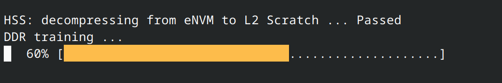

<!-- Copyright 2015-2026 Zephyr Project members and individual contributors. -->
<!-- SPDX-License-Identifier: Apache-2.0 -->
<!-- 中文翻译；编号、导航与译注为本地新增。 -->

<a id="beaglev_fire"></a>

# 第6章\_BeagleV®-Fire

原文：[官方页面](https://docs.zephyrproject.org/latest/boards/beagle/beaglev_fire/doc/index.html)。读取日期：2026-10-16；来源摘要见[来源记录](../SOURCES.md)。

开发板概览（Board Overview）

<a id="id1"></a>

[](images/BeagleV-Fire-Front-Annotated-768x432.webp)

BeagleV®-Fire

名称（Name）：

`beaglev_fire`

厂商（Vendor）：

[BeagleBoard.org基金会（Foundation）](https://docs.zephyrproject.org/latest/boards/index.html#vendor=beagle)

状态（Status）：

维护中（Maintained）

架构（Architecture）：

[riscv](https://docs.zephyrproject.org/latest/boards/index.html#arch=riscv)

片上系统（SoC）：

[polarfire](https://docs.zephyrproject.org/latest/boards/index.html#soc=polarfire)

<a id="board-github-link"></a>

[浏览开发板源码（Browse Board Sources）](https://github.com/zephyrproject-rtos/zephyr/blob/main//boards/beagle/beaglev_fire/doc/index.rst/../..)<a id="overview"></a>

## 概述（Overview）

BeagleV®-Fire是一款采用Microchip PolarFire® MPFS025T五核RISC-V SoC的单板计算机（SBC），集成现场可编程门阵列逻辑资源（FPGA Fabric），面向开发者、创客和开源社区探索RISC-V架构及FPGA技术。它具有与BeagleBone Black相同的P8、P9扩展板排针（Cape Headers），可叠加BeagleBone Cape扩展功能。高性能、低能耗的RISC-V指令集架构（ISA）结合灵活的FPGA逻辑，为开发者、爱好者及研究人员提供探索和试验RISC-V技术的平台。

<a id="supported-features"></a>

### 支持的功能（Supported Features）

`beaglev_fire`开发板支持下表所列的硬件功能。

片上／板载（On-Chip / On-Board）

功能集成在片上系统（SoC）内／位于开发板上。

2 / 2

分别表示已启用／已禁用的实例数。点击数量标签，可查看开发板或SoC设备树源码（DTS）中该功能的第一个实例。

`vnd,foo`

与此功能匹配的设备树绑定兼容字符串（Compatible String）；点击链接可查看绑定文档。

<a id="beaglev_fire-hw-features"></a>

<a id="beaglev_fire-beaglev_fire/polarfire/e51-hw-features-section"></a>

#### `beaglev_fire/polarfire/e51`目标（Target）

<a id="beaglev_fire-beaglev_fire/polarfire/e51-hw-features-panel"></a>

<a id="beaglev_fire-beaglev_fire/polarfire/e51-hw-features-memory"></a>

该开发板目标的片上存储容量：2 GiB RAM、N/A Flash。

<a id="beaglev_fire-beaglev_fire/polarfire/e51-hw-features-table"></a>

<table>
<tr>
<th>类型（Type）</th>
<th>位置（Location）</th>
<th>说明（Description）</th>
<th>兼容字符串（Compatible）</th>
</tr>
<tr>
<td rowspan="2">中央处理器（CPU）</td>
<td>片上（On-Chip）</td>
<td>SiFive E51标准内核处理器（Standard Core CPU）（<a href="https://github.com/zephyrproject-rtos/zephyr/blob/main/dts/riscv/microchip/mpfs.dtsi?plain=1#L22">已启用：1</a>）</td>
<td><a href="../cpu_vendor_multiarc_binding_reference/P039_sifive_e51.md#std-dtcompatible-sifive-e51"><code>sifive,e51</code></a></td>
</tr>
<tr>
<td>片上（On-Chip）</td>
<td>SiFive U54标准内核处理器（Standard Core CPU）（<a href="https://github.com/zephyrproject-rtos/zephyr/blob/main/dts/riscv/microchip/mpfs.dtsi?plain=1#L38">已禁用：4</a>）</td>
<td><a href="../cpu_vendor_multiarc_binding_reference/P041_sifive_u54.md#std-dtcompatible-sifive-u54"><code>sifive,u54</code></a></td>
</tr>
<tr>
<td rowspan="1">通用输入输出与接插件（GPIO &amp; Headers）</td>
<td>片上（On-Chip）</td>
<td>Microchip PolarFire SoC通用输入输出（GPIO）（<a href="https://github.com/zephyrproject-rtos/zephyr/blob/main/dts/riscv/microchip/mpfs.dtsi?plain=1#L293">已启用：1</a>；<a href="https://github.com/zephyrproject-rtos/zephyr/blob/main/dts/riscv/microchip/mpfs.dtsi?plain=1#L271">已禁用：2</a>）</td>
<td><a href="../gpio_infineon_intel_ite_microchip_binding_reference/P030_microchip_mpfs-gpio.md#std-dtcompatible-microchip-mpfs-gpio"><code>microchip,mpfs-gpio</code></a></td>
</tr>
<tr>
<td rowspan="1">集成电路间总线（I2C）</td>
<td>片上（On-Chip）</td>
<td>Microchip MPFS I2C控制器（<a href="https://github.com/zephyrproject-rtos/zephyr/blob/main/dts/riscv/microchip/mpfs.dtsi?plain=1#L304">已禁用：2</a>）</td>
<td><a href="../i2c_infineon_ite_nordic_binding_reference/P011_microchip_mpfs-i2c.md#std-dtcompatible-microchip-mpfs-i2c"><code>microchip,mpfs-i2c</code></a></td>
</tr>
<tr>
<td rowspan="3">中断控制器（Interrupt Controller）</td>
<td>片上（On-Chip）</td>
<td>RISC-V CPU中断控制器（Interrupt Controller）（<a href="https://github.com/zephyrproject-rtos/zephyr/blob/main/dts/riscv/microchip/mpfs.dtsi?plain=1#L30">已启用：5</a>）</td>
<td><a href="../interrupt_fabric_binding_reference/P006_riscv_cpu-intc.md#std-dtcompatible-riscv-cpu-intc"><code>riscv,cpu-intc</code></a></td>
</tr>
<tr>
<td>片上（On-Chip）</td>
<td>SiFive RISC-V内核本地中断器（Core-Local Interruptor）（<a href="https://github.com/zephyrproject-rtos/zephyr/blob/main/dts/riscv/microchip/mpfs.dtsi?plain=1#L123">已启用：1</a>）</td>
<td><a href="../interrupt_fabric_binding_reference/P010_sifive_clint0.md#std-dtcompatible-sifive-clint0"><code>sifive,clint0</code></a></td>
</tr>
<tr>
<td>片上（On-Chip）</td>
<td>SiFive RISCV-V平台级中断控制器（PLIC / Platform-Local Interrupt Controller）（<a href="https://github.com/zephyrproject-rtos/zephyr/blob/main/dts/riscv/microchip/mpfs.dtsi?plain=1#L147">已启用：1</a>）</td>
<td><a href="../interrupt_fabric_binding_reference/P009_sifive_plic-1.0.0.md#std-dtcompatible-sifive-plic-1.0.0"><code>sifive,plic-1.0.0</code></a></td>
</tr>
<tr>
<td rowspan="1">复位控制器（Reset Controller）</td>
<td>片上（On-Chip）</td>
<td>Microchip MPFS复位控制器，<code>SOFT_RESET_CR</code>及<code>SUBBLK_CLOCK_CR</code>（<a href="https://github.com/zephyrproject-rtos/zephyr/blob/main/dts/riscv/microchip/mpfs.dtsi?plain=1#L176">已禁用：1</a>）</td>
<td><a href="../reset_controller_binding_reference/P005_microchip_mpfs-reset.md#std-dtcompatible-microchip-mpfs-reset"><code>microchip,mpfs-reset</code></a></td>
</tr>
<tr>
<td rowspan="1">实时时钟（RTC）</td>
<td>片上（On-Chip）</td>
<td>Microchip微控制器子系统（MSS）实时时钟驱动（RTC）（<a href="https://github.com/zephyrproject-rtos/zephyr/blob/main/dts/riscv/microchip/mpfs.dtsi?plain=1#L326">已禁用：1</a>）</td>
<td><a href="../microchip_microcrystal_nxp_rtc_binding_reference/P001_microchip_rtc-mss.md#std-dtcompatible-microchip-rtc-mss"><code>microchip,rtc-mss</code></a></td>
</tr>
<tr>
<td rowspan="1">串行控制器（Serial Controller）</td>
<td>片上（On-Chip）</td>
<td>ns16550通用异步收发器（UART）（<a href="https://github.com/zephyrproject-rtos/zephyr/blob/main/dts/riscv/microchip/mpfs.dtsi?plain=1#L183">已启用：1</a>；<a href="https://github.com/zephyrproject-rtos/zephyr/blob/main/dts/riscv/microchip/mpfs.dtsi?plain=1#L194">已禁用：4</a>）</td>
<td><a href="../uart_microchip_nordic_nxp_binding_reference/P005_ns16550.md#std-dtcompatible-ns16550"><code>ns16550</code></a></td>
</tr>
<tr>
<td rowspan="2">串行外设接口（SPI）</td>
<td>片上（On-Chip）</td>
<td>Microchip PolarFire SoC QSPI控制器（<a href="https://github.com/zephyrproject-rtos/zephyr/blob/main/dts/riscv/microchip/mpfs.dtsi?plain=1#L238">已禁用：2</a>）</td>
<td><a href="../spi_microchip_nordic_nxp_binding_reference/P007_microchip_mpfs-qspi.md#std-dtcompatible-microchip-mpfs-qspi"><code>microchip,mpfs-qspi</code></a></td>
</tr>
<tr>
<td>片上（On-Chip）</td>
<td>Microchip PolarFire SoC SPI控制器（<a href="https://github.com/zephyrproject-rtos/zephyr/blob/main/dts/riscv/microchip/mpfs.dtsi?plain=1#L249">已禁用：1</a>）</td>
<td><a href="../spi_microchip_nordic_nxp_binding_reference/P008_microchip_mpfs-spi.md#std-dtcompatible-microchip-mpfs-spi"><code>microchip,mpfs-spi</code></a></td>
</tr>
<tr>
<td rowspan="1">静态随机存储器（SRAM）</td>
<td>片上（On-Chip）</td>
<td>通用片上静态随机存储器（SRAM）（<a href="https://github.com/zephyrproject-rtos/zephyr/blob/main/dts/riscv/microchip/mpfs.dtsi?plain=1#L113">已启用：3</a>）</td>
<td><a href="../hardware/P567_内存映射SRAM绑定.md#dtbinding-mmio-sram"><code>mmio-sram</code></a></td>
</tr>
<tr>
<td rowspan="1">系统控制器（System Controller）</td>
<td>片上（On-Chip）</td>
<td>系统控制器寄存器读写（System Controller Registers R/W）（<a href="https://github.com/zephyrproject-rtos/zephyr/blob/main/dts/riscv/microchip/mpfs.dtsi?plain=1#L172">已启用：1</a>）</td>
<td><a href="../edac_syscon_binding_reference/P008_syscon.md#std-dtcompatible-syscon"><code>syscon</code></a></td>
</tr>
<tr>
<td rowspan="1">定时器（Timer）</td>
<td>片上（On-Chip）</td>
<td>RISC-V机器模式定时器（Machine Timer）（<a href="https://github.com/zephyrproject-rtos/zephyr/blob/main/dts/riscv/microchip/mpfs.dtsi?plain=1#L136">已启用：1</a>）</td>
<td><a href="../interrupt_fabric_binding_reference/P011_riscv_machine-timer.md#std-dtcompatible-riscv-machine-timer"><code>riscv,machine-timer</code></a></td>
</tr>
</table>

<a id="beaglev_fire-beaglev_fire/polarfire/u54-hw-features-section"></a>

#### `beaglev_fire/polarfire/u54`目标（Target）

<a id="beaglev_fire-beaglev_fire/polarfire/u54-hw-features-panel"></a>

<a id="beaglev_fire-beaglev_fire/polarfire/u54-hw-features-memory"></a>

该开发板目标的片上存储容量：2 GiB RAM、N/A Flash。

<a id="beaglev_fire-beaglev_fire/polarfire/u54-hw-features-table"></a>

<table>
<tr>
<th>类型（Type）</th>
<th>位置（Location）</th>
<th>说明（Description）</th>
<th>兼容字符串（Compatible）</th>
</tr>
<tr>
<td rowspan="2">中央处理器（CPU）</td>
<td>片上（On-Chip）</td>
<td>SiFive E51标准内核处理器（Standard Core CPU）（<a href="https://github.com/zephyrproject-rtos/zephyr/blob/main/dts/riscv/microchip/mpfs.dtsi?plain=1#L22">已禁用：1</a>）</td>
<td><a href="../cpu_vendor_multiarc_binding_reference/P039_sifive_e51.md#std-dtcompatible-sifive-e51"><code>sifive,e51</code></a></td>
</tr>
<tr>
<td>片上（On-Chip）</td>
<td>SiFive U54标准内核处理器（Standard Core CPU）（<a href="https://github.com/zephyrproject-rtos/zephyr/blob/main/dts/riscv/microchip/mpfs.dtsi?plain=1#L38">已启用：4</a>）</td>
<td><a href="../cpu_vendor_multiarc_binding_reference/P041_sifive_u54.md#std-dtcompatible-sifive-u54"><code>sifive,u54</code></a></td>
</tr>
<tr>
<td rowspan="1">通用输入输出与接插件（GPIO &amp; Headers）</td>
<td>片上（On-Chip）</td>
<td>Microchip PolarFire SoC通用输入输出（GPIO）（<a href="https://github.com/zephyrproject-rtos/zephyr/blob/main/dts/riscv/microchip/mpfs.dtsi?plain=1#L293">已启用：1</a>；<a href="https://github.com/zephyrproject-rtos/zephyr/blob/main/dts/riscv/microchip/mpfs.dtsi?plain=1#L271">已禁用：2</a>）</td>
<td><a href="../gpio_infineon_intel_ite_microchip_binding_reference/P030_microchip_mpfs-gpio.md#std-dtcompatible-microchip-mpfs-gpio"><code>microchip,mpfs-gpio</code></a></td>
</tr>
<tr>
<td rowspan="1">集成电路间总线（I2C）</td>
<td>片上（On-Chip）</td>
<td>Microchip MPFS I2C控制器（<a href="https://github.com/zephyrproject-rtos/zephyr/blob/main/dts/riscv/microchip/mpfs.dtsi?plain=1#L304">已禁用：2</a>）</td>
<td><a href="../i2c_infineon_ite_nordic_binding_reference/P011_microchip_mpfs-i2c.md#std-dtcompatible-microchip-mpfs-i2c"><code>microchip,mpfs-i2c</code></a></td>
</tr>
<tr>
<td rowspan="3">中断控制器（Interrupt Controller）</td>
<td>片上（On-Chip）</td>
<td>RISC-V CPU中断控制器（Interrupt Controller）（<a href="https://github.com/zephyrproject-rtos/zephyr/blob/main/dts/riscv/microchip/mpfs.dtsi?plain=1#L30">已启用：5</a>）</td>
<td><a href="../interrupt_fabric_binding_reference/P006_riscv_cpu-intc.md#std-dtcompatible-riscv-cpu-intc"><code>riscv,cpu-intc</code></a></td>
</tr>
<tr>
<td>片上（On-Chip）</td>
<td>SiFive RISC-V内核本地中断器（Core-Local Interruptor）（<a href="https://github.com/zephyrproject-rtos/zephyr/blob/main/dts/riscv/microchip/mpfs.dtsi?plain=1#L123">已启用：1</a>）</td>
<td><a href="../interrupt_fabric_binding_reference/P010_sifive_clint0.md#std-dtcompatible-sifive-clint0"><code>sifive,clint0</code></a></td>
</tr>
<tr>
<td>片上（On-Chip）</td>
<td>SiFive RISCV-V平台级中断控制器（PLIC / Platform-Local Interrupt Controller）（<a href="https://github.com/zephyrproject-rtos/zephyr/blob/main/dts/riscv/microchip/mpfs.dtsi?plain=1#L147">已启用：1</a>）</td>
<td><a href="../interrupt_fabric_binding_reference/P009_sifive_plic-1.0.0.md#std-dtcompatible-sifive-plic-1.0.0"><code>sifive,plic-1.0.0</code></a></td>
</tr>
<tr>
<td rowspan="1">复位控制器（Reset Controller）</td>
<td>片上（On-Chip）</td>
<td>Microchip MPFS复位控制器，<code>SOFT_RESET_CR</code>及<code>SUBBLK_CLOCK_CR</code>（<a href="https://github.com/zephyrproject-rtos/zephyr/blob/main/dts/riscv/microchip/mpfs.dtsi?plain=1#L176">已禁用：1</a>）</td>
<td><a href="../reset_controller_binding_reference/P005_microchip_mpfs-reset.md#std-dtcompatible-microchip-mpfs-reset"><code>microchip,mpfs-reset</code></a></td>
</tr>
<tr>
<td rowspan="1">实时时钟（RTC）</td>
<td>片上（On-Chip）</td>
<td>Microchip微控制器子系统（MSS）实时时钟驱动（RTC）（<a href="https://github.com/zephyrproject-rtos/zephyr/blob/main/dts/riscv/microchip/mpfs.dtsi?plain=1#L326">已禁用：1</a>）</td>
<td><a href="../microchip_microcrystal_nxp_rtc_binding_reference/P001_microchip_rtc-mss.md#std-dtcompatible-microchip-rtc-mss"><code>microchip,rtc-mss</code></a></td>
</tr>
<tr>
<td rowspan="1">串行控制器（Serial Controller）</td>
<td>片上（On-Chip）</td>
<td>ns16550通用异步收发器（UART）（<a href="https://github.com/zephyrproject-rtos/zephyr/blob/main/dts/riscv/microchip/mpfs.dtsi?plain=1#L183">已启用：1</a>；<a href="https://github.com/zephyrproject-rtos/zephyr/blob/main/dts/riscv/microchip/mpfs.dtsi?plain=1#L194">已禁用：4</a>）</td>
<td><a href="../uart_microchip_nordic_nxp_binding_reference/P005_ns16550.md#std-dtcompatible-ns16550"><code>ns16550</code></a></td>
</tr>
<tr>
<td rowspan="2">串行外设接口（SPI）</td>
<td>片上（On-Chip）</td>
<td>Microchip PolarFire SoC QSPI控制器（<a href="https://github.com/zephyrproject-rtos/zephyr/blob/main/dts/riscv/microchip/mpfs.dtsi?plain=1#L238">已禁用：2</a>）</td>
<td><a href="../spi_microchip_nordic_nxp_binding_reference/P007_microchip_mpfs-qspi.md#std-dtcompatible-microchip-mpfs-qspi"><code>microchip,mpfs-qspi</code></a></td>
</tr>
<tr>
<td>片上（On-Chip）</td>
<td>Microchip PolarFire SoC SPI控制器（<a href="https://github.com/zephyrproject-rtos/zephyr/blob/main/dts/riscv/microchip/mpfs.dtsi?plain=1#L249">已禁用：1</a>）</td>
<td><a href="../spi_microchip_nordic_nxp_binding_reference/P008_microchip_mpfs-spi.md#std-dtcompatible-microchip-mpfs-spi"><code>microchip,mpfs-spi</code></a></td>
</tr>
<tr>
<td rowspan="1">静态随机存储器（SRAM）</td>
<td>片上（On-Chip）</td>
<td>通用片上静态随机存储器（SRAM）（<a href="https://github.com/zephyrproject-rtos/zephyr/blob/main/dts/riscv/microchip/mpfs.dtsi?plain=1#L113">已启用：3</a>）</td>
<td><a href="../hardware/P567_内存映射SRAM绑定.md#dtbinding-mmio-sram"><code>mmio-sram</code></a></td>
</tr>
<tr>
<td rowspan="1">系统控制器（System Controller）</td>
<td>片上（On-Chip）</td>
<td>系统控制器寄存器读写（System Controller Registers R/W）（<a href="https://github.com/zephyrproject-rtos/zephyr/blob/main/dts/riscv/microchip/mpfs.dtsi?plain=1#L172">已启用：1</a>）</td>
<td><a href="../edac_syscon_binding_reference/P008_syscon.md#std-dtcompatible-syscon"><code>syscon</code></a></td>
</tr>
<tr>
<td rowspan="1">定时器（Timer）</td>
<td>片上（On-Chip）</td>
<td>RISC-V机器模式定时器（Machine Timer）（<a href="https://github.com/zephyrproject-rtos/zephyr/blob/main/dts/riscv/microchip/mpfs.dtsi?plain=1#L136">已启用：1</a>）</td>
<td><a href="../interrupt_fabric_binding_reference/P011_riscv_machine-timer.md#std-dtcompatible-riscv-machine-timer"><code>riscv,machine-timer</code></a></td>
</tr>
</table>

<a id="beaglev_fire-beaglev_fire/polarfire/u54/smp-hw-features-section"></a>

#### `beaglev_fire/polarfire/u54/smp`目标（Target）

<a id="beaglev_fire-beaglev_fire/polarfire/u54/smp-hw-features-panel"></a>

<a id="beaglev_fire-beaglev_fire/polarfire/u54/smp-hw-features-memory"></a>

该开发板目标的片上存储容量：2 GiB RAM、N/A Flash。

<a id="beaglev_fire-beaglev_fire/polarfire/u54/smp-hw-features-table"></a>

<table>
<tr>
<th>类型（Type）</th>
<th>位置（Location）</th>
<th>说明（Description）</th>
<th>兼容字符串（Compatible）</th>
</tr>
<tr>
<td rowspan="2">中央处理器（CPU）</td>
<td>片上（On-Chip）</td>
<td>SiFive E51标准内核处理器（Standard Core CPU）（<a href="https://github.com/zephyrproject-rtos/zephyr/blob/main/dts/riscv/microchip/mpfs.dtsi?plain=1#L22">已禁用：1</a>）</td>
<td><a href="../cpu_vendor_multiarc_binding_reference/P039_sifive_e51.md#std-dtcompatible-sifive-e51"><code>sifive,e51</code></a></td>
</tr>
<tr>
<td>片上（On-Chip）</td>
<td>SiFive U54标准内核处理器（Standard Core CPU）（<a href="https://github.com/zephyrproject-rtos/zephyr/blob/main/dts/riscv/microchip/mpfs.dtsi?plain=1#L38">已启用：4</a>）</td>
<td><a href="../cpu_vendor_multiarc_binding_reference/P041_sifive_u54.md#std-dtcompatible-sifive-u54"><code>sifive,u54</code></a></td>
</tr>
<tr>
<td rowspan="1">通用输入输出与接插件（GPIO &amp; Headers）</td>
<td>片上（On-Chip）</td>
<td>Microchip PolarFire SoC通用输入输出（GPIO）（<a href="https://github.com/zephyrproject-rtos/zephyr/blob/main/dts/riscv/microchip/mpfs.dtsi?plain=1#L293">已启用：1</a>；<a href="https://github.com/zephyrproject-rtos/zephyr/blob/main/dts/riscv/microchip/mpfs.dtsi?plain=1#L271">已禁用：2</a>）</td>
<td><a href="../gpio_infineon_intel_ite_microchip_binding_reference/P030_microchip_mpfs-gpio.md#std-dtcompatible-microchip-mpfs-gpio"><code>microchip,mpfs-gpio</code></a></td>
</tr>
<tr>
<td rowspan="1">集成电路间总线（I2C）</td>
<td>片上（On-Chip）</td>
<td>Microchip MPFS I2C控制器（<a href="https://github.com/zephyrproject-rtos/zephyr/blob/main/dts/riscv/microchip/mpfs.dtsi?plain=1#L304">已禁用：2</a>）</td>
<td><a href="../i2c_infineon_ite_nordic_binding_reference/P011_microchip_mpfs-i2c.md#std-dtcompatible-microchip-mpfs-i2c"><code>microchip,mpfs-i2c</code></a></td>
</tr>
<tr>
<td rowspan="3">中断控制器（Interrupt Controller）</td>
<td>片上（On-Chip）</td>
<td>RISC-V CPU中断控制器（Interrupt Controller）（<a href="https://github.com/zephyrproject-rtos/zephyr/blob/main/dts/riscv/microchip/mpfs.dtsi?plain=1#L30">已启用：5</a>）</td>
<td><a href="../interrupt_fabric_binding_reference/P006_riscv_cpu-intc.md#std-dtcompatible-riscv-cpu-intc"><code>riscv,cpu-intc</code></a></td>
</tr>
<tr>
<td>片上（On-Chip）</td>
<td>SiFive RISC-V内核本地中断器（Core-Local Interruptor）（<a href="https://github.com/zephyrproject-rtos/zephyr/blob/main/dts/riscv/microchip/mpfs.dtsi?plain=1#L123">已启用：1</a>）</td>
<td><a href="../interrupt_fabric_binding_reference/P010_sifive_clint0.md#std-dtcompatible-sifive-clint0"><code>sifive,clint0</code></a></td>
</tr>
<tr>
<td>片上（On-Chip）</td>
<td>SiFive RISCV-V平台级中断控制器（PLIC / Platform-Local Interrupt Controller）（<a href="https://github.com/zephyrproject-rtos/zephyr/blob/main/dts/riscv/microchip/mpfs.dtsi?plain=1#L147">已启用：1</a>）</td>
<td><a href="../interrupt_fabric_binding_reference/P009_sifive_plic-1.0.0.md#std-dtcompatible-sifive-plic-1.0.0"><code>sifive,plic-1.0.0</code></a></td>
</tr>
<tr>
<td rowspan="1">复位控制器（Reset Controller）</td>
<td>片上（On-Chip）</td>
<td>Microchip MPFS复位控制器，<code>SOFT_RESET_CR</code>及<code>SUBBLK_CLOCK_CR</code>（<a href="https://github.com/zephyrproject-rtos/zephyr/blob/main/dts/riscv/microchip/mpfs.dtsi?plain=1#L176">已禁用：1</a>）</td>
<td><a href="../reset_controller_binding_reference/P005_microchip_mpfs-reset.md#std-dtcompatible-microchip-mpfs-reset"><code>microchip,mpfs-reset</code></a></td>
</tr>
<tr>
<td rowspan="1">实时时钟（RTC）</td>
<td>片上（On-Chip）</td>
<td>Microchip微控制器子系统（MSS）实时时钟驱动（RTC）（<a href="https://github.com/zephyrproject-rtos/zephyr/blob/main/dts/riscv/microchip/mpfs.dtsi?plain=1#L326">已禁用：1</a>）</td>
<td><a href="../microchip_microcrystal_nxp_rtc_binding_reference/P001_microchip_rtc-mss.md#std-dtcompatible-microchip-rtc-mss"><code>microchip,rtc-mss</code></a></td>
</tr>
<tr>
<td rowspan="1">串行控制器（Serial Controller）</td>
<td>片上（On-Chip）</td>
<td>ns16550通用异步收发器（UART）（<a href="https://github.com/zephyrproject-rtos/zephyr/blob/main/dts/riscv/microchip/mpfs.dtsi?plain=1#L183">已启用：1</a>；<a href="https://github.com/zephyrproject-rtos/zephyr/blob/main/dts/riscv/microchip/mpfs.dtsi?plain=1#L194">已禁用：4</a>）</td>
<td><a href="../uart_microchip_nordic_nxp_binding_reference/P005_ns16550.md#std-dtcompatible-ns16550"><code>ns16550</code></a></td>
</tr>
<tr>
<td rowspan="2">串行外设接口（SPI）</td>
<td>片上（On-Chip）</td>
<td>Microchip PolarFire SoC QSPI控制器（<a href="https://github.com/zephyrproject-rtos/zephyr/blob/main/dts/riscv/microchip/mpfs.dtsi?plain=1#L238">已禁用：2</a>）</td>
<td><a href="../spi_microchip_nordic_nxp_binding_reference/P007_microchip_mpfs-qspi.md#std-dtcompatible-microchip-mpfs-qspi"><code>microchip,mpfs-qspi</code></a></td>
</tr>
<tr>
<td>片上（On-Chip）</td>
<td>Microchip PolarFire SoC SPI控制器（<a href="https://github.com/zephyrproject-rtos/zephyr/blob/main/dts/riscv/microchip/mpfs.dtsi?plain=1#L249">已禁用：1</a>）</td>
<td><a href="../spi_microchip_nordic_nxp_binding_reference/P008_microchip_mpfs-spi.md#std-dtcompatible-microchip-mpfs-spi"><code>microchip,mpfs-spi</code></a></td>
</tr>
<tr>
<td rowspan="1">静态随机存储器（SRAM）</td>
<td>片上（On-Chip）</td>
<td>通用片上静态随机存储器（SRAM）（<a href="https://github.com/zephyrproject-rtos/zephyr/blob/main/dts/riscv/microchip/mpfs.dtsi?plain=1#L113">已启用：3</a>）</td>
<td><a href="../hardware/P567_内存映射SRAM绑定.md#dtbinding-mmio-sram"><code>mmio-sram</code></a></td>
</tr>
<tr>
<td rowspan="1">系统控制器（System Controller）</td>
<td>片上（On-Chip）</td>
<td>系统控制器寄存器读写（System Controller Registers R/W）（<a href="https://github.com/zephyrproject-rtos/zephyr/blob/main/dts/riscv/microchip/mpfs.dtsi?plain=1#L172">已启用：1</a>）</td>
<td><a href="../edac_syscon_binding_reference/P008_syscon.md#std-dtcompatible-syscon"><code>syscon</code></a></td>
</tr>
<tr>
<td rowspan="1">定时器（Timer）</td>
<td>片上（On-Chip）</td>
<td>RISC-V机器模式定时器（Machine Timer）（<a href="https://github.com/zephyrproject-rtos/zephyr/blob/main/dts/riscv/microchip/mpfs.dtsi?plain=1#L136">已启用：1</a>）</td>
<td><a href="../interrupt_fabric_binding_reference/P011_riscv_machine-timer.md#std-dtcompatible-riscv-machine-timer"><code>riscv,machine-timer</code></a></td>
</tr>
</table>

<a id="building"></a>

### 构建（Building）

BeagleV-Fire提供三种开发板配置：


- `beaglev_fire/polarfire/e51`：仅使用E51内核
- `beaglev_fire/polarfire/u54`：使用U54内核
- `beaglev_fire/polarfire/u54/smp`：使用U54内核并启用`CONFIG_SMP=y`

`beaglev_fire`配置的应用可按通常方式构建：

```text
# From the root of the zephyr repository
west build -b beaglev_fire/polarfire/u54 samples/hello_world
```

<a id="debugging"></a>

### 调试（Debugging）

向设备上传应用需要支持RISC-V的OpenOCD和GDB，可从SoftConsole SDK获取，下载及安装说明见[Microchip SoftConsole网站](https://www.microchip.com/en-us/products/fpgas-and-plds/fpga-and-soc-design-tools/programming-and-debug/softconsole)。

还需要Microchip FlashPro5／6等调试器（Debugger）。

使用3.3 V USB转UART桥接器连接BeagleV-Fire调试串口，然后在终端执行`tio <port>`访问。正确连接后，按Reset按键应出现如下进度条：



看到进度条后，可开始按下任意数字或字母键（0–9／a–z），中断硬件线程软件服务（HSS / Hart Software Services）启动其载荷。

安装所需工具后，可用OpenOCD连接开发板，在另一个终端执行：

```text
<softconsole_path>/openocd/bin/openocd --command "set DEVICE MPFS" --file \
<softconsole_path>/openocd/share/openocd/scripts/board/microsemi-riscv.cfg
```

保持OpenOCD运行，在另一个终端使用GDB上传二进制文件。可使用Zephyr SDK中的RISC-V GDB，启动命令如下：

```text
<path_to_zephyr_sdk>/riscv64-zephyr-elf/bin/riscv64-zephyr-elf-gdb
```

在GDB终端中使用以下命令连接设备并加载二进制文件：

```text
set arch riscv:rv64
set mem inaccessible-by-default off
file <path_to_zehyr.elf>
target extended-remote localhost:3333
load
break main
continue
```

<a id="flashing"></a>

### 烧录（Flashing）

将PolarFire [Hart Software Services](https://github.com/polarfire-soc/hart-software-services)与Zephyr结合使用时，需要通过[hss-payload-generator](https://github.com/polarfire-soc/hart-software-services/tree/master/tools/hss-payload-generator)生成HSS可启动的镜像。

```text
set-name: 'ZephyrImage'

# Define the entry point address for each hart (U54 cores)
hart-entry-points:
  u54_1: '0x1000000000'

# Define the payloads (ELF binaries or raw blobs)
payloads:
  <path_to_zephyr.elf>:
    exec-addr: '0x1000000000'  # Where Zephyr should be loaded
    owner-hart: u54_1  # Primary hart that runs Zephyr
    priv-mode: prv_m  # Start in Machine mode
    skip-opensbi: true  # Boot directly without OpenSBI
```

生成镜像后，重启已通过USB和UART连接的开发板，按键中断HSS启动过程，再执行`mmc`及`usbdmsc`命令：

```text
Press a key to enter CLI, ESC to skip
Timeout in 1 second
.[6.304162] Character 100 pressed
[6.308415] Type HELP for list of commands
[6.313276] >> mmc
[10.450867] Selecting SDCARD/MMC (fallback) as boot source ...
[10.457550] Attempting to select eMMC ... Passed
[10.712708] >> usbdmsc
[14.732841] initialize MMC
[14.736400] Attempting to select eMMC ... Passed
[15.168707] MMC - 512 byte pages, 512 byte blocks, 30621696 pages
Waiting for USB Host to connect... (CTRL-C to quit)
. 0 bytes written, 0 bytes read
USB Host connected. Waiting for disconnect... (CTRL-C to quit)
/ 0 bytes written, 219136 bytes read
```

此时开发板会表现为USB大容量存储设备，可使用`dd`或[BalenaEtcher](https://www.balena.io/etcher/)等工具写入镜像：

```text
dd if=<path_to_zephyr.elf> of=/dev/sdXD bs=4M status=progress oflag=sync
```

## 译注

原文HSS生成、USB大容量存储及dd写入步骤照录，设备名属于示例，不能将它视为读者电脑上已确认的目标盘。这里仅翻译官方操作说明，未执行磁盘写入。

## 原文外链核对

2026-10-16核对并重试以下原文外链时未能确认可访问性，保留原始目标，不将访问失败解释为原文内容有误。

- [softconsole](https://www.microchip.com/en-us/products/fpgas-and-plds/fpga-and-soc-design-tools/programming-and-debug/softconsole)：HTTP Error 403: Forbidden。

---

[上一章](P005_BeaglePlay.md) · [返回大纲](大纲.md) · [全站翻译进度](../PROGRESS.md) · [下一章](P007_BeagleY-AI.md)
