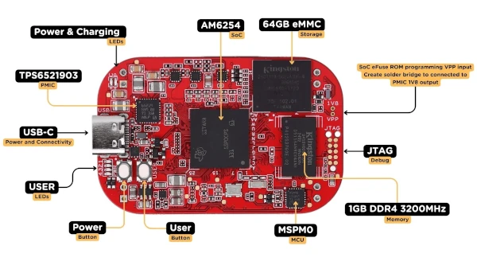

<!-- Copyright 2015-2026 Zephyr Project members and individual contributors. -->
<!-- SPDX-License-Identifier: Apache-2.0 -->
<!-- 中文翻译；编号、导航与译注为本地新增。 -->

<a id="pocketbeagle_2_industrial"></a>

# 第10章\_PocketBeagle 2 Industrial

原文：[官方页面](https://docs.zephyrproject.org/latest/boards/beagle/pocketbeagle_2/doc/pocketbeagle_2_industrial.html)。读取日期：2026-10-16；来源摘要见[来源记录](../SOURCES.md)。

开发板概览（Board Overview）

<a id="id7"></a>

[](images/pocketbeagle_2_industrial.webp)

PocketBeagle 2 Industrial

名称（Name）：

`pocketbeagle_2_industrial`

厂商（Vendor）：

[BeagleBoard.org基金会（Foundation）](https://docs.zephyrproject.org/latest/boards/index.html#vendor=beagle)

状态（Status）：

维护中（Maintained）

架构（Architecture）：

`[arm64](https://docs.zephyrproject.org/latest/boards/index.html#arch=arm64), [arm](https://docs.zephyrproject.org/latest/boards/index.html#arch=arm)`

片上系统（SoC）：

`[am6254](https://docs.zephyrproject.org/latest/boards/index.html#soc=am6254), [mspm0l1105](https://docs.zephyrproject.org/latest/boards/index.html#soc=mspm0l1105)`

<a id="board-github-link"></a>

[浏览开发板源码（Browse Board Sources）](https://github.com/zephyrproject-rtos/zephyr/blob/main//boards/beagle/pocketbeagle_2/doc/pocketbeagle_2_industrial.rst/../..)<a id="overview"></a>

## 概述（Overview）

PocketBeagle 2 Industrial是基于TI AM6254 SoC的计算平台。

详情见PocketBeagle 2 Industrial产品页面。（[PocketBeagle 2 Industrial产品页面（Product Page）](https://www.beagleboard.org/boards/pocketbeagle-2-industrial)）

<a id="hardware"></a>

## 硬件（Hardware）

PocketBeagle 2 Industrial采用TI AM62x SoC，包含Arm Cortex-A53多核簇、Arm Cortex-M4F微控制器、Imagination Technologies AXE-1-16图形处理器，以及TI可编程实时单元子系统微控制器簇协处理器。

此外，PocketBeagle 2 Industrial还包含MSPM0L1105 SoC，用作EEPROM及ADC。

Zephyr可在以下内核运行：


- AM62x上的Arm Cortex-A53内核；
- AM62x上的Arm Cortex-M4F内核；以及
- MSPM0L1105上的Arm Cortex-M0+内核。

与PocketBeagle 2相比的主要区别：


- 支持工业温度范围（Industrial Temperature Range）
- 1 GB DDR4 RAM，PocketBeagle 2为512 MB
- 64 GB eMMC闪存，PocketBeagle 2未焊装

<a id="supported-features"></a>

### 支持的功能（Supported Features）

`pocketbeagle_2_industrial`开发板支持下表所列的硬件功能。

片上／板载（On-Chip / On-Board）

功能集成在片上系统（SoC）内／位于开发板上。

2 / 2

分别表示已启用／已禁用的实例数。点击数量标签，可查看开发板或SoC设备树源码（DTS）中该功能的第一个实例。

`vnd,foo`

与此功能匹配的设备树绑定兼容字符串（Compatible String）；点击链接可查看绑定文档。

<a id="pocketbeagle_2_industrial-hw-features"></a>

<a id="pocketbeagle_2_industrial-pocketbeagle_2_industrial@A1/am6254/a53-hw-features-section"></a>

#### `pocketbeagle_2_industrial@A1/am6254/a53`目标（Target）

<a id="pocketbeagle_2_industrial-pocketbeagle_2_industrial@A1/am6254/a53-hw-features-panel"></a>

<a id="pocketbeagle_2_industrial-pocketbeagle_2_industrial@A1/am6254/a53-hw-features-memory"></a>

该开发板目标的片上存储容量：1022 MiB RAM、N/A Flash。

<a id="pocketbeagle_2_industrial-pocketbeagle_2_industrial@A1/am6254/a53-hw-features-table"></a>

<table>
<tr>
<th>类型（Type）</th>
<th>位置（Location）</th>
<th>说明（Description）</th>
<th>兼容字符串（Compatible）</th>
</tr>
<tr>
<td rowspan="1">中央处理器（CPU）</td>
<td>片上（On-Chip）</td>
<td>ARM Cortex-A53处理器（CPU）（<a href="https://github.com/zephyrproject-rtos/zephyr/blob/main/dts/arm64/ti/ti_am62x_a53.dtsi?plain=1#L24">已启用：4</a>）</td>
<td><a href="../cpu_arm_riscv_binding_reference/P008_arm_cortex-a53.md#std-dtcompatible-arm-cortex-a53"><code>arm,cortex-a53</code></a></td>
</tr>
<tr>
<td rowspan="1">计数器（Counter）</td>
<td>片上（On-Chip）</td>
<td>TI K3代处理器中基于计数器的实时时钟（RTC）（<a href="https://github.com/zephyrproject-rtos/zephyr/blob/main/dts/vendor/ti/k3-am62-main.dtsi?plain=1#L302">已禁用：1</a>）</td>
<td><a href="../stm32_ti_xilinx_counter_binding_reference/P010_ti_k3-rtc-counter.md#std-dtcompatible-ti-k3-rtc-counter"><code>ti,k3-rtc-counter</code></a></td>
</tr>
<tr>
<td rowspan="1">通用输入输出与接插件（GPIO &amp; Headers）</td>
<td>片上（On-Chip）</td>
<td>Davinci及Keystone器件的GPIO控制器（<a href="https://github.com/zephyrproject-rtos/zephyr/blob/main/dts/vendor/ti/k3-am62-main.dtsi?plain=1#L161">已启用：5</a>）</td>
<td><a href="../gpio_ti_xilinx_sdl_binding_reference/P014_ti_davinci-gpio.md#std-dtcompatible-ti-davinci-gpio"><code>ti,davinci-gpio</code></a></td>
</tr>
<tr>
<td rowspan="1">集成电路间总线（I2C）</td>
<td>片上（On-Chip）</td>
<td>TI OMAP I2C控制器（<a href="https://github.com/zephyrproject-rtos/zephyr/blob/main/dts/vendor/ti/k3-am62-main.dtsi?plain=1#L91">已启用：2</a>；<a href="https://github.com/zephyrproject-rtos/zephyr/blob/main/dts/vendor/ti/k3-am62-main.dtsi?plain=1#L73">已禁用：2</a>）</td>
<td><a href="../i2c_stm32_ti_mux_binding_reference/P013_ti_omap-i2c.md#std-dtcompatible-ti-omap-i2c"><code>ti,omap-i2c</code></a></td>
</tr>
<tr>
<td rowspan="1">中断控制器（Interrupt Controller）</td>
<td>片上（On-Chip）</td>
<td>ARM通用中断控制器（GIC）v3（<a href="https://github.com/zephyrproject-rtos/zephyr/blob/main/dts/arm64/ti/ti_am62x_a53.dtsi?plain=1#L55">已启用：1</a>）</td>
<td><a href="../interrupt_fabric_binding_reference/P004_arm_gic-v3.md#std-dtcompatible-arm-gic-v3"><code>arm,gic-v3</code></a></td>
</tr>
<tr>
<td rowspan="1">发光二极管（LED）</td>
<td>板载（On-Board）</td>
<td>一组由 GPIO 控制的 LED（GPIO-Controlled LEDs）（<a href="https://github.com/zephyrproject-rtos/zephyr/blob/main/boards/beagle/pocketbeagle_2/pocketbeagle_2_am62_a53-common.dtsi?plain=1#L20">已启用：1</a>）</td>
<td><a href="../hardware/P564_GPIO指示灯绑定.md#dtbinding-gpio-leds"><code>gpio-leds</code></a></td>
</tr>
<tr>
<td rowspan="1">邮箱（Mailbox）</td>
<td>片上（On-Chip）</td>
<td>TI OMAP邮箱（MAILBOX）（<a href="https://github.com/zephyrproject-rtos/zephyr/blob/main/dts/arm64/ti/ti_am62x_a53.dtsi?plain=1#L79">已启用：1</a>）</td>
<td><a href="../intercore_reference/P055_TIOMAP邮箱绑定.md#dtbinding-ti-omap-mailbox"><code>ti,omap-mailbox</code></a></td>
</tr>
<tr>
<td rowspan="1">引脚控制（Pin Control）</td>
<td>片上（On-Chip）</td>
<td>TI K3引脚控制器（Pin Controller）（<a href="https://github.com/zephyrproject-rtos/zephyr/blob/main/dts/arm64/ti/ti_am62x_a53.dtsi?plain=1#L72">已启用：1</a>）</td>
<td><a href="../pinctrl_stm32_ti_xilinx_binding_reference/P013_ti_k3-pinctrl.md#std-dtcompatible-ti-k3-pinctrl"><code>ti,k3-pinctrl</code></a></td>
</tr>
<tr>
<td rowspan="1">电源管理 CPU 操作（Power Management CPU Operations）</td>
<td>片上（On-Chip）</td>
<td>电源状态协调接口（PSCI / Power State Coordination Interface）1.1版（<a href="https://github.com/zephyrproject-rtos/zephyr/blob/main/dts/arm64/ti/ti_am62x_a53.dtsi?plain=1#L32">已启用：1</a>）</td>
<td><a href="https://docs.zephyrproject.org/latest/build/dts/api/bindings/pm_cpu_ops/arm%2Cpsci-1.1.html#std-dtcompatible-arm-psci-1.1"><code>arm,psci-1.1</code></a></td>
</tr>
<tr>
<td rowspan="1">SD 主机控制器（SDHC）</td>
<td>片上（On-Chip）</td>
<td>TI SD／eMMC主机控制器（<a href="https://github.com/zephyrproject-rtos/zephyr/blob/main/dts/vendor/ti/k3-am62-main.dtsi?plain=1#L315">已禁用：3</a>）</td>
<td><a href="../sdhc_binding_reference/P020_ti_am654-sdhci.md#std-dtcompatible-ti-am654-sdhci"><code>ti,am654-sdhci</code></a></td>
</tr>
<tr>
<td rowspan="1">串行控制器（Serial Controller）</td>
<td>片上（On-Chip）</td>
<td>ns16550通用异步收发器（UART）（<a href="https://github.com/zephyrproject-rtos/zephyr/blob/main/dts/vendor/ti/k3-am62-main.dtsi?plain=1#L10">已启用：3</a>；<a href="https://github.com/zephyrproject-rtos/zephyr/blob/main/dts/vendor/ti/k3-am62-main.dtsi?plain=1#L19">已禁用：4</a>）</td>
<td><a href="../uart_microchip_nordic_nxp_binding_reference/P005_ns16550.md#std-dtcompatible-ns16550"><code>ns16550</code></a></td>
</tr>
<tr>
<td rowspan="1">串行外设接口（SPI）</td>
<td>片上（On-Chip）</td>
<td>用于OMAP及K3 SoC的TI多通道SPI控制器（<a href="https://github.com/zephyrproject-rtos/zephyr/blob/main/dts/vendor/ti/k3-am62-main.dtsi?plain=1#L274">已启用：2</a>；<a href="https://github.com/zephyrproject-rtos/zephyr/blob/main/dts/vendor/ti/k3-am62-main.dtsi?plain=1#L284">已禁用：1</a>）</td>
<td><a href="../spi_stm32_ti_xilinx_binding_reference/P018_ti_omap-mcspi.md#std-dtcompatible-ti-omap-mcspi"><code>ti,omap-mcspi</code></a></td>
</tr>
<tr>
<td rowspan="1">系统控制器（System Controller）</td>
<td>片上（On-Chip）</td>
<td>TI K3器件级控制寄存器模块（Device Level Control Register Module）（<a href="https://github.com/zephyrproject-rtos/zephyr/blob/main/dts/arm64/ti/ti_am62x_a53.dtsi?plain=1#L64">已启用：1</a>）</td>
<td><a href="../edac_syscon_binding_reference/P009_ti_control-module.md#std-dtcompatible-ti-control-module"><code>ti,control-module</code></a></td>
</tr>
<tr>
<td rowspan="1">定时器（Timer）</td>
<td>片上（On-Chip）</td>
<td>每个内核独立的ARM架构定时器（Architected Timer）（<a href="https://github.com/zephyrproject-rtos/zephyr/blob/main/dts/arm64/ti/ti_am62x_a53.dtsi?plain=1#L42">已启用：1</a>）</td>
<td><a href="../arm_interrupt_timer_binding_reference/P010_ARMv8架构定时器.md#std-dtcompatible-arm-armv8-timer"><code>arm,armv8-timer</code></a></td>
</tr>
<tr>
<td rowspan="1">看门狗（Watchdog）</td>
<td>片上（On-Chip）</td>
<td>K3代处理器的看门狗定时器，实时间隔（RTI）模块（<a href="https://github.com/zephyrproject-rtos/zephyr/blob/main/dts/vendor/ti/k3-am62-main.dtsi?plain=1#L239">已启用：1</a>；<a href="https://github.com/zephyrproject-rtos/zephyr/blob/main/dts/vendor/ti/k3-am62-main.dtsi?plain=1#L246">已禁用：4</a>）</td>
<td><a href="../stm32_ti_xilinx_watchdog_binding_reference/P006_ti_j7-rti-wdt.md#std-dtcompatible-ti-j7-rti-wdt"><code>ti,j7-rti-wdt</code></a></td>
</tr>
</table>

<a id="pocketbeagle_2_industrial-pocketbeagle_2_industrial@A1/am6254/m4-hw-features-section"></a>

#### `pocketbeagle_2_industrial@A1/am6254/m4`目标（Target）

<a id="pocketbeagle_2_industrial-pocketbeagle_2_industrial@A1/am6254/m4-hw-features-panel"></a>

<a id="pocketbeagle_2_industrial-pocketbeagle_2_industrial@A1/am6254/m4-hw-features-memory"></a>

该开发板目标的片上存储容量：64 KiB RAM、192 KiB Flash。

<a id="pocketbeagle_2_industrial-pocketbeagle_2_industrial@A1/am6254/m4-hw-features-table"></a>

<table>
<tr>
<th>类型（Type）</th>
<th>位置（Location）</th>
<th>说明（Description）</th>
<th>兼容字符串（Compatible）</th>
</tr>
<tr>
<td rowspan="1">中央处理器（CPU）</td>
<td>片上（On-Chip）</td>
<td>ARM Cortex-M4F 处理器（CPU）（<a href="https://github.com/zephyrproject-rtos/zephyr/blob/main/dts/arm/ti/am62x_m4.dtsi?plain=1#L21">已启用：1</a>）</td>
<td><a href="../cpu_arm_riscv_binding_reference/P025_arm_cortex-m4f.md#std-dtcompatible-arm-cortex-m4f"><code>arm,cortex-m4f</code></a></td>
</tr>
<tr>
<td rowspan="1">时钟控制（Clock Control）</td>
<td>片上（On-Chip）</td>
<td>通用固定频率时钟提供者（Fixed-Rate Clock Provider）（<a href="https://github.com/zephyrproject-rtos/zephyr/blob/main/dts/arm/ti/am62x_m4.dtsi?plain=1#L54">已启用：1</a>）</td>
<td><a href="../hardware/P566_固定时钟绑定.md#dtbinding-fixed-clock"><code>fixed-clock</code></a></td>
</tr>
<tr>
<td rowspan="1">计数器（Counter）</td>
<td>片上（On-Chip）</td>
<td>TI K3代处理器中基于计数器的实时时钟（RTC）（<a href="https://github.com/zephyrproject-rtos/zephyr/blob/main/dts/vendor/ti/k3-am62-main.dtsi?plain=1#L302">已禁用：1</a>）</td>
<td><a href="../stm32_ti_xilinx_counter_binding_reference/P010_ti_k3-rtc-counter.md#std-dtcompatible-ti-k3-rtc-counter"><code>ti,k3-rtc-counter</code></a></td>
</tr>
<tr>
<td rowspan="1">通用输入输出与接插件（GPIO &amp; Headers）</td>
<td>片上（On-Chip）</td>
<td>Davinci及Keystone器件的GPIO控制器（<a href="https://github.com/zephyrproject-rtos/zephyr/blob/main/dts/vendor/ti/k3-am62-main.dtsi?plain=1#L161">已禁用：6</a>）</td>
<td><a href="../gpio_ti_xilinx_sdl_binding_reference/P014_ti_davinci-gpio.md#std-dtcompatible-ti-davinci-gpio"><code>ti,davinci-gpio</code></a></td>
</tr>
<tr>
<td rowspan="1">集成电路间总线（I2C）</td>
<td>片上（On-Chip）</td>
<td>TI OMAP I2C控制器（<a href="https://github.com/zephyrproject-rtos/zephyr/blob/main/dts/vendor/ti/k3-am62-main.dtsi?plain=1#L73">已禁用：5</a>）</td>
<td><a href="../i2c_stm32_ti_mux_binding_reference/P013_ti_omap-i2c.md#std-dtcompatible-ti-omap-i2c"><code>ti,omap-i2c</code></a></td>
</tr>
<tr>
<td rowspan="1">中断控制器（Interrupt Controller）</td>
<td>片上（On-Chip）</td>
<td>ARMv7-M 嵌套向量中断控制器（Nested Vectored Interrupt Controller，NVIC）（<a href="https://github.com/zephyrproject-rtos/zephyr/blob/main/dts/arm/armv7-m.dtsi?plain=1#L13">已启用：1</a>）</td>
<td><a href="../arm_interrupt_timer_binding_reference/P002_ARMv7_M_NVIC.md#std-dtcompatible-arm-v7m-nvic"><code>arm,v7m-nvic</code></a></td>
</tr>
<tr>
<td rowspan="1">邮箱（Mailbox）</td>
<td>片上（On-Chip）</td>
<td>TI OMAP邮箱（MAILBOX）（<a href="https://github.com/zephyrproject-rtos/zephyr/blob/main/dts/arm/ti/am62x_m4.dtsi?plain=1#L60">已启用：1</a>）</td>
<td><a href="../intercore_reference/P055_TIOMAP邮箱绑定.md#dtbinding-ti-omap-mailbox"><code>ti,omap-mailbox</code></a></td>
</tr>
<tr>
<td rowspan="1">引脚控制（Pin Control）</td>
<td>片上（On-Chip）</td>
<td>TI K3引脚控制器（Pin Controller）（<a href="https://github.com/zephyrproject-rtos/zephyr/blob/main/dts/arm/ti/am62x_m4.dtsi?plain=1#L77">已启用：1</a>）</td>
<td><a href="../pinctrl_stm32_ti_xilinx_binding_reference/P013_ti_k3-pinctrl.md#std-dtcompatible-ti-k3-pinctrl"><code>ti,k3-pinctrl</code></a></td>
</tr>
<tr>
<td rowspan="1">SD 主机控制器（SDHC）</td>
<td>片上（On-Chip）</td>
<td>TI SD／eMMC主机控制器（<a href="https://github.com/zephyrproject-rtos/zephyr/blob/main/dts/vendor/ti/k3-am62-main.dtsi?plain=1#L315">已禁用：3</a>）</td>
<td><a href="../sdhc_binding_reference/P020_ti_am654-sdhci.md#std-dtcompatible-ti-am654-sdhci"><code>ti,am654-sdhci</code></a></td>
</tr>
<tr>
<td rowspan="2">串行控制器（Serial Controller）</td>
<td>片上（On-Chip）</td>
<td>ns16550通用异步收发器（UART）（<a href="https://github.com/zephyrproject-rtos/zephyr/blob/main/dts/arm/ti/am62x_m4.dtsi?plain=1#L84">已启用：1</a>；<a href="https://github.com/zephyrproject-rtos/zephyr/blob/main/dts/vendor/ti/k3-am62-main.dtsi?plain=1#L10">已禁用：7</a>）</td>
<td><a href="../uart_microchip_nordic_nxp_binding_reference/P005_ns16550.md#std-dtcompatible-ns16550"><code>ns16550</code></a></td>
</tr>
<tr>
<td>板载（On-Board）</td>
<td>RMPSG UART设备（拼写依原文保留）（<a href="https://github.com/zephyrproject-rtos/zephyr/blob/main/boards/beagle/pocketbeagle_2/pocketbeagle_2_m4-common.dtsi?plain=1#L58">已启用：1</a>）</td>
<td><a href="../intercore_reference/P187_RPMsg串口设备树绑定.md#dtbinding-rpmsg-uart"><code>rpmsg-uart</code></a></td>
</tr>
<tr>
<td rowspan="1">串行外设接口（SPI）</td>
<td>片上（On-Chip）</td>
<td>用于OMAP及K3 SoC的TI多通道SPI控制器（<a href="https://github.com/zephyrproject-rtos/zephyr/blob/main/dts/vendor/ti/k3-am62-main.dtsi?plain=1#L274">已禁用：3</a>）</td>
<td><a href="../spi_stm32_ti_xilinx_binding_reference/P018_ti_omap-mcspi.md#std-dtcompatible-ti-omap-mcspi"><code>ti,omap-mcspi</code></a></td>
</tr>
<tr>
<td rowspan="1">静态随机存储器（SRAM）</td>
<td>片上（On-Chip）</td>
<td>通用片上静态随机存储器（SRAM）（<a href="https://github.com/zephyrproject-rtos/zephyr/blob/main/dts/arm/ti/am62x_m4.dtsi?plain=1#L35">已启用：2</a>）</td>
<td><a href="../hardware/P567_内存映射SRAM绑定.md#dtbinding-mmio-sram"><code>mmio-sram</code></a></td>
</tr>
<tr>
<td rowspan="1">系统控制器（System Controller）</td>
<td>片上（On-Chip）</td>
<td>TI K3器件级控制寄存器模块（Device Level Control Register Module）（<a href="https://github.com/zephyrproject-rtos/zephyr/blob/main/dts/arm/ti/am62x_m4.dtsi?plain=1#L69">已启用：1</a>）</td>
<td><a href="../edac_syscon_binding_reference/P009_ti_control-module.md#std-dtcompatible-ti-control-module"><code>ti,control-module</code></a></td>
</tr>
<tr>
<td rowspan="1">定时器（Timer）</td>
<td>片上（On-Chip）</td>
<td>ARMv7-M 系统节拍（System Tick）（<a href="https://github.com/zephyrproject-rtos/zephyr/blob/main/dts/arm/armv7-m.dtsi?plain=1#L21">已启用：1</a>）</td>
<td><a href="../arm_interrupt_timer_binding_reference/P006_ARMv7_M_SysTick.md#std-dtcompatible-arm-armv7m-systick"><code>arm,armv7m-systick</code></a></td>
</tr>
<tr>
<td rowspan="1">看门狗（Watchdog）</td>
<td>片上（On-Chip）</td>
<td>K3代处理器的看门狗定时器，实时间隔（RTI）模块（<a href="https://github.com/zephyrproject-rtos/zephyr/blob/main/dts/arm/ti/am62x_m4.dtsi?plain=1#L114">已启用：1</a>；<a href="https://github.com/zephyrproject-rtos/zephyr/blob/main/dts/vendor/ti/k3-am62-main.dtsi?plain=1#L239">已禁用：5</a>）</td>
<td><a href="../stm32_ti_xilinx_watchdog_binding_reference/P006_ti_j7-rti-wdt.md#std-dtcompatible-ti-j7-rti-wdt"><code>ti,j7-rti-wdt</code></a></td>
</tr>
</table>

<a id="pocketbeagle_2_industrial-pocketbeagle_2_industrial@A1/mspm0l1105-hw-features-section"></a>

#### `pocketbeagle_2_industrial@A1/mspm0l1105`目标（Target）

<a id="pocketbeagle_2_industrial-pocketbeagle_2_industrial@A1/mspm0l1105-hw-features-panel"></a>

<a id="pocketbeagle_2_industrial-pocketbeagle_2_industrial@A1/mspm0l1105-hw-features-memory"></a>

该开发板目标的片上存储容量：4 KiB RAM、32 KiB Flash。

<a id="pocketbeagle_2_industrial-pocketbeagle_2_industrial@A1/mspm0l1105-hw-features-table"></a>

<table>
<tr>
<th>类型（Type）</th>
<th>位置（Location）</th>
<th>说明（Description）</th>
<th>兼容字符串（Compatible）</th>
</tr>
<tr>
<td rowspan="1">中央处理器（CPU）</td>
<td>片上（On-Chip）</td>
<td>ARM Cortex-M0+处理器（CPU）（<a href="https://github.com/zephyrproject-rtos/zephyr/blob/main/dts/arm/ti/mspm0/mspm0.dtsi?plain=1#L17">已启用：1</a>）</td>
<td><a href="../cpu_arm_riscv_binding_reference/P017_arm_cortex-m0+.md#std-dtcompatible-arm-cortex-m0"><code>arm,cortex-m0+</code></a></td>
</tr>
<tr>
<td rowspan="1">模数转换器（ADC）</td>
<td>片上（On-Chip）</td>
<td>TI MSPM0 12位模数转换器（ADC12）（<a href="https://github.com/zephyrproject-rtos/zephyr/blob/main/dts/arm/ti/mspm0/l/mspm0l.dtsi?plain=1#L21">已禁用：1</a>）</td>
<td><a href="../hardware/P908_TIMSPM0ADC12绑定.md#dtbinding-ti-mspm0-adc12"><code>ti,mspm0-adc12</code></a></td>
</tr>
<tr>
<td rowspan="2">时钟控制（Clock Control）</td>
<td>片上（On-Chip）</td>
<td>TI MSPM0时钟（Clock）（<a href="https://github.com/zephyrproject-rtos/zephyr/blob/main/dts/arm/ti/mspm0/mspm0.dtsi?plain=1#L79">已启用：4</a>；<a href="https://github.com/zephyrproject-rtos/zephyr/blob/main/dts/arm/ti/mspm0/mspm0.dtsi?plain=1#L85">已禁用：3</a>）</td>
<td><a href="../clock_silabs_ti_xilinx_binding_reference/P025_ti_mspm0-clk.md#std-dtcompatible-ti-mspm0-clk"><code>ti,mspm0-clk</code></a></td>
</tr>
<tr>
<td>片上（On-Chip）</td>
<td>TI MSPM0振荡器（Oscillator）（<a href="https://github.com/zephyrproject-rtos/zephyr/blob/main/dts/arm/ti/mspm0/mspm0.dtsi?plain=1#L141">已启用：2</a>；<a href="https://github.com/zephyrproject-rtos/zephyr/blob/main/dts/arm/ti/mspm0/mspm0.dtsi?plain=1#L127">已禁用：2</a>）</td>
<td><a href="../clock_silabs_ti_xilinx_binding_reference/P026_ti_mspm0-osc.md#std-dtcompatible-ti-mspm0-osc"><code>ti,mspm0-osc</code></a></td>
</tr>
<tr>
<td rowspan="1">直接存储器访问（DMA）</td>
<td>片上（On-Chip）</td>
<td>TI MSPM0直接存储器访问（DMA）（<a href="https://github.com/zephyrproject-rtos/zephyr/blob/main/dts/arm/ti/mspm0/mspm0.dtsi?plain=1#L242">已禁用：1</a>）</td>
<td><a href="../stm32_ti_xilinx_dma_binding_reference/P014_ti_mspm0-dma.md#std-dtcompatible-ti-mspm0-dma"><code>ti,mspm0-dma</code></a></td>
</tr>
<tr>
<td rowspan="1">闪存控制器（Flash Controller）</td>
<td>片上（On-Chip）</td>
<td>TI MSPM0内部闪存控制器（<a href="https://github.com/zephyrproject-rtos/zephyr/blob/main/dts/arm/ti/mspm0/mspm0.dtsi?plain=1#L159">已启用：1</a>）</td>
<td><a href="../flash_renesas_st_ti_binding_reference/P032_ti_mspm0-flash-controller.md#std-dtcompatible-ti-mspm0-flash-controller"><code>ti,mspm0-flash-controller</code></a></td>
</tr>
<tr>
<td rowspan="1">通用输入输出与接插件（GPIO &amp; Headers）</td>
<td>片上（On-Chip）</td>
<td>TI MSPM0通用输入输出（GPIO）（<a href="https://github.com/zephyrproject-rtos/zephyr/blob/main/dts/arm/ti/mspm0/mspm0.dtsi?plain=1#L208">已禁用：1</a>）</td>
<td><a href="../gpio_ti_xilinx_sdl_binding_reference/P016_ti_mspm0-gpio.md#std-dtcompatible-ti-mspm0-gpio"><code>ti,mspm0-gpio</code></a></td>
</tr>
<tr>
<td rowspan="1">中断控制器（Interrupt Controller）</td>
<td>片上（On-Chip）</td>
<td>ARMv6-M嵌套向量中断控制器（NVIC / Nested Vectored Interrupt Controller）（<a href="https://github.com/zephyrproject-rtos/zephyr/blob/main/dts/arm/armv6-m.dtsi?plain=1#L13">已启用：1</a>）</td>
<td><a href="../arm_interrupt_timer_binding_reference/P001_ARMv6_M_NVIC.md#std-dtcompatible-arm-v6m-nvic"><code>arm,v6m-nvic</code></a></td>
</tr>
<tr>
<td rowspan="1">存储技术设备（MTD）</td>
<td>片上（On-Chip）</td>
<td>闪存（Flash）节点（<a href="https://github.com/zephyrproject-rtos/zephyr/blob/main/dts/arm/ti/mspm0/mspm0.dtsi?plain=1#L166">已启用：1</a>）</td>
<td><a href="../mtd_nxp_st_ti_partition_binding_reference/P013_soc-nv-flash.md#std-dtcompatible-soc-nv-flash"><code>soc-nv-flash</code></a></td>
</tr>
<tr>
<td rowspan="1">引脚控制（Pin Control）</td>
<td>片上（On-Chip）</td>
<td>TI MSPM0引脚控制节点（Pinctrl）（<a href="https://github.com/zephyrproject-rtos/zephyr/blob/main/dts/arm/ti/mspm0/mspm0.dtsi?plain=1#L203">已启用：1</a>）</td>
<td><a href="../pinctrl_stm32_ti_xilinx_binding_reference/P014_ti_mspm0-pinctrl.md#std-dtcompatible-ti-mspm0-pinctrl"><code>ti,mspm0-pinctrl</code></a></td>
</tr>
<tr>
<td rowspan="1">稳压器（Regulator）</td>
<td>片上（On-Chip）</td>
<td>Texas Instruments MSPM0参考电压（VREF）稳压器（<a href="https://github.com/zephyrproject-rtos/zephyr/blob/main/dts/arm/ti/mspm0/mspm0.dtsi?plain=1#L191">已禁用：1</a>）</td>
<td><a href="../hardware/P658_MSPM0参考电压绑定.md#dtbinding-ti-mspm0-vref"><code>ti,mspm0-vref</code></a></td>
</tr>
<tr>
<td rowspan="1">实时时钟（RTC）</td>
<td>片上（On-Chip）</td>
<td>Texas Instruments MSPM0实时时钟（RTC）驱动（<a href="https://github.com/zephyrproject-rtos/zephyr/blob/main/dts/arm/ti/mspm0/mspm0.dtsi?plain=1#L183">已禁用：1</a>）</td>
<td><a href="../soc_rtc_binding_reference/P017_ti_mspm0-rtc.md#std-dtcompatible-ti-mspm0-rtc"><code>ti,mspm0-rtc</code></a></td>
</tr>
<tr>
<td rowspan="1">串行控制器（Serial Controller）</td>
<td>片上（On-Chip）</td>
<td>TI MSPM0通用异步收发器（UART）（<a href="https://github.com/zephyrproject-rtos/zephyr/blob/main/dts/arm/ti/mspm0/mspm0.dtsi?plain=1#L226">已启用：1</a>；<a href="https://github.com/zephyrproject-rtos/zephyr/blob/main/dts/arm/ti/mspm0/l/mspm0l110x.dtsi?plain=1#L20">已禁用：1</a>）</td>
<td><a href="../uart_ti_wch_virtual_binding_reference/P002_ti_mspm0-uart.md#std-dtcompatible-ti-mspm0-uart"><code>ti,mspm0-uart</code></a></td>
</tr>
<tr>
<td rowspan="1">串行外设接口（SPI）</td>
<td>片上（On-Chip）</td>
<td>Texas Instruments MSPM0串行外设接口（SPI）（<a href="https://github.com/zephyrproject-rtos/zephyr/blob/main/dts/arm/ti/mspm0/mspm0.dtsi?plain=1#L236">已禁用：1</a>）</td>
<td><a href="../spi_stm32_ti_xilinx_binding_reference/P017_ti_mspm0-spi.md#std-dtcompatible-ti-mspm0-spi"><code>ti,mspm0-spi</code></a></td>
</tr>
<tr>
<td rowspan="1">静态随机存储器（SRAM）</td>
<td>片上（On-Chip）</td>
<td>通用片上静态随机存储器（SRAM）（<a href="https://github.com/zephyrproject-rtos/zephyr/blob/main/dts/arm/ti/mspm0/mspm0.dtsi?plain=1#L155">已启用：1</a>）</td>
<td><a href="../hardware/P567_内存映射SRAM绑定.md#dtbinding-mmio-sram"><code>mmio-sram</code></a></td>
</tr>
<tr>
<td rowspan="1">定时器（Timer）</td>
<td>片上（On-Chip）</td>
<td>ARMv6-M系统节拍（System Tick）（<a href="https://github.com/zephyrproject-rtos/zephyr/blob/main/dts/arm/armv6-m.dtsi?plain=1#L21">已启用：1</a>）</td>
<td><a href="../arm_interrupt_timer_binding_reference/P005_ARMv6_M_SysTick.md#std-dtcompatible-arm-armv6m-systick"><code>arm,armv6m-systick</code></a></td>
</tr>
<tr>
<td rowspan="1">看门狗（Watchdog）</td>
<td>片上（On-Chip）</td>
<td>MSPM0窗口看门狗定时器（Windowed Watchdog Timer）（<a href="https://github.com/zephyrproject-rtos/zephyr/blob/main/dts/arm/ti/mspm0/mspm0.dtsi?plain=1#L175">已禁用：1</a>）</td>
<td><a href="../stm32_ti_xilinx_watchdog_binding_reference/P007_ti_mspm0-watchdog.md#std-dtcompatible-ti-mspm0-watchdog"><code>ti,mspm0-watchdog</code></a></td>
</tr>
</table>

<a id="devices"></a>

### 设备（Devices）

<a id="serial-port"></a>

#### 串口（Serial Port）

<a id="a53-cores"></a>

##### A53内核（Cores）

此配置使用主域UART提供单路串行通信，具体为MAIN_UART6，即调试端口。

<a id="m4f-core"></a>

##### M4F内核（Core）

此配置使用MCU域UART提供单路串行通信，具体为MCU_UART0，P2.05为RX，P2.07为TX。

<a id="sd-card"></a>

## SD卡（SD Card）

<a id="id1"></a>

### A53内核（Cores）

下载BeagleBoard.org官方[BeagleBoard Imaging Utility](https://github.com/beagleboard/bb-imager-rs/releases)，制作包含Zephyr镜像的可启动SD卡。也可从[bb-zephyr-images](https://github.com/beagleboard/bb-zephyr-images/releases)下载Zephyr SD卡镜像。

<a id="id2"></a>

### M4F内核（Core）

下载BeagleBoard.org官方[BeagleBoard Imaging Utility](https://github.com/beagleboard/bb-imager-rs/releases)，制作包含Linux发行版镜像的可启动SD卡。A53应用内核启动Linux后，会通过remoteproc将Zephyr二进制程序加载到M4内核。

<a id="mspm0l1105"></a>

### MSPM0L1105

下载BeagleBoard.org官方[BeagleBoard Imaging Utility](https://github.com/beagleboard/bb-imager-rs/releases)，制作包含Linux发行版镜像的可启动SD卡。A53应用内核启动Linux后，可通过I2C上的引导串行加载程序（BSL）烧录MSPM0L1105固件。BeagleBoard.org发行版镜像自带支持MSPM0L1105[固件上传API（Firmware Upload API）](https://www.kernel.org/doc/html/latest/driver-api/firmware/fw_upload.html)的驱动。

<a id="flashing"></a>

## 烧录（Flashing）

<a id="a53-core"></a>

### A53内核（Core）

测试前需将二进制文件复制到SD卡的BOOT分区。

测试A53内核时，使用以下命令构建[Hello World](../getting_started/P005_HelloWorld示例.md#hello_world)示例。

```text
# From the root of the zephyr repository
west build -b pocketbeagle_2_industrial/am6254/a53 samples/hello_world
```

将二进制文件复制到SD卡的`/boot/`目录，并命名为`zephyr.bin`。

```text
# Mount the SD card at sdcard for example
sudo mount /dev/sdX sdcard
# copy the bin to the /boot/
sudo cp --remove-destination zephyr.bin sdcard/boot/zephyr.bin
```

随后可使用该SD卡启动。

程序运行后，会向调试端口输出Hello World。

<a id="id3"></a>

### M4F内核（Core）

注意（Note）

Zephyr默认使用P2.5作为UART RX、P2.7作为UART TX。

开发板通过OpenAMP资源表（Resource Table）支持remoteproc。

测试前需将二进制文件复制到SD卡，使A53内核在启动时通过remoteproc加载它。

测试M4F内核时，使用以下命令构建[Hello World](../getting_started/P005_HelloWorld示例.md#hello_world)示例。

```text
# From the root of the zephyr repository
west build -b pocketbeagle_2_industrial/am6254/m4 samples/hello_world
```

构建生成的二进制文件名为`zephyr.elf`，位于`build/zephyr`目录。

将该文件复制到SD卡上的`/lib/firmware`系统目录，并命名为`am62-mcu-m4f0_0-fw`。

```text
# Mount the SD card at sdcard for example
sudo mount /dev/sdX sdcard
# copy the elf to the /lib/firmware directory
sudo cp --remove-destination zephyr.elf sdcard/lib/firmware/am62-mcu-m4f0_0-fw
```

随后可用SD卡启动系统，启动时二进制程序会被加载到M4F内核。

<a id="id4"></a>

### MSPM0L1105

注意（Note）

PocketBeagle 2使用MSPM0L1105实现EEPROM及ADC，烧录任何自定义固件都会破坏这两项功能。

注意（Note）

烧录新固件还会清除EEPROM内容，因此尝试向MSPM0L1105烧录之前，请先备份EEPROM数据。

注意（Note）

Zephyr默认使用P1.19作为UART RX、P1.21作为UART TX。

测试MSPM0L1105时，使用以下命令构建最小占用示例（Minimal Footprint）。（[最小占用（Minimal Footprint）](../basic_samples/P010_最小应用.md#minimal)）

```text
# From the root of the zephyr repository
west build -b pocketbeagle_2_industrial/mspm0l1105 samples/basic/minimal
```

构建生成的二进制文件名为`zephyr.bin`，位于`build/zephyr`目录。

随后通过固件上传API（FW Upload API）烧录二进制文件。

```text
echo 1 > /sys/class/firmware/mspm0l1105/loading
dd if=zephyr.bin of=/sys/class/firmware/mspm0l1105/data
echo 0 > /sys/class/firmware/mspm0l1105/loading
```

<a id="debugging"></a>

## 调试（Debugging）

<a id="id5"></a>

### M4F内核（Core）

开发板支持从运行Linux的A53内核调试M4。由于目标访问需要超级用户权限，当前必须单独启动OpenOCD：

```text
sudo openocd -f board/ti_am625_swd_native.cfg
```

开始调试（Start Debugging）

```text
west build -b pocketbeagle_2_industrial/am6254/m4
west debug
```

<a id="id6"></a>

### MSPM0L1105

开始调试前，需要应用设备树覆盖文件`k3-am62-pocketbeagle2-mspm0swd.dtbo`以启用SWD引脚。可在`/boot/firmware/extlinux/extlinux.conf`中添加以下启动项：

```text
label msmp0
    kernel /Image.gz
    append console=ttyS2,115200n8 earlycon=ns16550a,mmio32,0x02860000 root=/dev/mmcblk1p3 ro rootfstype=ext4 fsck.repair=yes resume=/dev/mmcblk1p2 rootwait net.ifnames=0
    fdtdir /
    fdtoverlays /overlays/k3-am62-pocketbeagle2-mspm0swd.dtbo
```

保存`/boot/firmware/extlinux/extlinux.conf`后，可通过以下方式之一选择此启动项：


- 在`/boot/firmware/extlinux/extlinux.conf`中将其设为默认启动项。
- 通过UART在启动菜单（Bootmenu）中选择该项。

开发板支持从运行Linux的A53内核调试MSPM0L1105。由于Zephyr附带的OpenOCD不支持`sysfsgpio`驱动，当前需单独启动OpenOCD：

```text
openocd -f board/beagle/pocketbeagle_2_industrial/support/mspm0l1105.cfg
```

开始调试（Start Debugging）

```text
west build -b pocketbeagle_2_industrial/mspm0l1105
west debug
```

注意（Note）

默认提供的MSPM0 ADC EEPROM固件禁用了SWD调试。要使用上述步骤，需先烧录启用SWD调试的固件，可通过Linux在`/sys/class/firmware/mspm0l1105`提供的固件上传API完成。

也可对MSPM0L1105执行上电复位（Power-On Reset），获得同样效果。

<a id="references"></a>

## 参考资料（References）


- [PocketBeagle 2 Industrial产品页面（Product Page）](https://www.beagleboard.org/boards/pocketbeagle-2-industrial)
- [文档（Documentation）](https://docs.beagleboard.org/boards/pocketbeagle-2/index.html)

## 译注

本页/lib/firmware、/boot、/sys等为目标Linux系统目录，不是文档仓库在作者电脑上的绝对地址；复制与调试步骤应在官方说明所指定的目标系统环境执行。本地文档和图片链接仍全部使用相对路径。

原文DDR段落称为资源表分配4 kB，但所列范围0x9CC00000–0x9CC00400相差0x400字节；两处均保留。MSPM0烧录会破坏默认EEPROM／ADC功能并清除EEPROM内容的警告、SWD默认禁用及备份要求均完整保留。

原文工业版差异列表写1 GB DDR4，而共用DDR说明段落仍写512 MB，自动生成A53目标表为1022 MiB；这些数值分别保留，不自行统一。

---

[上一章](P009_PocketBeagle_2.md) · [返回大纲](大纲.md) · [全站翻译进度](../PROGRESS.md)
