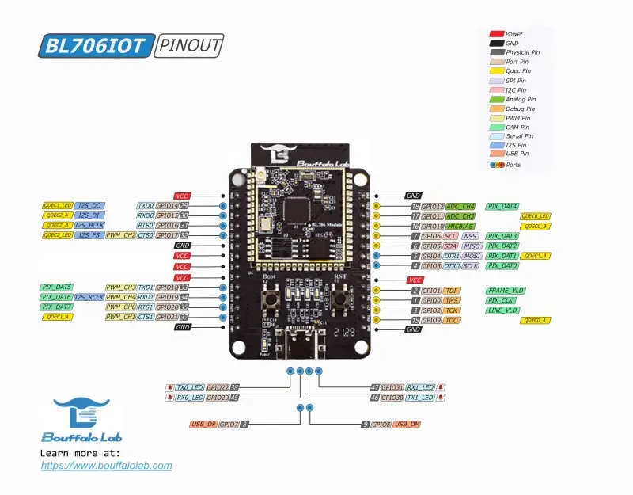

<!-- Copyright 2015-2026 Zephyr Project members and individual contributors. -->
<!-- SPDX-License-Identifier: Apache-2.0 -->
<!-- 中文翻译；编号、导航与译注为本地新增。 -->

<a id="bl706_iot_dvk"></a>

# 第3章\_博流BL706-IoT-DVK

原文：[官方页面](https://docs.zephyrproject.org/latest/boards/bflb/bl70x/bl706_iot_dvk/doc/index.html)。读取日期：2026-10-16；来源摘要见[来源记录](../SOURCES.md)。

开发板概览（Board Overview）

<a id="id1"></a>

[](images/bl706_iot.webp)

博流BL706-IoT-DVK

名称（Name）：

`bl706_iot_dvk`

厂商（Vendor）：

[博流（南京）有限公司（Bouffalo Lab）](https://docs.zephyrproject.org/latest/boards/index.html#vendor=bflb)

状态（Status）：

当前未积极维护（Not Actively Maintained）

架构（Architecture）：

[riscv](https://docs.zephyrproject.org/latest/boards/index.html#arch=riscv)

片上系统（SoC）：

[bl706c00q2i](https://docs.zephyrproject.org/latest/boards/index.html#soc=bl706c00q2i)

<a id="board-github-link"></a>

[浏览开发板源码（Browse Board Sources）](https://github.com/zephyrproject-rtos/zephyr/blob/main//boards/bflb/bl70x/bl706_iot_dvk/doc/index.rst/../..)<a id="overview"></a>

## 概述（Overview）

BL706-IoT-DVK是博流推出的开发板，基于BL706 RISC-V微控制器，型号BL706C00Q2I、QFN48封装。它具有USB-C接口、四个指示LED，并引出多数GPIO用于外设评估。USB转串口背板（Backplane）提供JTAG调试及UART控制台访问。

<a id="hardware"></a>

## 硬件（Hardware）

BL706C00Q2I SoC具有以下特性：


- 32位RISC-V内核SiFive E24，144 MHz
- 132 KB SRAM：64 KB指令紧耦合存储器（ITCM）、64 KB数据TCM／缓存及4 KB保持存储器（Retention）
- 模块上4 MB外部闪存，支持就地执行（XIP）
- USB 2.0全速设备接口（FS Device）
- 两路UART、一路SPI、一路I2C及一路I2S
- 五通道脉宽调制（PWM）
- 12位ADC及10位DAC
- 硬件安全引擎（Security Engine），支持AES、SHA及TRNG
- Bluetooth Low Energy 5.0及Zigbee
- 32个GPIO引脚，QFN48封装

开发板提供：


- USB-C连接器，用于供电、USB设备接口及CDC ACM控制台
- USB转串口背板，用于UART控制台及JTAG调试
- 四个指示LED：TX0、RX0、TX1及RX1
- UART0：GPIO14为TX，GPIO15为RX
- UART1：GPIO18为TX，GPIO19为RX
- SPI：GPIO3为SCLK、GPIO4为MOSI、GPIO5为MISO、GPIO6为SS
- I2C：GPIO5为SDA、GPIO6为SCL；与SPI共用，默认禁用
- 引出的GPIO排针，用于连接外设

<a id="supported-features"></a>

### 支持的功能（Supported Features）

`bl706_iot_dvk`开发板支持下表所列的硬件功能。

片上／板载（On-Chip / On-Board）

功能集成在片上系统（SoC）内／位于开发板上。

2 / 2

分别表示已启用／已禁用的实例数。点击数量标签，可查看开发板或SoC设备树源码（DTS）中该功能的第一个实例。

`vnd,foo`

与此功能匹配的设备树绑定兼容字符串（Compatible String）；点击链接可查看绑定文档。

<a id="bl706_iot_dvk-hw-features"></a>

<a id="bl706_iot_dvk-bl706_iot_dvk/bl706c00q2i-hw-features-section"></a>

#### `bl706_iot_dvk/bl706c00q2i`目标（Target）

<a id="bl706_iot_dvk-bl706_iot_dvk/bl706c00q2i-hw-features-panel"></a>

<a id="bl706_iot_dvk-bl706_iot_dvk/bl706c00q2i-hw-features-memory"></a>

该开发板目标的片上存储容量：88 KiB RAM、4 MiB Flash。

<a id="bl706_iot_dvk-bl706_iot_dvk/bl706c00q2i-hw-features-table"></a>

<table>
<tr>
<th>类型（Type）</th>
<th>位置（Location）</th>
<th>说明（Description）</th>
<th>兼容字符串（Compatible）</th>
</tr>
<tr>
<td rowspan="1">中央处理器（CPU）</td>
<td>片上（On-Chip）</td>
<td>SiFive E24标准处理器内核（Standard Core CPU）（<a href="https://github.com/zephyrproject-rtos/zephyr/blob/main/dts/riscv/bflb/bl70x.dtsi?plain=1#L107">已启用：1</a>）</td>
<td><a href="../cpu_vendor_multiarc_binding_reference/P037_sifive_e24.md#std-dtcompatible-sifive-e24"><code>sifive,e24</code></a></td>
</tr>
<tr>
<td rowspan="1">模数转换器（ADC）</td>
<td>片上（On-Chip）</td>
<td>博流智能（Bouffalolab）模数转换器（ADC）（<a href="https://github.com/zephyrproject-rtos/zephyr/blob/main/dts/riscv/bflb/bl70x.dtsi?plain=1#L200">已禁用：1</a>）</td>
<td><a href="../hardware/P886_BouffaloLab模数转换器绑定.md#dtbinding-bflb-adc"><code>bflb,adc</code></a></td>
</tr>
<tr>
<td rowspan="1">蓝牙（Bluetooth）</td>
<td>片上（On-Chip）</td>
<td>博流智能片上低功耗蓝牙（BLE）控制器的蓝牙主机控制器接口（Bluetooth HCI）（<a href="https://github.com/zephyrproject-rtos/zephyr/blob/main/dts/riscv/bflb/bl70x.dtsi?plain=1#L29">已启用：1</a>）</td>
<td><a href="../bluetooth_vendor_hci_binding_reference/P002_bflb_bt-hci.md#std-dtcompatible-bflb-bt-hci"><code>bflb,bt-hci</code></a></td>
</tr>
<tr>
<td rowspan="1">高速缓存（Cache）</td>
<td>片上（On-Chip）</td>
<td>博流智能L1C缓存控制（Cache Control）（<a href="https://github.com/zephyrproject-rtos/zephyr/blob/main/dts/riscv/bflb/bl70x.dtsi?plain=1#L245">已启用：1</a>）</td>
<td><a href="../memory_protection_binding_reference/P002_bflb_l1c.md#std-dtcompatible-bflb-l1c"><code>bflb,l1c</code></a></td>
</tr>
<tr>
<td rowspan="7">时钟控制（Clock Control）</td>
<td>片上（On-Chip）</td>
<td>通用固定频率时钟提供者（Fixed-Rate Clock Provider）（<a href="https://github.com/zephyrproject-rtos/zephyr/blob/main/dts/riscv/bflb/bl70x.dtsi?plain=1#L35">已启用：3</a>；<a href="https://github.com/zephyrproject-rtos/zephyr/blob/main/dts/riscv/bflb/bl70x.dtsi?plain=1#L42">已禁用：1</a>）</td>
<td><a href="../hardware/P566_固定时钟绑定.md#dtbinding-fixed-clock"><code>fixed-clock</code></a></td>
</tr>
<tr>
<td>片上（On-Chip）</td>
<td>博流智能F32K时钟（Clock）（<a href="https://github.com/zephyrproject-rtos/zephyr/blob/main/dts/riscv/bflb/bl70x.dtsi?plain=1#L56">已启用：1</a>）</td>
<td><a href="../clock_adi_atmel_bflb_binding_reference/P022_bflb_f32k.md#std-dtcompatible-bflb-f32k"><code>bflb,f32k</code></a></td>
</tr>
<tr>
<td>片上（On-Chip）</td>
<td>BL70x/L延迟锁定环（DLL）（<a href="https://github.com/zephyrproject-rtos/zephyr/blob/main/dts/riscv/bflb/bl70x.dtsi?plain=1#L71">已启用：1</a>）</td>
<td><a href="../clock_adi_atmel_bflb_binding_reference/P019_bflb_bl70x_l-dll.md#std-dtcompatible-bflb-bl70x_l-dll"><code>bflb,bl70x_l-dll</code></a></td>
</tr>
<tr>
<td>片上（On-Chip）</td>
<td>博流智能根时钟（Root Clock）：根据实际存在的时钟表示FCLK和HCLK，两者应保持一致（<a href="https://github.com/zephyrproject-rtos/zephyr/blob/main/dts/riscv/bflb/bl70x.dtsi?plain=1#L78">已启用：1</a>）</td>
<td><a href="../clock_esp_infineon_microchip_binding_reference/P001_bflb_root-clk.md#std-dtcompatible-bflb-root-clk"><code>bflb,root-clk</code></a></td>
</tr>
<tr>
<td>片上（On-Chip）</td>
<td>总线时钟（BCLK）或外设时钟（Peripheral Clock）：时钟源 → 分频器 → 当前时钟（<a href="https://github.com/zephyrproject-rtos/zephyr/blob/main/dts/riscv/bflb/bl70x.dtsi?plain=1#L86">已启用：1</a>）</td>
<td><a href="../clock_adi_atmel_bflb_binding_reference/P013_bflb_bclk.md#std-dtcompatible-bflb-bclk"><code>bflb,bclk</code></a></td>
</tr>
<tr>
<td>片上（On-Chip）</td>
<td>博流智能闪存时钟（BFLB Flash Clock）：时钟源 → 分频器 → CLK。目前只提供BL61x存储区1（Bank 1，即启动闪存）的设置（<a href="https://github.com/zephyrproject-rtos/zephyr/blob/main/dts/riscv/bflb/bl70x.dtsi?plain=1#L93">已启用：1</a>）</td>
<td><a href="../clock_adi_atmel_bflb_binding_reference/P023_bflb_flash-clk.md#std-dtcompatible-bflb-flash-clk"><code>bflb,flash-clk</code></a></td>
</tr>
<tr>
<td>片上（On-Chip）</td>
<td>博流BL70x(L)时钟控制器（<a href="https://github.com/zephyrproject-rtos/zephyr/blob/main/dts/riscv/bflb/bl70x.dtsi?plain=1#L183">已启用：1</a>）</td>
<td><a href="../clock_adi_atmel_bflb_binding_reference/P018_bflb_bl70x_l-clock-controller.md#std-dtcompatible-bflb-bl70x_l-clock-controller"><code>bflb,bl70x_l-clock-controller</code></a></td>
</tr>
<tr>
<td rowspan="3">计数器（Counter）</td>
<td>片上（On-Chip）</td>
<td>博流智能通用定时器模块（General Purpose Timer Block）（<a href="https://github.com/zephyrproject-rtos/zephyr/blob/main/dts/riscv/bflb/bl70x.dtsi?plain=1#L308">已禁用：1</a>）</td>
<td><a href="../counter_binding_reference/P014_bflb_timer.md#std-dtcompatible-bflb-timer"><code>bflb,timer</code></a></td>
</tr>
<tr>
<td>片上（On-Chip）</td>
<td>博流智能定时器通道（Timer Channel），用作计数器（Counter）（<a href="https://github.com/zephyrproject-rtos/zephyr/blob/main/dts/riscv/bflb/bl70x.dtsi?plain=1#L316">已禁用：2</a>）</td>
<td><a href="../counter_binding_reference/P013_bflb_timer-channel.md#std-dtcompatible-bflb-timer-channel"><code>bflb,timer-channel</code></a></td>
</tr>
<tr>
<td>片上（On-Chip）</td>
<td>博流智能实时时钟计数器（RTC Counter），基于HBN（<a href="https://github.com/zephyrproject-rtos/zephyr/blob/main/dts/riscv/bflb/bl70x.dtsi?plain=1#L426">已禁用：1</a>）</td>
<td><a href="../counter_binding_reference/P012_bflb_rtc.md#std-dtcompatible-bflb-rtc"><code>bflb,rtc</code></a></td>
</tr>
<tr>
<td rowspan="3">密码学加速器（Cryptographic Accelerator）</td>
<td>片上（On-Chip）</td>
<td>博流智能安全引擎（SEC Engine）的真随机数发生器（TRNG）（<a href="https://github.com/zephyrproject-rtos/zephyr/blob/main/dts/riscv/bflb/bl70x.dtsi?plain=1#L212">已启用：1</a>）</td>
<td><a href="../crypto_aes_sha_ccm_binding_reference/P006_bflb_sec-eng-trng.md#std-dtcompatible-bflb-sec-eng-trng"><code>bflb,sec-eng-trng</code></a></td>
</tr>
<tr>
<td>片上（On-Chip）</td>
<td>博流智能安全引擎（SEC Engine）的SHA硬件加速器（Hardware Accelerator）（<a href="https://github.com/zephyrproject-rtos/zephyr/blob/main/dts/riscv/bflb/bl70x.dtsi?plain=1#L220">已禁用：1</a>）</td>
<td><a href="../crypto_aes_sha_ccm_binding_reference/P005_bflb_sec-eng-sha.md#std-dtcompatible-bflb-sec-eng-sha"><code>bflb,sec-eng-sha</code></a></td>
</tr>
<tr>
<td>片上（On-Chip）</td>
<td>博流智能安全引擎（SEC Engine）的AES硬件加速器（Hardware Accelerator）（<a href="https://github.com/zephyrproject-rtos/zephyr/blob/main/dts/riscv/bflb/bl70x.dtsi?plain=1#L229">已禁用：1</a>）</td>
<td><a href="../crypto_aes_sha_ccm_binding_reference/P004_bflb_sec-eng-aes.md#std-dtcompatible-bflb-sec-eng-aes"><code>bflb,sec-eng-aes</code></a></td>
</tr>
<tr>
<td rowspan="1">直接存储器访问（DMA）</td>
<td>片上（On-Chip）</td>
<td>博流智能直接存储器访问（DMA）（<a href="https://github.com/zephyrproject-rtos/zephyr/blob/main/dts/riscv/bflb/bl70x.dtsi?plain=1#L387">已启用：1</a>）</td>
<td><a href="../dma_binding_reference/P012_bflb_dma.md#std-dtcompatible-bflb-dma"><code>bflb,dma</code></a></td>
</tr>
<tr>
<td rowspan="1">通用输入输出与接插件（GPIO &amp; Headers）</td>
<td>片上（On-Chip）</td>
<td>博流智能BL60x和BL70x GPIO节点（<a href="https://github.com/zephyrproject-rtos/zephyr/blob/main/dts/riscv/bflb/bl70x.dtsi?plain=1#L171">已启用：1</a>）</td>
<td><a href="../gpio_connectors_bflb_esp_binding_reference/P005_bflb_bl60x_70x-gpio.md#std-dtcompatible-bflb-bl60x_70x-gpio"><code>bflb,bl60x_70x-gpio</code></a></td>
</tr>
<tr>
<td rowspan="1">集成电路间总线（I2C）</td>
<td>片上（On-Chip）</td>
<td>博流智能I2C接口（<a href="https://github.com/zephyrproject-rtos/zephyr/blob/main/dts/riscv/bflb/bl70x.dtsi?plain=1#L267">已禁用：1</a>）</td>
<td><a href="../i2c_adi_atmel_esp_binding_reference/P012_bflb_i2c.md#std-dtcompatible-bflb-i2c"><code>bflb,i2c</code></a></td>
</tr>
<tr>
<td rowspan="1">低速率无线个域网（IEEE 802.15.4）</td>
<td>片上（On-Chip）</td>
<td>博流智能IEEE 802.15.4节点（Node）（<a href="https://github.com/zephyrproject-rtos/zephyr/blob/main/dts/riscv/bflb/bl70x.dtsi?plain=1#L466">已禁用：1</a>）</td>
<td><a href="../lora_ieee802154_binding_reference/P002_bflb_ieee802154.md#std-dtcompatible-bflb-ieee802154"><code>bflb,ieee802154</code></a></td>
</tr>
<tr>
<td rowspan="1">输入（Input）</td>
<td>片上（On-Chip）</td>
<td>博流智能红外接收外设（Infrared Receiver Peripheral）。将VS1838B等二极管／接收器的输出连接到指定GPIO引脚（<a href="https://github.com/zephyrproject-rtos/zephyr/blob/main/dts/riscv/bflb/bl70x.dtsi?plain=1#L335">已禁用：1</a>）</td>
<td><a href="../input_adc_touch_matrix_binding_reference/P006_bflb_irx.md#std-dtcompatible-bflb-irx"><code>bflb,irx</code></a></td>
</tr>
<tr>
<td rowspan="2">中断控制器（Interrupt Controller）</td>
<td>片上（On-Chip）</td>
<td>RISC-V CPU中断控制器（Interrupt Controller）（<a href="https://github.com/zephyrproject-rtos/zephyr/blob/main/dts/riscv/bflb/bl70x.dtsi?plain=1#L117">已启用：1</a>）</td>
<td><a href="../interrupt_fabric_binding_reference/P006_riscv_cpu-intc.md#std-dtcompatible-riscv-cpu-intc"><code>riscv,cpu-intc</code></a></td>
</tr>
<tr>
<td>片上（On-Chip）</td>
<td>RISC-V内核本地中断控制器（CLIC），预标准版本v0.9（<a href="https://github.com/zephyrproject-rtos/zephyr/blob/main/dts/riscv/bflb/bl70x.dtsi?plain=1#L132">已启用：1</a>）</td>
<td><a href="../riscv_interrupt_binding_reference/P007_sifive_clic-draft.md#std-dtcompatible-sifive-clic-draft"><code>sifive,clic-draft</code></a></td>
</tr>
<tr>
<td rowspan="1">发光二极管（LED）</td>
<td>板载（On-Board）</td>
<td>一组由 GPIO 控制的 LED（GPIO-Controlled LEDs）（<a href="https://github.com/zephyrproject-rtos/zephyr/blob/main/boards/bflb/bl70x/bl706_iot_dvk/bl706_iot_dvk.dts?plain=1#L22">已启用：1</a>）</td>
<td><a href="../hardware/P564_GPIO指示灯绑定.md#dtbinding-gpio-leds"><code>gpio-leds</code></a></td>
</tr>
<tr>
<td rowspan="2">存储器控制器（Memory Controller）</td>
<td>片上（On-Chip）</td>
<td>串行闪存控制器（Serial Flash Controller）（<a href="https://github.com/zephyrproject-rtos/zephyr/blob/main/dts/riscv/bflb/bl70x.dtsi?plain=1#L346">已启用：1</a>）</td>
<td><a href="../memory_controller_hyperbus_smc_binding_reference/P008_bflb_sf-controller.md#std-dtcompatible-bflb-sf-controller"><code>bflb,sf-controller</code></a></td>
</tr>
<tr>
<td>片上（On-Chip）</td>
<td>串行闪存控制器存储区（Serial Flash Controller Bank）（<a href="https://github.com/zephyrproject-rtos/zephyr/blob/main/dts/riscv/bflb/bl70x.dtsi?plain=1#L357">已启用：1</a>；<a href="https://github.com/zephyrproject-rtos/zephyr/blob/main/dts/riscv/bflb/bl70x.dtsi?plain=1#L365">已禁用：1</a>）</td>
<td><a href="../memory_controller_hyperbus_smc_binding_reference/P007_bflb_sf-bank.md#std-dtcompatible-bflb-sf-bank"><code>bflb,sf-bank</code></a></td>
</tr>
<tr>
<td rowspan="1">存储技术设备（MTD）</td>
<td>板载（On-Board）</td>
<td>博流智能串行闪存控制器中的闪存（Serial Flash Controller Flash）（<a href="https://github.com/zephyrproject-rtos/zephyr/blob/main/boards/bflb/bl70x/bl706_iot_dvk/bl706_mod.dtsi?plain=1#L30">已启用：1</a>）</td>
<td><a href="../mtd_atmel_bouffalo_binding_reference/P012_bflb_sf-flash.md#std-dtcompatible-bflb-sf-flash"><code>bflb,sf-flash</code></a></td>
</tr>
<tr>
<td rowspan="1">一次性可编程存储器（OTP Memory）</td>
<td>片上（On-Chip）</td>
<td>博流智能电子熔丝（Efuse）（<a href="https://github.com/zephyrproject-rtos/zephyr/blob/main/dts/riscv/bflb/bl70x.dtsi?plain=1#L238">已启用：1</a>）</td>
<td><a href="../otp_binding_reference/P002_bflb_efuse.md#std-dtcompatible-bflb-efuse"><code>bflb,efuse</code></a></td>
</tr>
<tr>
<td rowspan="1">引脚控制（Pin Control）</td>
<td>片上（On-Chip）</td>
<td>博流智能引脚控制节点（Pinctrl Node）（<a href="https://github.com/zephyrproject-rtos/zephyr/blob/main/dts/riscv/bflb/bl70x.dtsi?plain=1#L163">已启用：1</a>）</td>
<td><a href="../pinctrl_adi_ambiq_arm_binding_reference/P016_bflb_pinctrl.md#std-dtcompatible-bflb-pinctrl"><code>bflb,pinctrl</code></a></td>
</tr>
<tr>
<td rowspan="1">电源管理（Power Management）</td>
<td>片上（On-Chip）</td>
<td>博流智能电源控制器（Power Controller）（<a href="https://github.com/zephyrproject-rtos/zephyr/blob/main/dts/riscv/bflb/bl70x.dtsi?plain=1#L397">已启用：1</a>）</td>
<td><a href="../power_control_binding_reference/P002_bflb_power-controller.md#std-dtcompatible-bflb-power-controller"><code>bflb,power-controller</code></a></td>
</tr>
<tr>
<td rowspan="1">脉宽调制（PWM）</td>
<td>片上（On-Chip）</td>
<td>博流智能脉宽调制1（PWM 1）（<a href="https://github.com/zephyrproject-rtos/zephyr/blob/main/dts/riscv/bflb/bl70x.dtsi?plain=1#L289">已禁用：1</a>）</td>
<td><a href="../pwm_adi_esp_infineon_binding_reference/P010_bflb_pwm-1.md#std-dtcompatible-bflb-pwm-1"><code>bflb,pwm-1</code></a></td>
</tr>
<tr>
<td rowspan="3">稳压器（Regulator）</td>
<td>片上（On-Chip）</td>
<td>博流智能HBN SoC电压稳压器（Voltage Regulator），供CPU、存储器等使用。它是标称电压1.10 V的低压差稳压器（LDO）。具有两种模式，但仅在进入睡眠模式时切换，且两种模式不共用设置区域（<a href="https://github.com/zephyrproject-rtos/zephyr/blob/main/dts/riscv/bflb/bl70x.dtsi?plain=1#L408">已启用：1</a>）</td>
<td><a href="../hardware/P648_Bouffalo_SoC稳压器绑定.md#dtbinding-bflb-soc-regulator"><code>bflb,soc-regulator</code></a></td>
</tr>
<tr>
<td>片上（On-Chip）</td>
<td>博流智能HBN RT电压稳压器，供实时时钟（RTC）使用。它是标称电压1.10 V的低压差稳压器（LDO）。具有两种模式，但仅在进入睡眠模式时切换，且两种模式不共用设置区域（<a href="https://github.com/zephyrproject-rtos/zephyr/blob/main/dts/riscv/bflb/bl70x.dtsi?plain=1#L414">已启用：1</a>）</td>
<td><a href="../hardware/P647_Bouffalo_RT稳压器绑定.md#dtbinding-bflb-rt-regulator"><code>bflb,rt-regulator</code></a></td>
</tr>
<tr>
<td>片上（On-Chip）</td>
<td>博流智能HBN AON电压稳压器，供始终开启区域（Always ON Section）使用。它是标称电压1.10 V的低压差稳压器（LDO）。具有两种模式，但仅在进入睡眠模式时切换，且两种模式不共用设置区域（<a href="https://github.com/zephyrproject-rtos/zephyr/blob/main/dts/riscv/bflb/bl70x.dtsi?plain=1#L420">已启用：1</a>）</td>
<td><a href="../hardware/P646_Bouffalo_AON稳压器绑定.md#dtbinding-bflb-aon-regulator"><code>bflb,aon-regulator</code></a></td>
</tr>
<tr>
<td rowspan="1">传感器（Sensors）</td>
<td>片上（On-Chip）</td>
<td>博流智能片内温度传感器（TSEN / Internal Die Temperature Sensor）（<a href="https://github.com/zephyrproject-rtos/zephyr/blob/main/dts/riscv/bflb/bl70x.dtsi?plain=1#L23">已禁用：1</a>）</td>
<td><a href="../sensor_ams_aosong_bosch_binding_reference/P023_bflb_tsen.md#std-dtcompatible-bflb-tsen"><code>bflb,tsen</code></a></td>
</tr>
<tr>
<td rowspan="1">串行控制器（Serial Controller）</td>
<td>片上（On-Chip）</td>
<td>博流智能通用异步收发器（UART）（<a href="https://github.com/zephyrproject-rtos/zephyr/blob/main/dts/riscv/bflb/bl70x.dtsi?plain=1#L251">已启用：1</a>；<a href="https://github.com/zephyrproject-rtos/zephyr/blob/main/dts/riscv/bflb/bl70x.dtsi?plain=1#L259">已禁用：1</a>）</td>
<td><a href="../uart_adi_arm_atmel_binding_reference/P013_bflb_uart.md#std-dtcompatible-bflb-uart"><code>bflb,uart</code></a></td>
</tr>
<tr>
<td rowspan="1">串行外设接口（SPI）</td>
<td>片上（On-Chip）</td>
<td>博流智能串行外设接口（SPI）（<a href="https://github.com/zephyrproject-rtos/zephyr/blob/main/dts/riscv/bflb/bl70x.dtsi?plain=1#L278">已禁用：1</a>）</td>
<td><a href="../spi_adi_atmel_esp_binding_reference/P010_bflb_spi.md#std-dtcompatible-bflb-spi"><code>bflb,spi</code></a></td>
</tr>
<tr>
<td rowspan="1">静态随机存储器（SRAM）</td>
<td>片上（On-Chip）</td>
<td>通用片上静态随机存储器（SRAM）（<a href="https://github.com/zephyrproject-rtos/zephyr/blob/main/dts/riscv/bflb/bl70x.dtsi?plain=1#L441">已启用：3</a>）</td>
<td><a href="../hardware/P567_内存映射SRAM绑定.md#dtbinding-mmio-sram"><code>mmio-sram</code></a></td>
</tr>
<tr>
<td rowspan="1">定时器（Timer）</td>
<td>片上（On-Chip）</td>
<td>RISC-V机器模式定时器（Machine Timer）（<a href="https://github.com/zephyrproject-rtos/zephyr/blob/main/dts/riscv/bflb/bl70x.dtsi?plain=1#L146">已启用：1</a>）</td>
<td><a href="../interrupt_fabric_binding_reference/P011_riscv_machine-timer.md#std-dtcompatible-riscv-machine-timer"><code>riscv,machine-timer</code></a></td>
</tr>
<tr>
<td rowspan="1">通用串行总线（USB）</td>
<td>片上（On-Chip）</td>
<td>博流USB 1.1全速设备控制器，v1模块（<a href="https://github.com/zephyrproject-rtos/zephyr/blob/main/dts/riscv/bflb/bl70x.dtsi?plain=1#L379">已启用：1</a>）</td>
<td><a href="../usb_controller_binding_reference/P007_bflb_udc-1.md#std-dtcompatible-bflb-udc-1"><code>bflb,udc-1</code></a></td>
</tr>
<tr>
<td rowspan="1">看门狗（Watchdog）</td>
<td>片上（On-Chip）</td>
<td>博流智能看门狗定时器（Watchdog Timer）（<a href="https://github.com/zephyrproject-rtos/zephyr/blob/main/dts/riscv/bflb/bl70x.dtsi?plain=1#L299">已禁用：1</a>）</td>
<td><a href="../watchdog_binding_reference/P010_bflb_wdt.md#std-dtcompatible-bflb-wdt"><code>bflb,wdt</code></a></td>
</tr>
</table>

<a id="connections-and-ios"></a>

### 连接与输入输出（Connections and IOs）

<a id="default-zephyr-peripheral-mapping"></a>

#### Zephyr 默认外设映射（Peripheral Mapping）：


- `USB_DP : GPIO7`
- `USB_DM : GPIO8`
- `UART0_TX : GPIO14`
- `UART0_RX : GPIO15`
- `UART1_TX : GPIO18`
- `UART1_RX : GPIO19`
- `SPI0_SCLK : GPIO3`
- `SPI0_MOSI : GPIO4`
- `SPI0_MISO : GPIO5`
- `SPI0_SS : GPIO6`
- I2C0_SDA：GPIO5，与SPI共用
- I2C0_SCL：GPIO6，与SPI共用
- `TX0_LED : GPIO22`
- `RX0_LED : GPIO29`
- `TX1_LED : GPIO30`
- `RX1_LED : GPIO31`

<a id="programming-and-debugging"></a>

## 烧录与调试（Programming and Debugging）

`bl706_iot_dvk`开发板支持下表所列的运行工具（Runners）及相关west命令。

<table>
<tr>
<th></th>
<th>烧录（flash）</th>
<th>调试（debug）</th>
<th>连接调试会话（attach）</th>
<th>实时传输（rtt）</th>
<th>调试服务器（debugserver）</th>
</tr>
<tr>
<td>bflb_mcu_tool</td>
<td>✅（默认 / default）</td>
<td></td>
<td></td>
<td></td>
<td></td>
</tr>
<tr>
<td><a href="https://docs.zephyrproject.org/latest/develop/flash_debug/host-tools.html#runner-openocd">openocd</a></td>
<td>✅</td>
<td>✅（默认 / default）</td>
<td>✅</td>
<td>✅</td>
<td>✅</td>
</tr>
</table>

<a id="building"></a>

### 构建（Building）

```text
# From the root of the zephyr repository
west build -b bl706_iot_dvk samples/hello_world
```

<a id="flashing"></a>

### 烧录（Flashing）

可以通过UART使用`bflb-mcu-tool`烧录。按住Boot按键再按Reset，进入引导加载程序后执行：

```text
west flash
```

<a id="console"></a>

### 控制台（Console）

开发板默认使用USB CDC ACM UART作为Zephyr控制台。烧录并复位后，可在USB串口上以115200波特率访问控制台。

也可通过USB转串口背板上的UART0访问控制台，无需USB CDC ACM。

<a id="references"></a>

## 参考资料（References）

## 译注

原文硬件列表写132 KB SRAM，自动生成目标表为88 KiB RAM；USB硬件列表写2.0 FS，绑定说明写1.1 Full-Speed。两处分别保留。默认USB CDC ACM控制台与替代UART0控制台、I2C与SPI共用引脚的条件均未省略。

---

[上一章](P002_Bouffalo_Lab_BL618_G0_evaluation_board.md) · [返回大纲](大纲.md) · [全站翻译进度](../PROGRESS.md) · [下一章](P004_Bouffalo_Lab_Intelligent_Technology_Nanjing_Co._Ltd..md)
