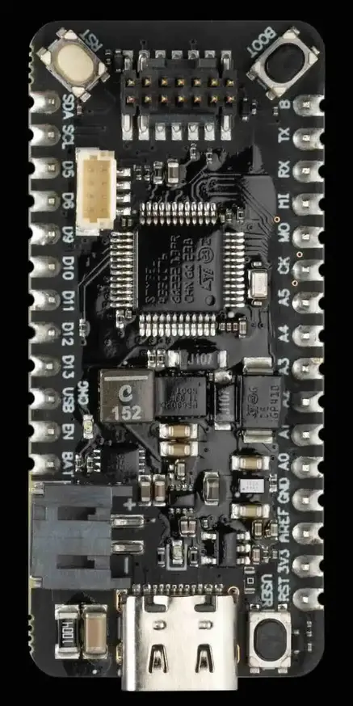
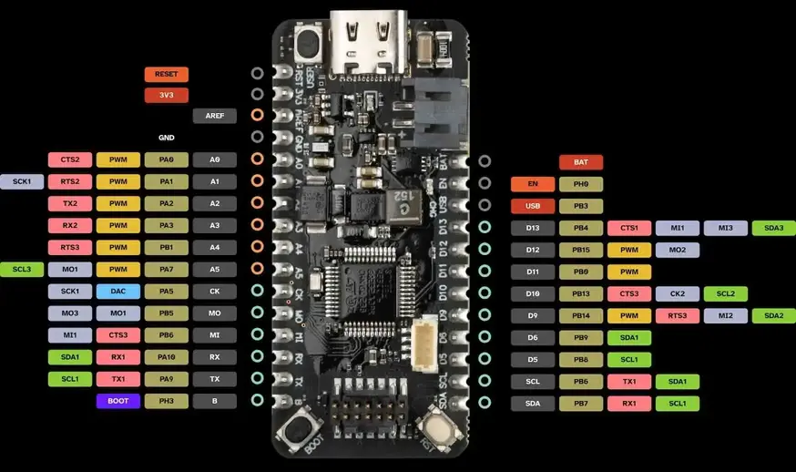

<!-- Copyright 2015-2026 Zephyr Project members and individual contributors. -->
<!-- SPDX-License-Identifier: Apache-2.0 -->
<!-- 中文翻译；编号、导航与译注为本地新增。 -->

<a id="cygnet"></a>

# 第9章\_Cygnet

原文：[官方页面](https://docs.zephyrproject.org/latest/boards/blues/cygnet/doc/index.html)。读取日期：2026-10-16；来源摘要见[来源记录](../SOURCES.md)。

开发板概览（Board Overview）

<a id="id1"></a>

[](images/cygnet.webp)

Cygnet

名称（Name）：

`cygnet`

厂商（Vendor）：

[Blues Wireless](https://docs.zephyrproject.org/latest/boards/index.html#vendor=blues)

状态（Status）：

当前未积极维护（Not Actively Maintained）

架构（Architecture）：

[arm](https://docs.zephyrproject.org/latest/boards/index.html#arch=arm)

片上系统（SoC）：

[stm32l433xx](https://docs.zephyrproject.org/latest/boards/index.html#soc=stm32l433xx)

<a id="board-github-link"></a>

[浏览开发板源码（Browse Board Sources）](https://github.com/zephyrproject-rtos/zephyr/blob/main//boards/blues/cygnet/doc/index.rst/../..)<a id="overview"></a>

## 概述（Overview）

Blues Cygnet采用基于ARM Cortex-M4的STM32L433CC MCU，提供多种连接能力和配置。主要特性如下：


- LQFP48封装的STM32L4微控制器
- Adafruit Feather连接器
- 用户LED（User LED）
- 用户按键
- USB Type-C接口

<a id="id3"></a>

更多开发板信息见[Blues Cygnet网站](https://www.blues.dev/)[注1](#id2)。

<a id="hardware"></a>

## 硬件（Hardware）

STM32L433CC SoC提供以下硬件IP：


- 采用FlexPowerControl的超低功耗设计，待机模式（Standby）低至28 nA，运行模式低至84 μA/MHz
- 内核：ARM® 32位Cortex®-M4 CPU，带浮点单元（FPU），最高80 MHz；Dhrystone 2.1性能为100 DMIPS或1.25 DMIPS/MHz
- 时钟源（Clock Sources）：


  - 用于实时时钟（RTC）的32 kHz低速外部晶体振荡器（LSE）
  - 内部16 MHz RC振荡器，出厂校准（Factory-Trimmed），精度±1%
  - 内部低功耗32 kHz RC振荡器，精度±5%
  - 内部多速率100 kHz至48 MHz振荡器，由LSE自动校准，精度优于±0.25%
  - 两个锁相环（PLL），用于系统时钟、USB、音频和ADC
- 带硬件日历、闹钟及校准功能的实时时钟（RTC）
- 11个定时器：


  - 一个16位高级电机控制定时器（Advanced Motor Control）
  - 一个32位及两个16位通用定时器
  - 两个16位基本定时器（Basic Timers）
  - 两个16位低功耗定时器，在停止模式（Stop Mode）下可用
  - 两个看门狗（Watchdogs）
  - 系统节拍定时器（SysTick Timer）
- 最多21个高速I/O，大多数耐受5 V
- 存储器（Memories）


  - 最多256 KB单存储体闪存（Single Bank Flash），支持专有代码读出保护
  - 64 KB SRAM，其中16 KB带硬件奇偶校验（Parity Check）
- 丰富的模拟外设（Analog Peripherals），采用独立供电


  - 一个12位ADC，5 MSPS；通过硬件过采样（Oversampling）可达16位，功耗200 μA/MSPS
  - 两路12位DAC输出通道，支持低功耗采样保持（Sample and Hold）
  - 一个运算放大器，内置可编程增益放大器（PGA）
  - 两个超低功耗比较器（Comparators）
- 17个通信接口：


  - USB 2.0全速免晶体方案，支持链路电源管理（LPM）及电池充电检测（BCD）
  - 一路串行音频接口（SAI）
  - 三路I2C快速增强模式（FM+），1 Mbit/s，支持SMBus/PMBus
  - 四路USART，支持ISO 7816、LIN、IrDA及调制解调器（Modem）
  - 一路低功耗UART（LPUART），支持Stop 2模式唤醒
  - 三路SPI及一路Quad SPI
  - CAN，支持2.0B主动模式（Active）
- 14通道直接存储器访问控制器（DMA Controller）
- 真随机数发生器（True Random Number Generator）
- 循环冗余校验计算单元（CRC），96位唯一标识（Unique ID）
- 开发支持：SWD、JTAG及嵌入式跟踪宏单元（Embedded Trace Macrocell*）

STM32L433CC的更多信息见：


- <a id="id7"></a>

  [ST网站上的STM32L433CC](https://www.st.com/en/microcontrollers-microprocessors/stm32l433cc.html)[注3](#id6)
- <a id="id9"></a>

  [STM32L432参考手册](https://www.st.com/resource/en/reference_manual/dm00151940.pdf)[注4](#id8)（型号依原文保留）

<a id="supported-features"></a>

### 支持的功能（Supported Features）

`cygnet`开发板支持下表所列的硬件功能。

片上／板载（On-Chip / On-Board）

功能集成在片上系统（SoC）内／位于开发板上。

2 / 2

分别表示已启用／已禁用的实例数。点击数量标签，可查看开发板或SoC设备树源码（DTS）中该功能的第一个实例。

`vnd,foo`

与此功能匹配的设备树绑定兼容字符串（Compatible String）；点击链接可查看绑定文档。

<a id="cygnet-hw-features"></a>

<a id="cygnet-cygnet/stm32l433xx-hw-features-section"></a>

#### `cygnet/stm32l433xx`目标（Target）

<a id="cygnet-cygnet/stm32l433xx-hw-features-panel"></a>

<a id="cygnet-cygnet/stm32l433xx-hw-features-memory"></a>

该开发板目标的片上存储容量：64 KiB RAM、256 KiB Flash。

<a id="cygnet-cygnet/stm32l433xx-hw-features-table"></a>

<table>
<tr>
<th>类型（Type）</th>
<th>位置（Location）</th>
<th>说明（Description）</th>
<th>兼容字符串（Compatible）</th>
</tr>
<tr>
<td rowspan="1">中央处理器（CPU）</td>
<td>片上（On-Chip）</td>
<td>ARM Cortex-M4F 处理器（CPU）（<a href="https://github.com/zephyrproject-rtos/zephyr/blob/main/dts/arm/st/l4/stm32l4.dtsi?plain=1#L34">已启用：1</a>）</td>
<td><a href="../cpu_arm_riscv_binding_reference/P025_arm_cortex-m4f.md#std-dtcompatible-arm-cortex-m4f"><code>arm,cortex-m4f</code></a></td>
</tr>
<tr>
<td rowspan="1">模数转换器（ADC）</td>
<td>片上（On-Chip）</td>
<td>STM32模数转换器（ADC）（<a href="https://github.com/zephyrproject-rtos/zephyr/blob/main/dts/arm/st/l4/stm32l4.dtsi?plain=1#L470">已禁用：1</a>）</td>
<td><a href="../hardware/P839_STM32模数转换器绑定.md#dtbinding-st-stm32-adc"><code>st,stm32-adc</code></a></td>
</tr>
<tr>
<td rowspan="1">控制器局域网（CAN）</td>
<td>片上（On-Chip）</td>
<td>STM32 CAN 控制器（Controller）（<a href="https://github.com/zephyrproject-rtos/zephyr/blob/main/dts/arm/st/l4/stm32l432.dtsi?plain=1#L55">已启用：1</a>）</td>
<td><a href="../can_nxp_renesas_stm32_ti_binding_reference/P011_st_stm32-bxcan.md#std-dtcompatible-st-stm32-bxcan"><code>st,stm32-bxcan</code></a></td>
</tr>
<tr>
<td rowspan="7">时钟控制（Clock Control）</td>
<td>片上（On-Chip）</td>
<td>STM32复位和时钟控制器（RCC / Reset and Clock Controller）（<a href="https://github.com/zephyrproject-rtos/zephyr/blob/main/dts/arm/st/l4/stm32l4.dtsi?plain=1#L185">已启用：1</a>）</td>
<td><a href="../timer_reference/P126_STM32复位与时钟控制绑定.md#dtbinding-st-stm32-rcc"><code>st,stm32-rcc</code></a></td>
</tr>
<tr>
<td>片上（On-Chip）</td>
<td>STM32 外部高速时钟（HSE Clock）（<a href="https://github.com/zephyrproject-rtos/zephyr/blob/main/dts/arm/st/l4/stm32l4.dtsi?plain=1#L71">已禁用：1</a>）</td>
<td><a href="../timer_reference/P129_STM32高速外部时钟绑定.md#dtbinding-st-stm32-hse-clock"><code>st,stm32-hse-clock</code></a></td>
</tr>
<tr>
<td>片上（On-Chip）</td>
<td>通用固定频率时钟提供者（Fixed-Rate Clock Provider）（<a href="https://github.com/zephyrproject-rtos/zephyr/blob/main/dts/arm/st/l4/stm32l4.dtsi?plain=1#L77">已启用：3</a>）</td>
<td><a href="../hardware/P566_固定时钟绑定.md#dtbinding-fixed-clock"><code>fixed-clock</code></a></td>
</tr>
<tr>
<td>片上（On-Chip）</td>
<td>STM32多速内部时钟（MSI Clock）（<a href="https://github.com/zephyrproject-rtos/zephyr/blob/main/dts/arm/st/l4/stm32l4.dtsi?plain=1#L84">已禁用：1</a>）</td>
<td><a href="../timer_reference/P132_STM32多速内部时钟绑定.md#dtbinding-st-stm32-msi-clock"><code>st,stm32-msi-clock</code></a></td>
</tr>
<tr>
<td>片上（On-Chip）</td>
<td>STM32低速外部时钟（LSE Clock）（<a href="https://github.com/zephyrproject-rtos/zephyr/blob/main/dts/arm/st/l4/stm32l4.dtsi?plain=1#L91">已禁用：1</a>）</td>
<td><a href="../timer_reference/P130_STM32低速外部时钟绑定.md#dtbinding-st-stm32-lse-clock"><code>st,stm32-lse-clock</code></a></td>
</tr>
<tr>
<td>片上（On-Chip）</td>
<td>STM32L4与L5器件的锁相环节点绑定（PLL Node Binding）（<a href="https://github.com/zephyrproject-rtos/zephyr/blob/main/dts/arm/st/l4/stm32l4.dtsi?plain=1#L106">已启用：1</a>；<a href="https://github.com/zephyrproject-rtos/zephyr/blob/main/dts/arm/st/l4/stm32l4.dtsi?plain=1#L112">已禁用：1</a>）</td>
<td><a href="../timer_reference/P148_STM32L4锁相环时钟绑定.md#dtbinding-st-stm32l4-pll-clock"><code>st,stm32l4-pll-clock</code></a></td>
</tr>
<tr>
<td>片上（On-Chip）</td>
<td>STM32 微控制器时钟输出（Microcontroller Clock Output，MCO）（<a href="https://github.com/zephyrproject-rtos/zephyr/blob/main/dts/arm/st/l4/stm32l4.dtsi?plain=1#L120">已禁用：1</a>）</td>
<td><a href="../timer_reference/P134_STM32时钟输出绑定.md#dtbinding-st-stm32-clock-mco"><code>st,stm32-clock-mco</code></a></td>
</tr>
<tr>
<td rowspan="1">计数器（Counter）</td>
<td>片上（On-Chip）</td>
<td>STM32 计数器（Counters）（<a href="https://github.com/zephyrproject-rtos/zephyr/blob/main/dts/arm/st/l4/stm32l4.dtsi?plain=1#L355">已禁用：6</a>）</td>
<td><a href="../stm32_ti_xilinx_counter_binding_reference/P007_st_stm32-counter.md#std-dtcompatible-st-stm32-counter"><code>st,stm32-counter</code></a></td>
</tr>
<tr>
<td rowspan="1">循环冗余校验（CRC）</td>
<td>片上（On-Chip）</td>
<td>STM32 CRC 计算单元（Calculation Unit）（<a href="https://github.com/zephyrproject-rtos/zephyr/blob/main/dts/arm/st/l4/stm32l4.dtsi?plain=1#L594">已禁用：1</a>）</td>
<td><a href="../crc_clock_monitor_binding_reference/P011_st_stm32-crc.md#std-dtcompatible-st-stm32-crc"><code>st,stm32-crc</code></a></td>
</tr>
<tr>
<td rowspan="1">数模转换器（DAC）</td>
<td>片上（On-Chip）</td>
<td>STM32 系列数模转换器（DAC）（<a href="https://github.com/zephyrproject-rtos/zephyr/blob/main/dts/arm/st/l4/stm32l432.dtsi?plain=1#L78">已禁用：1</a>）</td>
<td><a href="../hardware/P760_STM32数模转换器绑定.md#dtbinding-st-stm32-dac"><code>st,stm32-dac</code></a></td>
</tr>
<tr>
<td rowspan="1">直接存储器访问（DMA）</td>
<td>片上（On-Chip）</td>
<td>STM32直接存储器访问控制器（DMA Controller，V2）（<a href="https://github.com/zephyrproject-rtos/zephyr/blob/main/dts/arm/st/l4/stm32l4.dtsi?plain=1#L503">已禁用：2</a>）</td>
<td><a href="../stm32_ti_xilinx_dma_binding_reference/P008_st_stm32-dma-v2.md#std-dtcompatible-st-stm32-dma-v2"><code>st,stm32-dma-v2</code></a></td>
</tr>
<tr>
<td rowspan="1">闪存控制器（Flash Controller）</td>
<td>片上（On-Chip）</td>
<td>STM32 系列闪存控制器（Flash Controller）（<a href="https://github.com/zephyrproject-rtos/zephyr/blob/main/dts/arm/st/l4/stm32l4.dtsi?plain=1#L128">已启用：1</a>）</td>
<td><a href="../flash_renesas_st_ti_binding_reference/P011_st_stm32-flash-controller.md#std-dtcompatible-st-stm32-flash-controller"><code>st,stm32-flash-controller</code></a></td>
</tr>
<tr>
<td rowspan="2">通用输入输出与接插件（GPIO &amp; Headers）</td>
<td>片上（On-Chip）</td>
<td>STM32 通用输入输出控制器（GPIO Controller）（<a href="https://github.com/zephyrproject-rtos/zephyr/blob/main/dts/arm/st/l4/stm32l4.dtsi?plain=1#L219">已启用：6</a>）</td>
<td><a href="../gpio_silabs_st_connectors_binding_reference/P029_st_stm32-gpio.md#std-dtcompatible-st-stm32-gpio"><code>st,stm32-gpio</code></a></td>
</tr>
<tr>
<td>板载（On-Board）</td>
<td>引出到Adafruit Feather排针（Headers）的GPIO引脚（<a href="https://github.com/zephyrproject-rtos/zephyr/blob/main/boards/blues/cygnet/feather_connector.dtsi?plain=1#L8">已启用：1</a>）</td>
<td><a href="../gpio_adi_headers_ambiq_binding_reference/P001_adafruit-feather-header.md#std-dtcompatible-adafruit-feather-header"><code>adafruit-feather-header</code></a></td>
</tr>
<tr>
<td rowspan="1">集成电路间总线（I2C）</td>
<td>片上（On-Chip）</td>
<td>STM32 I2C V2 控制器（Controller）（<a href="https://github.com/zephyrproject-rtos/zephyr/blob/main/dts/arm/st/l4/stm32l4.dtsi?plain=1#L293">已启用：1</a>；<a href="https://github.com/zephyrproject-rtos/zephyr/blob/main/dts/arm/st/l4/stm32l4.dtsi?plain=1#L305">已禁用：2</a>）</td>
<td><a href="../i2c_stm32_ti_mux_binding_reference/P008_st_stm32-i2c-v2.md#std-dtcompatible-st-stm32-i2c-v2"><code>st,stm32-i2c-v2</code></a></td>
</tr>
<tr>
<td rowspan="1">集成电路间音频总线（I2S）</td>
<td>片上（On-Chip）</td>
<td>STM32 串行音频接口块控制器（SAI Block Controller）（<a href="https://github.com/zephyrproject-rtos/zephyr/blob/main/dts/arm/st/l4/stm32l432.dtsi?plain=1#L94">已禁用：1</a>）</td>
<td><a href="../i2s_binding_reference/P017_st_stm32-sai.md#std-dtcompatible-st-stm32-sai"><code>st,stm32-sai</code></a></td>
</tr>
<tr>
<td rowspan="1">输入（Input）</td>
<td>板载（On-Board）</td>
<td>一组绑定到 GPIO 的输入按键（GPIO-Bound Input Keys）（<a href="https://github.com/zephyrproject-rtos/zephyr/blob/main/boards/blues/cygnet/cygnet.dts?plain=1#L33">已启用：1</a>）</td>
<td><a href="../hardware/P563_GPIO按键绑定.md#std-dtcompatible-gpio-keys"><code>gpio-keys</code></a></td>
</tr>
<tr>
<td rowspan="2">中断控制器（Interrupt Controller）</td>
<td>片上（On-Chip）</td>
<td>ARMv7-M 嵌套向量中断控制器（Nested Vectored Interrupt Controller，NVIC）（<a href="https://github.com/zephyrproject-rtos/zephyr/blob/main/dts/arm/armv7-m.dtsi?plain=1#L13">已启用：1</a>）</td>
<td><a href="../arm_interrupt_timer_binding_reference/P002_ARMv7_M_NVIC.md#std-dtcompatible-arm-v7m-nvic"><code>arm,v7m-nvic</code></a></td>
</tr>
<tr>
<td>片上（On-Chip）</td>
<td>STM32 外部中断控制器（External Interrupt Controller）（<a href="https://github.com/zephyrproject-rtos/zephyr/blob/main/dts/arm/st/l4/stm32l4.dtsi?plain=1#L196">已启用：1</a>）</td>
<td><a href="../mcu_external_interrupt_binding_reference/P001_st_stm32-exti.md#std-dtcompatible-st-stm32-exti"><code>st,stm32-exti</code></a></td>
</tr>
<tr>
<td rowspan="1">发光二极管（LED）</td>
<td>板载（On-Board）</td>
<td>一组由 GPIO 控制的 LED（GPIO-Controlled LEDs）（<a href="https://github.com/zephyrproject-rtos/zephyr/blob/main/boards/blues/cygnet/cygnet.dts?plain=1#L24">已启用：1</a>）</td>
<td><a href="../hardware/P564_GPIO指示灯绑定.md#dtbinding-gpio-leds"><code>gpio-leds</code></a></td>
</tr>
<tr>
<td rowspan="1">存储器控制器（Memory Controller）</td>
<td>片上（On-Chip）</td>
<td>STM32 电池备份 RAM（Battery-Backed RAM）（<a href="https://github.com/zephyrproject-rtos/zephyr/blob/main/dts/arm/st/l4/stm32l432.dtsi?plain=1#L87">已禁用：1</a>）</td>
<td><a href="../memory_controller_sdram_psram_binding_reference/P010_st_stm32-bbram.md#std-dtcompatible-st-stm32-bbram"><code>st,stm32-bbram</code></a></td>
</tr>
<tr>
<td rowspan="1">存储技术设备（MTD）</td>
<td>片上（On-Chip）</td>
<td>STM32闪存（Flash Memory）（<a href="https://github.com/zephyrproject-rtos/zephyr/blob/main/dts/arm/st/l4/stm32l4.dtsi?plain=1#L138">已启用：1</a>）</td>
<td><a href="../mtd_nxp_st_ti_partition_binding_reference/P016_st_stm32-nv-flash.md#std-dtcompatible-st-stm32-nv-flash"><code>st,stm32-nv-flash</code></a></td>
</tr>
<tr>
<td rowspan="1">非易失存储器（NVMEM）</td>
<td>片上（On-Chip）</td>
<td>非易失存储器固定布局（Fixed Layout for Non-Volatile Memory）（<a href="https://github.com/zephyrproject-rtos/zephyr/blob/main/dts/arm/st/l4/stm32l4.dtsi?plain=1#L159">已启用：1</a>）</td>
<td><a href="../memory_protection_binding_reference/P009_fixed-layout.md#std-dtcompatible-fixed-layout"><code>fixed-layout</code></a></td>
</tr>
<tr>
<td rowspan="1">一次性可编程存储器（OTP Memory）</td>
<td>片上（On-Chip）</td>
<td>STM32 嵌入式非易失一次性可编程存储器（NVM OTP）（<a href="https://github.com/zephyrproject-rtos/zephyr/blob/main/dts/arm/st/l4/stm32l4.dtsi?plain=1#L155">已启用：1</a>；<a href="https://github.com/zephyrproject-rtos/zephyr/blob/main/dts/arm/st/l4/stm32l4.dtsi?plain=1#L148">已禁用：1</a>）</td>
<td><a href="../otp_binding_reference/P010_st_stm32-nvm-otp.md#std-dtcompatible-st-stm32-nvm-otp"><code>st,stm32-nvm-otp</code></a></td>
</tr>
<tr>
<td rowspan="1">物理层（PHY）</td>
<td>片上（On-Chip）</td>
<td>用于所有内置于 USB IP 的 USB 收发器（USB Transceivers）的绑定。（<a href="https://github.com/zephyrproject-rtos/zephyr/blob/main/dts/arm/st/l4/stm32l432.dtsi?plain=1#L123">已启用：1</a>）</td>
<td><a href="../phy_binding_reference/P008_usb-nop-xceiv.md#std-dtcompatible-usb-nop-xceiv"><code>usb-nop-xceiv</code></a></td>
</tr>
<tr>
<td rowspan="1">引脚控制（Pin Control）</td>
<td>片上（On-Chip）</td>
<td>STM32 引脚控制器（Pin Controller）（<a href="https://github.com/zephyrproject-rtos/zephyr/blob/main/dts/arm/st/l4/stm32l4.dtsi?plain=1#L212">已启用：1</a>）</td>
<td><a href="../pinctrl_stm32_ti_xilinx_binding_reference/P004_st_stm32-pinctrl.md#std-dtcompatible-st-stm32-pinctrl"><code>st,stm32-pinctrl</code></a></td>
</tr>
<tr>
<td rowspan="2">电源管理（Power Management）</td>
<td>片上（On-Chip）</td>
<td>STM32 电源控制器（Power Controller）（<a href="https://github.com/zephyrproject-rtos/zephyr/blob/main/dts/arm/st/l4/stm32l4.dtsi?plain=1#L559">已启用：1</a>）</td>
<td><a href="../stm32_soc_power_binding_reference/P010_st_stm32-pwr.md#std-dtcompatible-st-stm32-pwr"><code>st,stm32-pwr</code></a></td>
</tr>
<tr>
<td>片上（On-Chip）</td>
<td>STM32唤醒线控制器（Wake-up Lines Controller）（<a href="https://github.com/zephyrproject-rtos/zephyr/blob/main/dts/arm/st/l4/stm32l4.dtsi?plain=1#L563">已禁用：1</a>）</td>
<td><a href="../stm32_soc_power_binding_reference/P009_st_stm32-pwr-wkupctrl.md#std-dtcompatible-st-stm32-pwr-wkupctrl"><code>st,stm32-pwr-wkupctrl</code></a></td>
</tr>
<tr>
<td rowspan="1">脉宽调制（PWM）</td>
<td>片上（On-Chip）</td>
<td>STM32 脉宽调制（PWM）（<a href="https://github.com/zephyrproject-rtos/zephyr/blob/main/dts/arm/st/l4/stm32l4.dtsi?plain=1#L378">已启用：1</a>；<a href="https://github.com/zephyrproject-rtos/zephyr/blob/main/dts/arm/st/l4/stm32l4.dtsi?plain=1#L349">已禁用：3</a>）</td>
<td><a href="../pwm_stm32_ti_generic_binding_reference/P011_st_stm32-pwm.md#std-dtcompatible-st-stm32-pwm"><code>st,stm32-pwm</code></a></td>
</tr>
<tr>
<td rowspan="1">四线串行外设接口（QSPI）</td>
<td>片上（On-Chip）</td>
<td>STM32 四线串行外设接口控制器（QSPI Controller）（<a href="https://github.com/zephyrproject-rtos/zephyr/blob/main/dts/arm/st/l4/stm32l4.dtsi?plain=1#L317">已禁用：1</a>）</td>
<td><a href="../qspi_ospi_xspi_binding_reference/P011_st_stm32-qspi.md#std-dtcompatible-st-stm32-qspi"><code>st,stm32-qspi</code></a></td>
</tr>
<tr>
<td rowspan="1">稳压器（Regulator）</td>
<td>板载（On-Board）</td>
<td>固定电压稳压器（Fixed Voltage Regulators）（<a href="https://github.com/zephyrproject-rtos/zephyr/blob/main/boards/blues/cygnet/cygnet.dts?plain=1#L48">已启用：1</a>）</td>
<td><a href="../hardware/P635_固定稳压器设备树绑定.md#dtbinding-regulator-fixed"><code>regulator-fixed</code></a></td>
</tr>
<tr>
<td rowspan="1">复位控制器（Reset Controller）</td>
<td>片上（On-Chip）</td>
<td>STM32 复位与时钟控制器（Reset and Clock Control，RCC）（<a href="https://github.com/zephyrproject-rtos/zephyr/blob/main/dts/arm/st/l4/stm32l4.dtsi?plain=1#L190">已启用：1</a>）</td>
<td><a href="../reset_controller_binding_reference/P017_st_stm32-rcc-rctl.md#std-dtcompatible-st-stm32-rcc-rctl"><code>st,stm32-rcc-rctl</code></a></td>
</tr>
<tr>
<td rowspan="1">随机数生成器（RNG）</td>
<td>片上（On-Chip）</td>
<td>STM32 随机数生成器（Random Number Generator）（<a href="https://github.com/zephyrproject-rtos/zephyr/blob/main/dts/arm/st/l4/stm32l4.dtsi?plain=1#L547">已禁用：1</a>）</td>
<td><a href="../soc_rng_binding_reference/P016_st_stm32-rng.md#std-dtcompatible-st-stm32-rng"><code>st,stm32-rng</code></a></td>
</tr>
<tr>
<td rowspan="1">实时时钟（RTC）</td>
<td>片上（On-Chip）</td>
<td>STM32 实时时钟（RTC）（<a href="https://github.com/zephyrproject-rtos/zephyr/blob/main/dts/arm/st/l4/stm32l4.dtsi?plain=1#L459">已启用：1</a>）</td>
<td><a href="../soc_rtc_binding_reference/P014_st_stm32-rtc.md#std-dtcompatible-st-stm32-rtc"><code>st,stm32-rtc</code></a></td>
</tr>
<tr>
<td rowspan="1">SD 主机控制器（SDHC）</td>
<td>片上（On-Chip）</td>
<td>STM32 SDMMC 主机控制器（Host Controller）（<a href="https://github.com/zephyrproject-rtos/zephyr/blob/main/dts/arm/st/l4/stm32l433.dtsi?plain=1#L63">已禁用：1</a>）</td>
<td><a href="../sdhc_binding_reference/P019_st_stm32-sdmmc.md#std-dtcompatible-st-stm32-sdmmc"><code>st,stm32-sdmmc</code></a></td>
</tr>
<tr>
<td rowspan="4">传感器（Sensors）</td>
<td>片上（On-Chip）</td>
<td>STM32 正交解码器（Quadrature Decoder）（<a href="https://github.com/zephyrproject-rtos/zephyr/blob/main/dts/arm/st/l4/stm32l4.dtsi?plain=1#L360">已禁用：2</a>）</td>
<td><a href="../sensor_st_lsm_stm32_binding_reference/P028_st_stm32-qdec.md#std-dtcompatible-st-stm32-qdec"><code>st,stm32-qdec</code></a></td>
</tr>
<tr>
<td>片上（On-Chip）</td>
<td>STM32 系列温度节点（TEMP），用于以两个温度点完成生产校准的传感器。（<a href="https://github.com/zephyrproject-rtos/zephyr/blob/main/dts/arm/st/l4/stm32l4.dtsi?plain=1#L603">已禁用：1</a>）</td>
<td><a href="../sensor_st_lsm_stm32_binding_reference/P029_st_stm32-temp-cal.md#std-dtcompatible-st-stm32-temp-cal"><code>st,stm32-temp-cal</code></a></td>
</tr>
<tr>
<td>片上（On-Chip）</td>
<td>STM32 参考电压（VREF+）（<a href="https://github.com/zephyrproject-rtos/zephyr/blob/main/dts/arm/st/l4/stm32l4.dtsi?plain=1#L614">已启用：1</a>）</td>
<td><a href="../sensor_st_ti_power_capacitance_binding_reference/P003_st_stm32-vref.md#std-dtcompatible-st-stm32-vref"><code>st,stm32-vref</code></a></td>
</tr>
<tr>
<td>片上（On-Chip）</td>
<td>STM32 电池电压（VBAT）（<a href="https://github.com/zephyrproject-rtos/zephyr/blob/main/dts/arm/st/l4/stm32l4.dtsi?plain=1#L622">已启用：1</a>）</td>
<td><a href="../sensor_st_ti_power_capacitance_binding_reference/P001_st_stm32-vbat.md#std-dtcompatible-st-stm32-vbat"><code>st,stm32-vbat</code></a></td>
</tr>
<tr>
<td rowspan="2">串行控制器（Serial Controller）</td>
<td>片上（On-Chip）</td>
<td>STM32 通用同步／异步收发器（USART）（<a href="https://github.com/zephyrproject-rtos/zephyr/blob/main/dts/arm/st/l4/stm32l4.dtsi?plain=1#L266">已禁用：3</a>）</td>
<td><a href="../uart_silabs_stm32_ti_binding_reference/P016_st_stm32-usart.md#std-dtcompatible-st-stm32-usart"><code>st,stm32-usart</code></a></td>
</tr>
<tr>
<td>片上（On-Chip）</td>
<td>STM32低功耗通用异步收发器（LPUART）（<a href="https://github.com/zephyrproject-rtos/zephyr/blob/main/dts/arm/st/l4/stm32l4.dtsi?plain=1#L284">已启用：1</a>）</td>
<td><a href="../uart_silabs_stm32_ti_binding_reference/P014_st_stm32-lpuart.md#std-dtcompatible-st-stm32-lpuart"><code>st,stm32-lpuart</code></a></td>
</tr>
<tr>
<td rowspan="1">系统管理总线（SMbus）</td>
<td>片上（On-Chip）</td>
<td>STM32 系统管理总线控制器（SMBus Controller）（<a href="https://github.com/zephyrproject-rtos/zephyr/blob/main/dts/arm/st/l4/stm32l4.dtsi?plain=1#L629">已禁用：3</a>）</td>
<td><a href="../i3c_smbus_binding_reference/P013_st_stm32-smbus.md#std-dtcompatible-st-stm32-smbus"><code>st,stm32-smbus</code></a></td>
</tr>
<tr>
<td rowspan="1">串行外设接口（SPI）</td>
<td>片上（On-Chip）</td>
<td>带嵌入式接收和发送先进先出队列（Rx / Tx FIFOs）的STM32 SPI控制器（<a href="https://github.com/zephyrproject-rtos/zephyr/blob/main/dts/arm/st/l4/stm32l4.dtsi?plain=1#L327">已启用：1</a>；<a href="https://github.com/zephyrproject-rtos/zephyr/blob/main/dts/arm/st/l4/stm32l432.dtsi?plain=1#L27">已禁用：2</a>）</td>
<td><a href="../spi_stm32_ti_xilinx_binding_reference/P009_st_stm32-spi-fifo.md#std-dtcompatible-st-stm32-spi-fifo"><code>st,stm32-spi-fifo</code></a></td>
</tr>
<tr>
<td rowspan="3">定时器（Timer）</td>
<td>片上（On-Chip）</td>
<td>ARMv7-M 系统节拍（System Tick）（<a href="https://github.com/zephyrproject-rtos/zephyr/blob/main/dts/arm/armv7-m.dtsi?plain=1#L21">已启用：1</a>）</td>
<td><a href="../arm_interrupt_timer_binding_reference/P006_ARMv7_M_SysTick.md#std-dtcompatible-arm-armv7m-systick"><code>arm,armv7m-systick</code></a></td>
</tr>
<tr>
<td>片上（On-Chip）</td>
<td>STM32 定时器（Timers）（<a href="https://github.com/zephyrproject-rtos/zephyr/blob/main/dts/arm/st/l4/stm32l4.dtsi?plain=1#L367">已启用：1</a>；<a href="https://github.com/zephyrproject-rtos/zephyr/blob/main/dts/arm/st/l4/stm32l4.dtsi?plain=1#L338">已禁用：5</a>）</td>
<td><a href="../stm32_ti_silabs_timer_binding_reference/P008_st_stm32-timers.md#std-dtcompatible-st-stm32-timers"><code>st,stm32-timers</code></a></td>
</tr>
<tr>
<td>片上（On-Chip）</td>
<td>STM32低功耗定时器（LPTIM）（<a href="https://github.com/zephyrproject-rtos/zephyr/blob/main/dts/arm/st/l4/stm32l4.dtsi?plain=1#L523">已禁用：2</a>）</td>
<td><a href="../stm32_ti_silabs_timer_binding_reference/P007_st_stm32-lptim.md#std-dtcompatible-st-stm32-lptim"><code>st,stm32-lptim</code></a></td>
</tr>
<tr>
<td rowspan="1">通用串行总线（USB）</td>
<td>片上（On-Chip）</td>
<td>STM32 USB控制器（Controller）（<a href="https://github.com/zephyrproject-rtos/zephyr/blob/main/dts/arm/st/l4/stm32l432.dtsi?plain=1#L64">已启用：1</a>）</td>
<td><a href="../usb_stm32_audio_binding_reference/P006_st_stm32-usb.md#std-dtcompatible-st-stm32-usb"><code>st,stm32-usb</code></a></td>
</tr>
<tr>
<td rowspan="2">看门狗（Watchdog）</td>
<td>片上（On-Chip）</td>
<td>STM32 看门狗（Watchdog）（<a href="https://github.com/zephyrproject-rtos/zephyr/blob/main/dts/arm/st/l4/stm32l4.dtsi?plain=1#L252">已禁用：1</a>）</td>
<td><a href="../stm32_ti_xilinx_watchdog_binding_reference/P001_st_stm32-watchdog.md#std-dtcompatible-st-stm32-watchdog"><code>st,stm32-watchdog</code></a></td>
</tr>
<tr>
<td>片上（On-Chip）</td>
<td>STM32 系统窗口看门狗（System Window Watchdog）（<a href="https://github.com/zephyrproject-rtos/zephyr/blob/main/dts/arm/st/l4/stm32l4.dtsi?plain=1#L258">已禁用：1</a>）</td>
<td><a href="../stm32_ti_xilinx_watchdog_binding_reference/P002_st_stm32-window-watchdog.md#std-dtcompatible-st-stm32-window-watchdog"><code>st,stm32-window-watchdog</code></a></td>
</tr>
</table>

注意（Note）

CAN功能需要外部CAN收发器。

<a id="connections-and-ios"></a>

### 连接与输入输出（Connections and IOs）

Cygnet有六个GPIO控制器，负责引脚复用、输入／输出、上拉等功能。

<a id="available-pins"></a>

#### 可用引脚（Available Pins）



<a id="id5"></a>

更多细节见[Blues Cygnet用户手册](https://dev.blues.io/feather-mcus/cygnet/)[注2](#id4)。

<a id="default-zephyr-peripheral-mapping"></a>

#### Zephyr默认外设映射（Default Peripheral Mapping）


- `LPUART_1_TX : PB11`
- `LPUART_1_RX : PB10`
- UART_1_TX：PA9
- UART_1_RX：PA10
- `I2C_1_SCL : PB6`
- `I2C_1_SDA : PB7`
- `PWM_2_CH1 : PA0`
- `SPI_1: SCK/MISO/MOSI : PA5/PA6/PB5`

<a id="system-clock"></a>

#### 系统时钟（System Clock）

Cygnet系统时钟可由内部或外部振荡器驱动，也可由主PLL驱动。默认使用16 MHz高速内部振荡器作为PLL输入，生成80 MHz系统时钟。

<a id="serial-port"></a>

#### 串口（Serial Port）

Cygnet有四路U(S)ART及一路LPUART。Zephyr控制台分配给LPUART1，默认设置为115200 8N1。

<a id="programming-and-debugging"></a>

## 烧录与调试（Programming and Debugging）

Cygnet需要ST-LINK嵌入式调试工具进行编程及调试。

`cygnet`配置的应用可按通常方式构建和烧录，详情见[构建应用（Building an Application）](../application/P001_应用开发.md#build-an-application)及[运行应用（Run an Application）](https://docs.zephyrproject.org/latest/develop/application/index.html#application-run)。

<a id="flashing"></a>

### 烧录（Flashing）

<a id="id11"></a>

开发板默认使用west的[STM32CubeProgrammer](https://www.st.com/en/development-tools/stm32cubeprog.html)运行器[注5](#id10)烧录，需要先安装该工具。（[installation](https://docs.zephyrproject.org/latest/develop/flash_debug/host-tools.html#stm32cubeprog-flash-host-tools)）

也可通过`--runner`（或`-r`）选项选择OpenOCD或JLink烧录：

```text
$ west flash --runner openocd
$ west flash --runner jlink
```

<a id="flashing-an-application-to-cygnet"></a>

#### 向Cygnet烧录应用（Flashing an Application）

将Cygnet连接到ST-LINK调试器，再运行主机串口程序连接开发板。

```text
$ picocom /dev/ttyACM0 -b 115200
```

然后构建并烧录应用。以下以[Hello World](../getting_started/P005_HelloWorld示例.md#hello_world)为例。

```text
# From the root of the zephyr repository
west build -b cygnet samples/hello_world
west flash
```

控制台上应显示以下消息：

```text
$ Hello World! cygnet
```

<a id="debugging"></a>

### 调试（Debugging）

可以按常规方式调试应用。下面以[Hello World](../getting_started/P005_HelloWorld示例.md#hello_world)应用为例。

```text
# From the root of the zephyr repository
west build -b cygnet samples/hello_world
west debug
```

<a id="references"></a>

## 参考资料（References）

<a id="id2"></a>

〔[1](#id3)〕 [https://www.blues.dev/](https://www.blues.dev/)

<a id="id4"></a>

〔[2](#id5)〕 [https://dev.blues.io/feather-mcus/cygnet/](https://dev.blues.io/feather-mcus/cygnet/)

<a id="id6"></a>

〔[3](#id7)〕 [https://www.st.com/en/microcontrollers-microprocessors/stm32l433cc.html](https://www.st.com/en/microcontrollers-microprocessors/stm32l433cc.html)

<a id="id8"></a>

〔[4](#id9)〕 [https://www.st.com/resource/en/reference_manual/dm00151940.pdf](https://www.st.com/resource/en/reference_manual/dm00151940.pdf)

<a id="id10"></a>

〔[5](#id11)〕 [https://www.st.com/en/development-tools/stm32cubeprog.html](https://www.st.com/en/development-tools/stm32cubeprog.html)

## 译注

本页芯片为STM32L433CC，但参考手册链接标题写STM32L432；引脚表中的LPUART TX／RX也按原文保留，未根据其他板卡更改。

## 原文外链核对

2026-10-16核对并重试以下原文外链时未能确认可访问性，保留原始目标，不将访问失败解释为原文内容有误。

- [](https://www.blues.dev/)：<urlopen error [SSL: UNEXPECTED_EOF_WHILE_READING] EOF occurred in violation of protocol (_ssl.c:1010)>。
- [stm32cubeprog.html](https://www.st.com/en/development-tools/stm32cubeprog.html)：HTTP Error 567: Unknown Status。
- [stm32l433cc.html](https://www.st.com/en/microcontrollers-microprocessors/stm32l433cc.html)：HTTP Error 567: Unknown Status。
- [dm00151940.pdf](https://www.st.com/resource/en/reference_manual/dm00151940.pdf)：HTTP Error 567: Unknown Status。

---

[上一章](P008_BLIIoT_Technology_Co._Ltd..md) · [返回大纲](大纲.md) · [全站翻译进度](../PROGRESS.md) · [下一章](P010_Blues.md)
