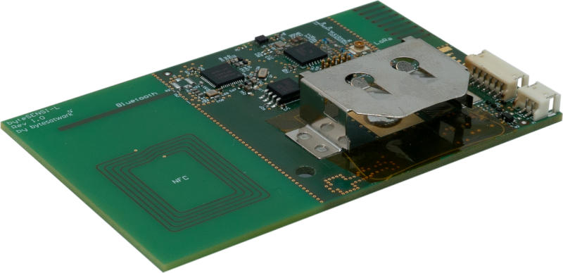

<!-- Copyright 2015-2026 Zephyr Project members and individual contributors. -->
<!-- SPDX-License-Identifier: Apache-2.0 -->
<!-- 中文翻译；编号、导航与译注为本地新增。 -->

<a id="bytesensi_l"></a>

# 第5章\_byteSENSI-L

原文：[官方页面](https://docs.zephyrproject.org/latest/boards/bytesatwork/bytesensi_l/doc/index.html)。读取日期：2026-10-16；来源摘要见[来源记录](../SOURCES.md)。

开发板概览（Board Overview）

<a id="id1"></a>

[](images/byteSENSI-L.jpg)

byteSENSI-L

名称（Name）：

`bytesensi_l`

厂商（Vendor）：

[bytesatwork AG公司](https://docs.zephyrproject.org/latest/boards/index.html#vendor=bytesatwork)

状态（Status）：

当前未积极维护（Not Actively Maintained）

架构（Architecture）：

[arm](https://docs.zephyrproject.org/latest/boards/index.html#arch=arm)

片上系统（SoC）：

[nrf52832](https://docs.zephyrproject.org/latest/boards/index.html#soc=nrf52832)

<a id="board-github-link"></a>

[浏览开发板源码（Browse Board Sources）](https://github.com/zephyrproject-rtos/zephyr/blob/main//boards/bytesatwork/bytesensi_l/doc/index.rst/../..)<a id="overview"></a>

## 概述（Overview）

byteSENSI-L是一款基于nRF52微控制器（MCU）的趣味LoRa设备，集成了多种传感器。

<a id="hardware"></a>

## 硬件（Hardware）

<a id="supported-features"></a>

### 支持的功能（Supported Features）

`bytesensi_l`开发板支持下表所列的硬件功能。

片上／板载（On-Chip / On-Board）

功能集成在片上系统（SoC）内／位于开发板上。

2 / 2

分别表示已启用／已禁用的实例数。点击数量标签，可查看开发板或SoC设备树源码（DTS）中该功能的第一个实例。

`vnd,foo`

与此功能匹配的设备树绑定兼容字符串（Compatible String）；点击链接可查看绑定文档。

<a id="bytesensi_l-hw-features"></a>

<a id="bytesensi_l-bytesensi_l/nrf52832-hw-features-section"></a>

#### `bytesensi_l/nrf52832`目标（Target）

<a id="bytesensi_l-bytesensi_l/nrf52832-hw-features-panel"></a>

<a id="bytesensi_l-bytesensi_l/nrf52832-hw-features-memory"></a>

该开发板目标的片上存储容量：64 KiB RAM、512 KiB Flash。

<a id="bytesensi_l-bytesensi_l/nrf52832-hw-features-table"></a>

<table>
<tr>
<th>类型（Type）</th>
<th>位置（Location）</th>
<th>说明（Description）</th>
<th>兼容字符串（Compatible）</th>
</tr>
<tr>
<td rowspan="1">中央处理器（CPU）</td>
<td>片上（On-Chip）</td>
<td>ARM Cortex-M4F 处理器（CPU）（<a href="https://github.com/zephyrproject-rtos/zephyr/blob/main/dts/arm/nordic/nrf52832.dtsi?plain=1#L23">已启用：1</a>）</td>
<td><a href="../cpu_arm_riscv_binding_reference/P025_arm_cortex-m4f.md#std-dtcompatible-arm-cortex-m4f"><code>arm,cortex-m4f</code></a></td>
</tr>
<tr>
<td rowspan="1">模数转换器（ADC）</td>
<td>片上（On-Chip）</td>
<td>Nordic Semiconductor nRF系列逐次逼近模数转换器（SAADC）节点（<a href="https://github.com/zephyrproject-rtos/zephyr/blob/main/dts/arm/nordic/nrf52832.dtsi?plain=1#L239">已禁用：1</a>）</td>
<td><a href="../hardware/P846_NordicNRF逐次逼近ADC绑定.md#dtbinding-nordic-nrf-saadc"><code>nordic,nrf-saadc</code></a></td>
</tr>
<tr>
<td rowspan="4">ARM 架构（ARM Architecture）</td>
<td>片上（On-Chip）</td>
<td>Nordic用户信息配置寄存器（UICR / User Information Configuration Registers）（<a href="https://github.com/zephyrproject-rtos/zephyr/blob/main/dts/arm/nordic/nrf52832.dtsi?plain=1#L57">已启用：1</a>）</td>
<td><a href="../arm_nordic_nxp_control_binding_reference/P007_nordic_nrf-uicr.md#std-dtcompatible-nordic-nrf-uicr"><code>nordic,nrf-uicr</code></a></td>
</tr>
<tr>
<td>片上（On-Chip）</td>
<td>Nordic nRF系列块保护（BPROT / Block Protection）（<a href="https://github.com/zephyrproject-rtos/zephyr/blob/main/dts/arm/nordic/nrf52832.dtsi?plain=1#L121">已启用：1</a>）</td>
<td><a href="../arm_timing_ethosu_control_binding_reference/P015_nordic_nrf-bprot.md#std-dtcompatible-nordic-nrf-bprot"><code>nordic,nrf-bprot</code></a></td>
</tr>
<tr>
<td>片上（On-Chip）</td>
<td>Nordic事件发生器单元（EGU / Event Generator Unit）（<a href="https://github.com/zephyrproject-rtos/zephyr/blob/main/dts/arm/nordic/nrf52832.dtsi?plain=1#L352">已启用：6</a>）</td>
<td><a href="../arm_timing_ethosu_control_binding_reference/P018_nordic_nrf-egu.md#std-dtcompatible-nordic-nrf-egu"><code>nordic,nrf-egu</code></a></td>
</tr>
<tr>
<td>片上（On-Chip）</td>
<td>Nordic nRF系列存储器监视单元（MWU / Memory Watch Unit）（<a href="https://github.com/zephyrproject-rtos/zephyr/blob/main/dts/arm/nordic/nrf52832.dtsi?plain=1#L452">已启用：1</a>）</td>
<td><a href="../arm_timing_ethosu_control_binding_reference/P022_nordic_nrf-mwu.md#std-dtcompatible-nordic-nrf-mwu"><code>nordic,nrf-mwu</code></a></td>
</tr>
<tr>
<td rowspan="1">音频（Audio）</td>
<td>片上（On-Chip）</td>
<td>Nordic脉冲密度调制接口（PDM / Pulse Density Modulation Interface）（<a href="https://github.com/zephyrproject-rtos/zephyr/blob/main/dts/arm/nordic/nrf52832.dtsi?plain=1#L422">已禁用：1</a>）</td>
<td><a href="../audio_pdm_codec_binding_reference/P012_nordic_nrf-pdm.md#std-dtcompatible-nordic-nrf-pdm"><code>nordic,nrf-pdm</code></a></td>
</tr>
<tr>
<td rowspan="4">时钟控制（Clock Control）</td>
<td>片上（On-Chip）</td>
<td>Nordic nRF时钟控制（Clock Control）节点（<a href="https://github.com/zephyrproject-rtos/zephyr/blob/main/dts/arm/nordic/nrf52832.dtsi?plain=1#L72">已启用：1</a>）</td>
<td><a href="../clock_sam_nordic_binding_reference/P015_nordic_nrf-clock.md#std-dtcompatible-nordic-nrf-clock"><code>nordic,nrf-clock</code></a></td>
</tr>
<tr>
<td>片上（On-Chip）</td>
<td>Nordic nRF高频时钟（HFCLK）控制节点（<a href="https://github.com/zephyrproject-rtos/zephyr/blob/main/dts/arm/nordic/nrf52832.dtsi?plain=1#L78">已启用：1</a>）</td>
<td><a href="../clock_sam_nordic_binding_reference/P009_nordic_nrf-clock-hfclk.md#std-dtcompatible-nordic-nrf-clock-hfclk"><code>nordic,nrf-clock-hfclk</code></a></td>
</tr>
<tr>
<td>片上（On-Chip）</td>
<td>Nordic nRF低频时钟（LFCLK）控制节点（<a href="https://github.com/zephyrproject-rtos/zephyr/blob/main/dts/arm/nordic/nrf52832.dtsi?plain=1#L83">已启用：1</a>）</td>
<td><a href="../clock_sam_nordic_binding_reference/P012_nordic_nrf-clock-lfclk.md#std-dtcompatible-nordic-nrf-clock-lfclk"><code>nordic,nrf-clock-lfclk</code></a></td>
</tr>
<tr>
<td>片上（On-Chip）</td>
<td>Nordic nRF高频晶体振荡器（High-frequency Crystal Oscillator，nRF52系列）（<a href="https://github.com/zephyrproject-rtos/zephyr/blob/main/dts/arm/nordic/nrf52832.dtsi?plain=1#L39">已启用：1</a>）</td>
<td><a href="../clock_sam_nordic_binding_reference/P022_nordic_nrf52-hfxo.md#std-dtcompatible-nordic-nrf52-hfxo"><code>nordic,nrf52-hfxo</code></a></td>
</tr>
<tr>
<td rowspan="1">比较器（Comparator）</td>
<td>片上（On-Chip）</td>
<td>Nordic nRF模拟比较器（COMP / Analog Comparator）（<a href="https://github.com/zephyrproject-rtos/zephyr/blob/main/dts/arm/nordic/nrf52832.dtsi?plain=1#L341">已禁用：1</a>）</td>
<td><a href="../hardware/P752_NordicnRF比较器绑定.md#dtbinding-nordic-nrf-comp"><code>nordic,nrf-comp</code></a></td>
</tr>
<tr>
<td rowspan="1">计数器（Counter）</td>
<td>片上（On-Chip）</td>
<td>Nordic nRF定时器（Timer）节点（<a href="https://github.com/zephyrproject-rtos/zephyr/blob/main/dts/arm/nordic/nrf52832.dtsi?plain=1#L248">已禁用：5</a>）</td>
<td><a href="../microchip_soc_counter_binding_reference/P017_nordic_nrf-timer.md#std-dtcompatible-nordic-nrf-timer"><code>nordic,nrf-timer</code></a></td>
</tr>
<tr>
<td rowspan="2">密码学加速器（Cryptographic Accelerator）</td>
<td>片上（On-Chip）</td>
<td>Nordic ECB（AES电子密码本模式加密 / Electronic Codebook Mode Encryption）（<a href="https://github.com/zephyrproject-rtos/zephyr/blob/main/dts/arm/nordic/nrf52832.dtsi?plain=1#L302">已启用：1</a>）</td>
<td><a href="../crypto_secure_engine_st_ti_binding_reference/P001_nordic_nrf-ecb.md#std-dtcompatible-nordic-nrf-ecb"><code>nordic,nrf-ecb</code></a></td>
</tr>
<tr>
<td>片上（On-Chip）</td>
<td>Nordic nRF系列CCM（AES CCM模式加密 / CCM Mode Encryption）（<a href="https://github.com/zephyrproject-rtos/zephyr/blob/main/dts/arm/nordic/nrf52832.dtsi?plain=1#L309">已启用：1</a>）</td>
<td><a href="../crypto_aes_sha_ccm_binding_reference/P020_nordic_nrf-ccm.md#std-dtcompatible-nordic-nrf-ccm"><code>nordic,nrf-ccm</code></a></td>
</tr>
<tr>
<td rowspan="1">调试（Debug）</td>
<td>片上（On-Chip）</td>
<td>ARMv7仪器化跟踪宏单元（ITM / Instrumentation Trace Macrocell）（<a href="https://github.com/zephyrproject-rtos/zephyr/blob/main/dts/arm/nordic/nrf52832.dtsi?plain=1#L30">已启用：1</a>）</td>
<td><a href="../debug_binding_reference/P001_ARMv7M_ITM调试绑定.md#std-dtcompatible-arm-armv7m-itm"><code>arm,armv7m-itm</code></a></td>
</tr>
<tr>
<td rowspan="1">闪存控制器（Flash Controller）</td>
<td>片上（On-Chip）</td>
<td>Nordic非易失性存储器控制器（NVMC / Non-Volatile Memory Controller）（<a href="https://github.com/zephyrproject-rtos/zephyr/blob/main/dts/arm/nordic/nrf52832.dtsi?plain=1#L429">已启用：1</a>）</td>
<td><a href="../flash_adi_microchip_nordic_binding_reference/P030_nordic_nrf52-flash-controller.md#std-dtcompatible-nordic-nrf52-flash-controller"><code>nordic,nrf52-flash-controller</code></a></td>
</tr>
<tr>
<td rowspan="1">全球导航卫星系统（GNSS）</td>
<td>板载（On-Board）</td>
<td>通用全球导航卫星系统（GNSS）NMEA接收器（<a href="https://github.com/zephyrproject-rtos/zephyr/blob/main/boards/bytesatwork/bytesensi_l/bytesensi_l.dts?plain=1#L173">已启用：1</a>）</td>
<td><a href="../gnss_fingerprint_binding_reference/P005_gnss-nmea-generic.md#std-dtcompatible-gnss-nmea-generic"><code>gnss-nmea-generic</code></a></td>
</tr>
<tr>
<td rowspan="2">通用输入输出与接插件（GPIO &amp; Headers）</td>
<td>片上（On-Chip）</td>
<td>NRF5 GPIO任务与事件（GPIOTE）（<a href="https://github.com/zephyrproject-rtos/zephyr/blob/main/dts/arm/nordic/nrf52832.dtsi?plain=1#L231">已启用：1</a>）</td>
<td><a href="../gpio_microchip_nordic_nuvoton_binding_reference/P017_nordic_nrf-gpiote.md#std-dtcompatible-nordic-nrf-gpiote"><code>nordic,nrf-gpiote</code></a></td>
</tr>
<tr>
<td>片上（On-Chip）</td>
<td>NRF5通用输入输出（GPIO）（<a href="https://github.com/zephyrproject-rtos/zephyr/blob/main/dts/arm/nordic/nrf52832.dtsi?plain=1#L511">已启用：1</a>）</td>
<td><a href="../gpio_microchip_nordic_nuvoton_binding_reference/P016_nordic_nrf-gpio.md#std-dtcompatible-nordic-nrf-gpio"><code>nordic,nrf-gpio</code></a></td>
</tr>
<tr>
<td rowspan="2">集成电路间总线（I2C）</td>
<td>片上（On-Chip）</td>
<td>Nordic nRF系列双线接口（TWI，TWI主机）（<a href="https://github.com/zephyrproject-rtos/zephyr/blob/main/dts/arm/nordic/nrf52832.dtsi?plain=1#L152">已启用：1</a>）</td>
<td><a href="../i2c_infineon_ite_nordic_binding_reference/P015_nordic_nrf-twi.md#std-dtcompatible-nordic-nrf-twi"><code>nordic,nrf-twi</code></a></td>
</tr>
<tr>
<td>片上（On-Chip）</td>
<td>Nordic nRF系列TWIM（带EasyDMA的TWI主机）（<a href="https://github.com/zephyrproject-rtos/zephyr/blob/main/dts/arm/nordic/nrf52832.dtsi?plain=1#L188">已禁用：1</a>）</td>
<td><a href="../i2c_infineon_ite_nordic_binding_reference/P016_nordic_nrf-twim.md#std-dtcompatible-nordic-nrf-twim"><code>nordic,nrf-twim</code></a></td>
</tr>
<tr>
<td rowspan="1">集成电路间音频总线（I2S）</td>
<td>片上（On-Chip）</td>
<td>Nordic芯片间音频接口（I2S / Inter-IC Sound Interface）（<a href="https://github.com/zephyrproject-rtos/zephyr/blob/main/dts/arm/nordic/nrf52832.dtsi?plain=1#L502">已禁用：1</a>）</td>
<td><a href="../i2s_binding_reference/P010_nordic_nrf-i2s.md#std-dtcompatible-nordic-nrf-i2s"><code>nordic,nrf-i2s</code></a></td>
</tr>
<tr>
<td rowspan="1">中断控制器（Interrupt Controller）</td>
<td>片上（On-Chip）</td>
<td>ARMv7-M 嵌套向量中断控制器（Nested Vectored Interrupt Controller，NVIC）（<a href="https://github.com/zephyrproject-rtos/zephyr/blob/main/dts/arm/armv7-m.dtsi?plain=1#L13">已启用：1</a>）</td>
<td><a href="../arm_interrupt_timer_binding_reference/P002_ARMv7_M_NVIC.md#std-dtcompatible-arm-v7m-nvic"><code>arm,v7m-nvic</code></a></td>
</tr>
<tr>
<td rowspan="1">远距离无线通信（LoRa）</td>
<td>板载（On-Board）</td>
<td>Semtech SX1276 LoRa调制解调器（Modem）（<a href="https://github.com/zephyrproject-rtos/zephyr/blob/main/boards/bytesatwork/bytesensi_l/bytesensi_l.dts?plain=1#L143">已启用：1</a>）</td>
<td><a href="../lora_ieee802154_binding_reference/P024_semtech_sx1276.md#std-dtcompatible-semtech-sx1276"><code>semtech,sx1276</code></a></td>
</tr>
<tr>
<td rowspan="2">其他绑定（Miscellaneous）</td>
<td>片上（On-Chip）</td>
<td>Nordic工厂信息配置寄存器（FICR / Factory Information Configuration Registers）（<a href="https://github.com/zephyrproject-rtos/zephyr/blob/main/dts/arm/nordic/nrf52832.dtsi?plain=1#L50">已启用：1</a>）</td>
<td><a href="../misc_adi_nordic_binding_reference/P018_nordic_nrf-ficr.md#std-dtcompatible-nordic-nrf-ficr"><code>nordic,nrf-ficr</code></a></td>
</tr>
<tr>
<td>片上（On-Chip）</td>
<td>Nordic nRF系列可编程外设互连（PPI / Programmable Peripheral Interconnect）（<a href="https://github.com/zephyrproject-rtos/zephyr/blob/main/dts/arm/nordic/nrf52832.dtsi?plain=1#L446">已启用：1</a>）</td>
<td><a href="../misc_adi_nordic_binding_reference/P020_nordic_nrf-ppi.md#std-dtcompatible-nordic-nrf-ppi"><code>nordic,nrf-ppi</code></a></td>
</tr>
<tr>
<td rowspan="3">存储技术设备（MTD）</td>
<td>板载（On-Board）</td>
<td>TI TMP11X电可擦可编程只读存储器（EEPROM）控制器（<a href="https://github.com/zephyrproject-rtos/zephyr/blob/main/boards/bytesatwork/bytesensi_l/bytesensi_l.dts?plain=1#L112">已启用：1</a>）</td>
<td><a href="../mtd_nxp_st_ti_partition_binding_reference/P020_ti_tmp11x-eeprom.md#std-dtcompatible-ti-tmp11x-eeprom"><code>ti,tmp11x-eeprom</code></a></td>
</tr>
<tr>
<td>板载（On-Board）</td>
<td>这些属性用于支持Zephyr的<code>spi-nor</code>闪存驱动通过Zephyr SPI API，使用基于M25P80的标准命令集控制串行闪存（Serial Flash Memory）。（<a href="https://github.com/zephyrproject-rtos/zephyr/blob/main/boards/bytesatwork/bytesensi_l/bytesensi_l.dts?plain=1#L156">已启用：1</a>）</td>
<td><a href="../mtd_microchip_nordic_nxp_binding_reference/P002_jedec_spi-nor.md#std-dtcompatible-jedec-spi-nor"><code>jedec,spi-nor</code></a></td>
</tr>
<tr>
<td>片上（On-Chip）</td>
<td>闪存（Flash）节点（<a href="https://github.com/zephyrproject-rtos/zephyr/blob/main/dts/arm/nordic/nrf52832.dtsi?plain=1#L436">已启用：1</a>）</td>
<td><a href="../mtd_nxp_st_ti_partition_binding_reference/P013_soc-nv-flash.md#std-dtcompatible-soc-nv-flash"><code>soc-nv-flash</code></a></td>
</tr>
<tr>
<td rowspan="2">网络（Networking）</td>
<td>片上（On-Chip）</td>
<td>Nordic nRF系列无线电（RADIO）外设（<a href="https://github.com/zephyrproject-rtos/zephyr/blob/main/dts/arm/nordic/nrf52832.dtsi?plain=1#L127">已启用：1</a>）</td>
<td><a href="../network_radio_frontend_binding_reference/P009_nordic_nrf-radio.md#std-dtcompatible-nordic-nrf-radio"><code>nordic,nrf-radio</code></a></td>
</tr>
<tr>
<td>片上（On-Chip）</td>
<td>Nordic nRF系列近场通信标签（NFCT / Near Field Communication Tag）（<a href="https://github.com/zephyrproject-rtos/zephyr/blob/main/dts/arm/nordic/nrf52832.dtsi?plain=1#L224">已禁用：1</a>）</td>
<td><a href="../network_radio_frontend_binding_reference/P008_nordic_nrf-nfct.md#std-dtcompatible-nordic-nrf-nfct"><code>nordic,nrf-nfct</code></a></td>
</tr>
<tr>
<td rowspan="1">引脚控制（Pin Control）</td>
<td>片上（On-Chip）</td>
<td>Nordic nRF系列引脚控制器（Pin Controller）（<a href="https://github.com/zephyrproject-rtos/zephyr/blob/main/dts/vendor/nordic/nrf_common.dtsi?plain=1#L26">已启用：1</a>）</td>
<td><a href="../pinctrl_infineon_nordic_nxp_binding_reference/P009_nordic_nrf-pinctrl.md#std-dtcompatible-nordic-nrf-pinctrl"><code>nordic,nrf-pinctrl</code></a></td>
</tr>
<tr>
<td rowspan="1">电源管理（Power Management）</td>
<td>片上（On-Chip）</td>
<td>Nordic nRF电源控制（Power Control）节点（<a href="https://github.com/zephyrproject-rtos/zephyr/blob/main/dts/arm/nordic/nrf52832.dtsi?plain=1#L89">已启用：1</a>）</td>
<td><a href="../power_control_binding_reference/P008_nordic_nrf-power.md#std-dtcompatible-nordic-nrf-power"><code>nordic,nrf-power</code></a></td>
</tr>
<tr>
<td rowspan="2">脉宽调制（PWM）</td>
<td>片上（On-Chip）</td>
<td>nRF脉宽调制（PWM）（<a href="https://github.com/zephyrproject-rtos/zephyr/blob/main/dts/arm/nordic/nrf52832.dtsi?plain=1#L414">已禁用：3</a>）</td>
<td><a href="../pwm_intel_microchip_nxp_binding_reference/P015_nordic_nrf-pwm.md#std-dtcompatible-nordic-nrf-pwm"><code>nordic,nrf-pwm</code></a></td>
</tr>
<tr>
<td>片上（On-Chip）</td>
<td>nRFx软件脉宽调制（S/W PWM）（<a href="https://github.com/zephyrproject-rtos/zephyr/blob/main/dts/vendor/nordic/nrf_common.dtsi?plain=1#L39">已禁用：1</a>）</td>
<td><a href="../pwm_intel_microchip_nxp_binding_reference/P016_nordic_nrf-sw-pwm.md#std-dtcompatible-nordic-nrf-sw-pwm"><code>nordic,nrf-sw-pwm</code></a></td>
</tr>
<tr>
<td rowspan="1">稳压器（Regulator）</td>
<td>片上（On-Chip）</td>
<td>Nordic nRF5X稳压器（Regulator，内核供电的固定级）（<a href="https://github.com/zephyrproject-rtos/zephyr/blob/main/dts/arm/nordic/nrf52832.dtsi?plain=1#L113">已启用：1</a>）</td>
<td><a href="../hardware/P643_nRF5X稳压器绑定.md#dtbinding-nordic-nrf5x-regulator"><code>nordic,nrf5x-regulator</code></a></td>
</tr>
<tr>
<td rowspan="1">保持存储器（Retained Memory）</td>
<td>片上（On-Chip）</td>
<td>Nordic通用保持寄存器（GPREGRET / General Purpose Register Retention）设备（<a href="https://github.com/zephyrproject-rtos/zephyr/blob/main/dts/arm/nordic/nrf52832.dtsi?plain=1#L97">已启用：2</a>）</td>
<td><a href="../hardware/P627_Nordic通用保留寄存器绑定.md#dtbinding-nordic-nrf-gpregret"><code>nordic,nrf-gpregret</code></a></td>
</tr>
<tr>
<td rowspan="1">随机数生成器（RNG）</td>
<td>片上（On-Chip）</td>
<td>Nordic nRF系列随机数发生器（RNG / Random Number Generator）（<a href="https://github.com/zephyrproject-rtos/zephyr/blob/main/dts/arm/nordic/nrf52832.dtsi?plain=1#L295">已启用：1</a>）</td>
<td><a href="../rng_binding_reference/P014_nordic_nrf-rng.md#std-dtcompatible-nordic-nrf-rng"><code>nordic,nrf-rng</code></a></td>
</tr>
<tr>
<td rowspan="1">实时时钟（RTC）</td>
<td>片上（On-Chip）</td>
<td>Nordic nRF实时时间计数器（RTC / Real-Time Counter）（<a href="https://github.com/zephyrproject-rtos/zephyr/blob/main/dts/arm/nordic/nrf52832.dtsi?plain=1#L278">已禁用：3</a>）</td>
<td><a href="../microchip_microcrystal_nxp_rtc_binding_reference/P010_nordic_nrf-rtc.md#std-dtcompatible-nordic-nrf-rtc"><code>nordic,nrf-rtc</code></a></td>
</tr>
<tr>
<td rowspan="6">传感器（Sensors）</td>
<td>板载（On-Board）</td>
<td>APDS9960数字接近、环境光、RGB及手势传感器（Gesture Sensor）（<a href="https://github.com/zephyrproject-rtos/zephyr/blob/main/boards/bytesatwork/bytesensi_l/bytesensi_l.dts?plain=1#L98">已启用：1</a>）</td>
<td><a href="../sensor_ams_aosong_bosch_binding_reference/P021_avago_apds9960.md#std-dtcompatible-avago-apds9960"><code>avago,apds9960</code></a></td>
</tr>
<tr>
<td>板载（On-Board）</td>
<td>德州仪器（Texas Instruments）TMP11X温度传感器（<a href="https://github.com/zephyrproject-rtos/zephyr/blob/main/boards/bytesatwork/bytesensi_l/bytesensi_l.dts?plain=1#L105">已启用：1</a>）</td>
<td><a href="../sensor_ti_vishay_wurth_sensing_binding_reference/P009_ti_tmp11x.md#std-dtcompatible-ti-tmp11x"><code>ti,tmp11x</code></a></td>
</tr>
<tr>
<td>板载（On-Board）</td>
<td>CCS811数字空气质量传感器（<a href="https://github.com/zephyrproject-rtos/zephyr/blob/main/boards/bytesatwork/bytesensi_l/bytesensi_l.dts?plain=1#L119">已启用：1</a>）</td>
<td><a href="../sensor_ams_aosong_bosch_binding_reference/P001_ams_ccs811.md#std-dtcompatible-ams-ccs811"><code>ams,ccs811</code></a></td>
</tr>
<tr>
<td>板载（On-Board）</td>
<td>STMicroelectronics LPS22HB 压力传感器（Pressure Sensor）（<a href="https://github.com/zephyrproject-rtos/zephyr/blob/main/boards/bytesatwork/bytesensi_l/bytesensi_l.dts?plain=1#L127">已启用：1</a>）</td>
<td><a href="../sensor_st_lis_lps_binding_reference/P021_st_lps22hb-press.md#std-dtcompatible-st-lps22hb-press"><code>st,lps22hb-press</code></a></td>
</tr>
<tr>
<td>片上（On-Chip）</td>
<td>Nordic nRF系列温度（TEMP）节点（<a href="https://github.com/zephyrproject-rtos/zephyr/blob/main/dts/arm/nordic/nrf52832.dtsi?plain=1#L288">已启用：1</a>）</td>
<td><a href="../sensor_microchip_nordic_nxp_binding_reference/P023_nordic_nrf-temp.md#std-dtcompatible-nordic-nrf-temp"><code>nordic,nrf-temp</code></a></td>
</tr>
<tr>
<td>片上（On-Chip）</td>
<td>Nordic nRF正交解码器（QDEC / Quadrature Decoder）节点（<a href="https://github.com/zephyrproject-rtos/zephyr/blob/main/dts/arm/nordic/nrf52832.dtsi?plain=1#L334">已禁用：1</a>）</td>
<td><a href="../sensor_microchip_nordic_nxp_binding_reference/P021_nordic_nrf-qdec.md#std-dtcompatible-nordic-nrf-qdec"><code>nordic,nrf-qdec</code></a></td>
</tr>
<tr>
<td rowspan="1">串行控制器（Serial Controller）</td>
<td>片上（On-Chip）</td>
<td>Nordic nRF系列UARTE（带EasyDMA的UART）（<a href="https://github.com/zephyrproject-rtos/zephyr/blob/main/dts/arm/nordic/nrf52832.dtsi?plain=1#L143">已启用：1</a>）</td>
<td><a href="../uart_microchip_nordic_nxp_binding_reference/P004_nordic_nrf-uarte.md#std-dtcompatible-nordic-nrf-uarte"><code>nordic,nrf-uarte</code></a></td>
</tr>
<tr>
<td rowspan="1">串行外设接口（SPI）</td>
<td>片上（On-Chip）</td>
<td>Nordic nRF系列串行外设接口（SPI）控制器（<a href="https://github.com/zephyrproject-rtos/zephyr/blob/main/dts/arm/nordic/nrf52832.dtsi?plain=1#L206">已启用：1</a>；<a href="https://github.com/zephyrproject-rtos/zephyr/blob/main/dts/arm/nordic/nrf52832.dtsi?plain=1#L170">已禁用：2</a>）</td>
<td><a href="../spi_microchip_nordic_nxp_binding_reference/P012_nordic_nrf-spi.md#std-dtcompatible-nordic-nrf-spi"><code>nordic,nrf-spi</code></a></td>
</tr>
<tr>
<td rowspan="1">静态随机存储器（SRAM）</td>
<td>片上（On-Chip）</td>
<td>通用片上静态随机存储器（SRAM）（<a href="https://github.com/zephyrproject-rtos/zephyr/blob/main/dts/arm/nordic/nrf52832.dtsi?plain=1#L66">已启用：1</a>）</td>
<td><a href="../hardware/P567_内存映射SRAM绑定.md#dtbinding-mmio-sram"><code>mmio-sram</code></a></td>
</tr>
<tr>
<td rowspan="1">定时器（Timer）</td>
<td>片上（On-Chip）</td>
<td>ARMv7-M 系统节拍（System Tick）（<a href="https://github.com/zephyrproject-rtos/zephyr/blob/main/dts/arm/armv7-m.dtsi?plain=1#L21">已禁用：1</a>）</td>
<td><a href="../arm_interrupt_timer_binding_reference/P006_ARMv7_M_SysTick.md#std-dtcompatible-arm-armv7m-systick"><code>arm,armv7m-systick</code></a></td>
</tr>
<tr>
<td rowspan="1">看门狗（Watchdog）</td>
<td>片上（On-Chip）</td>
<td>Nordic nRF系列看门狗定时器（WDT / Watchdog Timer）（<a href="https://github.com/zephyrproject-rtos/zephyr/blob/main/dts/arm/nordic/nrf52832.dtsi?plain=1#L317">已启用：1</a>）</td>
<td><a href="../nxp_nordic_nuvoton_watchdog_binding_reference/P002_nordic_nrf-wdt.md#std-dtcompatible-nordic-nrf-wdt"><code>nordic,nrf-wdt</code></a></td>
</tr>
</table>

<a id="connections-and-ios"></a>

### 连接与输入输出（Connections and IOs）

<a id="external-connectors"></a>

#### 外部接插件（External Connectors）

外部电源（External Supply），X1

<table>
<tr>
<th>引脚编号（PIN #）</th>
<th>信号名称（Signal Name）</th>
<th>功能（Function）</th>
</tr>
<tr>
<td>1</td>
<td>电池电源（VBAT）</td>
<td>代替CR2477电池的电源输入</td>
</tr>
<tr>
<td>2</td>
<td>地（GND）</td>
<td>地（Ground）</td>
</tr>
</table>

编程连接器（Programming Connector），SL1

<table>
<tr>
<th>引脚编号（PIN #）</th>
<th>信号名称（Signal Name）</th>
</tr>
<tr>
<td>1</td>
<td>电池电源（VBAT）</td>
</tr>
<tr>
<td>2</td>
<td>串行线调试数据（SWDIO）</td>
</tr>
<tr>
<td>3</td>
<td>地（GND）</td>
</tr>
<tr>
<td>4</td>
<td>串行线调试时钟（SWDCLK）</td>
</tr>
<tr>
<td>5</td>
<td>地（GND）</td>
</tr>
<tr>
<td>6</td>
<td>未连接（NC），SWO</td>
</tr>
<tr>
<td>7</td>
<td>未连接（NC），防错键位（Key）</td>
</tr>
<tr>
<td>8</td>
<td>未连接（NC）</td>
</tr>
<tr>
<td>9</td>
<td>地（GND）</td>
</tr>
<tr>
<td>10</td>
<td>低电平复位（nReset）</td>
</tr>
</table>

I2C传感器（Sensor），X3

<table>
<tr>
<th>引脚编号（PIN #）</th>
<th>信号名称（Signal Name）</th>
<th>功能（Function）</th>
</tr>
<tr>
<td>1</td>
<td>电池电源（VBAT）</td>
<td>电源输出（Power Out）</td>
</tr>
<tr>
<td>2</td>
<td>串行时钟线（SCL）</td>
<td>P0.15上的I2C时钟</td>
</tr>
<tr>
<td>3</td>
<td>串行数据线（SDA）</td>
<td>P0.16上的I2C数据</td>
</tr>
<tr>
<td>4</td>
<td>中断（INT）</td>
<td>P0.13上的中断（Interrupt）</td>
</tr>
<tr>
<td>5</td>
<td>I2C_ADDR</td>
<td>连接到VBAT</td>
</tr>
<tr>
<td>6</td>
<td>地（GND）</td>
<td>地（Ground）</td>
</tr>
</table>

单总线传感器（One Wire Sensor），X2

<table>
<tr>
<th>引脚编号（PIN #）</th>
<th>信号名称（Signal Name）</th>
<th>功能（Function）</th>
</tr>
<tr>
<td>1</td>
<td>电源（VDD）</td>
<td>4V8</td>
</tr>
<tr>
<td>2</td>
<td>输入输出（IO）</td>
<td>单总线（One Wire）</td>
</tr>
<tr>
<td>3</td>
<td>地（GND）</td>
<td>地（Ground）</td>
</tr>
</table>

外接低功耗蓝牙（BLE）天线，J1

外接LoRa天线，J2

外接全球定位系统（GPS）天线，J3

<a id="programming-and-debugging"></a>

## 烧录与调试（Programming and Debugging）

`bytesensi_l`开发板支持下表所列的运行工具（Runners）及相关west命令。

<table>
<tr>
<th></th>
<th>烧录（flash）</th>
<th>调试（debug）</th>
<th>连接调试会话（attach）</th>
<th>实时传输（rtt）</th>
<th>复位（reset）</th>
<th>调试服务器（debugserver）</th>
</tr>
<tr>
<td><a href="https://docs.zephyrproject.org/latest/develop/flash_debug/host-tools.html#runner-jlink">jlink</a></td>
<td>✅（默认 / default）</td>
<td>✅（默认 / default）</td>
<td>✅</td>
<td>✅</td>
<td>✅</td>
<td>✅</td>
</tr>
</table>

<a id="flashing"></a>

### 烧录（Flashing）

byteSENSI-L开发板可以使用SEGGER JLink编程器烧录。

可以按通常方式构建和烧录应用。以下以[Hello World](../getting_started/P005_HelloWorld示例.md#hello_world)应用为例。

> ```text
> west build -b bytesensi_l samples/hello_world
> west flash
> ```

<a id="debugging"></a>

### 调试（Debugging）

可以使用`west debug`调试应用。

<a id="serial-console"></a>

### 串行控制台（Serial Console）

byteSENSI-L开发板仅使用Segger实时传输（RTT）控制台提供串行控制台功能，没有可用的物理串口。

<a id="references"></a>

## 参考资料（References）


- [bytesatwork网站](https://www.bytesatwork.io/)
- [bytesatwork维基（Wiki）](https://wiki.bytesatwork.io/)

## 译注

此页明确使用SEGGER RTT提供控制台，没有可用物理串口。连接器中的NC、键位及VBAT连接关系按原图表保留。

---

[上一章](P004_Broadcom_Corporation.md) · [返回大纲](大纲.md) · [全站翻译进度](../PROGRESS.md) · [下一章](P006_bytesatwork.md)
