<!-- Copyright 2015-2026 Zephyr Project members and individual contributors. -->
<!-- SPDX-License-Identifier: Apache-2.0 -->
<!-- 中文翻译；编号、导航与译注为本地新增。 -->

# 第1章\_支持的开发板与扩展板（Supported Boards and Shields）

原文：[官方目录](https://docs.zephyrproject.org/latest/boards/index.html)。读取日期：2026-10-16；来源摘要见[来源记录](../SOURCES.md)。

本页列出Zephyr当前支持的所有开发板（Board）及扩展板（Shield）。

如果要为新开发板添加Zephyr支持，请从[开发板移植指南（Board Porting Guide）](https://docs.zephyrproject.org/latest/hardware/porting/board_porting.html#board-porting-guide)开始。添加板级说明文档时，记得采用[doc/templates/board.tmpl模板](https://github.com/zephyrproject-rtos/zephyr/blob/main/doc/templates/board.tmpl)。

扩展板是可堆叠在开发板上、增加功能的硬件附加模块。扩展板移植详情见[扩展板移植与配置（Shield Porting and Configuration）](https://docs.zephyrproject.org/latest/hardware/porting/shields.html#shield-porting-guide)。

## 搜索提示（Search Tips）

- 使用下面的表单筛选受支持开发板及扩展板。字段留空时，不参与筛选。

- 名称、厂商及支持的硬件能力筛选同时适用于开发板和扩展板，其余字段仅适用于开发板。

- 开发板或扩展板必须满足不同字段中选择的全部条件。例如同时选择厂商和架构时，只显示两者均匹配的开发板；同一字段选择多个选项，例如两个架构时，匹配任意一个即可。

- 按可用RAM或Flash筛选时，只要开发板至少有一个构建目标满足条件，就会显示在结果中。

- 找不到完全相同的开发板也不必担心。如果已有使用相同或相近MCU的类似开发板，可以将其作为[添加新板支持的起点（Starting Point）](https://docs.zephyrproject.org/latest/hardware/porting/board_porting.html#create-your-board-directory)。

> 译注：以上是官方网页筛选操作的说明。本Markdown保留全部目录卡片、原图及入口，使用阅读器搜索即可查找名称。下表翻译官方控件含义；Markdown本身不执行网页筛选脚本。厂商法定名称、产品型号、架构标识及设备树兼容字符串保留原写法。

| 原文控件 | 中文说明 |
| --- | --- |
| Name | 名称；可输入完整或部分板名，例如reel board、nucleo。 |
| Showing / Boards / Shields | 显示对象：开发板／扩展板。 |
| Architecture | 架构；Any architecture表示任意架构。 |
| Vendor | 厂商；Any vendor表示任意厂商。 |
| On-target RAM | 构建目标可用RAM容量；Any表示不限。 |
| On-target Flash | 构建目标可用Flash容量；Any表示不限。 |
| Family / Series / SoC | 芯片家族／系列／片上系统。 |
| Supported Hardware Capabilities | 支持的硬件能力；例如display显示、sensor传感器。 |
| Supported devices (compatible strings, supports wildcards) | 支持的设备；输入设备树compatible字符串，支持通配符，如ti,hdc2080或bosch,bmp*。 |
| Reset Filters | 重置筛选条件。 |
| Switch to Compact View | 切换到紧凑视图。 |

### 架构与厂商选项

架构选项：任意架构（Any Architecture）；ARC；ARM；ARM 64；MIPS；OpenRISC；POSIX；Qualcomm Hexagon；Renesas RX；RISC-V；SPARC；TriCore；x86；Xtensa。

厂商选项：任意厂商（Any Vendor）；SiFive, Inc.；ASPEED Technology Inc.；GigaDevice Semiconductor；Core Devices LLC；FANKE Technology Co., Ltd.；Makerfabs；Nordic Semiconductor；DFRobot；Bouffalo Lab (Nanjing) Co., Ltd.；Würth Elektronik GmbH.；bytesatwork AG；QuickLogic Corp.；VNGIoTLab；Third Reality, Inc.；WinChipHead；VCC-GND Studio；Toradex AG；FoBE Studio；SparkFun Electronics；Texas Instruments；SEGGER Microcontroller GmbH；CAN-module, FOP；FocalTech Systems Co.,Ltd；NUCODE Co., Ltd. (nuworks.io)；Qualcomm Technologies, Inc；CTHINGS.CO；Aesc Silicon；Element14 (A Premier Farnell Company)；UP Bridge the Gap；GARDENA GmbH；SiFli Technologies；VIEWE Display Co., Ltd.；Particle.io；Norik Systems；Makerbase Co., Ltd.；FlySky；Alientek；BLIIoT Technology Co., Ltd.；T3 Gemstone；Pine64；Croxel, Inc.；Raspberry Pi Foundation；Blues Wireless；Telink Semiconductor；MuseLab Electronics；WIZnet Co., Ltd.；PCB Cupid；SHAKTI Processor Program；Jhoinrch；Witte Technology；MediaTek Inc.；Xen Hypervisor；Elan Microelectronic Corp.；emtrion GmbH；Barth Elektronik GmbH；Tuya Inc.；Cypress Semiconductor Corporation；Shenzhen Xunlong Software CO.,Limited；lowRISC Community Interest Company；Alif Semiconductor；Sutajio Ko-Usagi PTE Ltd.；Shanghai MXCHIP Information Technology Co., Ltd.；Adafruit Industries, LLC；Umeta & Ikki Automotive Parts；Seeed Technology Co., Ltd；Ambiq Micro, Inc.；Radxa；Gaisler；Nuvoton Technology Corporation；Electronut Labs；Eurovibes；ARM Ltd.；KAGA FEI Co., Ltd.；Egis Technology Inc；Armfly；Chengdu Ebyte Electronic Technology；Lilygo Shenzhen Xinyuan Electronic Technology Co., Ltd；Arduino；OpenHW Group；u-blox；Espressif Systems；Ai-Thinker Co., Ltd.；Dongguan Waiken-Smart Technology Co., Ltd.；Broadcom Corporation；Soldered Electronics；PJRC；Zephyr Project；TDK Corporation.；01Space；Silicon Laboratories；Shenzhen Holyiot Technology Co., Ltd.；Waveshare Electronics；StarFive Technology Co. Ltd.；DPTechnics；Raytac Corporation；KWS Computersysteme Gmbh；其他／未知（Other/Unknown）；STMicroelectronics；BlackBerry Limited；Shenzhen JLC Technology Group Co., Ltd.；Octavo Systems LLC；Shenzhen Zaowubang Technology Co., Ltd.；QEMU，通用开源机器模拟器及虚拟化工具；Intel Corporation；Renesas Electronics Corporation；Infineon Technologies；Cadence Design Systems Inc.；Google, Inc.；Retronix Technology Inc.；Centre for Development of Advanced Computing (C-DAC)；Shanghai Ruiside Electronic Technology Co., Ltd.；Ronoth；Heimann Sensor GmbH；WEMOS Electronics；BBC；Seagate Technology PLC；Cirrus Logic, Inc.；Udoo；aconno GmbH；TechNexion；Vicharak；Qorvo, Inc.；Advanced Micro Devices (AMD), Inc.；Blue Clover Devices；RAKwireless Technology Limited；Longan Labs (Shenzhen Longan Technology Co., Ltd.)；Synaptics Inc.；Atmel Corporation；M5Stack；Project ACRN；ITE Tech. Inc.；Contextual Electronics；Andes Technology Corporation；Microchip Technology Inc.；Efinix Inc；IAR Systems AB；MikroElektronika d.o.o.；Synopsys, Inc.；Shenzhen Luckfox Technology Co., Ltd.；OLIMEX Ltd.；Circuit Dojo；Pimoroni Ltd.；ENE Technology, Inc.；Analog Devices, Inc.；Dragino Technology Co., Limited；Atmark Techno, Inc.；Ezurio；NXP Semiconductors；sensry.io；Cytron Technologies；Peregrine Consultoria e Servicos；Panasonic Corporation；Actinius B.V.；Enclustra；SECO S.p.A.；Realtek Semiconductor Corp.；BeagleBoard.org Foundation；WeAct Studio；PHYTEC；KinCony Electronics Co., Ltd.；Shenzhen FeiKaiTe Technology Co., Ltd.；Variscite Ltd.；Hardkernel Co., Ltd；Firefly；Franzininho；EnjoyDigital；SteelSeries；Trenz Electronic；Chengdu Heltec Automation Technology Co., Ltd.；Framework Computer, Inc.；Ruuvi Innovations Ltd (Oy)；Digilent, Inc.；Space Cubics Inc.；Doctors of Intelligence & Technology；Shenzhen Fuyuansheng Electronic Technology Co., Ltd.；Antmicro's open source simulation and virtual development framework；open-isa.org；Shenzhen Sipeed Technology Co., Ltd.；LuatOS Team；Antmicro；innblue UG；Khadas；Guangdong Embedsky Technology Co., Ltd.；DH electronics GmbH；96Boards；OmniVision Technologies Inc.；Arducam Technology Co., Limited；Dalian Good Display Co., Ltd.；Canis Automotive Labs；Aptina Imaging；Future Technology Devices International Ltd.；Inventek Systems；Sharp Corporation；Orient Display；Reyax Technology Co., Ltd.；Semtech Corporation；Sierra Wireless；Wistron NeWeb Corporation；Zurich University of Applied Sciences。

## 开发板目录（Board Catalog）

| 名称及官方说明译文 | 厂商 | 架构 | 官方原图 |
| --- | --- | --- | --- |
| [21014 Module／21014模块（Module）](../boards_gd_to_iar/P032_21014_Module.md) | Shenzhen Holyiot Technology Co., Ltd. | arm | 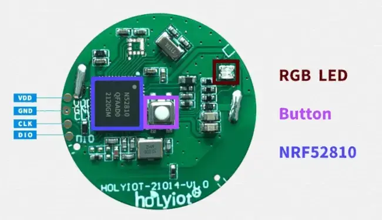 |
| [acn52832](../boards_aconno_acrn_actinius/P001_acn52832.md) | aconno GmbH | arm | 原网页未提供图片 |
| [ACP 6.0 Xtensa Audio DSP／ACP 6.0 Xtensa音频数字信号处理器（Audio DSP）](../boards_amd/P001_ACP_6.0_Xtensa_Audio_DSP.md) | Advanced Micro Devices (AMD), Inc. | — | 原网页未提供图片 |
| [ACP 7.0 Xtensa Audio DSP／ACP 7.0 Xtensa音频数字信号处理器（Audio DSP）](../boards_amd/P002_ACP_7.0_Xtensa_Audio_DSP.md) | Advanced Micro Devices (AMD), Inc. | — | 原网页未提供图片 |
| [ACP 7.X Xtensa Audio DSP／ACP 7.X Xtensa音频数字信号处理器（Audio DSP）](../boards_amd/P003_ACP_7.X_Xtensa_Audio_DSP.md) | Advanced Micro Devices (AMD), Inc. | — | 原网页未提供图片 |
| [ACRN hypervisor／ACRN虚拟机监控器（Hypervisor）](../boards_aconno_acrn_actinius/P003_ACRN_hypervisor.md) | Project ACRN | x86 |  |
| [ACRN Hypervisor on ADL／ACRN虚拟机监控器（Hypervisor）](../boards_aconno_acrn_actinius/P003_ACRN_hypervisor.md) | Project ACRN | x86 |  |
| [ACRN on EHL hypervisor／ACRN虚拟机监控器（Hypervisor）](../boards_aconno_acrn_actinius/P003_ACRN_hypervisor.md) | Project ACRN | x86 |  |
| [AD-APARD32690-SL](../boards_adi_ethernet_platforms/P002_AD-APARD32690-SL.md) | Analog Devices, Inc. | arm, riscv | 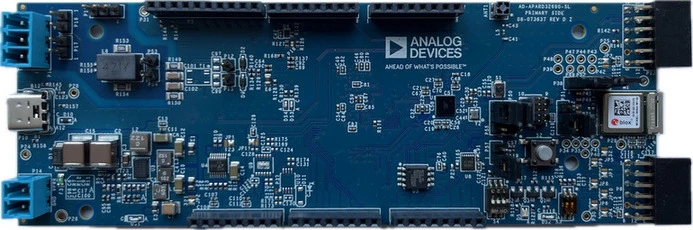 |
| [AD-SWIOT1L-SL](../boards_adi_ethernet_platforms/P001_AD-SWIOT1L-SL.md) | Analog Devices, Inc. | arm | 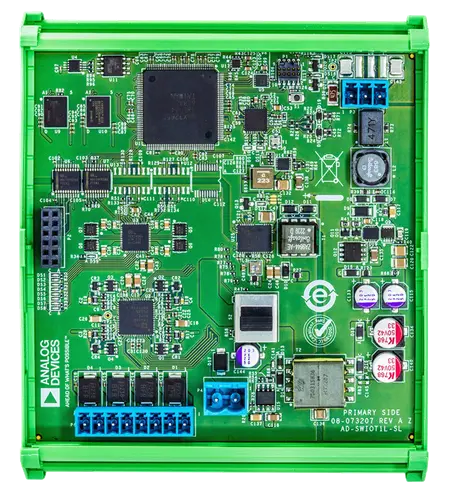 |
| [Adafruit ESP32-S3 Reverse TFT Feather](../boards_adafruit_feather_esp32_rp2040/P010_Adafruit_ESP32-S3_Reverse_TFT_Feather.md) | Adafruit Industries, LLC | xtensa | 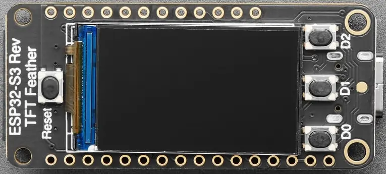 |
| [Adafruit Feather ESP32](../boards_adafruit_feather_esp32_rp2040/P003_Adafruit_Feather_ESP32.md) | Adafruit Industries, LLC | xtensa | 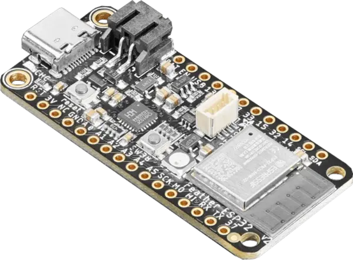 |
| [Adafruit Feather ESP32C6](../boards_adafruit_feather_esp32_rp2040/P004_Adafruit_Feather_ESP32C6.md) | Adafruit Industries, LLC | riscv | 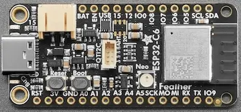 |
| [Adafruit Feather ESP32S2](../boards_adafruit_feather_esp32_rp2040/P005_Adafruit_Feather_ESP32S2.md) | Adafruit Industries, LLC | xtensa | 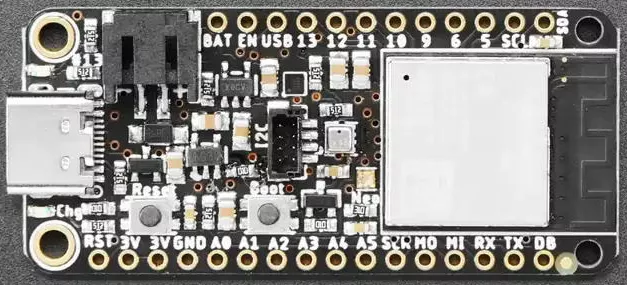 |
| [Adafruit Feather ESP32S2 TFT](../boards_adafruit_feather_esp32_rp2040/P006_Adafruit_Feather_ESP32S2_TFT.md) | Adafruit Industries, LLC | xtensa | 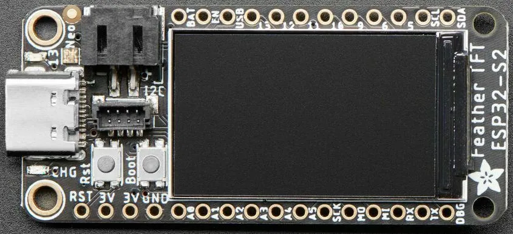 |
| [Adafruit Feather ESP32S2 TFT Reverse](../boards_adafruit_feather_esp32_rp2040/P007_Adafruit_Feather_ESP32S2_TFT_Reverse.md) | Adafruit Industries, LLC | xtensa | 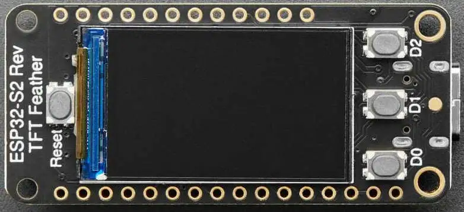 |
| [Adafruit Feather ESP32S3](../boards_adafruit_feather_esp32_rp2040/P008_Adafruit_Feather_ESP32S3.md) | Adafruit Industries, LLC | xtensa | 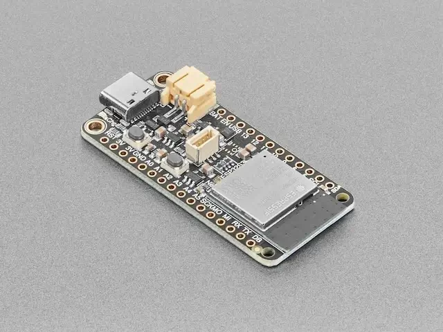 |
| [Adafruit Feather ESP32S3 TFT](../boards_adafruit_feather_esp32_rp2040/P009_Adafruit_Feather_ESP32S3_TFT.md) | Adafruit Industries, LLC | xtensa | 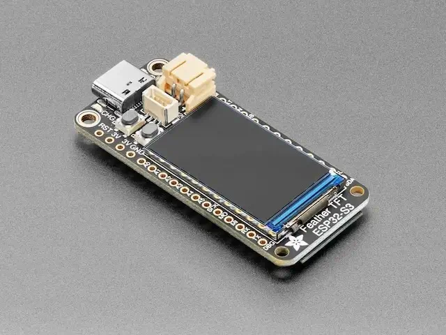 |
| [Adafruit MacroPad RP2040](../boards_adafruit_itsybitsy_metro_qt_trinkey/P006_Adafruit_MacroPad_RP2040.md) | Adafruit Industries, LLC | arm | 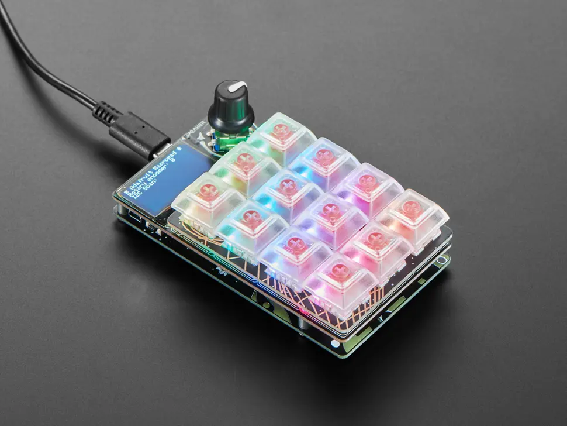 |
| [Adafruit Metro RP2350](../boards_adafruit_itsybitsy_metro_qt_trinkey/P008_Adafruit_Metro_RP2350.md) | Adafruit Industries, LLC | arm | 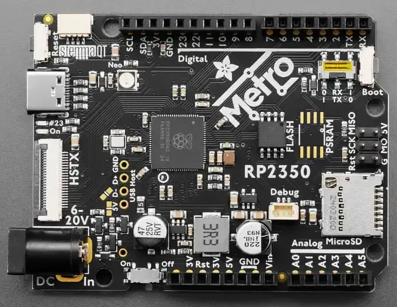 |
| [ADP-XC7K AE350](../boards_andes_antmicro/P001_ADP-XC7K_AE350.md) | Andes Technology Corporation | riscv |  |
| [Advanced BLE Cell／高级BLE蜂窝板（Advanced BLE Cell）](../boards_cdac_to_cthings/P010_Advanced_BLE_Cell.md) | Contextual Electronics | arm | 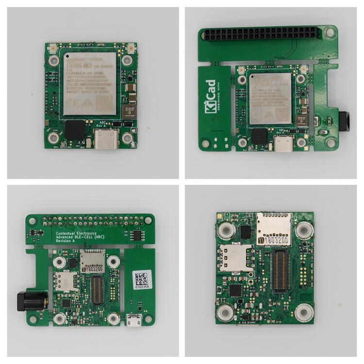 |
| [Aerocore2](../boards_01space_96boards/P003_Aerocore2.md) | 96Boards | arm |  |
| [Agilex SoC Development Kit／Agilex SoC开发套件（Development Kit）](../boards_intel_ite/P019_Agilex_SoC_Development_Kit.md) | Intel Corporation | arm64 | 原网页未提供图片 |
| [Agilex™ 5 SoC FPGA Development Kit／Agilex 5 SoC FPGA开发套件（Development Kit）](../boards_intel_ite/P018_Agilex_5_SoC_FPGA_Development_Kit.md) | Intel Corporation | arm64 | 原网页未提供图片 |
| [Ai-Thinker ESP32-CAM／安信可Ai-Thinker ESP32-CAM](../boards_aesc_aithinker_alientek/P009_Ai-Thinker_ESP32-CAM.md) | Ai-Thinker Co., Ltd. | xtensa | 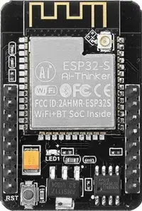 |
| [Ai-Thinker M61-32S development board／安信可Ai-Thinker M61-32S开发板（Development Board）](../boards_aesc_aithinker_alientek/P004_Ai-Thinker_M61-32S_development_board.md) | Ai-Thinker Co., Ltd. | riscv | 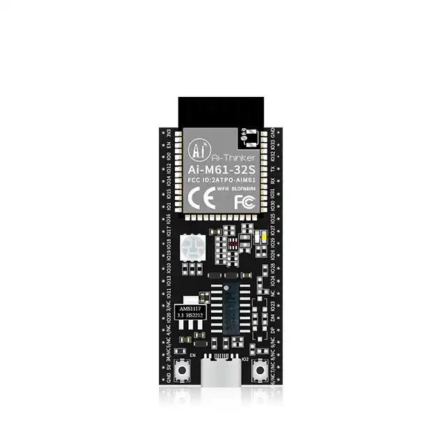 |
| [Ai-Thinker M62-12F development board／安信可Ai-Thinker M62-12F开发板（Development Board）](../boards_aesc_aithinker_alientek/P005_Ai-Thinker_M62-12F_development_board.md) | Ai-Thinker Co., Ltd. | riscv | 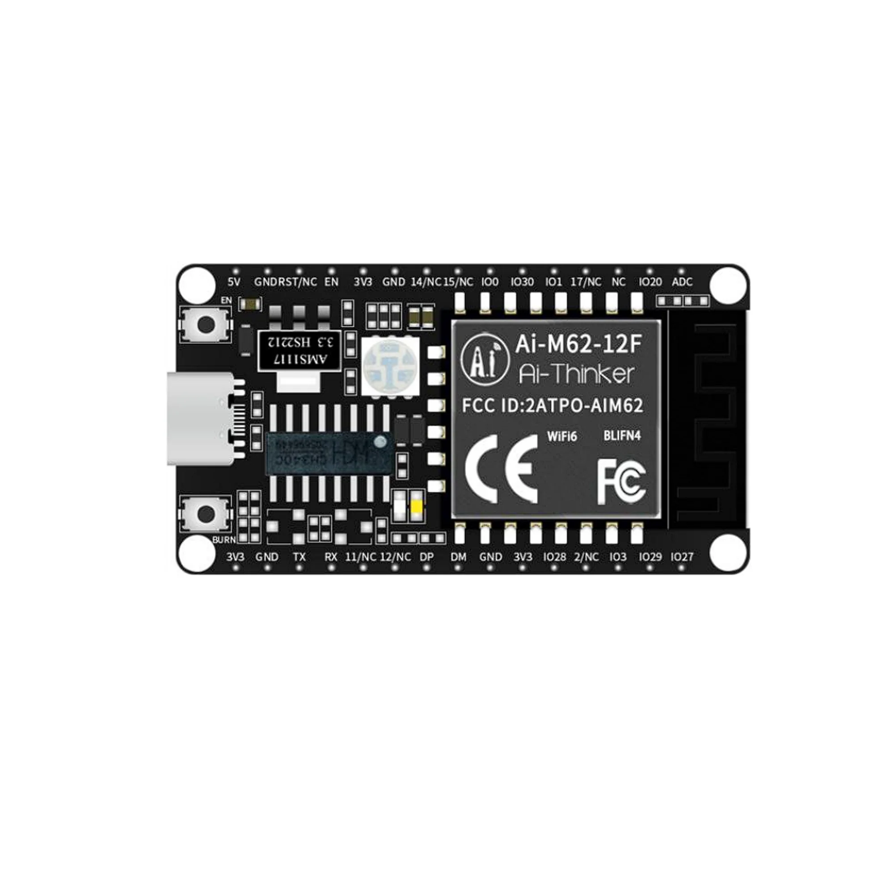 |
| [Ai-Thinker M64P-32S Development Board／安信可Ai-Thinker M64P-32S开发板（Development Board）](../boards_aesc_aithinker_alientek/P006_Ai-Thinker_M64P-32S_Development_Board.md) | Ai-Thinker Co., Ltd. | riscv | 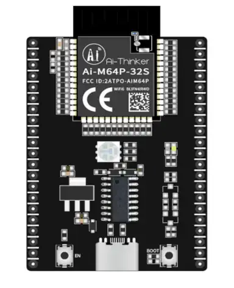 |
| [Ai-Thinker WB2-12F development board／安信可Ai-Thinker WB2-12F开发板（Development Board）](../boards_aesc_aithinker_alientek/P007_Ai-Thinker_WB2-12F_development_board.md) | Ai-Thinker Co., Ltd. | riscv | 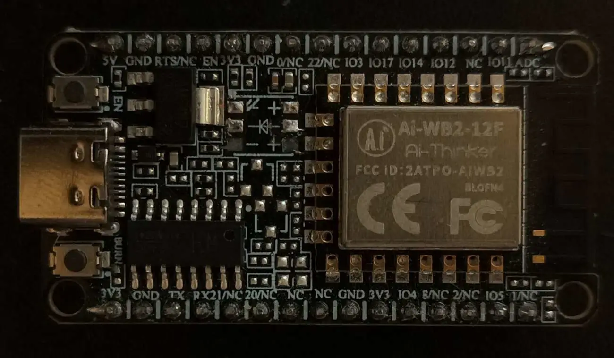 |
| [AiPi-Eyes-S2 Multi-Functional Development Board／AiPi-Eyes-S2多功能开发板（Multi-Functional Development Board）](../boards_aesc_aithinker_alientek/P008_AiPi-Eyes-S2_Multi-Functional_Development_Board.md) | Ai-Thinker Co., Ltd. | riscv | 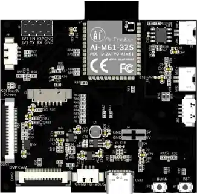 |
| [Alder Lake CRB](../boards_intel_ite/P001_Alder_Lake_N.md) | Intel Corporation | x86 | 原网页未提供图片 |
| [Alder Lake RVP](../boards_intel_ite/P001_Alder_Lake_N.md) | Intel Corporation | x86 | 原网页未提供图片 |
| [Alif Balletto B1 Development Kit／Alif Balletto B1开发套件（Development Kit）](../boards_alif_ambiq/P001_Alif_Balletto_B1_Development_Kit.md) | Alif Semiconductor | arm |  |
| [Alif Balletto B1 StartKit／Alif Balletto B1入门套件（StartKit）](../boards_alif_ambiq/P002_Alif_Balletto_B1_StartKit.md) | Alif Semiconductor | arm | 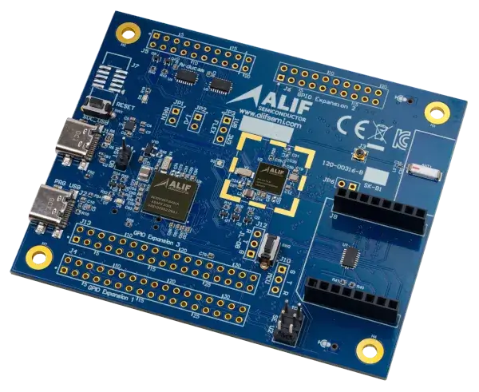 |
| [Alif Ensemble E1C Development Kit／Alif Ensemble E1C开发套件（Development Kit）](../boards_alif_ambiq/P003_Alif_Ensemble_E1C_Development_Kit.md) | Alif Semiconductor | arm | 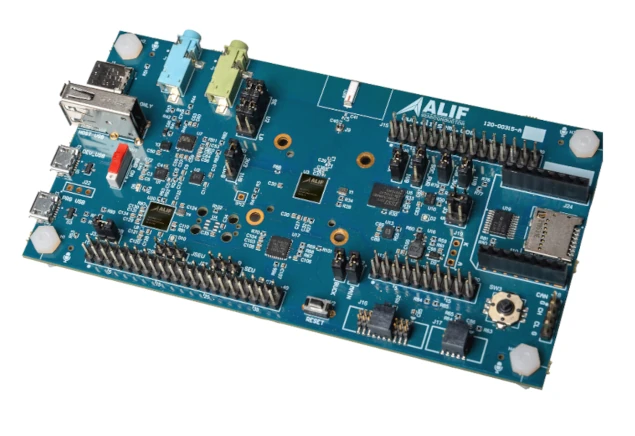 |
| [Alif Ensemble E1C StartKit／Alif Ensemble E1C入门套件（StartKit）](../boards_alif_ambiq/P004_Alif_Ensemble_E1C_StartKit.md) | Alif Semiconductor | arm | 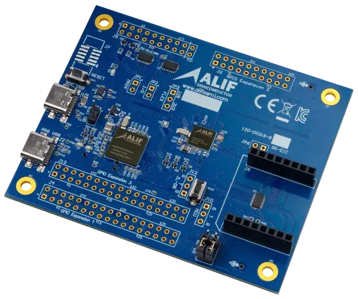 |
| [Alif Ensemble E8 AI/ML AppKit／Alif Ensemble E8人工智能／机器学习应用套件（AI/ML AppKit）](../boards_alif_ambiq/P005_Alif_Ensemble_E8_AI_ML_AppKit.md) | Alif Semiconductor | arm |  |
| [Alif Ensemble E8 Development Kit／Alif Ensemble E8开发套件（Development Kit）](../boards_alif_ambiq/P006_Alif_Ensemble_E8_Development_Kit.md) | Alif Semiconductor | arm | 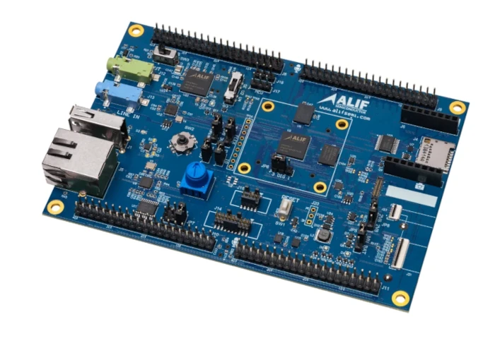 |
| [AM13E230X Launchpad](../boards_ti/P015_AM13E230X_Launchpad.md) | Texas Instruments | arm |  |
| [AM62L TMDS62LEVM evaluation module (EVM)／AM62L TMDS62LEVM评估模块（EVM）](../boards_ti/P002_AM62L_TMDS62LEVM_evaluation_module_EVM.md) | Texas Instruments | arm64 | 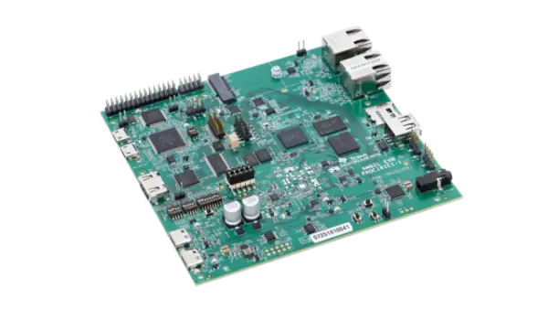 |
| [AMD Versal APU Development Board／AMD Versal应用处理单元开发板（APU Development Board）](../boards_amd/P008_AMD_Versal_APU_Development_Board.md) | Advanced Micro Devices (AMD), Inc. | arm64 | 原网页未提供图片 |
| [AMD Versal Gen 2 APU Development Board／AMD Versal第二代APU开发板（Gen 2 Development Board）](../boards_amd/P006_AMD_Versal_Gen_2_APU_Development_Board.md) | Advanced Micro Devices (AMD), Inc. | arm64 | 原网页未提供图片 |
| [AMD Versal RPU Cortex-R5／AMD Versal实时处理单元（RPU）Cortex-R5](../boards_amd/P009_AMD_Versal_RPU_Cortex-R5.md) | Advanced Micro Devices (AMD), Inc. | arm | 原网页未提供图片 |
| [AMD Zynq UltraScale+ MPSoC APU／AMD Zynq UltraScale+多处理器片上系统应用处理单元（MPSoC APU）](../boards_amd/P012_AMD_Zynq_UltraScale_MPSoC_APU.md) | Advanced Micro Devices (AMD), Inc. | arm64 | 原网页未提供图片 |
| [AMD Zynq UltraScale+ MPSoC RPU／AMD Zynq UltraScale+多处理器片上系统实时处理单元（MPSoC RPU）](../boards_amd/P013_AMD_Zynq_UltraScale_MPSoC_RPU.md) | Advanced Micro Devices (AMD), Inc. | arm | 原网页未提供图片 |
| [AN54LQ-DB-15](../boards_rak_raspberry_raytac/P015_AN54LQ-DB-15.md) | Raytac Corporation | arm, riscv | 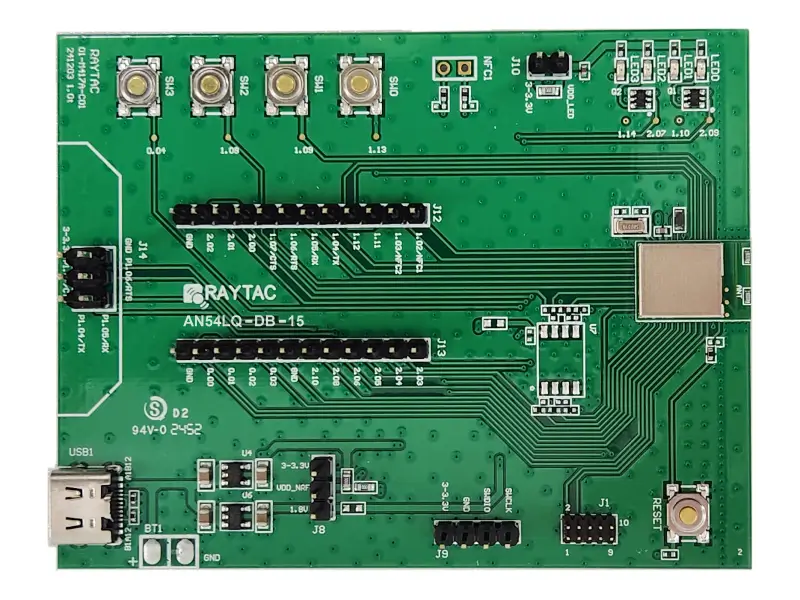 |
| [AN54LV-DB-15](../boards_rak_raspberry_raytac/P016_AN54LV-DB-15.md) | Raytac Corporation | arm, riscv | 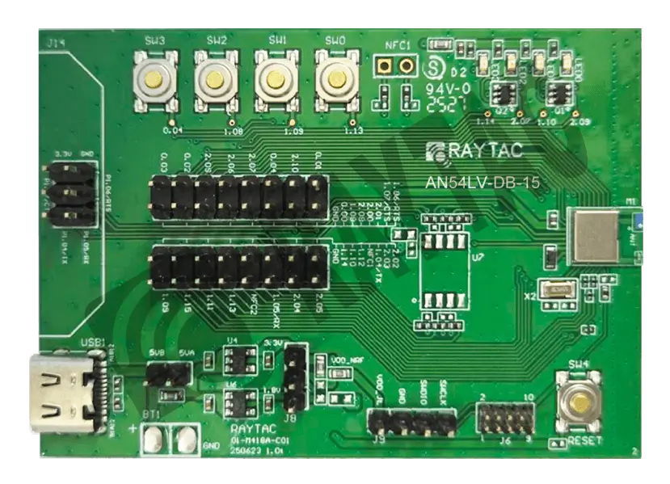 |
| [AN7002Q-DB-5340](../boards_rak_raspberry_raytac/P017_AN7002Q-DB-5340.md) | Raytac Corporation | arm | 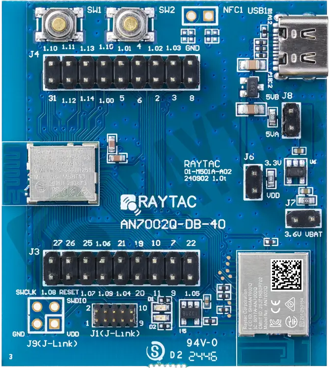 |
| [Apex Pro Mini](../boards_starfive_trenz/P003_Apex_Pro_Mini.md) | SteelSeries | arm | 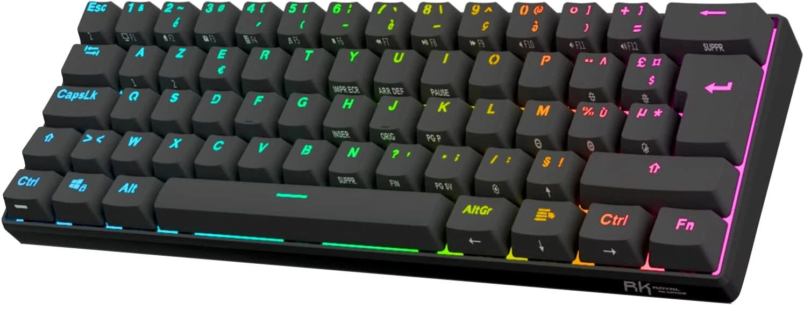 |
| [Apollo2 EVB／Apollo2评估板（EVB）](../boards_alif_ambiq/P008_Apollo2_EVB.md) | Ambiq Micro, Inc. | arm | 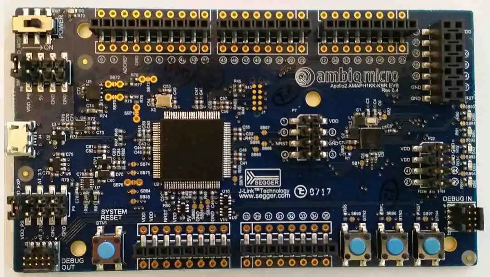 |
| [Apollo3 Blue EVB／Apollo3 Blue评估板（EVB）](../boards_alif_ambiq/P009_Apollo3_Blue_EVB.md) | Ambiq Micro, Inc. | arm | 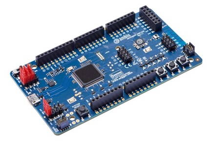 |
| [Apollo3 Blue Plus EVB／Apollo3 Blue Plus评估板（EVB）](../boards_alif_ambiq/P010_Apollo3_Blue_Plus_EVB.md) | Ambiq Micro, Inc. | arm | 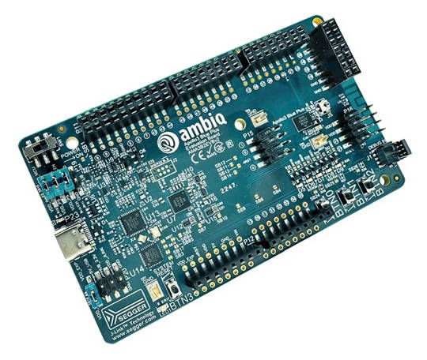 |
| [Apollo4 Blue Plus KXR EVB／Apollo4 Blue Plus KXR评估板（EVB）](../boards_alif_ambiq/P011_Apollo4_Blue_Plus_KXR_EVB.md) | Ambiq Micro, Inc. | arm | 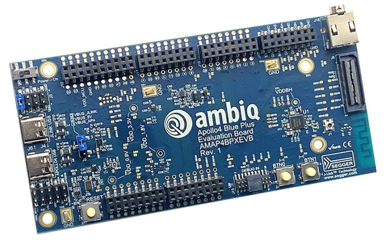 |
| [Apollo4P EVB／Apollo4P评估板（EVB）](../boards_alif_ambiq/P012_Apollo4P_EVB.md) | Ambiq Micro, Inc. | arm |  |
| [Apollo510 SOC Evaluation Board／Apollo510片上系统评估板（SoC Evaluation Board）](../boards_alif_ambiq/P013_Apollo510_SOC_Evaluation_Board.md) | Ambiq Micro, Inc. | arm | 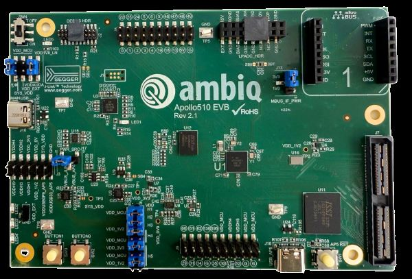 |
| [ARC EM Software Development Platform／ARC EM软件开发平台（Software Development Platform）](../boards_sipeed_sparkfun/P008_ARC_EM_Software_Development_Platform.md) | Synopsys, Inc. | arc | 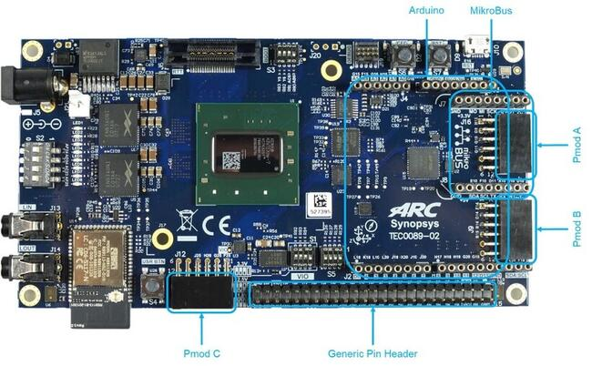 |
| [ARC EM Starter Kit／ARC EM入门套件（Starter Kit）](../boards_sipeed_sparkfun/P007_ARC_EM_Starter_Kit.md) | Synopsys, Inc. | arc | 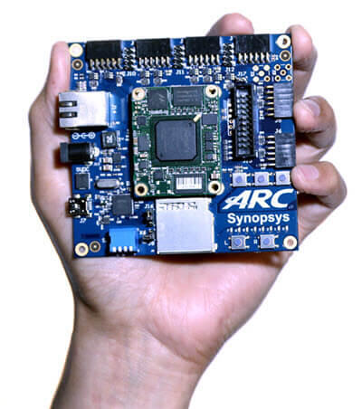 |
| [ARC HS Development Kit／ARC HS开发套件（Development Kit）](../boards_sipeed_sparkfun/P009_ARC_HS_Development_Kit.md) | Synopsys, Inc. | arc | 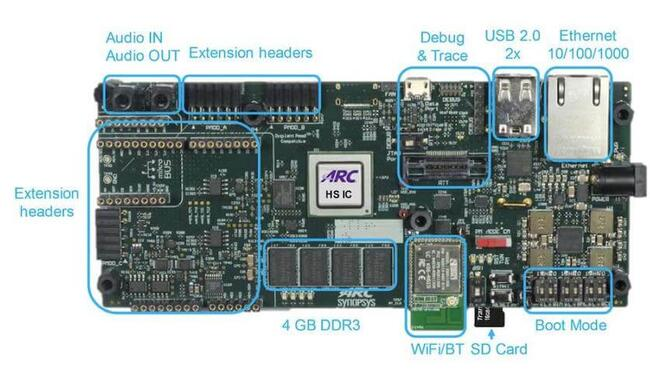 |
| [ARC HS4x/HS4xD Development Kit／ARC HS4x／HS4xD开发套件（Development Kit）](../boards_sipeed_sparkfun/P010_ARC_HS4x_HS4xD_Development_Kit.md) | Synopsys, Inc. | arc |  |
| [ARC IoT Development Kit／ARC物联网开发套件（IoT Development Kit）](../boards_sipeed_sparkfun/P012_ARC_IoT_Development_Kit.md) | Synopsys, Inc. | arc | 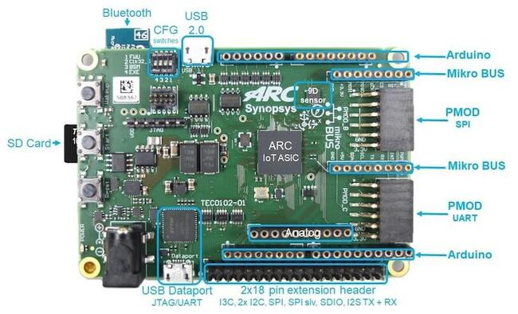 |
| [ARC nSIM and HAPS FPGA boards／ARC nSIM与HAPS FPGA平台](../boards_sipeed_sparkfun/P013_ARC_nSIM_and_HAPS_FPGA_boards.md) | Synopsys, Inc. | arc | 原网页未提供图片 |
| [Arduino Due](../boards_arduino/P001_Arduino_Due.md) | Arduino | arm | 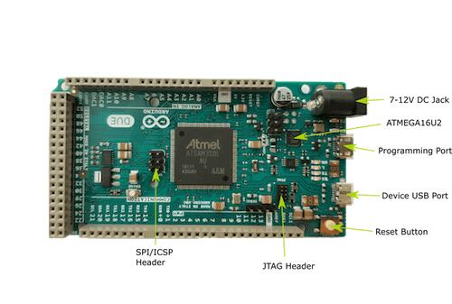 |
| [Arduino GIGA R1 WiFi](../boards_arduino/P002_Arduino_GIGA_R1_WiFi.md) | Arduino | arm | 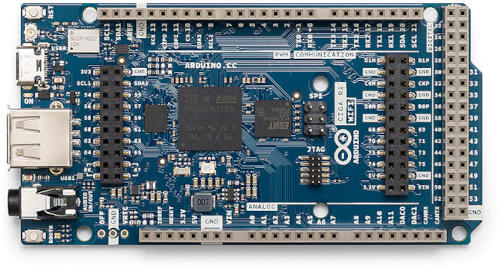 |
| [Arduino MKR Zero](../boards_arduino/P004_Arduino_MKR_Zero.md) | Arduino | arm |  |
| [Arduino Nano 33 BLE (Sense)](../boards_arduino/P005_Arduino_Nano_33_BLE_Sense.md) | Arduino | arm | 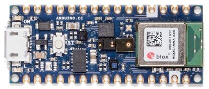 |
| [Arduino Nano 33 IOT](../boards_arduino/P006_Arduino_Nano_33_IOT.md) | Arduino | arm |  |
| [Arduino Nano Matter](../boards_arduino/P008_Arduino_Nano_Matter.md) | Arduino | arm | 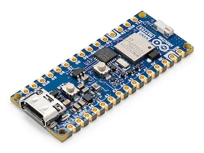 |
| [Arduino Nano R4](../boards_arduino/P009_Arduino_Nano_R4.md) | Arduino | arm |  |
| [Arduino Nano RP2040 Connect](../boards_arduino/P007_Arduino_Nano_RP2040_Connect.md) | Arduino | arm | 原网页未提供图片 |
| [Arduino Nesso N1](../boards_arduino/P010_Arduino_Nesso_N1.md) | Arduino | riscv | 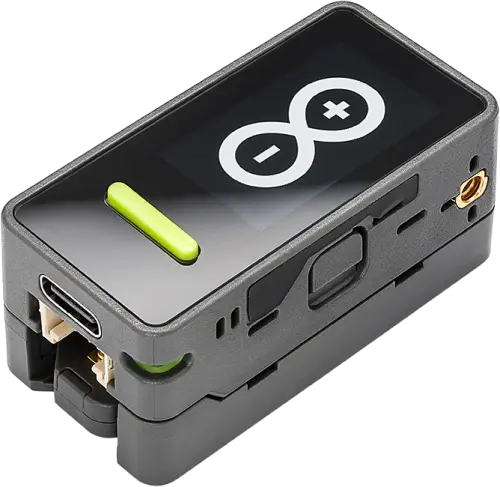 |
| [Arduino Nicla Sense ME](../boards_arduino/P011_Arduino_Nicla_Sense_ME.md) | Arduino | arm | 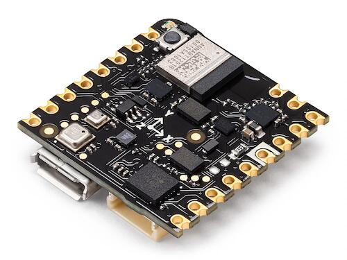 |
| [Arduino Nicla Vision](../boards_arduino/P012_Arduino_Nicla_Vision.md) | Arduino | arm | 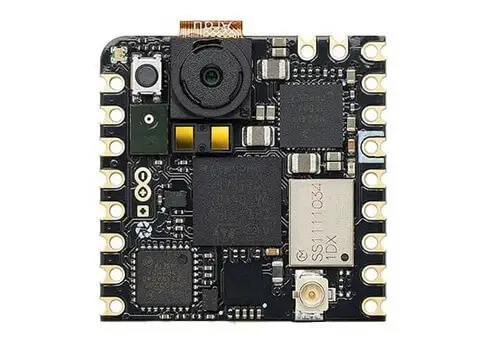 |
| [Arduino OPTA](../boards_arduino/P013_Arduino_OPTA.md) | Arduino | arm | 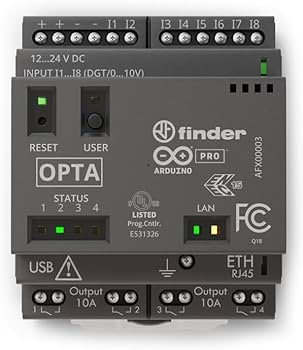 |
| [Arduino Portenta C33](../boards_arduino/P014_Arduino_Portenta_C33.md) | Arduino | arm | 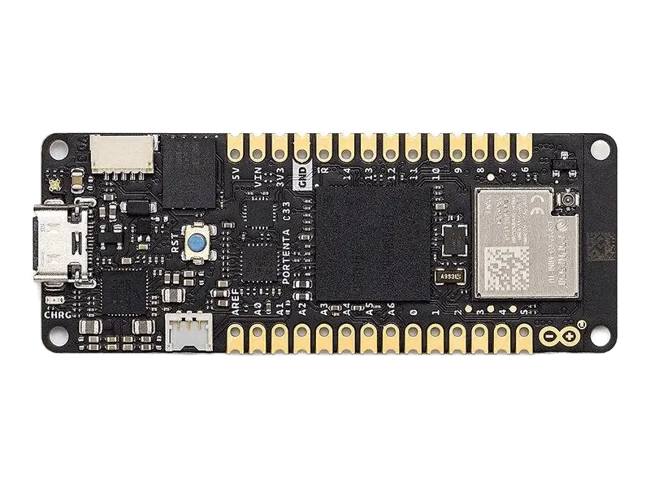 |
| [Arduino Portenta H7](../boards_arduino/P015_Arduino_Portenta_H7.md) | Arduino | arm | 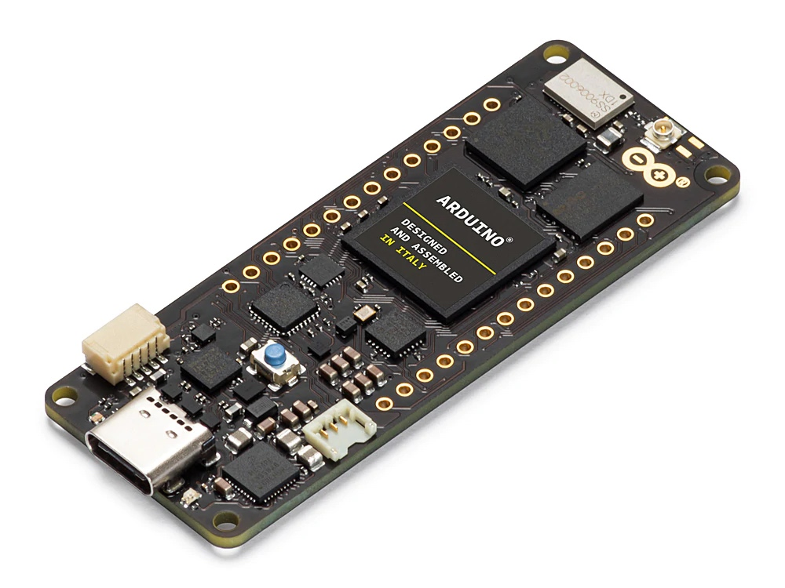 |
| [Arduino UNO Q](../boards_arduino/P016_Arduino_UNO_Q.md) | Arduino | arm |  |
| [Arduino UNO R4 Minima/WiFi](../boards_arduino/P017_Arduino_UNO_R4_Minima_WiFi.md) | Arduino | arm | 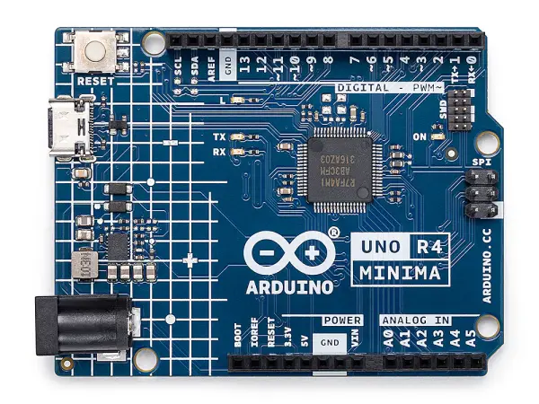 |
| [Arduino/Genuino Zero](../boards_arduino/P018_Arduino_Genuino_Zero.md) | Arduino | arm | 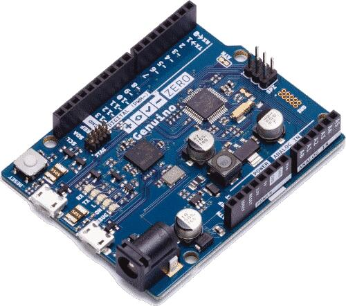 |
| [Argon](../boards_panasonic_particle_pcbcupid_peregrine/P008_Argon.md) | Particle.io | arm |  |
| [Argonkey](../boards_01space_96boards/P004_Argonkey.md) | 96Boards | arm |  |
| [ARIES v3.0 Development Board／ARIES v3.0开发板（Development Board）](../boards_cdac_to_cthings/P001_ARIES_v3.0_Development_Board.md) | Centre for Development of Advanced Computing (C-DAC) | riscv | 原网页未提供图片 |
| [Arm Corstone-1000-A320 Fixed Virtual Platform／Arm Corstone-1000-A320固定虚拟平台（FVP）](../boards_arm/P003_Arm_Corstone-1000-A320_Fixed_Virtual_Platform.md) | ARM Ltd. | arm64 | 原网页未提供图片 |
| [Armfly STM32H743XIH6／安富莱Armfly STM32H743XIH6](../boards_armfly_aspeed_degu/P002_Armfly_STM32H743XIH6.md) | Armfly | arm |  |
| [ARMv8 Xen Virtual Machine Example／ARMv8 Xen虚拟机示例](../boards_waveshare_tail/P050_ARMv8_Xen_Virtual_Machine_Example.md) | Xen Hypervisor | arm64 | 原网页未提供图片 |
| [ART-Pi](../boards_realtek_ruiside_sifive/P010_ART-Pi.md) | Shanghai Ruiside Electronic Technology Co., Ltd. | arm |  |
| [ART-Pi2](../boards_realtek_ruiside_sifive/P011_ART-Pi2.md) | Shanghai Ruiside Electronic Technology Co., Ltd. | arm |  |
| [Arturo182 Serpente](../boards_other_vendors/P016_Arturo182_Serpente.md) | Other/Unknown | arm |  |
| [Arty](../boards_cypress_to_dragino/P014_Arty.md) | Digilent, Inc. | arm |  |
| [AST1030_EVB](../boards_armfly_aspeed_degu/P003_AST1030_EVB.md) | ASPEED Technology Inc. | arm |  |
| [ATOM Lite](../boards_lilygo_to_m5stack/P020_ATOM_Lite.md) | M5Stack | xtensa |  |
| [AtomS3](../boards_lilygo_to_m5stack/P021_AtomS3.md) | M5Stack | xtensa |  |
| [AtomS3 Lite](../boards_lilygo_to_m5stack/P022_AtomS3_Lite.md) | M5Stack | xtensa |  |
| [Avenger96](../boards_01space_96boards/P005_Avenger96.md) | 96Boards | arm |  |
| [AZ3166 MXChip IoT DevKit](../boards_mikroe_to_mxchip/P011_AZ3166_MXChip_IoT_DevKit.md) | Shanghai MXCHIP Information Technology Co., Ltd. | arm |  |
| [B-G474E-DPOW1 Discovery／B-G474E-DPOW1探索套件（Discovery）](../boards_st_discovery_eval/P001_B-G474E-DPOW1_Discovery.md) | STMicroelectronics | arm |  |
| [B-L072Z-LRWAN1 Discovery kit／B-L072Z-LRWAN1探索套件（Discovery Kit）](../boards_st_discovery_eval/P002_B-L072Z-LRWAN1_Discovery_kit.md) | STMicroelectronics | arm |  |
| [B-L4S5I-IOT01A Discovery kit／B-L4S5I-IOT01A探索套件（Discovery Kit）](../boards_st_discovery_eval/P003_B-L4S5I-IOT01A_Discovery_kit.md) | STMicroelectronics | arm |  |
| [B-U585I-IOT02A Discovery kit／B-U585I-IOT02A探索套件（Discovery Kit）](../boards_st_discovery_eval/P004_B-U585I-IOT02A_Discovery_kit.md) | STMicroelectronics | arm |  |
| [Bartlett Lake P CRB／Bartlett Lake P客户参考板（CRB）](../boards_intel_ite/P007_Bartlett_Lake_P_CRB.md) | Intel Corporation | x86 | 原网页未提供图片 |
| [BASE RevC 2xAEM (Architectural Envelope Model) Fixed Virtual Platform／BASE RevC 2xAEM架构包络模型固定虚拟平台（Architectural Envelope Model / Fixed Virtual Platform）](../boards_arm/P001_BASE_RevC_2xAEM_Architectural_Envelope_Model_Fixed_Virtual_Platform.md) | ARM Ltd. | arm, arm64 | 原网页未提供图片 |
| [BCM958401M2](../boards_broadcom_bytesatwork_canmodule/P001_BCM958401M2.md) | Broadcom Corporation | arm | 原网页未提供图片 |
| [BCM958402M2 (Cortex-M7)／博通BCM958402M2（Cortex-M7）](../boards_broadcom_bytesatwork_canmodule/P003_Broadcom_BCM958402M2_Cortex-M7.md) | Broadcom Corporation | arm, arm64 | 原网页未提供图片 |
| [BeagleBadge](../boards_beagle/P001_BeagleBadge.md) | BeagleBoard.org Foundation | arm64 |  |
| [BeagleBone AI-64](../boards_beagle/P002_BeagleBone_AI-64.md) | BeagleBoard.org Foundation | arm |  |
| [BeagleConnect Freedom](../boards_beagle/P003_BeagleConnect_Freedom.md) | BeagleBoard.org Foundation | arm |  |
| [BeagleConnect Zepto](../boards_beagle/P004_BeagleConnect_Zepto.md) | BeagleBoard.org Foundation | arm |  |
| [BeaglePlay](../boards_beagle/P005_BeaglePlay.md) | BeagleBoard.org Foundation | arm |  |
| [BeagleV®-Fire](../boards_beagle/P006_BeagleV_-Fire.md) | BeagleBoard.org Foundation | riscv |  |
| [BeagleY-AI](../boards_beagle/P007_BeagleY-AI.md) | BeagleBoard.org Foundation | arm |  |
| [Beetle RP2350](../boards_cypress_to_dragino/P010_Beetle_RP2350.md) | DFRobot | arm, riscv |  |
| [BGM220 Explorer Kit (BGM220-EK4314A)／BGM220探索套件，BGM220-EK4314A](../boards_silabs/P016_BGM220_Explorer_Kit_BGM220-EK4314A.md) | Silicon Laboratories | arm |  |
| [BGM220P Bluetooth Module 2.4 GHz +8 dBm Radio Board／BGM220P蓝牙模块2.4 GHz +8 dBm无线电板](../boards_silabs/P040_BGM220P_Bluetooth_Module_2.4_GHz_8_dBm_Radio_Board.md) | Silicon Laboratories | arm |  |
| [BL5340 DVK／BL5340开发套件（DVK）](../boards_eurovibes_ezurio/P003_BL5340_DVK.md) | Ezurio | arm |  |
| [BL54L15 DVK／BL54L15开发套件（DVK）](../boards_eurovibes_ezurio/P004_BL54L15_DVK.md) | Ezurio | arm, riscv |  |
| [BL604E IOT DVK development board／BL604E IOT DVK开发板（Development Board）](../boards_bouffalo_qnx_bliiot_blues/P001_BL604E_IOT_DVK_development_board.md) | Bouffalo Lab (Nanjing) Co., Ltd. | riscv |  |
| [BL652 DVK／BL652开发套件（DVK）](../boards_eurovibes_ezurio/P005_BL652_DVK.md) | Ezurio | arm |  |
| [BL653 DVK／BL653开发套件（DVK）](../boards_eurovibes_ezurio/P006_BL653_DVK.md) | Ezurio | arm |  |
| [BL654 DVK／BL654开发套件（DVK）](../boards_eurovibes_ezurio/P007_BL654_DVK.md) | Ezurio | arm |  |
| [BL654 Sensor Board／BL654传感器板（Sensor Board）](../boards_eurovibes_ezurio/P008_BL654_Sensor_Board.md) | Ezurio | arm |  |
| [BL654 USB (451-00004)](../boards_eurovibes_ezurio/P009_BL654_USB_451-00004.md) | Ezurio | arm |  |
| [BL704L Development Board／BL704L开发板（Development Board）](../boards_other_vendors/P001_BL704L_Development_Board.md) | Other/Unknown | riscv |  |
| [Black Pill STM32H523](../boards_weact/P004_Black_Pill_STM32H523.md) | WeAct Studio | arm |  |
| [Black Pill STM32U585](../boards_weact/P005_Black_Pill_STM32U585.md) | WeAct Studio | arm |  |
| [Black Pill V1.2](../boards_weact/P001_Black_Pill_V1.2.md) | WeAct Studio | arm |  |
| [Black Pill V2.0](../boards_weact/P003_Black_Pill_V2.0.md) | WeAct Studio | arm |  |
| [Black Pill V3.0](../boards_weact/P002_Black_Pill_V3.0.md) | WeAct Studio | arm |  |
| [Black STM32 F407VE Development Board／Black STM32 F407VE开发板](../boards_other_vendors/P002_Black_STM32_F407VE_Development_Board.md) | Other/Unknown | arm |  |
| [Black STM32 F407ZG Pro Development Board／Black STM32 F407ZG Pro开发板](../boards_other_vendors/P003_Black_STM32_F407ZG_Pro_Development_Board.md) | Other/Unknown | arm |  |
| [BLE400](../boards_waveshare_tail/P013_BLE400.md) | Waveshare Electronics | arm |  |
| [BLIIoT ARMxy BL350 AM62x M4](../boards_bouffalo_qnx_bliiot_blues/P007_BLIIoT_ARMxy_BL350_AM62x_M4.md) | BLIIoT Technology Co., Ltd. | arm |  |
| [Blue Clover PLT Demo V2 nRF52832](../boards_barth_bbc_blueclover/P007_Blue_Clover_PLT_Demo_V2_nRF52832.md) | Blue Clover Devices | arm |  |
| [BluePill Plus CH32V203](../boards_weact/P006_BluePill_Plus_CH32V203.md) | WeAct Studio | riscv |  |
| [Boron](../boards_panasonic_particle_pcbcupid_peregrine/P009_Boron.md) | Particle.io | arm |  |
| [Bouffalo Lab BL618 G0 evaluation board／博流BL618 G0评估板（Evaluation Board）](../boards_bouffalo_qnx_bliiot_blues/P002_Bouffalo_Lab_BL618_G0_evaluation_board.md) | Bouffalo Lab (Nanjing) Co., Ltd. | riscv |  |
| [Bouffalo Lab BL706-IoT-DVK／博流BL706-IoT-DVK](../boards_bouffalo_qnx_bliiot_blues/P003_Bouffalo_Lab_BL706-IoT-DVK.md) | Bouffalo Lab (Nanjing) Co., Ltd. | riscv |  |
| [byteSENSI-L](../boards_broadcom_bytesatwork_canmodule/P005_byteSENSI-L.md) | bytesatwork AG | arm |  |
| [Cadence SweRV based boards](P001_开发板目录.md) | Cadence Design Systems Inc. | riscv | 原网页未提供图片 |
| [CAN485 DevBoard V1](../boards_weact/P007_CAN485_DevBoard_V1.md) | WeAct Studio | xtensa |  |
| [CANbardo](../boards_other_vendors/P004_CANbardo.md) | Other/Unknown | arm |  |
| [CANBed RP2040](https://docs.zephyrproject.org/latest/boards/longan/canbed_rp2040/doc/index.html) | Longan Labs (Shenzhen Longan Technology Co., Ltd.) | arm |  |
| [CANBRIDGE G473](../boards_broadcom_bytesatwork_canmodule/P007_CANBRIDGE_G473.md) | CAN-module, FOP | arm |  |
| [candleLight](../boards_other_vendors/P005_candleLight.md) | Other/Unknown | arm |  |
| [candleLightFD](../boards_other_vendors/P006_candleLightFD.md) | Other/Unknown | arm |  |
| [Capacitive Touch Evaluation System for RA2L1／RA2L1电容触摸评估系统（Capacitive Touch Evaluation System）](../boards_renesas_rx_rz/P023_Capacitive_Touch_Evaluation_System_for_RA2L1.md) | Renesas Electronics Corporation | arm |  |
| [Carbon](../boards_01space_96boards/P006_96Boards_Carbon_nRF51.md) | 96Boards | arm |  |
| [CC1312R1 LaunchXL](../boards_ti/P003_CC1312R1_LaunchXL.md) | Texas Instruments | arm |  |
| [CC1352P1 LaunchXL](../boards_ti/P004_CC1352P1_LaunchXL.md) | Texas Instruments | arm |  |
| [CC1352P7 LaunchPad](../boards_ti/P005_CC1352P7_LaunchPad.md) | Texas Instruments | arm |  |
| [CC1352R SensorTag](../boards_ti/P007_CC1352R_SensorTag.md) | Texas Instruments | arm |  |
| [CC1352R1 LaunchXL](../boards_ti/P006_CC1352R1_LaunchXL.md) | Texas Instruments | arm |  |
| [CC2340R5 LaunchPad](../boards_ti/P017_CC2340R5_LaunchPad.md) | Texas Instruments | arm |  |
| [CC26x2R1 LaunchXL](../boards_ti/P008_CC26x2R1_LaunchXL.md) | Texas Instruments | arm |  |
| [CC3220SF LaunchXL](../boards_ti/P009_CC3220SF_LaunchXL.md) | Texas Instruments | arm | 原网页未提供图片 |
| [CC3235SF LaunchXL](../boards_ti/P010_CC3235SF_LaunchXL.md) | Texas Instruments | arm | 原网页未提供图片 |
| [Clicker 2 for STM32](../boards_mikroe_to_mxchip/P001_Clicker_2_for_STM32.md) | MikroElektronika d.o.o. | arm |  |
| [Clicker RA4M1](../boards_mikroe_to_mxchip/P002_Clicker_RA4M1.md) | MikroElektronika d.o.o. | arm |  |
| [Core2](../boards_lilygo_to_m5stack/P023_Core2.md) | M5Stack | xtensa |  |
| [CoreS3](../boards_lilygo_to_m5stack/P024_CoreS3.md) | M5Stack | xtensa |  |
| [Cortex-M Trace Reference Board V1.2／Cortex-M跟踪参考板V1.2（Trace Reference Board）](../boards_retronix_sifli/P019_Cortex-M_Trace_Reference_Board_V1.2.md) | SEGGER Microcontroller GmbH | arm |  |
| [Cortex-R8 Virtual／Cortex-R8虚拟开发板](../renode_reference/P002_Cortex_R8虚拟开发板.md) | Antmicro's open source simulation and virtual development framework | arm | 原网页未提供图片 |
| [CPKCOR RA8D1B board／CPKCOR RA8D1B开发板](../boards_renesas_ra/P002_CPKCOR_RA8D1B_board.md) | Renesas Electronics Corporation | arm | 原网页未提供图片 |
| [CRD40L26-POC-C](../boards_cdac_to_cthings/P007_CRD40L26-POC-C.md) | Cirrus Logic, Inc. | arm |  |
| [CRD40L50-POC-Q](../boards_cdac_to_cthings/P008_CRD40L50-POC-Q.md) | Cirrus Logic, Inc. | arm |  |
| [CTHINGS.CO Connectivity Card／CTHINGS.CO通信卡（Connectivity Card）](../boards_cdac_to_cthings/P018_CTHINGS.CO_Connectivity_Card.md) | CTHINGS.CO | arm |  |
| [CX1825 nRF52840](../boards_cdac_to_cthings/P016_CX1825_nRF52840.md) | Croxel, Inc. | arm |  |
| [CY8CPROTO-041TP](../boards_infineon_innblue/P006_CY8CPROTO-041TP.md) | Infineon Technologies | arm |  |
| [CY8CPROTO-062-4343W](../boards_infineon_innblue/P007_CY8CPROTO-062-4343W.md) | Infineon Technologies | arm |  |
| [CY8CPROTO-063-BLE](../boards_infineon_innblue/P008_CY8CPROTO-063-BLE.md) | Infineon Technologies | arm |  |
| [Cyclone® V SoC Development Kit／Intel Cyclone V SoC开发套件（Development Kit）](../boards_intel_ite/P020_Intel_Cyclone_V_SoC_Development_Kit.md) | Intel Corporation | arm |  |
| [Cygnet](../boards_bouffalo_qnx_bliiot_blues/P009_Cygnet.md) | Blues Wireless | arm |  |
| [Cytron Maker Nano RP2040](../boards_cypress_to_dragino/P005_Cytron_Maker_Nano_RP2040.md) | Cytron Technologies | arm |  |
| [Cytron Maker Pi RP2040](../boards_cypress_to_dragino/P006_Cytron_Maker_Pi_RP2040.md) | Cytron Technologies | arm |  |
| [Cytron Maker Uno RP2040](../boards_cypress_to_dragino/P007_Cytron_Maker_Uno_RP2040.md) | Cytron Technologies | arm |  |
| [CYW920829M2EVK-02](../boards_infineon_innblue/P009_CYW920829M2EVK-02.md) | Infineon Technologies | arm |  |
| [DA14695 Development Kit USB／DA14695 USB开发套件](../boards_renesas_ra/P003_DA14695_Development_Kit_USB.md) | Renesas Electronics Corporation | arm |  |
| [DA1469x Development Kit Pro／DA1469x Pro开发套件](../boards_renesas_ra/P004_DA1469x_Development_Kit_Pro.md) | Renesas Electronics Corporation | arm |  |
| [DART-MX8M-PLUS](../boards_ublox_misc/P025_DART-MX8M-PLUS.md) | Variscite Ltd. | arm, arm64 |  |
| [DART-MX93](../boards_ublox_misc/P027_DART-MX93.md) | Variscite Ltd. | arm, arm64 |  |
| [Decawave DWM1001](../boards_pimoroni_radxa/P011_Decawave_DWM1001.md) | Qorvo, Inc. | arm | 原网页未提供图片 |
| [Decawave DWM3001CDK](../boards_pimoroni_radxa/P012_Decawave_DWM3001CDK.md) | Qorvo, Inc. | arm | 原网页未提供图片 |
| [DECT NR+ USB Dongle／DECT NR+ USB适配器（Dongle）](../boards_norik_to_nuvoton/P001_DECT_NR_USB_Dongle.md) | Norik Systems | arm |  |
| [Degu Evaluation Kit／Degu评估套件（Evaluation Kit）](../boards_armfly_aspeed_degu/P005_Degu_Evaluation_Kit.md) | Atmark Techno, Inc. | arm |  |
| [DFRobot Beetle ESP32-C3](../boards_cypress_to_dragino/P008_DFRobot_Beetle_ESP32-C3.md) | DFRobot | riscv |  |
| [DFRobot Beetle RP2040](../boards_cypress_to_dragino/P009_DFRobot_Beetle_RP2040.md) | DFRobot | arm |  |
| [DHSBC STM32MP255C](../boards_cypress_to_dragino/P013_DHSBC_STM32MP255C.md) | DH electronics GmbH | arm |  |
| [Digilent CV32A6 on Genesys 2／Digilent Genesys 2上的CV32A6](../boards_octavo_olimex_openhw_openisa/P013_Digilent_CV32A6_on_Genesys_2.md) | OpenHW Group | riscv |  |
| [Digilent CV64A6 on Genesys 2／Digilent Genesys 2上的CV64A6](../boards_octavo_olimex_openhw_openisa/P014_Digilent_CV64A6_on_Genesys_2.md) | OpenHW Group | riscv |  |
| [Disco L475 IOT01 (B-L475E-IOT01A)／Disco L475 IOT01探索板（B-L475E-IOT01A）](../boards_st_discovery_eval/P005_Disco_L475_IOT01_B-L475E-IOT01A.md) | STMicroelectronics | arm |  |
| [DNESP32S3B](../boards_aesc_aithinker_alientek/P011_DNESP32S3B.md) | Alientek | xtensa |  |
| [DOIT ESP32-DevKit-V1](../boards_other_vendors/P007_DOIT_ESP32-DevKit-V1.md) | Other/Unknown | xtensa |  |
| [Dragonclaw Development Board／Dragonclaw开发板（Development Board）](../boards_gd_to_iar/P017_Dragonclaw_Development_Board.md) | Google, Inc. | arm | 原网页未提供图片 |
| [DT-BL10 coexistence Module Development Kit／DT-BL10共存模块开发套件（Coexistence Module Development Kit）](../boards_cypress_to_dragino/P018_DT-BL10_coexistence_Module_Development_Kit.md) | Doctors of Intelligence & Technology | riscv |  |
| [E73-TBB](../boards_ebyte_to_enjoydigital/P001_E73-TBB.md) | Chengdu Ebyte Electronic Technology | arm |  |
| [Ebyte E80 Module Development Board (HF)／亿佰特E80模块开发板，高频版（Ebyte E80 Module Development Board / HF）](../boards_ebyte_to_enjoydigital/P002_Ebyte_E80_Module_Development_Board_HF.md) | Chengdu Ebyte Electronic Technology | arm |  |
| [Ebyte EoRa-HUB-900TB Module Test Kit／亿佰特EoRa-HUB-900TB模块测试套件（Module Test Kit）](../boards_ebyte_to_enjoydigital/P003_Ebyte_EoRa-HUB-900TB_Module_Test_Kit.md) | Chengdu Ebyte Electronic Technology | xtensa |  |
| [EC4L15BA1-EVB](../boards_jhoinrch_to_kws/P006_EC4L15BA1-EVB.md) | KAGA FEI Co., Ltd. | arm, riscv |  |
| [Edge-V](../boards_jhoinrch_to_kws/P009_Edge-V.md) | Khadas | arm64 | 原网页未提供图片 |
| [Edge2](../boards_jhoinrch_to_kws/P008_Edge2.md) | Khadas | arm64 |  |
| [EFM32 Giant Gecko 11 (SLSTK3701A)／EFM32 Giant Gecko 11入门套件，SLSTK3701A](../boards_silabs/P067_EFM32_Giant_Gecko_11_SLSTK3701A.md) | Silicon Laboratories | arm |  |
| [EFM32 Happy Gecko (SLSTK3400A)／EFM32 Happy Gecko入门套件，SLSTK3400A](../boards_silabs/P064_EFM32_Happy_Gecko_SLSTK3400A.md) | Silicon Laboratories | arm |  |
| [EFM32 Pearl Gecko (SLSTK3401A)／EFM32 Pearl Gecko入门套件，SLSTK3401A](../boards_silabs/P065_EFM32_Pearl_Gecko_SLSTK3401A.md) | Silicon Laboratories | arm |  |
| [EFM32 Pearl Gecko 12 (SLSTK3402A)／EFM32 Pearl Gecko 12入门套件，SLSTK3402A](../boards_silabs/P066_EFM32_Pearl_Gecko_12_SLSTK3402A.md) | Silicon Laboratories | arm |  |
| [EFM32 Tiny Gecko (EFM32TG-STK3300)／EFM32 Tiny Gecko入门套件，EFM32TG-STK3300](../boards_silabs/P061_EFM32_Tiny_Gecko_EFM32TG-STK3300.md) | Silicon Laboratories | arm |  |
| [EFM32 Wonder Gecko (EFM32WG-STK3800)／EFM32 Wonder Gecko入门套件，EFM32WG-STK3800](../boards_silabs/P062_EFM32_Wonder_Gecko_EFM32WG-STK3800.md) | Silicon Laboratories | arm |  |
| [EFM32GG12 Thunderboard (SLTB009A)](../boards_silabs/P007_EFM32GG12_Thunderboard_SLTB009A.md) | Silicon Laboratories | arm |  |
| [EFM32PG23 Pro Kit (PG23-PK2504A)／EFM32PG23专业套件（Pro Kit），PG23-PK2504A](../boards_silabs/P002_EFM32PG23_Pro_Kit_PG23-PK2504A.md) | Silicon Laboratories | arm |  |
| [EFM32PG26 Explorer Kit (PG26-EK2711A)／EFM32PG26探索套件，PG26-EK2711A](../boards_silabs/P019_EFM32PG26_Explorer_Kit_PG26-EK2711A.md) | Silicon Laboratories | arm |  |
| [EFM32PG28 Pro Kit (PG28-PK2506A)／EFM32PG28专业套件，PG28-PK2506A](../boards_silabs/P003_EFM32PG28_Pro_Kit_PG28-PK2506A.md) | Silicon Laboratories | arm |  |
| [EFR32BG13 2.4 GHz 10 dBm (SLWRB4104A)／EFR32BG13 2.4 GHz 10 dBm无线电板，SLWRB4104A](../boards_silabs/P029_EFR32BG13_2.4_GHz_10_dBm_SLWRB4104A.md) | Silicon Laboratories | arm |  |
| [EFR32BG22 Explorer Kit (BG22-EK4108A)／EFR32BG22探索套件，BG22-EK4108A](../boards_silabs/P015_EFR32BG22_Explorer_Kit_BG22-EK4108A.md) | Silicon Laboratories | arm |  |
| [EFR32BG22 Thunderboard (SLTB010A)](../boards_silabs/P008_EFR32BG22_Thunderboard_SLTB010A.md) | Silicon Laboratories | arm |  |
| [EFR32BG27 2.4 GHz 4 dBm DCDC Boost CSP (BG27-RB4111B)／EFR32BG27 2.4 GHz 4 dBm升压DC-DC、CSP无线电板，BG27-RB4111B](../boards_silabs/P055_EFR32BG27_2.4_GHz_4_dBm_DCDC_Boost_CSP_BG27-RB4111B.md) | Silicon Laboratories | arm |  |
| [EFR32BG27 2.4 GHz 4 dBm DCDC Buck CSP (BG27-RB4110B)／EFR32BG27 2.4 GHz 4 dBm降压DC-DC、CSP无线电板，BG27-RB4110B](../boards_silabs/P054_EFR32BG27_2.4_GHz_4_dBm_DCDC_Buck_CSP_BG27-RB4110B.md) | Silicon Laboratories | arm |  |
| [EFR32BG29 Bluetooth LE 4 dBm DCDC Boost WLCSP (BG29-RB4420A)／EFR32BG29低功耗蓝牙4 dBm升压DC-DC、WLCSP无线电板，BG29-RB4420A](../boards_silabs/P058_EFR32BG29_Bluetooth_LE_4_dBm_DCDC_Boost_WLCSP_BG29-RB4420A.md) | Silicon Laboratories | arm |  |
| [EFR32FG1 2400/868 MHz 13 dBm Dual Band (SLWRB4250B)／EFR32FG1 2400/868 MHz 13 dBm双频无线电板，SLWRB4250B](../boards_silabs/P032_EFR32FG1_2400_868_MHz_13_dBm_Dual_Band_SLWRB4250B.md) | Silicon Laboratories | arm |  |
| [EFR32FG13 2400/915 MHz 19 dBm Dual Band (SLWRB4255A)／EFR32FG13 2400/915 MHz 19 dBm双频无线电板，SLWRB4255A](../boards_silabs/P033_EFR32FG13_2400_915_MHz_19_dBm_Dual_Band_SLWRB4255A.md) | Silicon Laboratories | arm |  |
| [EFR32MG12 2.4 GHz 19 dBm (SLWRB4161A)／EFR32MG12 2.4 GHz 19 dBm无线电板，SLWRB4161A](../boards_silabs/P030_EFR32MG12_2.4_GHz_19_dBm_SLWRB4161A.md) | Silicon Laboratories | arm |  |
| [EFR32MG12 2400/868-915 MHz 19 dBm Dual Band (SLWRB4170A)／EFR32MG12 2400/868-915 MHz 19 dBm双频无线电板，SLWRB4170A](../boards_silabs/P031_EFR32MG12_2400_868-915_MHz_19_dBm_Dual_Band_SLWRB4170A.md) | Silicon Laboratories | arm |  |
| [EFR32MG12 Thunderboard (SLTB004A)](../boards_silabs/P006_EFR32MG12_Thunderboard_SLTB004A.md) | Silicon Laboratories | arm |  |
| [EFR32xG21 2.4 GHz 20 dBm (SLWRB4180A)／EFR32xG21 2.4 GHz 20 dBm无线电板，SLWRB4180A](../boards_silabs/P035_EFR32xG21_2.4_GHz_20_dBm_SLWRB4180A.md) | Silicon Laboratories | arm |  |
| [EFR32xG21 2.4 GHz 20 dBm (SLWRB4180B)／EFR32xG21 2.4 GHz 20 dBm无线电板，SLWRB4180B](../boards_silabs/P036_EFR32xG21_2.4_GHz_20_dBm_SLWRB4180B.md) | Silicon Laboratories | arm |  |
| [EFR32xG21B 2.4 GHz 10 dBm (xG21-RB4195B)／EFR32xG21B 2.4 GHz 10 dBm无线电板，xG21-RB4195B](../boards_silabs/P037_EFR32xG21B_2.4_GHz_10_dBm_xG21-RB4195B.md) | Silicon Laboratories | arm |  |
| [EFR32xG21B 2.4 GHz 20 dBm (xG21-RB4196B)／EFR32xG21B 2.4 GHz 20 dBm无线电板，xG21-RB4196B](../boards_silabs/P038_EFR32xG21B_2.4_GHz_20_dBm_xG21-RB4196B.md) | Silicon Laboratories | arm |  |
| [EFR32xG22 2.4 GHz +6 dBm Radio Board／EFR32xG22 2.4 GHz +6 dBm无线电板](../boards_silabs/P039_EFR32xG22_2.4_GHz_6_dBm_Radio_Board.md) | Silicon Laboratories | arm |  |
| [EFR32xG22E 2.4 GHz 6 dBm (xG22-RB4415A)／EFR32xG22E 2.4 GHz 6 dBm无线电板，xG22-RB4415A](../boards_silabs/P041_EFR32xG22E_2.4_GHz_6_dBm_xG22-RB4415A.md) | Silicon Laboratories | arm |  |
| [EFR32xG22E Explorer Kit (xG22-EK2710A)／EFR32xG22E探索套件，xG22-EK2710A](../boards_silabs/P017_EFR32xG22E_Explorer_Kit_xG22-EK2710A.md) | Silicon Laboratories | arm |  |
| [EFR32xG23 868-915 MHz 20 dBm (xG23-RB4210A)／EFR32xG23 868-915 MHz 20 dBm无线电板，xG23-RB4210A](../boards_silabs/P042_EFR32xG23_868-915_MHz_20_dBm_xG23-RB4210A.md) | Silicon Laboratories | arm |  |
| [EFR32xG24 2.4 GHz 10 dBm (xG24-RB4186C)／EFR32xG24 2.4 GHz 10 dBm无线电板，xG24-RB4186C](../boards_silabs/P043_EFR32xG24_2.4_GHz_10_dBm_xG24-RB4186C.md) | Silicon Laboratories | arm |  |
| [EFR32xG24 2.4 GHz 20 dBm (xG24-RB4187C)／EFR32xG24 2.4 GHz 20 dBm无线电板，xG24-RB4187C](../boards_silabs/P044_EFR32xG24_2.4_GHz_20_dBm_xG24-RB4187C.md) | Silicon Laboratories | arm |  |
| [EFR32xG24 2.4 GHz 20 dBm Antenna Diversity Radio Board／EFR32xG24 2.4 GHz 20 dBm天线分集无线电板](../boards_silabs/P045_EFR32xG24_2.4_GHz_20_dBm_Antenna_Diversity_Radio_Board.md) | Silicon Laboratories | arm |  |
| [EFR32xG24 Dev Kit (xG24-DK2601B)／EFR32xG24开发套件，xG24-DK2601B](../boards_silabs/P009_EFR32xG24_Dev_Kit_xG24-DK2601B.md) | Silicon Laboratories | arm |  |
| [EFR32xG24 Explorer Kit (xG24-EK2703A)／EFR32xG24探索套件（Explorer Kit），xG24-EK2703A](../boards_silabs/P010_EFR32xG24_Explorer_Kit_xG24-EK2703A.md) | Silicon Laboratories | arm | 原网页未提供图片 |
| [EFR32xG26 2.4 GHz +10 dBm BGA136 Radio Board／EFR32xG26 2.4 GHz +10 dBm BGA136无线电板](../boards_silabs/P051_EFR32xG26_2.4_GHz_10_dBm_BGA136_Radio_Board.md) | Silicon Laboratories | arm |  |
| [EFR32xG26 2.4 GHz +10 dBm Radio Board／EFR32xG26 2.4 GHz +10 dBm无线电板](../boards_silabs/P052_EFR32xG26_2.4_GHz_10_dBm_Radio_Board.md) | Silicon Laboratories | arm |  |
| [EFR32xG26 2.4 GHz +20 dBm Radio Board／EFR32xG26 2.4 GHz +20 dBm无线电板](../boards_silabs/P053_EFR32xG26_2.4_GHz_20_dBm_Radio_Board.md) | Silicon Laboratories | arm |  |
| [EFR32xG26 Dev Kit (xG26-DK2608A)／EFR32xG26开发套件，xG26-DK2608A](../boards_silabs/P011_EFR32xG26_Dev_Kit_xG26-DK2608A.md) | Silicon Laboratories | arm |  |
| [EFR32xG26 Explorer Kit (xG26-EK2709A)／EFR32xG26探索套件，xG26-EK2709A](../boards_silabs/P020_EFR32xG26_Explorer_Kit_xG26-EK2709A.md) | Silicon Laboratories | arm |  |
| [EFR32xG27 2.4 GHz 8 dBm (xG27-RB4194A)／EFR32xG27 2.4 GHz 8 dBm无线电板，xG27-RB4194A](../boards_silabs/P056_EFR32xG27_2.4_GHz_8_dBm_xG27-RB4194A.md) | Silicon Laboratories | arm |  |
| [EFR32xG27 Dev Kit (xG27-DK2602A)／EFR32xG27开发套件，xG27-DK2602A](../boards_silabs/P012_EFR32xG27_Dev_Kit_xG27-DK2602A.md) | Silicon Laboratories | arm |  |
| [EFR32xG28 868-915 MHz 20 dBm (xG28-RB4401C)／EFR32xG28 868-915 MHz 20 dBm无线电板，xG28-RB4401C](../boards_silabs/P057_EFR32xG28_868-915_MHz_20_dBm_xG28-RB4401C.md) | Silicon Laboratories | arm |  |
| [EFR32xG28 Explorer Kit (xG28-EK2705A)／EFR32xG28探索套件，xG28-EK2705A](../boards_silabs/P021_EFR32xG28_Explorer_Kit_xG28-EK2705A.md) | Silicon Laboratories | arm |  |
| [EFR32xG29 2.4 GHz 6 dBm Boost QFN40 (xG29-RB4413A)／EFR32xG29 2.4 GHz 6 dBm升压（Boost）、QFN40无线电板，xG29-RB4413A](../boards_silabs/P060_EFR32xG29_2.4_GHz_6_dBm_Boost_QFN40_xG29-RB4413A.md) | Silicon Laboratories | arm |  |
| [EFR32xG29 2.4 GHz 8 dBm Buck (xG29-RB4412A)／EFR32xG29 2.4 GHz 8 dBm降压（Buck）无线电板，xG29-RB4412A](../boards_silabs/P059_EFR32xG29_2.4_GHz_8_dBm_Buck_xG29-RB4412A.md) | Silicon Laboratories | arm |  |
| [ELAN EM32F967](../boards_ebyte_to_enjoydigital/P009_ELAN_EM32F967.md) | Elan Microelectronic Corp. | arm |  |
| [ElemRV Flask-H](../boards_aesc_aithinker_alientek/P001_ElemRV_Flask-H.md) | Aesc Silicon | riscv | 原网页未提供图片 |
| [ElemRV Flask-N](../boards_aesc_aithinker_alientek/P002_ElemRV_Flask-N.md) | Aesc Silicon | riscv | 原网页未提供图片 |
| [Elkhart Lake CRB／Elkhart Lake客户参考板（CRB）](../boards_intel_ite/P010_Elkhart_Lake_CRB.md) | Intel Corporation | x86 | 原网页未提供图片 |
| [emSBC-NEON-CM7](../boards_ebyte_to_enjoydigital/P018_emSBC-NEON-CM7.md) | emtrion GmbH | arm |  |
| [ENE KB1062_EVB](../boards_ebyte_to_enjoydigital/P021_ENE_KB1062_EVB.md) | ENE Technology, Inc. | arm | 原网页未提供图片 |
| [ENE KB1200_EVB](../boards_ebyte_to_enjoydigital/P022_ENE_KB1200_EVB.md) | ENE Technology, Inc. | arm | 原网页未提供图片 |
| [ESP Thread Border Router / ZigBee Gateway／ESP Thread边界路由器／ZigBee网关（Border Router / Gateway）](../boards_espressif/P033_ESP_Thread_Border_Router_ZigBee_Gateway.md) | Espressif Systems | xtensa |  |
| [ESP-WROVER-KIT](../boards_espressif/P034_ESP-WROVER-KIT.md) | Espressif Systems | xtensa |  |
| [ESP32-C3 Development Board (LCKFB)／LCKFB ESP32-C3开发板](../boards_other_vendors/P008_ESP32-C3_Development_Board_LCKFB.md) | Other/Unknown | riscv |  |
| [ESP32-C3-DevKit-RUST](../boards_espressif/P020_ESP32-C3-DevKit-RUST.md) | Espressif Systems | riscv |  |
| [ESP32-C3-DevKitC](../boards_espressif/P018_ESP32-C3-DevKitC.md) | Espressif Systems | riscv |  |
| [ESP32-C3-DevKitM](../boards_espressif/P019_ESP32-C3-DevKitM.md) | Espressif Systems | riscv |  |
| [ESP32-C3-Mini](../boards_weact/P009_ESP32-C3-Mini.md) | WeAct Studio | riscv |  |
| [ESP32-C3-SUPERMINI](../boards_other_vendors/P009_ESP32-C3-SUPERMINI.md) | Other/Unknown | riscv |  |
| [ESP32-C5-DevKitC-1](../boards_espressif/P021_ESP32-C5-DevKitC-1.md) | Espressif Systems | riscv |  |
| [ESP32-C6 LCD 1.47"／ESP32-C6 LCD 1.47英寸](../boards_waveshare_tail/P004_ESP32-C6_LCD_1.47.md) | Waveshare Electronics | riscv |  |
| [ESP32-C6-DevKitC](../boards_espressif/P023_ESP32-C6-DevKitC.md) | Espressif Systems | riscv |  |
| [ESP32-C6-Mini](../boards_weact/P010_ESP32-C6-Mini.md) | WeAct Studio | riscv |  |
| [ESP32-C61-DevKitC](../boards_espressif/P022_ESP32-C61-DevKitC.md) | Espressif Systems | riscv |  |
| [ESP32-DevKitC](../boards_espressif/P016_ESP32-DevKitC.md) | Espressif Systems | xtensa |  |
| [ESP32-Ethernet-Kit](../boards_espressif/P017_ESP32-Ethernet-Kit.md) | Espressif Systems | xtensa |  |
| [ESP32-EVB](../boards_octavo_olimex_openhw_openisa/P006_ESP32-EVB.md) | OLIMEX Ltd. | xtensa |  |
| [ESP32-H2-DevKitM](../boards_espressif/P024_ESP32-H2-DevKitM.md) | Espressif Systems | riscv |  |
| [ESP32-H2-SUPERMINI](../boards_other_vendors/P010_ESP32-H2-SUPERMINI.md) | Other/Unknown | riscv | 原网页未提供图片 |
| [ESP32-P4-Function-EV-Board](../boards_espressif/P025_ESP32-P4-Function-EV-Board.md) | Espressif Systems | riscv |  |
| [ESP32-P4-PC](../boards_octavo_olimex_openhw_openisa/P003_ESP32-P4-PC.md) | OLIMEX Ltd. | riscv |  |
| [ESP32-P4-WIFI6](../boards_waveshare_tail/P006_ESP32-P4-WIFI6.md) | Waveshare Electronics | riscv |  |
| [ESP32-P4-WIFI6-Dev-Kit](../boards_waveshare_tail/P007_ESP32-P4-WIFI6-Dev-Kit.md) | Waveshare Electronics | riscv |  |
| [ESP32-P4X-Function-EV-Board](../boards_espressif/P026_ESP32-P4X-Function-EV-Board.md) | Espressif Systems | riscv |  |
| [ESP32-S2 Franzininho](../boards_fanke_to_gardena/P017_ESP32-S2_Franzininho.md) | Franzininho | xtensa |  |
| [ESP32-S2 Lolin Mini](../boards_ublox_misc/P043_ESP32-S2_Lolin_Mini.md) | WEMOS Electronics | xtensa |  |
| [ESP32-S2-DevKitC](../boards_espressif/P027_ESP32-S2-DevKitC.md) | Espressif Systems | xtensa |  |
| [ESP32-S2-Saola](../boards_espressif/P028_ESP32-S2-Saola.md) | Espressif Systems | xtensa |  |
| [ESP32-S3-B](../boards_weact/P011_ESP32-S3-B.md) | WeAct Studio | xtensa |  |
| [ESP32-S3-BOX-3](../boards_espressif/P029_ESP32-S3-BOX-3.md) | Espressif Systems | xtensa |  |
| [ESP32-S3-DevKitC](../boards_espressif/P030_ESP32-S3-DevKitC.md) | Espressif Systems | xtensa |  |
| [ESP32-S3-EYE](../boards_espressif/P031_ESP32-S3-EYE.md) | Espressif Systems | xtensa |  |
| [ESP32-S3-GEEK](../boards_waveshare_tail/P008_ESP32-S3-GEEK.md) | Waveshare Electronics | xtensa |  |
| [ESP32-S3-Matrix](../boards_waveshare_tail/P009_ESP32-S3-Matrix.md) | Waveshare Electronics | xtensa |  |
| [ESP32-S3-Mini](../boards_weact/P012_ESP32-S3-Mini.md) | WeAct Studio | xtensa |  |
| [ESP32-S3-RLCD-4.2](../boards_waveshare_tail/P010_ESP32-S3-RLCD-4.2.md) | Waveshare Electronics | xtensa |  |
| [ESP32-S3-Touch-LCD-1.28](../boards_waveshare_tail/P011_ESP32-S3-Touch-LCD-1.28.md) | Waveshare Electronics | xtensa |  |
| [ESP32C3 0.42 OLED](../boards_01space_96boards/P001_ESP32C3_0.42_OLED.md) | 01Space | riscv |  |
| [ESP32C3_LUATOS_CORE](../boards_lilygo_to_m5stack/P014_ESP32C3_LUATOS_CORE.md) | LuatOS Team | riscv |  |
| [ESP32S3-Luatos-Core](../boards_lilygo_to_m5stack/P015_ESP32S3-Luatos-Core.md) | LuatOS Team | xtensa |  |
| [ESP8684-DevKitM](../boards_espressif/P032_ESP8684-DevKitM.md) | Espressif Systems | riscv |  |
| [ET171 Development Board／ET171开发板（Development Board）](../boards_ebyte_to_enjoydigital/P007_ET171_Development_Board.md) | Egis Technology Inc | riscv |  |
| [EVAL-ADIN1110EVB Evaluation board／EVAL-ADIN1110EVB评估板（Evaluation Board）](../boards_adi_ethernet_platforms/P003_EVAL-ADIN1110EVB_Evaluation_board.md) | Analog Devices, Inc. | arm |  |
| [EVAL-ADIN1140D1Z](../boards_adi_ethernet_platforms/P004_EVAL-ADIN1140D1Z.md) | Analog Devices, Inc. | arm |  |
| [EVAL-ADIN2111D1Z](../boards_adi_ethernet_platforms/P005_EVAL-ADIN2111D1Z.md) | Analog Devices, Inc. | arm |  |
| [EVAL-ADIN2111EVB Evaluation board／EVAL-ADIN2111EVB评估板（Evaluation Board）](../boards_adi_ethernet_platforms/P006_EVAL-ADIN2111EVB_Evaluation_board.md) | Analog Devices, Inc. | arm |  |
| [EVK NINA-B11x](../boards_ublox_misc/P012_EVK_NINA-B11x.md) | u-blox | arm |  |
| [EVK NINA-B40x](../boards_ublox_misc/P014_EVK_NINA-B40x.md) | u-blox | arm |  |
| [EVK-ANNA-B11x](../boards_ublox_misc/P011_EVK-ANNA-B11x.md) | u-blox | arm |  |
| [EVK-BMD-30/35: BMD-300-EVAL, BMD-301-EVAL, and BMD-350-EVAL／EVK-BMD-30/35：BMD-300-EVAL、BMD-301-EVAL及BMD-350-EVAL](../boards_ublox_misc/P004_EVK-BMD-30_35_BMD-300-EVAL_BMD-301-EVAL_and_BMD-350-EVAL.md) | u-blox | arm |  |
| [EVK-BMD-330: BMD-330-EVAL](../boards_ublox_misc/P005_EVK-BMD-330_BMD-330-EVAL.md) | u-blox | arm |  |
| [EVK-BMD-34/38: BMD-340-EVAL and BMD-341-EVAL／EVK-BMD-34/38：BMD-340-EVAL与BMD-341-EVAL](../boards_ublox_misc/P006_EVK-BMD-34_38_BMD-340-EVAL_and_BMD-341-EVAL.md) | u-blox | arm |  |
| [EVK-BMD-34/38: BMD-345-EVAL](../boards_ublox_misc/P007_EVK-BMD-34_38_BMD-345-EVAL.md) | u-blox | arm |  |
| [EVK-BMD-34/48: BMD-380-EVAL](../boards_ublox_misc/P009_EVK-BMD-34_48_BMD-380-EVAL.md) | u-blox | arm |  |
| [EVK-BMD-360: BMD-360-EVAL](../boards_ublox_misc/P008_EVK-BMD-360_BMD-360-EVAL.md) | u-blox | arm |  |
| [EVK-IRIS-W106-RW612](../boards_ublox_misc/P010_EVK-IRIS-W106-RW612.md) | u-blox | arm |  |
| [EVK-NINA-B3](../boards_ublox_misc/P013_EVK-NINA-B3.md) | u-blox | arm |  |
| [EVK-NINA-B5-MCXW716C](../boards_ublox_misc/P015_EVK-NINA-B5-MCXW716C.md) | u-blox | arm |  |
| [EVK-NORA-B2](../boards_ublox_misc/P016_EVK-NORA-B2.md) | u-blox | arm, riscv | 原网页未提供图片 |
| [Fast Prototyping Board for RA8E1 MCU Group／RA8E1 MCU组快速原型板](../boards_renesas_rx_rz/P008_Fast_Prototyping_Board_for_RA8E1_MCU_Group.md) | Renesas Electronics Corporation | arm |  |
| [Fast Prototyping Board for RX140／RX140快速原型板](../boards_renesas_rx_rz/P009_Fast_Prototyping_Board_for_RX140.md) | Renesas Electronics Corporation | rx |  |
| [Feather M0 Basic Proto](../boards_adafruit_feather_and_grand_central/P001_Feather_M0_Basic_Proto.md) | Adafruit Industries, LLC | arm |  |
| [Feather M0 LoRa](../boards_adafruit_feather_and_grand_central/P002_Feather_M0_LoRa.md) | Adafruit Industries, LLC | arm |  |
| [Feather M4 Express](../boards_adafruit_feather_and_grand_central/P003_Feather_M4_Express.md) | Adafruit Industries, LLC | arm |  |
| [Feather nRF52840 (Express, Sense)](../boards_adafruit_feather_and_grand_central/P004_Feather_nRF52840_Express_Sense_.md) | Adafruit Industries, LLC | arm |  |
| [Feather RP2040](../boards_adafruit_feather_and_grand_central/P007_Feather_RP2040.md) | Adafruit Industries, LLC | arm |  |
| [Feather RP2040 Adalogger](../boards_adafruit_feather_esp32_rp2040/P001_Feather_RP2040_Adalogger.md) | Adafruit Industries, LLC | arm |  |
| [Feather RP2040 CAN bus／Feather RP2040 CAN总线（CAN Bus）](../boards_adafruit_feather_esp32_rp2040/P002_Feather_RP2040_CAN_bus.md) | Adafruit Industries, LLC | arm |  |
| [Feather RP2040 RFM95 Lora](../boards_adafruit_feather_and_grand_central/P006_Feather_RP2040_RFM95_Lora.md) | Adafruit Industries, LLC | arm |  |
| [Feather STM32F405 Express](../boards_adafruit_feather_and_grand_central/P009_Feather_STM32F405_Express.md) | Adafruit Industries, LLC | arm |  |
| [Fire](../boards_lilygo_to_m5stack/P025_Fire.md) | M5Stack | xtensa |  |
| [FireCuda Gaming SSD (FaZe) board／FireCuda Gaming SSD的FaZe开发板](../boards_retronix_sifli/P011_FireCuda_Gaming_SSD_FaZe_board.md) | Seagate Technology PLC | arm |  |
| [FK723M1-ZGT6](../boards_fanke_to_gardena/P001_FK723M1-ZGT6.md) | FANKE Technology Co., Ltd. | arm |  |
| [FK743M5-XIH6](../boards_fanke_to_gardena/P002_FK743M5-XIH6.md) | FANKE Technology Co., Ltd. | arm |  |
| [FK750M1-VBT6](../boards_fanke_to_gardena/P003_FK750M1-VBT6.md) | FANKE Technology Co., Ltd. | arm |  |
| [FK7B0M1-VBT6](../boards_fanke_to_gardena/P004_FK7B0M1-VBT6.md) | FANKE Technology Co., Ltd. | arm |  |
| [FlySky FS-i6S](../boards_fanke_to_gardena/P009_FlySky_FS-i6S.md) | FlySky | arm |  |
| [FocalTech FT9001 Evaluation Board／FocalTech FT9001评估板（Evaluation Board）](../boards_fanke_to_gardena/P013_FocalTech_FT9001_Evaluation_Board.md) | FocalTech Systems Co.,Ltd | arm |  |
| [Framework Laptop 16 Keyboard／Framework Laptop 16键盘（Keyboard）](../boards_fanke_to_gardena/P016_Framework_Laptop_16_Keyboard.md) | Framework Computer, Inc. | arm |  |
| [Framework LED Matrix／Framework LED矩阵（LED Matrix）](../boards_fanke_to_gardena/P014_Framework_LED_Matrix.md) | Framework Computer, Inc. | arm |  |
| [FRDM-IMX91](../boards_nxp_frdm_imx_kinetis/P001_FRDM-IMX91.md) | NXP Semiconductors | arm64 | 原网页未提供图片 |
| [FRDM-IMX93](../boards_nxp_frdm_imx_kinetis/P002_FRDM-IMX93.md) | NXP Semiconductors | arm, arm64 |  |
| [FRDM-IMXRT1152](../boards_nxp_frdm_imx_kinetis/P003_FRDM-IMXRT1152.md) | NXP Semiconductors | arm | 原网页未提供图片 |
| [FRDM-iMXRT1186](../boards_nxp_frdm_imx_kinetis/P004_FRDM-iMXRT1186.md) | NXP Semiconductors | arm |  |
| [FRDM-IMXRT700](../boards_nxp_frdm_imx_kinetis/P005_FRDM-IMXRT700.md) | NXP Semiconductors | arm | 原网页未提供图片 |
| [FRDM-K22F](../boards_nxp_frdm_imx_kinetis/P006_FRDM-K22F.md) | NXP Semiconductors | arm |  |
| [FRDM-K32L2B3](../boards_nxp_frdm_imx_kinetis/P007_FRDM-K32L2B3.md) | NXP Semiconductors | arm |  |
| [FRDM-K64F](../boards_nxp_frdm_imx_kinetis/P008_FRDM-K64F.md) | NXP Semiconductors | arm |  |
| [FRDM-K82F](../boards_nxp_frdm_imx_kinetis/P009_FRDM-K82F.md) | NXP Semiconductors | arm |  |
| [FRDM-KE15Z](../boards_nxp_frdm_imx_kinetis/P010_FRDM-KE15Z.md) | NXP Semiconductors | arm |  |
| [FRDM-KE16Z](../boards_nxp_frdm_imx_kinetis/P011_FRDM-KE16Z.md) | NXP Semiconductors | arm |  |
| [FRDM-KE17Z](../boards_nxp_frdm_imx_kinetis/P012_FRDM-KE17Z.md) | NXP Semiconductors | arm |  |
| [FRDM-KE17Z512](../boards_nxp_frdm_imx_kinetis/P013_FRDM-KE17Z512.md) | NXP Semiconductors | arm |  |
| [FRDM-KL25Z](../boards_nxp_frdm_imx_kinetis/P014_FRDM-KL25Z.md) | NXP Semiconductors | arm |  |
| [FRDM-KW41Z](../boards_nxp_frdm_imx_kinetis/P015_FRDM-KW41Z.md) | NXP Semiconductors | arm |  |
| [FRDM-MCXA153](../boards_nxp_frdm_mcx_rw/P001_FRDM-MCXA153.md) | NXP Semiconductors | arm |  |
| [FRDM-MCXA156](../boards_nxp_frdm_mcx_rw/P002_FRDM-MCXA156.md) | NXP Semiconductors | arm |  |
| [FRDM-MCXA266](../boards_nxp_frdm_mcx_rw/P005_FRDM-MCXA266.md) | NXP Semiconductors | arm |  |
| [FRDM-MCXA344](../boards_nxp_frdm_mcx_rw/P003_FRDM-MCXA344.md) | NXP Semiconductors | arm |  |
| [FRDM-MCXA346](../boards_nxp_frdm_mcx_rw/P006_FRDM-MCXA346.md) | NXP Semiconductors | arm |  |
| [FRDM-MCXA366](../boards_nxp_frdm_mcx_rw/P007_FRDM-MCXA366.md) | NXP Semiconductors | arm |  |
| [FRDM-MCXA577](../boards_nxp_frdm_mcx_rw/P004_FRDM-MCXA577.md) | NXP Semiconductors | arm |  |
| [FRDM-MCXC242](../boards_nxp_frdm_mcx_rw/P008_FRDM-MCXC242.md) | NXP Semiconductors | arm |  |
| [FRDM-MCXC444](../boards_nxp_frdm_mcx_rw/P009_FRDM-MCXC444.md) | NXP Semiconductors | arm |  |
| [FRDM-MCXE247](../boards_nxp_frdm_mcx_rw/P010_FRDM-MCXE247.md) | NXP Semiconductors | arm |  |
| [FRDM-MCXE31B](../boards_nxp_frdm_mcx_rw/P011_FRDM-MCXE31B.md) | NXP Semiconductors | arm |  |
| [FRDM-MCXL255](../boards_nxp_frdm_mcx_rw/P012_FRDM-MCXL255.md) | NXP Semiconductors | arm |  |
| [FRDM-MCXN236](../boards_nxp_frdm_mcx_rw/P013_FRDM-MCXN236.md) | NXP Semiconductors | arm |  |
| [FRDM-MCXN947](../boards_nxp_frdm_mcx_rw/P014_FRDM-MCXN947.md) | NXP Semiconductors | arm |  |
| [FRDM-MCXW23](../boards_nxp_frdm_mcx_rw/P015_FRDM-MCXW23.md) | NXP Semiconductors | arm |  |
| [FRDM-MCXW70](../boards_nxp_frdm_mcx_rw/P016_FRDM-MCXW70.md) | NXP Semiconductors | arm |  |
| [FRDM-MCXW71](../boards_nxp_frdm_mcx_rw/P017_FRDM-MCXW71.md) | NXP Semiconductors | arm |  |
| [FRDM-MCXW72](../boards_nxp_frdm_mcx_rw/P018_FRDM-MCXW72.md) | NXP Semiconductors | arm |  |
| [FRDM-RW612](../boards_nxp_frdm_mcx_rw/P019_FRDM-RW612.md) | NXP Semiconductors | arm |  |
| [FVP BaseR AEMv8-R](../boards_arm/P002_FVP_BaseR_AEMv8-R.md) | ARM Ltd. | arm, arm64 |  |
| [Ganymed Break-Out-Board (BOB)／Ganymed引出板（Break-Out-Board，BOB）](../boards_retronix_sifli/P020_Ganymed_Break-Out-Board_BOB.md) | sensry.io | riscv |  |
| [Ganymed Starter Kit (SK)／Ganymed入门套件（Starter Kit，SK）](../boards_retronix_sifli/P021_Ganymed_Starter_Kit_SK.md) | sensry.io | riscv |  |
| [GD32A503V-EVAL](../boards_gd_to_iar/P001_GD32A503V-EVAL.md) | GigaDevice Semiconductor | arm |  |
| [GD32C231C-EVAL](../boards_gd_to_iar/P002_GD32C231C-EVAL.md) | GigaDevice Semiconductor | arm |  |
| [GD32E103V-EVAL](../boards_gd_to_iar/P003_GD32E103V-EVAL.md) | GigaDevice Semiconductor | arm |  |
| [GD32E507V-START](../boards_gd_to_iar/P004_GD32E507V-START.md) | GigaDevice Semiconductor | arm |  |
| [GD32E507Z-EVAL](../boards_gd_to_iar/P005_GD32E507Z-EVAL.md) | GigaDevice Semiconductor | arm |  |
| [GD32F350R-EVAL](../boards_gd_to_iar/P006_GD32F350R-EVAL.md) | GigaDevice Semiconductor | arm |  |
| [GD32F403Z-EVAL](../boards_gd_to_iar/P007_GD32F403Z-EVAL.md) | GigaDevice Semiconductor | arm |  |
| [GD32F407V-START](../boards_gd_to_iar/P008_GD32F407V-START.md) | GigaDevice Semiconductor | arm |  |
| [GD32F450I-EVAL](../boards_gd_to_iar/P009_GD32F450I-EVAL.md) | GigaDevice Semiconductor | arm |  |
| [GD32F450V-START](../boards_gd_to_iar/P010_GD32F450V-START.md) | GigaDevice Semiconductor | arm |  |
| [GD32F450Z-EVAL](../boards_gd_to_iar/P011_GD32F450Z-EVAL.md) | GigaDevice Semiconductor | arm |  |
| [GD32F470I-EVAL](../boards_gd_to_iar/P012_GD32F470I-EVAL.md) | GigaDevice Semiconductor | arm |  |
| [GD32F470ZIT6 Core Board／GD32F470ZIT6核心板（Core Board）](../boards_waveshare_tail/P001_GD32F470ZIT6_Core_Board.md) | Dongguan Waiken-Smart Technology Co., Ltd. | arm |  |
| [GD32L233R-EVA](../boards_gd_to_iar/P013_GD32L233R-EVA.md) | GigaDevice Semiconductor | arm |  |
| [GD32VF103C-STARTER](../boards_gd_to_iar/P014_GD32VF103C-STARTER.md) | GigaDevice Semiconductor | riscv |  |
| [GD32VF103V-EVAL](../boards_gd_to_iar/P015_GD32VF103V-EVAL.md) | GigaDevice Semiconductor | riscv |  |
| [Generic LEON3／通用LEON3（Generic LEON3）](../boards_fanke_to_gardena/P021_Generic_LEON3.md) | Gaisler | sparc | 原网页未提供图片 |
| [Genio 510 EVK／Genio 510评估套件（EVK）](../boards_madmachine_to_mediatek/P014_Genio_510_EVK.md) | MediaTek Inc. | arm64 |  |
| [Genio 700 EVK／Genio 700评估套件（EVK）](../boards_madmachine_to_mediatek/P015_Genio_700_EVK.md) | MediaTek Inc. | arm64 |  |
| [Glyph-C3](../boards_panasonic_particle_pcbcupid_peregrine/P014_Glyph-C3.md) | PCB Cupid | riscv |  |
| [Glyph-C6](../boards_panasonic_particle_pcbcupid_peregrine/P015_Glyph-C6.md) | PCB Cupid | riscv |  |
| [Glyph-H2](../boards_panasonic_particle_pcbcupid_peregrine/P016_Glyph-H2.md) | PCB Cupid | riscv |  |
| [GR716-MINI Development Board／GR716-MINI开发板（Development Board）](../boards_fanke_to_gardena/P022_GR716-MINI_Development_Board.md) | Gaisler | sparc |  |
| [Grand Central M4 Express](../boards_adafruit_feather_and_grand_central/P010_Grand_Central_M4_Express.md) | Adafruit Industries, LLC | arm |  |
| [Heimann HTPA Eval Board (rev0)／Heimann HTPA评估板，rev0版本](../boards_gd_to_iar/P024_Heimann_HTPA_Eval_Board_rev0.md) | Heimann Sensor GmbH | arm |  |
| [Heltec T114 v2](../boards_gd_to_iar/P026_Heltec_T114_v2.md) | Chengdu Heltec Automation Technology Co., Ltd. | arm |  |
| [Hexiwear](../boards_mikroe_to_mxchip/P003_Hexiwear.md) | MikroElektronika d.o.o. | arm |  |
| [HiFive Unleashed](../boards_realtek_ruiside_sifive/P018_HiFive_Unleashed.md) | SiFive, Inc. | riscv |  |
| [HiFive Unmatched](../boards_realtek_ruiside_sifive/P019_HiFive_Unmatched.md) | SiFive, Inc. | riscv |  |
| [HiFive1](../boards_realtek_ruiside_sifive/P016_HiFive1.md) | SiFive, Inc. | riscv |  |
| [HiFive1 Rev B](../boards_realtek_ruiside_sifive/P017_HiFive1_Rev_B.md) | SiFive, Inc. | riscv |  |
| [HOLYIOT 25008](../boards_gd_to_iar/P033_HOLYIOT_25008.md) | Shenzhen Holyiot Technology Co., Ltd. | arm |  |
| [i.MX 7 Computer on Module - Colibri iMX7／i.MX7计算机模块（Computer on Module）：Colibri iMX7](../boards_starfive_trenz/P017_i.MX_7_Computer_on_Module_-_Colibri_iMX7.md) | Toradex AG | arm |  |
| [i.MX 8QuadMax Multisensory Enablement Kit (MEK)](P001_开发板目录.md) | NXP Semiconductors | xtensa | 原网页未提供图片 |
| [i.MX 8QuadXPlus Multisensory Enablement Kit (MEK)](P001_开发板目录.md) | NXP Semiconductors | xtensa | 原网页未提供图片 |
| [i.MX 8ULP Evaluation Kit](P001_开发板目录.md) | NXP Semiconductors | xtensa | 原网页未提供图片 |
| [i.MX8MM EVK](../boards_nxp_imx_evk/P001_i.MX8MM_EVK.md) | NXP Semiconductors | arm, arm64 | 原网页未提供图片 |
| [i.MX8MN EVK (Cortex-A53)](../boards_nxp_imx_evk/P002_i.MX8MN_EVK_Cortex-A53.md) | NXP Semiconductors | arm64 | 原网页未提供图片 |
| [i.MX8MP EVK](../boards_nxp_imx_evk/P003_i.MX8MP_EVK.md) | NXP Semiconductors | arm, xtensa, arm64 | 原网页未提供图片 |
| [i.MX91 EVK](../boards_nxp_imx_evk/P005_i.MX91_EVK.md) | NXP Semiconductors | arm64 | 原网页未提供图片 |
| [i.MX91 QSB](../boards_nxp_imx_evk/P006_i.MX91_QSB.md) | NXP Semiconductors | arm64 | 原网页未提供图片 |
| [i.MX93 EVK](../boards_nxp_imx_evk/P007_i.MX93_EVK.md) | NXP Semiconductors | arm, arm64 | 原网页未提供图片 |
| [i.MX943 EVK](../boards_nxp_imx_evk/P008_i.MX943_EVK.md) | NXP Semiconductors | arm, arm64 | 原网页未提供图片 |
| [i.MX95 15x15 EVK](../boards_nxp_imx_evk/P011_i.MX95_15x15_EVK.md) | NXP Semiconductors | arm, arm64 | 原网页未提供图片 |
| [i.MX95 EVK](../boards_nxp_imx_evk/P010_i.MX95_EVK.md) | NXP Semiconductors | arm, arm64 | 原网页未提供图片 |
| [i.MX952 EVK](../boards_nxp_imx_evk/P009_i.MX952_EVK.md) | NXP Semiconductors | arm, arm64 | 原网页未提供图片 |
| [Icarus](../boards_aconno_acrn_actinius/P005_Icarus.md) | Actinius B.V. | arm |  |
| [Icarus Bee](../boards_aconno_acrn_actinius/P006_Icarus_Bee.md) | Actinius B.V. | arm |  |
| [Icarus SoM／Icarus系统模块（Icarus SoM）](../boards_aconno_acrn_actinius/P007_Icarus_SoM.md) | Actinius B.V. | arm |  |
| [Icarus SoM DK／Icarus SoM开发套件（Icarus SoM DK）](../boards_aconno_acrn_actinius/P008_Icarus_SoM_DK.md) | Actinius B.V. | arm |  |
| [ICE-V Wireless](../boards_other_vendors/P011_ICE-V_Wireless.md) | Other/Unknown | riscv |  |
| [Icetower Development Board／Icetower开发板（Development Board）](../boards_gd_to_iar/P018_Icetower_Development_Board.md) | Google, Inc. | arm | 原网页未提供图片 |
| [Inkplate 6Color](../boards_sipeed_sparkfun/P016_Inkplate_6Color.md) | Soldered Electronics | xtensa |  |
| [Integrated Sensor Hub (ISH) 5.4.1／Intel集成传感器集线器（ISH / Integrated Sensor Hub）](../boards_intel_ite/P012_Intel_Integrated_Sensor_Hub_ISH.md) | Intel Corporation | x86 | 原网页未提供图片 |
| [Integrated Sensor Hub (ISH) 5.6.0／Intel集成传感器集线器（ISH / Integrated Sensor Hub）](../boards_intel_ite/P012_Intel_Integrated_Sensor_Hub_ISH.md) | Intel Corporation | x86 | 原网页未提供图片 |
| [Integrated Sensor Hub (ISH) 5.8.0／Intel集成传感器集线器（ISH / Integrated Sensor Hub）](../boards_intel_ite/P012_Intel_Integrated_Sensor_Hub_ISH.md) | Intel Corporation | x86 | 原网页未提供图片 |
| [Intel ADSP／Intel音频数字信号处理器（ADSP）](../boards_intel_ite/P003_Intel_ADSP.md) | Intel Corporation | xtensa | 原网页未提供图片 |
| [INTEL FPGA niosv_g](../boards_intel_ite/P013_INTEL_FPGA_niosv_g.md) | Intel Corporation | riscv | 原网页未提供图片 |
| [INTEL FPGA niosv_m](../boards_intel_ite/P014_INTEL_FPGA_niosv_m.md) | Intel Corporation | riscv | 原网页未提供图片 |
| [IP Switch Board／IP交换机开发板（IP Switch Board）](../boards_retronix_sifli/P017_IP_Switch_Board.md) | SEGGER Microcontroller GmbH | arm |  |
| [IT51XXX series／IT51XXX系列（Series）](../boards_intel_ite/P023_IT51XXX_series.md) | ITE Tech. Inc. | riscv |  |
| [IT82XX2 series／IT82XX2系列（Series）](../boards_intel_ite/P024_IT82XX2_series.md) | ITE Tech. Inc. | riscv |  |
| [IT8XXX2 series／IT8XXX2系列（Series）](../boards_intel_ite/P025_IT8XXX2_series.md) | ITE Tech. Inc. | riscv |  |
| [ItsyBitsy M4 Express](../boards_adafruit_itsybitsy_metro_qt_trinkey/P003_ItsyBitsy_M4_Express.md) | Adafruit Industries, LLC | arm |  |
| [ItsyBitsy nRF52840](../boards_adafruit_itsybitsy_metro_qt_trinkey/P002_ItsyBitsy_nRF52840.md) | Adafruit Industries, LLC | arm |  |
| [Itsybitsy RP2040](../boards_adafruit_itsybitsy_metro_qt_trinkey/P004_Itsybitsy_RP2040.md) | Adafruit Industries, LLC | arm |  |
| [JZ-F407VET6 Industrial Control Board／JZ-F407VET6工业控制板](../boards_other_vendors/P013_JZ-F407VET6_Industrial_Control_Board.md) | Other/Unknown | arm |  |
| [KB2040](../boards_adafruit_itsybitsy_metro_qt_trinkey/P005_KB2040.md) | Adafruit Industries, LLC | arm |  |
| [KC868-A32](../boards_jhoinrch_to_kws/P012_KC868-A32.md) | KinCony Electronics Co., Ltd. | xtensa |  |
| [KC868-A8](../boards_jhoinrch_to_kws/P013_KC868-A8.md) | KinCony Electronics Co., Ltd. | xtensa |  |
| [KG100S Radio board (KG100S-RB4332A)／KG100S无线电板，KG100S-RB4332A](../boards_silabs/P024_KG100S_Radio_board_KG100S-RB4332A.md) | Silicon Laboratories | arm |  |
| [Kit T2G-C2-D-6M Lite／T2G-C2-D-6M Lite套件（Kit）](../boards_infineon_innblue/P018_Kit_T2G-C2-D-6M_Lite.md) | Infineon Technologies | arm |  |
| [KV260 Development Board RPU Cortex-R5／KV260开发板实时处理单元（RPU）Cortex-R5](../boards_amd/P005_KV260_Development_Board_RPU_Cortex-R5.md) | Advanced Micro Devices (AMD), Inc. | arm |  |
| [Labs Blip](../boards_ebyte_to_enjoydigital/P012_Labs_Blip.md) | Electronut Labs | arm |  |
| [Labs Papyr](../boards_ebyte_to_enjoydigital/P013_Labs_Papyr.md) | Electronut Labs | arm |  |
| [Legend](../boards_retronix_sifli/P013_Legend.md) | Seagate Technology PLC | arm |  |
| [LilyGO T-Deck / T-Deck Plus](../boards_lilygo_to_m5stack/P002_LilyGO_T-Deck_T-Deck_Plus.md) | Lilygo Shenzhen Xinyuan Electronic Technology Co., Ltd | xtensa |  |
| [Linum Board／Linum开发板](../boards_waveshare_tail/P041_Linum_Board.md) | Witte Technology | arm |  |
| [LiteX VexiiRiscv](../boards_ebyte_to_enjoydigital/P024_LiteX_VexiiRiscv.md) | EnjoyDigital | riscv | 原网页未提供图片 |
| [LiteX VexRiscv](../boards_ebyte_to_enjoydigital/P025_LiteX_VexRiscv.md) | EnjoyDigital | riscv |  |
| [LoDev](../boards_retronix_sifli/P004_LoDev.md) | Ronoth | arm |  |
| [Longan Nano](../boards_sipeed_sparkfun/P002_Longan_Nano.md) | Shenzhen Sipeed Technology Co., Ltd. | riscv |  |
| [LoRa STM32WL DevKit／LoRa STM32WL开发套件（DevKit）](../boards_octavo_olimex_openhw_openisa/P005_LoRa_STM32WL_DevKit.md) | OLIMEX Ltd. | arm |  |
| [LoRa-E5 Dev Board／LoRa-E5开发板（Dev Board）](../boards_seeed/P002_LoRa-E5_Dev_Board.md) | Seeed Technology Co., Ltd | arm |  |
| [LoRa-E5 mini](../boards_seeed/P003_LoRa-E5_mini.md) | Seeed Technology Co., Ltd | arm |  |
| [LPC845-BRK](../boards_nxp_lpc/P001_LPC845-BRK.md) | NXP Semiconductors | arm |  |
| [LPCXpresso11U68](../boards_nxp_lpc/P002_LPCXpresso11U68.md) | NXP Semiconductors | arm |  |
| [LPCXPRESSO51U68](../boards_nxp_lpc/P003_LPCXPRESSO51U68.md) | NXP Semiconductors | arm |  |
| [LPCXPRESSO54114](../boards_nxp_lpc/P004_LPCXPRESSO54114.md) | NXP Semiconductors | arm |  |
| [LPCXpresso54628](../boards_nxp_lpc/P005_LPCXpresso54628.md) | NXP Semiconductors | arm |  |
| [LPCXpresso55S06](../boards_nxp_lpc/P006_LPCXpresso55S06.md) | NXP Semiconductors | arm |  |
| [LPCXpresso55S16](../boards_nxp_lpc/P007_LPCXpresso55S16.md) | NXP Semiconductors | arm |  |
| [LPCXpresso55S28](../boards_nxp_lpc/P008_LPCXpresso55S28.md) | NXP Semiconductors | arm |  |
| [LPCXpresso55S36](../boards_nxp_lpc/P009_LPCXpresso55S36.md) | NXP Semiconductors | arm |  |
| [LPCXPRESSO55S69](../boards_nxp_lpc/P010_LPCXPRESSO55S69.md) | NXP Semiconductors | arm |  |
| [LS1046A RDB](../boards_nxp_remaining/P001_LS1046A_RDB.md) | NXP Semiconductors | arm64 | 原网页未提供图片 |
| [LSN50 LoRA Sensor Node／LSN50 LoRa传感器节点（Sensor Node）](../boards_cypress_to_dragino/P024_LSN50_LoRA_Sensor_Node.md) | Dragino Technology Co., Limited | arm |  |
| [Lyra 24 P10 DVK／Lyra 24 P10开发套件（DVK）](../boards_eurovibes_ezurio/P013_Lyra_24_P10_DVK.md) | Ezurio | arm |  |
| [Lyra 24 P20 DVK／Lyra 24 P20开发套件（DVK）](../boards_eurovibes_ezurio/P014_Lyra_24_P20_DVK.md) | Ezurio | arm |  |
| [Lyra 24 P20RF DVK／Lyra 24 P20RF开发套件（DVK）](../boards_eurovibes_ezurio/P015_Lyra_24_P20RF_DVK.md) | Ezurio | arm |  |
| [Lyra 24 S10 DVK／Lyra 24 S10开发套件（DVK）](../boards_eurovibes_ezurio/P016_Lyra_24_S10_DVK.md) | Ezurio | arm |  |
| [Lyra P DVK／Lyra P开发套件（DVK）](../boards_eurovibes_ezurio/P017_Lyra_P_DVK.md) | Ezurio | arm |  |
| [Lyra S DVK／Lyra S开发套件（DVK）](../boards_eurovibes_ezurio/P018_Lyra_S_DVK.md) | Ezurio | arm |  |
| [M2GL025 Mi-V](../boards_microchip/P005_M2GL025_Mi-V.md) | Microchip Technology Inc. | riscv | 原网页未提供图片 |
| [M5Stack StackChan](../boards_lilygo_to_m5stack/P028_M5Stack_StackChan.md) | M5Stack | xtensa |  |
| [M5Stack StickS3](../boards_lilygo_to_m5stack/P030_M5Stack_StickS3.md) | M5Stack | xtensa |  |
| [M5StickC PLUS](../boards_lilygo_to_m5stack/P032_M5StickC_PLUS.md) | M5Stack | xtensa | 原网页未提供图片 |
| [Matouch MTRO128G](../boards_madmachine_to_mediatek/P012_Matouch_MTRO128G.md) | Makerfabs | xtensa |  |
| [MAX32650EVKIT](../boards_adi_max32_max78_sdp/P001_MAX32650EVKIT.md) | Analog Devices, Inc. | arm |  |
| [MAX32650FTHR](../boards_adi_max32_max78_sdp/P002_MAX32650FTHR.md) | Analog Devices, Inc. | arm |  |
| [MAX32651EVKIT](../boards_adi_max32_max78_sdp/P003_MAX32651EVKIT.md) | Analog Devices, Inc. | arm |  |
| [MAX32655EVKIT](../boards_adi_max32_max78_sdp/P004_MAX32655EVKIT.md) | Analog Devices, Inc. | arm, riscv |  |
| [MAX32655FTHR](../boards_adi_max32_max78_sdp/P005_MAX32655FTHR.md) | Analog Devices, Inc. | arm, riscv |  |
| [MAX32657EVKIT](../boards_adi_max32_max78_sdp/P006_MAX32657EVKIT.md) | Analog Devices, Inc. | arm |  |
| [MAX32658EVKIT](../boards_adi_max32_max78_sdp/P007_MAX32658EVKIT.md) | Analog Devices, Inc. | arm |  |
| [MAX32660EVSYS](../boards_adi_max32_max78_sdp/P008_MAX32660EVSYS.md) | Analog Devices, Inc. | arm |  |
| [MAX32662EVKIT](../boards_adi_max32_max78_sdp/P009_MAX32662EVKIT.md) | Analog Devices, Inc. | arm |  |
| [MAX32666EVKIT](../boards_adi_max32_max78_sdp/P010_MAX32666EVKIT.md) | Analog Devices, Inc. | arm |  |
| [MAX32666FTHR](../boards_adi_max32_max78_sdp/P011_MAX32666FTHR.md) | Analog Devices, Inc. | arm |  |
| [MAX32670EVKIT](../boards_adi_max32_max78_sdp/P012_MAX32670EVKIT.md) | Analog Devices, Inc. | arm |  |
| [MAX32672EVKIT](../boards_adi_max32_max78_sdp/P013_MAX32672EVKIT.md) | Analog Devices, Inc. | arm |  |
| [MAX32672FTHR](../boards_adi_max32_max78_sdp/P014_MAX32672FTHR.md) | Analog Devices, Inc. | arm |  |
| [MAX32675EVKIT](../boards_adi_max32_max78_sdp/P015_MAX32675EVKIT.md) | Analog Devices, Inc. | arm |  |
| [MAX32680EVKIT](../boards_adi_max32_max78_sdp/P016_MAX32680EVKIT.md) | Analog Devices, Inc. | arm |  |
| [MAX32690EVKIT](../boards_adi_max32_max78_sdp/P017_MAX32690EVKIT.md) | Analog Devices, Inc. | arm, riscv |  |
| [MAX32690FTHR](../boards_adi_max32_max78_sdp/P018_MAX32690FTHR.md) | Analog Devices, Inc. | arm |  |
| [MAX78000EVKIT](../boards_adi_max32_max78_sdp/P019_MAX78000EVKIT.md) | Analog Devices, Inc. | arm |  |
| [MAX78000FTHR](../boards_adi_max32_max78_sdp/P020_MAX78000FTHR.md) | Analog Devices, Inc. | arm, riscv |  |
| [MAX78002EVKIT](../boards_adi_max32_max78_sdp/P021_MAX78002EVKIT.md) | Analog Devices, Inc. | arm, riscv |  |
| [MCX-N5XX-EVK](../boards_nxp_remaining/P002_MCX-N5XX-EVK.md) | NXP Semiconductors | arm |  |
| [MCX-N9XX-EVK](../boards_nxp_remaining/P003_MCX-N9XX-EVK.md) | NXP Semiconductors | arm |  |
| [MCXW23-EVK](../boards_nxp_remaining/P004_MCXW23-EVK.md) | NXP Semiconductors | arm |  |
| [MCXW72-EVK](../boards_nxp_remaining/P005_MCXW72-EVK.md) | NXP Semiconductors | arm |  |
| [MDBT50Q-CX-40 Dongle／MDBT50Q-CX-40 USB棒形板（Dongle）](../boards_rak_raspberry_raytac/P019_MDBT50Q-CX-40_Dongle.md) | Raytac Corporation | arm |  |
| [MDBT50Q-DB-33](../boards_rak_raspberry_raytac/P020_MDBT50Q-DB-33.md) | Raytac Corporation | arm |  |
| [MDBT50Q-DB-40](../boards_rak_raspberry_raytac/P021_MDBT50Q-DB-40.md) | Raytac Corporation | arm |  |
| [MDBT53-DB-40](../boards_rak_raspberry_raytac/P022_MDBT53-DB-40.md) | Raytac Corporation | arm |  |
| [MDBT53V-DB-40](../boards_rak_raspberry_raytac/P023_MDBT53V-DB-40.md) | Raytac Corporation | arm |  |
| [MEC1501 Modular card ASSY6885／MEC1501模块卡ASSY6885（Modular Card）](../boards_microchip/P008_MEC1501_Modular_card_ASSY6885.md) | Microchip Technology Inc. | arm |  |
| [MEC15xxEVB ASSY6853](../boards_microchip/P009_MEC15xxEVB_ASSY6853.md) | Microchip Technology Inc. | arm |  |
| [MEC172x Modular Card ASSY6930 (Rev. B)／MEC172x模块卡ASSY6930，Rev. B（Modular Card）](../boards_microchip/P011_MEC172x_Modular_Card_ASSY6930_Rev._B.md) | Microchip Technology Inc. | arm |  |
| [MEC172xEVB ASSY6906](../boards_microchip/P010_MEC172xEVB_ASSY6906.md) | Microchip Technology Inc. | arm |  |
| [MEC17xxEVB ASSY6941](../boards_microchip/P012_MEC17xxEVB_ASSY6941.md) | Microchip Technology Inc. | arm |  |
| [Meerkat96](../boards_96boards_remaining/P001_Meerkat96.md) | 96Boards | arm |  |
| [MERCURY-XU](P001_开发板目录.md) | Enclustra | arm | 原网页未提供图片 |
| [Metro RP2040](../boards_adafruit_itsybitsy_metro_qt_trinkey/P007_Metro_RP2040.md) | Adafruit Industries, LLC | arm |  |
| [MGM260P 2.4 GHz +10 dBm Radio Board／MGM260P 2.4 GHz +10 dBm无线电板](../boards_silabs/P049_MGM260P_2.4_GHz_10_dBm_Radio_Board.md) | Silicon Laboratories | arm |  |
| [MGM260P 2.4 GHz +20 dBm Radio Board／MGM260P 2.4 GHz +20 dBm无线电板](../boards_silabs/P050_MGM260P_2.4_GHz_20_dBm_Radio_Board.md) | Silicon Laboratories | arm |  |
| [micro:bit](../boards_barth_bbc_blueclover/P004_micro_bit.md) | BBC | arm |  |
| [micro:bit V2](../boards_barth_bbc_blueclover/P005_micro_bit_V2.md) | BBC | arm |  |
| [Microchip M2S Hello FPGA Kit／Microchip M2S Hello FPGA套件（Kit）](../boards_microchip/P007_Microchip_M2S_Hello_FPGA_Kit.md) | Microchip Technology Inc. | arm |  |
| [Microchip M2S010 MKR Kit／Microchip M2S010 MKR套件（Kit）](../boards_microchip/P006_Microchip_M2S010_MKR_Kit.md) | Microchip Technology Inc. | arm | 原网页未提供图片 |
| [MicroMod board Processor／MicroMod处理器板（Processor Board）](../boards_sipeed_sparkfun/P018_MicroMod_board_Processor.md) | SparkFun Electronics | arm |  |
| [MikroE Quail](../boards_mikroe_to_mxchip/P006_MikroE_Quail.md) | MikroElektronika d.o.o. | arm |  |
| [MIMX8MQ EVK](../boards_nxp_imx_evk/P004_MIMX8MQ_EVK.md) | NXP Semiconductors | arm |  |
| [MIMXRT1010-EVK](../boards_nxp_imx_rt10xx/P001_MIMXRT1010-EVK.md) | NXP Semiconductors | arm |  |
| [MIMXRT1015-EVK](../boards_nxp_imx_rt10xx/P002_MIMXRT1015-EVK.md) | NXP Semiconductors | arm |  |
| [MIMXRT1020-EVK](../boards_nxp_imx_rt10xx/P003_MIMXRT1020-EVK.md) | NXP Semiconductors | arm |  |
| [MIMXRT1024-EVK](../boards_nxp_imx_rt10xx/P004_MIMXRT1024-EVK.md) | NXP Semiconductors | arm |  |
| [MIMXRT1040-EVK](../boards_nxp_imx_rt10xx/P005_MIMXRT1040-EVK.md) | NXP Semiconductors | arm |  |
| [MIMXRT1050-EVK](../boards_nxp_imx_rt10xx/P006_MIMXRT1050-EVK.md) | NXP Semiconductors | arm |  |
| [MIMXRT1060-EVK](../boards_nxp_imx_rt10xx/P007_MIMXRT1060-EVK.md) | NXP Semiconductors | arm |  |
| [MIMXRT1062-FMURT6](../boards_nxp_imx_rt10xx/P008_MIMXRT1062-FMURT6.md) | NXP Semiconductors | arm |  |
| [MIMXRT1064-EVK](../boards_nxp_imx_rt10xx/P009_MIMXRT1064-EVK.md) | NXP Semiconductors | arm |  |
| [MIMXRT1160-EVK](../boards_nxp_imx_rt_multicore/P001_MIMXRT1160-EVK.md) | NXP Semiconductors | arm |  |
| [MIMXRT1170-EVK](../boards_nxp_imx_rt_multicore/P002_MIMXRT1170-EVK.md) | NXP Semiconductors | arm |  |
| [MIMXRT1180-EVK](../boards_nxp_imx_rt_multicore/P003_MIMXRT1180-EVK.md) | NXP Semiconductors | arm |  |
| [MIMXRT2660-EVK](../boards_nxp_imx_rt_multicore/P004_MIMXRT2660-EVK.md) | NXP Semiconductors | arm | 原网页未提供图片 |
| [MIMXRT595-EVK](../boards_nxp_imx_rt_multicore/P005_MIMXRT595-EVK.md) | NXP Semiconductors | arm, xtensa |  |
| [MIMXRT685-AUD-EVK](../boards_nxp_imx_rt_multicore/P006_MIMXRT685-AUD-EVK.md) | NXP Semiconductors | arm |  |
| [MIMXRT685-EVK](../boards_nxp_imx_rt_multicore/P007_MIMXRT685-EVK.md) | NXP Semiconductors | arm, xtensa |  |
| [MIMXRT700-EVK](../boards_nxp_imx_rt_multicore/P008_MIMXRT700-EVK.md) | NXP Semiconductors | arm, xtensa | 原网页未提供图片 |
| [MINI-M4 for STM32](../boards_mikroe_to_mxchip/P005_MINI-M4_for_STM32.md) | MikroElektronika d.o.o. | arm |  |
| [MiniSTM32H743 Core Board／MiniSTM32H743核心板](../boards_weact/P014_MiniSTM32H743_Core_Board.md) | WeAct Studio | arm |  |
| [MiniSTM32H750 Core Board／MiniSTM32H750核心板](../boards_weact/P015_MiniSTM32H750_Core_Board.md) | WeAct Studio | arm |  |
| [MiniSTM32H7B0 Core Board／MiniSTM32H7B0核心板](../boards_weact/P016_MiniSTM32H7B0_Core_Board.md) | WeAct Studio | arm |  |
| [MKS CANable V1.0](../boards_madmachine_to_mediatek/P005_MKS_CANable_V1.0.md) | Makerbase Co., Ltd. | arm |  |
| [MKS CANable V2.0](../boards_madmachine_to_mediatek/P006_MKS_CANable_V2.0.md) | Makerbase Co., Ltd. | arm |  |
| [Motion 2350 Pro](https://docs.zephyrproject.org/latest/boards/cytron/motion_2350_pro/doc/index.html) | Cytron Technologies | arm, riscv |  |
| [MPS3 FPGA/Corstone FVP／MPS3 FPGA／Corstone固定虚拟平台（FVP）](../boards_arm/P009_MPS3_FPGA_Corstone_FVP.md) | ARM Ltd. | arm |  |
| [MPS4 Corstone FVP／MPS4 Corstone固定虚拟平台（FVP）](../boards_arm/P010_MPS4_Corstone_FVP.md) | ARM Ltd. | arm | 原网页未提供图片 |
| [MR-CANHUBK3](../boards_nxp_remaining/P006_MR-CANHUBK3.md) | NXP Semiconductors | arm |  |
| [MR-MCXN-T1](../boards_nxp_remaining/P007_MR-MCXN-T1.md) | NXP Semiconductors | arm |  |
| [MR-NavQ95B](../boards_nxp_remaining/P008_MR-NavQ95B.md) | NXP Semiconductors | arm |  |
| [MSP-EXP432P401R LaunchXL](../boards_ti/P022_MSP-EXP432P401R_LaunchXL.md) | Texas Instruments | arm |  |
| [MSPM0G3507 Launchpad](../boards_ti/P018_MSPM0G3507_Launchpad.md) | Texas Instruments | arm |  |
| [MSPM0G3519 Launchpad](../boards_ti/P019_MSPM0G3519_Launchpad.md) | Texas Instruments | arm |  |
| [MSPM0L2228 Launchpad](../boards_ti/P020_MSPM0L2228_Launchpad.md) | Texas Instruments | arm |  |
| [MSPM33C321A Launchpad](../boards_ti/P021_MSPM33C321A_Launchpad.md) | Texas Instruments | arm | 原网页未提供图片 |
| [MT8186 ADSP](P001_开发板目录.md) | MediaTek Inc. | xtensa | 原网页未提供图片 |
| [MT8188 ADSP](P001_开发板目录.md) | MediaTek Inc. | xtensa | 原网页未提供图片 |
| [MT8195 ADSP](P001_开发板目录.md) | MediaTek Inc. | xtensa | 原网页未提供图片 |
| [MT8196 ADSP](P001_开发板目录.md) | MediaTek Inc. | xtensa | 原网页未提供图片 |
| [MT8365 ADSP](P001_开发板目录.md) | MediaTek Inc. | xtensa | 原网页未提供图片 |
| [MuseLab nanoCH32V317](../boards_mikroe_to_mxchip/P009_MuseLab_nanoCH32V317.md) | MuseLab Electronics | riscv |  |
| [MuseLab nanoCH57x](../boards_mikroe_to_mxchip/P010_MuseLab_nanoCH57x.md) | MuseLab Electronics | riscv |  |
| [Myra SiP Baseboard／Myra系统级封装底板（SiP Baseboard）](../boards_andes_antmicro/P004_Myra_SiP_Baseboard.md) | Antmicro | arm |  |
| [NAND Flash Evaluator／NAND闪存评估板（NAND Flash Evaluator）](../boards_retronix_sifli/P018_NAND_Flash_Evaluator.md) | SEGGER Microcontroller GmbH | arm |  |
| [NanoC6](../boards_lilygo_to_m5stack/P026_NanoC6.md) | M5Stack | riscv |  |
| [Native simulator - native_sim／Native Simulator本机模拟器](../native_reference/P004_Native_Simulator本机模拟器.md) | Zephyr Project | posix | 原网页未提供图片 |
| [NBSN95 NB-IoT Sensor Node／NBSN95窄带物联网（NB-IoT）传感器节点](../boards_cypress_to_dragino/P025_NBSN95_NB-IoT_Sensor_Node.md) | Dragino Technology Co., Limited | arm |  |
| [Neo Full](../boards_ublox_misc/P019_Neo_Full.md) | Udoo | arm |  |
| [Neonkey](../boards_96boards_remaining/P002_Neonkey.md) | 96Boards | arm |  |
| [NEORV32](../boards_other_vendors/P014_NEORV32.md) | Other/Unknown | riscv |  |
| [Nexys Video (Ganga SoC)／Nexys Video上的Ganga SoC](../boards_retronix_sifli/P024_Nexys_Video_Ganga_SoC.md) | SHAKTI Processor Program | — | 原网页未提供图片 |
| [Nitrogen](../boards_96boards_remaining/P003_Nitrogen.md) | 96Boards | arm |  |
| [Nova Lake RVP／Nova Lake参考验证平台（RVP）](../boards_intel_ite/P015_Nova_Lake_RVP.md) | Intel Corporation | x86 | 原网页未提供图片 |
| [NPCK3M8K_EVB](../boards_norik_to_nuvoton/P009_NPCK3M8K_EVB.md) | Nuvoton Technology Corporation | arm |  |
| [NPCM400_EVB](../boards_norik_to_nuvoton/P010_NPCM400_EVB.md) | Nuvoton Technology Corporation | arm |  |
| [NPCX4M8F_EVB](../boards_norik_to_nuvoton/P011_NPCX4M8F_EVB.md) | Nuvoton Technology Corporation | arm |  |
| [NPCX7M6FB_EVB](../boards_norik_to_nuvoton/P012_NPCX7M6FB_EVB.md) | Nuvoton Technology Corporation | arm |  |
| [NPCX9M6F_EVB](../boards_norik_to_nuvoton/P013_NPCX9M6F_EVB.md) | Nuvoton Technology Corporation | arm |  |
| [nRF21540 DK／nRF21540开发套件（DK）](../boards_nordic/P002_nRF21540_DK.md) | Nordic Semiconductor | arm |  |
| [nRF51 DK／nRF51开发套件（DK）](../boards_nordic/P003_nRF51_DK.md) | Nordic Semiconductor | arm |  |
| [nRF51 Dongle／nRF51 USB适配器（Dongle）](../boards_nordic/P004_nRF51_Dongle.md) | Nordic Semiconductor | arm |  |
| [nRF51-VBLUno51](../boards_ublox_misc/P041_nRF51-VBLUno51.md) | VNGIoTLab | arm |  |
| [nRF52 Adafruit Feather](../boards_adafruit_itsybitsy_metro_qt_trinkey/P009_nRF52_Adafruit_Feather.md) | Adafruit Industries, LLC | arm |  |
| [nRF52 DK／nRF52开发套件（DK）](../boards_nordic/P008_nRF52_DK.md) | Nordic Semiconductor | arm |  |
| [nRF52 simulated board (BabbleSim)／NRF52模拟开发板](../bsim_reference/P002_NRF52模拟开发板.md) | Zephyr Project | posix | 原网页未提供图片 |
| [nRF52-VBLUno52](../boards_ublox_misc/P042_nRF52-VBLUno52.md) | VNGIoTLab | arm |  |
| [nRF52832 breakout／nRF52832引出板（Breakout）](../boards_sipeed_sparkfun/P019_nRF52832_breakout.md) | SparkFun Electronics | arm |  |
| [nRF52832-mdk](../boards_madmachine_to_mediatek/P008_nRF52832-mdk.md) | Shenzhen Zaowubang Technology Co., Ltd. | arm | 原网页未提供图片 |
| [nRF52833 DK／nRF52833开发套件（DK）](../boards_nordic/P005_nRF52833_DK.md) | Nordic Semiconductor | arm |  |
| [nRF52840 DK／nRF52840开发套件（DK）](../boards_nordic/P006_nRF52840_DK.md) | Nordic Semiconductor | arm |  |
| [nRF52840 Dongle／nRF52840 USB适配器（Dongle）](../boards_nordic/P007_nRF52840_Dongle.md) | Nordic Semiconductor | arm |  |
| [nRF52840 MDK USB Dongle／nRF52840 MDK USB适配器（USB Dongle）](../boards_madmachine_to_mediatek/P010_nRF52840_MDK_USB_Dongle.md) | Shenzhen Zaowubang Technology Co., Ltd. | arm |  |
| [nRF52840-mdk](../boards_madmachine_to_mediatek/P009_nRF52840-mdk.md) | Shenzhen Zaowubang Technology Co., Ltd. | arm | 原网页未提供图片 |
| [nRF5340 Audio DK／nRF5340音频开发套件（Audio DK）](../boards_nordic/P009_nRF5340_Audio_DK.md) | Nordic Semiconductor | arm |  |
| [nRF5340 DK／nRF5340开发套件（DK）](../boards_nordic/P010_nRF5340_DK.md) | Nordic Semiconductor | arm |  |
| [nRF5340 simulated boards (BabbleSim)／NRF5340模拟开发板](../bsim_reference/P003_NRF5340模拟开发板.md) | Zephyr Project | posix | 原网页未提供图片 |
| [nRF54H20 DK／nRF54H20开发套件（DK）](../boards_nordic/P011_nRF54H20_DK.md) | Nordic Semiconductor | arm, riscv |  |
| [nRF54L15 DK／nRF54L15开发套件（DK）](../boards_nordic/P012_nRF54L15_DK.md) | Nordic Semiconductor | arm, riscv |  |
| [nRF54L15 simulated boards (BabbleSim)／NRF54L15模拟开发板](../bsim_reference/P004_NRF54L15模拟开发板.md) | Zephyr Project | posix | 原网页未提供图片 |
| [nRF54L15 TAG](../boards_nordic/P013_nRF54L15_TAG.md) | Nordic Semiconductor | arm, riscv |  |
| [nRF54LM20 DK／nRF54LM20开发套件（DK）](../boards_nordic/P014_nRF54LM20_DK.md) | Nordic Semiconductor | arm, riscv |  |
| [nRF54LM20 simulated boards (BabbleSim)／NRF54LM20模拟开发板](../bsim_reference/P005_NRF54LM20模拟开发板.md) | Zephyr Project | posix | 原网页未提供图片 |
| [nRF54LV10 DK／nRF54LV10开发套件（DK）](../boards_nordic/P015_nRF54LV10_DK.md) | Nordic Semiconductor | arm, riscv |  |
| [nRF7002 DK／nRF7002开发套件（DK）](../boards_nordic/P016_nRF7002_DK.md) | Nordic Semiconductor | arm |  |
| [nRF7120 DK／nRF7120开发套件（DK）](../boards_nordic/P017_nRF7120_DK.md) | Nordic Semiconductor | arm, riscv | 原网页未提供图片 |
| [nRF9131 EK／nRF9131评估套件（EK）](../boards_nordic/P018_nRF9131_EK.md) | Nordic Semiconductor | arm |  |
| [nRF9151 DK／nRF9151开发套件（DK）](../boards_nordic/P019_nRF9151_DK.md) | Nordic Semiconductor | arm |  |
| [nRF9160 DK／nRF9160开发套件（DK）](../boards_nordic/P020_nRF9160_DK.md) | Nordic Semiconductor | arm |  |
| [nRF9160 Feather](../boards_cdac_to_cthings/P005_nRF9160_Feather.md) | Circuit Dojo | arm |  |
| [nRF9160 INNBLUE21](../boards_infineon_innblue/P023_nRF9160_INNBLUE21.md) | innblue UG | arm |  |
| [nRF9160 INNBLUE22](../boards_infineon_innblue/P024_nRF9160_INNBLUE22.md) | innblue UG | arm |  |
| [nRF9160 Thing Plus](../boards_sipeed_sparkfun/P024_nRF9160_Thing_Plus.md) | SparkFun Electronics | arm |  |
| [nRF9161 DK／nRF9161开发套件（DK）](../boards_nordic/P021_nRF9161_DK.md) | Nordic Semiconductor | arm |  |
| [nRF9280 PDK](P001_开发板目录.md) | Nordic Semiconductor | arm, riscv | 原网页未提供图片 |
| [nRF93M1 DK／nRF93M1开发套件（DK）](../boards_nordic/P022_nRF93M1_DK.md) | Nordic Semiconductor | arm, riscv |  |
| [Nucleo C031C6／Nucleo C031C6开发板](../boards_st_nucleo/P001_Nucleo_C031C6.md) | STMicroelectronics | arm |  |
| [Nucleo C071RB／Nucleo C071RB开发板](../boards_st_nucleo/P002_Nucleo_C071RB.md) | STMicroelectronics | arm |  |
| [Nucleo C092RC／Nucleo C092RC开发板](../boards_st_nucleo/P003_Nucleo_C092RC.md) | STMicroelectronics | arm |  |
| [Nucleo C542RC／Nucleo C542RC开发板](../boards_st_nucleo/P004_Nucleo_C542RC.md) | STMicroelectronics | arm |  |
| [Nucleo C562RE／Nucleo C562RE开发板](../boards_st_nucleo/P005_Nucleo_C562RE.md) | STMicroelectronics | arm |  |
| [Nucleo C5A3ZG／Nucleo C5A3ZG开发板](../boards_st_nucleo/P006_Nucleo_C5A3ZG.md) | STMicroelectronics | arm |  |
| [Nucleo F030R8／Nucleo F030R8开发板](../boards_st_nucleo/P007_Nucleo_F030R8.md) | STMicroelectronics | arm |  |
| [Nucleo F031K6／Nucleo F031K6开发板](../boards_st_nucleo/P008_Nucleo_F031K6.md) | STMicroelectronics | arm |  |
| [Nucleo F042K6／Nucleo F042K6开发板](../boards_st_nucleo/P009_Nucleo_F042K6.md) | STMicroelectronics | arm |  |
| [Nucleo F070RB／Nucleo F070RB开发板](../boards_st_nucleo/P010_Nucleo_F070RB.md) | STMicroelectronics | arm |  |
| [Nucleo F072RB／Nucleo F072RB开发板](../boards_st_nucleo/P011_Nucleo_F072RB.md) | STMicroelectronics | arm |  |
| [Nucleo F091RC／Nucleo F091RC开发板](../boards_st_nucleo/P012_Nucleo_F091RC.md) | STMicroelectronics | arm |  |
| [Nucleo F103RB／Nucleo F103RB开发板](../boards_st_nucleo/P013_Nucleo_F103RB.md) | STMicroelectronics | arm |  |
| [Nucleo F207ZG／Nucleo F207ZG开发板](../boards_st_nucleo/P014_Nucleo_F207ZG.md) | STMicroelectronics | arm |  |
| [Nucleo F302R8／Nucleo F302R8开发板](../boards_st_nucleo/P015_Nucleo_F302R8.md) | STMicroelectronics | arm |  |
| [Nucleo F303K8／Nucleo F303K8开发板](../boards_st_nucleo/P016_Nucleo_F303K8.md) | STMicroelectronics | arm |  |
| [Nucleo F303RE／Nucleo F303RE开发板](../boards_st_nucleo/P017_Nucleo_F303RE.md) | STMicroelectronics | arm |  |
| [Nucleo F334R8／Nucleo F334R8开发板](../boards_st_nucleo/P018_Nucleo_F334R8.md) | STMicroelectronics | arm |  |
| [Nucleo F401RE／Nucleo F401RE开发板](../boards_st_nucleo/P019_Nucleo_F401RE.md) | STMicroelectronics | arm |  |
| [Nucleo F410RB／Nucleo F410RB开发板](../boards_st_nucleo/P020_Nucleo_F410RB.md) | STMicroelectronics | arm |  |
| [Nucleo F411RE／Nucleo F411RE开发板](../boards_st_nucleo/P021_Nucleo_F411RE.md) | STMicroelectronics | arm |  |
| [Nucleo F412ZG／Nucleo F412ZG开发板](../boards_st_nucleo/P022_Nucleo_F412ZG.md) | STMicroelectronics | arm |  |
| [Nucleo F413ZH／Nucleo F413ZH开发板](../boards_st_nucleo/P023_Nucleo_F413ZH.md) | STMicroelectronics | arm |  |
| [Nucleo F429ZI／Nucleo F429ZI开发板](../boards_st_nucleo/P024_Nucleo_F429ZI.md) | STMicroelectronics | arm |  |
| [Nucleo F439ZI／Nucleo F439ZI开发板](../boards_st_nucleo/P025_Nucleo_F439ZI.md) | STMicroelectronics | arm |  |
| [Nucleo F446RE／Nucleo F446RE开发板](../boards_st_nucleo/P026_Nucleo_F446RE.md) | STMicroelectronics | arm |  |
| [Nucleo F446ZE／Nucleo F446ZE开发板](../boards_st_nucleo/P027_Nucleo_F446ZE.md) | STMicroelectronics | arm |  |
| [Nucleo F722ZE／Nucleo F722ZE开发板](../boards_st_nucleo/P028_Nucleo_F722ZE.md) | STMicroelectronics | arm |  |
| [Nucleo F746ZG／Nucleo F746ZG开发板](../boards_st_nucleo/P029_Nucleo_F746ZG.md) | STMicroelectronics | arm |  |
| [Nucleo F756ZG／Nucleo F756ZG开发板](../boards_st_nucleo/P030_Nucleo_F756ZG.md) | STMicroelectronics | arm |  |
| [Nucleo F767ZI／Nucleo F767ZI开发板](../boards_st_nucleo/P031_Nucleo_F767ZI.md) | STMicroelectronics | arm |  |
| [Nucleo G031K8／Nucleo G031K8开发板](../boards_st_nucleo/P032_Nucleo_G031K8.md) | STMicroelectronics | arm |  |
| [Nucleo G070RB／Nucleo G070RB开发板](../boards_st_nucleo/P033_Nucleo_G070RB.md) | STMicroelectronics | arm |  |
| [Nucleo G071RB／Nucleo G071RB开发板](../boards_st_nucleo/P034_Nucleo_G071RB.md) | STMicroelectronics | arm |  |
| [Nucleo G0B1RE／Nucleo G0B1RE开发板](../boards_st_nucleo/P035_Nucleo_G0B1RE.md) | STMicroelectronics | arm |  |
| [Nucleo G431KB／Nucleo G431KB开发板](../boards_st_nucleo/P036_Nucleo_G431KB.md) | STMicroelectronics | arm |  |
| [Nucleo G431RB／Nucleo G431RB开发板](../boards_st_nucleo/P037_Nucleo_G431RB.md) | STMicroelectronics | arm |  |
| [Nucleo G474RE／Nucleo G474RE开发板](../boards_st_nucleo/P038_Nucleo_G474RE.md) | STMicroelectronics | arm |  |
| [Nucleo G491RE／Nucleo G491RE开发板](../boards_st_nucleo/P039_Nucleo_G491RE.md) | STMicroelectronics | arm |  |
| [Nucleo H503RB／Nucleo H503RB开发板](../boards_st_nucleo/P040_Nucleo_H503RB.md) | STMicroelectronics | arm |  |
| [Nucleo H533RE／Nucleo H533RE开发板](../boards_st_nucleo/P041_Nucleo_H533RE.md) | STMicroelectronics | arm |  |
| [Nucleo H563ZI／Nucleo H563ZI开发板](../boards_st_nucleo/P042_Nucleo_H563ZI.md) | STMicroelectronics | arm |  |
| [Nucleo H723ZG／Nucleo H723ZG开发板](../boards_st_nucleo/P043_Nucleo_H723ZG.md) | STMicroelectronics | arm |  |
| [Nucleo H743ZI／Nucleo H743ZI开发板](../boards_st_nucleo/P044_Nucleo_H743ZI.md) | STMicroelectronics | arm |  |
| [Nucleo H745ZI-Q／Nucleo H745ZI-Q开发板](../boards_st_nucleo/P045_Nucleo_H745ZI-Q.md) | STMicroelectronics | arm |  |
| [Nucleo H753ZI／Nucleo H753ZI开发板](../boards_st_nucleo/P046_Nucleo_H753ZI.md) | STMicroelectronics | arm |  |
| [Nucleo H755ZI-Q／Nucleo H755ZI-Q开发板](../boards_st_nucleo/P047_Nucleo_H755ZI-Q.md) | STMicroelectronics | arm |  |
| [Nucleo H7A3ZI-Q／Nucleo H7A3ZI-Q开发板](../boards_st_nucleo/P048_Nucleo_H7A3ZI-Q.md) | STMicroelectronics | arm |  |
| [Nucleo H7S3L8／Nucleo H7S3L8开发板](../boards_st_nucleo/P049_Nucleo_H7S3L8.md) | STMicroelectronics | arm |  |
| [Nucleo L011K4／Nucleo L011K4开发板](../boards_st_nucleo/P050_Nucleo_L011K4.md) | STMicroelectronics | arm |  |
| [Nucleo L031K6／Nucleo L031K6开发板](../boards_st_nucleo/P051_Nucleo_L031K6.md) | STMicroelectronics | arm |  |
| [Nucleo L053R8／Nucleo L053R8开发板](../boards_st_nucleo/P052_Nucleo_L053R8.md) | STMicroelectronics | arm |  |
| [Nucleo L073RZ／Nucleo L073RZ开发板](../boards_st_nucleo/P053_Nucleo_L073RZ.md) | STMicroelectronics | arm |  |
| [Nucleo L152RE／Nucleo L152RE开发板](../boards_st_nucleo/P054_Nucleo_L152RE.md) | STMicroelectronics | arm |  |
| [Nucleo L412RB-P／Nucleo L412RB-P开发板](../boards_st_nucleo/P055_Nucleo_L412RB-P.md) | STMicroelectronics | arm |  |
| [Nucleo L432KC／Nucleo L432KC开发板](../boards_st_nucleo/P056_Nucleo_L432KC.md) | STMicroelectronics | arm |  |
| [Nucleo L433RC／Nucleo L433RC开发板](../boards_st_nucleo/P057_Nucleo_L433RC.md) | STMicroelectronics | arm |  |
| [Nucleo L452RE／Nucleo L452RE开发板](../boards_st_nucleo/P058_Nucleo_L452RE.md) | STMicroelectronics | arm |  |
| [Nucleo L476RG／Nucleo L476RG开发板](../boards_st_nucleo/P059_Nucleo_L476RG.md) | STMicroelectronics | arm |  |
| [Nucleo L496ZG／Nucleo L496ZG开发板](../boards_st_nucleo/P060_Nucleo_L496ZG.md) | STMicroelectronics | arm |  |
| [Nucleo L4A6ZG／Nucleo L4A6ZG开发板](../boards_st_nucleo/P061_Nucleo_L4A6ZG.md) | STMicroelectronics | arm |  |
| [Nucleo L4R5ZI／Nucleo L4R5ZI开发板](../boards_st_nucleo/P062_Nucleo_L4R5ZI.md) | STMicroelectronics | arm |  |
| [Nucleo L552ZE Q／Nucleo L552ZE Q开发板](../boards_st_nucleo/P063_Nucleo_L552ZE_Q.md) | STMicroelectronics | arm |  |
| [Nucleo N657X0-Q／Nucleo N657X0-Q开发板](../boards_st_nucleo/P064_Nucleo_N657X0-Q.md) | STMicroelectronics | arm |  |
| [Nucleo U031R8／Nucleo U031R8开发板](../boards_st_nucleo/P065_Nucleo_U031R8.md) | STMicroelectronics | arm |  |
| [Nucleo U083RC／Nucleo U083RC开发板](../boards_st_nucleo/P066_Nucleo_U083RC.md) | STMicroelectronics | arm |  |
| [Nucleo U385RG Q／Nucleo U385RG Q开发板](../boards_st_nucleo/P067_Nucleo_U385RG_Q.md) | STMicroelectronics | arm |  |
| [Nucleo U3C5ZI Q／Nucleo U3C5ZI Q开发板](../boards_st_nucleo/P068_Nucleo_U3C5ZI_Q.md) | STMicroelectronics | arm |  |
| [Nucleo U545RE Q／Nucleo U545RE Q开发板](../boards_st_nucleo/P069_Nucleo_U545RE_Q.md) | STMicroelectronics | arm |  |
| [Nucleo U575ZI Q／Nucleo U575ZI Q开发板](../boards_st_nucleo/P070_Nucleo_U575ZI_Q.md) | STMicroelectronics | arm |  |
| [Nucleo U5A5ZJ Q／Nucleo U5A5ZJ Q开发板](../boards_st_nucleo/P071_Nucleo_U5A5ZJ_Q.md) | STMicroelectronics | arm |  |
| [Nucleo WB05KZ／Nucleo WB05KZ开发板](../boards_st_nucleo/P072_Nucleo_WB05KZ.md) | STMicroelectronics | arm |  |
| [Nucleo WB07CC／Nucleo WB07CC开发板](../boards_st_nucleo/P073_Nucleo_WB07CC.md) | STMicroelectronics | arm |  |
| [Nucleo WB09KE／Nucleo WB09KE开发板](../boards_st_nucleo/P074_Nucleo_WB09KE.md) | STMicroelectronics | arm |  |
| [Nucleo WB55RG／Nucleo WB55RG开发板](../boards_st_nucleo/P075_Nucleo_WB55RG.md) | STMicroelectronics | arm |  |
| [Nucleo WBA25CE1／Nucleo WBA25CE1开发板](../boards_st_nucleo/P076_Nucleo_WBA25CE1.md) | STMicroelectronics | arm |  |
| [Nucleo WBA55CG／Nucleo WBA55CG开发板](../boards_st_nucleo/P077_Nucleo_WBA55CG.md) | STMicroelectronics | arm |  |
| [Nucleo WBA65RI／Nucleo WBA65RI开发板](../boards_st_nucleo/P078_Nucleo_WBA65RI.md) | STMicroelectronics | arm |  |
| [Nucleo WL33CC1／Nucleo WL33CC1开发板](../boards_st_nucleo/P079_Nucleo_WL33CC1.md) | STMicroelectronics | arm |  |
| [Nucleo WL55JC／Nucleo WL55JC开发板](../boards_st_nucleo/P080_Nucleo_WL55JC.md) | STMicroelectronics | arm |  |
| [NUCODE NU32](../boards_norik_to_nuvoton/P006_NUCODE_NU32.md) | NUCODE Co., Ltd. (nuworks.io) | arm | 原网页未提供图片 |
| [NUCODE NU40](../boards_norik_to_nuvoton/P007_NUCODE_NU40.md) | NUCODE Co., Ltd. (nuworks.io) | arm | 原网页未提供图片 |
| [NUMAKER M031KI](../boards_norik_to_nuvoton/P015_NUMAKER_M031KI.md) | Nuvoton Technology Corporation | arm |  |
| [NUMAKER M2L31KI](../boards_norik_to_nuvoton/P016_NUMAKER_M2L31KI.md) | Nuvoton Technology Corporation | arm |  |
| [NUMAKER M3334KI](../boards_norik_to_nuvoton/P017_NUMAKER_M3334KI.md) | Nuvoton Technology Corporation | arm |  |
| [NUMAKER M3351KI](../boards_norik_to_nuvoton/P018_NUMAKER_M3351KI.md) | Nuvoton Technology Corporation | arm |  |
| [NUMAKER M5531](../boards_norik_to_nuvoton/P019_NUMAKER_M5531.md) | Nuvoton Technology Corporation | arm |  |
| [NUMAKER M55M1](../boards_norik_to_nuvoton/P020_NUMAKER_M55M1.md) | Nuvoton Technology Corporation | arm |  |
| [NUMAKER NUGESTUREAI M55M1](../boards_norik_to_nuvoton/P014_NUMAKER_NUGESTUREAI_M55M1.md) | Nuvoton Technology Corporation | arm |  |
| [NUMAKER PFM M467](../boards_norik_to_nuvoton/P021_NUMAKER_PFM_M467.md) | Nuvoton Technology Corporation | arm |  |
| [NUMAKER PFM M487](../boards_norik_to_nuvoton/P022_NUMAKER_PFM_M487.md) | Nuvoton Technology Corporation | arm |  |
| [Oceanus-I EV](../boards_waveshare_tail/P034_Oceanus-I_EV.md) | Würth Elektronik GmbH. | arm |  |
| [Octopus IO-Board／Octopus I/O扩展板（IO-Board）](../boards_norik_to_nuvoton/P003_Octopus_IO-Board.md) | Norik Systems | arm |  |
| [Octopus SoM／Octopus系统模块（SoM）](../boards_norik_to_nuvoton/P004_Octopus_SoM.md) | Norik Systems | arm |  |
| [ODROID-GO](../boards_gd_to_iar/P023_ODROID-GO.md) | Hardkernel Co., Ltd | xtensa |  |
| [OLIMEX-STM32-E407](../boards_octavo_olimex_openhw_openisa/P008_OLIMEX-STM32-E407.md) | OLIMEX Ltd. | arm |  |
| [OLIMEX-STM32-H103](../boards_octavo_olimex_openhw_openisa/P009_OLIMEX-STM32-H103.md) | OLIMEX Ltd. | arm |  |
| [OLIMEX-STM32-H405](../boards_octavo_olimex_openhw_openisa/P010_OLIMEX-STM32-H405.md) | OLIMEX Ltd. | arm |  |
| [OLIMEX-STM32-H407](../boards_octavo_olimex_openhw_openisa/P011_OLIMEX-STM32-H407.md) | OLIMEX Ltd. | arm |  |
| [OLIMEX-STM32-P405](../boards_octavo_olimex_openhw_openisa/P012_OLIMEX-STM32-P405.md) | OLIMEX Ltd. | arm |  |
| [OLIMEXINO-STM32](../boards_octavo_olimex_openhw_openisa/P007_OLIMEXINO-STM32.md) | OLIMEX Ltd. | arm |  |
| [Open103Z](../boards_waveshare_tail/P014_Open103Z.md) | Waveshare Electronics | arm |  |
| [OpenISA VEGAboard](../boards_octavo_olimex_openhw_openisa/P017_OpenISA_VEGAboard.md) | open-isa.org | riscv |  |
| [OpenTitan Earl Grey](../boards_lilygo_to_m5stack/P013_OpenTitan_Earl_Grey.md) | lowRISC Community Interest Company | riscv | 原网页未提供图片 |
| [Ophelia-I EV NRF52805](../boards_waveshare_tail/P035_Ophelia-I_EV_NRF52805.md) | Würth Elektronik GmbH. | arm |  |
| [Ophelia-IV EV](../boards_waveshare_tail/P036_Ophelia-IV_EV.md) | Würth Elektronik GmbH. | arm, riscv |  |
| [Orange Pi 5 Ultra RK3588](../boards_waveshare_tail/P054_Orange_Pi_5_Ultra_RK3588.md) | Shenzhen Xunlong Software CO.,Limited | arm64 | 原网页未提供图片 |
| [Orange Pi Zero](../boards_waveshare_tail/P052_Orange_Pi_Zero.md) | Shenzhen Xunlong Software CO.,Limited | arm |  |
| [Orange Pi Zero 2W](../boards_waveshare_tail/P053_Orange_Pi_Zero_2W.md) | Shenzhen Xunlong Software CO.,Limited | arm64 |  |
| [Orthosie-I-EV](../boards_waveshare_tail/P037_Orthosie-I-EV.md) | Würth Elektronik GmbH. | riscv |  |
| [OSD32MP1-BRK](../boards_octavo_olimex_openhw_openisa/P002_OSD32MP1-BRK.md) | Octavo Systems LLC | arm |  |
| [PAN B611 Evaluation Board／PAN B611评估板](../boards_panasonic_particle_pcbcupid_peregrine/P007_PAN_B611_Evaluation_Board.md) | Panasonic Corporation | arm, riscv |  |
| [PAN1770 Evaluation Board／PAN1770评估板（Evaluation Board）](../boards_panasonic_particle_pcbcupid_peregrine/P002_PAN1770_Evaluation_Board.md) | Panasonic Corporation | arm |  |
| [PAN1780 Evaluation Board／PAN1780评估板](../boards_panasonic_particle_pcbcupid_peregrine/P003_PAN1780_Evaluation_Board.md) | Panasonic Corporation | arm |  |
| [PAN1781 Evaluation Board／PAN1781评估板](../boards_panasonic_particle_pcbcupid_peregrine/P004_PAN1781_Evaluation_Board.md) | Panasonic Corporation | arm |  |
| [PAN1782 Evaluation Board／PAN1782评估板](../boards_panasonic_particle_pcbcupid_peregrine/P005_PAN1782_Evaluation_Board.md) | Panasonic Corporation | arm |  |
| [PAN1783 Evaluation Board／PAN1783评估板](../boards_panasonic_particle_pcbcupid_peregrine/P006_PAN1783_Evaluation_Board.md) | Panasonic Corporation | arm |  |
| [PAN1783A Evaluation Board／PAN1783评估板](../boards_panasonic_particle_pcbcupid_peregrine/P006_PAN1783_Evaluation_Board.md) | Panasonic Corporation | arm |  |
| [PAN1783A-PA Evaluation Board／PAN1783评估板](../boards_panasonic_particle_pcbcupid_peregrine/P006_PAN1783_Evaluation_Board.md) | Panasonic Corporation | arm |  |
| [Panther Lake H CRB／Panther Lake H客户参考板（CRB）](../boards_intel_ite/P016_Panther_Lake_H_CRB.md) | Intel Corporation | x86 | 原网页未提供图片 |
| [PaperColor](../boards_lilygo_to_m5stack/P027_PaperColor.md) | M5Stack | xtensa |  |
| [Pebble 2 Duo](../boards_cdac_to_cthings/P013_Pebble_2_Duo.md) | Core Devices LLC | arm |  |
| [Pebble Round 2](../boards_cdac_to_cthings/P014_Pebble_Round_2.md) | Core Devices LLC | arm |  |
| [Pebble Time 2](../boards_cdac_to_cthings/P015_Pebble_Time_2.md) | Core Devices LLC | arm |  |
| [phyBOARD-Atlas i.MX RT1170](../boards_phytec/P002_phyBOARD-Atlas_i.MX_RT1170.md) | PHYTEC | arm |  |
| [phyBOARD-Electra AM64x M4F Core／phyBOARD-Electra AM64x M4F核](../boards_phytec/P003_phyBOARD-Electra_AM64x_M4F_Core.md) | PHYTEC | arm |  |
| [phyBOARD-Lyra AM62x A53 Core／phyBOARD-Lyra AM62x A53核](../boards_phytec/P004_phyBOARD-Lyra_AM62x_A53_Core.md) | PHYTEC | arm, arm64 |  |
| [phyBOARD-Nash i.MX93](../boards_phytec/P006_phyBOARD-Nash_i.MX93.md) | PHYTEC | arm, arm64 |  |
| [phyBOARD-Polis i.MX8M Mini](../boards_phytec/P007_phyBOARD-Polis_i.MX8M_Mini.md) | PHYTEC | arm, arm64 |  |
| [phyBOARD-Pollux i.MX8M Plus](../boards_phytec/P008_phyBOARD-Pollux_i.MX8M_Plus.md) | PHYTEC | arm |  |
| [PIC32CK GC01 Curiosity Ultra](../boards_microchip/P014_PIC32CK_GC01_Curiosity_Ultra.md) | Microchip Technology Inc. | arm |  |
| [PIC32CK SG01 Curiosity Ultra](../boards_microchip/P015_PIC32CK_SG01_Curiosity_Ultra.md) | Microchip Technology Inc. | arm |  |
| [PIC32CM GC00 Curiosity Pro](../boards_microchip/P016_PIC32CM_GC00_Curiosity_Pro.md) | Microchip Technology Inc. | arm |  |
| [PIC32CM JH01 Curiosity Nano+ Touch Evaluation Kit／PIC32CM JH01 Curiosity Nano+ Touch评估套件](../boards_microchip/P017_PIC32CM_JH01_Curiosity_Nano_Touch_Evaluation_Kit.md) | Microchip Technology Inc. | arm |  |
| [PIC32CM JH01 Curiosity Pro](../boards_microchip/P018_PIC32CM_JH01_Curiosity_Pro.md) | Microchip Technology Inc. | arm |  |
| [PIC32CM PL10 Curiosity Nano](../boards_microchip/P019_PIC32CM_PL10_Curiosity_Nano.md) | Microchip Technology Inc. | arm |  |
| [PIC32CM SG00 Curiosity Pro](../boards_microchip/P020_PIC32CM_SG00_Curiosity_Pro.md) | Microchip Technology Inc. | arm |  |
| [PIC32CX SG41 Curiosity Ultra](../boards_microchip/P021_PIC32CX_SG41_Curiosity_Ultra.md) | Microchip Technology Inc. | arm |  |
| [PIC32CX SG61 Curiosity Ultra](../boards_microchip/P022_PIC32CX_SG61_Curiosity_Ultra.md) | Microchip Technology Inc. | arm |  |
| [PIC32CZ CA80 Curiosity Ultra](../boards_microchip/P023_PIC32CZ_CA80_Curiosity_Ultra.md) | Microchip Technology Inc. | arm |  |
| [PIC32CZ CA90 Curiosity Ultra](../boards_microchip/P024_PIC32CZ_CA90_Curiosity_Ultra.md) | Microchip Technology Inc. | arm |  |
| [PIC64GX1000 Curiosity kit／PIC64GX1000 Curiosity套件](../boards_microchip/P025_PIC64GX1000_Curiosity_kit.md) | Microchip Technology Inc. | riscv |  |
| [Pico Ultra](../boards_lilygo_to_m5stack/P018_Pico_Ultra.md) | Shenzhen Luckfox Technology Co., Ltd. | arm |  |
| [Pico-Pi i.MX7D - Android Things IoT Development Platform／Pico-Pi i.MX7D：Android Things物联网开发平台](../boards_starfive_trenz/P012_Pico-Pi_i.MX7D_-_Android_Things_IoT_Development_Platform.md) | TechNexion | arm |  |
| [Pico-SPE](../boards_jhoinrch_to_kws/P018_Pico-SPE.md) | KWS Computersysteme Gmbh | arm |  |
| [Pico2-SPE](../boards_jhoinrch_to_kws/P017_Pico2-SPE.md) | KWS Computersysteme Gmbh | arm |  |
| [Pimoroni Pico Plus2](../boards_pimoroni_radxa/P002_Pimoroni_Pico_Plus2.md) | Pimoroni Ltd. | arm, riscv |  |
| [Pimoroni Tiny 2040](../boards_pimoroni_radxa/P003_Pimoroni_Tiny_2040.md) | Pimoroni Ltd. | arm |  |
| [PineCone BL602 Evaluation Board／PineCone BL602评估板](../boards_pimoroni_radxa/P005_PineCone_BL602_Evaluation_Board.md) | Pine64 | riscv |  |
| [PineTime DevKit0](../boards_pimoroni_radxa/P006_PineTime_DevKit0.md) | Pine64 | arm |  |
| [Pinnacle 100 DVK／Pinnacle 100开发套件（DVK）](../boards_eurovibes_ezurio/P020_Pinnacle_100_DVK.md) | Ezurio | arm |  |
| [PocketBeagle 2](../boards_beagle/P009_PocketBeagle_2.md) | BeagleBoard.org Foundation | arm, arm64 |  |
| [PocketBeagle 2 Industrial](../boards_beagle/P010_PocketBeagle_2_Industrial.md) | BeagleBoard.org Foundation | arm, arm64 |  |
| [PolarFire SoC Icicle Kit](../boards_microchip/P013_PolarFire_SoC_Icicle_Kit.md) | Microchip Technology Inc. | riscv |  |
| [Pro Micro nRF52840](../boards_other_vendors/P015_Pro_Micro_nRF52840.md) | Other/Unknown | arm |  |
| [Pro Micro RP2040](../boards_sipeed_sparkfun/P020_Pro_Micro_RP2040.md) | SparkFun Electronics | arm |  |
| [Proteus-II-EV](../boards_waveshare_tail/P038_Proteus-II-EV.md) | Würth Elektronik GmbH. | arm |  |
| [Proteus-III-EV](../boards_waveshare_tail/P039_Proteus-III-EV.md) | Würth Elektronik GmbH. | arm |  |
| [PSOC 6 WiFi-BT Pioneer Kit／PSOC 6 WiFi-BT Pioneer开发套件（Kit）](../boards_cypress_to_dragino/P002_PSOC_6_WiFi-BT_Pioneer_Kit.md) | Cypress Semiconductor Corporation | arm |  |
| [PSOC 63 BLE Pioneer Kit／PSOC 63 BLE Pioneer开发套件（Kit）](../boards_cypress_to_dragino/P001_PSOC_63_BLE_Pioneer_Kit.md) | Cypress Semiconductor Corporation | arm |  |
| [PSOC™ 4000T](../boards_infineon_innblue/P004_PSOC_4000T.md) | Infineon Technologies | arm |  |
| [PSOC™ 4000T AUTO](../boards_infineon_innblue/P005_PSOC_4000T_AUTO.md) | Infineon Technologies | arm |  |
| [PSOC™ 4100S Max pioneer kit／PSOC 4100S Max先锋套件（Pioneer Kit）](../boards_infineon_innblue/P001_PSOC_4100S_Max_pioneer_kit.md) | Infineon Technologies | arm |  |
| [PSOC™ 6 AI Evaluation Kit／PSOC 6 AI评估套件（AI Evaluation Kit）](../boards_infineon_innblue/P002_PSOC_6_AI_Evaluation_Kit.md) | Infineon Technologies | arm |  |
| [PSOC™ 62S4 Pioneer Kit／PSOC 62S4先锋套件（Pioneer Kit）](../boards_infineon_innblue/P003_PSOC_62S4_Pioneer_Kit.md) | Infineon Technologies | arm |  |
| [PSOC™ Control C3M5 Connectivity Card 2／PSOC Control C3M5通信卡2（Connectivity Card 2）](../boards_infineon_innblue/P011_PSOC_Control_C3M5_Connectivity_Card_2.md) | Infineon Technologies | arm |  |
| [PSOC™ Control C3M5 Evaluation Kit／PSOC Control C3M5评估套件（Evaluation Kit）](../boards_infineon_innblue/P012_PSOC_Control_C3M5_Evaluation_Kit.md) | Infineon Technologies | arm |  |
| [PSOC™ Control C3M6 Evaluation Kit](https://docs.zephyrproject.org/latest/boards/infineon/kit_psc3m6_eval/doc/index.html) | Infineon Technologies | arm |  |
| [PSOC™ Edge E84 AI Evaluation Kit／PSOC Edge E84 AI评估套件（AI Evaluation Kit）](../boards_infineon_innblue/P014_PSOC_Edge_E84_AI_Evaluation_Kit.md) | Infineon Technologies | arm |  |
| [PSOC™ Edge E84 Evaluation Kit／PSOC Edge E84评估套件（Evaluation Kit）](../boards_infineon_innblue/P015_PSOC_Edge_E84_Evaluation_Kit.md) | Infineon Technologies | arm |  |
| [QCC744M Evaluation Kit／QCC744M评估套件（Evaluation Kit）](../boards_pimoroni_radxa/P010_QCC744M_Evaluation_Kit.md) | Qualcomm Technologies, Inc | riscv |  |
| [QEMU Emulation for ARCv2 & ARCv3／QEMU\_ARCv2与ARCv3](../qemu_catalog_reference/P002_QEMU_ARCv2与ARCv3.md) | QEMU, a generic and open source machine emulator and virtualizer | arc | 原网页未提供图片 |
| [QEMU Emulation for ARM AArch64 Virt KVM／QEMU\_AArch64\_Virt\_KVM仿真开发板](../qemu_arm_reference/P006_QEMU_AArch64_Virt_KVM仿真开发板.md) | ARM Ltd. | arm64 | 原网页未提供图片 |
| [QEMU Emulation for ARM Cortex-A53／QEMU\_Cortex\_A53仿真开发板](../qemu_arm_reference/P001_QEMU_Cortex_A53仿真开发板.md) | ARM Ltd. | arm64 | 原网页未提供图片 |
| [QEMU Emulation for ARM Cortex-A72／QEMU\_Cortex\_A72仿真开发板](../qemu_arm_reference/P002_QEMU_Cortex_A72仿真开发板.md) | Raspberry Pi Foundation | arm64 | 原网页未提供图片 |
| [QEMU Emulation for ARM Cortex-M0／QEMU\_Cortex\_M0仿真开发板](../qemu_arm_reference/P003_QEMU_Cortex_M0仿真开发板.md) | Nordic Semiconductor | arm | 原网页未提供图片 |
| [QEMU Emulation for ARM Cortex-M3／QEMU\_Cortex\_M3仿真开发板](../qemu_arm_reference/P004_QEMU_Cortex_M3仿真开发板.md) | QEMU, a generic and open source machine emulator and virtualizer | arm | 原网页未提供图片 |
| [QEMU Emulation for ARM Cortex-R5／QEMU\_Cortex\_R5仿真开发板](../qemu_arm_reference/P005_QEMU_Cortex_R5仿真开发板.md) | QEMU, a generic and open source machine emulator and virtualizer | arm | 原网页未提供图片 |
| [QEMU Emulation for Cortex-A9](P001_开发板目录.md) | QEMU, a generic and open source machine emulator and virtualizer | arm | 原网页未提供图片 |
| [QEMU Emulation for Hexagon／QEMU\_Hexagon仿真开发板](../qemu_other_reference/P005_QEMU_Hexagon仿真开发板.md) | QEMU, a generic and open source machine emulator and virtualizer | hexagon | 原网页未提供图片 |
| [QEMU Emulation for Infineon AURIX TC39x／QEMU\_Infineon\_AURIX\_TC39x与TC4Dx仿真开发板](../qemu_other_reference/P006_QEMU_Infineon_AURIX_TC39x与TC4Dx仿真开发板.md) | Infineon Technologies | tricore | 原网页未提供图片 |
| [QEMU Emulation for Infineon AURIX TC4Dx／QEMU\_Infineon\_AURIX\_TC39x与TC4Dx仿真开发板](../qemu_other_reference/P006_QEMU_Infineon_AURIX_TC39x与TC4Dx仿真开发板.md) | Infineon Technologies | tricore | 原网页未提供图片 |
| [QEMU Emulation for LEON3／QEMU\_LEON3仿真开发板](../qemu_other_reference/P001_QEMU_LEON3仿真开发板.md) | Gaisler | sparc | 原网页未提供图片 |
| [QEMU Emulation for MIPS Malta／QEMU\_MIPS\_Malta仿真开发板](../qemu_other_reference/P002_QEMU_MIPS_Malta仿真开发板.md) | QEMU, a generic and open source machine emulator and virtualizer | mips | 原网页未提供图片 |
| [QEMU Emulation for OpenRISC 1000／QEMU\_OpenRISC\_1000仿真开发板](../qemu_other_reference/P003_QEMU_OpenRISC_1000仿真开发板.md) | QEMU, a generic and open source machine emulator and virtualizer | openrisc | 原网页未提供图片 |
| [QEMU Emulation for Renesas RX／QEMU\_Renesas\_RX仿真开发板](../qemu_other_reference/P004_QEMU_Renesas_RX仿真开发板.md) | Renesas Electronics Corporation | rx | 原网页未提供图片 |
| [QEMU Emulation for RISCV32／QEMU\_RISCV32仿真开发板](../qemu_riscv_reference/P001_QEMU_RISCV32仿真开发板.md) | QEMU, a generic and open source machine emulator and virtualizer | riscv | 原网页未提供图片 |
| [QEMU Emulation for RISCV32 XIP／QEMU\_RISCV32\_XIP仿真开发板](../qemu_riscv_reference/P002_QEMU_RISCV32_XIP仿真开发板.md) | QEMU, a generic and open source machine emulator and virtualizer | riscv | 原网页未提供图片 |
| [QEMU Emulation for RISCV32E／QEMU\_RISCV32E仿真开发板](../qemu_riscv_reference/P003_QEMU_RISCV32E仿真开发板.md) | QEMU, a generic and open source machine emulator and virtualizer | riscv | 原网页未提供图片 |
| [QEMU Emulation for RISCV64／QEMU\_RISCV64仿真开发板](../qemu_riscv_reference/P004_QEMU_RISCV64仿真开发板.md) | QEMU, a generic and open source machine emulator and virtualizer | riscv | 原网页未提供图片 |
| [QEMU Emulation for X86](../qemu_catalog_reference/P003_QEMU_X86.md) | Intel Corporation | x86 | 原网页未提供图片 |
| [QEMU Emulation for X86 / Lakemont CPU](../qemu_catalog_reference/P005_QEMU_X86_Lakemont.md) | Intel Corporation | x86 | 原网页未提供图片 |
| [QEMU Emulation for X86 64bit／QEMU\_X86\_64位](../qemu_catalog_reference/P004_QEMU_X86_64位.md) | Intel Corporation | x86 | 原网页未提供图片 |
| [QEMU Emulation for X86 Minimal Configuration](../qemu_catalog_reference/P003_QEMU_X86.md) | Intel Corporation | x86 | 原网页未提供图片 |
| [QEMU Emulation for Xtensa](../qemu_catalog_reference/P006_QEMU_Xtensa.md) | Cadence Design Systems Inc. | xtensa | 原网页未提供图片 |
| [QNX Hypervisor Virtual Machine／QNX虚拟机监控器虚拟机（QNX Hypervisor Virtual Machine）](../boards_bouffalo_qnx_bliiot_blues/P006_QNX_Hypervisor_Virtual_Machine.md) | BlackBerry Limited | arm64 | 原网页未提供图片 |
| [Qomu](../boards_pimoroni_radxa/P015_Qomu.md) | QuickLogic Corp. | arm |  |
| [QT Py ESP32-S3](../boards_adafruit_itsybitsy_metro_qt_trinkey/P010_QT_Py_ESP32-S3.md) | Adafruit Industries, LLC | xtensa |  |
| [QT Py RP2040](../boards_adafruit_itsybitsy_metro_qt_trinkey/P011_QT_Py_RP2040.md) | Adafruit Industries, LLC | arm |  |
| [QuickFeather](../boards_pimoroni_radxa/P016_QuickFeather.md) | QuickLogic Corp. | arm |  |
| [Quill nRF52840 Mesh](../boards_fanke_to_gardena/P012_Quill_nRF52840_Mesh.md) | FoBE Studio | arm |  |
| [Quincy](../boards_gd_to_iar/P020_Quincy.md) | Google, Inc. | arm | 原网页未提供图片 |
| [R-Car H3ULCB](https://docs.zephyrproject.org/latest/boards/renesas/rcar_h3ulcb/doc/index.html) | Renesas Electronics Corporation | arm, arm64 |  |
| [R-Car Ironhide／R-Car Ironhide开发板](../boards_renesas_rx_rz/P018_R-Car_Ironhide.md) | Renesas Electronics Corporation | arm, arm64 |  |
| [R-Car Salvator-X／R-Car Salvator-X开发板](../boards_renesas_rx_rz/P019_R-Car_Salvator-X.md) | Renesas Electronics Corporation | arm |  |
| [R-Car Salvator-XS／R-Car Salvator-XS开发板](../boards_renesas_rx_rz/P020_R-Car_Salvator-XS.md) | Renesas Electronics Corporation | arm64 |  |
| [R-Car Spider](https://docs.zephyrproject.org/latest/boards/renesas/rcar_spider_s4/doc/index.html) | Renesas Electronics Corporation | arm, arm64 |  |
| [RA0E1 Fast Prototype Board／RA0E1快速原型板（Fast Prototype Board）](../boards_renesas_rx_rz/P004_RA0E1_Fast_Prototype_Board.md) | Renesas Electronics Corporation | arm |  |
| [RA2A1 Evaluation Kit／RA2A1评估套件（Evaluation Kit）](../boards_renesas_ra/P005_RA2A1_Evaluation_Kit.md) | Renesas Electronics Corporation | arm |  |
| [RA2L1 Evaluation Kit／RA2L1评估套件](../boards_renesas_ra/P006_RA2L1_Evaluation_Kit.md) | Renesas Electronics Corporation | arm |  |
| [RA4C1 Evaluation Kit／RA4C1评估套件](../boards_renesas_ra/P007_RA4C1_Evaluation_Kit.md) | Renesas Electronics Corporation | arm |  |
| [RA4E1 Fast Prototyping Board／RA4E1快速原型板（Fast Prototyping Board）](../boards_renesas_rx_rz/P005_RA4E1_Fast_Prototyping_Board.md) | Renesas Electronics Corporation | arm |  |
| [RA4E1 Voice User Reference Kit／RA4E1语音用户参考套件（Voice User Reference Kit）](../boards_renesas_rx_rz/P040_RA4E1_Voice_User_Reference_Kit.md) | Renesas Electronics Corporation | arm |  |
| [RA4E2 Evaluation Kit／RA4E2评估套件](../boards_renesas_ra/P008_RA4E2_Evaluation_Kit.md) | Renesas Electronics Corporation | arm |  |
| [RA4L1 Evaluation Kit／RA4L1评估套件](../boards_renesas_ra/P009_RA4L1_Evaluation_Kit.md) | Renesas Electronics Corporation | arm |  |
| [RA4M1 Evaluation Kit／RA4M1评估套件](../boards_renesas_ra/P010_RA4M1_Evaluation_Kit.md) | Renesas Electronics Corporation | arm |  |
| [RA4M2 Evaluation Kit／RA4M2评估套件](../boards_renesas_ra/P011_RA4M2_Evaluation_Kit.md) | Renesas Electronics Corporation | arm |  |
| [RA4M3 Evaluation Kit／RA4M3评估套件](../boards_renesas_ra/P012_RA4M3_Evaluation_Kit.md) | Renesas Electronics Corporation | arm |  |
| [RA4T1 Motor Control Kit／RA4T1电机控制套件（Motor Control Kit）](../boards_renesas_rx_rz/P015_RA4T1_Motor_Control_Kit.md) | Renesas Electronics Corporation | arm |  |
| [RA4W1 Evaluation Kit／RA4W1评估套件](../boards_renesas_ra/P013_RA4W1_Evaluation_Kit.md) | Renesas Electronics Corporation | arm |  |
| [RA6E1 Fast Prototyping Board／RA6E1快速原型板](../boards_renesas_rx_rz/P006_RA6E1_Fast_Prototyping_Board.md) | Renesas Electronics Corporation | arm |  |
| [RA6E2 Evaluation Kit／RA6E2评估套件](../boards_renesas_ra/P014_RA6E2_Evaluation_Kit.md) | Renesas Electronics Corporation | arm |  |
| [RA6E2 Fast Prototyping Board／RA6E2快速原型板](../boards_renesas_rx_rz/P007_RA6E2_Fast_Prototyping_Board.md) | Renesas Electronics Corporation | arm |  |
| [RA6M1 Evaluation Kit／RA6M1评估套件](../boards_renesas_ra/P015_RA6M1_Evaluation_Kit.md) | Renesas Electronics Corporation | arm |  |
| [RA6M2 Evaluation Kit／RA6M2评估套件](../boards_renesas_ra/P016_RA6M2_Evaluation_Kit.md) | Renesas Electronics Corporation | arm |  |
| [RA6M3 Evaluation Kit／RA6M3评估套件](../boards_renesas_ra/P017_RA6M3_Evaluation_Kit.md) | Renesas Electronics Corporation | arm |  |
| [RA6M4 Evaluation Kit／RA6M4评估套件](../boards_renesas_ra/P018_RA6M4_Evaluation_Kit.md) | Renesas Electronics Corporation | arm |  |
| [RA6M5 Evaluation Kit／RA6M5评估套件](../boards_renesas_ra/P019_RA6M5_Evaluation_Kit.md) | Renesas Electronics Corporation | arm |  |
| [RA8D1 AI Kit Development Platform／RA8D1人工智能套件开发平台（AI Kit Development Platform）](../boards_renesas_ra/P001_RA8D1_AI_Kit_Development_Platform.md) | Renesas Electronics Corporation | arm |  |
| [RA8D1 Evaluation Kit／RA8D1评估套件](../boards_renesas_ra/P020_RA8D1_Evaluation_Kit.md) | Renesas Electronics Corporation | arm |  |
| [RA8D1 Vision Board／RA8D1 Vision Board视觉开发板](../boards_realtek_ruiside_sifive/P013_RA8D1_Vision_Board.md) | Shanghai Ruiside Electronic Technology Co., Ltd. | arm |  |
| [RA8D2 Evaluation Kit／RA8D2评估套件](../boards_renesas_ra/P021_RA8D2_Evaluation_Kit.md) | Renesas Electronics Corporation | arm |  |
| [RA8M1 Evaluation Kit／RA8M1评估套件](../boards_renesas_ra/P022_RA8M1_Evaluation_Kit.md) | Renesas Electronics Corporation | arm |  |
| [RA8M2 Evaluation Kit／RA8M2评估套件](../boards_renesas_ra/P023_RA8M2_Evaluation_Kit.md) | Renesas Electronics Corporation | arm |  |
| [RA8P1 Evaluation Kit／RA8P1评估套件](../boards_renesas_ra/P024_RA8P1_Evaluation_Kit.md) | Renesas Electronics Corporation | arm |  |
| [RA8P1 Titan](../boards_realtek_ruiside_sifive/P014_RA8P1_Titan.md) | Shanghai Ruiside Electronic Technology Co., Ltd. | arm |  |
| [RA8P1 Titan Mini](../boards_realtek_ruiside_sifive/P015_RA8P1_Titan_Mini.md) | Shanghai Ruiside Electronic Technology Co., Ltd. | arm |  |
| [RA8T1 Motor Control Kit／RA8T1电机控制套件](../boards_renesas_rx_rz/P016_RA8T1_Motor_Control_Kit.md) | Renesas Electronics Corporation | arm |  |
| [RA8T2 Evaluation Kit／RA8T2评估套件](../boards_renesas_ra/P025_RA8T2_Evaluation_Kit.md) | Renesas Electronics Corporation | arm |  |
| [RA8T2 Motor Control Kit／RA8T2电机控制套件](../boards_renesas_rx_rz/P017_RA8T2_Motor_Control_Kit.md) | Renesas Electronics Corporation | arm |  |
| [Radxa ROCK 3B](../boards_pimoroni_radxa/P018_Radxa_ROCK_3B.md) | Radxa | arm64 |  |
| [RAK11160](../boards_rak_raspberry_raytac/P002_RAK11160.md) | RAKwireless Technology Limited | arm |  |
| [RAK11720](../boards_rak_raspberry_raytac/P003_RAK11720.md) | RAKwireless Technology Limited | arm |  |
| [RAK3112](../boards_rak_raspberry_raytac/P004_RAK3112.md) | RAKwireless Technology Limited | xtensa |  |
| [RAK3172](../boards_rak_raspberry_raytac/P005_RAK3172.md) | RAKwireless Technology Limited | arm |  |
| [RAK4631 WisBlock Core Module／RAK4631 WisBlock核心模块（Core Module）](../boards_rak_raspberry_raytac/P006_RAK4631_WisBlock_Core_Module.md) | RAKwireless Technology Limited | arm |  |
| [RAK5010](../boards_rak_raspberry_raytac/P007_RAK5010.md) | RAKwireless Technology Limited | arm |  |
| [Raptor Lake P CRB／Raptor Lake客户参考板（CRB）](../boards_intel_ite/P017_Raptor_Lake_CRB.md) | Intel Corporation | x86 | 原网页未提供图片 |
| [Raptor Lake S CRB／Raptor Lake客户参考板（CRB）](../boards_intel_ite/P017_Raptor_Lake_CRB.md) | Intel Corporation | x86 | 原网页未提供图片 |
| [Raspberry Pi 4 Model B (Cortex-A72)](../boards_rak_raspberry_raytac/P009_Raspberry_Pi_4_Model_B_Cortex-A72.md) | Raspberry Pi Foundation | arm64 |  |
| [Raspberry Pi 5 (Cortex-A76)](../boards_rak_raspberry_raytac/P010_Raspberry_Pi_5_Cortex-A76.md) | Raspberry Pi Foundation | arm64 | 原网页未提供图片 |
| [Raspberry Pi Debug Probe／Raspberry Pi调试探针（Debug Probe）](../boards_rak_raspberry_raytac/P011_Raspberry_Pi_Debug_Probe.md) | Raspberry Pi Foundation | arm |  |
| [Raspberry Pi Pico](../boards_rak_raspberry_raytac/P012_Raspberry_Pi_Pico.md) | Raspberry Pi Foundation | arm |  |
| [Raspberry Pi Pico 2](../boards_rak_raspberry_raytac/P013_Raspberry_Pi_Pico_2.md) | Raspberry Pi Foundation | arm, riscv |  |
| [Raspberry Pi Zero 2 W](../boards_rak_raspberry_raytac/P014_Raspberry_Pi_Zero_2_W.md) | Raspberry Pi Foundation | arm64 | 原网页未提供图片 |
| [RD-RW612-BGA](../boards_nxp_remaining/P009_RD-RW612-BGA.md) | NXP Semiconductors | arm | 原网页未提供图片 |
| [RDDRONE-FMUK66](../boards_nxp_remaining/P010_RDDRONE-FMUK66.md) | NXP Semiconductors | arm |  |
| [RED-V Things Plus](../boards_sipeed_sparkfun/P021_RED-V_Things_Plus.md) | SparkFun Electronics | riscv |  |
| [Redbear Labs Nano](../boards_panasonic_particle_pcbcupid_peregrine/P011_Redbear_Labs_Nano.md) | Particle.io | arm |  |
| [Redbear Labs Nano v2](../boards_panasonic_particle_pcbcupid_peregrine/P012_Redbear_Labs_Nano_v2.md) | Particle.io | arm |  |
| [reel board](../boards_phytec/P009_reel_board.md) | PHYTEC | arm |  |
| [Renesas Starter Kit for RX130／瑞萨RX130入门套件（Renesas Starter Kit）](../boards_renesas_rx_rz/P021_Renesas_Starter_Kit_for_RX130.md) | Renesas Electronics Corporation | rx |  |
| [Renesas Starter Kit for RX140／瑞萨RX140入门套件](../boards_renesas_rx_rz/P022_Renesas_Starter_Kit_for_RX140.md) | Renesas Electronics Corporation | rx |  |
| [Renesas Starter Kit+ for RZ/N2L／瑞萨RZ/N2L入门套件Plus（Starter Kit+）](../boards_renesas_rx_rz/P033_Renesas_Starter_Kit_for_RZ_N2L.md) | Renesas Electronics Corporation | arm |  |
| [Renesas Starter Kit+ for RZ/T2L／瑞萨RZ/T2L入门套件Plus](../boards_renesas_rx_rz/P035_Renesas_Starter_Kit_for_RZ_T2L.md) | Renesas Electronics Corporation | arm |  |
| [Renesas Starter Kit+ for RZ/T2M／瑞萨RZ/T2M入门套件Plus](../boards_renesas_rx_rz/P036_Renesas_Starter_Kit_for_RZ_T2M.md) | Renesas Electronics Corporation | arm |  |
| [reTerminal E1001](../boards_seeed/P004_reTerminal_E1001.md) | Seeed Technology Co., Ltd | xtensa |  |
| [reTerminal E1002](../boards_seeed/P005_reTerminal_E1002.md) | Seeed Technology Co., Ltd | xtensa |  |
| [reTerminal E1003](../boards_seeed/P006_reTerminal_E1003.md) | Seeed Technology Co., Ltd | xtensa |  |
| [RH02](../boards_jhoinrch_to_kws/P002_RH02.md) | Jhoinrch | arm |  |
| [RH02 Plus (2026)](../boards_jhoinrch_to_kws/P003_RH02_Plus_2026.md) | Jhoinrch | arm |  |
| [RISC-V nSIM and HAPS FPGA boards／RISC-V nSIM与HAPS FPGA平台](../boards_sipeed_sparkfun/P014_RISC-V_nSIM_and_HAPS_FPGA_boards.md) | Synopsys, Inc. | riscv | 原网页未提供图片 |
| [RISCV32 Virtual／RISC-V 32位虚拟开发板](../renode_reference/P003_RISCV32虚拟开发板.md) | Antmicro's open source simulation and virtual development framework | riscv | 原网页未提供图片 |
| [RM1261 DVK／RM1261开发套件（DVK）](../boards_eurovibes_ezurio/P021_RM1261_DVK.md) | Ezurio | arm |  |
| [RM1262 DVK／RM1262开发套件（DVK）](../boards_eurovibes_ezurio/P022_RM1262_DVK.md) | Ezurio | arm |  |
| [RM1xx DVK／RM1xx开发套件（DVK）](../boards_eurovibes_ezurio/P023_RM1xx_DVK.md) | Ezurio | arm |  |
| [RoboKit 1](../boards_starfive_trenz/P010_RoboKit_1.md) | TDK Corporation. | arm |  |
| [ROC-RK3568-PC (Quad-core Cortex-A55)／ROC-RK3568-PC（四核Cortex-A55）](../boards_fanke_to_gardena/P007_ROC-RK3568-PC_Quad-core_Cortex-A55.md) | Firefly | arm64 | 原网页未提供图片 |
| [ROC-RK3588-PC (Quad-core Cortex-A55)／ROC-RK3588-PC（四核Cortex-A55，标题按原文保留）](../boards_fanke_to_gardena/P008_ROC-RK3588-PC_Quad-core_Cortex-A55.md) | Firefly | arm64 | 原网页未提供图片 |
| [ROCK 5B+](../boards_pimoroni_radxa/P019_ROCK_5B.md) | Radxa | arm64 | 原网页未提供图片 |
| [RP2040 Prop-Maker Feather](../boards_adafruit_feather_and_grand_central/P005_RP2040_Prop-Maker_Feather.md) | Adafruit Industries, LLC | arm |  |
| [RP2040 Scorpio Feather](../boards_adafruit_feather_and_grand_central/P008_RP2040_Scorpio_Feather.md) | Adafruit Industries, LLC | arm |  |
| [RP2040-GEEK](../boards_waveshare_tail/P015_RP2040-GEEK.md) | Waveshare Electronics | arm |  |
| [RP2040-Keyboard-3](../boards_waveshare_tail/P016_RP2040-Keyboard-3.md) | Waveshare Electronics | arm |  |
| [RP2040-Matrix](../boards_waveshare_tail/P017_RP2040-Matrix.md) | Waveshare Electronics | arm |  |
| [RP2040-Plus](../boards_waveshare_tail/P018_RP2040-Plus.md) | Waveshare Electronics | arm |  |
| [RP2040-Zero](../boards_waveshare_tail/P019_RP2040-Zero.md) | Waveshare Electronics | arm |  |
| [RP2350-Zero](../boards_waveshare_tail/P020_RP2350-Zero.md) | Waveshare Electronics | arm, riscv |  |
| [RTL8721Dx Evaluation Board／RTL8721Dx评估板（Evaluation Board）](../boards_realtek_ruiside_sifive/P002_RTL8721Dx_Evaluation_Board.md) | Realtek Semiconductor Corp. | arm |  |
| [RTL8721Dx Evaluation Board／RTL8721Dx评估板（Evaluation Board）](../boards_realtek_ruiside_sifive/P005_RTL8721Dx_Evaluation_Board.md) | Realtek Semiconductor Corp. | arm |  |
| [RTL8721F Evaluation Board／RTL8721F评估板（Evaluation Board）](../boards_realtek_ruiside_sifive/P003_RTL8721F_Evaluation_Board.md) | Realtek Semiconductor Corp. | arm |  |
| [RTL872xD Evaluation Board／RTL872xD评估板（Evaluation Board）](../boards_realtek_ruiside_sifive/P004_RTL872xD_Evaluation_Board.md) | Realtek Semiconductor Corp. | arm |  |
| [RTL8752H Evaluation Board／RTL8752H评估板（Evaluation Board）](../boards_realtek_ruiside_sifive/P006_RTL8752H_Evaluation_Board.md) | Realtek Semiconductor Corp. | arm |  |
| [RTL87x2G Model A Evaluation Board／RTL87x2G Model A评估板（Evaluation Board）](../boards_realtek_ruiside_sifive/P007_RTL87x2G_Model_A_Evaluation_Board.md) | Realtek Semiconductor Corp. | arm |  |
| [RTS5817 MAA Evaluation Board／RTS5817 MAA评估板（Evaluation Board）](../boards_realtek_ruiside_sifive/P008_RTS5817_MAA_Evaluation_Board.md) | Realtek Semiconductor Corp. | arm |  |
| [RTS5912 Evaluation Board／RTS5912评估板（Evaluation Board）](../boards_realtek_ruiside_sifive/P009_RTS5912_Evaluation_Board.md) | Realtek Semiconductor Corp. | arm |  |
| [RuuviTag](../boards_retronix_sifli/P007_RuuviTag.md) | Ruuvi Innovations Ltd (Oy) | arm |  |
| [RX14T Fast Prototyping Board／RX14T快速原型板](../boards_renesas_rx_rz/P010_RX14T_Fast_Prototyping_Board.md) | Renesas Electronics Corporation | rx |  |
| [RX14T Motor Control Board／RX14T电机控制板（Motor Control Board）](../boards_renesas_rx_rz/P013_RX14T_Motor_Control_Board.md) | Renesas Electronics Corporation | rx |  |
| [RX261 Evaluation Kit／RX261评估套件（Evaluation Kit）](../boards_renesas_rx_rz/P001_RX261_Evaluation_Kit.md) | Renesas Electronics Corporation | rx |  |
| [RX261 Fast Prototyping Board／RX261快速原型板](../boards_renesas_rx_rz/P011_RX261_Fast_Prototyping_Board.md) | Renesas Electronics Corporation | rx |  |
| [RX26T Motor Control Board／RX26T电机控制板](../boards_renesas_rx_rz/P014_RX26T_Motor_Control_Board.md) | Renesas Electronics Corporation | rx |  |
| [RX74M Evaluation Kit／RX74M评估套件](../boards_renesas_rx_rz/P002_RX74M_Evaluation_Kit.md) | Renesas Electronics Corporation | rx |  |
| [RX74N Evaluation Kit／RX74N评估套件](../boards_renesas_rx_rz/P003_RX74N_Evaluation_Kit.md) | Renesas Electronics Corporation | rx |  |
| [RZ/A2M Evaluation Kit／RZ/A2M评估套件](../boards_renesas_rx_rz/P024_RZ_A2M_Evaluation_Kit.md) | Renesas Electronics Corporation | arm |  |
| [RZ/A3M Evaluation Kit／RZ/A3M评估套件](../boards_renesas_rx_rz/P025_RZ_A3M_Evaluation_Kit.md) | Renesas Electronics Corporation | arm64 |  |
| [RZ/A3UL SMARC Evaluation Board Kit／RZ/A3UL SMARC评估板套件](../boards_renesas_rx_rz/P026_RZ_A3UL_SMARC_Evaluation_Board_Kit.md) | Renesas Electronics Corporation | arm64 |  |
| [RZ/G2L SMARC Evaluation Board Kit／RZ/G2L SMARC评估板套件](../boards_renesas_rx_rz/P027_RZ_G2L_SMARC_Evaluation_Board_Kit.md) | Renesas Electronics Corporation | arm |  |
| [RZ/G2LC SMARC Evaluation Board Kit／RZ/G2LC SMARC评估板套件](../boards_renesas_rx_rz/P028_RZ_G2LC_SMARC_Evaluation_Board_Kit.md) | Renesas Electronics Corporation | arm |  |
| [RZ/G2UL SMARC Evaluation Board Kit／RZ/G2UL SMARC评估板套件](../boards_renesas_rx_rz/P029_RZ_G2UL_SMARC_Evaluation_Board_Kit.md) | Renesas Electronics Corporation | arm |  |
| [RZ/G3E Evaluation Board Kit／RZ/G3E评估板套件](../boards_renesas_rx_rz/P030_RZ_G3E_Evaluation_Board_Kit.md) | Renesas Electronics Corporation | arm |  |
| [RZ/G3S SMARC Evaluation Board Kit／RZ/G3S SMARC评估板套件](../boards_renesas_rx_rz/P031_RZ_G3S_SMARC_Evaluation_Board_Kit.md) | Renesas Electronics Corporation | arm |  |
| [RZ/N2H Evaluation Board Kit／RZ/N2H评估板套件](../boards_renesas_rx_rz/P032_RZ_N2H_Evaluation_Board_Kit.md) | Renesas Electronics Corporation | arm |  |
| [RZ/T2H Evaluation Board Kit／RZ/T2H评估板套件](../boards_renesas_rx_rz/P034_RZ_T2H_Evaluation_Board_Kit.md) | Renesas Electronics Corporation | arm |  |
| [RZ/V2H Evaluation Board Kit／RZ/V2H评估板套件](../boards_renesas_rx_rz/P037_RZ_V2H_Evaluation_Board_Kit.md) | Renesas Electronics Corporation | arm |  |
| [RZ/V2L SMARC Evaluation Board Kit／RZ/V2L SMARC评估板套件](../boards_renesas_rx_rz/P038_RZ_V2L_SMARC_Evaluation_Board_Kit.md) | Renesas Electronics Corporation | arm |  |
| [RZ/V2N Evaluation Board Kit／RZ/V2N评估板套件](../boards_renesas_rx_rz/P039_RZ_V2N_Evaluation_Board_Kit.md) | Renesas Electronics Corporation | arm |  |
| [S32K148EVB-Q176](../boards_nxp_remaining/P011_S32K148EVB-Q176.md) | NXP Semiconductors | arm |  |
| [S32K5XXCVB](../boards_nxp_remaining/P012_S32K5XXCVB.md) | NXP Semiconductors | arm | 原网页未提供图片 |
| [SAM C21N Xplained Pro Evaluation Kit／SAM C21N Xplained Pro评估套件（Evaluation Kit）](../boards_atmel/P007_SAM_C21N_Xplained_Pro_Evaluation_Kit.md) | Atmel Corporation | arm |  |
| [SAM D20 Xplained Pro Evaluation Kit／SAM D20 Xplained Pro评估套件（Evaluation Kit）](../boards_atmel/P008_SAM_D20_Xplained_Pro_Evaluation_Kit.md) | Atmel Corporation | arm |  |
| [SAM D21 Xplained Pro Evaluation Kit／SAM D21 Xplained Pro评估套件（Evaluation Kit）](../boards_atmel/P009_SAM_D21_Xplained_Pro_Evaluation_Kit.md) | Atmel Corporation | arm |  |
| [SAM E54 Curiosity Ultra](../boards_microchip/P026_SAM_E54_Curiosity_Ultra.md) | Microchip Technology Inc. | arm |  |
| [SAM E54 Xplained Pro](../boards_microchip/P027_SAM_E54_Xplained_Pro.md) | Microchip Technology Inc. | arm |  |
| [SAM E54 Xplained Pro Evaluation Kit／SAM E54 Xplained Pro评估套件（Evaluation Kit）](../boards_atmel/P010_SAM_E54_Xplained_Pro_Evaluation_Kit.md) | Atmel Corporation | arm |  |
| [SAM E70(B) Xplained](../boards_atmel/P005_SAM_E70_B_Xplained.md) | Atmel Corporation | arm |  |
| [SAM L21 Xplained Pro Evaluation Kit／SAM L21 Xplained Pro评估套件（Evaluation Kit）](../boards_atmel/P011_SAM_L21_Xplained_Pro_Evaluation_Kit.md) | Atmel Corporation | arm |  |
| [SAM R21 Xplained Pro Evaluation Kit／SAM R21 Xplained Pro评估套件（Evaluation Kit）](../boards_atmel/P012_SAM_R21_Xplained_Pro_Evaluation_Kit.md) | Atmel Corporation | arm |  |
| [SAM R34 Xplained Pro Evaluation Kit／SAM R34 Xplained Pro评估套件（Evaluation Kit）](../boards_atmel/P013_SAM_R34_Xplained_Pro_Evaluation_Kit.md) | Atmel Corporation | arm |  |
| [SAM V71(B) Xplained Ultra](../boards_atmel/P006_SAM_V71_B_Xplained_Ultra.md) | Atmel Corporation | arm |  |
| [SAM4E Xplained Pro](../boards_atmel/P002_SAM4E_Xplained_Pro.md) | Atmel Corporation | arm |  |
| [SAM4L WM-400 Cape Board／SAM4L WM-400 Cape扩展板](../boards_panasonic_particle_pcbcupid_peregrine/P019_SAM4L_WM-400_Cape_Board.md) | Peregrine Consultoria e Servicos | arm |  |
| [SAM4L-EK](../boards_atmel/P003_SAM4L-EK.md) | Atmel Corporation | arm |  |
| [SAM4S Xplained](../boards_atmel/P004_SAM4S_Xplained.md) | Atmel Corporation | arm |  |
| [SAMA5D27 SOM1 Kit1](../boards_microchip/P028_SAMA5D27_SOM1_Kit1.md) | Microchip Technology Inc. | arm |  |
| [SAMA7D65 Curiosity Kit](../boards_microchip/P029_SAMA7D65_Curiosity_Kit.md) | Microchip Technology Inc. | arm |  |
| [SAMA7G54 Evaluation Kit／SAMA7G54评估套件](../boards_microchip/P030_SAMA7G54_Evaluation_Kit.md) | Microchip Technology Inc. | arm |  |
| [SC-OBC Module A1](../boards_retronix_sifli/P009_SC-OBC_Module_A1.md) | Space Cubics Inc. | arm |  |
| [SC-OBC Module V1](../boards_retronix_sifli/P010_SC-OBC_Module_V1.md) | Space Cubics Inc. | arm, riscv |  |
| [SDP-K1](../boards_adi_max32_max78_sdp/P022_SDP-K1.md) | Analog Devices, Inc. | arm |  |
| [SECO SBC-3.5-PX30 (JUNO - D23) (STM32F302)／SECO SBC-3.5-PX30（JUNO-D23）的STM32F302](../boards_retronix_sifli/P015_SECO_SBC-3.5-PX30_JUNO_-_D23_STM32F302.md) | SECO S.p.A. | arm |  |
| [Seeeduino XIAO](../boards_seeed/P007_Seeeduino_XIAO.md) | Seeed Technology Co., Ltd | arm |  |
| [SensorTile.box](../boards_st_discovery_eval/P007_SensorTile.box.md) | STMicroelectronics | arm |  |
| [SensorTile.box PRO／SensorTile.box PRO传感器套件](../boards_st_discovery_eval/P008_SensorTile.box_PRO.md) | STMicroelectronics | arm |  |
| [Sentrius BT510 Sensor／Sentrius BT510传感器（Sensor）](../boards_eurovibes_ezurio/P010_Sentrius_BT510_Sensor.md) | Ezurio | arm |  |
| [Sentrius BT610 Sensor／Sentrius BT610传感器（Sensor）](../boards_eurovibes_ezurio/P011_Sentrius_BT610_Sensor.md) | Ezurio | arm |  |
| [Sentrius™ MG100 Gateway／Sentrius MG100网关（Gateway）](../boards_eurovibes_ezurio/P019_Sentrius_MG100_Gateway.md) | Ezurio | arm |  |
| [SF32LB52-DevKit-LCD](../boards_retronix_sifli/P026_SF32LB52-DevKit-LCD.md) | SiFli Technologies | arm |  |
| [Shrike-fi](../boards_ublox_misc/P034_Shrike-fi.md) | Vicharak | xtensa |  |
| [Shrike-lite](../boards_ublox_misc/P035_Shrike-lite.md) | Vicharak | arm |  |
| [SiM3U1xx 32-bit MCU USB Development Kit／SiM3U1xx 32位MCU USB开发套件](../boards_silabs/P004_SiM3U1xx_32-bit_MCU_USB_Development_Kit.md) | Silicon Laboratories | arm |  |
| [Sipeed M0S Dock](../boards_sipeed_sparkfun/P005_Sipeed_M0S_Dock.md) | Shenzhen Sipeed Technology Co., Ltd. | riscv |  |
| [Sipeed M0Sense](../boards_sipeed_sparkfun/P003_Sipeed_M0Sense.md) | Shenzhen Sipeed Technology Co., Ltd. | riscv |  |
| [Sipeed M1S Dock](../boards_sipeed_sparkfun/P004_Sipeed_M1S_Dock.md) | Shenzhen Sipeed Technology Co., Ltd. | riscv |  |
| [SiWx917 Wi-Fi 6 and Bluetooth LE 8 MB Flash + 8 MB ext PSRAM Radio Board (SiWx91x-RB4342A)／SiWx917 Wi-Fi 6与低功耗蓝牙8 MB闪存、8 MB外部PSRAM无线电板，SiWx91x-RB4342A](../boards_silabs/P026_SiWx917_Wi-Fi_6_and_Bluetooth_LE_8_MB_Flash_8_MB_ext_PSRAM_Radio_Board_SiWx91x-RB4342A.md) | Silicon Laboratories | arm |  |
| [SiWx917 Wi-Fi 6 and Bluetooth LE SoC 8 MB Flash Radio Board (SiWx91x-RB4338A)／SiWx917 Wi-Fi 6与低功耗蓝牙SoC 8 MB闪存无线电板，SiWx91x-RB4338A](../boards_silabs/P025_SiWx917_Wi-Fi_6_and_Bluetooth_LE_SoC_8_MB_Flash_Radio_Board_SiWx91x-RB4338A.md) | Silicon Laboratories | arm |  |
| [SiWx917 Wi-Fi 6 and Bluetooth LE SoC Dev Kit (BRD2605A)／SiWx917 Wi-Fi 6与低功耗蓝牙SoC开发套件，BRD2605A](../boards_silabs/P005_SiWx917_Wi-Fi_6_and_Bluetooth_LE_SoC_Dev_Kit_BRD2605A.md) | Silicon Laboratories | arm | 原网页未提供图片 |
| [SiWx917Y Module Wi-Fi 6 and Bluetooth LE Explorer Kit (BRD2708A)／SiWx917Y模块Wi-Fi 6与低功耗蓝牙探索套件，BRD2708A](../boards_silabs/P014_SiWx917Y_Module_Wi-Fi_6_and_Bluetooth_LE_Explorer_Kit_BRD2708A.md) | Silicon Laboratories | arm |  |
| [SixG301 +10 dBm, 4 MB Flash Radio Board／SixG301 +10 dBm、4 MB闪存无线电板](../boards_silabs/P028_SixG301_10_dBm_4_MB_Flash_Radio_Board.md) | Silicon Laboratories | arm |  |
| [SK-AM62 Evaluation board／SK-AM62评估板（Evaluation Board）](../boards_ti/P023_SK-AM62_Evaluation_board.md) | Texas Instruments | arm, arm64 |  |
| [SK-AM64](../boards_ti/P024_SK-AM64.md) | Texas Instruments | arm |  |
| [SkyStar GD32F407VET6](../boards_jhoinrch_to_kws/P005_SkyStar_GD32F407VET6.md) | Shenzhen JLC Technology Group Co., Ltd. | arm |  |
| [Smart Garden Radio Module／智能花园无线电模块（Smart Garden Radio Module）](../boards_fanke_to_gardena/P025_Smart_Garden_Radio_Module.md) | GARDENA GmbH | arm |  |
| [Sparkfun RP2040 mikroBUS Development Board／SparkFun RP2040 mikroBUS开发板](../boards_sipeed_sparkfun/P022_Sparkfun_RP2040_mikroBUS_Development_Board.md) | SparkFun Electronics | arm |  |
| [Sparkfun SAMD21 Dev Breakout](../boards_sipeed_sparkfun/P023_Sparkfun_SAMD21_Dev_Breakout.md) | SparkFun Electronics | arm |  |
| [Sparrow Hawk R-Car V4H SBC／Sparrow Hawk R-Car V4H单板计算机（SBC）](../boards_retronix_sifli/P002_Sparrow_Hawk_R-Car_V4H_SBC.md) | Retronix Technology Inc. | arm, arm64 |  |
| [SR100 RDK](../boards_starfive_trenz/P006_SR100_RDK.md) | Synaptics Inc. | arm | 原网页未提供图片 |
| [ST25DV Discovery, MB1283 version／ST25DV Discovery探索套件，MB1283版本](../boards_st_discovery_eval/P009_ST25DV_Discovery_MB1283_version.md) | STMicroelectronics | arm |  |
| [STAMP-C3](../boards_lilygo_to_m5stack/P033_STAMP-C3.md) | M5Stack | riscv | 原网页未提供图片 |
| [StampS3](../boards_lilygo_to_m5stack/P029_StampS3.md) | M5Stack | xtensa |  |
| [STEVAL STWINBX1 Development kit／STEVAL STWINBX1开发套件（Development Kit）](../boards_st_discovery_eval/P011_STEVAL_STWINBX1_Development_kit.md) | STMicroelectronics | arm |  |
| [STG-800 lococube mini-PLC／STG-800 lococube微型可编程逻辑控制器（mini-PLC）](../boards_barth_bbc_blueclover/P002_STG-800_lococube_mini-PLC.md) | Barth Elektronik GmbH | arm |  |
| [STM32 Debug Probe／STM32调试探针（Debug Probe）](../boards_other_vendors/P017_STM32_Debug_Probe.md) | Other/Unknown | — |  |
| [STM32 Flight Controller Unit／STM32飞行控制单元（Flight Controller Unit）](../boards_st_discovery_eval/P010_STM32_Flight_Controller_Unit.md) | STMicroelectronics | arm |  |
| [STM32 M4 Clicker](../boards_mikroe_to_mxchip/P007_STM32_M4_Clicker.md) | MikroElektronika d.o.o. | arm |  |
| [STM32 Mini F401](../boards_other_vendors/P021_STM32_Mini_F401.md) | Other/Unknown | arm |  |
| [STM32 Minimum Development Board／STM32最小开发板（Minimum Development Board）](../boards_other_vendors/P018_STM32_Minimum_Development_Board.md) | Other/Unknown | arm |  |
| [STM32 Sensor Mezzanine／STM32传感器夹层扩展板（Sensor Mezzanine）](../boards_96boards_remaining/P004_STM32_Sensor_Mezzanine.md) | 96Boards | arm |  |
| [STM32-MICRIUM](../boards_st_discovery_eval/P014_STM32-MICRIUM.md) | STMicroelectronics | arm |  |
| [STM3210C Evaluation／STM3210C评估板（Evaluation）](../boards_st_discovery_eval/P012_STM3210C_Evaluation.md) | STMicroelectronics | arm |  |
| [STM32373C Evaluation／STM32373C评估板（Evaluation）](../boards_st_discovery_eval/P013_STM32373C_Evaluation.md) | STMicroelectronics | arm |  |
| [STM32C0116-DK Discovery Kit／STM32C0116-DK探索套件（Discovery Kit）](../boards_st_discovery_eval/P015_STM32C0116-DK_Discovery_Kit.md) | STMicroelectronics | arm |  |
| [STM32F0 Discovery／STM32F0探索板（Discovery）](../boards_st_discovery_eval/P018_STM32F0_Discovery.md) | STMicroelectronics | arm |  |
| [STM32F030 DEMO BOARD／STM32F030演示板（DEMO BOARD）](../boards_other_vendors/P019_STM32F030_DEMO_BOARD.md) | Other/Unknown | arm |  |
| [STM32F072 Evaluation／STM32F072评估板（Evaluation）](../boards_st_discovery_eval/P016_STM32F072_Evaluation.md) | STMicroelectronics | arm |  |
| [STM32F072B Discovery／STM32F072B探索板（Discovery）](../boards_st_discovery_eval/P017_STM32F072B_Discovery.md) | STMicroelectronics | arm |  |
| [STM32F103 Mini](../boards_other_vendors/P020_STM32F103_Mini.md) | Other/Unknown | arm |  |
| [STM32F3 Discovery／STM32F3探索板（Discovery）](../boards_st_discovery_eval/P019_STM32F3_Discovery.md) | STMicroelectronics | arm |  |
| [STM32F4 Discovery／STM32F4探索板（Discovery）](../boards_st_discovery_eval/P025_STM32F4_Discovery.md) | STMicroelectronics | arm |  |
| [STM32F405 Core Board V1.0／STM32F405核心板V1.0](../boards_weact/P019_STM32F405_Core_Board_V1.0.md) | WeAct Studio | arm |  |
| [STM32F411E Discovery／STM32F411E探索板（Discovery）](../boards_st_discovery_eval/P020_STM32F411E_Discovery.md) | STMicroelectronics | arm |  |
| [STM32F412G Discovery／STM32F412G探索板（Discovery）](../boards_st_discovery_eval/P021_STM32F412G_Discovery.md) | STMicroelectronics | arm |  |
| [STM32F413H Discovery／STM32F413H探索板（Discovery）](../boards_st_discovery_eval/P022_STM32F413H_Discovery.md) | STMicroelectronics | arm |  |
| [STM32F429I Discovery／STM32F429I探索板（Discovery）](../boards_st_discovery_eval/P023_STM32F429I_Discovery.md) | STMicroelectronics | arm |  |
| [STM32F429II-ACA](../boards_gd_to_iar/P038_STM32F429II-ACA.md) | IAR Systems AB | arm |  |
| [STM32F446 Core Board V1.1／STM32F446核心板V1.1](../boards_weact/P020_STM32F446_Core_Board_V1.1.md) | WeAct Studio | arm |  |
| [STM32F469I Discovery／STM32F469I探索板（Discovery）](../boards_st_discovery_eval/P024_STM32F469I_Discovery.md) | STMicroelectronics | arm |  |
| [STM32F723E Discovery／STM32F723E探索板（Discovery）](../boards_st_discovery_eval/P026_STM32F723E_Discovery.md) | STMicroelectronics | arm |  |
| [STM32F746G Discovery／STM32F746G探索板（Discovery）](../boards_st_discovery_eval/P027_STM32F746G_Discovery.md) | STMicroelectronics | arm |  |
| [STM32F7508-DK Discovery Kit／STM32F7508-DK探索套件（Discovery Kit）](../boards_st_discovery_eval/P028_STM32F7508-DK_Discovery_Kit.md) | STMicroelectronics | arm |  |
| [STM32F769I Discovery／STM32F769I探索板（Discovery）](../boards_st_discovery_eval/P029_STM32F769I_Discovery.md) | STMicroelectronics | arm |  |
| [STM32G030 Core Board 1.0／STM32G030核心板1.0](../boards_weact/P021_STM32G030_Core_Board_1.0.md) | WeAct Studio | arm |  |
| [STM32G0316 Discovery／STM32G0316探索板（Discovery）](../boards_st_discovery_eval/P030_STM32G0316_Discovery.md) | STMicroelectronics | arm |  |
| [STM32G071B Discovery／STM32G071B探索板（Discovery）](../boards_st_discovery_eval/P031_STM32G071B_Discovery.md) | STMicroelectronics | arm |  |
| [STM32G081B Evaluation／STM32G081B评估板（Evaluation）](../boards_st_discovery_eval/P032_STM32G081B_Evaluation.md) | STMicroelectronics | arm |  |
| [STM32G0B1 Core Board／STM32G0B1核心板](../boards_weact/P022_STM32G0B1_Core_Board.md) | WeAct Studio | arm |  |
| [STM32G431 based Sertest-NG board／基于STM32G431的Sertest-NG开发板](../boards_eurovibes_ezurio/P002_STM32G431_based_Sertest-NG_board.md) | Eurovibes | arm |  |
| [STM32G431 Core Board／STM32G431核心板](../boards_weact/P023_STM32G431_Core_Board.md) | WeAct Studio | arm |  |
| [STM32H562 Core Board／STM32H562核心板](../boards_weact/P024_STM32H562_Core_Board.md) | WeAct Studio | arm |  |
| [STM32H573I-DK Discovery／STM32H573I-DK探索板（Discovery）](../boards_st_discovery_eval/P033_STM32H573I-DK_Discovery.md) | STMicroelectronics | arm |  |
| [STM32H5F5J-DK Discovery／STM32H5F5J-DK探索板（Discovery）](../boards_st_discovery_eval/P034_STM32H5F5J-DK_Discovery.md) | STMicroelectronics | arm |  |
| [STM32H7 HDMI Board／STM32H7 HDMI开发板（Board）](../boards_andes_antmicro/P005_STM32H7_HDMI_Board.md) | Antmicro | arm |  |
| [STM32H7 Renode Reference Platform／STM32H7 Renode参考平台（Reference Platform）](../boards_andes_antmicro/P006_STM32H7_Renode_Reference_Platform.md) | Antmicro | arm |  |
| [STM32H735G Discovery／STM32H735G探索板（Discovery）](../boards_st_discovery_eval/P035_STM32H735G_Discovery.md) | STMicroelectronics | arm |  |
| [STM32H745I Discovery／STM32H745I探索板（Discovery）](../boards_st_discovery_eval/P036_STM32H745I_Discovery.md) | STMicroelectronics | arm |  |
| [STM32H747I Discovery／STM32H747I探索板（Discovery）](../boards_st_discovery_eval/P037_STM32H747I_Discovery.md) | STMicroelectronics | arm |  |
| [STM32H750B Discovery Kit／STM32H750B探索套件（Discovery Kit）](../boards_st_discovery_eval/P038_STM32H750B_Discovery_Kit.md) | STMicroelectronics | arm |  |
| [STM32H757I Eval／STM32H757I评估板（Eval）](../boards_st_discovery_eval/P039_STM32H757I_Eval.md) | STMicroelectronics | arm |  |
| [STM32H7B3I Discovery kit／STM32H7B3I探索套件（Discovery Kit）](../boards_st_discovery_eval/P040_STM32H7B3I_Discovery_kit.md) | STMicroelectronics | arm |  |
| [STM32H7S78-DK Discovery／STM32H7S78-DK探索板（Discovery）](../boards_st_discovery_eval/P041_STM32H7S78-DK_Discovery.md) | STMicroelectronics | arm |  |
| [STM32L1 Discovery／STM32L1探索板（Discovery）](../boards_st_discovery_eval/P042_STM32L1_Discovery.md) | STMicroelectronics | arm |  |
| [STM32L152C Discovery／STM32L1探索板（Discovery）](../boards_st_discovery_eval/P042_STM32L1_Discovery.md) | STMicroelectronics | arm |  |
| [STM32L475 Pandora](../boards_aesc_aithinker_alientek/P013_STM32L475_Pandora.md) | Alientek | arm |  |
| [STM32L476G Discovery／STM32L476G探索板（Discovery）](../boards_st_discovery_eval/P043_STM32L476G_Discovery.md) | STMicroelectronics | arm |  |
| [STM32L496G Discovery／STM32L496G探索板（Discovery）](../boards_st_discovery_eval/P044_STM32L496G_Discovery.md) | STMicroelectronics | arm |  |
| [STM32L4R9I Discovery／STM32L4R9I探索板（Discovery）](../boards_st_discovery_eval/P045_STM32L4R9I_Discovery.md) | STMicroelectronics | arm |  |
| [STM32L562E-DK Discovery／STM32L562E-DK探索板（Discovery）](../boards_st_discovery_eval/P046_STM32L562E-DK_Discovery.md) | STMicroelectronics | arm |  |
| [STM32MP135F-DK Discovery／STM32MP135F-DK探索板（Discovery）](../boards_st_discovery_eval/P047_STM32MP135F-DK_Discovery.md) | STMicroelectronics | arm |  |
| [STM32MP157x-DK2 Discovery／STM32MP157x-DK2探索板（Discovery）](../boards_st_discovery_eval/P048_STM32MP157x-DK2_Discovery.md) | STMicroelectronics | arm |  |
| [STM32MP215F-DK Evaluation Board／STM32MP215F-DK评估板（Evaluation Board）](../boards_st_discovery_eval/P049_STM32MP215F-DK_Evaluation_Board.md) | STMicroelectronics | arm |  |
| [STM32MP257F-DK Discovery Kit／STM32MP257F-DK探索套件（Discovery Kit）](../boards_st_discovery_eval/P050_STM32MP257F-DK_Discovery_Kit.md) | STMicroelectronics | arm |  |
| [STM32MP257F-EV1 Evaluation Board／STM32MP257F-EV1评估板（Evaluation Board）](../boards_st_discovery_eval/P051_STM32MP257F-EV1_Evaluation_Board.md) | STMicroelectronics | arm |  |
| [STM32N6570-DK](../boards_st_discovery_eval/P052_STM32N6570-DK.md) | STMicroelectronics | arm |  |
| [STM32U083C-DK](../boards_st_discovery_eval/P053_STM32U083C-DK.md) | STMicroelectronics | arm |  |
| [STM32U5A9J Discovery Kit／STM32U5A9J探索套件（Discovery Kit）](../boards_st_discovery_eval/P054_STM32U5A9J_Discovery_Kit.md) | STMicroelectronics | arm |  |
| [STM32U5G9J Discovery Kit／STM32U5G9J探索套件（Discovery Kit）](../boards_st_discovery_eval/P056_STM32U5G9J_Discovery_Kit.md) | STMicroelectronics | arm |  |
| [STM32U5G9J Discovery Kit 1／STM32U5G9J探索套件1（Discovery Kit 1）](../boards_st_discovery_eval/P055_STM32U5G9J_Discovery_Kit_1.md) | STMicroelectronics | arm |  |
| [STM32VL Discovery／STM32VL探索板（Discovery）](../boards_st_discovery_eval/P057_STM32VL_Discovery.md) | STMicroelectronics | arm |  |
| [STM32WB55 Core Board V1.0／STM32WB55核心板V1.0](../boards_weact/P025_STM32WB55_Core_Board_V1.0.md) | WeAct Studio | arm |  |
| [STM32WB5MM-DK](../boards_st_discovery_eval/P058_STM32WB5MM-DK.md) | STMicroelectronics | arm |  |
| [STM32WB5MMG](../boards_st_discovery_eval/P059_STM32WB5MMG.md) | STMicroelectronics | arm |  |
| [STM32WBA65I Discovery kit／STM32WBA65I探索套件（Discovery Kit）](../boards_st_discovery_eval/P060_STM32WBA65I_Discovery_kit.md) | STMicroelectronics | arm |  |
| [Swan](../boards_bouffalo_qnx_bliiot_blues/P011_Swan.md) | Blues Wireless | arm |  |
| [SwiftIO](../boards_madmachine_to_mediatek/P003_SwiftIO.md) | Shenzhen FeiKaiTe Technology Co., Ltd. | arm |  |
| [SwiftIO Feather](../boards_madmachine_to_mediatek/P002_SwiftIO_Feather.md) | Shenzhen FeiKaiTe Technology Co., Ltd. | arm |  |
| [T-Dongle S3](../boards_lilygo_to_m5stack/P003_T-Dongle_S3.md) | Lilygo Shenzhen Xinyuan Electronic Technology Co., Ltd | xtensa |  |
| [T-Watch S3](../boards_lilygo_to_m5stack/P010_T-Watch_S3.md) | Lilygo Shenzhen Xinyuan Electronic Technology Co., Ltd | xtensa |  |
| [T2G Body High Evaluation Kit／T2G Body High评估套件（Evaluation Kit）](../boards_infineon_innblue/P016_T2G_Body_High_Evaluation_Kit.md) | Infineon Technologies | arm |  |
| [T2G Body High Lite Evaluation Kit／T2G Body High Lite评估套件（Evaluation Kit）](../boards_infineon_innblue/P017_T2G_Body_High_Lite_Evaluation_Kit.md) | Infineon Technologies | arm |  |
| [T3 Gemstone O1](../boards_starfive_trenz/P008_T3_Gemstone_O1.md) | T3 Gemstone | arm |  |
| [Tang Mega 138K Pro Dock](../boards_sipeed_sparkfun/P006_Tang_Mega_138K_Pro_Dock.md) | Shenzhen Sipeed Technology Co., Ltd. | riscv |  |
| [Teensy 4.0](../boards_pimoroni_radxa/P008_Teensy_4.0.md) | PJRC | arm |  |
| [Teensy 4.1](../boards_pimoroni_radxa/P008_Teensy_4.0.md) | PJRC | arm |  |
| [Teensy MicroMod](../boards_pimoroni_radxa/P008_Teensy_4.0.md) | PJRC | arm |  |
| [Thing Plus Matter](../boards_sipeed_sparkfun/P025_Thing_Plus_Matter.md) | SparkFun Electronics | arm |  |
| [Thingy:52](../boards_nordic/P023_Thingy_52.md) | Nordic Semiconductor | arm |  |
| [Thingy:53](../boards_nordic/P024_Thingy_53.md) | Nordic Semiconductor | arm |  |
| [ThirdReality Temperature and Humidity Sensor Lite／ThirdReality温湿度传感器Lite（Temperature and Humidity Sensor Lite）](../boards_starfive_trenz/P015_ThirdReality_Temperature_and_Humidity_Sensor_Lite.md) | Third Reality, Inc. | riscv |  |
| [TI AM243x LaunchPad](../boards_ti/P016_TI_AM243x_LaunchPad.md) | Texas Instruments | arm | 原网页未提供图片 |
| [TI AM243x-EVM](../boards_ti/P001_TI_AM243x-EVM.md) | Texas Instruments | arm |  |
| [TI Tiva C Series TM4C123G LaunchPad／TI Tiva C系列TM4C123G LaunchPad](../boards_ti/P025_TI_Tiva_C_Series_TM4C123G_LaunchPad.md) | Texas Instruments | arm |  |
| [Titanium Ti60 F225](../boards_ebyte_to_enjoydigital/P006_Titanium_Ti60_F225.md) | Efinix Inc | riscv |  |
| [TLSR9518ADK80D](../boards_starfive_trenz/P014_TLSR9518ADK80D.md) | Telink Semiconductor | riscv |  |
| [Tomu](../boards_jhoinrch_to_kws/P015_Tomu.md) | Sutajio Ko-Usagi PTE Ltd. | arm |  |
| [TQ H503A](../boards_ebyte_to_enjoydigital/P017_TQ_H503A.md) | Guangdong Embedsky Technology Co., Ltd. | arm |  |
| [Trenz Electronic TE0950](../boards_starfive_trenz/P023_Trenz_Electronic_TE0950.md) | Trenz Electronic | arm |  |
| [Trinket M0](../boards_adafruit_itsybitsy_metro_qt_trinkey/P012_Trinket_M0.md) | Adafruit Industries, LLC | arm |  |
| [Trinkey QT2040](../boards_adafruit_itsybitsy_metro_qt_trinkey/P013_Trinkey_QT2040.md) | Adafruit Industries, LLC | arm |  |
| [TRRS Trinkey](../boards_adafruit_itsybitsy_metro_qt_trinkey/P014_TRRS_Trinkey.md) | Adafruit Industries, LLC | arm |  |
| [TTGO LoRa32](../boards_lilygo_to_m5stack/P004_TTGO_LoRa32.md) | Lilygo Shenzhen Xinyuan Electronic Technology Co., Ltd | xtensa |  |
| [TTGO T-OI-PLUS](../boards_lilygo_to_m5stack/P009_TTGO_T-OI-PLUS.md) | Lilygo Shenzhen Xinyuan Electronic Technology Co., Ltd | riscv |  |
| [TTGO T7 Mini32 V1.5](../boards_lilygo_to_m5stack/P005_TTGO_T7_Mini32_V1.5.md) | Lilygo Shenzhen Xinyuan Electronic Technology Co., Ltd | xtensa |  |
| [TTGO T8-C3](../boards_lilygo_to_m5stack/P006_TTGO_T8-C3.md) | Lilygo Shenzhen Xinyuan Electronic Technology Co., Ltd | riscv |  |
| [TTGO T8-S3](../boards_lilygo_to_m5stack/P007_TTGO_T8-S3.md) | Lilygo Shenzhen Xinyuan Electronic Technology Co., Ltd | xtensa |  |
| [TTGO TBeam](../boards_lilygo_to_m5stack/P008_TTGO_TBeam.md) | Lilygo Shenzhen Xinyuan Electronic Technology Co., Ltd | xtensa |  |
| [Twinkie V2](../boards_gd_to_iar/P021_Twinkie_V2.md) | Google, Inc. | arm | 原网页未提供图片 |
| [TWR-KE18F](../boards_nxp_remaining/P014_TWR-KE18F.md) | NXP Semiconductors | arm |  |
| [TWR-KV58F220M](../boards_nxp_remaining/P015_TWR-KV58F220M.md) | NXP Semiconductors | arm |  |
| [TYZS3](../boards_ublox_misc/P002_TYZS3.md) | Tuya Inc. | arm |  |
| [UCAN](../boards_fanke_to_gardena/P020_UCAN.md) | Shenzhen Fuyuansheng Electronic Technology Co., Ltd. | arm |  |
| [UCANS32K1SIC](../boards_nxp_remaining/P016_UCANS32K1SIC.md) | NXP Semiconductors | arm |  |
| [UDOO KEY](../boards_ublox_misc/P018_UDOO_KEY.md) | Udoo | arm, xtensa |  |
| [UIAPduino Pro Micro CH32V003](../boards_ublox_misc/P021_UIAPduino_Pro_Micro_CH32V003.md) | Umeta & Ikki Automotive Parts | riscv |  |
| [Unit C6L](../boards_lilygo_to_m5stack/P031_Unit_C6L.md) | M5Stack | riscv |  |
| [UP Squared](../boards_ublox_misc/P023_UP_Squared.md) | UP Bridge the Gap | x86 |  |
| [UP Squared Pro 7000](../boards_ublox_misc/P024_UP_Squared_Pro_7000.md) | UP Bridge the Gap | x86 | 原网页未提供图片 |
| [UPD301C Basic Sink Application Example／UPD301C基础受电端应用示例（Basic Sink Application Example）](../boards_microchip/P003_UPD301C_Basic_Sink_Application_Example.md) | Microchip Technology Inc. | arm |  |
| [USB-KW24D512](../boards_nxp_remaining/P017_USB-KW24D512.md) | NXP Semiconductors | arm | 原网页未提供图片 |
| [USB2CANFDV1](../boards_weact/P026_USB2CANFDV1.md) | WeAct Studio | arm |  |
| [USB2CANFDV2](../boards_weact/P027_USB2CANFDV2.md) | WeAct Studio | arm |  |
| [USBCAN ISO](../boards_broadcom_bytesatwork_canmodule/P009_USBCAN_ISO.md) | CAN-module, FOP | arm |  |
| [USBCANFD DUAL](../boards_broadcom_bytesatwork_canmodule/P010_USBCANFD_DUAL.md) | CAN-module, FOP | arm |  |
| [USBCANFD SOLO](../boards_broadcom_bytesatwork_canmodule/P011_USBCANFD_SOLO.md) | CAN-module, FOP | arm |  |
| [V2M Beetle](../boards_arm/P011_V2M_Beetle.md) | ARM Ltd. | arm |  |
| [V2M MPS2](../boards_arm/P005_V2M_MPS2.md) | ARM Ltd. | arm |  |
| [V2M Musca B1](../boards_arm/P012_V2M_Musca_B1.md) | ARM Ltd. | arm |  |
| [V2M Musca-S1](../boards_arm/P013_V2M_Musca-S1.md) | ARM Ltd. | arm |  |
| [VAR-SOM-MX8M-PLUS](../boards_ublox_misc/P026_VAR-SOM-MX8M-PLUS.md) | Variscite Ltd. | arm, arm64 |  |
| [VAR-SOM-MX93](../boards_ublox_misc/P028_VAR-SOM-MX93.md) | Variscite Ltd. | arm, arm64 |  |
| [Verdin AM62](../boards_starfive_trenz/P019_Verdin_AM62.md) | Toradex AG | arm |  |
| [Verdin iMX8M Mini](../boards_starfive_trenz/P020_Verdin_iMX8M_Mini.md) | Toradex AG | arm |  |
| [Verdin iMX8M Plus SoM／Verdin iMX8M Plus系统模块（SoM）](../boards_starfive_trenz/P021_Verdin_iMX8M_Plus_SoM.md) | Toradex AG | arm |  |
| [Versal 2 RPU development board／Versal 2实时处理单元开发板（RPU Development Board）](../boards_amd/P007_Versal_2_RPU_development_board.md) | Advanced Micro Devices (AMD), Inc. | arm | 原网页未提供图片 |
| [Versal Net APU Development Board／Versal Net应用处理单元开发板（APU Development Board）](../boards_amd/P010_Versal_Net_APU_Development_Board.md) | Advanced Micro Devices (AMD), Inc. | arm64 | 原网页未提供图片 |
| [Versal NET RPU development board／Versal NET实时处理单元开发板（RPU Development Board）](../boards_amd/P011_Versal_NET_RPU_development_board.md) | Advanced Micro Devices (AMD), Inc. | arm | 原网页未提供图片 |
| [VIEWE UEDX24240013-MD50E](../boards_ublox_misc/P037_VIEWE_UEDX24240013-MD50E.md) | VIEWE Display Co., Ltd. | — |  |
| [VIEWE UEDX24320028E-WB-A](../boards_ublox_misc/P038_VIEWE_UEDX24320028E-WB-A.md) | VIEWE Display Co., Ltd. | xtensa |  |
| [VIEWE UEDX32480035E-WB-A](../boards_ublox_misc/P039_VIEWE_UEDX32480035E-WB-A.md) | VIEWE Display Co., Ltd. | xtensa |  |
| [VisionFive 2 JH7110](../boards_starfive_trenz/P002_VisionFive_2_JH7110.md) | StarFive Technology Co. Ltd. | riscv |  |
| [VMU RT1170](../boards_nxp_remaining/P018_VMU_RT1170.md) | NXP Semiconductors | arm |  |
| [W5500-EVB-Pico](../boards_waveshare_tail/P043_W5500-EVB-Pico.md) | WIZnet Co., Ltd. | arm |  |
| [W5500-EVB-Pico2](../boards_waveshare_tail/P044_W5500-EVB-Pico2.md) | WIZnet Co., Ltd. | arm |  |
| [W55RP20-EVB-Pico](../boards_waveshare_tail/P045_W55RP20-EVB-Pico.md) | WIZnet Co., Ltd. | arm |  |
| [W6100-EVB-Pico](../boards_waveshare_tail/P046_W6100-EVB-Pico.md) | WIZnet Co., Ltd. | arm |  |
| [W6100-EVB-Pico2](../boards_waveshare_tail/P047_W6100-EVB-Pico2.md) | WIZnet Co., Ltd. | arm |  |
| [W6300-EVB-Pico2](../boards_waveshare_tail/P048_W6300-EVB-Pico2.md) | WIZnet Co., Ltd. | arm | 原网页未提供图片 |
| [Walter](../boards_cypress_to_dragino/P022_Walter.md) | DPTechnics | xtensa |  |
| [WaRP7 - Next Generation IoT and Wearable Development Platform／WaRP7——下一代物联网与可穿戴开发平台（Next Generation IoT and Wearable Development Platform）](../boards_ebyte_to_enjoydigital/P015_WaRP7_-_Next_Generation_IoT_and_Wearable_Development_Platform.md) | Element14 (A Premier Farnell Company) | arm |  |
| [Waveshare Core2350B](../boards_waveshare_tail/P003_Waveshare_Core2350B.md) | Waveshare Electronics | arm, riscv |  |
| [Waveshare ESP32-P4-ETH](../boards_waveshare_tail/P005_Waveshare_ESP32-P4-ETH.md) | Waveshare Electronics | riscv |  |
| [Waveshare RP2350B Plus W](../boards_waveshare_tail/P021_Waveshare_RP2350B_Plus_W.md) | Waveshare Electronics | arm, riscv |  |
| [WCH CH32H417EVT](../boards_waveshare_tail/P022_WCH_CH32H417EVT.md) | WinChipHead | riscv |  |
| [WCH CH32V003EVT](../boards_waveshare_tail/P023_WCH_CH32V003EVT.md) | WinChipHead | riscv |  |
| [WCH CH32V003F4P6 Development Board／WCH CH32V003F4P6开发板](../boards_waveshare_tail/P024_WCH_CH32V003F4P6_Development_Board.md) | WinChipHead | riscv |  |
| [WCH CH32V006EVT](../boards_waveshare_tail/P025_WCH_CH32V006EVT.md) | WinChipHead | riscv |  |
| [WCH CH32V103EVT](../boards_waveshare_tail/P026_WCH_CH32V103EVT.md) | WinChipHead | riscv |  |
| [WCH CH32V203EVT](../boards_waveshare_tail/P027_WCH_CH32V203EVT.md) | WinChipHead | riscv |  |
| [WCH CH32V303VCT6_EVT](../boards_waveshare_tail/P028_WCH_CH32V303VCT6_EVT.md) | WinChipHead | riscv |  |
| [WCH CH32V305F-EVT-R0](../boards_waveshare_tail/P029_WCH_CH32V305F-EVT-R0.md) | WinChipHead | riscv |  |
| [WCH CH32V307V-EVT-R1](../boards_waveshare_tail/P030_WCH_CH32V307V-EVT-R1.md) | WinChipHead | riscv |  |
| [WCH LinkW](../boards_waveshare_tail/P032_WCH_LinkW.md) | WinChipHead | riscv |  |
| [WeAct RA4M1 Core Board／WeAct RA4M1核心板](../boards_weact/P017_WeAct_RA4M1_Core_Board.md) | WeAct Studio | arm |  |
| [WeAct RP2350B Core](../boards_weact/P018_WeAct_RP2350B_Core.md) | WeAct Studio | arm, riscv |  |
| [WeActStudio CH32V00xCoreBoard](../boards_weact/P008_WeActStudio_CH32V00xCoreBoard.md) | WeAct Studio | riscv |  |
| [Wemos Lolin32 Lite](../boards_ublox_misc/P045_Wemos_Lolin32_Lite.md) | WEMOS Electronics | xtensa |  |
| [WGM160P Wi-Fi Module (SLWRB4321A)／WGM160P Wi-Fi模块，SLWRB4321A](../boards_silabs/P034_WGM160P_Wi-Fi_Module_SLWRB4321A.md) | Silicon Laboratories | arm |  |
| [WiFi LoRa 32 (V2)](../boards_gd_to_iar/P027_WiFi_LoRa_32_V2.md) | Chengdu Heltec Automation Technology Co., Ltd. | xtensa | 原网页未提供图片 |
| [WiFi LoRa 32 (V3)](../boards_gd_to_iar/P028_WiFi_LoRa_32_V3.md) | Chengdu Heltec Automation Technology Co., Ltd. | xtensa |  |
| [Wildcat Lake CRB／Wildcat Lake客户参考板（CRB）](../boards_intel_ite/P021_Wildcat_Lake_CRB.md) | Intel Corporation | x86 | 原网页未提供图片 |
| [Wio Terminal](../boards_seeed/P008_Wio_Terminal.md) | Seeed Technology Co., Ltd | arm |  |
| [Wio Tracker L1](../boards_seeed/P009_Wio_Tracker_L1.md) | Seeed Technology Co., Ltd | arm |  |
| [Wio-WM1110 Dev Kit／Wio-WM1110开发套件（Dev Kit）](../boards_seeed/P010_Wio-WM1110_Dev_Kit.md) | Seeed Technology Co., Ltd | arm |  |
| [Wireless Stick Lite (V3)](../boards_gd_to_iar/P029_Wireless_Stick_Lite_V3.md) | Chengdu Heltec Automation Technology Co., Ltd. | xtensa |  |
| [Wireless Tracker (V1.1)](../boards_gd_to_iar/P030_Wireless_Tracker_V1.1.md) | Chengdu Heltec Automation Technology Co., Ltd. | xtensa |  |
| [WisTrio](../boards_96boards_remaining/P005_WisTrio.md) | 96Boards | arm |  |
| [X-S32Z27X-DC (DC2)](../boards_nxp_remaining/P013_X-S32Z27X-DC_DC2.md) | NXP Semiconductors | arm | 原网页未提供图片 |
| [Xenon](../boards_panasonic_particle_pcbcupid_peregrine/P013_Xenon.md) | Particle.io | arm |  |
| [xGM240P 10 dBm Module Radio Board (xGM240-RB4316A)／xGM240P 10 dBm模块无线电板，xGM240-RB4316A](../boards_silabs/P046_xGM240P_10_dBm_Module_Radio_Board_xGM240-RB4316A.md) | Silicon Laboratories | arm |  |
| [xGM240P 20 dBm Module Radio Board (xGM240-RB4317A)／xGM240P 20 dBm模块无线电板，xGM240-RB4317A](../boards_silabs/P047_xGM240P_20_dBm_Module_Radio_Board_xGM240-RB4317A.md) | Silicon Laboratories | arm |  |
| [xGM240S +10 dBm SiP Module Radio Board (xGM240-RB4318A)／xGM240S +10 dBm系统级封装模块无线电板，xGM240-RB4318A](../boards_silabs/P048_xGM240S_10_dBm_SiP_Module_Radio_Board_xGM240-RB4318A.md) | Silicon Laboratories | arm |  |
| [xGM260P Explorer Kit (MGM260P-EK2713A)／xGM260P探索套件，MGM260P-EK2713A](../boards_silabs/P018_xGM260P_Explorer_Kit_MGM260P-EK2713A.md) | Silicon Laboratories | arm |  |
| [XIAO BLE (Sense)／XIAO BLE及Sense版本](../boards_seeed/P011_XIAO_BLE_Sense.md) | Seeed Technology Co., Ltd | arm |  |
| [XIAO ESP32C3](../boards_seeed/P012_XIAO_ESP32C3.md) | Seeed Technology Co., Ltd | riscv |  |
| [XIAO ESP32C5](../boards_seeed/P013_XIAO_ESP32C5.md) | Seeed Technology Co., Ltd | riscv |  |
| [XIAO ESP32C6](../boards_seeed/P014_XIAO_ESP32C6.md) | Seeed Technology Co., Ltd | riscv |  |
| [XIAO ESP32S3](../boards_seeed/P015_XIAO_ESP32S3.md) | Seeed Technology Co., Ltd | xtensa |  |
| [XIAO MG24](../boards_seeed/P016_XIAO_MG24.md) | Seeed Technology Co., Ltd | arm |  |
| [XIAO NRF54L15](../boards_seeed/P017_XIAO_NRF54L15.md) | Seeed Technology Co., Ltd | arm, riscv |  |
| [XIAO nRF54LM20A](../boards_seeed/P018_XIAO_nRF54LM20A.md) | Seeed Technology Co., Ltd | arm, riscv |  |
| [XIAO nRF54LM20B](../boards_seeed/P019_XIAO_nRF54LM20B.md) | Seeed Technology Co., Ltd | arm |  |
| [XIAO RA4M1](../boards_seeed/P020_XIAO_RA4M1.md) | Seeed Technology Co., Ltd | arm |  |
| [XIAO RP2040](../boards_seeed/P021_XIAO_RP2040.md) | Seeed Technology Co., Ltd | arm |  |
| [XIAO RP2350](../boards_seeed/P022_XIAO_RP2350.md) | Seeed Technology Co., Ltd | arm, riscv |  |
| [XIAO STM32C5](../boards_seeed/P023_XIAO_STM32C5.md) | Seeed Technology Co., Ltd | arm |  |
| [XMC45-RELAX-KIT](../boards_infineon_innblue/P020_XMC45-RELAX-KIT.md) | Infineon Technologies | arm |  |
| [XMC47-RELAX-KIT](../boards_infineon_innblue/P021_XMC47-RELAX-KIT.md) | Infineon Technologies | arm |  |
| [XMC7200 Evaluation Kit／XMC7200评估套件（Evaluation Kit）](../boards_infineon_innblue/P019_XMC7200_Evaluation_Kit.md) | Infineon Technologies | arm |  |
| [XT-ZB1 Zigbee 3.0 and BLE 5.0 Coexistence Module Development Kit／XT-ZB1 Zigbee 3.0与BLE 5.0共存模块开发套件（Coexistence Module Development Kit）](../boards_cypress_to_dragino/P019_XT-ZB1_Zigbee_3.0_and_BLE_5.0_Coexistence_Module_Development_Kit.md) | Doctors of Intelligence & Technology | riscv |  |
| [Xtensa simulator／Xtensa仿真器（Simulator）](../boards_cdac_to_cthings/P004_Xtensa_simulator.md) | Cadence Design Systems Inc. | xtensa |  |
| [YD-ESP32](../boards_ublox_misc/P031_YD-ESP32.md) | VCC-GND Studio | xtensa |  |
| [YD-STM32H750VB](../boards_ublox_misc/P032_YD-STM32H750VB.md) | VCC-GND Studio | arm |  |
| [YJ-16019](../boards_gd_to_iar/P035_YJ-16019.md) | Shenzhen Holyiot Technology Co., Ltd. | arm |  |
| [YJ-17095](../boards_gd_to_iar/P036_YJ-17095.md) | Shenzhen Holyiot Technology Co., Ltd. | arm |  |
| [ZedBoard](../boards_cypress_to_dragino/P016_ZedBoard.md) | Digilent, Inc. | arm |  |
| [Zybo](../boards_cypress_to_dragino/P017_Zybo.md) | Digilent, Inc. | arm |  |
## 扩展板目录（Shield Catalog）

| 名称及官方说明译文 | 厂商 | 架构 | 官方原图 |
| --- | --- | --- | --- |
| [24GHz mmWave Sensor for XIAO／Seeed Studio XIAO 24 GHz毫米波传感器（mmWave Sensor）](../boards_shields/P165_Seeed_Studio_24GHz_mmWave_Sensor_for_XIAO.md) | Seeed Technology Co., Ltd | — |  |
| [3D Hall 3 Click／MikroElektronika 3D Hall 3 Click三维霍尔扩展板](../boards_shields/P090_MikroElektronika_3D_Hall_3_Click.md) | MikroElektronika d.o.o. | — |  |
| [ABRobot ESP32C3 OLED Shield／Abrobot ESP32 C3 OLED扩展板（Shield）](../boards_shields/P001_Abrobot_ESP32_C3_OLED_Shield.md) | Other/Unknown | — |  |
| [ACCEL 13 Click／MikroElektronika ACCEL 13 Click加速度计扩展板](../boards_shields/P091_MikroElektronika_ACCEL_13_Click.md) | MikroElektronika d.o.o. | — |  |
| [ACCEL 4 Click／MikroElektronika三轴Accel 4 Click加速度计扩展板](../boards_shields/P092_MikroElektronika_3_axis_Accel_4_Click.md) | MikroElektronika d.o.o. | — |  |
| [AD-APARDPFW-SL 2-port 10BASE-T1L Arduino Shield with SPoE Power Forwarding](../boards_shields/P002_AD-APARDPFW-SL.md) | Analog Devices, Inc. | — |  |
| [AD4052 Evaluation Shield](../boards_shields/P065_EVAL-AD4052-ARDZ.md) | Analog Devices, Inc. | — |  |
| [Adafruit 160x128 1.8" SPI TFT display／通用ST7735R显示扩展板（Generic Display Shield）](../boards_shields/P177_Generic_ST7735R_Display_Shield.md) | Adafruit Industries, LLC | — | 原网页未提供图片 |
| [Adafruit 2.8" TFT Touch Shield V2 (Nano)／Adafruit 2.8英寸TFT触摸扩展板v2](../boards_shields/P004_Adafruit_2.8_TFT_Touch_Shield_v2.md) | Adafruit Industries, LLC | — |  |
| [Adafruit 2.8" TFT Touch Shield V2 (Uno)／Adafruit 2.8英寸TFT触摸扩展板v2](../boards_shields/P004_Adafruit_2.8_TFT_Touch_Shield_v2.md) | Adafruit Industries, LLC | — |  |
| [Adafruit 24LC32 EEPROM Shield／Adafruit 24LC32 EEPROM扩展板（Shield）](../boards_shields/P003_Adafruit_24LC32_EEPROM_Shield.md) | Adafruit Industries, LLC | — |  |
| [Adafruit AD5693R DAC Shield／Adafruit AD5693R数模转换器扩展板（DAC Shield）](../boards_shields/P006_Adafruit_AD5693R_DAC_Shield.md) | Adafruit Industries, LLC | — |  |
| [Adafruit Adalogger FeatherWing／Adafruit Adalogger FeatherWing扩展板（Shield）](../boards_shields/P007_Adafruit_Adalogger_Featherwing_Shield.md) | Adafruit Industries, LLC | — |  |
| [Adafruit AHT20 Temperature and Humidity Sensor Shield／Adafruit AHT20扩展板（Shield）](../boards_shields/P008_Adafruit_AHT20_Shield.md) | Adafruit Industries, LLC | — |  |
| [Adafruit APDS9960 Proximity, Light, RGB and Gesture Sensor Shield／Adafruit APDS9960扩展板（Shield）](../boards_shields/P009_Adafruit_APDS9960_Shield.md) | Adafruit Industries, LLC | — |  |
| [Adafruit AW9523 GPIO Expander and LED Driver／Adafruit AW9523 GPIO扩展器及LED驱动器](../boards_shields/P010_Adafruit_AW9523_GPIO_Expander_and_LED_Driver.md) | Adafruit Industries, LLC | — |  |
| [Adafruit Data Logger Shield／Adafruit数据记录扩展板（Data Logger Shield）](../boards_shields/P011_Adafruit_Data_Logger_Shield.md) | Adafruit Industries, LLC | — |  |
| [Adafruit DPS310 Precision Barometric Pressure and Altitude Sensor Shield／Adafruit DPS310扩展板（Shield）](../boards_shields/P012_Adafruit_DPS310_Shield.md) | Adafruit Industries, LLC | — |  |
| [Adafruit DRV2605L Haptic Motor Controller Shield／Adafruit DRV2605L扩展板（Shield）](../boards_shields/P013_Adafruit_DRV2605L_Shield.md) | Adafruit Industries, LLC | — |  |
| [Adafruit DS2484 I2C to 1-Wire Bus Adapter Shield／Adafruit DS2484扩展板（Shield）](../boards_shields/P014_Adafruit_DS2484_Shield.md) | Adafruit Industries, LLC | — |  |
| [Adafruit FeatherWing 128x32 OLED／Adafruit FeatherWing 128×32 OLED扩展板（Shield）](../boards_shields/P015_Adafruit_FeatherWing_128x32_OLED_Shield.md) | Adafruit Industries, LLC | — |  |
| [Adafruit FeatherWing 128x64 OLED／Adafruit FeatherWing 128×64 OLED扩展板（Shield）](../boards_shields/P016_Adafruit_FeatherWing_128x64_OLED_Shield.md) | Adafruit Industries, LLC | — |  |
| [Adafruit FeatherWing MAX3421E／Adafruit FeatherWing MAX3421E扩展板（Shield）](../boards_shields/P017_Adafruit_FeatherWing_MAX3421E_Shield.md) | Adafruit Industries, LLC | — |  |
| [Adafruit HT16K33 LED Matrix Shield／Adafruit HT16K33 LED矩阵扩展板（LED Matrix Shield）](../boards_shields/P018_Adafruit_HT16K33_LED_Matrix_Shield.md) | Adafruit Industries, LLC | — |  |
| [Adafruit HTS221 Temperature and Humidity Sensor Shield／Adafruit HTS221扩展板（Shield）](../boards_shields/P019_Adafruit_HTS221_Shield.md) | Adafruit Industries, LLC | — |  |
| [Adafruit I2C to 8 Channel Solenoid Driver Shield／Adafruit I2C转8通道电磁阀驱动扩展板（Solenoid Driver Shield）](../boards_shields/P005_Adafruit_I2C_to_8_Channel_Solenoid_Driver_Shield.md) | Adafruit Industries, LLC | — |  |
| [Adafruit INA219 Current Sensor Shield／Adafruit INA219扩展板（Shield）](../boards_shields/P020_Adafruit_INA219_Shield.md) | Adafruit Industries, LLC | — |  |
| [Adafruit INA228 Power Monitor／Adafruit INA228扩展板（Shield）](../boards_shields/P021_Adafruit_INA228_Shield.md) | Adafruit Industries, LLC | — |  |
| [Adafruit INA237 Current Sensor Shield／Adafruit INA237扩展板（Shield）](../boards_shields/P022_Adafruit_INA237_Shield.md) | Adafruit Industries, LLC | — |  |
| [Adafruit INA3221 Triple Power Monitor Shield／Adafruit INA3221扩展板（Shield）](../boards_shields/P023_Adafruit_INA3221_Shield.md) | Adafruit Industries, LLC | — |  |
| [Adafruit ISM330DHCX T DoF IMU Sensor Shield／Adafruit ISM330DHCX扩展板（Shield）](../boards_shields/P024_Adafruit_ISM330DHCX_Shield.md) | Adafruit Industries, LLC | — |  |
| [Adafruit LIS2MDL Triple-axis Magnetometer Sensor Shield／Adafruit LIS2MDL扩展板（Shield）](../boards_shields/P025_Adafruit_LIS2MDL_Shield.md) | Adafruit Industries, LLC | — |  |
| [Adafruit LIS3DH Triple-Axis Accelerometer Sensor Shield／Adafruit LIS3DH扩展板（Shield）](../boards_shields/P026_Adafruit_LIS3DH_Shield.md) | Adafruit Industries, LLC | — |  |
| [Adafruit LIS3MDL Triple-Axis Magnetometer Sensor Shield／Adafruit LIS3MDL扩展板（Shield）](../boards_shields/P027_Adafruit_LIS3MDL_Shield.md) | Adafruit Industries, LLC | — |  |
| [Adafruit LPS22 Pressure Sensor Shield／Adafruit LPS22扩展板（Shield）](../boards_shields/P028_Adafruit_LPS22_Shield.md) | Adafruit Industries, LLC | — |  |
| [Adafruit LTR-329 Light Sensor Shield／Adafruit LTR-329扩展板（Shield）](../boards_shields/P029_Adafruit_LTR-329_Shield.md) | Adafruit Industries, LLC | — |  |
| [Adafruit MAX17048 Fuel Gauge Shield／Adafruit MAX17048扩展板（Shield）](../boards_shields/P030_Adafruit_MAX17048_Shield.md) | Adafruit Industries, LLC | — |  |
| [Adafruit MCP4728 DAC Shield／Adafruit MCP4728四路DAC扩展板（Quad DAC Shield）](../boards_shields/P031_Adafruit_MCP4728_Quad_DAC_Shield.md) | Adafruit Industries, LLC | — |  |
| [Adafruit MCP9808 High Accuracy I2C Temperature Sensor Shield／Adafruit MCP9808扩展板（Shield）](../boards_shields/P032_Adafruit_MCP9808_Shield.md) | Adafruit Industries, LLC | — |  |
| [Adafruit NeoPixel Grid BFF／Adafruit 5×5 NeoPixel网格BFF扩展板](../boards_shields/P033_Adafruit_5x5_NeoPixel_Grid_BFF.md) | Adafruit Industries, LLC | — |  |
| [Adafruit NeoPixel Grid BFF (with display matrix)／Adafruit 5×5 NeoPixel网格BFF扩展板](../boards_shields/P033_Adafruit_5x5_NeoPixel_Grid_BFF.md) | Adafruit Industries, LLC | — |  |
| [Adafruit PCA9685 PWM Shield／Adafruit 16通道PWM／舵机扩展板（Servo Shield）](../boards_shields/P034_Adafruit_16-channel_PWM_Servo_Shield.md) | Adafruit Industries, LLC | — |  |
| [Adafruit PCF8523 Real Time Clock Shield／Adafruit PCF8523扩展板（Shield）](../boards_shields/P035_Adafruit_PCF8523_Shield.md) | Adafruit Industries, LLC | — |  |
| [Adafruit SHT40 SHT41 SHT45 Temperature and Humidity Sensor Shield／Adafruit SHT40、SHT41及SHT45扩展板（Shields）](../boards_shields/P036_Adafruit_SHT40_SHT41_and_SHT45_Shields.md) | Adafruit Industries, LLC | — |  |
| [Adafruit TSL2591 High Dynamic Range Digital Light Sensor Shield／Adafruit TSL2591扩展板（Shield）](../boards_shields/P037_Adafruit_TSL2591_Shield.md) | Adafruit Industries, LLC | — |  |
| [Adafruit VCNL4040 Proximity and Lux Sensor Shield／Adafruit VCNL4040扩展板（Shield）](../boards_shields/P038_Adafruit_VCNL4040_Shield.md) | Adafruit Industries, LLC | — |  |
| [Adafruit VEML7700 Light Sensor Shield／Adafruit VEML7700扩展板（Shield）](../boards_shields/P039_Adafruit_VEML7700_Shield.md) | Adafruit Industries, LLC | — |  |
| [Adafruit WINC1500 WiFi Shield／Adafruit WINC1500 Wi-Fi扩展板（Shield）](../boards_shields/P040_Adafruit_WINC1500_Wifi_Shield.md) | Adafruit Industries, LLC | — | 原网页未提供图片 |
| [ADC Click／MikroElektronika ADC Click模数转换扩展板](../boards_shields/P093_MikroElektronika_ADC_Click.md) | MikroElektronika d.o.o. | — |  |
| [ADXL362 Evaluation Shield](../boards_shields/P067_EVAL-ADXL362-ARDZ.md) | Analog Devices, Inc. | — |  |
| [ADXL367 Evaluation Shield](../boards_shields/P068_EVAL-ADXL367-ARDZ.md) | Analog Devices, Inc. | — |  |
| [ADXL372 Evaluation Shield](../boards_shields/P069_EVAL-ADXL372-ARDZ.md) | Analog Devices, Inc. | — |  |
| [Air Quality 3 Click／MikroElektronika Air Quality 3 Click空气质量扩展板](../boards_shields/P094_MikroElektronika_Air_Quality_3_Click.md) | MikroElektronika d.o.o. | — |  |
| [Ambient 2 Click／MikroElektronika Ambient 2 Click环境光扩展板](../boards_shields/P095_MikroElektronika_Ambient_2_Click.md) | MikroElektronika d.o.o. | — |  |
| [Analog Devices Low-Speed Mixed-Signal Playground／Analog Devices低速混合信号实验平台（Low-Speed Mixed-Signal Playground）](../boards_shields/P041_Analog_Devices_Low-Speed_Mixed-Signal_Playground.md) | Analog Devices, Inc. | — |  |
| [Arceli ETH W5500 Shield／ARCELI W5500以太网模块（ETH）](../boards_shields/P043_ARCELI_W5500_ETH.md) | WIZnet Co., Ltd. | — | 原网页未提供图片 |
| [Arducam CU450_OV5640 DVP interface camera module／ArduCam CU450 OV5640摄像头模块（Camera Module）](../boards_shields/P044_ArduCam_CU450_OV5640_Camera_Module.md) | OmniVision Technologies Inc. | — | 原网页未提供图片 |
| [Arducam Mega Shield／ArduCam Mega SPI摄像头扩展板（Camera Shield）](../boards_shields/P045_ArduCam_Mega_SPI_Camera_Shield.md) | Arducam Technology Co., Limited | — | 原网页未提供图片 |
| [Arducam Mega Shield (Arduino)／ArduCam Mega SPI摄像头扩展板（Camera Shield）](../boards_shields/P045_ArduCam_Mega_SPI_Camera_Shield.md) | Arducam Technology Co., Limited | — | 原网页未提供图片 |
| [Arducam Mega Shield (MikroBus)／ArduCam Mega SPI摄像头扩展板（Camera Shield）](../boards_shields/P045_ArduCam_Mega_SPI_Camera_Shield.md) | Arducam Technology Co., Limited | — | 原网页未提供图片 |
| [Arducam Mega Shield (Xiao)／ArduCam Mega SPI摄像头扩展板（Camera Shield）](../boards_shields/P045_ArduCam_Mega_SPI_Camera_Shield.md) | Arducam Technology Co., Limited | — | 原网页未提供图片 |
| [Arduino GIGA Display Shield／Arduino GIGA显示扩展板（Display Shield）](../boards_shields/P046_Arduino_GIGA_Display_Shield.md) | Arduino | — |  |
| [Arduino Modulino Buttons／Arduino Modulino按键模块（Buttons）](../boards_shields/P047_Arduino_Modulino_Buttons.md) | Arduino | — |  |
| [Arduino Modulino Latch Relay／Arduino Modulino磁保持继电器模块（Latch Relay）](../boards_shields/P048_Arduino_Modulino_Latch_Relay.md) | Arduino | — |  |
| [Arduino Modulino Movement／Arduino Modulino运动模块（Movement）](../boards_shields/P049_Arduino_Modulino_Movement.md) | Arduino | — |  |
| [Arduino Modulino Pixels／Arduino Modulino像素灯模块（Pixels）](../boards_shields/P050_Arduino_Modulino_Pixels.md) | Arduino | — |  |
| [Arduino Modulino Thermo／Arduino Modulino温湿度模块（Thermo）](../boards_shields/P051_Arduino_Modulino_Thermo.md) | Arduino | — |  |
| [Arduino UNO Click／Arduino UNO click扩展板（Shield）](../boards_shields/P052_Arduino_UNO_click_shield.md) | Arduino | — | 原网页未提供图片 |
| [ARM V2C-DAPLink for DesignStart FPGA／面向DesignStart FPGA的ARM V2C-DAPLink](../boards_shields/P193_ARM_V2C-DAPLink_for_DesignStart_FPGA.md) | ARM Ltd. | — |  |
| [ARM V2C-DAPLink for DesignStart FPGA (boot from QSPI)／面向DesignStart FPGA的ARM V2C-DAPLink](../boards_shields/P193_ARM_V2C-DAPLink_for_DesignStart_FPGA.md) | ARM Ltd. | — |  |
| [Atmel AT86RF2XX Transceiver／Atmel AT86RF2XX收发器（Transceivers）](../boards_shields/P053_Atmel_AT86RF2XX_Transceivers.md) | Atmel Corporation | — |  |
| [Atmel AT86RF2XX Transceiver for Arduino／Atmel AT86RF2XX收发器（Transceivers）](../boards_shields/P053_Atmel_AT86RF2XX_Transceivers.md) | Atmel Corporation | — |  |
| [Atmel AT86RF2XX Transceiver for Atmel Xplained／Atmel AT86RF2XX收发器（Transceivers）](../boards_shields/P053_Atmel_AT86RF2XX_Transceivers.md) | Atmel Corporation | — |  |
| [Atmel AT86RF2XX Transceiver for Atmel Xplained (legacy)／Atmel AT86RF2XX收发器（Transceivers）](../boards_shields/P053_Atmel_AT86RF2XX_Transceivers.md) | Atmel Corporation | — |  |
| [Atmel AT86RF2XX Transceiver for Atmel Xplained Pro／Atmel AT86RF2XX收发器（Transceivers）](../boards_shields/P053_Atmel_AT86RF2XX_Transceivers.md) | Atmel Corporation | — |  |
| [Atmel AT86RF2XX Transceiver for MikroBUS／Atmel AT86RF2XX收发器（Transceivers）](../boards_shields/P053_Atmel_AT86RF2XX_Transceivers.md) | Atmel Corporation | — |  |
| [B-M2MEM-PACK1 MB1927-18BA／ST B-M2MEM-PACK1 M.2串行存储器套件](../boards_shields/P184_ST_B-M2MEM-PACK1_M.2_serial_memory_pack.md) | STMicroelectronics | — |  |
| [B-M2MEM-PACK1 MB1927-33BA／ST B-M2MEM-PACK1 M.2串行存储器套件](../boards_shields/P184_ST_B-M2MEM-PACK1_M.2_serial_memory_pack.md) | STMicroelectronics | — |  |
| [B-M2MEM-PACK1 MB1928-33LA／ST B-M2MEM-PACK1 M.2串行存储器套件](../boards_shields/P184_ST_B-M2MEM-PACK1_M.2_serial_memory_pack.md) | STMicroelectronics | — |  |
| [B-M2MEM-PACK1 MB1928-33LB／ST B-M2MEM-PACK1 M.2串行存储器套件](../boards_shields/P184_ST_B-M2MEM-PACK1_M.2_serial_memory_pack.md) | STMicroelectronics | — |  |
| [BLE TINY Click／MikroElektronika BLE TINY Click低功耗蓝牙扩展板](../boards_shields/P096_MikroElektronika_BLE_TINY_Click.md) | MikroElektronika d.o.o. | — |  |
| [BOOSTXL-ULPSENSE／BOOSTXL-ULPSENSE：超低功耗传感器BoosterPack](../boards_shields/P054_BOOSTXL-ULPSENSE_Ultra-low_Power_Sensor_BoosterPack.md) | Texas Instruments | — | 原网页未提供图片 |
| [BP-BASSENSORSMKII／TI Building Automation Sensors MKII：楼宇自动化多传感器扩展板](../boards_shields/P192_TI_Building_Automation_Sensors_MKII_Building_Automation_Multi_sensor_shield.md) | Texas Instruments | — | 原网页未提供图片 |
| [BuyDisplay 2.8" TFT Touch Shield／Buydisplay 2.8英寸TFT触摸扩展板及Arduino适配器](../boards_shields/P055_Buydisplay_2.8_TFT_Touch_Shield_with_Arduino_adapter.md) | Dalian Good Display Co., Ltd. | — | 原网页未提供图片 |
| [BuyDisplay 3.5" TFT Touch Shield／Buydisplay 3.5英寸TFT触摸扩展板及Arduino适配器](../boards_shields/P056_Buydisplay_3.5_TFT_Touch_Shield_with_Arduino_adapter.md) | Dalian Good Display Co., Ltd. | — | 原网页未提供图片 |
| [CAN FD 6 Click／MikroElektronika CAN FD 6 Click扩展板](../boards_shields/P097_MikroElektronika_CAN_FD_6_Click.md) | MikroElektronika d.o.o. | — |  |
| [CAN-BUS Shield V2／Microchip MCP2515 CAN总线扩展板（Shields）](../boards_shields/P089_Microchip_MCP2515_CAN_bus_shields.md) | DFRobot | — |  |
| [Canis Labs CANPico／Canis Labs CANPico扩展板（Shield）](../boards_shields/P057_Canis_Labs_CANPico_Shield.md) | Canis Automotive Labs | — |  |
| [COB LED Driver Board for XIAO／Seeed Studio XIAO COB LED驱动板（Driver Board）](../boards_shields/P163_Seeed_Studio_COB_LED_Driver_Board_for_XIAO.md) | Seeed Technology Co., Ltd | — |  |
| [DAC80508 Evaluation Module／DAC80508评估模块（Evaluation Module）](../boards_shields/P058_DAC80508_Evaluation_Module.md) | Texas Instruments | — |  |
| [DALI 2 Click／MikroElektronika DALI 2 Click照明总线扩展板](../boards_shields/P098_MikroElektronika_DALI_2_Click.md) | MikroElektronika d.o.o. | — |  |
| [DFRobot Gravity TM6605 Haptic Motor Driver Module／DFRobot Gravity TM6605触觉电机驱动模块（Haptic Motor Driver Module）](../boards_shields/P059_DFRobot_Gravity_TM6605_Haptic_Motor_Driver_Module.md) | DFRobot | — | 原网页未提供图片 |
| [DHSBC RS485 CAN Shield／DH electronics DHSBC RS485 CAN扩展板（Shield）](../boards_shields/P060_DH_electronics_DHSBC_RS485_CAN_Shield.md) | DH electronics GmbH | — |  |
| [Digilent Pmod ACL／Digilent Pmod ACL加速度计模块](../boards_shields/P145_Digilent_Pmod_ACL.md) | Digilent, Inc. | — | 原网页未提供图片 |
| [DVP 20-pin OV7670 Camera Shield／DVP 20引脚OV7670摄像头模块](../boards_shields/P061_DVP_20-pin_OV7670_Camera_Module.md) | OmniVision Technologies Inc. | — | 原网页未提供图片 |
| [DVP FPC-24 MT9M114 Camera Module／DVP FPC-24 MT9M114摄像头模块](../boards_shields/P062_DVP_FPC-24_MT9M114_Camera_Module.md) | Aptina Imaging | — | 原网页未提供图片 |
| [EEPROM 13 Click／MikroElektronika EEPROM 13 Click存储扩展板](../boards_shields/P099_MikroElektronika_EEPROM_13_Click.md) | MikroElektronika d.o.o. | — |  |
| [EERAM 3.3V Click／MikroElektronika EERAM 3.3V Click存储扩展板](../boards_shields/P100_MikroElektronika_EERAM_3.3V_Click.md) | MikroElektronika d.o.o. | — |  |
| [EK-RA8D1 to RTK7EKA6M3B00001BU Display Adapter／EK-RA8D1转RTK7EKA6M3B00001BU显示适配器（Display Adapter）](../boards_shields/P063_EK-RA8D1_to_RTK7EKA6M3B00001BU_Display_Adapter.md) | Renesas Electronics Corporation | — |  |
| [ElecFreaks CAN-BUS Shield／Microchip MCP2515 CAN总线扩展板（Shields）](../boards_shields/P089_Microchip_MCP2515_CAN_bus_shields.md) | Other/Unknown | — |  |
| [ESP-8266 Module／ESP-8266模块（Modules）](../boards_shields/P064_ESP-8266_Modules.md) | Espressif Systems | — |  |
| [ESP-8266 Module (Arduino)／ESP-8266模块（Modules）](../boards_shields/P064_ESP-8266_Modules.md) | Espressif Systems | — |  |
| [ESP-8266 Module (MikroBus)／ESP-8266模块（Modules）](../boards_shields/P064_ESP-8266_Modules.md) | Espressif Systems | — |  |
| [ETH Click／MikroElektronika ETH Click以太网扩展板](../boards_shields/P102_MikroElektronika_ETH_Click.md) | MikroElektronika d.o.o. | — | 原网页未提供图片 |
| [ETH3 Click／MikroElektronika ETH 3 Click以太网扩展板](../boards_shields/P101_MikroElektronika_ETH_3_Click.md) | MikroElektronika d.o.o. | — |  |
| [EVAL-AD5529R-ARDZ Evaluation Shield](../boards_shields/P066_EVAL-AD5529R-ARDZ.md) | Analog Devices, Inc. | — |  |
| [EVAL-CN0391-ARDZ Thermocouple Shield](../boards_shields/P070_EVAL-CN0391-ARDZ.md) | Analog Devices, Inc. | — |  |
| [Expansion Board Base for XIAO／Seeed Studio XIAO扩展板（Expansion Board）](../boards_shields/P164_Seeed_Studio_XIAO_Expansion_Board.md) | Seeed Technology Co., Ltd | — |  |
| [Flash 5 Click／MikroElektronika Flash 5 Click闪存扩展板](../boards_shields/P103_MikroElektronika_Flash_5_Click.md) | MikroElektronika d.o.o. | — |  |
| [Flash 6 Click／MikroElektronika Flash 6 Click闪存扩展板](../boards_shields/P104_MikroElektronika_Flash_6_Click.md) | MikroElektronika d.o.o. | — |  |
| [Flash 8 Click／MikroElektronika Flash 8 Click闪存扩展板](../boards_shields/P105_MikroElektronika_Flash_8_Click.md) | MikroElektronika d.o.o. | — |  |
| [FRDM-CR20A／NXP FRDM-CR20A扩展板](../boards_shields/P071_NXP_FRDM-CR20A.md) | NXP Semiconductors | — |  |
| [FRDM-KW41Z／NXP FRDM-KW41Z扩展板（Shield）](../boards_shields/P072_NXP_FRDM-KW41Z_Shield.md) | NXP Semiconductors | — | 原网页未提供图片 |
| [FRDM-ST BC-AGM01／NXP FRDM-STBC-AGM01扩展板](../boards_shields/P073_NXP_FRDM-STBC-AGM01.md) | NXP Semiconductors | — |  |
| [FTDI VM800C Display Shield／FTDI VM800C嵌入式视频引擎板（Embedded Video Engine Board）](../boards_shields/P074_FTDI_VM800C_Embedded_Video_Engine_Board.md) | Future Technology Devices International Ltd. | — |  |
| [G1120B0 MIPI Display Shield／NXP G1120B0MIPI MIPI显示屏](../boards_shields/P075_NXP_G1120B0MIPI_MIPI_Display.md) | NXP Semiconductors | — | 原网页未提供图片 |
| [H Bridge 4 Click／MikroElektronika H Bridge 4 Click电机驱动扩展板](../boards_shields/P106_MikroElektronika_H_Bridge_4_Click.md) | MikroElektronika d.o.o. | — |  |
| [Illuminance Click／MikroElektronika Illuminance Click照度扩展板](../boards_shields/P107_MikroElektronika_Illuminance_Click.md) | MikroElektronika d.o.o. | — |  |
| [Inventek es-WIFI Mini Shield (UART)／Inventek es-WIFI扩展板（Shield）](../boards_shields/P077_Inventek_es-WIFI_Shield.md) | Inventek Systems | — |  |
| [Inventek es-WIFI Shield (generic)／Inventek es-WIFI扩展板（Shield）](../boards_shields/P077_Inventek_es-WIFI_Shield.md) | Inventek Systems | — |  |
| [Inventek es-WIFI Shield (SPI)／Inventek es-WIFI扩展板（Shield）](../boards_shields/P077_Inventek_es-WIFI_Shield.md) | Inventek Systems | — |  |
| [IR Gesture Click／MikroElektronika IR Gesture Click红外手势扩展板](../boards_shields/P108_MikroElektronika_IR_Gesture_Click.md) | MikroElektronika d.o.o. | — |  |
| [Keyestudio CAN-BUS Shield／Microchip MCP2515 CAN总线扩展板（Shields）](../boards_shields/P089_Microchip_MCP2515_CAN_bus_shields.md) | Other/Unknown | — |  |
| [LIN Click／MikroElektronika LIN Click总线扩展板](../boards_shields/P109_MikroElektronika_LIN_Click.md) | MikroElektronika d.o.o. | — |  |
| [link board ETH／PHYTEC link board ETH以太网扩展板](../boards_shields/P079_PHYTEC_link_board_ETH.md) | PHYTEC | — |  |
| [LMP90100 Sensor AFE Evaluation Board／LMP90100传感器模拟前端评估板（Sensor AFE Evaluation Board）](../boards_shields/P080_LMP90100_Sensor_AFE_Evaluation_Board.md) | Texas Instruments | — |  |
| [LSM6DSL Click／MikroElektronika LSM6DSL Click惯性传感器扩展板](../boards_shields/P110_MikroElektronika_LSM6DSL_Click.md) | MikroElektronika d.o.o. | — |  |
| [LTE IoT 10 Click／MikroElektronika LTE IoT 10 Click蜂窝通信扩展板](../boards_shields/P111_MikroElektronika_LTE_IoT_10_Click.md) | MikroElektronika d.o.o. | — |  |
| [LTE IoT 7 Click／MikroElektronika LTE IoT 7 Click蜂窝通信扩展板](../boards_shields/P112_MikroElektronika_LTE_IoT_7_Click.md) | MikroElektronika d.o.o. | — |  |
| [M5Stack Cardputer／M5Stack-Cardputer底座扩展板（Base Shield）](../boards_shields/P082_M5Stack-Cardputer_base_shield.md) | M5Stack | — |  |
| [M5Stack Unit Gesture／M5Stack Unit手势模块（Gesture）](../boards_shields/P084_M5Stack_Unit_Gesture.md) | M5Stack | — |  |
| [M5Stack Unit Mini OLED／M5Stack Unit Mini OLED模块](../boards_shields/P085_M5Stack_Unit_Mini_OLED.md) | M5Stack | — |  |
| [M5Stack-Core2 base shield／M5Stack-Core2底部扩展板（Base Shield）](../boards_shields/P083_M5Stack-Core2_base_shield.md) | M5Stack | — |  |
| [MAX7219 8x8 Display shield／MAX7219 LED显示驱动扩展板（Display Driver Shield）](../boards_shields/P086_MAX7219_LED_display_driver_shield.md) | Other/Unknown | — | 原网页未提供图片 |
| [MB1280 STMod+ Fan-Out／MB1280 STMod+扇出扩展板（Fan-out Shield）](../boards_shields/P087_MB1280_STMod_fan-out_shield.md) | STMicroelectronics | — | 原网页未提供图片 |
| [MB1280 STMod+ Fan-Out ADC／MB1280 STMod+扇出扩展板（Fan-out Shield）](../boards_shields/P087_MB1280_STMod_fan-out_shield.md) | STMicroelectronics | — | 原网页未提供图片 |
| [MB1280 STMod+ Fan-Out I2C／MB1280 STMod+扇出扩展板（Fan-out Shield）](../boards_shields/P087_MB1280_STMod_fan-out_shield.md) | STMicroelectronics | — | 原网页未提供图片 |
| [MB1280 STMod+ Fan-Out PWM／MB1280 STMod+扇出扩展板（Fan-out Shield）](../boards_shields/P087_MB1280_STMod_fan-out_shield.md) | STMicroelectronics | — | 原网页未提供图片 |
| [MB1280 STMod+ Fan-Out Serial／MB1280 STMod+扇出扩展板（Fan-out Shield）](../boards_shields/P087_MB1280_STMod_fan-out_shield.md) | STMicroelectronics | — | 原网页未提供图片 |
| [MB1280 STMod+ Fan-Out SPI／MB1280 STMod+扇出扩展板（Fan-out Shield）](../boards_shields/P087_MB1280_STMod_fan-out_shield.md) | STMicroelectronics | — | 原网页未提供图片 |
| [MikroElektronika CAN SPI Click shield／MikroElektronika MCP251x Click扩展板（Shields）](../boards_shields/P113_MikroElektronika_MCP251x_Click_shields.md) | MikroElektronika d.o.o. | — |  |
| [MikroElektronika MCP2517FD Click shield／MikroElektronika MCP251xFD Click扩展板（Shields）](../boards_shields/P114_MikroElektronika_MCP251xFD_Click_shields.md) | MikroElektronika d.o.o. | — |  |
| [MikroElektronika MCP251863 Click shield／MikroElektronika MCP251xFD Click扩展板（Shields）](../boards_shields/P114_MikroElektronika_MCP251xFD_Click_shields.md) | MikroElektronika d.o.o. | — |  |
| [MikroElektronika MCP2518FD Click shield／MikroElektronika MCP251xFD Click扩展板（Shields）](../boards_shields/P114_MikroElektronika_MCP251xFD_Click_shields.md) | MikroElektronika d.o.o. | — |  |
| [MikroElektronika MCP25625 Click shield／MikroElektronika MCP251x Click扩展板（Shields）](../boards_shields/P113_MikroElektronika_MCP251x_Click_shields.md) | MikroElektronika d.o.o. | — |  |
| [nPM1100 EK／nPM1100评估套件（EK）](../boards_shields/P125_nPM1100_EK.md) | Nordic Semiconductor | — |  |
| [nPM1300 EK／nPM1300评估套件（EK）](../boards_shields/P126_nPM1300_EK.md) | Nordic Semiconductor | — | 原网页未提供图片 |
| [nPM1304 EK／nPM1304评估套件（EK）](../boards_shields/P127_nPM1304_EK.md) | Nordic Semiconductor | — | 原网页未提供图片 |
| [nPM2100 EK／nPM2100评估套件（EK）](../boards_shields/P128_nPM2100_EK.md) | Nordic Semiconductor | — | 原网页未提供图片 |
| [nPM6001 EK／nPM6001评估套件（EK）](../boards_shields/P129_nPM6001_EK.md) | Nordic Semiconductor | — |  |
| [nRF7002 EB-II Shield／nRF7002第二代评估板（EB II）](../boards_shields/P131_nRF7002_EB_II.md) | Nordic Semiconductor | — |  |
| [nRF7002 EB-II Shield (nRF7000)／nRF7002第二代评估板（EB II）](../boards_shields/P131_nRF7002_EB_II.md) | Nordic Semiconductor | — |  |
| [nRF7002 EB-II Shield (nRF7001)／nRF7002第二代评估板（EB II）](../boards_shields/P131_nRF7002_EB_II.md) | Nordic Semiconductor | — |  |
| [nRF7002 EB-II Shield (SR Co-Existence)／nRF7002第二代评估板（EB II）](../boards_shields/P131_nRF7002_EB_II.md) | Nordic Semiconductor | — |  |
| [nRF7002 Evaluation Board Shield／nRF7002评估板（EB）](../boards_shields/P130_nRF7002_EB.md) | Nordic Semiconductor | — |  |
| [nRF7002 Evaluation Board Shield (SR Co-Existence)／nRF7002评估板（EB）](../boards_shields/P130_nRF7002_EB.md) | Nordic Semiconductor | — |  |
| [nRF7002 Evaluation Board Shield (SR Co-Existence) standalone／nRF7002评估板（EB）](../boards_shields/P130_nRF7002_EB.md) | Nordic Semiconductor | — |  |
| [nRF7002 Evaluation Kit Shield／nRF7002评估套件（EK）](../boards_shields/P132_nRF7002_EK.md) | Nordic Semiconductor | — |  |
| [nRF7002 Evaluation Kit Shield (nRF7000)／nRF7002评估套件（EK）](../boards_shields/P132_nRF7002_EK.md) | Nordic Semiconductor | — |  |
| [nRF7002 Evaluation Kit Shield (nRF7001)／nRF7002评估套件（EK）](../boards_shields/P132_nRF7002_EK.md) | Nordic Semiconductor | — |  |
| [nRF7002 Evaluation Kit Shield (SR Co-Existence)／nRF7002评估套件（EK）](../boards_shields/P132_nRF7002_EK.md) | Nordic Semiconductor | — |  |
| [NXP ADTJA1101-RMII Automotive Ethernet Adapter／NXP ADTJA1101-RMII车载以太网适配器（Automotive Ethernet Adapter）](../boards_shields/P133_NXP_ADTJA1101-RMII_Automotive_Ethernet_Adapter.md) | NXP Semiconductors | — |  |
| [NXP Arduino WiFi/BT Shield (AW510)／NXP Arduino Wi-Fi及蓝牙扩展板（BT Shield）](../boards_shields/P134_NXP_Arduino_WiFi_and_BT_Shield.md) | NXP Semiconductors | — | 原网页未提供图片 |
| [NXP BTB44 OV5640 Camera Module／NXP BTB-44 OV5640摄像头模块](../boards_shields/P135_NXP_BTB-44_OV5640_Camera_Module.md) | NXP Semiconductors | — | 原网页未提供图片 |
| [NXP FRDM M2 Adapter + Murata 2LL (IW610) Wi-Fi/BT Shield／NXP M.2 Wi-Fi与蓝牙扩展板](../boards_shields/P137_NXP_M.2_Wi-Fi_and_BT_Shield.md) | NXP Semiconductors | — |  |
| [NXP LCD_PAR_S035 TFT LCD Module (Parallel)／NXP LCD_PAR_S035 TFT LCD模块](../boards_shields/P078_NXP_LCD_PAR_S035_TFT_LCD_Module.md) | NXP Semiconductors | — | 原网页未提供图片 |
| [NXP LCD_PAR_S035 TFT LCD Module (SPI)／NXP LCD_PAR_S035 TFT LCD模块](../boards_shields/P078_NXP_LCD_PAR_S035_TFT_LCD_Module.md) | NXP Semiconductors | — | 原网页未提供图片 |
| [NXP M.2 IW612 IW610 IEEE 802.15.4 SPI RCP Shield／NXP M.2 IEEE 802.15.4 SPI无线协处理器扩展板（RCP Shield）](../boards_shields/P136_NXP_M.2_IEEE_802.15.4_SPI_RCP_Shield.md) | NXP Semiconductors | — | 原网页未提供图片 |
| [NXP M2 WiFi/BT Shield (Murata 1XK)／NXP M.2 Wi-Fi与蓝牙扩展板](../boards_shields/P137_NXP_M.2_Wi-Fi_and_BT_Shield.md) | NXP Semiconductors | — |  |
| [NXP M2 WiFi/BT Shield (Murata 2EL)／NXP M.2 Wi-Fi与蓝牙扩展板](../boards_shields/P137_NXP_M.2_Wi-Fi_and_BT_Shield.md) | NXP Semiconductors | — |  |
| [NXP M2 WiFi/BT Shield (Murata 2LL)／NXP M.2 Wi-Fi与蓝牙扩展板](../boards_shields/P137_NXP_M.2_Wi-Fi_and_BT_Shield.md) | NXP Semiconductors | — |  |
| [NXP MX8-DSI-OLED1A／NXP MX8 DSI OLED1A显示面板（Panel）](../boards_shields/P138_NXP_MX8_DSI_OLED1A_Panel.md) | NXP Semiconductors | — | 原网页未提供图片 |
| [NXP MX9-DSI-OLED／NXP MX9 DSI OLED显示面板（Panel）](../boards_shields/P139_NXP_MX9_DSI_OLED_Panel.md) | NXP Semiconductors | — | 原网页未提供图片 |
| [NXP S32K5XX MB／NXP S32K5XX-MB扩展板（Shield）](../boards_shields/P140_NXP_S32K5XX-MB_Shield.md) | NXP Semiconductors | — | 原网页未提供图片 |
| [Olimex SHIELD-MIDI／Olimex MIDI扩展板（SHIELD-MIDI）](../boards_shields/P142_Olimex_SHIELD-MIDI.md) | OLIMEX Ltd. | — |  |
| [OpenThread RCP over Arduino SPI／通过Arduino排针连接OpenThread RCP](../boards_shields/P143_OpenThread_RCP_over_Arduino_header.md) | Other/Unknown | — | 原网页未提供图片 |
| [OpenThread RCP over Arduino UART／通过Arduino排针连接OpenThread RCP](../boards_shields/P143_OpenThread_RCP_over_Arduino_header.md) | Other/Unknown | — | 原网页未提供图片 |
| [Orient OD-6010 7-segment SLCD Panel／OD-6010分段LCD面板扩展板（SLCD Panel Shield）](../boards_shields/P141_OD-6010_SLCD_Panel_Shield.md) | Orient Display | — | 原网页未提供图片 |
| [OV2640 Camera Module Shield／WeAct Studio MiniSTM32H7xx OV2640摄像头传感器](../boards_shields/P199_WeAct_Studio_MiniSTM32H7xx_OV2640_Camera_Sensor.md) | WeAct Studio | — |  |
| [P3T1755DP Arduino I2C Shield／P3T1755DP Arduino扩展评估板](../boards_shields/P144_P3T1755DP_Arduino_Shield_Evaluation_Board.md) | NXP Semiconductors | — |  |
| [P3T1755DP Arduino I3C Shield／P3T1755DP扩展板](../hardware/P430_P3T1755DP扩展板.md) | NXP Semiconductors | — |  |
| [Panasonic Grid-EYE Evaluation Kit／松下Panasonic Grid-EYE扩展板（Shields）](../boards_shields/P042_Panasonic_Grid-EYE_Shields.md) | Panasonic Corporation | — |  |
| [Panasonic Grid-EYE Evaluation Shield／松下Panasonic Grid-EYE扩展板（Shields）](../boards_shields/P042_Panasonic_Grid-EYE_Shields.md) | Panasonic Corporation | — |  |
| [PiCowbell CAN Bus for Pico／Microchip MCP2515 CAN总线扩展板（Shields）](../boards_shields/P089_Microchip_MCP2515_CAN_bus_shields.md) | Adafruit Industries, LLC | — |  |
| [Pmod SD Card Shield／Digilent Pmod SD存储模块](../boards_shields/P146_Digilent_Pmod_SD.md) | Digilent, Inc. | — |  |
| [Pressure 3 Click／MikroElektronika Pressure 3 Click气压扩展板](../boards_shields/P115_MikroElektronika_Pressure_3_Click.md) | MikroElektronika d.o.o. | — |  |
| [Proximity 9 Click／MikroElektronika Proximity 9 Click接近感测扩展板](../boards_shields/P116_MikroElektronika_Proximity_9_Click.md) | MikroElektronika d.o.o. | — |  |
| [RAK19007 WisBlock Base Board 2nd Gen／RAK19007第二代WisBlock基板（Base Board 2nd Gen）](../boards_shields/P147_RAK19007_WisBlock_Base_Board_2nd_Gen.md) | RAKwireless Technology Limited | — |  |
| [Raspberry Pi Camera Module 2／树莓派摄像头模块2（Raspberry Pi Camera Module 2）](../boards_shields/P148_Raspberry_Pi_Camera_Module_2.md) | Raspberry Pi Foundation | — |  |
| [Raspberry Pi Pico to UNO FlexyPin Adapter／树莓派Pico转UNO FlexyPin适配板（Adapter）](../boards_shields/P156_Raspberry_Pi_Pico_to_UNO_FlexyPin_Adapter.md) | Other/Unknown | — |  |
| [Renesas AIK OV2640 Camera Module／Renesas AIK OV2640摄像头扩展板（Camera Shield）](../boards_shields/P149_Renesas_AIK_OV2640_Camera_Shield.md) | Renesas Electronics Corporation | — | 原网页未提供图片 |
| [Reyax LoRa RYLR896 and RYLR915 Modules／Reyax LoRa RYLR896及RYLR915模块](../boards_shields/P151_Reyax_LoRa_RYLR896_and_RYLR915_Modules.md) | Reyax Technology Co., Ltd. | — | 原网页未提供图片 |
| [RK043FN02H-CT 4.3" LCD Panel／NXP RK043FN02H-CT并行显示屏](../boards_shields/P152_NXP_RK043FN02H-CT_Parallel_Display.md) | NXP Semiconductors | — | 原网页未提供图片 |
| [RK043FN66HS-CTG 4.3" LCD Panel／NXP RK043FN66HS-CTG并行显示屏](../boards_shields/P153_NXP_RK043FN66HS-CTG_Parallel_Display.md) | NXP Semiconductors | — | 原网页未提供图片 |
| [RK055HDMIPI4M 5.5" LCD Panel／NXP RK055HDMIPI4M MIPI显示屏](../boards_shields/P154_NXP_RK055HDMIPI4M_MIPI_Display.md) | NXP Semiconductors | — | 原网页未提供图片 |
| [RK055HDMIPI4MA0 5.5" LCD Panel／NXP RK055HDMIPI4MA0 MIPI显示屏](../boards_shields/P155_NXP_RK055HDMIPI4MA0_MIPI_Display.md) | NXP Semiconductors | — | 原网页未提供图片 |
| [RNBD451 Add-on Board (Mikro BUS)／RNBD451附加板（Add-on Board）](../boards_shields/P088_RNBD451_Add-on_Board.md) | Microchip Technology Inc. | — |  |
| [RNBD451 Add-on Board (Xplained Pro)／RNBD451附加板（Add-on Board）](../boards_shields/P088_RNBD451_Add-on_Board.md) | Microchip Technology Inc. | — |  |
| [Round Display for XIAO／Seeed Studio XIAO圆形显示屏（Round Display）](../boards_shields/P166_Seeed_Studio_XIAO_Round_Display.md) | Seeed Technology Co., Ltd | — |  |
| [RS485 Isolator 5 Click／MikroElektronika RS485 Isolator 5 Click隔离扩展板](../boards_shields/P117_MikroElektronika_RS485_Isolator_5_Click.md) | MikroElektronika d.o.o. | — |  |
| [RTC 18 Click／MikroElektronika RTC 18 Click时钟扩展板](../boards_shields/P118_MikroElektronika_RTC_18_Click.md) | MikroElektronika d.o.o. | — |  |
| [RTK0EG0019B01002BJ Capacitive Touch Application Shield／RTK0EG0019B01002BJ电容触摸应用扩展板（Capacitive Touch Application Shield）](../boards_shields/P157_RTK0EG0019B01002BJ_Capacitive_Touch_Application_Shield.md) | Renesas Electronics Corporation | — |  |
| [RTK7EKA6M3B00001BU Display／RTK7EKA6M3B00001BU显示屏（Display）](../boards_shields/P158_RTK7EKA6M3B00001BU_Display.md) | Renesas Electronics Corporation | — | 原网页未提供图片 |
| [RTKAPPLCDMS02001BE MIPI Display／RTKAPPLCDMS02001BE MIPI显示屏（Display）](../boards_shields/P159_RTKAPPLCDMS02001BE_MIPI_Display.md) | Renesas Electronics Corporation | — | 原网页未提供图片 |
| [RTKLCDPAR1S00001BE Display／RTKLCDPAR1S00001BE显示屏（Display）](../boards_shields/P160_RTKLCDPAR1S00001BE_Display.md) | Renesas Electronics Corporation | — | 原网页未提供图片 |
| [RTKMIPILCDB00000BE MIPI Display／RTKMIPILCDB00000BE MIPI显示屏（Display）](../boards_shields/P161_RTKMIPILCDB00000BE_MIPI_Display.md) | Renesas Electronics Corporation | — | 原网页未提供图片 |
| [Semtech SX1261MB2BAS LoRa Shield／Semtech SX1261MB2BAS LoRa扩展板（Shield）](../boards_shields/P167_Semtech_SX1261MB2BAS_LoRa_Shield.md) | Semtech Corporation | — | 原网页未提供图片 |
| [Semtech SX1262MB2DAS LoRa Shield／Semtech SX1262MB2DAS LoRa扩展板（Shield）](../boards_shields/P168_Semtech_SX1262MB2DAS_LoRa_Shield.md) | Semtech Corporation | — | 原网页未提供图片 |
| [SH1106 128x64 pixels generic shield／SSD1306 128x64(/32) pixels通用扩展板（Generic Shield）](../boards_shields/P176_SSD1306_128x64_32_pixels_generic_shield.md) | Other/Unknown | — | 原网页未提供图片 |
| [Sharp memory display generic shield／Sharp存储型显示屏通用扩展板（Memory Display Generic Shield）](../boards_shields/P081_Sharp_memory_display_generic_shield.md) | Sharp Corporation | — | 原网页未提供图片 |
| [Sierra Wireless HL/RC Module Evaluation Kit／HL/RC模块评估套件扩展板（Module Evaluation Kit Shield）](../boards_shields/P190_HL_RC_Module_Evaluation_Kit_Shield.md) | Sierra Wireless | — |  |
| [SparkFun Environmental Combo Breakout with ENS160 and BME280／Sparkfun ENS160及BME280环境组合扩展板（Environmental Combo Shield）](../boards_shields/P172_Sparkfun_Environmental_Combo_Shield_with_ENS160_and_BME280.md) | SparkFun Electronics | — |  |
| [SparkFun MicroMod Asset Tracker Shield／Sparkfun SparkFun MicroMod资产追踪扩展板（Asset Tracker Shield）](../boards_shields/P171_Sparkfun_SparkFun_MicroMod_Asset_Tracker_Shield.md) | SparkFun Electronics | — |  |
| [Sparkfun RV8803 Real Time Clock Shield／Sparkfun RV8803扩展板（Shield）](../boards_shields/P174_Sparkfun_RV8803_Shield.md) | SparkFun Electronics | — |  |
| [Sparkfun Sara R4](P001_开发板目录.md) | SparkFun Electronics | — | 原网页未提供图片 |
| [Sparkfun SHTC3 Temperature and Humidity Sensor Shield／Sparkfun SHTC3扩展板（Shield）](../boards_shields/P175_Sparkfun_SHTC3_Shield.md) | SparkFun Electronics | — |  |
| [SparkFun USB Host Shield／SparkFun MAX3421E扩展板（Shield）](../boards_shields/P173_SparkFun_MAX3421E_Shield.md) | SparkFun Electronics | — | 原网页未提供图片 |
| [SSD1306 128x32 pixels generic shield／SSD1306 128x64(/32) pixels通用扩展板（Generic Shield）](../boards_shields/P176_SSD1306_128x64_32_pixels_generic_shield.md) | Other/Unknown | — | 原网页未提供图片 |
| [SSD1306 128x64 pixels generic shield／SSD1306 128x64(/32) pixels通用扩展板（Generic Shield）](../boards_shields/P176_SSD1306_128x64_32_pixels_generic_shield.md) | Other/Unknown | — | 原网页未提供图片 |
| [SSD1306 128x64 pixels generic shield (SPI)／SSD1306 128x64(/32) pixels通用扩展板（Generic Shield）](../boards_shields/P176_SSD1306_128x64_32_pixels_generic_shield.md) | Other/Unknown | — | 原网页未提供图片 |
| [ST B-CAMS-IMX-MB1854／ST B-CAMS-IMX-MB1854摄像头模块](../boards_shields/P180_ST_B-CAMS-IMX-MB1854.md) | STMicroelectronics | — |  |
| [ST B-CAMS-OMV MB1683 Camera Shield／ST B-CAMS-OMV-MB1683摄像头模块](../boards_shields/P181_ST_B-CAMS-OMV-MB1683.md) | STMicroelectronics | — |  |
| [ST B-DSI-MB1314／ST B-DSI-MB1314显示扩展板](../boards_shields/P182_ST_B-DSI-MB1314.md) | STMicroelectronics | — |  |
| [ST B-LCD40-DSI1／ST B-LCD40-DSI1显示扩展板](../boards_shields/P183_ST_B-LCD40-DSI1.md) | STMicroelectronics | — |  |
| [ST B-LCD40-DSI1 (MB1166-A09)／ST B-LCD40-DSI1显示扩展板](../boards_shields/P183_ST_B-LCD40-DSI1.md) | STMicroelectronics | — |  |
| [ST LCD DSI MB1835／ST LCD DSI MB1835显示扩展板](../boards_shields/P185_ST_LCD_DSI_MB1835.md) | STMicroelectronics | — |  |
| [ST MB1897 camera module／ST MB1897摄像头（ST_MB1897_CAM）](../boards_shields/P186_ST_MB1897_CAM.md) | STMicroelectronics | — |  |
| [ST STM32F4DIS-CAM／ST STM32F4DIS-CAM摄像头板](../boards_shields/P187_ST_STM32F4DIS-CAM.md) | STMicroelectronics | — | 原网页未提供图片 |
| [ST7789V TL019FQV01／通用ST7789V显示扩展板（Generic Display Shield）](../boards_shields/P178_Generic_ST7789V_Display_Shield.md) | Other/Unknown | — | 原网页未提供图片 |
| [ST87MXX module／ST87MXX扩展板（Shield）](../boards_shields/P179_ST87MXX_shield.md) | STMicroelectronics | — |  |
| [Stepper 18 Click／MikroElektronika Stepper 18 Click步进驱动扩展板](../boards_shields/P119_MikroElektronika_Stepper_18_Click.md) | MikroElektronika d.o.o. | — |  |
| [Stepper 19 Click／MikroElektronika Stepper 19 Click步进驱动扩展板](../boards_shields/P120_MikroElektronika_Stepper_19_Click.md) | MikroElektronika d.o.o. | — |  |
| [SX1272MB2DAS LoRa Shield／Semtech SX1272MB2DAS LoRa扩展板（Shield）](../boards_shields/P169_Semtech_SX1272MB2DAS_LoRa_Shield.md) | Semtech Corporation | — | 原网页未提供图片 |
| [SX1276MB1MAS LoRa Shield／Semtech SX1276MB1MAS LoRa扩展板（Shield）](../boards_shields/P170_Semtech_SX1276MB1MAS_LoRa_Shield.md) | Semtech Corporation | — | 原网页未提供图片 |
| [Temp&Hum Click／MikroElektronika Temp&Hum Click温湿度扩展板](../boards_shields/P121_MikroElektronika_Temp_Hum_Click.md) | MikroElektronika d.o.o. | — |  |
| [Texas Instruments TCAN4550EVM／Texas Instruments TCAN4550EVM评估模块](../boards_shields/P191_Texas_Instruments_TCAN4550EVM.md) | Texas Instruments | — |  |
| [Two-Wire ETH Click／MikroElektronika Two Wire ETH Click双线以太网扩展板](../boards_shields/P122_MikroElektronika_Two_Wire_ETH_Click.md) | MikroElektronika d.o.o. | — |  |
| [US159-DA14531EVZ Pmod／Renesas DA14531 Pmod扩展板](../boards_shields/P150_Renesas_DA14531_Pmod_Board.md) | Renesas Electronics Corporation | — |  |
| [W5500 Ethernet Shield／Seeed W5500以太网扩展板（Ethernet Shield）](../boards_shields/P162_Seeed_W5500_Ethernet_Shield.md) | Seeed Technology Co., Ltd | — |  |
| [W5500 Ethernet Shield／WIZnet W5500以太网扩展板（Ethernet Shield）](../boards_shields/P200_WIZnet_W5500_Ethernet_Shield.md) | WIZnet Co., Ltd. | — |  |
| [Waveshare 240x240 1.3inch IPS LCD／通用ST7789V显示扩展板（Generic Display Shield）](../boards_shields/P178_Generic_ST7789V_Display_Shield.md) | Waveshare Electronics | — | 原网页未提供图片 |
| [Waveshare 7inch DSI LCD (C)／WAVESHARE DSI LCD面板（Panel）](../boards_shields/P194_WAVESHARE_DSI_LCD_Panel.md) | Waveshare Electronics | — | 原网页未提供图片 |
| [WAVESHARE e-Paper GDEH0154A07／WAVESHARE电子纸裸屏扩展板（e-Paper Raw Panel Shield）](../boards_shields/P195_WAVESHARE_e-Paper_Raw_Panel_Shield.md) | Waveshare Electronics | — | 原网页未提供图片 |
| [WAVESHARE e-Paper GDEH0213B1／WAVESHARE电子纸裸屏扩展板（e-Paper Raw Panel Shield）](../boards_shields/P195_WAVESHARE_e-Paper_Raw_Panel_Shield.md) | Waveshare Electronics | — | 原网页未提供图片 |
| [WAVESHARE e-Paper GDEH0213B72／WAVESHARE电子纸裸屏扩展板（e-Paper Raw Panel Shield）](../boards_shields/P195_WAVESHARE_e-Paper_Raw_Panel_Shield.md) | Waveshare Electronics | — | 原网页未提供图片 |
| [WAVESHARE e-Paper GDEH029A1／WAVESHARE电子纸裸屏扩展板（e-Paper Raw Panel Shield）](../boards_shields/P195_WAVESHARE_e-Paper_Raw_Panel_Shield.md) | Waveshare Electronics | — | 原网页未提供图片 |
| [WAVESHARE e-Paper GDEW042T2／WAVESHARE电子纸裸屏扩展板（e-Paper Raw Panel Shield）](../boards_shields/P195_WAVESHARE_e-Paper_Raw_Panel_Shield.md) | Waveshare Electronics | — | 原网页未提供图片 |
| [WAVESHARE e-Paper GDEW042T2-P／WAVESHARE电子纸裸屏扩展板（e-Paper Raw Panel Shield）](../boards_shields/P195_WAVESHARE_e-Paper_Raw_Panel_Shield.md) | Waveshare Electronics | — | 原网页未提供图片 |
| [WAVESHARE e-Paper GDEW075T7／WAVESHARE电子纸裸屏扩展板（e-Paper Raw Panel Shield）](../boards_shields/P195_WAVESHARE_e-Paper_Raw_Panel_Shield.md) | Waveshare Electronics | — | 原网页未提供图片 |
| [WAVESHARE e-Paper GDEY0213B74／WAVESHARE电子纸裸屏扩展板（e-Paper Raw Panel Shield）](../boards_shields/P195_WAVESHARE_e-Paper_Raw_Panel_Shield.md) | Waveshare Electronics | — | 原网页未提供图片 |
| [Waveshare Pico LCD 1.14"／树莓派Pico用Waveshare 1.14英寸LCD显示模块](../boards_shields/P196_Waveshare_1.14inch_LCD_Display_Module_for_Raspberry_Pi_Pico.md) | Waveshare Electronics | — | 原网页未提供图片 |
| [Waveshare Pico OLED 1.3"／树莓派Pico用Waveshare 1.3英寸OLED显示模块](../boards_shields/P197_Waveshare_1.3inch_OLED_Display_Module_for_Raspberry_Pi_Pico.md) | Waveshare Electronics | — | 原网页未提供图片 |
| [Waveshare Pico UPS-B shield／Waveshare Pico UPS-B不间断电源扩展板（Shield）](../boards_shields/P198_Waveshare_Pico_UPS-B_shield.md) | Waveshare Electronics | — |  |
| [Weather Click (I2C)／MikroElektronika Weather Click气象扩展板](../boards_shields/P123_MikroElektronika_Weather_Click.md) | MikroElektronika d.o.o. | — |  |
| [Weather Click (SPI)／MikroElektronika Weather Click气象扩展板](../boards_shields/P123_MikroElektronika_Weather_Click.md) | MikroElektronika d.o.o. | — |  |
| [WIFI BLE Click (Arduino)／MikroElektronika Wi-Fi与BLE扩展板（Shield）](../boards_shields/P124_MikroElektronika_WIFI_and_BLE_Shield.md) | MikroElektronika d.o.o. | — |  |
| [WIFI BLE Click (MikroBus)／MikroElektronika Wi-Fi与BLE扩展板（Shield）](../boards_shields/P124_MikroElektronika_WIFI_and_BLE_Shield.md) | MikroElektronika d.o.o. | — |  |
| [Wnc M14A2A](P001_开发板目录.md) | Wistron NeWeb Corporation | — | 原网页未提供图片 |
| [X-NUCLEO-53L0A1／X-NUCLEO-53L0A1测距及手势检测传感器扩展板](../boards_shields/P201_X-NUCLEO-53L0A1_ranging_and_gesture_detection_sensor_expansion_board.md) | STMicroelectronics | — |  |
| [X-NUCLEO-67W61M1／X-NUCLEO-67W61M1：Wi-Fi 6扩展板](../boards_shields/P202_X-NUCLEO-67W61M1_Wi-Fi_6_expansion_board.md) | STMicroelectronics | — |  |
| [X-NUCLEO-BNRG2A1／X-NUCLEO-BNRG2A1：低功耗蓝牙BLE扩展板](../boards_shields/P203_X-NUCLEO-BNRG2A1_BLE_expansion_board.md) | STMicroelectronics | — |  |
| [X-NUCLEO-EEPRMA2／X-NUCLEO-EEPRMA2 EEPROM存储器扩展板](../boards_shields/P204_X-NUCLEO-EEPRMA2_EEPROM_memory_expansion_board.md) | STMicroelectronics | — |  |
| [X-NUCLEO-GFX01M2 Display Shield／X-NUCLEO-GFX01M2显示扩展板](../boards_shields/P205_X-NUCLEO-GFX01M2_Display_expansion_board.md) | STMicroelectronics | — |  |
| [X-NUCLEO-GFX02Z1 (AZ2)／X-NUCLEO-GFX02Z1显示扩展板](../boards_shields/P206_X-NUCLEO-GFX02Z1_Display_expansion_board.md) | STMicroelectronics | — |  |
| [X-NUCLEO-GNSS1A1／X-NUCLEO-GNSS1A1：基于Teseo-LIV3F的GNSS扩展板](../boards_shields/P207_X-NUCLEO-GNSS1A1_GNSS_expansion_board_based_on_Teseo-LIV3F.md) | STMicroelectronics | — |  |
| [X-NUCLEO-IDB05A1／X-NUCLEO-IDB05A1：低功耗蓝牙BLE扩展板](../boards_shields/P208_X-NUCLEO-IDB05A1_BLE_expansion_board.md) | STMicroelectronics | — |  |
| [X-NUCLEO-IKS01A1／X-NUCLEO-IKS01A1：MEMS惯性及环境多传感器扩展板](../boards_shields/P209_X-NUCLEO-IKS01A1_MEMS_Inertial_and_Environmental_Multi_sensor_shield.md) | STMicroelectronics | — |  |
| [X-NUCLEO-IKS01A2 (SensorHub / Mode 2)／X-NUCLEO-IKS01A2：MEMS惯性及环境多传感器扩展板](../boards_shields/P210_X-NUCLEO-IKS01A2_MEMS_Inertial_and_Environmental_Multi_sensor_shield.md) | STMicroelectronics | — |  |
| [X-NUCLEO-IKS01A2 (Standard / Mode 1)／X-NUCLEO-IKS01A2：MEMS惯性及环境多传感器扩展板](../boards_shields/P210_X-NUCLEO-IKS01A2_MEMS_Inertial_and_Environmental_Multi_sensor_shield.md) | STMicroelectronics | — |  |
| [X-NUCLEO-IKS01A3 (SensorHub / Mode 2)／X-NUCLEO-IKS01A3：MEMS惯性及环境多传感器扩展板](../boards_shields/P211_X-NUCLEO-IKS01A3_MEMS_Inertial_and_Environmental_Multi_sensor_shield.md) | STMicroelectronics | — |  |
| [X-NUCLEO-IKS01A3 (Standard / Mode 1)／X-NUCLEO-IKS01A3：MEMS惯性及环境多传感器扩展板](../boards_shields/P211_X-NUCLEO-IKS01A3_MEMS_Inertial_and_Environmental_Multi_sensor_shield.md) | STMicroelectronics | — |  |
| [X-NUCLEO-IKS02A1 (Microphone)／X-NUCLEO-IKS02A1：MEMS惯性及环境多传感器扩展板](../boards_shields/P212_X-NUCLEO-IKS02A1_MEMS_Inertial_and_Environmental_Multi_sensor_shield.md) | STMicroelectronics | — |  |
| [X-NUCLEO-IKS02A1 (SensorHub / Mode 2)／X-NUCLEO-IKS02A1：MEMS惯性及环境多传感器扩展板](../boards_shields/P212_X-NUCLEO-IKS02A1_MEMS_Inertial_and_Environmental_Multi_sensor_shield.md) | STMicroelectronics | — |  |
| [X-NUCLEO-IKS02A1 (Standard / Mode 1)／X-NUCLEO-IKS02A1：MEMS惯性及环境多传感器扩展板](../boards_shields/P212_X-NUCLEO-IKS02A1_MEMS_Inertial_and_Environmental_Multi_sensor_shield.md) | STMicroelectronics | — |  |
| [X-NUCLEO-IKS4A1 (Mode 1 + I3C)／X-NUCLEO-IKS4A1：MEMS惯性及环境多传感器扩展板](../boards_shields/P213_X-NUCLEO-IKS4A1_MEMS_Inertial_and_Environmental_Multi_sensor_shield.md) | STMicroelectronics | — |  |
| [X-NUCLEO-IKS4A1 (Mode 1)／X-NUCLEO-IKS4A1：MEMS惯性及环境多传感器扩展板](../boards_shields/P213_X-NUCLEO-IKS4A1_MEMS_Inertial_and_Environmental_Multi_sensor_shield.md) | STMicroelectronics | — |  |
| [X-NUCLEO-IKS4A1 (Mode 2)／X-NUCLEO-IKS4A1：MEMS惯性及环境多传感器扩展板](../boards_shields/P213_X-NUCLEO-IKS4A1_MEMS_Inertial_and_Environmental_Multi_sensor_shield.md) | STMicroelectronics | — |  |
| [X-NUCLEO-IKS4A1 (Mode 3)／X-NUCLEO-IKS4A1：MEMS惯性及环境多传感器扩展板](../boards_shields/P213_X-NUCLEO-IKS4A1_MEMS_Inertial_and_Environmental_Multi_sensor_shield.md) | STMicroelectronics | — |  |
| [X-NUCLEO-IKS5A1／X-NUCLEO-IKS5A1：MEMS惯性及环境多传感器扩展板](../boards_shields/P214_X-NUCLEO-IKS5A1_MEMS_Inertial_and_Environmental_Multi_sensor_shield.md) | STMicroelectronics | — |  |
| [X-NUCLEO-PGEEZ1／X-NUCLEO-PGEEZ1页式EEPROM扩展板（Page EEPROM）](../boards_shields/P215_X-NUCLEO-PGEEZ1_page_EEPROM_expansion_board.md) | STMicroelectronics | — |  |
| [X-NUCLEO-WB05KN1 (SPI)／X-NUCLEO-WB05KN1：低功耗蓝牙BLE扩展板](../boards_shields/P216_X-NUCLEO-WB05KN1_BLE_expansion_board.md) | STMicroelectronics | — |  |
| [X-NUCLEO-WB05KN1 (UART)／X-NUCLEO-WB05KN1：低功耗蓝牙BLE扩展板](../boards_shields/P216_X-NUCLEO-WB05KN1_BLE_expansion_board.md) | STMicroelectronics | — |  |
| [X-NUCLEO-WBA25A1 (SPI)／X-NUCLEO-WBA25A1：低功耗蓝牙BLE扩展板](../boards_shields/P217_X-NUCLEO-WBA25A1_BLE_expansion_board.md) | STMicroelectronics | — |  |
| [X-NUCLEO-WBA25A1 (UART)／X-NUCLEO-WBA25A1：低功耗蓝牙BLE扩展板](../boards_shields/P217_X-NUCLEO-WBA25A1_BLE_expansion_board.md) | STMicroelectronics | — |  |
| [XIAO CAN Bus Shield／Microchip MCP2515 CAN总线扩展板（Shields）](../boards_shields/P089_Microchip_MCP2515_CAN_bus_shields.md) | Seeed Technology Co., Ltd | — |  |
| [ZC143AC72 MIPI Display Shield／NXP ZC143AC72MIPI MIPI显示屏](../boards_shields/P218_NXP_ZC143AC72MIPI_MIPI_Display.md) | NXP Semiconductors | — | 原网页未提供图片 |
| [ZHAW Luma Matrix Shield／ZHAW Luma Matrix矩阵扩展板（Shield）](../boards_shields/P219_ZHAW_Luma_Matrix_Shield.md) | Zurich University of Applied Sciences | — |  |

## 原图恢复说明

LIN click缩略图的网页链接返回404。已从该模块官方文档所标记的Zephyr源码提交52e5451d0a72f41e0eedec8f03ede1ae30bdeccf取回同名原图，视觉核对板面名称且文件未修改；失效网页文件无法取得，因此不声明两处字节相同。来源：[Zephyr源码中的lin-click.webp](https://raw.githubusercontent.com/zephyrproject-rtos/zephyr/52e5451d0a72f41e0eedec8f03ede1ae30bdeccf/boards/shields/mikroe_lin_click/doc/img/lin-click.webp)。

目录卡片中用于网页筛选的SoC、目标内存、硬件能力及compatible等原始数据另保存于[目录数据](catalog-data.json)，保留全部1478项；这些是官方网页的筛选数据，不表示新增板级支持。

---

[本册大纲](大纲.md) · [文档集入口](../README.md)
