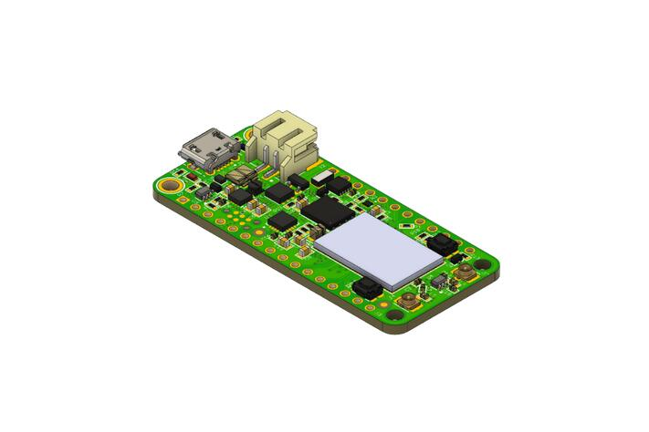
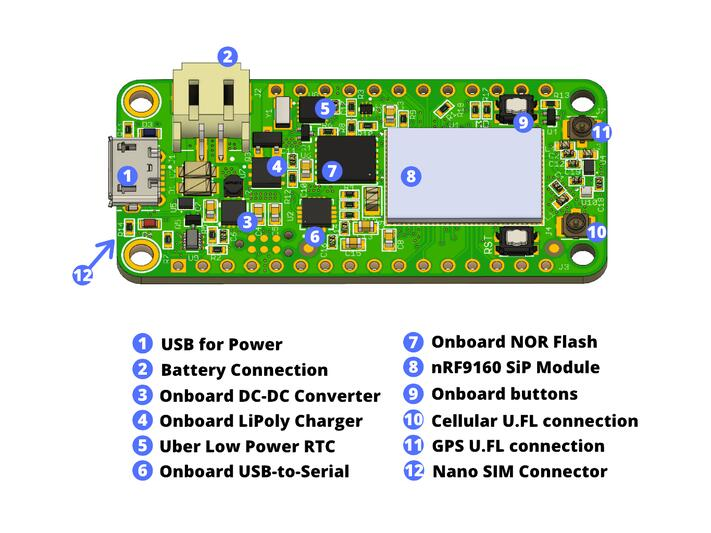

<!-- Copyright 2015-2026 Zephyr Project members and individual contributors. -->
<!-- SPDX-License-Identifier: Apache-2.0 -->
<!-- 中文翻译；编号、导航与译注为本地新增。 -->

<a id="circuitdojo_feather"></a>

# 第5章\_nRF9160 Feather

原文：[官方页面](https://docs.zephyrproject.org/latest/boards/circuitdojo/feather/doc/index.html)。读取日期：2026-10-16；来源摘要见[来源记录](../SOURCES.md)。

开发板概览（Board Overview）

<a id="id1"></a>

[](images/circuitdojo_feather_nrf9160.jpg)

nRF9160 Feather

名称（Name）：

`circuitdojo_feather`

厂商（Vendor）：

[Circuit Dojo](https://docs.zephyrproject.org/latest/boards/index.html#vendor=circuitdojo)

状态（Status）：

当前未积极维护（Not Actively Maintained）

架构（Architecture）：

[arm](https://docs.zephyrproject.org/latest/boards/index.html#arch=arm)

片上系统（SoC）：

[nrf9160](https://docs.zephyrproject.org/latest/boards/index.html#soc=nrf9160)

<a id="board-github-link"></a>

[浏览开发板源码（Browse Board Sources）](https://github.com/zephyrproject-rtos/zephyr/blob/main//boards/circuitdojo/feather/doc/index.rst/../..)<a id="overview"></a>

## 概述（Overview）

Circuit Dojo的nRF9160 Feather是一款用于实现LTE-M及窄带物联网（NB-IoT）应用的单板开发平台。`circuitdojo_feather_nrf9160`开发板配置使用现有的Nordic Semiconductor nRF9160支持。支持的nRF9160外设包括：


- 模数转换器（ADC）
- 时钟（CLOCK）
- 闪存（FLASH）
- 通用输入输出（GPIO）
- 集成电路间总线（I2C）
- 存储器保护单元（MPU）
- 嵌套向量中断控制器（NVIC）
- 脉宽调制（PWM）
- 实时时钟（RTC）
- Segger实时传输（RTT，RTT控制台 / RTT Console）
- 串行外设接口（SPI）
- 带EasyDMA的通用异步收发器（UARTE）
- 看门狗定时器（WDT）
- 实现定义的归属单元（IDAU）

<a id="id3"></a>

更多开发板信息见[nRF9160 Feather文档](https://docs.circuitdojo.com/nrf9160-feather/overview.html)[注1](#id2)。

<a id="hardware"></a>

## 硬件（Hardware）



<a id="supported-features"></a>

### 支持的功能（Supported Features）

`circuitdojo_feather`开发板支持下表所列的硬件功能。

片上／板载（On-Chip / On-Board）

功能集成在片上系统（SoC）内／位于开发板上。

2 / 2

分别表示已启用／已禁用的实例数。点击数量标签，可查看开发板或SoC设备树源码（DTS）中该功能的第一个实例。

`vnd,foo`

与此功能匹配的设备树绑定兼容字符串（Compatible String）；点击链接可查看绑定文档。

<a id="circuitdojo_feather-hw-features"></a>

<a id="circuitdojo_feather-circuitdojo_feather/nrf9160-hw-features-section"></a>

#### `circuitdojo_feather/nrf9160`目标（Target）

<a id="circuitdojo_feather-circuitdojo_feather/nrf9160-hw-features-panel"></a>

<a id="circuitdojo_feather-circuitdojo_feather/nrf9160-hw-features-memory"></a>

该开发板目标的片上存储容量：88 KiB RAM、1 MiB Flash。

<a id="circuitdojo_feather-circuitdojo_feather/nrf9160-hw-features-table"></a>

<table>
<tr>
<th>类型（Type）</th>
<th>位置（Location）</th>
<th>说明（Description）</th>
<th>兼容字符串（Compatible）</th>
</tr>
<tr>
<td rowspan="1">中央处理器（CPU）</td>
<td>片上（On-Chip）</td>
<td>ARM Cortex-M33F处理器（CPU）（<a href="https://github.com/zephyrproject-rtos/zephyr/blob/main/dts/arm/nordic/nrf91.dtsi?plain=1#L16">已启用：1</a>）</td>
<td><a href="../cpu_arm_riscv_binding_reference/P023_arm_cortex-m33f.md#std-dtcompatible-arm-cortex-m33f"><code>arm,cortex-m33f</code></a></td>
</tr>
<tr>
<td rowspan="1">模数转换器（ADC）</td>
<td>片上（On-Chip）</td>
<td>Nordic Semiconductor nRF系列逐次逼近模数转换器（SAADC）节点（<a href="https://github.com/zephyrproject-rtos/zephyr/blob/main/dts/arm/nordic/nrf91_peripherals.dtsi?plain=1#L7">已启用：1</a>）</td>
<td><a href="../hardware/P846_NordicNRF逐次逼近ADC绑定.md#dtbinding-nordic-nrf-saadc"><code>nordic,nrf-saadc</code></a></td>
</tr>
<tr>
<td rowspan="5">ARM 架构（ARM Architecture）</td>
<td>片上（On-Chip）</td>
<td>Nordic事件发生器单元（EGU / Event Generator Unit）（<a href="https://github.com/zephyrproject-rtos/zephyr/blob/main/dts/arm/nordic/nrf91_peripherals.dtsi?plain=1#L24">已启用：6</a>）</td>
<td><a href="../arm_timing_ethosu_control_binding_reference/P018_nordic_nrf-egu.md#std-dtcompatible-nordic-nrf-egu"><code>nordic,nrf-egu</code></a></td>
</tr>
<tr>
<td>片上（On-Chip）</td>
<td>Nordic密钥管理单元（KMU / Key Management Unit）（<a href="https://github.com/zephyrproject-rtos/zephyr/blob/main/dts/arm/nordic/nrf91_peripherals.dtsi?plain=1#L82">已启用：1</a>）</td>
<td><a href="../arm_timing_ethosu_control_binding_reference/P019_nordic_nrf-kmu.md#std-dtcompatible-nordic-nrf-kmu"><code>nordic,nrf-kmu</code></a></td>
</tr>
<tr>
<td>片上（On-Chip）</td>
<td>Nordic nRF系列控制访问端口（CTRL-AP / Control Access Port）（<a href="https://github.com/zephyrproject-rtos/zephyr/blob/main/dts/arm/nordic/nrf91.dtsi?plain=1#L81">已启用：1</a>）</td>
<td><a href="../arm_timing_ethosu_control_binding_reference/P016_nordic_nrf-ctrlapperi.md#std-dtcompatible-nordic-nrf-ctrlapperi"><code>nordic,nrf-ctrlapperi</code></a></td>
</tr>
<tr>
<td>片上（On-Chip）</td>
<td>Nordic系统保护单元（SPU / System Protection Unit）（<a href="https://github.com/zephyrproject-rtos/zephyr/blob/main/dts/arm/nordic/nrf91.dtsi?plain=1#L109">已启用：1</a>）</td>
<td><a href="../arm_nordic_nxp_control_binding_reference/P004_nordic_nrf-spu.md#std-dtcompatible-nordic-nrf-spu"><code>nordic,nrf-spu</code></a></td>
</tr>
<tr>
<td>片上（On-Chip）</td>
<td>Nordic用户信息配置寄存器（UICR / User Information Configuration Registers）（<a href="https://github.com/zephyrproject-rtos/zephyr/blob/main/dts/arm/nordic/nrf91.dtsi?plain=1#L123">已启用：1</a>）</td>
<td><a href="../arm_nordic_nxp_control_binding_reference/P007_nordic_nrf-uicr.md#std-dtcompatible-nordic-nrf-uicr"><code>nordic,nrf-uicr</code></a></td>
</tr>
<tr>
<td rowspan="1">音频（Audio）</td>
<td>片上（On-Chip）</td>
<td>Nordic脉冲密度调制接口（PDM / Pulse Density Modulation Interface）（<a href="https://github.com/zephyrproject-rtos/zephyr/blob/main/dts/arm/nordic/nrf91_peripherals.dtsi?plain=1#L89">已禁用：1</a>）</td>
<td><a href="../audio_pdm_codec_binding_reference/P012_nordic_nrf-pdm.md#std-dtcompatible-nordic-nrf-pdm"><code>nordic,nrf-pdm</code></a></td>
</tr>
<tr>
<td rowspan="3">时钟控制（Clock Control）</td>
<td>片上（On-Chip）</td>
<td>Nordic nRF时钟控制（Clock Control）节点（<a href="https://github.com/zephyrproject-rtos/zephyr/blob/main/dts/arm/nordic/nrf91_peripherals.dtsi?plain=1#L326">已启用：1</a>）</td>
<td><a href="../clock_sam_nordic_binding_reference/P015_nordic_nrf-clock.md#std-dtcompatible-nordic-nrf-clock"><code>nordic,nrf-clock</code></a></td>
</tr>
<tr>
<td>片上（On-Chip）</td>
<td>Nordic nRF高频时钟（HFCLK）控制节点（<a href="https://github.com/zephyrproject-rtos/zephyr/blob/main/dts/arm/nordic/nrf91_peripherals.dtsi?plain=1#L332">已启用：1</a>）</td>
<td><a href="../clock_sam_nordic_binding_reference/P009_nordic_nrf-clock-hfclk.md#std-dtcompatible-nordic-nrf-clock-hfclk"><code>nordic,nrf-clock-hfclk</code></a></td>
</tr>
<tr>
<td>片上（On-Chip）</td>
<td>Nordic nRF低频时钟（LFCLK）控制节点（<a href="https://github.com/zephyrproject-rtos/zephyr/blob/main/dts/arm/nordic/nrf91_peripherals.dtsi?plain=1#L337">已启用：1</a>）</td>
<td><a href="../clock_sam_nordic_binding_reference/P012_nordic_nrf-clock-lfclk.md#std-dtcompatible-nordic-nrf-clock-lfclk"><code>nordic,nrf-clock-lfclk</code></a></td>
</tr>
<tr>
<td rowspan="1">计数器（Counter）</td>
<td>片上（On-Chip）</td>
<td>Nordic nRF定时器（Timer）节点（<a href="https://github.com/zephyrproject-rtos/zephyr/blob/main/dts/arm/nordic/nrf91_peripherals.dtsi?plain=1#L376">已禁用：3</a>）</td>
<td><a href="../microchip_soc_counter_binding_reference/P017_nordic_nrf-timer.md#std-dtcompatible-nordic-nrf-timer"><code>nordic,nrf-timer</code></a></td>
</tr>
<tr>
<td rowspan="1">密码学加速器（Cryptographic Accelerator）</td>
<td>片上（On-Chip）</td>
<td>ARM TrustZone CryptoCell 310密码模块（<a href="https://github.com/zephyrproject-rtos/zephyr/blob/main/dts/arm/nordic/nrf91.dtsi?plain=1#L73">已禁用：1</a>）</td>
<td><a href="../crypto_aes_sha_ccm_binding_reference/P001_arm_cryptocell-310.md#std-dtcompatible-arm-cryptocell-310"><code>arm,cryptocell-310</code></a></td>
</tr>
<tr>
<td rowspan="1">闪存控制器（Flash Controller）</td>
<td>片上（On-Chip）</td>
<td>Nordic非易失性存储器控制器（NVMC / Non-Volatile Memory Controller）（<a href="https://github.com/zephyrproject-rtos/zephyr/blob/main/dts/arm/nordic/nrf91.dtsi?plain=1#L52">已启用：1</a>）</td>
<td><a href="../flash_nuvoton_nxp_renesas_binding_reference/P002_nordic_nrf91-flash-controller.md#std-dtcompatible-nordic-nrf91-flash-controller"><code>nordic,nrf91-flash-controller</code></a></td>
</tr>
<tr>
<td rowspan="3">通用输入输出与接插件（GPIO &amp; Headers）</td>
<td>片上（On-Chip）</td>
<td>NRF5通用输入输出（GPIO）（<a href="https://github.com/zephyrproject-rtos/zephyr/blob/main/dts/arm/nordic/nrf91_peripherals.dtsi?plain=1#L296">已启用：1</a>）</td>
<td><a href="../gpio_microchip_nordic_nuvoton_binding_reference/P016_nordic_nrf-gpio.md#std-dtcompatible-nordic-nrf-gpio"><code>nordic,nrf-gpio</code></a></td>
</tr>
<tr>
<td>片上（On-Chip）</td>
<td>NRF5 GPIO任务与事件（GPIOTE）（<a href="https://github.com/zephyrproject-rtos/zephyr/blob/main/dts/arm/nordic/nrf91.dtsi?plain=1#L92">已启用：1</a>；<a href="https://github.com/zephyrproject-rtos/zephyr/blob/main/dts/arm/nordic/nrf91.dtsi?plain=1#L101">已禁用：1</a>）</td>
<td><a href="../gpio_microchip_nordic_nuvoton_binding_reference/P017_nordic_nrf-gpiote.md#std-dtcompatible-nordic-nrf-gpiote"><code>nordic,nrf-gpiote</code></a></td>
</tr>
<tr>
<td>板载（On-Board）</td>
<td>引出到Adafruit Feather排针（Headers）的GPIO引脚（<a href="https://github.com/zephyrproject-rtos/zephyr/blob/main/boards/circuitdojo/feather/circuitdojo_feather_nrf9160_common.dtsi?plain=1#L59">已启用：1</a>）</td>
<td><a href="../gpio_adi_headers_ambiq_binding_reference/P001_adafruit-feather-header.md#std-dtcompatible-adafruit-feather-header"><code>adafruit-feather-header</code></a></td>
</tr>
<tr>
<td rowspan="1">集成电路间总线（I2C）</td>
<td>片上（On-Chip）</td>
<td>Nordic nRF系列TWIM（带EasyDMA的TWI主机）（<a href="https://github.com/zephyrproject-rtos/zephyr/blob/main/dts/arm/nordic/nrf91_peripherals.dtsi?plain=1#L152">已启用：1</a>；<a href="https://github.com/zephyrproject-rtos/zephyr/blob/main/dts/arm/nordic/nrf91_peripherals.dtsi?plain=1#L136">已禁用：3</a>）</td>
<td><a href="../i2c_infineon_ite_nordic_binding_reference/P016_nordic_nrf-twim.md#std-dtcompatible-nordic-nrf-twim"><code>nordic,nrf-twim</code></a></td>
</tr>
<tr>
<td rowspan="1">集成电路间音频总线（I2S）</td>
<td>片上（On-Chip）</td>
<td>Nordic芯片间音频接口（I2S / Inter-IC Sound Interface）（<a href="https://github.com/zephyrproject-rtos/zephyr/blob/main/dts/arm/nordic/nrf91_peripherals.dtsi?plain=1#L73">已禁用：1</a>）</td>
<td><a href="../i2s_binding_reference/P010_nordic_nrf-i2s.md#std-dtcompatible-nordic-nrf-i2s"><code>nordic,nrf-i2s</code></a></td>
</tr>
<tr>
<td rowspan="1">工业输入输出（IIO）</td>
<td>板载（On-Board）</td>
<td>分压器（Voltage Divider）（<a href="https://github.com/zephyrproject-rtos/zephyr/blob/main/boards/circuitdojo/feather/circuitdojo_feather_nrf9160_common.dtsi?plain=1#L179">已启用：1</a>）</td>
<td><a href="../auxdisplay_iio_tach_binding_reference/P012_voltage-divider.md#std-dtcompatible-voltage-divider"><code>voltage-divider</code></a></td>
</tr>
<tr>
<td rowspan="1">输入（Input）</td>
<td>板载（On-Board）</td>
<td>一组绑定到 GPIO 的输入按键（GPIO-Bound Input Keys）（<a href="https://github.com/zephyrproject-rtos/zephyr/blob/main/boards/circuitdojo/feather/circuitdojo_feather_nrf9160_common.dtsi?plain=1#L37">已启用：1</a>）</td>
<td><a href="../hardware/P563_GPIO按键绑定.md#std-dtcompatible-gpio-keys"><code>gpio-keys</code></a></td>
</tr>
<tr>
<td rowspan="1">中断控制器（Interrupt Controller）</td>
<td>片上（On-Chip）</td>
<td>ARMv8-M嵌套向量中断控制器（NVIC / Nested Vectored Interrupt Controller）（<a href="https://github.com/zephyrproject-rtos/zephyr/blob/main/dts/arm/armv8-m.dtsi?plain=1#L13">已启用：1</a>）</td>
<td><a href="../arm_interrupt_timer_binding_reference/P003_ARMv8_M_NVIC.md#std-dtcompatible-arm-v8m-nvic"><code>arm,v8m-nvic</code></a></td>
</tr>
<tr>
<td rowspan="1">处理器间／进程间通信（IPC）</td>
<td>片上（On-Chip）</td>
<td>Nordic nRF系列处理器间通信（IPC / Interprocessor Communication）（<a href="https://github.com/zephyrproject-rtos/zephyr/blob/main/dts/arm/nordic/nrf91_peripherals.dtsi?plain=1#L66">已启用：1</a>）</td>
<td><a href="../intercore_reference/P102_NordicnRF处理器间通信绑定.md#dtbinding-nordic-nrf-ipc"><code>nordic,nrf-ipc</code></a></td>
</tr>
<tr>
<td rowspan="2">发光二极管（LED）</td>
<td>板载（On-Board）</td>
<td>一组由 GPIO 控制的 LED（GPIO-Controlled LEDs）（<a href="https://github.com/zephyrproject-rtos/zephyr/blob/main/boards/circuitdojo/feather/circuitdojo_feather_nrf9160_common.dtsi?plain=1#L20">已启用：1</a>）</td>
<td><a href="../hardware/P564_GPIO指示灯绑定.md#dtbinding-gpio-leds"><code>gpio-leds</code></a></td>
</tr>
<tr>
<td>板载（On-Board）</td>
<td>一组由脉宽调制（PWM）控制的LED（<a href="https://github.com/zephyrproject-rtos/zephyr/blob/main/boards/circuitdojo/feather/circuitdojo_feather_nrf9160_common.dtsi?plain=1#L29">已启用：1</a>）</td>
<td><a href="../hardware/P565_PWM指示灯绑定.md#dtbinding-pwm-leds"><code>pwm-leds</code></a></td>
</tr>
<tr>
<td rowspan="2">其他绑定（Miscellaneous）</td>
<td>片上（On-Chip）</td>
<td>Nordic分布式可编程外设互连控制器（DPPIC / Distributed Programmable Peripheral Interconnect Controller）（<a href="https://github.com/zephyrproject-rtos/zephyr/blob/main/dts/arm/nordic/nrf91_peripherals.dtsi?plain=1#L16">已启用：1</a>）</td>
<td><a href="../misc_adi_nordic_binding_reference/P017_nordic_nrf-dppic.md#std-dtcompatible-nordic-nrf-dppic"><code>nordic,nrf-dppic</code></a></td>
</tr>
<tr>
<td>片上（On-Chip）</td>
<td>Nordic工厂信息配置寄存器（FICR / Factory Information Configuration Registers）（<a href="https://github.com/zephyrproject-rtos/zephyr/blob/main/dts/arm/nordic/nrf91.dtsi?plain=1#L116">已启用：1</a>）</td>
<td><a href="../misc_adi_nordic_binding_reference/P018_nordic_nrf-ficr.md#std-dtcompatible-nordic-nrf-ficr"><code>nordic,nrf-ficr</code></a></td>
</tr>
<tr>
<td rowspan="1">内存管理单元／内存保护单元（MMU / MPU）</td>
<td>片上（On-Chip）</td>
<td>ARMv8-M存储器保护单元（MPU / Memory Protection Unit）（<a href="https://github.com/zephyrproject-rtos/zephyr/blob/main/dts/arm/nordic/nrf91.dtsi?plain=1#L23">已启用：1</a>）</td>
<td><a href="../memory_protection_binding_reference/P007_arm_armv8m-mpu.md#std-dtcompatible-arm-armv8m-mpu"><code>arm,armv8m-mpu</code></a></td>
</tr>
<tr>
<td rowspan="4">存储技术设备（MTD）</td>
<td>板载（On-Board）</td>
<td>这些属性用于支持Zephyr的<code>spi-nor</code>闪存驱动通过Zephyr SPI API，使用基于M25P80的标准命令集控制串行闪存（Serial Flash Memory）。（<a href="https://github.com/zephyrproject-rtos/zephyr/blob/main/boards/circuitdojo/feather/circuitdojo_feather_nrf9160_common.dtsi?plain=1#L164">已启用：1</a>）</td>
<td><a href="../mtd_microchip_nordic_nxp_binding_reference/P002_jedec_spi-nor.md#std-dtcompatible-jedec-spi-nor"><code>jedec,spi-nor</code></a></td>
</tr>
<tr>
<td>片上（On-Chip）</td>
<td>闪存（Flash）节点（<a href="https://github.com/zephyrproject-rtos/zephyr/blob/main/dts/arm/nordic/nrf91.dtsi?plain=1#L60">已启用：1</a>）</td>
<td><a href="../mtd_nxp_st_ti_partition_binding_reference/P013_soc-nv-flash.md#std-dtcompatible-soc-nv-flash"><code>soc-nv-flash</code></a></td>
</tr>
<tr>
<td>片上（On-Chip）</td>
<td>在Nordic片上系统（SoC）的ARM TrustZone-M布局中标记安全闪存分区（Secure Flash Partitions）。（<a href="https://github.com/zephyrproject-rtos/zephyr/blob/main/dts/vendor/nordic/nrf91xx_partition.dtsi?plain=1#L159">已启用：1</a>）</td>
<td><a href="../mtd_microchip_nordic_nxp_binding_reference/P014_nordic_tz-secure.md#std-dtcompatible-nordic-tz-secure"><code>nordic,tz-secure</code></a></td>
</tr>
<tr>
<td>片上（On-Chip）</td>
<td>在Nordic片上系统（SoC）的ARM TrustZone-M布局中标记非安全闪存分区（Non-secure Flash Partitions）。（<a href="https://github.com/zephyrproject-rtos/zephyr/blob/main/dts/vendor/nordic/nrf91xx_partition.dtsi?plain=1#L168">已启用：1</a>）</td>
<td><a href="../mtd_microchip_nordic_nxp_binding_reference/P013_nordic_tz-nonsecure.md#std-dtcompatible-nordic-tz-nonsecure"><code>nordic,tz-nonsecure</code></a></td>
</tr>
<tr>
<td rowspan="1">引脚控制（Pin Control）</td>
<td>片上（On-Chip）</td>
<td>Nordic nRF系列引脚控制器（Pin Controller）（<a href="https://github.com/zephyrproject-rtos/zephyr/blob/main/dts/vendor/nordic/nrf_common.dtsi?plain=1#L26">已启用：1</a>）</td>
<td><a href="../pinctrl_infineon_nordic_nxp_binding_reference/P009_nordic_nrf-pinctrl.md#std-dtcompatible-nordic-nrf-pinctrl"><code>nordic,nrf-pinctrl</code></a></td>
</tr>
<tr>
<td rowspan="2">电源管理（Power Management）</td>
<td>片上（On-Chip）</td>
<td>Nordic易失性存储器控制器（VMC / Volatile Memory Controller）（<a href="https://github.com/zephyrproject-rtos/zephyr/blob/main/dts/arm/nordic/nrf91_peripherals.dtsi?plain=1#L102">已启用：1</a>）</td>
<td><a href="../power_control_binding_reference/P010_nordic_nrf-vmc.md#std-dtcompatible-nordic-nrf-vmc"><code>nordic,nrf-vmc</code></a></td>
</tr>
<tr>
<td>片上（On-Chip）</td>
<td>Nordic nRF电源控制（Power Control）节点（<a href="https://github.com/zephyrproject-rtos/zephyr/blob/main/dts/arm/nordic/nrf91_peripherals.dtsi?plain=1#L343">已启用：1</a>）</td>
<td><a href="../power_control_binding_reference/P008_nordic_nrf-power.md#std-dtcompatible-nordic-nrf-power"><code>nordic,nrf-power</code></a></td>
</tr>
<tr>
<td rowspan="2">脉宽调制（PWM）</td>
<td>片上（On-Chip）</td>
<td>nRF脉宽调制（PWM）（<a href="https://github.com/zephyrproject-rtos/zephyr/blob/main/dts/arm/nordic/nrf91_peripherals.dtsi?plain=1#L264">已启用：1</a>；<a href="https://github.com/zephyrproject-rtos/zephyr/blob/main/dts/arm/nordic/nrf91_peripherals.dtsi?plain=1#L272">已禁用：3</a>）</td>
<td><a href="../pwm_intel_microchip_nxp_binding_reference/P015_nordic_nrf-pwm.md#std-dtcompatible-nordic-nrf-pwm"><code>nordic,nrf-pwm</code></a></td>
</tr>
<tr>
<td>片上（On-Chip）</td>
<td>nRFx软件脉宽调制（S/W PWM）（<a href="https://github.com/zephyrproject-rtos/zephyr/blob/main/dts/vendor/nordic/nrf_common.dtsi?plain=1#L39">已禁用：1</a>）</td>
<td><a href="../pwm_intel_microchip_nxp_binding_reference/P016_nordic_nrf-sw-pwm.md#std-dtcompatible-nordic-nrf-sw-pwm"><code>nordic,nrf-sw-pwm</code></a></td>
</tr>
<tr>
<td rowspan="2">稳压器（Regulator）</td>
<td>片上（On-Chip）</td>
<td>nRF91X上的Nordic REGULATORS电压稳压器控制模块（Voltage Regulators Control Module）（<a href="https://github.com/zephyrproject-rtos/zephyr/blob/main/dts/arm/nordic/nrf91_peripherals.dtsi?plain=1#L96">已启用：1</a>）</td>
<td><a href="../hardware/P644_nRF91稳压器集合绑定.md#dtbinding-nordic-nrf91x-regulators"><code>nordic,nrf91x-regulators</code></a></td>
</tr>
<tr>
<td>板载（On-Board）</td>
<td>固定电压稳压器（Fixed Voltage Regulators）（<a href="https://github.com/zephyrproject-rtos/zephyr/blob/main/boards/circuitdojo/feather/circuitdojo_feather_nrf9160_common.dtsi?plain=1#L87">已启用：1</a>）</td>
<td><a href="../hardware/P635_固定稳压器设备树绑定.md#dtbinding-regulator-fixed"><code>regulator-fixed</code></a></td>
</tr>
<tr>
<td rowspan="1">保持存储器（Retained Memory）</td>
<td>片上（On-Chip）</td>
<td>Nordic通用保持寄存器（GPREGRET / General Purpose Register Retention）设备（<a href="https://github.com/zephyrproject-rtos/zephyr/blob/main/dts/arm/nordic/nrf91_peripherals.dtsi?plain=1#L352">已启用：2</a>）</td>
<td><a href="../hardware/P627_Nordic通用保留寄存器绑定.md#dtbinding-nordic-nrf-gpregret"><code>nordic,nrf-gpregret</code></a></td>
</tr>
<tr>
<td rowspan="2">实时时钟（RTC）</td>
<td>板载（On-Board）</td>
<td>NXP PCF85063A实时时钟（RTC）（<a href="https://github.com/zephyrproject-rtos/zephyr/blob/main/boards/circuitdojo/feather/circuitdojo_feather_nrf9160_common.dtsi?plain=1#L136">已启用：1</a>）</td>
<td><a href="../microchip_microcrystal_nxp_rtc_binding_reference/P015_nxp_pcf85063a.md#std-dtcompatible-nxp-pcf85063a"><code>nxp,pcf85063a</code></a></td>
</tr>
<tr>
<td>片上（On-Chip）</td>
<td>Nordic nRF实时时间计数器（RTC / Real-Time Counter）（<a href="https://github.com/zephyrproject-rtos/zephyr/blob/main/dts/arm/nordic/nrf91_peripherals.dtsi?plain=1#L306">已禁用：2</a>）</td>
<td><a href="../microchip_microcrystal_nxp_rtc_binding_reference/P010_nordic_nrf-rtc.md#std-dtcompatible-nordic-nrf-rtc"><code>nordic,nrf-rtc</code></a></td>
</tr>
<tr>
<td rowspan="1">传感器（Sensors）</td>
<td>板载（On-Board）</td>
<td>通过I2C总线访问的意法半导体LIS2DH三轴加速度计（<a href="https://github.com/zephyrproject-rtos/zephyr/blob/main/boards/circuitdojo/feather/circuitdojo_feather_nrf9160_common.dtsi?plain=1#L141">已启用：1</a>）</td>
<td><a href="../compatible_binding_reference/P079_st_lis2dh.md#std-dtcompatible-st-lis2dh"><code>st,lis2dh</code></a></td>
</tr>
<tr>
<td rowspan="1">串行控制器（Serial Controller）</td>
<td>片上（On-Chip）</td>
<td>Nordic nRF系列UARTE（带EasyDMA的UART）（<a href="https://github.com/zephyrproject-rtos/zephyr/blob/main/dts/arm/nordic/nrf91_peripherals.dtsi?plain=1#L108">已启用：1</a>；<a href="https://github.com/zephyrproject-rtos/zephyr/blob/main/dts/arm/nordic/nrf91_peripherals.dtsi?plain=1#L115">已禁用：3</a>）</td>
<td><a href="../uart_microchip_nordic_nxp_binding_reference/P004_nordic_nrf-uarte.md#std-dtcompatible-nordic-nrf-uarte"><code>nordic,nrf-uarte</code></a></td>
</tr>
<tr>
<td rowspan="1">串行外设接口（SPI）</td>
<td>片上（On-Chip）</td>
<td>Nordic nRF系列SPIM（带EasyDMA的SPI控制器）（<a href="https://github.com/zephyrproject-rtos/zephyr/blob/main/dts/arm/nordic/nrf91_peripherals.dtsi?plain=1#L248">已启用：1</a>；<a href="https://github.com/zephyrproject-rtos/zephyr/blob/main/dts/arm/nordic/nrf91_peripherals.dtsi?plain=1#L200">已禁用：3</a>）</td>
<td><a href="../spi_microchip_nordic_nxp_binding_reference/P013_nordic_nrf-spim.md#std-dtcompatible-nordic-nrf-spim"><code>nordic,nrf-spim</code></a></td>
</tr>
<tr>
<td rowspan="1">静态随机存储器（SRAM）</td>
<td>片上（On-Chip）</td>
<td>通用片上静态随机存储器（SRAM）（<a href="https://github.com/zephyrproject-rtos/zephyr/blob/main/dts/arm/nordic/nrf91.dtsi?plain=1#L37">已启用：1</a>）</td>
<td><a href="../hardware/P567_内存映射SRAM绑定.md#dtbinding-mmio-sram"><code>mmio-sram</code></a></td>
</tr>
<tr>
<td rowspan="1">定时器（Timer）</td>
<td>片上（On-Chip）</td>
<td>ARMv8-M系统节拍（System Tick）（<a href="https://github.com/zephyrproject-rtos/zephyr/blob/main/dts/arm/armv8-m.dtsi?plain=1#L21">已禁用：1</a>）</td>
<td><a href="../arm_interrupt_timer_binding_reference/P007_ARMv8_M_SysTick.md#std-dtcompatible-arm-armv8m-systick"><code>arm,armv8m-systick</code></a></td>
</tr>
<tr>
<td rowspan="1">看门狗（Watchdog）</td>
<td>片上（On-Chip）</td>
<td>Nordic nRF系列看门狗定时器（WDT / Watchdog Timer）（<a href="https://github.com/zephyrproject-rtos/zephyr/blob/main/dts/arm/nordic/nrf91_peripherals.dtsi?plain=1#L369">已启用：1</a>）</td>
<td><a href="../nxp_nordic_nuvoton_watchdog_binding_reference/P002_nordic_nrf-wdt.md#std-dtcompatible-nordic-nrf-wdt"><code>nordic,nrf-wdt</code></a></td>
</tr>
</table>

<a id="circuitdojo_feather-circuitdojo_feather/nrf9160/ns-hw-features-section"></a>

#### `circuitdojo_feather/nrf9160/ns`目标（Target）

<a id="circuitdojo_feather-circuitdojo_feather/nrf9160/ns-hw-features-panel"></a>

<a id="circuitdojo_feather-circuitdojo_feather/nrf9160/ns-hw-features-memory"></a>

该开发板目标的片上存储容量：128 KiB RAM、1 MiB Flash。

<a id="circuitdojo_feather-circuitdojo_feather/nrf9160/ns-hw-features-table"></a>

<table>
<tr>
<th>类型（Type）</th>
<th>位置（Location）</th>
<th>说明（Description）</th>
<th>兼容字符串（Compatible）</th>
</tr>
<tr>
<td rowspan="1">中央处理器（CPU）</td>
<td>片上（On-Chip）</td>
<td>ARM Cortex-M33F处理器（CPU）（<a href="https://github.com/zephyrproject-rtos/zephyr/blob/main/dts/arm/nordic/nrf91_ns.dtsi?plain=1#L16">已启用：1</a>）</td>
<td><a href="../cpu_arm_riscv_binding_reference/P023_arm_cortex-m33f.md#std-dtcompatible-arm-cortex-m33f"><code>arm,cortex-m33f</code></a></td>
</tr>
<tr>
<td rowspan="1">模数转换器（ADC）</td>
<td>片上（On-Chip）</td>
<td>Nordic Semiconductor nRF系列逐次逼近模数转换器（SAADC）节点（<a href="https://github.com/zephyrproject-rtos/zephyr/blob/main/dts/arm/nordic/nrf91_peripherals.dtsi?plain=1#L7">已启用：1</a>）</td>
<td><a href="../hardware/P846_NordicNRF逐次逼近ADC绑定.md#dtbinding-nordic-nrf-saadc"><code>nordic,nrf-saadc</code></a></td>
</tr>
<tr>
<td rowspan="2">ARM 架构（ARM Architecture）</td>
<td>片上（On-Chip）</td>
<td>Nordic事件发生器单元（EGU / Event Generator Unit）（<a href="https://github.com/zephyrproject-rtos/zephyr/blob/main/dts/arm/nordic/nrf91_peripherals.dtsi?plain=1#L24">已启用：6</a>）</td>
<td><a href="../arm_timing_ethosu_control_binding_reference/P018_nordic_nrf-egu.md#std-dtcompatible-nordic-nrf-egu"><code>nordic,nrf-egu</code></a></td>
</tr>
<tr>
<td>片上（On-Chip）</td>
<td>Nordic密钥管理单元（KMU / Key Management Unit）（<a href="https://github.com/zephyrproject-rtos/zephyr/blob/main/dts/arm/nordic/nrf91_peripherals.dtsi?plain=1#L82">已启用：1</a>）</td>
<td><a href="../arm_timing_ethosu_control_binding_reference/P019_nordic_nrf-kmu.md#std-dtcompatible-nordic-nrf-kmu"><code>nordic,nrf-kmu</code></a></td>
</tr>
<tr>
<td rowspan="1">音频（Audio）</td>
<td>片上（On-Chip）</td>
<td>Nordic脉冲密度调制接口（PDM / Pulse Density Modulation Interface）（<a href="https://github.com/zephyrproject-rtos/zephyr/blob/main/dts/arm/nordic/nrf91_peripherals.dtsi?plain=1#L89">已禁用：1</a>）</td>
<td><a href="../audio_pdm_codec_binding_reference/P012_nordic_nrf-pdm.md#std-dtcompatible-nordic-nrf-pdm"><code>nordic,nrf-pdm</code></a></td>
</tr>
<tr>
<td rowspan="3">时钟控制（Clock Control）</td>
<td>片上（On-Chip）</td>
<td>Nordic nRF时钟控制（Clock Control）节点（<a href="https://github.com/zephyrproject-rtos/zephyr/blob/main/dts/arm/nordic/nrf91_peripherals.dtsi?plain=1#L326">已启用：1</a>）</td>
<td><a href="../clock_sam_nordic_binding_reference/P015_nordic_nrf-clock.md#std-dtcompatible-nordic-nrf-clock"><code>nordic,nrf-clock</code></a></td>
</tr>
<tr>
<td>片上（On-Chip）</td>
<td>Nordic nRF高频时钟（HFCLK）控制节点（<a href="https://github.com/zephyrproject-rtos/zephyr/blob/main/dts/arm/nordic/nrf91_peripherals.dtsi?plain=1#L332">已启用：1</a>）</td>
<td><a href="../clock_sam_nordic_binding_reference/P009_nordic_nrf-clock-hfclk.md#std-dtcompatible-nordic-nrf-clock-hfclk"><code>nordic,nrf-clock-hfclk</code></a></td>
</tr>
<tr>
<td>片上（On-Chip）</td>
<td>Nordic nRF低频时钟（LFCLK）控制节点（<a href="https://github.com/zephyrproject-rtos/zephyr/blob/main/dts/arm/nordic/nrf91_peripherals.dtsi?plain=1#L337">已启用：1</a>）</td>
<td><a href="../clock_sam_nordic_binding_reference/P012_nordic_nrf-clock-lfclk.md#std-dtcompatible-nordic-nrf-clock-lfclk"><code>nordic,nrf-clock-lfclk</code></a></td>
</tr>
<tr>
<td rowspan="1">计数器（Counter）</td>
<td>片上（On-Chip）</td>
<td>Nordic nRF定时器（Timer）节点（<a href="https://github.com/zephyrproject-rtos/zephyr/blob/main/dts/arm/nordic/nrf91_peripherals.dtsi?plain=1#L376">已禁用：3</a>）</td>
<td><a href="../microchip_soc_counter_binding_reference/P017_nordic_nrf-timer.md#std-dtcompatible-nordic-nrf-timer"><code>nordic,nrf-timer</code></a></td>
</tr>
<tr>
<td rowspan="1">闪存控制器（Flash Controller）</td>
<td>片上（On-Chip）</td>
<td>Nordic非易失性存储器控制器（NVMC / Non-Volatile Memory Controller）（<a href="https://github.com/zephyrproject-rtos/zephyr/blob/main/dts/arm/nordic/nrf91_ns.dtsi?plain=1#L53">已启用：1</a>）</td>
<td><a href="../flash_nuvoton_nxp_renesas_binding_reference/P002_nordic_nrf91-flash-controller.md#std-dtcompatible-nordic-nrf91-flash-controller"><code>nordic,nrf91-flash-controller</code></a></td>
</tr>
<tr>
<td rowspan="3">通用输入输出与接插件（GPIO &amp; Headers）</td>
<td>片上（On-Chip）</td>
<td>NRF5通用输入输出（GPIO）（<a href="https://github.com/zephyrproject-rtos/zephyr/blob/main/dts/arm/nordic/nrf91_peripherals.dtsi?plain=1#L296">已启用：1</a>）</td>
<td><a href="../gpio_microchip_nordic_nuvoton_binding_reference/P016_nordic_nrf-gpio.md#std-dtcompatible-nordic-nrf-gpio"><code>nordic,nrf-gpio</code></a></td>
</tr>
<tr>
<td>片上（On-Chip）</td>
<td>NRF5 GPIO任务与事件（GPIOTE）（<a href="https://github.com/zephyrproject-rtos/zephyr/blob/main/dts/arm/nordic/nrf91_ns.dtsi?plain=1#L78">已启用：1</a>）</td>
<td><a href="../gpio_microchip_nordic_nuvoton_binding_reference/P017_nordic_nrf-gpiote.md#std-dtcompatible-nordic-nrf-gpiote"><code>nordic,nrf-gpiote</code></a></td>
</tr>
<tr>
<td>板载（On-Board）</td>
<td>引出到Adafruit Feather排针（Headers）的GPIO引脚（<a href="https://github.com/zephyrproject-rtos/zephyr/blob/main/boards/circuitdojo/feather/circuitdojo_feather_nrf9160_common.dtsi?plain=1#L59">已启用：1</a>）</td>
<td><a href="../gpio_adi_headers_ambiq_binding_reference/P001_adafruit-feather-header.md#std-dtcompatible-adafruit-feather-header"><code>adafruit-feather-header</code></a></td>
</tr>
<tr>
<td rowspan="1">集成电路间总线（I2C）</td>
<td>片上（On-Chip）</td>
<td>Nordic nRF系列TWIM（带EasyDMA的TWI主机）（<a href="https://github.com/zephyrproject-rtos/zephyr/blob/main/dts/arm/nordic/nrf91_peripherals.dtsi?plain=1#L152">已启用：1</a>；<a href="https://github.com/zephyrproject-rtos/zephyr/blob/main/dts/arm/nordic/nrf91_peripherals.dtsi?plain=1#L136">已禁用：3</a>）</td>
<td><a href="../i2c_infineon_ite_nordic_binding_reference/P016_nordic_nrf-twim.md#std-dtcompatible-nordic-nrf-twim"><code>nordic,nrf-twim</code></a></td>
</tr>
<tr>
<td rowspan="1">集成电路间音频总线（I2S）</td>
<td>片上（On-Chip）</td>
<td>Nordic芯片间音频接口（I2S / Inter-IC Sound Interface）（<a href="https://github.com/zephyrproject-rtos/zephyr/blob/main/dts/arm/nordic/nrf91_peripherals.dtsi?plain=1#L73">已禁用：1</a>）</td>
<td><a href="../i2s_binding_reference/P010_nordic_nrf-i2s.md#std-dtcompatible-nordic-nrf-i2s"><code>nordic,nrf-i2s</code></a></td>
</tr>
<tr>
<td rowspan="1">工业输入输出（IIO）</td>
<td>板载（On-Board）</td>
<td>分压器（Voltage Divider）（<a href="https://github.com/zephyrproject-rtos/zephyr/blob/main/boards/circuitdojo/feather/circuitdojo_feather_nrf9160_common.dtsi?plain=1#L179">已启用：1</a>）</td>
<td><a href="../auxdisplay_iio_tach_binding_reference/P012_voltage-divider.md#std-dtcompatible-voltage-divider"><code>voltage-divider</code></a></td>
</tr>
<tr>
<td rowspan="1">输入（Input）</td>
<td>板载（On-Board）</td>
<td>一组绑定到 GPIO 的输入按键（GPIO-Bound Input Keys）（<a href="https://github.com/zephyrproject-rtos/zephyr/blob/main/boards/circuitdojo/feather/circuitdojo_feather_nrf9160_common.dtsi?plain=1#L37">已启用：1</a>）</td>
<td><a href="../hardware/P563_GPIO按键绑定.md#std-dtcompatible-gpio-keys"><code>gpio-keys</code></a></td>
</tr>
<tr>
<td rowspan="1">中断控制器（Interrupt Controller）</td>
<td>片上（On-Chip）</td>
<td>ARMv8-M嵌套向量中断控制器（NVIC / Nested Vectored Interrupt Controller）（<a href="https://github.com/zephyrproject-rtos/zephyr/blob/main/dts/arm/armv8-m.dtsi?plain=1#L13">已启用：1</a>）</td>
<td><a href="../arm_interrupt_timer_binding_reference/P003_ARMv8_M_NVIC.md#std-dtcompatible-arm-v8m-nvic"><code>arm,v8m-nvic</code></a></td>
</tr>
<tr>
<td rowspan="1">处理器间／进程间通信（IPC）</td>
<td>片上（On-Chip）</td>
<td>Nordic nRF系列处理器间通信（IPC / Interprocessor Communication）（<a href="https://github.com/zephyrproject-rtos/zephyr/blob/main/dts/arm/nordic/nrf91_peripherals.dtsi?plain=1#L66">已启用：1</a>）</td>
<td><a href="../intercore_reference/P102_NordicnRF处理器间通信绑定.md#dtbinding-nordic-nrf-ipc"><code>nordic,nrf-ipc</code></a></td>
</tr>
<tr>
<td rowspan="2">发光二极管（LED）</td>
<td>板载（On-Board）</td>
<td>一组由 GPIO 控制的 LED（GPIO-Controlled LEDs）（<a href="https://github.com/zephyrproject-rtos/zephyr/blob/main/boards/circuitdojo/feather/circuitdojo_feather_nrf9160_common.dtsi?plain=1#L20">已启用：1</a>）</td>
<td><a href="../hardware/P564_GPIO指示灯绑定.md#dtbinding-gpio-leds"><code>gpio-leds</code></a></td>
</tr>
<tr>
<td>板载（On-Board）</td>
<td>一组由脉宽调制（PWM）控制的LED（<a href="https://github.com/zephyrproject-rtos/zephyr/blob/main/boards/circuitdojo/feather/circuitdojo_feather_nrf9160_common.dtsi?plain=1#L29">已启用：1</a>）</td>
<td><a href="../hardware/P565_PWM指示灯绑定.md#dtbinding-pwm-leds"><code>pwm-leds</code></a></td>
</tr>
<tr>
<td rowspan="1">其他绑定（Miscellaneous）</td>
<td>片上（On-Chip）</td>
<td>Nordic分布式可编程外设互连控制器（DPPIC / Distributed Programmable Peripheral Interconnect Controller）（<a href="https://github.com/zephyrproject-rtos/zephyr/blob/main/dts/arm/nordic/nrf91_peripherals.dtsi?plain=1#L16">已启用：1</a>）</td>
<td><a href="../misc_adi_nordic_binding_reference/P017_nordic_nrf-dppic.md#std-dtcompatible-nordic-nrf-dppic"><code>nordic,nrf-dppic</code></a></td>
</tr>
<tr>
<td rowspan="1">内存管理单元／内存保护单元（MMU / MPU）</td>
<td>片上（On-Chip）</td>
<td>ARMv8-M存储器保护单元（MPU / Memory Protection Unit）（<a href="https://github.com/zephyrproject-rtos/zephyr/blob/main/dts/arm/nordic/nrf91_ns.dtsi?plain=1#L23">已启用：1</a>）</td>
<td><a href="../memory_protection_binding_reference/P007_arm_armv8m-mpu.md#std-dtcompatible-arm-armv8m-mpu"><code>arm,armv8m-mpu</code></a></td>
</tr>
<tr>
<td rowspan="4">存储技术设备（MTD）</td>
<td>板载（On-Board）</td>
<td>这些属性用于支持Zephyr的<code>spi-nor</code>闪存驱动通过Zephyr SPI API，使用基于M25P80的标准命令集控制串行闪存（Serial Flash Memory）。（<a href="https://github.com/zephyrproject-rtos/zephyr/blob/main/boards/circuitdojo/feather/circuitdojo_feather_nrf9160_common.dtsi?plain=1#L164">已启用：1</a>）</td>
<td><a href="../mtd_microchip_nordic_nxp_binding_reference/P002_jedec_spi-nor.md#std-dtcompatible-jedec-spi-nor"><code>jedec,spi-nor</code></a></td>
</tr>
<tr>
<td>片上（On-Chip）</td>
<td>闪存（Flash）节点（<a href="https://github.com/zephyrproject-rtos/zephyr/blob/main/dts/arm/nordic/nrf91_ns.dtsi?plain=1#L61">已启用：1</a>）</td>
<td><a href="../mtd_nxp_st_ti_partition_binding_reference/P013_soc-nv-flash.md#std-dtcompatible-soc-nv-flash"><code>soc-nv-flash</code></a></td>
</tr>
<tr>
<td>片上（On-Chip）</td>
<td>在Nordic片上系统（SoC）的ARM TrustZone-M布局中标记安全闪存分区（Secure Flash Partitions）。（<a href="https://github.com/zephyrproject-rtos/zephyr/blob/main/dts/vendor/nordic/nrf91xx_partition.dtsi?plain=1#L159">已启用：1</a>）</td>
<td><a href="../mtd_microchip_nordic_nxp_binding_reference/P014_nordic_tz-secure.md#std-dtcompatible-nordic-tz-secure"><code>nordic,tz-secure</code></a></td>
</tr>
<tr>
<td>片上（On-Chip）</td>
<td>在Nordic片上系统（SoC）的ARM TrustZone-M布局中标记非安全闪存分区（Non-secure Flash Partitions）。（<a href="https://github.com/zephyrproject-rtos/zephyr/blob/main/dts/vendor/nordic/nrf91xx_partition.dtsi?plain=1#L168">已启用：1</a>）</td>
<td><a href="../mtd_microchip_nordic_nxp_binding_reference/P013_nordic_tz-nonsecure.md#std-dtcompatible-nordic-tz-nonsecure"><code>nordic,tz-nonsecure</code></a></td>
</tr>
<tr>
<td rowspan="1">引脚控制（Pin Control）</td>
<td>片上（On-Chip）</td>
<td>Nordic nRF系列引脚控制器（Pin Controller）（<a href="https://github.com/zephyrproject-rtos/zephyr/blob/main/dts/vendor/nordic/nrf_common.dtsi?plain=1#L26">已启用：1</a>）</td>
<td><a href="../pinctrl_infineon_nordic_nxp_binding_reference/P009_nordic_nrf-pinctrl.md#std-dtcompatible-nordic-nrf-pinctrl"><code>nordic,nrf-pinctrl</code></a></td>
</tr>
<tr>
<td rowspan="2">电源管理（Power Management）</td>
<td>片上（On-Chip）</td>
<td>Nordic易失性存储器控制器（VMC / Volatile Memory Controller）（<a href="https://github.com/zephyrproject-rtos/zephyr/blob/main/dts/arm/nordic/nrf91_peripherals.dtsi?plain=1#L102">已启用：1</a>）</td>
<td><a href="../power_control_binding_reference/P010_nordic_nrf-vmc.md#std-dtcompatible-nordic-nrf-vmc"><code>nordic,nrf-vmc</code></a></td>
</tr>
<tr>
<td>片上（On-Chip）</td>
<td>Nordic nRF电源控制（Power Control）节点（<a href="https://github.com/zephyrproject-rtos/zephyr/blob/main/dts/arm/nordic/nrf91_peripherals.dtsi?plain=1#L343">已启用：1</a>）</td>
<td><a href="../power_control_binding_reference/P008_nordic_nrf-power.md#std-dtcompatible-nordic-nrf-power"><code>nordic,nrf-power</code></a></td>
</tr>
<tr>
<td rowspan="2">脉宽调制（PWM）</td>
<td>片上（On-Chip）</td>
<td>nRF脉宽调制（PWM）（<a href="https://github.com/zephyrproject-rtos/zephyr/blob/main/dts/arm/nordic/nrf91_peripherals.dtsi?plain=1#L264">已启用：1</a>；<a href="https://github.com/zephyrproject-rtos/zephyr/blob/main/dts/arm/nordic/nrf91_peripherals.dtsi?plain=1#L272">已禁用：3</a>）</td>
<td><a href="../pwm_intel_microchip_nxp_binding_reference/P015_nordic_nrf-pwm.md#std-dtcompatible-nordic-nrf-pwm"><code>nordic,nrf-pwm</code></a></td>
</tr>
<tr>
<td>片上（On-Chip）</td>
<td>nRFx软件脉宽调制（S/W PWM）（<a href="https://github.com/zephyrproject-rtos/zephyr/blob/main/dts/vendor/nordic/nrf_common.dtsi?plain=1#L39">已禁用：1</a>）</td>
<td><a href="../pwm_intel_microchip_nxp_binding_reference/P016_nordic_nrf-sw-pwm.md#std-dtcompatible-nordic-nrf-sw-pwm"><code>nordic,nrf-sw-pwm</code></a></td>
</tr>
<tr>
<td rowspan="2">稳压器（Regulator）</td>
<td>片上（On-Chip）</td>
<td>nRF91X上的Nordic REGULATORS电压稳压器控制模块（Voltage Regulators Control Module）（<a href="https://github.com/zephyrproject-rtos/zephyr/blob/main/dts/arm/nordic/nrf91_peripherals.dtsi?plain=1#L96">已启用：1</a>）</td>
<td><a href="../hardware/P644_nRF91稳压器集合绑定.md#dtbinding-nordic-nrf91x-regulators"><code>nordic,nrf91x-regulators</code></a></td>
</tr>
<tr>
<td>板载（On-Board）</td>
<td>固定电压稳压器（Fixed Voltage Regulators）（<a href="https://github.com/zephyrproject-rtos/zephyr/blob/main/boards/circuitdojo/feather/circuitdojo_feather_nrf9160_common.dtsi?plain=1#L87">已启用：1</a>）</td>
<td><a href="../hardware/P635_固定稳压器设备树绑定.md#dtbinding-regulator-fixed"><code>regulator-fixed</code></a></td>
</tr>
<tr>
<td rowspan="1">保持存储器（Retained Memory）</td>
<td>片上（On-Chip）</td>
<td>Nordic通用保持寄存器（GPREGRET / General Purpose Register Retention）设备（<a href="https://github.com/zephyrproject-rtos/zephyr/blob/main/dts/arm/nordic/nrf91_peripherals.dtsi?plain=1#L352">已启用：2</a>）</td>
<td><a href="../hardware/P627_Nordic通用保留寄存器绑定.md#dtbinding-nordic-nrf-gpregret"><code>nordic,nrf-gpregret</code></a></td>
</tr>
<tr>
<td rowspan="2">实时时钟（RTC）</td>
<td>板载（On-Board）</td>
<td>NXP PCF85063A实时时钟（RTC）（<a href="https://github.com/zephyrproject-rtos/zephyr/blob/main/boards/circuitdojo/feather/circuitdojo_feather_nrf9160_common.dtsi?plain=1#L136">已启用：1</a>）</td>
<td><a href="../microchip_microcrystal_nxp_rtc_binding_reference/P015_nxp_pcf85063a.md#std-dtcompatible-nxp-pcf85063a"><code>nxp,pcf85063a</code></a></td>
</tr>
<tr>
<td>片上（On-Chip）</td>
<td>Nordic nRF实时时间计数器（RTC / Real-Time Counter）（<a href="https://github.com/zephyrproject-rtos/zephyr/blob/main/dts/arm/nordic/nrf91_peripherals.dtsi?plain=1#L306">已禁用：2</a>）</td>
<td><a href="../microchip_microcrystal_nxp_rtc_binding_reference/P010_nordic_nrf-rtc.md#std-dtcompatible-nordic-nrf-rtc"><code>nordic,nrf-rtc</code></a></td>
</tr>
<tr>
<td rowspan="1">传感器（Sensors）</td>
<td>板载（On-Board）</td>
<td>通过I2C总线访问的意法半导体LIS2DH三轴加速度计（<a href="https://github.com/zephyrproject-rtos/zephyr/blob/main/boards/circuitdojo/feather/circuitdojo_feather_nrf9160_common.dtsi?plain=1#L141">已启用：1</a>）</td>
<td><a href="../compatible_binding_reference/P079_st_lis2dh.md#std-dtcompatible-st-lis2dh"><code>st,lis2dh</code></a></td>
</tr>
<tr>
<td rowspan="1">串行控制器（Serial Controller）</td>
<td>片上（On-Chip）</td>
<td>Nordic nRF系列UARTE（带EasyDMA的UART）（<a href="https://github.com/zephyrproject-rtos/zephyr/blob/main/dts/arm/nordic/nrf91_peripherals.dtsi?plain=1#L108">已启用：1</a>；<a href="https://github.com/zephyrproject-rtos/zephyr/blob/main/dts/arm/nordic/nrf91_peripherals.dtsi?plain=1#L115">已禁用：3</a>）</td>
<td><a href="../uart_microchip_nordic_nxp_binding_reference/P004_nordic_nrf-uarte.md#std-dtcompatible-nordic-nrf-uarte"><code>nordic,nrf-uarte</code></a></td>
</tr>
<tr>
<td rowspan="1">串行外设接口（SPI）</td>
<td>片上（On-Chip）</td>
<td>Nordic nRF系列SPIM（带EasyDMA的SPI控制器）（<a href="https://github.com/zephyrproject-rtos/zephyr/blob/main/dts/arm/nordic/nrf91_peripherals.dtsi?plain=1#L248">已启用：1</a>；<a href="https://github.com/zephyrproject-rtos/zephyr/blob/main/dts/arm/nordic/nrf91_peripherals.dtsi?plain=1#L200">已禁用：3</a>）</td>
<td><a href="../spi_microchip_nordic_nxp_binding_reference/P013_nordic_nrf-spim.md#std-dtcompatible-nordic-nrf-spim"><code>nordic,nrf-spim</code></a></td>
</tr>
<tr>
<td rowspan="1">静态随机存储器（SRAM）</td>
<td>片上（On-Chip）</td>
<td>通用片上静态随机存储器（SRAM）（<a href="https://github.com/zephyrproject-rtos/zephyr/blob/main/dts/arm/nordic/nrf91_ns.dtsi?plain=1#L38">已启用：1</a>）</td>
<td><a href="../hardware/P567_内存映射SRAM绑定.md#dtbinding-mmio-sram"><code>mmio-sram</code></a></td>
</tr>
<tr>
<td rowspan="1">定时器（Timer）</td>
<td>片上（On-Chip）</td>
<td>ARMv8-M系统节拍（System Tick）（<a href="https://github.com/zephyrproject-rtos/zephyr/blob/main/dts/arm/armv8-m.dtsi?plain=1#L21">已禁用：1</a>）</td>
<td><a href="../arm_interrupt_timer_binding_reference/P007_ARMv8_M_SysTick.md#std-dtcompatible-arm-armv8m-systick"><code>arm,armv8m-systick</code></a></td>
</tr>
<tr>
<td rowspan="1">看门狗（Watchdog）</td>
<td>片上（On-Chip）</td>
<td>Nordic nRF系列看门狗定时器（WDT / Watchdog Timer）（<a href="https://github.com/zephyrproject-rtos/zephyr/blob/main/dts/arm/nordic/nrf91_peripherals.dtsi?plain=1#L369">已启用：1</a>）</td>
<td><a href="../nxp_nordic_nuvoton_watchdog_binding_reference/P002_nordic_nrf-wdt.md#std-dtcompatible-nordic-nrf-wdt"><code>nordic,nrf-wdt</code></a></td>
</tr>
</table>

<a id="connections-and-ios"></a>

### 连接与输入输出（Connections and IOs）

nRF9160 Feather具有Feather平台熟悉的各项特性，以下列出其中几个特点：

<a id="led"></a>

#### 发光二极管（LED）


- D7（蓝色）= P0.03

<a id="push-buttons-and-switches"></a>

#### 按键与开关（Push Buttons and Switches）


- `MODE = P0.12`
- 复位（RESET）

<a id="usb"></a>

#### 通用串行总线（USB）

提供USB／UART连接，既可调试，也可通过启用UART的MCUboot加载新代码。

<a id="standard-battery-connection"></a>

#### 标准电池连接（Standard Battery Connection）

nRF9160 Feather板载双针电池连接器，需要大于300 mA的锂聚合物电池；数值与单位依原文保留。

<a id="nano-sim-holder"></a>

#### Nano SIM卡座（Nano SIM Holder）

nRF9160 Feather底面内置Nano SIM（4FF）卡座。

<a id="programming-and-debugging"></a>

## 烧录与调试（Programming and Debugging）

`circuitdojo_feather`开发板支持下表所列的运行工具（Runners）及相关west命令。

<table>
<tr>
<th></th>
<th>烧录（flash）</th>
<th>调试（debug）</th>
<th>连接调试会话（attach）</th>
<th>实时传输（rtt）</th>
<th>复位（reset）</th>
<th>调试服务器（debugserver）</th>
</tr>
<tr>
<td><a href="https://docs.zephyrproject.org/latest/develop/flash_debug/host-tools.html#runner-jlink"><code>jlink</code></a></td>
<td>✅</td>
<td>✅（默认 / default）</td>
<td>✅</td>
<td>✅</td>
<td>✅</td>
<td>✅</td>
</tr>
<tr>
<td>nrfjprog</td>
<td>✅</td>
<td></td>
<td></td>
<td></td>
<td></td>
<td></td>
</tr>
<tr>
<td>nrfutil</td>
<td>✅（默认 / default）</td>
<td></td>
<td></td>
<td></td>
<td></td>
<td></td>
</tr>
</table>

`circuitdojo_feather_nrf9160`配有Tag Connect TC2030-CTX-NL，可供以下多数编程器使用：


- J-Link，推荐nRF53-DK
- 基于CMSIS-DAP的编程器

<a id="id5"></a>

更多信息见[快速入门（Getting Started）](https://docs.jaredwolff.com/nrf9160-getting-started.html)[注2](#id4)。

<a id="building-an-application"></a>

### 构建应用（Building an Application）

在多数情况下，使用Zephyr或Nordic示例时应选择`ns`目标。

注意（Note）

该开发板不支持Trusted Firmware-M（TF-M），也不支持构建`ns`目标。

部分示例不使用安全模式（Secure Mode），因此不需要`ns`后缀；下面的`hello_world`就是一个例子。

<a id="flashing"></a>

### 烧录（Flashing）

按照[Nordic nRF5x Segger J-Link](../debugging/P005_Nordic_Segger_JLink.md#nordic-segger)页面安装并配置所需软件，更多信息见[烧录（Flashing）](../debugging/P005_Nordic_Segger_JLink.md#nordic-segger-flashing)。随后按常规方式构建和烧录应用；详见[构建应用（Building an Application）](../application/P001_应用开发.md#build-an-application)和[运行应用（Run an Application）](https://docs.zephyrproject.org/latest/develop/application/index.html#application-run)。

下面以[Hello World](../getting_started/P005_HelloWorld示例.md#hello_world)应用为例。

首先运行常用终端程序查看输出。

```text
$ screen /dev/<tty_device> 115200
```

将`<tty_device>`替换为nRF9160 Feather所在串口。在Linux／Mac上，多数情况下为`/dev/tty.SLAB_USBtoUART`。

随后按通常方式构建并烧录应用。

```text
# From the root of the zephyr repository
west build -b circuitdojo_feather_nrf9160 samples/hello_world
west flash
```

<a id="debugging"></a>

### 调试（Debugging）

参阅[Nordic nRF5x Segger J-Link](../debugging/P005_Nordic_Segger_JLink.md#nordic-segger)页面，了解如何使用Segger芯片调试Nordic开发板。

<a id="testing-the-leds-and-buttons-on-the-nrf9160-feather"></a>

## 测试nRF9160 Feather上的LED与按键（Testing LEDs and Buttons）

有两个示例可用于测试开发板按键（开关）及LED是否能在Zephyr下正常工作：


- [闪灯（Blinky）](../getting_started/P004_LED闪烁示例.md#blinky)
- [按键（Button）](../basic_samples/P003_按钮输入.md#button)

可以构建并烧录这些示例，确认Zephyr在开发板上正常运行。按键与LED定义位于[boards/circuitdojo/feather/circuitdojo_feather_nrf9160_common.dtsi](https://github.com/zephyrproject-rtos/zephyr/blob/main/boards/circuitdojo/feather/circuitdojo_feather_nrf9160_common.dtsi)。

<a id="references"></a>

## 参考资料（References）

<a id="id2"></a>

〔[1](#id3)〕 [https://docs.circuitdojo.com/nrf9160-feather/overview.html](https://docs.circuitdojo.com/nrf9160-feather/overview.html)

<a id="id4"></a>

〔[2](#id5)〕 [https://docs.jaredwolff.com/nrf9160-getting-started.html](https://docs.jaredwolff.com/nrf9160-getting-started.html)

附注（Side Note）：本页以nRF9160 DK文档为基础编写。感谢Nordic开发了出色的平台！

## 译注

原文先建议多数情况下使用ns目标，随后又明确表示不支持TF-M及构建ns目标；自动生成的功能表也列出ns目标。三处按原文保留，不将这一矛盾改写为可用性保证。电池要求的300mA单位亦照录，不擅自改为容量单位mAh。

---

[上一章](P004_Xtensa_simulator.md) · [返回大纲](大纲.md) · [全站翻译进度](../PROGRESS.md) · [下一章](P006_Circuit_Dojo.md)
