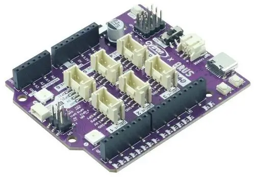

<!-- Copyright 2015-2026 Zephyr Project members and individual contributors. -->
<!-- SPDX-License-Identifier: Apache-2.0 -->
<!-- 中文翻译；编号、导航与译注为本地新增。 -->

<a id="maker_uno_rp2040"></a>

# 第7章\_Cytron Maker Uno RP2040

原文：[官方页面](https://docs.zephyrproject.org/latest/boards/cytron/maker_uno_rp2040/doc/index.html)。读取日期：2026-10-16；来源摘要见[来源记录](../SOURCES.md)。

开发板概览（Board Overview）

<a id="id1"></a>

[](images/maker_uno_rp2040.webp)

Cytron Maker Uno RP2040

名称（Name）：

`maker_uno_rp2040`

厂商（Vendor）：

[Cytron Technologies公司](https://docs.zephyrproject.org/latest/boards/index.html#vendor=cytron)

状态（Status）：

当前未积极维护（Not Actively Maintained）

架构（Architecture）：

[arm](https://docs.zephyrproject.org/latest/boards/index.html#arch=arm)

片上系统（SoC）：

[rp2040](https://docs.zephyrproject.org/latest/boards/index.html#soc=rp2040)

<a id="board-github-link"></a>

[浏览开发板源码（Browse Board Sources）](https://github.com/zephyrproject-rtos/zephyr/blob/main//boards/cytron/maker_uno_rp2040/doc/index.rst/../..)<a id="overview"></a>

## 概述（Overview）

<a id="id3"></a>

[Cytron Maker Uno RP2040](https://www.cytron.io/p-maker-uno-rp2040)开发板[注1](#id2)基于Raspberry Pi Ltd.的RP2040微控制器，具有Arduino排针、多个Grove连接器和USB Type-C连接器。

<a id="hardware"></a>

## 硬件（Hardware）


- Raspberry Pi RP2040微控制器（Microcontroller），最高频率133 MHz
- 双ARM Cortex-M0+内核
- 264 kByte静态随机存储器（SRAM）
- 2 Mbyte QSPI闪存
- 16个GPIO引脚
- 4个模数转换器（ADC）引脚
- 集成电路间总线（I2C）
- 串行外设接口（SPI）
- 通用异步收发器（UART）
- USB Type-C接口
- 锂聚合物电池（LiPo）充电器
- 复位、启动及用户按键
- 两个RGB LED，Neopixels
- 带静音开关的压电蜂鸣器（Piezo Buzzer）
- 四个舵机端口（Servo Ports）
- Maker／Qwiic／Stemma QT／zephyr_i2c连接器
- 六个Grove连接器
- 数字引脚状态指示灯

<a id="default-zephyr-peripheral-mapping"></a>

### Zephyr默认外设映射（Default Peripheral Mapping）

RGB LED连接到GPIO25，其引脚复用（Pin Mux）设置为PIO0。

Arduino排针，注意GPIO20和GPIO21各出现两次：

<table>
<tr>
<th>标签（Label）</th>
<th>引脚（Pin）</th>
<th>默认引脚复用（Default Pin Mux）</th>
<th>同时位于连接器（Also in Connector）</th>
</tr>
<tr>
<td>A0</td>
<td>GPIO26</td>
<td>ADC0</td>
<td>Grove 3</td>
</tr>
<tr>
<td>A1</td>
<td>GPIO27</td>
<td>ADC1</td>
<td>Grove 4</td>
</tr>
<tr>
<td>A2</td>
<td>GPIO28</td>
<td>ADC2</td>
<td>Grove 5</td>
</tr>
<tr>
<td>A3</td>
<td>GPIO29</td>
<td>ADC3</td>
<td>Grove 5</td>
</tr>
<tr>
<td>串行数据线（SDA）</td>
<td>GPIO20</td>
<td>I2C0串行数据（SDA）</td>
<td>Grove 6、Maker</td>
</tr>
<tr>
<td>串行时钟线（SCL）</td>
<td>GPIO21</td>
<td>I2C0串行时钟（SCL）</td>
<td>Grove 6、Maker</td>
</tr>
<tr>
<td>GP1</td>
<td>GPIO1</td>
<td>UART0接收（RX）</td>
<td>Grove 1</td>
</tr>
<tr>
<td>GP0</td>
<td>GPIO0</td>
<td>UART0发送（TX）</td>
<td>Grove 1</td>
</tr>
<tr>
<td>GP2</td>
<td>GPIO2</td>
<td>GPIO上拉（Pull-Up）</td>
<td>用户按键（User Button）</td>
</tr>
<tr>
<td>GP3</td>
<td>GPIO3</td>
<td>别名（Alias）<code>led0</code></td>
<td></td>
</tr>
<tr>
<td>GP4</td>
<td>GPIO4</td>
<td></td>
<td>Grove 2</td>
</tr>
<tr>
<td>GP5</td>
<td>GPIO5</td>
<td></td>
<td>Grove 2</td>
</tr>
<tr>
<td>GP6</td>
<td>GPIO6</td>
<td></td>
<td>Grove 3</td>
</tr>
<tr>
<td>GP7</td>
<td>GPIO7</td>
<td></td>
<td>Grove 4</td>
</tr>
<tr>
<td>GP8</td>
<td>GPIO8</td>
<td></td>
<td>蜂鸣器（Buzzer）</td>
</tr>
<tr>
<td>GP9</td>
<td>GPIO9</td>
<td></td>
<td></td>
</tr>
<tr>
<td>GP13</td>
<td>GPIO13</td>
<td>SPI1片选（CS）</td>
<td></td>
</tr>
<tr>
<td>GP11</td>
<td>GPIO11</td>
<td>SPI1主机输出从机输入（MOSI）</td>
<td>SPI排针（Header）</td>
</tr>
<tr>
<td>GP12</td>
<td>GPIO12</td>
<td>SPI1主机输入从机输出（MISO）</td>
<td>SPI排针（Header）</td>
</tr>
<tr>
<td>GP10</td>
<td>GPIO10</td>
<td>SPI1时钟（SCK）</td>
<td>SPI排针（Header）</td>
</tr>
<tr>
<td>GP20</td>
<td>GPIO20</td>
<td>I2C0串行数据（SDA）</td>
<td>Grove 6、Maker</td>
</tr>
<tr>
<td>GP21</td>
<td>GPIO21</td>
<td>I2C0串行时钟（SCL）</td>
<td>Grove 6、Maker</td>
</tr>
</table>

SPI六针排针，引脚也位于Arduino排针：

<table>
<tr>
<th>标签（Label）</th>
<th>引脚（Pin）</th>
<th>默认引脚复用（Default Pin Mux）</th>
</tr>
<tr>
<td>GP10</td>
<td>GPIO10</td>
<td>SPI1时钟（SCK）</td>
</tr>
<tr>
<td>GP11</td>
<td>GPIO11</td>
<td>SPI1主机输出从机输入（MOSI）</td>
</tr>
<tr>
<td>GP12</td>
<td>GPIO12</td>
<td>SPI1主机输入从机输出（MISO）</td>
</tr>
</table>

舵机排针（Servo Header）：

<table>
<tr>
<th>标签（Label）</th>
<th>引脚（Pin）</th>
<th>默认引脚复用（Default Pin Mux）</th>
<th>Zephyr PWM名称（Name）</th>
</tr>
<tr>
<td>GP14</td>
<td>GPIO14</td>
<td>PWM7A</td>
<td>14</td>
</tr>
<tr>
<td>GP15</td>
<td>GPIO15</td>
<td>PWM7B</td>
<td>15</td>
</tr>
<tr>
<td>GP16</td>
<td>GPIO16</td>
<td>PWM0A</td>
<td>0</td>
</tr>
<tr>
<td>GP17</td>
<td>GPIO17</td>
<td>PWM0B</td>
<td>1</td>
</tr>
</table>

Grove连接器1，引脚也位于Arduino排针：

<table>
<tr>
<th>标签（Label）</th>
<th>引脚（Pin）</th>
<th>默认引脚复用（Default Pin Mux）</th>
</tr>
<tr>
<td>GP1</td>
<td>GPIO1</td>
<td>UART0接收（RX）</td>
</tr>
<tr>
<td>GP0</td>
<td>GPIO0</td>
<td>UART0发送（TX）</td>
</tr>
</table>

Grove连接器2，引脚也位于Arduino排针：

<table>
<tr>
<th>标签（Label）</th>
<th>引脚（Pin）</th>
</tr>
<tr>
<td>GP4</td>
<td>GPIO4</td>
</tr>
<tr>
<td>GP5</td>
<td>GPIO5</td>
</tr>
</table>

Grove连接器3，引脚也位于Arduino排针：

<table>
<tr>
<th>标签（Label）</th>
<th>引脚（Pin）</th>
<th>默认引脚复用（Default Pin Mux）</th>
</tr>
<tr>
<td>GP6</td>
<td>GPIO6</td>
<td></td>
</tr>
<tr>
<td>A0</td>
<td>GPIO26</td>
<td>ADC0</td>
</tr>
</table>

Grove连接器4，引脚也位于Arduino排针：

<table>
<tr>
<th>标签（Label）</th>
<th>引脚（Pin）</th>
<th>默认引脚复用（Default Pin Mux）</th>
</tr>
<tr>
<td>GP7</td>
<td>GPIO7</td>
<td></td>
</tr>
<tr>
<td>A1</td>
<td>GPIO27</td>
<td>ADC1</td>
</tr>
</table>

Grove连接器5，引脚也位于Arduino排针：

<table>
<tr>
<th>标签（Label）</th>
<th>引脚（Pin）</th>
<th>默认引脚复用（Default Pin Mux）</th>
</tr>
<tr>
<td>A2</td>
<td>GPIO28</td>
<td>ADC2</td>
</tr>
<tr>
<td>A3</td>
<td>GPIO29</td>
<td>ADC3</td>
</tr>
</table>

Grove连接器6，引脚也位于Maker连接器及Arduino排针：

<table>
<tr>
<th>标签（Label）</th>
<th>引脚（Pin）</th>
<th>默认引脚复用（Default Pin Mux）</th>
</tr>
<tr>
<td>GP20</td>
<td>GPIO20</td>
<td>I2C0串行数据（SDA）</td>
</tr>
<tr>
<td>GP21</td>
<td>GPIO21</td>
<td>I2C0串行时钟（SCL）</td>
</tr>
</table>

Maker连接器，也称Qwiic／Stemma QT／zephyr_i2c；引脚也位于Grove 6及Arduino排针：

<table>
<tr>
<th>标签（Label）</th>
<th>引脚（Pin）</th>
<th>默认引脚复用（Default Pin Mux）</th>
</tr>
<tr>
<td>GP20</td>
<td>GPIO20</td>
<td>I2C0串行数据（SDA）</td>
</tr>
<tr>
<td>GP21</td>
<td>GPIO21</td>
<td>I2C0串行时钟（SCL）</td>
</tr>
</table>

<a id="id5"></a>

另见[原理图（Schematic）](https://drive.google.com/file/d/1BNqbxXScMXnL3-2YYfbR66nFCD1li71X/view)[注2](#id4)。

<a id="supported-features"></a>

### 支持的功能（Supported Features）

`maker_uno_rp2040`开发板支持下表所列的硬件功能。

片上／板载（On-Chip / On-Board）

功能集成在片上系统（SoC）内／位于开发板上。

2 / 2

分别表示已启用／已禁用的实例数。点击数量标签，可查看开发板或SoC设备树源码（DTS）中该功能的第一个实例。

`vnd,foo`

与此功能匹配的设备树绑定兼容字符串（Compatible String）；点击链接可查看绑定文档。

<a id="maker_uno_rp2040-hw-features"></a>

<a id="maker_uno_rp2040-maker_uno_rp2040/rp2040-hw-features-section"></a>

#### `maker_uno_rp2040/rp2040`目标（Target）

<a id="maker_uno_rp2040-maker_uno_rp2040/rp2040-hw-features-panel"></a>

<a id="maker_uno_rp2040-maker_uno_rp2040/rp2040-hw-features-memory"></a>

该开发板目标的片上存储容量：264 KiB RAM、2 MiB Flash。

<a id="maker_uno_rp2040-maker_uno_rp2040/rp2040-hw-features-table"></a>

<table>
<tr>
<th>类型（Type）</th>
<th>位置（Location）</th>
<th>说明（Description）</th>
<th>兼容字符串（Compatible）</th>
</tr>
<tr>
<td rowspan="1">中央处理器（CPU）</td>
<td>片上（On-Chip）</td>
<td>ARM Cortex-M0+处理器（CPU）（<a href="https://github.com/zephyrproject-rtos/zephyr/blob/main/dts/arm/raspberrypi/rpi_pico/rp2040.dtsi?plain=1#L35">已启用：2</a>）</td>
<td><a href="../cpu_arm_riscv_binding_reference/P017_arm_cortex-m0+.md#std-dtcompatible-arm-cortex-m0"><code>arm,cortex-m0+</code></a></td>
</tr>
<tr>
<td rowspan="1">模数转换器（ADC）</td>
<td>片上（On-Chip）</td>
<td>Raspberry Pi Pico模数转换器（ADC）（<a href="https://github.com/zephyrproject-rtos/zephyr/blob/main/dts/arm/raspberrypi/rpi_pico/rp2040.dtsi?plain=1#L309">已启用：1</a>）</td>
<td><a href="../hardware/P894_RaspberryPiPico模数转换器绑定.md#dtbinding-raspberrypi-pico-adc"><code>raspberrypi,pico-adc</code></a></td>
</tr>
<tr>
<td rowspan="5">时钟控制（Clock Control）</td>
<td>片上（On-Chip）</td>
<td>Raspberry Pi Pico时钟控制器（Clock Controller）节点（<a href="https://github.com/zephyrproject-rtos/zephyr/blob/main/dts/arm/raspberrypi/rpi_pico/rp2040.dtsi?plain=1#L220">已启用：1</a>）</td>
<td><a href="../clock_nxp_pico_realtek_renesas_binding_reference/P016_raspberrypi_pico-clock-controller.md#std-dtcompatible-raspberrypi-pico-clock-controller"><code>raspberrypi,pico-clock-controller</code></a></td>
</tr>
<tr>
<td>片上（On-Chip）</td>
<td>Raspberry Pi Pico时钟（Clock）的表示（<a href="https://github.com/zephyrproject-rtos/zephyr/blob/main/dts/arm/raspberrypi/rpi_pico/rp2040.dtsi?plain=1#L47">已启用：11</a>；<a href="https://github.com/zephyrproject-rtos/zephyr/blob/main/dts/arm/raspberrypi/rpi_pico/rp2040.dtsi?plain=1#L174">已禁用：2</a>）</td>
<td><a href="../clock_nxp_pico_realtek_renesas_binding_reference/P017_raspberrypi_pico-clock.md#std-dtcompatible-raspberrypi-pico-clock"><code>raspberrypi,pico-clock</code></a></td>
</tr>
<tr>
<td>片上（On-Chip）</td>
<td>Raspberry Pi Pico锁相环（PLL）的表示（<a href="https://github.com/zephyrproject-rtos/zephyr/blob/main/dts/arm/raspberrypi/rpi_pico/rp2040.dtsi?plain=1#L128">已启用：2</a>）</td>
<td><a href="../clock_nxp_pico_realtek_renesas_binding_reference/P018_raspberrypi_pico-pll.md#std-dtcompatible-raspberrypi-pico-pll"><code>raspberrypi,pico-pll</code></a></td>
</tr>
<tr>
<td>片上（On-Chip）</td>
<td>Raspberry Pi Pico环形振荡器（Ring Oscillator）的表示（<a href="https://github.com/zephyrproject-rtos/zephyr/blob/main/dts/arm/raspberrypi/rpi_pico/rp2040.dtsi?plain=1#L150">已启用：1</a>）</td>
<td><a href="../clock_nxp_pico_realtek_renesas_binding_reference/P019_raspberrypi_pico-rosc.md#std-dtcompatible-raspberrypi-pico-rosc"><code>raspberrypi,pico-rosc</code></a></td>
</tr>
<tr>
<td>片上（On-Chip）</td>
<td>Raspberry Pi Pico外部振荡器（External Oscillator）的表示（<a href="https://github.com/zephyrproject-rtos/zephyr/blob/main/dts/arm/raspberrypi/rpi_pico/rp2040.dtsi?plain=1#L168">已启用：1</a>）</td>
<td><a href="../clock_nxp_pico_realtek_renesas_binding_reference/P020_raspberrypi_pico-xosc.md#std-dtcompatible-raspberrypi-pico-xosc"><code>raspberrypi,pico-xosc</code></a></td>
</tr>
<tr>
<td rowspan="1">计数器（Counter）</td>
<td>片上（On-Chip）</td>
<td>Raspberry Pi Pico定时器（Timer）（<a href="https://github.com/zephyrproject-rtos/zephyr/blob/main/dts/arm/raspberrypi/rpi_pico/rp2040.dtsi?plain=1#L373">已启用：1</a>）</td>
<td><a href="../renesas_realtek_counter_binding_reference/P008_raspberrypi_pico-timer.md#std-dtcompatible-raspberrypi-pico-timer"><code>raspberrypi,pico-timer</code></a></td>
</tr>
<tr>
<td rowspan="1">直接存储器访问（DMA）</td>
<td>片上（On-Chip）</td>
<td>Raspberry Pi Pico直接存储器访问（DMA）（<a href="https://github.com/zephyrproject-rtos/zephyr/blob/main/dts/arm/raspberrypi/rpi_pico/rp2040.dtsi?plain=1#L389">已禁用：1</a>）</td>
<td><a href="../nxp_realtek_renesas_dma_binding_reference/P009_raspberrypi_pico-dma.md#std-dtcompatible-raspberrypi-pico-dma"><code>raspberrypi,pico-dma</code></a></td>
</tr>
<tr>
<td rowspan="1">闪存控制器（Flash Controller）</td>
<td>片上（On-Chip）</td>
<td>Raspberry Pi Pico闪存控制器（Flash Controller）（<a href="https://github.com/zephyrproject-rtos/zephyr/blob/main/dts/arm/raspberrypi/rpi_pico/rp2040.dtsi?plain=1#L197">已启用：1</a>）</td>
<td><a href="../flash_nuvoton_nxp_renesas_binding_reference/P021_raspberrypi_pico-flash-controller.md#std-dtcompatible-raspberrypi-pico-flash-controller"><code>raspberrypi,pico-flash-controller</code></a></td>
</tr>
<tr>
<td rowspan="5">通用输入输出与接插件（GPIO &amp; Headers）</td>
<td>片上（On-Chip）</td>
<td>Raspberry Pi Pico通用输入输出（GPIO）（<a href="https://github.com/zephyrproject-rtos/zephyr/blob/main/dts/arm/raspberrypi/rpi_pico/rp2040.dtsi?plain=1#L242">已启用：1</a>）</td>
<td><a href="../gpio_raspberrypi_renesas_binding_reference/P006_raspberrypi_pico-gpio.md#std-dtcompatible-raspberrypi-pico-gpio"><code>raspberrypi,pico-gpio</code></a></td>
</tr>
<tr>
<td>片上（On-Chip）</td>
<td>Raspberry Pi Pico GPIO端口（Port）（<a href="https://github.com/zephyrproject-rtos/zephyr/blob/main/dts/arm/raspberrypi/rpi_pico/rp2040.dtsi?plain=1#L255">已启用：1</a>）</td>
<td><a href="../gpio_raspberrypi_renesas_binding_reference/P005_raspberrypi_pico-gpio-port.md#std-dtcompatible-raspberrypi-pico-gpio-port"><code>raspberrypi,pico-gpio-port</code></a></td>
</tr>
<tr>
<td>板载（On-Board）</td>
<td>引出到Arduino Uno R3排针（Headers）的GPIO引脚（<a href="https://github.com/zephyrproject-rtos/zephyr/blob/main/boards/cytron/maker_uno_rp2040/arduino_r3_connector.dtsi?plain=1#L8">已启用：1</a>）</td>
<td><a href="../gpio_adi_headers_ambiq_binding_reference/P023_arduino-header-r3.md#std-dtcompatible-arduino-header-r3"><code>arduino-header-r3</code></a></td>
</tr>
<tr>
<td>板载（On-Board）</td>
<td>通过Grove四针排针引出的GPIO（<a href="https://github.com/zephyrproject-rtos/zephyr/blob/main/boards/cytron/maker_uno_rp2040/grove_connectors.dtsi?plain=1#L8">已启用：6</a>）</td>
<td><a href="../gpio_connectors_bflb_esp_binding_reference/P029_grove-header.md#std-dtcompatible-grove-header"><code>grove-header</code></a></td>
</tr>
<tr>
<td>板载（On-Board）</td>
<td>STEMMA QT是一种用于I2C设备的4针JST-SH接口。（<a href="https://github.com/zephyrproject-rtos/zephyr/blob/main/boards/cytron/maker_uno_rp2040/grove_connectors.dtsi?plain=1#L62">已启用：1</a>）</td>
<td><a href="../gpio_ti_xilinx_sdl_binding_reference/P005_stemma-qt-connector.md#std-dtcompatible-stemma-qt-connector"><code>stemma-qt-connector</code></a></td>
</tr>
<tr>
<td rowspan="1">集成电路间总线（I2C）</td>
<td>片上（On-Chip）</td>
<td>Raspberry Pi Pico I2C控制器（<a href="https://github.com/zephyrproject-rtos/zephyr/blob/main/dts/arm/raspberrypi/rpi_pico/rp2040.dtsi?plain=1#L320">已启用：1</a>；<a href="https://github.com/zephyrproject-rtos/zephyr/blob/main/dts/arm/raspberrypi/rpi_pico/rp2040.dtsi?plain=1#L332">已禁用：1</a>）</td>
<td><a href="../i2c_nxp_pico_renesas_binding_reference/P008_raspberrypi_pico-i2c.md#std-dtcompatible-raspberrypi-pico-i2c"><code>raspberrypi,pico-i2c</code></a></td>
</tr>
<tr>
<td rowspan="1">输入（Input）</td>
<td>板载（On-Board）</td>
<td>一组绑定到 GPIO 的输入按键（GPIO-Bound Input Keys）（<a href="https://github.com/zephyrproject-rtos/zephyr/blob/main/boards/cytron/maker_uno_rp2040/maker_uno_rp2040.dts?plain=1#L43">已启用：1</a>）</td>
<td><a href="../hardware/P563_GPIO按键绑定.md#std-dtcompatible-gpio-keys"><code>gpio-keys</code></a></td>
</tr>
<tr>
<td rowspan="1">中断控制器（Interrupt Controller）</td>
<td>片上（On-Chip）</td>
<td>ARMv6-M嵌套向量中断控制器（NVIC / Nested Vectored Interrupt Controller）（<a href="https://github.com/zephyrproject-rtos/zephyr/blob/main/dts/arm/armv6-m.dtsi?plain=1#L13">已启用：1</a>）</td>
<td><a href="../arm_interrupt_timer_binding_reference/P001_ARMv6_M_NVIC.md#std-dtcompatible-arm-v6m-nvic"><code>arm,v6m-nvic</code></a></td>
</tr>
<tr>
<td rowspan="1">发光二极管（LED）</td>
<td>板载（On-Board）</td>
<td>一组由 GPIO 控制的 LED（GPIO-Controlled LEDs）（<a href="https://github.com/zephyrproject-rtos/zephyr/blob/main/boards/cytron/maker_uno_rp2040/maker_uno_rp2040.dts?plain=1#L53">已启用：1</a>）</td>
<td><a href="../hardware/P564_GPIO指示灯绑定.md#dtbinding-gpio-leds"><code>gpio-leds</code></a></td>
</tr>
<tr>
<td rowspan="1">灯带（LED Strip）</td>
<td>板载（On-Board）</td>
<td>配置用于WS2812的可编程输入输出（PIO）节点（<a href="https://github.com/zephyrproject-rtos/zephyr/blob/main/boards/cytron/maker_uno_rp2040/maker_uno_rp2040.dts?plain=1#L174">已启用：1</a>）</td>
<td><a href="../led_strip_binding_reference/P011_worldsemi_ws2812-rpi_pico-pio.md#std-dtcompatible-worldsemi-ws2812-rpi_pico-pio"><code>worldsemi,ws2812-rpi_pico-pio</code></a></td>
</tr>
<tr>
<td rowspan="1">邮箱（Mailbox）</td>
<td>片上（On-Chip）</td>
<td>Raspberry Pi Pico处理器间邮箱（Interprocessor Mailbox）（<a href="https://github.com/zephyrproject-rtos/zephyr/blob/main/dts/arm/raspberrypi/rpi_pico/rp2040.dtsi?plain=1#L452">已禁用：2</a>）</td>
<td><a href="../intercore_reference/P050_Pico邮箱绑定.md#dtbinding-raspberrypi-pico-mbox"><code>raspberrypi,pico-mbox</code></a></td>
</tr>
<tr>
<td rowspan="2">其他绑定（Miscellaneous）</td>
<td>片上（On-Chip）</td>
<td>Raspberry Pi Pico可编程输入输出（PIO）（<a href="https://github.com/zephyrproject-rtos/zephyr/blob/main/dts/arm/raspberrypi/rpi_pico/rp2040.dtsi?plain=1#L412">已启用：1</a>；<a href="https://github.com/zephyrproject-rtos/zephyr/blob/main/dts/arm/raspberrypi/rpi_pico/rp2040.dtsi?plain=1#L423">已禁用：1</a>）</td>
<td><a href="../misc_nxp_renesas_zephyr_binding_reference/P011_raspberrypi_pico-pio.md#std-dtcompatible-raspberrypi-pico-pio"><code>raspberrypi,pico-pio</code></a></td>
</tr>
<tr>
<td>片上（On-Chip）</td>
<td>Raspberry Pi Pico单周期输入输出（SIO）（<a href="https://github.com/zephyrproject-rtos/zephyr/blob/main/dts/arm/raspberrypi/rpi_pico/rp2040.dtsi?plain=1#L444">已启用：1</a>）</td>
<td><a href="../misc_nxp_renesas_zephyr_binding_reference/P013_raspberrypi_pico-sio.md#std-dtcompatible-raspberrypi-pico-sio"><code>raspberrypi,pico-sio</code></a></td>
</tr>
<tr>
<td rowspan="1">存储技术设备（MTD）</td>
<td>片上（On-Chip）</td>
<td>闪存（Flash）节点（<a href="https://github.com/zephyrproject-rtos/zephyr/blob/main/dts/arm/raspberrypi/rpi_pico/rp2040.dtsi?plain=1#L205">已启用：1</a>）</td>
<td><a href="../mtd_nxp_st_ti_partition_binding_reference/P013_soc-nv-flash.md#std-dtcompatible-soc-nv-flash"><code>soc-nv-flash</code></a></td>
</tr>
<tr>
<td rowspan="1">引脚控制（Pin Control）</td>
<td>片上（On-Chip）</td>
<td>Raspberry Pi Pico引脚控制器（Pin Controller）（<a href="https://github.com/zephyrproject-rtos/zephyr/blob/main/dts/arm/raspberrypi/rpi_pico/rp2040.dtsi?plain=1#L492">已启用：1</a>）</td>
<td><a href="../pinctrl_nxp_pico_binding_reference/P025_raspberrypi_pico-pinctrl.md#std-dtcompatible-raspberrypi-pico-pinctrl"><code>raspberrypi,pico-pinctrl</code></a></td>
</tr>
<tr>
<td rowspan="1">脉宽调制（PWM）</td>
<td>片上（On-Chip）</td>
<td>Raspberry Pi Pico脉宽调制（PWM）（<a href="https://github.com/zephyrproject-rtos/zephyr/blob/main/dts/arm/raspberrypi/rpi_pico/rp2040.dtsi?plain=1#L362">已启用：1</a>）</td>
<td><a href="../pwm_nxp_renesas_binding_reference/P014_raspberrypi_pico-pwm.md#std-dtcompatible-raspberrypi-pico-pwm"><code>raspberrypi,pico-pwm</code></a></td>
</tr>
<tr>
<td rowspan="1">稳压器（Regulator）</td>
<td>片上（On-Chip）</td>
<td>Raspberry Pi Pico内核电源稳压器（Core Supply Regulator）（<a href="https://github.com/zephyrproject-rtos/zephyr/blob/main/dts/arm/raspberrypi/rpi_pico/rp2040.dtsi?plain=1#L402">已启用：1</a>）</td>
<td><a href="../hardware/P654_RaspberryPi内核供电稳压器绑定.md#dtbinding-raspberrypi-core-supply-regulator"><code>raspberrypi,core-supply-regulator</code></a></td>
</tr>
<tr>
<td rowspan="1">复位控制器（Reset Controller）</td>
<td>片上（On-Chip）</td>
<td>Raspberry Pi Pico复位控制器（Reset Controller）（<a href="https://github.com/zephyrproject-rtos/zephyr/blob/main/dts/arm/raspberrypi/rpi_pico/rp2040.dtsi?plain=1#L214">已启用：1</a>）</td>
<td><a href="../reset_controller_binding_reference/P012_raspberrypi_pico-reset.md#std-dtcompatible-raspberrypi-pico-reset"><code>raspberrypi,pico-reset</code></a></td>
</tr>
<tr>
<td rowspan="1">实时时钟（RTC）</td>
<td>片上（On-Chip）</td>
<td>Raspberry Pi Pico实时时钟（RTC）（<a href="https://github.com/zephyrproject-rtos/zephyr/blob/main/dts/arm/raspberrypi/rpi_pico/rp2040.dtsi?plain=1#L434">已禁用：1</a>）</td>
<td><a href="../soc_rtc_binding_reference/P003_raspberrypi_pico-rtc.md#std-dtcompatible-raspberrypi-pico-rtc"><code>raspberrypi,pico-rtc</code></a></td>
</tr>
<tr>
<td rowspan="1">传感器（Sensors）</td>
<td>片上（On-Chip）</td>
<td>Raspberry Pi Pico系列温度传感器（Temperature Sensor）节点（<a href="https://github.com/zephyrproject-rtos/zephyr/blob/main/dts/arm/raspberrypi/rpi_pico/rp2040.dtsi?plain=1#L496">已启用：1</a>）</td>
<td><a href="../sensor_realtek_rohm_sensirion_binding_reference/P003_raspberrypi_pico-temp.md#std-dtcompatible-raspberrypi-pico-temp"><code>raspberrypi,pico-temp</code></a></td>
</tr>
<tr>
<td rowspan="1">串行控制器（Serial Controller）</td>
<td>片上（On-Chip）</td>
<td>Raspberry Pi Pico通用异步收发器（UART）（<a href="https://github.com/zephyrproject-rtos/zephyr/blob/main/dts/arm/raspberrypi/rpi_pico/rp2040.dtsi?plain=1#L265">已启用：1</a>；<a href="https://github.com/zephyrproject-rtos/zephyr/blob/main/dts/arm/raspberrypi/rpi_pico/rp2040.dtsi?plain=1#L275">已禁用：1</a>）</td>
<td><a href="../uart_raspberrypi_realtek_renesas_binding_reference/P002_raspberrypi_pico-uart.md#std-dtcompatible-raspberrypi-pico-uart"><code>raspberrypi,pico-uart</code></a></td>
</tr>
<tr>
<td rowspan="1">串行外设接口（SPI）</td>
<td>片上（On-Chip）</td>
<td>Raspberry Pi Pico串行外设接口（SPI）（<a href="https://github.com/zephyrproject-rtos/zephyr/blob/main/dts/arm/raspberrypi/rpi_pico/rp2040.dtsi?plain=1#L297">已启用：1</a>；<a href="https://github.com/zephyrproject-rtos/zephyr/blob/main/dts/arm/raspberrypi/rpi_pico/rp2040.dtsi?plain=1#L285">已禁用：1</a>）</td>
<td><a href="../spi_flexspi_nxp_renesas_binding_reference/P010_raspberrypi_pico-spi.md#std-dtcompatible-raspberrypi-pico-spi"><code>raspberrypi,pico-spi</code></a></td>
</tr>
<tr>
<td rowspan="1">静态随机存储器（SRAM）</td>
<td>片上（On-Chip）</td>
<td>通用片上静态随机存储器（SRAM）（<a href="https://github.com/zephyrproject-rtos/zephyr/blob/main/dts/arm/raspberrypi/rpi_pico/rp2040.dtsi?plain=1#L192">已启用：1</a>）</td>
<td><a href="../hardware/P567_内存映射SRAM绑定.md#dtbinding-mmio-sram"><code>mmio-sram</code></a></td>
</tr>
<tr>
<td rowspan="1">定时器（Timer）</td>
<td>片上（On-Chip）</td>
<td>ARMv6-M系统节拍（System Tick）（<a href="https://github.com/zephyrproject-rtos/zephyr/blob/main/dts/arm/armv6-m.dtsi?plain=1#L21">已启用：1</a>）</td>
<td><a href="../arm_interrupt_timer_binding_reference/P005_ARMv6_M_SysTick.md#std-dtcompatible-arm-armv6m-systick"><code>arm,armv6m-systick</code></a></td>
</tr>
<tr>
<td rowspan="1">通用串行总线（USB）</td>
<td>片上（On-Chip）</td>
<td>Raspberry Pi Pico USB设备控制器（USB Device Controller）（<a href="https://github.com/zephyrproject-rtos/zephyr/blob/main/dts/arm/raspberrypi/rpi_pico/rp2040.dtsi?plain=1#L351">已启用：1</a>）</td>
<td><a href="../usb_soc_binding_reference/P014_raspberrypi_pico-usbd.md#std-dtcompatible-raspberrypi-pico-usbd"><code>raspberrypi,pico-usbd</code></a></td>
</tr>
<tr>
<td rowspan="1">看门狗（Watchdog）</td>
<td>片上（On-Chip）</td>
<td>Raspberry Pi Pico看门狗（Watchdog）（<a href="https://github.com/zephyrproject-rtos/zephyr/blob/main/dts/arm/raspberrypi/rpi_pico/rp2040.dtsi?plain=1#L344">已启用：1</a>）</td>
<td><a href="../nxp_nordic_nuvoton_watchdog_binding_reference/P015_raspberrypi_pico-watchdog.md#std-dtcompatible-raspberrypi-pico-watchdog"><code>raspberrypi,pico-watchdog</code></a></td>
</tr>
</table>

<a id="programming-and-debugging"></a>

## 烧录与调试（Programming and Debugging）

`maker_uno_rp2040`开发板支持下表所列的运行工具（Runners）及相关west命令。

<table>
<tr>
<th></th>
<th>烧录（flash）</th>
<th>调试（debug）</th>
</tr>
<tr>
<td><a href="https://docs.zephyrproject.org/latest/develop/flash_debug/host-tools.html#runner-uf2">uf2</a></td>
<td>✅（默认 / default）</td>
<td></td>
</tr>
</table>

Maker Uno RP2040开发板未引出SWDIO和SWCLK引脚，因此必须通过USB端口编程。按住BOOT键，再按RST键，设备会显示为USB大容量存储设备。构建应用后将生成`build/zephyr/zephyr.uf2`文件，将其拖放到USB大容量存储设备，即可重新编程开发板。

有关RP2040开发板编程的更多信息，请参阅编程与调试（[Programming and Debugging](https://docs.zephyrproject.org/latest/boards/raspberrypi/rpi_pico/doc/index.html#rpi-pico-programming-and-debugging)）。

<a id="flashing"></a>

### 烧录（Flashing）

运行LED[灯带（LED Strip）](../hardware/P191_LED灯带示例.md#led-strip)示例：

```text
# From the root of the zephyr repository
west build -b maker_uno_rp2040 samples/drivers/led/led_strip/
west flash
```

也可尝试[Hello World](../getting_started/P005_HelloWorld示例.md#hello_world)、[Blinky](../getting_started/P004_LED闪烁示例.md#blinky)、[Button](../basic_samples/P003_按钮输入.md#button)、[Input dump](../interaction/P014_输入事件转储示例.md#input-dump)，以及使用设备树的模数转换器（ADC）示例。（[使用设备树的模数转换器（ADC with Devicetree）](../hardware/P439_ADC设备树示例.md#adc_dt)）

下面使用[通用光照传感器轮询（Generic Light Sensor Polling）](../sensors/P019_光照传感器轮询示例.md#light_sensor_polling)示例和单独的扩展板，演示Maker／Qwiic／Stemma QT I2C连接器的使用：

```text
# From the root of the zephyr repository
west build -b maker_uno_rp2040 --shield adafruit_veml7700 samples/sensor/light_polling
west flash
```

使用Shell控制GPIO引脚：

```text
# From the root of the zephyr repository
west build -b maker_uno_rp2040 samples/sensor/sensor_shell -- -DCONFIG_GPIO=y -DCONFIG_GPIO_SHELL=y
west flash
```

在Shell中执行以下命令，将某个GPIO引脚设为高电平，并观察指示LED：

```text
gpio conf gpio0 2 o
gpio set gpio0 2 1
```

舵机通过PWM输出控制。[Servomotor](../basic_samples/P007_舵机控制.md#servo-motor)示例通过覆盖文件（Overlay）设置GP14输出的舵机位置脉冲时序：

```text
# From the root of the zephyr repository
west build -b maker_uno_rp2040 samples/basic/servo_motor/
west flash
```

也可通过PWM Shell控制舵机：

```text
# From the root of the zephyr repository
west build -b maker_uno_rp2040 samples/sensor/sensor_shell -- -DCONFIG_PWM=y -DCONFIG_PWM_SHELL=y
west flash
```

使用Shell命令设置舵机位置。多数舵机可处理800至2000微秒的脉冲宽度；原文此句有posiotion和server拼写错误：

```text
pwm usec pwm@40050000 14 20000 800
pwm usec pwm@40050000 14 20000 2000
```

使用蜂鸣器时，必须将GPIO8的引脚复用设为PWM：在[boards/cytron/maker_uno_rp2040/maker_uno_rp2040-pinctrl.dtsi](https://github.com/zephyrproject-rtos/zephyr/blob/main/boards/cytron/maker_uno_rp2040/maker_uno_rp2040-pinctrl.dtsi)文件的`pwm_default`段加入`PWM_4A_P8`。打开开发板长边上的蜂鸣器开关，然后使用上述相同命令构建`sensor_shell`。

用以下Shell命令打开和关闭蜂鸣器：

```text
pwm usec pwm@40050000 8 1000 500
pwm usec pwm@40050000 8 1000 0
```

<a id="references"></a>

## 参考资料（References）

<a id="id2"></a>

〔[1](#id3)〕 [https://www.cytron.io/p-maker-uno-rp2040](https://www.cytron.io/p-maker-uno-rp2040)

<a id="id4"></a>

〔[2](#id5)〕 [https://drive.google.com/file/d/1BNqbxXScMXnL3-2YYfbR66nFCD1li71X/view](https://drive.google.com/file/d/1BNqbxXScMXnL3-2YYfbR66nFCD1li71X/view)

## 译注

Maker Uno没有引出SWDIO／SWCLK；蜂鸣器需在pinctrl中为GPIO8添加PWM_4A_P8。GPIO20和GPIO21重复出现在排针表中的提示已保留。

## 原文外链核对

2026-10-16核对并重试以下原文外链时未能确认可访问性，保留原始目标，不将访问失败解释为原文内容有误。

- [p-maker-uno-rp2040](https://www.cytron.io/p-maker-uno-rp2040)：HTTP Error 403: Forbidden。

---

[上一章](P006_Cytron_Maker_Pi_RP2040.md) · [返回大纲](大纲.md) · [全站翻译进度](../PROGRESS.md) · [下一章](P008_DFRobot_Beetle_ESP32-C3.md)
