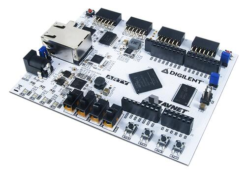

<!-- Copyright 2015-2026 Zephyr Project members and individual contributors. -->
<!-- SPDX-License-Identifier: Apache-2.0 -->
<!-- 中文翻译；编号、导航与译注为本地新增。 -->

<a id="arty_a7"></a>

# 第14章\_Arty

原文：[官方页面](https://docs.zephyrproject.org/latest/boards/digilent/arty_a7/doc/index.html)。读取日期：2026-10-16；来源摘要见[来源记录](../SOURCES.md)。

开发板概览（Board Overview）

<a id="id2"></a>

[](images/arty_a7-35.jpg)

Arty

名称（Name）：

`arty_a7`

厂商（Vendor）：

[Digilent, Inc.公司](https://docs.zephyrproject.org/latest/boards/index.html#vendor=digilent)

状态（Status）：

当前未积极维护（Not Actively Maintained）

架构（Architecture）：

[arm](https://docs.zephyrproject.org/latest/boards/index.html#arch=arm)

片上系统（SoC）：

`[designstart_fpga_cortex_m1](https://docs.zephyrproject.org/latest/boards/index.html#soc=designstart_fpga_cortex_m1), [designstart_fpga_cortex_m3](https://docs.zephyrproject.org/latest/boards/index.html#soc=designstart_fpga_cortex_m3)`

<a id="board-github-link"></a>

[浏览开发板源码（Browse Board Sources）](https://github.com/zephyrproject-rtos/zephyr/blob/main//boards/digilent/arty_a7/doc/index.rst/../..)<a id="digilent-arty"></a>

## Digilent Arty

<a id="overview"></a>

### 概述（Overview）

[Digilent Arty](https://store.digilentinc.com/arty)是一系列面向创客与爱好者的FPGA开发板。Arty有多种配置，各自采用不同的Xilinx FPGA，包括Spartan-7、Artix-7或Zynq-7000系列。

每块开发板都配有用于FPGA编程和调试的板载JTAG、LED、开关、按键、DDR3 RAM，以及用于存储FPGA配置位流（Bitstream）的QSPI闪存。

<a id="id3"></a>



Digilent Arty A7-35，图片来源（Credit）：Digilent Inc

基于Spartan-7及Artix-7的Arty开发板不包含CPU，必须在FPGA中实例化软处理器（Soft Processor）才能运行Zephyr。Zephyr尚不支持基于Zynq-7000的Arty开发板。

<a id="arm-cortex-m1-m3-designstart-fpga"></a>

### ARM Cortex-M1／M3 DesignStart FPGA

在Arty上实例化软处理器的一种方式，是使用ARM提供的DesignStart FPGA Xilinx版参考设计（Reference Designs）。Zephyr支持Cortex-M1及Cortex-M3两种参考设计。Cortex-M1设计面向Spartan-7或Artix-7 Arty开发板；Cortex-M3设计仅面向Artix-7开发板。目前Zephyr仅支持面向Artix-7的设计。（[ARM DesignStart FPGA](https://www.arm.com/resources/designstart/designstart-fpga)）

ARM Cortex-M1／M3 DesignStart FPGA的更多信息见以下网站：


- [DesignStart FPGA技术资源（Technical Resources）](https://developer.arm.com/ip-products/designstart/fpga)
- [面向Xilinx的DesignStart FPGA技术资源（Technical Resources）](https://developer.arm.com/ip-products/designstart/fpga/fpga-xilinx)
- [ARM DesignStart FPGA Xilinx常见问题（FAQs）](https://developer.arm.com/ip-products/designstart/fpga/fpga-xilinx-faqs)

<a id="supported-features"></a>

#### 支持的功能（Supported Features）

`arty_a7`开发板支持下表所列的硬件功能。

片上／板载（On-Chip / On-Board）

功能集成在片上系统（SoC）内／位于开发板上。

2 / 2

分别表示已启用／已禁用的实例数。点击数量标签，可查看开发板或SoC设备树源码（DTS）中该功能的第一个实例。

`vnd,foo`

与此功能匹配的设备树绑定兼容字符串（Compatible String）；点击链接可查看绑定文档。

<a id="arty_a7-hw-features"></a>

<a id="arty_a7-arty_a7/designstart_fpga_cortex_m1-hw-features-section"></a>

##### `arty_a7/designstart_fpga_cortex_m1`目标（Target）

<a id="arty_a7-arty_a7/designstart_fpga_cortex_m1-hw-features-panel"></a>

<a id="arty_a7-arty_a7/designstart_fpga_cortex_m1-hw-features-memory"></a>

该开发板目标的片上存储容量：32 KiB RAM、64 KiB Flash。

<a id="arty_a7-arty_a7/designstart_fpga_cortex_m1-hw-features-table"></a>

<table>
<tr>
<th>类型（Type）</th>
<th>位置（Location）</th>
<th>说明（Description）</th>
<th>兼容字符串（Compatible）</th>
</tr>
<tr>
<td rowspan="1">中央处理器（CPU）</td>
<td>板载（On-Board）</td>
<td>ARM Cortex-M1处理器（CPU）（<a href="https://github.com/zephyrproject-rtos/zephyr/blob/main/boards/digilent/arty_a7/arty_a7_designstart_fpga_cortex_m1.dts?plain=1#L20">已启用：1</a>）</td>
<td><a href="../cpu_arm_riscv_binding_reference/P019_arm_cortex-m1.md#std-dtcompatible-arm-cortex-m1"><code>arm,cortex-m1</code></a></td>
</tr>
<tr>
<td rowspan="2">通用输入输出与接插件（GPIO &amp; Headers）</td>
<td>板载（On-Board）</td>
<td>Xilinx AXI GPIO硬件IP（<a href="https://github.com/zephyrproject-rtos/zephyr/blob/main/boards/digilent/arty_a7/dts/arty_a7_arm_designstart.dtsi?plain=1#L221">已启用：2</a>；<a href="https://github.com/zephyrproject-rtos/zephyr/blob/main/boards/digilent/arty_a7/dts/arty_a7_arm_designstart.dtsi?plain=1#L176">已禁用：1</a>）</td>
<td><a href="../gpio_ti_xilinx_sdl_binding_reference/P032_xlnx_xps-gpio-1.00.a.md#std-dtcompatible-xlnx-xps-gpio-1.00.a"><code>xlnx,xps-gpio-1.00.a</code></a></td>
</tr>
<tr>
<td>板载（On-Board）</td>
<td>Xilinx AXI GPIO硬件IP的GPIO2（<a href="https://github.com/zephyrproject-rtos/zephyr/blob/main/boards/digilent/arty_a7/dts/arty_a7_arm_designstart.dtsi?plain=1#L240">已启用：2</a>）</td>
<td><a href="../gpio_ti_xilinx_sdl_binding_reference/P031_xlnx_xps-gpio-1.00.a-gpio2.md#std-dtcompatible-xlnx-xps-gpio-1.00.a-gpio2"><code>xlnx,xps-gpio-1.00.a-gpio2</code></a></td>
</tr>
<tr>
<td rowspan="1">输入（Input）</td>
<td>板载（On-Board）</td>
<td>一组绑定到 GPIO 的输入按键（GPIO-Bound Input Keys）（<a href="https://github.com/zephyrproject-rtos/zephyr/blob/main/boards/digilent/arty_a7/dts/arty_a7_arm_designstart.dtsi?plain=1#L115">已启用：1</a>）</td>
<td><a href="../hardware/P563_GPIO按键绑定.md#std-dtcompatible-gpio-keys"><code>gpio-keys</code></a></td>
</tr>
<tr>
<td rowspan="1">中断控制器（Interrupt Controller）</td>
<td>片上（On-Chip）</td>
<td>ARMv6-M嵌套向量中断控制器（NVIC / Nested Vectored Interrupt Controller）（<a href="https://github.com/zephyrproject-rtos/zephyr/blob/main/dts/arm/armv6-m.dtsi?plain=1#L13">已启用：1</a>）</td>
<td><a href="../arm_interrupt_timer_binding_reference/P001_ARMv6_M_NVIC.md#std-dtcompatible-arm-v6m-nvic"><code>arm,v6m-nvic</code></a></td>
</tr>
<tr>
<td rowspan="1">发光二极管（LED）</td>
<td>板载（On-Board）</td>
<td>一组由 GPIO 控制的 LED（GPIO-Controlled LEDs）（<a href="https://github.com/zephyrproject-rtos/zephyr/blob/main/boards/digilent/arty_a7/dts/arty_a7_arm_designstart.dtsi?plain=1#L31">已启用：1</a>）</td>
<td><a href="../hardware/P564_GPIO指示灯绑定.md#dtbinding-gpio-leds"><code>gpio-leds</code></a></td>
</tr>
<tr>
<td rowspan="1">其他绑定（Miscellaneous）</td>
<td>板载（On-Board）</td>
<td>ARM DesignStart FPGA DAPLink QSPI总线复用器（Bus Multiplexer）（<a href="https://github.com/zephyrproject-rtos/zephyr/blob/main/boards/digilent/arty_a7/dts/arty_a7_arm_designstart.dtsi?plain=1#L167">已禁用：1</a>）</td>
<td><code>arm,daplink-qspi-mux</code></td>
</tr>
<tr>
<td rowspan="2">存储技术设备（MTD）</td>
<td>板载（On-Board）</td>
<td>这些属性用于支持Zephyr的<code>spi-nor</code>闪存驱动通过Zephyr SPI API，使用基于M25P80的标准命令集控制串行闪存（Serial Flash Memory）。（<a href="https://github.com/zephyrproject-rtos/zephyr/blob/main/boards/digilent/arty_a7/dts/arty_a7_arm_designstart.dtsi?plain=1#L283">已启用：1</a>）</td>
<td><a href="../mtd_microchip_nordic_nxp_binding_reference/P002_jedec_spi-nor.md#std-dtcompatible-jedec-spi-nor"><code>jedec,spi-nor</code></a></td>
</tr>
<tr>
<td>板载（On-Board）</td>
<td>闪存或其他非易失性存储器的固定分区（Fixed Partitions）（<a href="https://github.com/zephyrproject-rtos/zephyr/blob/main/boards/digilent/arty_a7/dts/arty_a7_arm_designstart.dtsi?plain=1#L290">已启用：1</a>）</td>
<td><a href="../hardware/P568_固定分区绑定.md#dtbinding-fixed-partitions"><code>fixed-partitions</code></a></td>
</tr>
<tr>
<td rowspan="1">串行控制器（Serial Controller）</td>
<td>板载（On-Board）</td>
<td>Xilinx UART Lite硬件IP（<a href="https://github.com/zephyrproject-rtos/zephyr/blob/main/boards/digilent/arty_a7/dts/arty_a7_arm_designstart.dtsi?plain=1#L215">已启用：1</a>）</td>
<td><a href="../uart_ti_wch_virtual_binding_reference/P010_xlnx_xps-uartlite-1.00.a.md#std-dtcompatible-xlnx-xps-uartlite-1.00.a"><code>xlnx,xps-uartlite-1.00.a</code></a></td>
</tr>
<tr>
<td rowspan="1">串行外设接口（SPI）</td>
<td>板载（On-Board）</td>
<td>Xilinx AXI四线SPI（Quad SPI）控制器（<a href="https://github.com/zephyrproject-rtos/zephyr/blob/main/boards/digilent/arty_a7/dts/arty_a7_arm_designstart.dtsi?plain=1#L273">已启用：1</a>；<a href="https://github.com/zephyrproject-rtos/zephyr/blob/main/boards/digilent/arty_a7/dts/arty_a7_arm_designstart.dtsi?plain=1#L191">已禁用：2</a>）</td>
<td><a href="../spi_stm32_ti_xilinx_binding_reference/P020_xlnx_xps-spi-2.00.a.md#std-dtcompatible-xlnx-xps-spi-2.00.a"><code>xlnx,xps-spi-2.00.a</code></a></td>
</tr>
<tr>
<td rowspan="1">静态随机存储器（SRAM）</td>
<td>板载（On-Board）</td>
<td>通用片上静态随机存储器（SRAM）（<a href="https://github.com/zephyrproject-rtos/zephyr/blob/main/boards/digilent/arty_a7/arty_a7_designstart_fpga_cortex_m1.dts?plain=1#L42">已启用：1</a>）</td>
<td><a href="../hardware/P567_内存映射SRAM绑定.md#dtbinding-mmio-sram"><code>mmio-sram</code></a></td>
</tr>
<tr>
<td rowspan="1">定时器（Timer）</td>
<td>片上（On-Chip）</td>
<td>ARMv6-M系统节拍（System Tick）（<a href="https://github.com/zephyrproject-rtos/zephyr/blob/main/dts/arm/armv6-m.dtsi?plain=1#L21">已启用：1</a>）</td>
<td><a href="../arm_interrupt_timer_binding_reference/P005_ARMv6_M_SysTick.md#std-dtcompatible-arm-armv6m-systick"><code>arm,armv6m-systick</code></a></td>
</tr>
</table>

<a id="arty_a7-arty_a7/designstart_fpga_cortex_m3-hw-features-section"></a>

##### `arty_a7/designstart_fpga_cortex_m3`目标（Target）

<a id="arty_a7-arty_a7/designstart_fpga_cortex_m3-hw-features-panel"></a>

<a id="arty_a7-arty_a7/designstart_fpga_cortex_m3-hw-features-memory"></a>

该开发板目标的片上存储容量：32 KiB RAM、32 KiB Flash。

<a id="arty_a7-arty_a7/designstart_fpga_cortex_m3-hw-features-table"></a>

<table>
<tr>
<th>类型（Type）</th>
<th>位置（Location）</th>
<th>说明（Description）</th>
<th>兼容字符串（Compatible）</th>
</tr>
<tr>
<td rowspan="1">中央处理器（CPU）</td>
<td>板载（On-Board）</td>
<td>ARM Cortex-M3处理器（CPU）（<a href="https://github.com/zephyrproject-rtos/zephyr/blob/main/boards/digilent/arty_a7/arty_a7_designstart_fpga_cortex_m3.dts?plain=1#L20">已启用：1</a>）</td>
<td><a href="../cpu_arm_riscv_binding_reference/P021_arm_cortex-m3.md#std-dtcompatible-arm-cortex-m3"><code>arm,cortex-m3</code></a></td>
</tr>
<tr>
<td rowspan="2">通用输入输出与接插件（GPIO &amp; Headers）</td>
<td>板载（On-Board）</td>
<td>Xilinx AXI GPIO硬件IP（<a href="https://github.com/zephyrproject-rtos/zephyr/blob/main/boards/digilent/arty_a7/dts/arty_a7_arm_designstart.dtsi?plain=1#L221">已启用：2</a>；<a href="https://github.com/zephyrproject-rtos/zephyr/blob/main/boards/digilent/arty_a7/dts/arty_a7_arm_designstart.dtsi?plain=1#L176">已禁用：1</a>）</td>
<td><a href="../gpio_ti_xilinx_sdl_binding_reference/P032_xlnx_xps-gpio-1.00.a.md#std-dtcompatible-xlnx-xps-gpio-1.00.a"><code>xlnx,xps-gpio-1.00.a</code></a></td>
</tr>
<tr>
<td>板载（On-Board）</td>
<td>Xilinx AXI GPIO硬件IP的GPIO2（<a href="https://github.com/zephyrproject-rtos/zephyr/blob/main/boards/digilent/arty_a7/dts/arty_a7_arm_designstart.dtsi?plain=1#L240">已启用：2</a>）</td>
<td><a href="../gpio_ti_xilinx_sdl_binding_reference/P031_xlnx_xps-gpio-1.00.a-gpio2.md#std-dtcompatible-xlnx-xps-gpio-1.00.a-gpio2"><code>xlnx,xps-gpio-1.00.a-gpio2</code></a></td>
</tr>
<tr>
<td rowspan="1">输入（Input）</td>
<td>板载（On-Board）</td>
<td>一组绑定到 GPIO 的输入按键（GPIO-Bound Input Keys）（<a href="https://github.com/zephyrproject-rtos/zephyr/blob/main/boards/digilent/arty_a7/dts/arty_a7_arm_designstart.dtsi?plain=1#L115">已启用：1</a>）</td>
<td><a href="../hardware/P563_GPIO按键绑定.md#std-dtcompatible-gpio-keys"><code>gpio-keys</code></a></td>
</tr>
<tr>
<td rowspan="1">中断控制器（Interrupt Controller）</td>
<td>片上（On-Chip）</td>
<td>ARMv7-M 嵌套向量中断控制器（Nested Vectored Interrupt Controller，NVIC）（<a href="https://github.com/zephyrproject-rtos/zephyr/blob/main/dts/arm/armv7-m.dtsi?plain=1#L13">已启用：1</a>）</td>
<td><a href="../arm_interrupt_timer_binding_reference/P002_ARMv7_M_NVIC.md#std-dtcompatible-arm-v7m-nvic"><code>arm,v7m-nvic</code></a></td>
</tr>
<tr>
<td rowspan="1">发光二极管（LED）</td>
<td>板载（On-Board）</td>
<td>一组由 GPIO 控制的 LED（GPIO-Controlled LEDs）（<a href="https://github.com/zephyrproject-rtos/zephyr/blob/main/boards/digilent/arty_a7/dts/arty_a7_arm_designstart.dtsi?plain=1#L31">已启用：1</a>）</td>
<td><a href="../hardware/P564_GPIO指示灯绑定.md#dtbinding-gpio-leds"><code>gpio-leds</code></a></td>
</tr>
<tr>
<td rowspan="1">其他绑定（Miscellaneous）</td>
<td>板载（On-Board）</td>
<td>ARM DesignStart FPGA DAPLink QSPI总线复用器（Bus Multiplexer）（<a href="https://github.com/zephyrproject-rtos/zephyr/blob/main/boards/digilent/arty_a7/dts/arty_a7_arm_designstart.dtsi?plain=1#L167">已禁用：1</a>）</td>
<td><code>arm,daplink-qspi-mux</code></td>
</tr>
<tr>
<td rowspan="1">内存管理单元／内存保护单元（MMU / MPU）</td>
<td>板载（On-Board）</td>
<td>ARMv7-M存储器保护单元（MPU / Memory Protection Unit）（<a href="https://github.com/zephyrproject-rtos/zephyr/blob/main/boards/digilent/arty_a7/arty_a7_designstart_fpga_cortex_m3.dts?plain=1#L27">已启用：1</a>）</td>
<td><a href="../memory_protection_binding_reference/P005_arm_armv7m-mpu.md#std-dtcompatible-arm-armv7m-mpu"><code>arm,armv7m-mpu</code></a></td>
</tr>
<tr>
<td rowspan="2">存储技术设备（MTD）</td>
<td>板载（On-Board）</td>
<td>这些属性用于支持Zephyr的<code>spi-nor</code>闪存驱动通过Zephyr SPI API，使用基于M25P80的标准命令集控制串行闪存（Serial Flash Memory）。（<a href="https://github.com/zephyrproject-rtos/zephyr/blob/main/boards/digilent/arty_a7/dts/arty_a7_arm_designstart.dtsi?plain=1#L283">已启用：1</a>）</td>
<td><a href="../mtd_microchip_nordic_nxp_binding_reference/P002_jedec_spi-nor.md#std-dtcompatible-jedec-spi-nor"><code>jedec,spi-nor</code></a></td>
</tr>
<tr>
<td>板载（On-Board）</td>
<td>闪存或其他非易失性存储器的固定分区（Fixed Partitions）（<a href="https://github.com/zephyrproject-rtos/zephyr/blob/main/boards/digilent/arty_a7/dts/arty_a7_arm_designstart.dtsi?plain=1#L290">已启用：1</a>）</td>
<td><a href="../hardware/P568_固定分区绑定.md#dtbinding-fixed-partitions"><code>fixed-partitions</code></a></td>
</tr>
<tr>
<td rowspan="1">串行控制器（Serial Controller）</td>
<td>板载（On-Board）</td>
<td>Xilinx UART Lite硬件IP（<a href="https://github.com/zephyrproject-rtos/zephyr/blob/main/boards/digilent/arty_a7/dts/arty_a7_arm_designstart.dtsi?plain=1#L215">已启用：1</a>）</td>
<td><a href="../uart_ti_wch_virtual_binding_reference/P010_xlnx_xps-uartlite-1.00.a.md#std-dtcompatible-xlnx-xps-uartlite-1.00.a"><code>xlnx,xps-uartlite-1.00.a</code></a></td>
</tr>
<tr>
<td rowspan="1">串行外设接口（SPI）</td>
<td>板载（On-Board）</td>
<td>Xilinx AXI四线SPI（Quad SPI）控制器（<a href="https://github.com/zephyrproject-rtos/zephyr/blob/main/boards/digilent/arty_a7/dts/arty_a7_arm_designstart.dtsi?plain=1#L273">已启用：1</a>；<a href="https://github.com/zephyrproject-rtos/zephyr/blob/main/boards/digilent/arty_a7/dts/arty_a7_arm_designstart.dtsi?plain=1#L191">已禁用：2</a>）</td>
<td><a href="../spi_stm32_ti_xilinx_binding_reference/P020_xlnx_xps-spi-2.00.a.md#std-dtcompatible-xlnx-xps-spi-2.00.a"><code>xlnx,xps-spi-2.00.a</code></a></td>
</tr>
<tr>
<td rowspan="1">静态随机存储器（SRAM）</td>
<td>板载（On-Board）</td>
<td>通用片上静态随机存储器（SRAM）（<a href="https://github.com/zephyrproject-rtos/zephyr/blob/main/boards/digilent/arty_a7/arty_a7_designstart_fpga_cortex_m3.dts?plain=1#L47">已启用：1</a>）</td>
<td><a href="../hardware/P567_内存映射SRAM绑定.md#dtbinding-mmio-sram"><code>mmio-sram</code></a></td>
</tr>
<tr>
<td rowspan="1">定时器（Timer）</td>
<td>片上（On-Chip）</td>
<td>ARMv7-M 系统节拍（System Tick）（<a href="https://github.com/zephyrproject-rtos/zephyr/blob/main/dts/arm/armv7-m.dtsi?plain=1#L21">已启用：1</a>）</td>
<td><a href="../arm_interrupt_timer_binding_reference/P006_ARMv7_M_SysTick.md#std-dtcompatible-arm-armv7m-systick"><code>arm,armv7m-systick</code></a></td>
</tr>
</table>

<a id="system-clock"></a>

#### 系统时钟（System Clock）

Cortex-M1参考设计使用开发板的100 MHz外部振荡器作为CPU系统时钟；Cortex-M3参考设计配置为50 MHz CPU系统时钟。

<a id="serial-port"></a>

#### 串口（Serial Port）

参考设计包含一个Xilinx UART Lite。该UART配置为控制台，可通过USB连接器J10经板载JTAG适配器访问。

<a id="connecting-the-debug-probes"></a>

#### 连接调试探针（Connecting the Debug Probes）

对开发板编程需要两种调试探针：连接FPGA的板载Digilent JTAG，以及连接ARM Cortex-M1 CPU、支持串行线调试（SWD）的外部探针。

板载JTAG用于配置及调试Xilinx FPGA本身，通过USB连接器J10访问。

外部SWD调试探针可连接到J4：nSRST接IO39，SWDIO接IO40，SWCLK接IO41。另一种选择是使用专用的[ARM V2C-DAPLink for DesignStart FPGA](https://docs.zephyrproject.org/latest/boards/shields/v2c_daplink/doc/index.html#v2c-daplink-shield)。

<a id="programming-and-debugging"></a>

### 烧录与调试（Programming and Debugging）

首先，按ARM Cortex-M1／Cortex-M3 DesignStart FPGA Xilinx版用户指南，使用Xilinx Vivado将所选参考设计的配置位流（Bitstream）写入FPGA。该指南包含在面向Xilinx的DesignStart FPGA技术资源所提供的参考设计下载包中。（[面向Xilinx的DesignStart FPGA技术资源（Technical Resources）](https://developer.arm.com/ip-products/designstart/fpga/fpga-xilinx)）

另一种将参考设计位流配置到FPGA的方式，是使用[OpenOCD调试主机工具（Debug Host Tools）](https://docs.zephyrproject.org/latest/develop/flash_debug/host-tools.html#openocd-debug-host-tools)：

```text
openocd -f board/arty_s7.cfg -c "init;\
     pld load 0 m1_for_arty_a7_reference.bit;\
     shutdown"
```

or:

```text
openocd -f board/arty_s7.cfg -c "init;\
     pld load 0 m3_for_arty_a7_reference.bit;\
     shutdown"
```

注意（Note）

预构建FPGA位流仅适用于配备Artix-35T FPGA的Arty开发板。其他Arty型号，例如Arty A7-100，必须重新构建位流。

接着按通常方式构建和烧录应用，详情见[构建应用（Building an Application）](../application/P001_应用开发.md#build-an-application)及[运行应用（Run an Application）](https://docs.zephyrproject.org/latest/develop/application/index.html#application-run)。

<a id="configuring-a-console"></a>

#### 配置控制台（Configuring a Console）

UART控制台可经USB连接器J10上的板载JTAG访问。板载JTAG会枚举为两个USB串口，UART通常位于第二个串口。

在串口终端中使用以下设置，例如minicom或PuTTY：


- 速率（Speed）：115200波特率
- 数据位（Data）：8位
- 奇偶校验（Parity）：无（None）
- 停止位（Stop Bits）：1位

<a id="flashing"></a>

#### 烧录（Flashing）

以下示例为Cortex-M1参考设计构建并烧录[Hello World](../getting_started/P005_HelloWorld示例.md#hello_world)应用：

```text
# From the root of the zephyr repository
west build -b arty_a7/designstart_fpga_cortex_m1 samples/hello_world
west flash
```

烧录后，终端中应出现类似以下消息：

```text
*** Booting Zephyr OS build zephyr-v2.3.99  ***
Hello World! arty_a7
```

Cortex-M3参考设计可使用相同步骤。

但上述步骤不会将应用持久化到闪存，只会将其写入FPGA内部块RAM（Block RAM）。下次配置FPGA时，会恢复为FPGA位流所包含的块RAM初始应用。

将应用持久化到FPGA位流的步骤见ARM Cortex-M1／M3 DesignStart FPGA Xilinx版用户指南。启用[`CONFIG_BUILD_OUTPUT_VERILOG`](https://docs.zephyrproject.org/latest/kconfig.html#CONFIG_BUILD_OUTPUT_VERILOG)后，构建系统会自动生成Verilog存储器十六进制转储文件`zephyr.mem`，可供[Xilinx Vivado](https://www.xilinx.com/products/design-tools/vivado.html)初始化块RAM。

<a id="debugging"></a>

#### 调试（Debugging）

下面以[Hello World](../getting_started/P005_HelloWorld示例.md#hello_world)应用为例。

```text
# From the root of the zephyr repository
west build -b arty_a7/designstart_fpga_cortex_m1 samples/hello_world
west debug
```

在调试器中单步执行应用，终端中应出现类似以下消息：

```text
*** Booting Zephyr OS build zephyr-v2.3.99  ***
Hello World! arty_a7
```

## 译注

板载JTAG配置FPGA，外部SWD调试软核CPU，两者用途不同。写入FPGA块RAM的应用并未持久化；只有按参考设计流程更新位流，才能使应用在重新配置FPGA后保留。预构建位流仅适用于指定Artix-35T器件。

## 原文外链核对

2026-10-16核对并重试以下原文外链时未能确认可访问性，保留原始目标，不将访问失败解释为原文内容有误。

- [fpga](https://developer.arm.com/ip-products/designstart/fpga)：<urlopen error [SSL: CERTIFICATE_VERIFY_FAILED] certificate verify failed: unable to get local issuer certificate (_ssl.c:1010)>。
- [fpga-xilinx](https://developer.arm.com/ip-products/designstart/fpga/fpga-xilinx)：<urlopen error [SSL: CERTIFICATE_VERIFY_FAILED] certificate verify failed: unable to get local issuer certificate (_ssl.c:1010)>。
- [fpga-xilinx-faqs](https://developer.arm.com/ip-products/designstart/fpga/fpga-xilinx-faqs)：<urlopen error [SSL: CERTIFICATE_VERIFY_FAILED] certificate verify failed: unable to get local issuer certificate (_ssl.c:1010)>。
- [arty](https://store.digilentinc.com/arty)：HTTP Error 403: Forbidden。
- [designstart-fpga](https://www.arm.com/resources/designstart/designstart-fpga)：<urlopen error [SSL: CERTIFICATE_VERIFY_FAILED] certificate verify failed: unable to get local issuer certificate (_ssl.c:1010)>。

---

[上一章](P013_DHSBC_STM32MP255C.md) · [返回大纲](大纲.md) · [全站翻译进度](../PROGRESS.md) · [下一章](P015_Digilent_Inc..md)
