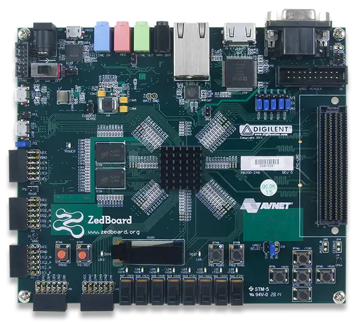

<!-- Copyright 2015-2026 Zephyr Project members and individual contributors. -->
<!-- SPDX-License-Identifier: Apache-2.0 -->
<!-- 中文翻译；编号、导航与译注为本地新增。 -->

<a id="zedboard"></a>

# 第16章\_ZedBoard

原文：[官方页面](https://docs.zephyrproject.org/latest/boards/digilent/zedboard/doc/index.html)。读取日期：2026-10-16；来源摘要见[来源记录](../SOURCES.md)。

开发板概览（Board Overview）

<a id="id1"></a>

[](images/zedboard.webp)

ZedBoard

名称（Name）：

`zedboard`

厂商（Vendor）：

[Digilent, Inc.公司](https://docs.zephyrproject.org/latest/boards/index.html#vendor=digilent)

状态（Status）：

当前未积极维护（Not Actively Maintained）

架构（Architecture）：

[arm](https://docs.zephyrproject.org/latest/boards/index.html#arch=arm)

片上系统（SoC）：

[xc7z020](https://docs.zephyrproject.org/latest/boards/index.html#soc=xc7z020)

<a id="board-github-link"></a>

[浏览开发板源码（Browse Board Sources）](https://github.com/zephyrproject-rtos/zephyr/blob/main//boards/digilent/zedboard/doc/index.rst/../..)<a id="overview"></a>

## 概述（Overview）

[安富利（Avnet）ZedBoard](https://www.avnet.com/wps/portal/us/products/avnet-boards/avnet-board-families/zedboard/)，即Zynq评估与开发板（Zynq Evaluation and Development Board），是一款面向Xilinx Zynq-7000全可编程SoC的低成本开发板。它采用XC7Z020器件，在同一裸片上集成双核ARM Cortex-A9处理器与Xilinx 7系列现场可编程门阵列（FPGA）逻辑，由Avnet、Digilent、Xilinx及ARM联合开发。

<a id="hardware"></a>

## 硬件（Hardware）

<a id="supported-features"></a>

### 支持的功能（Supported Features）

`zedboard`开发板支持下表所列的硬件功能。

片上／板载（On-Chip / On-Board）

功能集成在片上系统（SoC）内／位于开发板上。

2 / 2

分别表示已启用／已禁用的实例数。点击数量标签，可查看开发板或SoC设备树源码（DTS）中该功能的第一个实例。

`vnd,foo`

与此功能匹配的设备树绑定兼容字符串（Compatible String）；点击链接可查看绑定文档。

<a id="zedboard-hw-features"></a>

<a id="zedboard-zedboard/xc7z020-hw-features-section"></a>

#### `zedboard/xc7z020`目标（Target）

<a id="zedboard-zedboard/xc7z020-hw-features-panel"></a>

<a id="zedboard-zedboard/xc7z020-hw-features-memory"></a>

该开发板目标的片上存储容量：511 MiB RAM、N/A Flash。

<a id="zedboard-zedboard/xc7z020-hw-features-table"></a>

<table>
<tr>
<th>类型（Type）</th>
<th>位置（Location）</th>
<th>说明（Description）</th>
<th>兼容字符串（Compatible）</th>
</tr>
<tr>
<td rowspan="1">中央处理器（CPU）</td>
<td>板载（On-Board）</td>
<td>ARM Cortex-A9处理器（CPU）（<a href="https://github.com/zephyrproject-rtos/zephyr/blob/main/boards/digilent/zedboard/zedboard.dts?plain=1#L37">已启用：2</a>）</td>
<td><a href="../cpu_arm_riscv_binding_reference/P016_arm_cortex-a9.md#std-dtcompatible-arm-cortex-a9"><code>arm,cortex-a9</code></a></td>
</tr>
<tr>
<td rowspan="1">时钟控制（Clock Control）</td>
<td>片上（On-Chip）</td>
<td>通用固定频率时钟提供者（Fixed-Rate Clock Provider）（<a href="https://github.com/zephyrproject-rtos/zephyr/blob/main/dts/arm/xilinx/zynq7000.dtsi?plain=1#L13">已启用：1</a>）</td>
<td><a href="../hardware/P566_固定时钟绑定.md#dtbinding-fixed-clock"><code>fixed-clock</code></a></td>
</tr>
<tr>
<td rowspan="3">以太网（Ethernet）</td>
<td>片上（On-Chip）</td>
<td>Xilinx千兆以太网媒体访问控制器（GEM Ethernet Controller）（<a href="https://github.com/zephyrproject-rtos/zephyr/blob/main/dts/arm/xilinx/zynq7000.dtsi?plain=1#L80">已启用：1</a>；<a href="https://github.com/zephyrproject-rtos/zephyr/blob/main/dts/arm/xilinx/zynq7000.dtsi?plain=1#L110">已禁用：1</a>）</td>
<td><a href="../ethernet_synopsys_st_xilinx_binding_reference/P022_xlnx_gem.md#std-dtcompatible-xlnx-gem"><code>xlnx,gem</code></a></td>
</tr>
<tr>
<td>片上（On-Chip）</td>
<td>Xilinx GEM管理数据输入输出节点（MDIO Node）（<a href="https://github.com/zephyrproject-rtos/zephyr/blob/main/dts/arm/xilinx/zynq7000.dtsi?plain=1#L102">已启用：1</a>；<a href="https://github.com/zephyrproject-rtos/zephyr/blob/main/dts/arm/xilinx/zynq7000.dtsi?plain=1#L132">已禁用：1</a>）</td>
<td><a href="../ethernet_mdio_microchip_binding_reference/P012_xlnx_gem-mdio.md#std-dtcompatible-xlnx-gem-mdio"><code>xlnx,gem-mdio</code></a></td>
</tr>
<tr>
<td>板载（On-Board）</td>
<td>通用媒体独立接口物理层（MII PHY）（<a href="https://github.com/zephyrproject-rtos/zephyr/blob/main/boards/digilent/zedboard/zedboard.dts?plain=1#L115">已启用：1</a>）</td>
<td><a href="../ethernet_nxp_phy_binding_reference/P019_ethernet-phy.md#std-dtcompatible-ethernet-phy"><code>ethernet-phy</code></a></td>
</tr>
<tr>
<td rowspan="2">通用输入输出与接插件（GPIO &amp; Headers）</td>
<td>片上（On-Chip）</td>
<td>Xilinx Zynq-7000/ZynqMP MIO/EMIO通用输入输出控制器（GPIO Controller）（<a href="https://github.com/zephyrproject-rtos/zephyr/blob/main/dts/arm/xilinx/zynq7000.dtsi?plain=1#L184">已启用：1</a>）</td>
<td><a href="../gpio_ti_xilinx_sdl_binding_reference/P030_xlnx_ps-gpio.md#std-dtcompatible-xlnx-ps-gpio"><code>xlnx,ps-gpio</code></a></td>
</tr>
<tr>
<td>片上（On-Chip）</td>
<td>Xilinx Zynq-7000/ZynqMP MIO/EMIO GPIO控制器组（Bank）（<a href="https://github.com/zephyrproject-rtos/zephyr/blob/main/dts/arm/xilinx/zynq7000.dtsi?plain=1#L195">已启用：4</a>）</td>
<td><a href="../gpio_ti_xilinx_sdl_binding_reference/P029_xlnx_ps-gpio-bank.md#std-dtcompatible-xlnx-ps-gpio-bank"><code>xlnx,ps-gpio-bank</code></a></td>
</tr>
<tr>
<td rowspan="1">集成电路间总线（I2C）</td>
<td>片上（On-Chip）</td>
<td>Cadence I2C控制器（<a href="https://github.com/zephyrproject-rtos/zephyr/blob/main/dts/arm/xilinx/zynq7000.dtsi?plain=1#L58">已禁用：2</a>）</td>
<td><a href="../i2c_adi_atmel_esp_binding_reference/P015_cdns_i2c.md#std-dtcompatible-cdns-i2c"><code>cdns,i2c</code></a></td>
</tr>
<tr>
<td rowspan="1">输入（Input）</td>
<td>板载（On-Board）</td>
<td>一组绑定到 GPIO 的输入按键（GPIO-Bound Input Keys）（<a href="https://github.com/zephyrproject-rtos/zephyr/blob/main/boards/digilent/zedboard/zedboard.dts?plain=1#L71">已启用：1</a>）</td>
<td><a href="../hardware/P563_GPIO按键绑定.md#std-dtcompatible-gpio-keys"><code>gpio-keys</code></a></td>
</tr>
<tr>
<td rowspan="1">中断控制器（Interrupt Controller）</td>
<td>片上（On-Chip）</td>
<td>ARM通用中断控制器（GIC）v1（<a href="https://github.com/zephyrproject-rtos/zephyr/blob/main/dts/arm/xilinx/zynq7000.dtsi?plain=1#L49">已启用：1</a>）</td>
<td><a href="../interrupt_fabric_binding_reference/P002_arm_gic-v1.md#std-dtcompatible-arm-gic-v1"><code>arm,gic-v1</code></a></td>
</tr>
<tr>
<td rowspan="1">发光二极管（LED）</td>
<td>板载（On-Board）</td>
<td>一组由 GPIO 控制的 LED（GPIO-Controlled LEDs）（<a href="https://github.com/zephyrproject-rtos/zephyr/blob/main/boards/digilent/zedboard/zedboard.dts?plain=1#L62">已启用：1</a>）</td>
<td><a href="../hardware/P564_GPIO指示灯绑定.md#dtbinding-gpio-leds"><code>gpio-leds</code></a></td>
</tr>
<tr>
<td rowspan="1">引脚控制（Pin Control）</td>
<td>片上（On-Chip）</td>
<td>Xilinx Zynq-7000系列SoC引脚控制（Pinctrl）节点（<a href="https://github.com/zephyrproject-rtos/zephyr/blob/main/dts/arm/xilinx/zynq7000.dtsi?plain=1#L258">已启用：1</a>）</td>
<td><a href="../pinctrl_stm32_ti_xilinx_binding_reference/P021_xlnx_pinctrl-zynq.md#std-dtcompatible-xlnx-pinctrl-zynq"><code>xlnx,pinctrl-zynq</code></a></td>
</tr>
<tr>
<td rowspan="1">SD 主机控制器（SDHC）</td>
<td>片上（On-Chip）</td>
<td>Xilinx安全数字／嵌入式多媒体卡主机控制器（SD/EMMC Host Controller）（<a href="https://github.com/zephyrproject-rtos/zephyr/blob/main/dts/arm/xilinx/zynq7000.dtsi?plain=1#L232">已禁用：2</a>）</td>
<td><a href="../sdhc_binding_reference/P021_xlnx_versal-8.9a.md#std-dtcompatible-xlnx-versal-8.9a"><code>xlnx,versal-8.9a</code></a></td>
</tr>
<tr>
<td rowspan="1">串行控制器（Serial Controller）</td>
<td>片上（On-Chip）</td>
<td>Xilinx处理系统通用异步收发器（PS UART）（<a href="https://github.com/zephyrproject-rtos/zephyr/blob/main/dts/arm/xilinx/zynq7000.dtsi?plain=1#L149">已启用：1</a>；<a href="https://github.com/zephyrproject-rtos/zephyr/blob/main/dts/arm/xilinx/zynq7000.dtsi?plain=1#L140">已禁用：1</a>）</td>
<td><a href="../uart_ti_wch_virtual_binding_reference/P011_xlnx_xuartps.md#std-dtcompatible-xlnx-xuartps"><code>xlnx,xuartps</code></a></td>
</tr>
<tr>
<td rowspan="1">串行外设接口（SPI）</td>
<td>片上（On-Chip）</td>
<td>Cadence串行外设接口控制器（SPI Controller）（<a href="https://github.com/zephyrproject-rtos/zephyr/blob/main/dts/arm/xilinx/zynq7000.dtsi?plain=1#L158">已禁用：2</a>）</td>
<td><a href="../spi_adi_atmel_esp_binding_reference/P011_cdns_spi.md#std-dtcompatible-cdns-spi"><code>cdns,spi</code></a></td>
</tr>
<tr>
<td rowspan="1">静态随机存储器（SRAM）</td>
<td>板载（On-Board）</td>
<td>通用片上静态随机存储器（SRAM）（<a href="https://github.com/zephyrproject-rtos/zephyr/blob/main/boards/digilent/zedboard/zedboard.dts?plain=1#L57">已启用：1</a>）</td>
<td><a href="../hardware/P567_内存映射SRAM绑定.md#dtbinding-mmio-sram"><code>mmio-sram</code></a></td>
</tr>
<tr>
<td rowspan="1">系统控制器（System Controller）</td>
<td>片上（On-Chip）</td>
<td>系统控制器寄存器读写（System Controller Registers R/W）（<a href="https://github.com/zephyrproject-rtos/zephyr/blob/main/dts/arm/xilinx/zynq7000.dtsi?plain=1#L251">已启用：1</a>）</td>
<td><a href="../edac_syscon_binding_reference/P008_syscon.md#std-dtcompatible-syscon"><code>syscon</code></a></td>
</tr>
<tr>
<td rowspan="1">定时器（Timer）</td>
<td>片上（On-Chip）</td>
<td>每个内核独立的ARM架构定时器（Architected Timer）（<a href="https://github.com/zephyrproject-rtos/zephyr/blob/main/dts/arm/xilinx/zynq7000.dtsi?plain=1#L34">已启用：1</a>）</td>
<td><a href="../arm_interrupt_timer_binding_reference/P010_ARMv8架构定时器.md#std-dtcompatible-arm-armv8-timer"><code>arm,armv8-timer</code></a></td>
</tr>
</table>

<a id="programming-and-debugging"></a>

## 烧录与调试（Programming and Debugging）

运行Zephyr应用前，必须初始化Zynq-7000系列SoC。可以采用多种方式，例如Xilinx第一级引导加载程序（FSBL）、Xilinx Vivado生成的`ps_init.tcl` JTAG脚本，以及Das U-Boot次级程序加载器（SPL）等。

这里使用U-Boot SPL。关于Das U-Boot在Xilinx Zynq-7000系列SoC上的使用细节与步骤，见以下文档：


- [Das U-Boot网站](https://www.denx.de/wiki/U-Boot)
- [在Xilinx U-Boot中使用发行版启动（Distro Boot）](https://xilinx-wiki.atlassian.net/wiki/spaces/A/pages/749142017/Using+Distro+Boot+With+Xilinx+U-Boot)

<a id="building-das-u-boot"></a>

### 构建Das U-Boot（Building Das U-Boot）

为Avnet ZedBoard克隆并构建Das U-Boot：

```text
git clone -b v2026.04 https://source.denx.de/u-boot/u-boot.git
cd u-boot
make distclean
make xilinx_zynq_virt_defconfig
export PATH=/path/to/zephyr-sdk/arm-zephyr-eabi/bin/:$PATH
export CROSS_COMPILE=arm-zephyr-eabi-
export DEVICE_TREE="zynq-zed"
make
```

<a id="running-an-application"></a>

### 运行应用（Running an Application）

通过U-Boot从SD卡加载并运行Zephyr应用。构建[Hello World](../getting_started/P005_HelloWorld示例.md#hello_world)应用：

```text
# From the root of the zephyr repository
west build -b zedboard samples/hello_world
```

将`u-boot/spl/boot.bin`、`u-boot/u-boot.img`及`build/zephyr/zephyr.bin`复制到FAT32格式的microSD卡，将卡插入ZedBoard的SD插槽，按要求设置JP7至JP11跳线，使开发板从SD卡启动，然后上电。

U-Boot初始化完成后，加载并运行Zephyr应用。此处关闭缓存，因为Zephyr预期自行初始化存储器管理单元（MMU）及缓存：

```text
Zynq> fatload mmc 0 0x100000 zephyr.bin
Zynq> dcache off
Zynq> icache off
Zynq> go 0x100000
## Starting application at 0x00100000 ...
*** Booting Zephyr OS vx.xx.x-xxx-gxxxxxxxxxxxx ***
Hello World! zedboard
```

注意（Note）

原文说明仅在该开发板验证了通过U-Boot从SD卡启动；尚不支持基于JTAG的`west flash`／`west debug`。

## 译注

ZedBoard页面仅声明通过U-Boot从SD卡启动已获上游验证；JTAG方式的west flash／west debug尚不支持，不能套用Zybo页面的验证范围。

---

[上一章](P015_Digilent_Inc..md) · [返回大纲](大纲.md) · [全站翻译进度](../PROGRESS.md) · [下一章](P017_Zybo.md)
