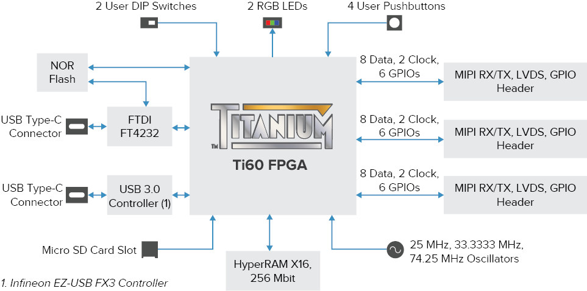

<!-- Copyright 2015-2026 Zephyr Project members and individual contributors. -->
<!-- SPDX-License-Identifier: Apache-2.0 -->
<!-- 中文翻译；编号、导航与译注为本地新增。 -->

<a id="titanium_ti60_f225"></a>

# 第6章\_Titanium Ti60 F225

原文：[官方页面](https://docs.zephyrproject.org/latest/boards/efinix/titanium_ti60_f225/doc/index.html)。读取日期：2026-10-16；来源摘要见[来源记录](../SOURCES.md)。

开发板概览（Board Overview）

<a id="id1"></a>

[](images/titanium_ti60_f225.jpg)

Titanium Ti60 F225

名称（Name）：

`titanium_ti60_f225`

厂商（Vendor）：

[Efinix Inc公司](https://docs.zephyrproject.org/latest/boards/index.html#vendor=efinix)

状态（Status）：

当前未积极维护（Not Actively Maintained）

架构（Architecture）：

[riscv](https://docs.zephyrproject.org/latest/boards/index.html#arch=riscv)

片上系统（SoC）：

[efinix_sapphire](https://docs.zephyrproject.org/latest/boards/index.html#soc=efinix_sapphire)

<a id="board-github-link"></a>

[浏览开发板源码（Browse Board Sources）](https://github.com/zephyrproject-rtos/zephyr/blob/main//boards/efinix/titanium_ti60_f225/doc/index.rst/../..)<a id="overview"></a>

## 概述（Overview）

Efinix Titanium Ti60 F225开发套件包含Ti60 FPGA，采用16 nm工艺，在较小尺寸下以尽可能低的功耗提供高性能。Efinix还提供Sapphire SoC硬件IP，这是一款基于VexRiscv内核、可由用户配置功能与扩展的RISC-V SoC。使用Efinity IP Manager，可仅包含实际需要的外设。

<a id="board-block-diagram"></a>

## 开发板框图（Board Block Diagram）



<a id="id3"></a>

更多信息见[Ti60F225](https://www.efinixinc.com/products-devkits-titaniumti60f225.html)网站[注1](#id2)。

<a id="sapphire-soc-setup-on-the-fpga-guide"></a>

## 在FPGA上配置Sapphire SoC的指南（Setup Guide）

<a id="id5"></a>

SoC配置指南见[Efinix-Zephyr](https://github.com/Efinix-Inc/zephyr-efinix)[注2](#id4)。

<a id="building"></a>

## 构建（Building）

按通常方式构建应用，详情见[构建应用（Building an Application）](../application/P001_应用开发.md#build-an-application)及[运行应用（Run an Application）](https://docs.zephyrproject.org/latest/develop/application/index.html#application-run)。

```text
# From the root of the zephyr repository
west build -b titanium_ti60_f225 samples/hello_world
```

<a id="flashing"></a>

## 烧录（Flashing）

<a id="id6"></a>

将二进制程序写入SPI NOR闪存需要Efinity编程器，操作指南见[Efinix-Zephyr](https://github.com/Efinix-Inc/zephyr-efinix)[注2](#id4)。

注意（Note）

原文说明，Zephyr RTOS已经使用Efinity IDE v2022.2.322生成的SoC配置位流（Bitstream）验证。

<a id="references"></a>

## 参考资料（References）

<a id="id2"></a>

〔[1](#id3)〕 [https://www.efinixinc.com/products-devkits-titaniumti60f225.html](https://www.efinixinc.com/products-devkits-titaniumti60f225.html)

<a id="id4"></a>

〔2〕 ([1](#id5),[2](#id6)) [https://github.com/Efinix-Inc/zephyr-efinix](https://github.com/Efinix-Inc/zephyr-efinix)

## 译注

Efinity IDE v2022.2.322及其位流的验证结论来自原文；本次只翻译与核对文档，未重新生成或下载FPGA位流。

---

[上一章](P005_Efinix_Inc..md) · [返回大纲](大纲.md) · [全站翻译进度](../PROGRESS.md) · [下一章](P007_ET171_Development_Board.md)
