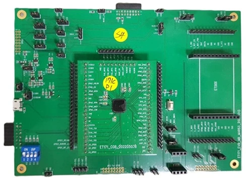

<!-- Copyright 2015-2026 Zephyr Project members and individual contributors. -->
<!-- SPDX-License-Identifier: Apache-2.0 -->
<!-- 中文翻译；编号、导航与译注为本地新增。 -->

<a id="egis_et171"></a>

# 第7章\_ET171开发板（Development Board）

原文：[官方页面](https://docs.zephyrproject.org/latest/boards/egis/egis_et171/doc/index.html)。读取日期：2026-10-16；来源摘要见[来源记录](../SOURCES.md)。

开发板概览（Board Overview）

<a id="id1"></a>

[](images/egis_et171.webp)

ET171开发板（Development Board）

名称（Name）：

`egis_et171`

厂商（Vendor）：

[Egis Technology Inc公司](https://docs.zephyrproject.org/latest/boards/index.html#vendor=egis)

状态（Status）：

当前未积极维护（Not Actively Maintained）

架构（Architecture）：

[riscv](https://docs.zephyrproject.org/latest/boards/index.html#arch=riscv)

片上系统（SoC）：

[et171](https://docs.zephyrproject.org/latest/boards/index.html#soc=et171)

<a id="board-github-link"></a>

[浏览开发板源码（Browse Board Sources）](https://github.com/zephyrproject-rtos/zephyr/blob/main//boards/egis/egis_et171/doc/index.rst/../..)<a id="overview"></a>

## 概述（Overview）

ET171开发板用于开发与验证，可通过UART、GPIO、SPI及I2C等接口开展应用开发。

<a id="hardware"></a>

## 硬件（Hardware）

平台提供以下硬件组件：


- 32位RISC-V处理器（CPU）
- 384 KB嵌入式同步动态随机存储器（SDRAM）
- 通用异步收发器（UART）
- 集成电路间总线（I2C）
- 串行外设接口（SPI）
- 通用输入输出（GPIO）
- 脉宽调制（PWM）
- 直接存储器访问（DMA）
- 通用串行总线（USB）

<a id="supported-features"></a>

### 支持的功能（Supported Features）

`egis_et171`开发板支持下表所列的硬件功能。

片上／板载（On-Chip / On-Board）

功能集成在片上系统（SoC）内／位于开发板上。

2 / 2

分别表示已启用／已禁用的实例数。点击数量标签，可查看开发板或SoC设备树源码（DTS）中该功能的第一个实例。

`vnd,foo`

与此功能匹配的设备树绑定兼容字符串（Compatible String）；点击链接可查看绑定文档。

<a id="egis_et171-hw-features"></a>

<a id="egis_et171-egis_et171/et171-hw-features-section"></a>

#### `egis_et171/et171`目标（Target）

<a id="egis_et171-egis_et171/et171-hw-features-panel"></a>

<a id="egis_et171-egis_et171/et171-hw-features-memory"></a>

该开发板目标的片上存储容量：384 KiB RAM、1 MiB Flash。

<a id="egis_et171-egis_et171/et171-hw-features-table"></a>

<table>
<tr>
<th>类型（Type）</th>
<th>位置（Location）</th>
<th>说明（Description）</th>
<th>兼容字符串（Compatible）</th>
</tr>
<tr>
<td rowspan="1">中央处理器（CPU）</td>
<td>片上（On-Chip）</td>
<td>晶心科技AndesCore v5系列RISC-V内核（<a href="https://github.com/zephyrproject-rtos/zephyr/blob/main/dts/riscv/egis/egis_et171.dtsi?plain=1#L19">已启用：1</a>）</td>
<td><a href="../cpu_arm_riscv_binding_reference/P003_andestech_andescore-v5.md#std-dtcompatible-andestech-andescore-v5"><code>andestech,andescore-v5</code></a></td>
</tr>
<tr>
<td rowspan="1">时钟控制（Clock Control）</td>
<td>板载（On-Board）</td>
<td>通用固定频率时钟提供者（Fixed-Rate Clock Provider）（<a href="https://github.com/zephyrproject-rtos/zephyr/blob/main/boards/egis/egis_et171/egis_et171.dts?plain=1#L50">已禁用：1</a>）</td>
<td><a href="../hardware/P566_固定时钟绑定.md#dtbinding-fixed-clock"><code>fixed-clock</code></a></td>
</tr>
<tr>
<td rowspan="1">计数器（Counter）</td>
<td>片上（On-Chip）</td>
<td>晶心科技atcpit100可编程间隔定时器节点（PIT Node）的描述（<a href="https://github.com/zephyrproject-rtos/zephyr/blob/main/dts/riscv/egis/egis_et171.dtsi?plain=1#L94">已启用：1</a>）</td>
<td><a href="../counter_binding_reference/P005_andestech_atcpit100.md#std-dtcompatible-andestech-atcpit100"><code>andestech,atcpit100</code></a></td>
</tr>
<tr>
<td rowspan="1">直接存储器访问（DMA）</td>
<td>片上（On-Chip）</td>
<td>晶心科技DMA控制器通道：指向DMA控制器的节点引用（phandle），以及以下四个整数单元（Cells）：（<a href="https://github.com/zephyrproject-rtos/zephyr/blob/main/dts/riscv/egis/egis_et171.dtsi?plain=1#L134">已启用：1</a>）</td>
<td><a href="../dma_binding_reference/P008_andestech_atcdmacx00.md#std-dtcompatible-andestech-atcdmacx00"><code>andestech,atcdmacx00</code></a></td>
</tr>
<tr>
<td rowspan="1">通用输入输出与接插件（GPIO &amp; Headers）</td>
<td>片上（On-Chip）</td>
<td>晶心科技ATCGPIO100通用输入输出控制器（GPIO Controller）（<a href="https://github.com/zephyrproject-rtos/zephyr/blob/main/dts/riscv/egis/egis_et171.dtsi?plain=1#L113">已启用：1</a>）</td>
<td><a href="../gpio_adi_headers_ambiq_binding_reference/P020_andestech_atcgpio100.md#std-dtcompatible-andestech-atcgpio100"><code>andestech,atcgpio100</code></a></td>
</tr>
<tr>
<td rowspan="1">集成电路间总线（I2C）</td>
<td>片上（On-Chip）</td>
<td>晶心科技ATCIIC100 I2C（<a href="https://github.com/zephyrproject-rtos/zephyr/blob/main/dts/riscv/egis/egis_et171.dtsi?plain=1#L124">已禁用：1</a>）</td>
<td><a href="../i2c_adi_atmel_esp_binding_reference/P005_andestech_atciic100.md#std-dtcompatible-andestech-atciic100"><code>andestech,atciic100</code></a></td>
</tr>
<tr>
<td rowspan="2">中断控制器（Interrupt Controller）</td>
<td>片上（On-Chip）</td>
<td>RISC-V CPU中断控制器（Interrupt Controller）（<a href="https://github.com/zephyrproject-rtos/zephyr/blob/main/dts/riscv/egis/egis_et171.dtsi?plain=1#L29">已启用：1</a>）</td>
<td><a href="../interrupt_fabric_binding_reference/P006_riscv_cpu-intc.md#std-dtcompatible-riscv-cpu-intc"><code>riscv,cpu-intc</code></a></td>
</tr>
<tr>
<td>片上（On-Chip）</td>
<td>SiFive RISCV-V平台级中断控制器（PLIC / Platform-Local Interrupt Controller）（<a href="https://github.com/zephyrproject-rtos/zephyr/blob/main/dts/riscv/egis/egis_et171.dtsi?plain=1#L50">已启用：2</a>）</td>
<td><a href="../interrupt_fabric_binding_reference/P009_sifive_plic-1.0.0.md#std-dtcompatible-sifive-plic-1.0.0"><code>sifive,plic-1.0.0</code></a></td>
</tr>
<tr>
<td rowspan="1">发光二极管（LED）</td>
<td>板载（On-Board）</td>
<td>一组由 GPIO 控制的 LED（GPIO-Controlled LEDs）（<a href="https://github.com/zephyrproject-rtos/zephyr/blob/main/boards/egis/egis_et171/egis_et171.dts?plain=1#L30">已启用：1</a>）</td>
<td><a href="../hardware/P564_GPIO指示灯绑定.md#dtbinding-gpio-leds"><code>gpio-leds</code></a></td>
</tr>
<tr>
<td rowspan="1">存储技术设备（MTD）</td>
<td>板载（On-Board）</td>
<td>闪存（Flash）节点（<a href="https://github.com/zephyrproject-rtos/zephyr/blob/main/boards/egis/egis_et171/egis_et171.dts?plain=1#L44">已启用：1</a>）</td>
<td><a href="../mtd_nxp_st_ti_partition_binding_reference/P013_soc-nv-flash.md#std-dtcompatible-soc-nv-flash"><code>soc-nv-flash</code></a></td>
</tr>
<tr>
<td rowspan="1">串行控制器（Serial Controller）</td>
<td>片上（On-Chip）</td>
<td>ns16550通用异步收发器（UART）（<a href="https://github.com/zephyrproject-rtos/zephyr/blob/main/dts/riscv/egis/egis_et171.dtsi?plain=1#L85">已启用：1</a>）</td>
<td><a href="../uart_microchip_nordic_nxp_binding_reference/P005_ns16550.md#std-dtcompatible-ns16550"><code>ns16550</code></a></td>
</tr>
<tr>
<td rowspan="1">静态随机存储器（SRAM）</td>
<td>片上（On-Chip）</td>
<td>通用片上静态随机存储器（SRAM）（<a href="https://github.com/zephyrproject-rtos/zephyr/blob/main/dts/riscv/egis/egis_et171.dtsi?plain=1#L38">已启用：1</a>）</td>
<td><a href="../hardware/P567_内存映射SRAM绑定.md#dtbinding-mmio-sram"><code>mmio-sram</code></a></td>
</tr>
<tr>
<td rowspan="1">系统控制器（System Controller）</td>
<td>片上（On-Chip）</td>
<td>系统控制器寄存器读写（System Controller Registers R/W）（<a href="https://github.com/zephyrproject-rtos/zephyr/blob/main/dts/riscv/egis/egis_et171.dtsi?plain=1#L79">已禁用：1</a>）</td>
<td><a href="../edac_syscon_binding_reference/P008_syscon.md#std-dtcompatible-syscon"><code>syscon</code></a></td>
</tr>
<tr>
<td rowspan="1">定时器（Timer）</td>
<td>片上（On-Chip）</td>
<td>RISC-V机器模式定时器（Machine Timer）（<a href="https://github.com/zephyrproject-rtos/zephyr/blob/main/dts/riscv/egis/egis_et171.dtsi?plain=1#L72">已启用：1</a>）</td>
<td><a href="../interrupt_fabric_binding_reference/P011_riscv_machine-timer.md#std-dtcompatible-riscv-machine-timer"><code>riscv,machine-timer</code></a></td>
</tr>
<tr>
<td rowspan="1">看门狗（Watchdog）</td>
<td>片上（On-Chip）</td>
<td>晶心科技看门狗驱动（Watchdog Driver）（<a href="https://github.com/zephyrproject-rtos/zephyr/blob/main/dts/riscv/egis/egis_et171.dtsi?plain=1#L146">已启用：1</a>）</td>
<td><a href="../watchdog_binding_reference/P004_andestech_atcwdt200.md#std-dtcompatible-andestech-atcwdt200"><code>andestech,atcwdt200</code></a></td>
</tr>
</table>

<a id="connections-and-ios"></a>

### 连接与输入输出（Connections and IOs）

ET171平台有一个GPIO控制器，提供17位I/O，负责引脚输入／输出及上拉等功能。

ET171平台有三个SPI控制器，其中两个还支持QSPI及就地执行（XIP）模式。

ET171平台有一个USB 2.0控制器，最高支持USB 2.0高速模式（High-Speed）。

除USB DP／DM外，ET171的全部外设I/O都通过复用控制器（Multiplexer Controller）映射到31个I/O引脚。

<a id="system-clock"></a>

#### 系统时钟（System Clock）

ET171平台具有多级分频器（Multi-Stage Frequency Divider），最高速度200 MHz。

<a id="programming-and-debugging"></a>

## 编程与调试（Programming and Debugging）

`egis_et171`开发板支持下表所列的运行工具（Runners）及相关west命令。

<table>
<tr>
<th></th>
<th>烧录（flash）</th>
<th>调试（debug）</th>
</tr>
<tr>
<td>misc-flasher</td>
<td>✅（默认 / default）</td>
<td></td>
</tr>
</table>

ET171兼容Andes AE350，因此可使用Andes在线仿真器（ICE）调试。调试Zephyr应用或将其上传到RAM时，需要将主机ICE连接到ET171开发板，并在主机运行ICE管理软件ICEman。

<a id="connecting-andes-ice-aice"></a>

### 连接晶心科技在线仿真器（Andes ICE / AICE）

AICE用于调试，并将RAM代码上传到开发板。

<a id="building"></a>

### 构建（Building）

可以按通常方式构建应用。以下以[Hello World](../getting_started/P005_HelloWorld示例.md#hello_world)应用为例。

```text
# From the root of the zephyr repository
west build -b egis_et171 samples/hello_world
```

<a id="flashing"></a>

### 烧录（Flashing）

由于这是面向企业（B2B）的原型板，没有公开提供的烧录工具。如有开发需求，请联系Egis Technology Inc的对接人员。（[Egis Technology Inc.公司](https://www.egistec.com/)）

<a id="id3"></a>

<a id="id5"></a>

如果有[AICE-MICRO](http://www.andestech.com/en/products-solutions/andeshape-platforms/aice-micro/)调试器[注1](#id2)及ICEman软件（[Andes Development Kit](https://github.com/andestech/Andes-Development-Kit/releases)）[注2](#id4)，可设置`CONFIG_XIP=n`，通过ICE调试器使程序运行于RAM模式。

加载程序前，应先启动ICEman。

```text
# Enable execute file permission of ICEman
$ chmod a+x ./ICEman

# Running the ICEman server
$ sudo ./ICEman -Z v5
```

```text
# When your ICEman server is running
# You can load the program into RAM and execute it via gdb
$ riscv64-zephyr-elf-gdb build/zephyr/zephyr.elf
(gdb) target remote :1111
(gdb) monitor reset halt
(gdb) load
(gdb) quit
```

<a id="references"></a>

## 参考资料（References）

<a id="id2"></a>

〔[1](#id3)〕 [http://www.andestech.com/en/products-solutions/andeshape-platforms/aice-micro/](http://www.andestech.com/en/products-solutions/andeshape-platforms/aice-micro/)

<a id="id4"></a>

〔[2](#id5)〕 [https://github.com/andestech/Andes-Development-Kit/releases](https://github.com/andestech/Andes-Development-Kit/releases)

## 译注

ET171为B2B原型板，官方未公开提供烧录工具；AICE／ICEman调试与RAM加载条件按原文保留，不扩展为west flash可用性承诺。

## 原文外链核对

2026-10-16核对并重试以下原文外链时未能确认可访问性，保留原始目标，不将访问失败解释为原文内容有误。

- [](http://www.andestech.com/en/products-solutions/andeshape-platforms/aice-micro/)：timed out。

---

[上一章](P006_Titanium_Ti60_F225.md) · [返回大纲](大纲.md) · [全站翻译进度](../PROGRESS.md) · [下一章](P008_Egis_Technology_Inc..md)
