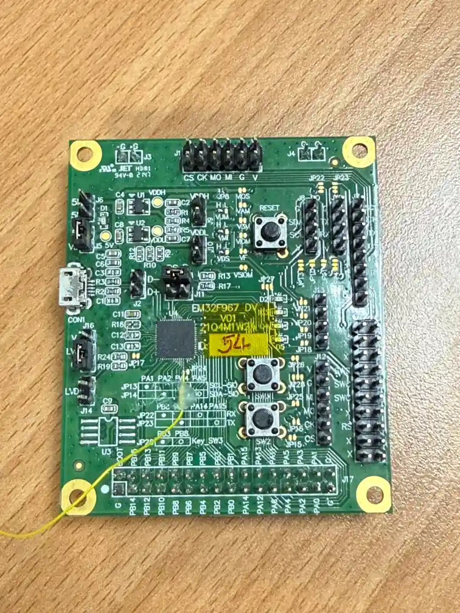

<!-- Copyright 2015-2026 Zephyr Project members and individual contributors. -->
<!-- SPDX-License-Identifier: Apache-2.0 -->
<!-- 中文翻译；编号、导航与译注为本地新增。 -->

<a id="32f967_dv"></a>

# 第9章\_ELAN EM32F967

原文：[官方页面](https://docs.zephyrproject.org/latest/boards/elan/32f967_dv/doc/index.html)。读取日期：2026-10-16；来源摘要见[来源记录](../SOURCES.md)。

开发板概览（Board Overview）

<a id="id1"></a>

[](images/32f967_dv.webp)

ELAN EM32F967

名称（Name）：

`32f967_dv`

厂商（Vendor）：

[义隆微电子（Elan Microelectronic Corp.）](https://docs.zephyrproject.org/latest/boards/index.html#vendor=elan)

状态（Status）：

当前未积极维护（Not Actively Maintained）

架构（Architecture）：

[arm](https://docs.zephyrproject.org/latest/boards/index.html#arch=arm)

片上系统（SoC）：

[em32f967](https://docs.zephyrproject.org/latest/boards/index.html#soc=em32f967)

<a id="board-github-link"></a>

[浏览开发板源码（Browse Board Sources）](https://github.com/zephyrproject-rtos/zephyr/blob/main//boards/elan/32f967_dv/doc/index.rst/../..)<a id="elan-32f967-dv"></a>

## Elan 32f967_dv

<a id="overview"></a>

### 概述（Overview）

Elan 32f967_dv是一款基于Elan EM32F967 SoC（ARM Cortex-M4）、面向企业（B2B）的开发板，用于验证SoC与Zephyr的初步集成。

<a id="hardware"></a>

### 硬件（Hardware）

平台提供以下硬件组件：


- SoC：Elan EM32F967，ARM Cortex-M4
- CPU最高频率96 MHz
- 嵌入式闪存（Flash）：536 KB
- 嵌入式RAM：272 KB
- UART：通过焊接跳线调试，没有专用连接器
- 串行外设接口（SPI）
- 通用输入输出（GPIO）
- 脉宽调制（PWM）
- USB：用于固件烧录及应用通信
- 看门狗定时器（WDT）
- 备份域寄存器（Backup Domain Registers），经Zephyr的电池备份RAM（BBRAM）接口访问
- 真随机数发生器（TRNG / True Random Number Generator）
- 硬件加密引擎（Hardware Crypto Engine）
- 定时器（Timer）
- 实时时钟（RTC）

<a id="supported-features"></a>

#### 支持的功能（Supported Features）

`32f967_dv`开发板支持下表所列的硬件功能。

片上／板载（On-Chip / On-Board）

功能集成在片上系统（SoC）内／位于开发板上。

2 / 2

分别表示已启用／已禁用的实例数。点击数量标签，可查看开发板或SoC设备树源码（DTS）中该功能的第一个实例。

`vnd,foo`

与此功能匹配的设备树绑定兼容字符串（Compatible String）；点击链接可查看绑定文档。

<a id="32f967_dv-hw-features"></a>

<a id="32f967_dv-32f967_dv/em32f967-hw-features-section"></a>

##### `32f967_dv/em32f967`目标（Target）

<a id="32f967_dv-32f967_dv/em32f967-hw-features-panel"></a>

<a id="32f967_dv-32f967_dv/em32f967-hw-features-memory"></a>

该开发板目标的片上存储容量：272 KiB RAM、536 KiB Flash。

<a id="32f967_dv-32f967_dv/em32f967-hw-features-table"></a>

<table>
<tr>
<th>类型（Type）</th>
<th>位置（Location）</th>
<th>说明（Description）</th>
<th>兼容字符串（Compatible）</th>
</tr>
<tr>
<td rowspan="1">中央处理器（CPU）</td>
<td>片上（On-Chip）</td>
<td>ARM Cortex-M4 处理器（CPU）（<a href="https://github.com/zephyrproject-rtos/zephyr/blob/main/dts/arm/elan/em32fxxx.dtsi?plain=1#L19">已启用：1</a>）</td>
<td><a href="../cpu_arm_riscv_binding_reference/P024_arm_cortex-m4.md#std-dtcompatible-arm-cortex-m4"><code>arm,cortex-m4</code></a></td>
</tr>
<tr>
<td rowspan="3">时钟控制（Clock Control）</td>
<td>片上（On-Chip）</td>
<td>Elan EM32 AHB时钟控制器（<a href="https://github.com/zephyrproject-rtos/zephyr/blob/main/dts/arm/elan/em32fxxx.dtsi?plain=1#L41">已启用：1</a>）</td>
<td><a href="../clock_esp_infineon_microchip_binding_reference/P002_elan_em32-ahb.md#std-dtcompatible-elan-em32-ahb"><code>elan,em32-ahb</code></a></td>
</tr>
<tr>
<td>片上（On-Chip）</td>
<td>Elan EM32 APB时钟控制器（<a href="https://github.com/zephyrproject-rtos/zephyr/blob/main/dts/arm/elan/em32fxxx.dtsi?plain=1#L50">已启用：1</a>）</td>
<td><a href="../clock_esp_infineon_microchip_binding_reference/P003_elan_em32-apb.md#std-dtcompatible-elan-em32-apb"><code>elan,em32-apb</code></a></td>
</tr>
<tr>
<td>片上（On-Chip）</td>
<td>通用固定频率时钟提供者（Fixed-Rate Clock Provider）（<a href="https://github.com/zephyrproject-rtos/zephyr/blob/main/dts/arm/elan/em32fxxx.dtsi?plain=1#L58">已启用：1</a>）</td>
<td><a href="../hardware/P566_固定时钟绑定.md#dtbinding-fixed-clock"><code>fixed-clock</code></a></td>
</tr>
<tr>
<td rowspan="1">通用输入输出与接插件（GPIO &amp; Headers）</td>
<td>片上（On-Chip）</td>
<td>EM32 GPIO控制器（<a href="https://github.com/zephyrproject-rtos/zephyr/blob/main/dts/arm/elan/em32fxxx.dtsi?plain=1#L76">已启用：2</a>）</td>
<td><a href="../gpio_connectors_bflb_esp_binding_reference/P018_elan_em32-gpio.md#std-dtcompatible-elan-em32-gpio"><code>elan,em32-gpio</code></a></td>
</tr>
<tr>
<td rowspan="1">中断控制器（Interrupt Controller）</td>
<td>片上（On-Chip）</td>
<td>ARMv7-M 嵌套向量中断控制器（Nested Vectored Interrupt Controller，NVIC）（<a href="https://github.com/zephyrproject-rtos/zephyr/blob/main/dts/arm/armv7-m.dtsi?plain=1#L13">已启用：1</a>）</td>
<td><a href="../arm_interrupt_timer_binding_reference/P002_ARMv7_M_NVIC.md#std-dtcompatible-arm-v7m-nvic"><code>arm,v7m-nvic</code></a></td>
</tr>
<tr>
<td rowspan="1">内存管理单元／内存保护单元（MMU / MPU）</td>
<td>片上（On-Chip）</td>
<td>ARMv7-M存储器保护单元（MPU / Memory Protection Unit）（<a href="https://github.com/zephyrproject-rtos/zephyr/blob/main/dts/arm/elan/em32fxxx.dtsi?plain=1#L26">已启用：1</a>）</td>
<td><a href="../memory_protection_binding_reference/P005_arm_armv7m-mpu.md#std-dtcompatible-arm-armv7m-mpu"><code>arm,armv7m-mpu</code></a></td>
</tr>
<tr>
<td rowspan="1">存储技术设备（MTD）</td>
<td>片上（On-Chip）</td>
<td>闪存（Flash）节点（<a href="https://github.com/zephyrproject-rtos/zephyr/blob/main/dts/arm/elan/em32fxxx.dtsi?plain=1#L125">已启用：1</a>）</td>
<td><a href="../mtd_nxp_st_ti_partition_binding_reference/P013_soc-nv-flash.md#std-dtcompatible-soc-nv-flash"><code>soc-nv-flash</code></a></td>
</tr>
<tr>
<td rowspan="1">引脚控制（Pin Control）</td>
<td>片上（On-Chip）</td>
<td>EM32引脚控制器，EM32F967（<a href="https://github.com/zephyrproject-rtos/zephyr/blob/main/dts/arm/elan/em32fxxx.dtsi?plain=1#L66">已启用：1</a>）</td>
<td><a href="../pinctrl_adi_ambiq_arm_binding_reference/P019_elan_em32-pinctrl.md#std-dtcompatible-elan-em32-pinctrl"><code>elan,em32-pinctrl</code></a></td>
</tr>
<tr>
<td rowspan="1">脉宽调制（PWM）</td>
<td>片上（On-Chip）</td>
<td>ELAN EM32F967 PWM控制器（<a href="https://github.com/zephyrproject-rtos/zephyr/blob/main/dts/arm/elan/em32fxxx.dtsi?plain=1#L229">已禁用：1</a>）</td>
<td><a href="../pwm_adi_esp_infineon_binding_reference/P012_elan_em32-pwm.md#std-dtcompatible-elan-em32-pwm"><code>elan,em32-pwm</code></a></td>
</tr>
<tr>
<td rowspan="1">串行控制器（Serial Controller）</td>
<td>片上（On-Chip）</td>
<td>ELAN EM32 UART控制器（<a href="https://github.com/zephyrproject-rtos/zephyr/blob/main/dts/arm/elan/em32fxxx.dtsi?plain=1#L101">已启用：1</a>）</td>
<td><a href="../uart_adi_arm_atmel_binding_reference/P018_elan_em32-uart.md#std-dtcompatible-elan-em32-uart"><code>elan,em32-uart</code></a></td>
</tr>
<tr>
<td rowspan="1">静态随机存储器（SRAM）</td>
<td>片上（On-Chip）</td>
<td>通用片上静态随机存储器（SRAM）（<a href="https://github.com/zephyrproject-rtos/zephyr/blob/main/dts/arm/elan/em32fxxx.dtsi?plain=1#L33">已启用：1</a>）</td>
<td><a href="../hardware/P567_内存映射SRAM绑定.md#dtbinding-mmio-sram"><code>mmio-sram</code></a></td>
</tr>
<tr>
<td rowspan="1">系统控制器（System Controller）</td>
<td>片上（On-Chip）</td>
<td>系统控制器寄存器读写（System Controller Registers R/W）（<a href="https://github.com/zephyrproject-rtos/zephyr/blob/main/dts/arm/elan/em32fxxx.dtsi?plain=1#L242">已启用：3</a>；<a href="https://github.com/zephyrproject-rtos/zephyr/blob/main/dts/arm/elan/em32fxxx.dtsi?plain=1#L250">已禁用：1</a>）</td>
<td><a href="../edac_syscon_binding_reference/P008_syscon.md#std-dtcompatible-syscon"><code>syscon</code></a></td>
</tr>
<tr>
<td rowspan="1">定时器（Timer）</td>
<td>片上（On-Chip）</td>
<td>ARMv7-M 系统节拍（System Tick）（<a href="https://github.com/zephyrproject-rtos/zephyr/blob/main/dts/arm/armv7-m.dtsi?plain=1#L21">已启用：1</a>）</td>
<td><a href="../arm_interrupt_timer_binding_reference/P006_ARMv7_M_SysTick.md#std-dtcompatible-arm-armv7m-systick"><code>arm,armv7m-systick</code></a></td>
</tr>
</table>

<a id="connections-and-ios"></a>

#### 连接与输入输出（Connections and IOs）


- `UART_1 TX/RX : PA2 / PA1`
- `SPI_2 NSS/SCK/MISO/MOSI : PB4 / PB5 / PB6 / PB7`
- `PWM_0 LED : PA3`

<a id="programming-and-debugging"></a>

### 烧录与调试（Programming and Debugging）

`32f967_dv`开发板支持下表所列的运行工具（Runners）及相关west命令。

<table>
<tr>
<th></th>
<th>烧录（flash）</th>
<th>调试（debug）</th>
</tr>
<tr>
<td>misc-flasher</td>
<td>✅（默认 / default）</td>
<td></td>
</tr>
</table>

此开发板不使用J-Link或OpenOCD等标准烧录接口。

<a id="flashing"></a>

#### 烧录（Flashing）

烧录工具仅向Elan客户提供，用于生产及评估，不对外公开。

当前阶段不支持Zephyr的`west flash`命令。

可以按通常方式构建应用。以下以[Hello World](../getting_started/P005_HelloWorld示例.md#hello_world)应用为例。

```text
# From the root of the zephyr repository
west build -b 32f967_dv samples/hello_world
```

<a id="debugging"></a>

#### 调试（Debugging）

可以按常规方式调试应用。下面以[Hello World](../getting_started/P005_HelloWorld示例.md#hello_world)应用为例。

```text
# From the root of the zephyr repository
west build -b 32f967_dv samples/hello_world
west debug
```

<a id="references"></a>

### 参考资料（References）

开发板及Elan EM32F967 SoC文档向Elan客户提供。数据手册、技术参考手册及工具信息请联系Elan获取。

## 译注

EM32F967的烧录工具和技术资料仅向客户提供；原文明确不支持west flash。硬件清单与Zephyr当前支持功能分别保留。

---

[上一章](P008_Egis_Technology_Inc..md) · [返回大纲](大纲.md) · [全站翻译进度](../PROGRESS.md) · [下一章](P010_Elan_Microelectronics_Corp..md)
