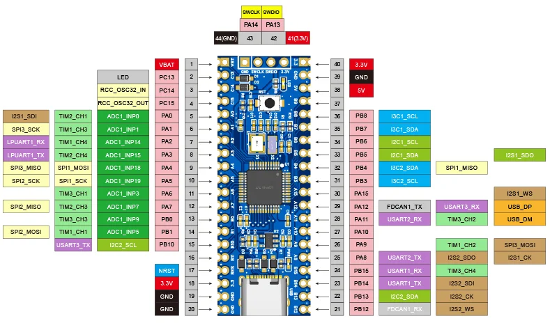

<!-- Copyright 2015-2026 Zephyr Project members and individual contributors. -->
<!-- SPDX-License-Identifier: Apache-2.0 -->
<!-- 中文翻译；编号、导航与译注为本地新增。 -->

<a id="tq_h503a"></a>

# 第17章\_TQ H503A

原文：[官方页面](https://docs.zephyrproject.org/latest/boards/embedsky/tq_h503a/doc/index.html)。读取日期：2026-10-16；来源摘要见[来源记录](../SOURCES.md)。

开发板概览（Board Overview）

<a id="id1"></a>

[](images/tq_h503a.webp)

TQ H503A

名称（Name）：

`tq_h503a`

厂商（Vendor）：

[广东天嵌科技（Guangdong Embedsky Technology Co., Ltd.）](https://docs.zephyrproject.org/latest/boards/index.html#vendor=embedsky)

状态（Status）：

当前未积极维护（Not Actively Maintained）

架构（Architecture）：

[arm](https://docs.zephyrproject.org/latest/boards/index.html#arch=arm)

片上系统（SoC）：

[stm32h503xx](https://docs.zephyrproject.org/latest/boards/index.html#soc=stm32h503xx)

<a id="board-github-link"></a>

[浏览开发板源码（Browse Board Sources）](https://github.com/zephyrproject-rtos/zephyr/blob/main//boards/embedsky/tq_h503a/doc/index.rst/../..)<a id="overview"></a>

## 概述（Overview）

<a id="id3"></a>

<a id="id5"></a>

天嵌TQ-H503A是一款成本极低、配置精简的开发板，采用基于ARM® Cortex®-M33内核的STM32H503CBT6微控制器，见[STM32H503CB网站](https://www.st.com/en/microcontrollers/stm32h503cb.html)[注1](#id2)。它是STM32H503x系列的48针型号，见[STM32H503x参考手册](https://www.st.com/resource/en/reference_manual/rm0492-stm32h503-line-armbased-32bit-mcus-stmicroelectronics.pdf)[注2](#id4)。TQ-H503A的主要特性如下：


- LQFP48封装的STM32H503CB微控制器，带128 Kbyte闪存及32 Kbyte SRAM
- 一个用户LED
- 32.768 kHz晶体振荡器（Crystal Oscillator）
- 8 MHz外部高速（HSE）晶体振荡器

<a id="hardware"></a>

## 硬件（Hardware）

STM32H503CB属于STM32H5高性能微控制器系列，基于高性能Arm® Cortex®-M33 32位RISC内核，工作频率最高250 MHz。


- 内核：Arm® Cortex®-M33 CPU，带FPU、MPU及DSP指令；Dhrystone 2.1性能为375 DMIPS
- 自适应实时加速器（ART Accelerator）
- 存储器（Memories）


  - 128 Kbyte带ECC的嵌入式闪存，两个存储体，支持边读边写（Read-While-Write）
  - 2 Kbyte一次性可编程（OTP）存储器
  - 32 Kbyte带ECC的SRAM
  - 2 Kbyte备份SRAM，在最低功耗模式下仍可用
- 时钟管理（Clock Management）


  - 内部振荡器：64 MHz HSI、48 MHz HSI48、4 MHz CSI及32 kHz LSI
  - 两个PLL，用于系统时钟、USB、音频及ADC
  - 外部振荡器：4至50 MHz HSE、32.768 kHz LSE
- 嵌入式低压差稳压器（LDO）
- 35个高速I/O，多数耐受5 V
- 模拟外设（Analog Peripherals）


  - 一个12位ADC，最高2.5 MSPS
  - 一个12位双通道DAC
  - 一个超低功耗比较器（Comparator）
  - 一个运算放大器（Operational Amplifier），带宽7 MHz
- 一个数字温度传感器
- 11个定时器：四个16位、一个32位、两个可在Stop模式使用的16位低功耗定时器、两个看门狗、一个SysTick，以及带硬件日历、闹钟和校准功能的RTC
- 16个通信接口


  - 两个I2C快速模式增强（FM+）接口，支持SMBus／PMBus®
  - 两个与I2C共用的I3C接口
  - 三路USART，支持ISO 7816、LIN、IrDA及调制解调器控制
  - 一路低功耗UART（LPUART）
  - 三路SPI，均与全双工I2S复用
  - 三路USART配置为同步模式时，可额外提供三路SPI
  - 一路灵活数据速率CAN（FDCAN）
  - 一个USB 2.0全速主机与设备接口
- 两个DMA控制器，用于减轻CPU负担
- 安全（Security）


  - 散列（HASH）：SHA-1、SHA-2，以及哈希消息认证码（HMAC）
  - 真随机数发生器（True Random Generator）
  - 96位唯一标识（Unique ID）
  - 主动防篡改（Active Tamper）
- 开发支持：串行线调试（SWD）及JTAG接口

<a id="supported-features"></a>

### 支持的功能（Supported Features）

`tq_h503a`开发板支持下表所列的硬件功能。

片上／板载（On-Chip / On-Board）

功能集成在片上系统（SoC）内／位于开发板上。

2 / 2

分别表示已启用／已禁用的实例数。点击数量标签，可查看开发板或SoC设备树源码（DTS）中该功能的第一个实例。

`vnd,foo`

与此功能匹配的设备树绑定兼容字符串（Compatible String）；点击链接可查看绑定文档。

<a id="tq_h503a-hw-features"></a>

<a id="tq_h503a-tq_h503a/stm32h503xx-hw-features-section"></a>

#### `tq_h503a/stm32h503xx`目标（Target）

<a id="tq_h503a-tq_h503a/stm32h503xx-hw-features-panel"></a>

<a id="tq_h503a-tq_h503a/stm32h503xx-hw-features-memory"></a>

该开发板目标的片上存储容量：32 KiB RAM、128 KiB Flash。

<a id="tq_h503a-tq_h503a/stm32h503xx-hw-features-table"></a>

<table>
<tr>
<th>类型（Type）</th>
<th>位置（Location）</th>
<th>说明（Description）</th>
<th>兼容字符串（Compatible）</th>
</tr>
<tr>
<td rowspan="1">中央处理器（CPU）</td>
<td>片上（On-Chip）</td>
<td>ARM Cortex-M33处理器（CPU）（<a href="https://github.com/zephyrproject-rtos/zephyr/blob/main/dts/arm/st/h5/stm32h5.dtsi?plain=1#L32">已启用：1</a>）</td>
<td><a href="../cpu_arm_riscv_binding_reference/P022_arm_cortex-m33.md#std-dtcompatible-arm-cortex-m33"><code>arm,cortex-m33</code></a></td>
</tr>
<tr>
<td rowspan="1">模数转换器（ADC）</td>
<td>片上（On-Chip）</td>
<td>STM32模数转换器（ADC）（<a href="https://github.com/zephyrproject-rtos/zephyr/blob/main/dts/arm/st/h5/stm32h5.dtsi?plain=1#L359">已禁用：1</a>）</td>
<td><a href="../hardware/P839_STM32模数转换器绑定.md#dtbinding-st-stm32-adc"><code>st,stm32-adc</code></a></td>
</tr>
<tr>
<td rowspan="1">控制器局域网（CAN）</td>
<td>片上（On-Chip）</td>
<td>STM32 FDCAN灵活数据速率CAN控制器（CAN FD Controller）（<a href="https://github.com/zephyrproject-rtos/zephyr/blob/main/dts/arm/st/h5/stm32h5.dtsi?plain=1#L610">已禁用：1</a>）</td>
<td><a href="../can_nxp_renesas_stm32_ti_binding_reference/P012_st_stm32-fdcan.md#std-dtcompatible-st-stm32-fdcan"><code>st,stm32-fdcan</code></a></td>
</tr>
<tr>
<td rowspan="8">时钟控制（Clock Control）</td>
<td>片上（On-Chip）</td>
<td>STM32H5复位与时钟控制器（RCC）（<a href="https://github.com/zephyrproject-rtos/zephyr/blob/main/dts/arm/st/h5/stm32h5.dtsi?plain=1#L194">已启用：1</a>）</td>
<td><a href="../timer_reference/P167_STM32H5复位与时钟控制绑定.md#dtbinding-st-stm32h5-rcc"><code>st,stm32h5-rcc</code></a></td>
</tr>
<tr>
<td>片上（On-Chip）</td>
<td>STM32 外部高速时钟（HSE Clock）（<a href="https://github.com/zephyrproject-rtos/zephyr/blob/main/dts/arm/st/h5/stm32h5.dtsi?plain=1#L59">已启用：1</a>）</td>
<td><a href="../timer_reference/P129_STM32高速外部时钟绑定.md#dtbinding-st-stm32-hse-clock"><code>st,stm32-hse-clock</code></a></td>
</tr>
<tr>
<td>片上（On-Chip）</td>
<td>STM32高速内部时钟（HSI）（<a href="https://github.com/zephyrproject-rtos/zephyr/blob/main/dts/arm/st/h5/stm32h5.dtsi?plain=1#L65">已启用：1</a>）</td>
<td><a href="../timer_reference/P146_STM32H7内部高速时钟绑定.md#dtbinding-st-stm32h7-hsi-clock"><code>st,stm32h7-hsi-clock</code></a></td>
</tr>
<tr>
<td>片上（On-Chip）</td>
<td>STM32内部48 MHz（HSI48）时钟（<a href="https://github.com/zephyrproject-rtos/zephyr/blob/main/dts/arm/st/h5/stm32h5.dtsi?plain=1#L73">已启用：1</a>）</td>
<td><a href="../timer_reference/P131_STM32内部48MHz时钟绑定.md#dtbinding-st-stm32-hsi48-clock"><code>st,stm32-hsi48-clock</code></a></td>
</tr>
<tr>
<td>片上（On-Chip）</td>
<td>通用固定频率时钟提供者（Fixed-Rate Clock Provider）（<a href="https://github.com/zephyrproject-rtos/zephyr/blob/main/dts/arm/st/h5/stm32h5.dtsi?plain=1#L80">已启用：1</a>；<a href="https://github.com/zephyrproject-rtos/zephyr/blob/main/dts/arm/st/h5/stm32h5.dtsi?plain=1#L95">已禁用：1</a>）</td>
<td><a href="../hardware/P566_固定时钟绑定.md#dtbinding-fixed-clock"><code>fixed-clock</code></a></td>
</tr>
<tr>
<td>片上（On-Chip）</td>
<td>STM32低速外部时钟（LSE Clock）（<a href="https://github.com/zephyrproject-rtos/zephyr/blob/main/dts/arm/st/h5/stm32h5.dtsi?plain=1#L87">已禁用：1</a>）</td>
<td><a href="../timer_reference/P130_STM32低速外部时钟绑定.md#dtbinding-st-stm32-lse-clock"><code>st,stm32-lse-clock</code></a></td>
</tr>
<tr>
<td>片上（On-Chip）</td>
<td>STM32H5锁相环（PLL）（<a href="https://github.com/zephyrproject-rtos/zephyr/blob/main/dts/arm/st/h5/stm32h5.dtsi?plain=1#L102">已启用：1</a>；<a href="https://github.com/zephyrproject-rtos/zephyr/blob/main/dts/arm/st/h5/stm32h5.dtsi?plain=1#L108">已禁用：1</a>）</td>
<td><a href="../timer_reference/P153_STM32H5锁相环时钟绑定.md#dtbinding-st-stm32h5-pll-clock"><code>st,stm32h5-pll-clock</code></a></td>
</tr>
<tr>
<td>片上（On-Chip）</td>
<td>STM32 微控制器时钟输出（Microcontroller Clock Output，MCO）（<a href="https://github.com/zephyrproject-rtos/zephyr/blob/main/dts/arm/st/h5/stm32h5.dtsi?plain=1#L116">已禁用：2</a>）</td>
<td><a href="../timer_reference/P134_STM32时钟输出绑定.md#dtbinding-st-stm32-clock-mco"><code>st,stm32-clock-mco</code></a></td>
</tr>
<tr>
<td rowspan="1">计数器（Counter）</td>
<td>片上（On-Chip）</td>
<td>STM32 计数器（Counters）（<a href="https://github.com/zephyrproject-rtos/zephyr/blob/main/dts/arm/st/h5/stm32h5.dtsi?plain=1#L413">已禁用：5</a>）</td>
<td><a href="../stm32_ti_xilinx_counter_binding_reference/P007_st_stm32-counter.md#std-dtcompatible-st-stm32-counter"><code>st,stm32-counter</code></a></td>
</tr>
<tr>
<td rowspan="1">循环冗余校验（CRC）</td>
<td>片上（On-Chip）</td>
<td>STM32 CRC 计算单元（Calculation Unit）（<a href="https://github.com/zephyrproject-rtos/zephyr/blob/main/dts/arm/st/h5/stm32h5.dtsi?plain=1#L796">已禁用：1</a>）</td>
<td><a href="../crc_clock_monitor_binding_reference/P011_st_stm32-crc.md#std-dtcompatible-st-stm32-crc"><code>st,stm32-crc</code></a></td>
</tr>
<tr>
<td rowspan="1">密码学加速器（Cryptographic Accelerator）</td>
<td>片上（On-Chip）</td>
<td>STM32哈希处理器（HASH Processor）（<a href="https://github.com/zephyrproject-rtos/zephyr/blob/main/dts/arm/st/h5/stm32h5.dtsi?plain=1#L622">已禁用：1</a>）</td>
<td><a href="../crypto_secure_engine_st_ti_binding_reference/P017_st_stm32-hash.md#std-dtcompatible-st-stm32-hash"><code>st,stm32-hash</code></a></td>
</tr>
<tr>
<td rowspan="1">数模转换器（DAC）</td>
<td>片上（On-Chip）</td>
<td>STM32 系列数模转换器（DAC）（<a href="https://github.com/zephyrproject-rtos/zephyr/blob/main/dts/arm/st/h5/stm32h5.dtsi?plain=1#L351">已禁用：1</a>）</td>
<td><a href="../hardware/P760_STM32数模转换器绑定.md#dtbinding-st-stm32-dac"><code>st,stm32-dac</code></a></td>
</tr>
<tr>
<td rowspan="1">直接存储器访问（DMA）</td>
<td>片上（On-Chip）</td>
<td>STM32U5直接存储器访问（DMA）控制器（<a href="https://github.com/zephyrproject-rtos/zephyr/blob/main/dts/arm/st/h5/stm32h5.dtsi?plain=1#L641">已禁用：2</a>）</td>
<td><a href="../stm32_ti_xilinx_dma_binding_reference/P012_st_stm32u5-dma.md#std-dtcompatible-st-stm32u5-dma"><code>st,stm32u5-dma</code></a></td>
</tr>
<tr>
<td rowspan="1">闪存控制器（Flash Controller）</td>
<td>片上（On-Chip）</td>
<td>STM32 系列闪存控制器（Flash Controller）（<a href="https://github.com/zephyrproject-rtos/zephyr/blob/main/dts/arm/st/h5/stm32h5.dtsi?plain=1#L130">已启用：1</a>）</td>
<td><a href="../flash_renesas_st_ti_binding_reference/P011_st_stm32-flash-controller.md#std-dtcompatible-st-stm32-flash-controller"><code>st,stm32-flash-controller</code></a></td>
</tr>
<tr>
<td rowspan="1">通用输入输出与接插件（GPIO &amp; Headers）</td>
<td>片上（On-Chip）</td>
<td>STM32 通用输入输出控制器（GPIO Controller）（<a href="https://github.com/zephyrproject-rtos/zephyr/blob/main/dts/arm/st/h5/stm32h5.dtsi?plain=1#L235">已启用：5</a>）</td>
<td><a href="../gpio_silabs_st_connectors_binding_reference/P029_st_stm32-gpio.md#std-dtcompatible-st-stm32-gpio"><code>st,stm32-gpio</code></a></td>
</tr>
<tr>
<td rowspan="1">集成电路间总线（I2C）</td>
<td>片上（On-Chip）</td>
<td>STM32 I2C V2 控制器（Controller）（<a href="https://github.com/zephyrproject-rtos/zephyr/blob/main/dts/arm/st/h5/stm32h5.dtsi?plain=1#L518">已启用：1</a>；<a href="https://github.com/zephyrproject-rtos/zephyr/blob/main/dts/arm/st/h5/stm32h5.dtsi?plain=1#L530">已禁用：1</a>）</td>
<td><a href="../i2c_stm32_ti_mux_binding_reference/P008_st_stm32-i2c-v2.md#std-dtcompatible-st-stm32-i2c-v2"><code>st,stm32-i2c-v2</code></a></td>
</tr>
<tr>
<td rowspan="1">集成电路间音频总线（I2S）</td>
<td>片上（On-Chip）</td>
<td>STM32H7 I2S控制器（<a href="https://github.com/zephyrproject-rtos/zephyr/blob/main/dts/arm/st/h5/stm32h5.dtsi?plain=1#L663">已禁用：3</a>）</td>
<td><a href="../i2s_binding_reference/P018_st_stm32h7-i2s.md#std-dtcompatible-st-stm32h7-i2s"><code>st,stm32h7-i2s</code></a></td>
</tr>
<tr>
<td rowspan="1">改进型集成电路间总线（I3C）</td>
<td>片上（On-Chip）</td>
<td>STM32H5 I3C控制器（<a href="https://github.com/zephyrproject-rtos/zephyr/blob/main/dts/arm/st/h5/stm32h5.dtsi?plain=1#L542">已禁用：2</a>）</td>
<td><a href="../i3c_smbus_binding_reference/P010_st_stm32-i3c.md#std-dtcompatible-st-stm32-i3c"><code>st,stm32-i3c</code></a></td>
</tr>
<tr>
<td rowspan="2">中断控制器（Interrupt Controller）</td>
<td>片上（On-Chip）</td>
<td>ARMv8-M嵌套向量中断控制器（NVIC / Nested Vectored Interrupt Controller）（<a href="https://github.com/zephyrproject-rtos/zephyr/blob/main/dts/arm/armv8-m.dtsi?plain=1#L13">已启用：1</a>）</td>
<td><a href="../arm_interrupt_timer_binding_reference/P003_ARMv8_M_NVIC.md#std-dtcompatible-arm-v8m-nvic"><code>arm,v8m-nvic</code></a></td>
</tr>
<tr>
<td>片上（On-Chip）</td>
<td>STM32G0 外部中断控制器（External Interrupt Controller）（<a href="https://github.com/zephyrproject-rtos/zephyr/blob/main/dts/arm/st/h5/stm32h5.dtsi?plain=1#L206">已启用：1</a>）</td>
<td><a href="../mcu_external_interrupt_binding_reference/P002_st_stm32g0-exti.md#std-dtcompatible-st-stm32g0-exti"><code>st,stm32g0-exti</code></a></td>
</tr>
<tr>
<td rowspan="1">发光二极管（LED）</td>
<td>板载（On-Board）</td>
<td>一组由 GPIO 控制的 LED（GPIO-Controlled LEDs）（<a href="https://github.com/zephyrproject-rtos/zephyr/blob/main/boards/embedsky/tq_h503a/tq_h503a.dts?plain=1#L22">已启用：1</a>）</td>
<td><a href="../hardware/P564_GPIO指示灯绑定.md#dtbinding-gpio-leds"><code>gpio-leds</code></a></td>
</tr>
<tr>
<td rowspan="1">内存管理单元／内存保护单元（MMU / MPU）</td>
<td>片上（On-Chip）</td>
<td>ARMv8-M存储器保护单元（MPU / Memory Protection Unit）（<a href="https://github.com/zephyrproject-rtos/zephyr/blob/main/dts/arm/st/h5/stm32h5.dtsi?plain=1#L42">已启用：1</a>）</td>
<td><a href="../memory_protection_binding_reference/P007_arm_armv8m-mpu.md#std-dtcompatible-arm-armv8m-mpu"><code>arm,armv8m-mpu</code></a></td>
</tr>
<tr>
<td rowspan="1">存储技术设备（MTD）</td>
<td>片上（On-Chip）</td>
<td>STM32闪存（Flash Memory）（<a href="https://github.com/zephyrproject-rtos/zephyr/blob/main/dts/arm/st/h5/stm32h5.dtsi?plain=1#L139">已启用：1</a>）</td>
<td><a href="../mtd_nxp_st_ti_partition_binding_reference/P016_st_stm32-nv-flash.md#std-dtcompatible-st-stm32-nv-flash"><code>st,stm32-nv-flash</code></a></td>
</tr>
<tr>
<td rowspan="1">非易失存储器（NVMEM）</td>
<td>片上（On-Chip）</td>
<td>非易失存储器固定布局（Fixed Layout for Non-Volatile Memory）（<a href="https://github.com/zephyrproject-rtos/zephyr/blob/main/dts/arm/st/h5/stm32h5.dtsi?plain=1#L160">已启用：1</a>）</td>
<td><a href="../memory_protection_binding_reference/P009_fixed-layout.md#std-dtcompatible-fixed-layout"><code>fixed-layout</code></a></td>
</tr>
<tr>
<td rowspan="1">一次性可编程存储器（OTP Memory）</td>
<td>片上（On-Chip）</td>
<td>STM32 嵌入式非易失一次性可编程存储器（NVM OTP）（<a href="https://github.com/zephyrproject-rtos/zephyr/blob/main/dts/arm/st/h5/stm32h5.dtsi?plain=1#L156">已启用：1</a>；<a href="https://github.com/zephyrproject-rtos/zephyr/blob/main/dts/arm/st/h5/stm32h5.dtsi?plain=1#L149">已禁用：1</a>）</td>
<td><a href="../otp_binding_reference/P010_st_stm32-nvm-otp.md#std-dtcompatible-st-stm32-nvm-otp"><code>st,stm32-nvm-otp</code></a></td>
</tr>
<tr>
<td rowspan="1">物理层（PHY）</td>
<td>片上（On-Chip）</td>
<td>用于所有内置于 USB IP 的 USB 收发器（USB Transceivers）的绑定。（<a href="https://github.com/zephyrproject-rtos/zephyr/blob/main/dts/arm/st/h5/stm32h5.dtsi?plain=1#L851">已启用：1</a>）</td>
<td><a href="../phy_binding_reference/P008_usb-nop-xceiv.md#std-dtcompatible-usb-nop-xceiv"><code>usb-nop-xceiv</code></a></td>
</tr>
<tr>
<td rowspan="1">引脚控制（Pin Control）</td>
<td>片上（On-Chip）</td>
<td>支持高速低电压（HSLV）的STM32引脚控制器（<a href="https://github.com/zephyrproject-rtos/zephyr/blob/main/dts/arm/st/h5/stm32h5.dtsi?plain=1#L228">已启用：1</a>）</td>
<td><a href="../pinctrl_stm32_ti_xilinx_binding_reference/P006_st_stm32h5-pinctrl.md#std-dtcompatible-st-stm32h5-pinctrl"><code>st,stm32h5-pinctrl</code></a></td>
</tr>
<tr>
<td rowspan="3">电源管理（Power Management）</td>
<td>片上（On-Chip）</td>
<td>STM32 电源控制器（Power Controller）（<a href="https://github.com/zephyrproject-rtos/zephyr/blob/main/dts/arm/st/h5/stm32h5.dtsi?plain=1#L742">已启用：1</a>）</td>
<td><a href="../stm32_soc_power_binding_reference/P010_st_stm32-pwr.md#std-dtcompatible-st-stm32-pwr"><code>st,stm32-pwr</code></a></td>
</tr>
<tr>
<td>片上（On-Chip）</td>
<td>STM32唤醒线控制器（Wake-up Lines Controller）（<a href="https://github.com/zephyrproject-rtos/zephyr/blob/main/dts/arm/st/h5/stm32h5.dtsi?plain=1#L746">已禁用：1</a>）</td>
<td><a href="../stm32_soc_power_binding_reference/P009_st_stm32-pwr-wkupctrl.md#std-dtcompatible-st-stm32-pwr-wkupctrl"><code>st,stm32-pwr-wkupctrl</code></a></td>
</tr>
<tr>
<td>片上（On-Chip）</td>
<td>STM32H5 I/O单元控制器（I/O Cell Controller）（<a href="https://github.com/zephyrproject-rtos/zephyr/blob/main/dts/arm/st/h5/stm32h5.dtsi?plain=1#L805">已禁用：1</a>）</td>
<td><a href="../stm32_soc_power_binding_reference/P013_st_stm32h5-iocell.md#std-dtcompatible-st-stm32h5-iocell"><code>st,stm32h5-iocell</code></a></td>
</tr>
<tr>
<td rowspan="1">脉宽调制（PWM）</td>
<td>片上（On-Chip）</td>
<td>STM32 脉宽调制（PWM）（<a href="https://github.com/zephyrproject-rtos/zephyr/blob/main/dts/arm/st/h5/stm32h5.dtsi?plain=1#L407">已禁用：3</a>）</td>
<td><a href="../pwm_stm32_ti_generic_binding_reference/P011_st_stm32-pwm.md#std-dtcompatible-st-stm32-pwm"><code>st,stm32-pwm</code></a></td>
</tr>
<tr>
<td rowspan="1">复位控制器（Reset Controller）</td>
<td>片上（On-Chip）</td>
<td>STM32 复位与时钟控制器（Reset and Clock Control，RCC）（<a href="https://github.com/zephyrproject-rtos/zephyr/blob/main/dts/arm/st/h5/stm32h5.dtsi?plain=1#L200">已启用：1</a>）</td>
<td><a href="../reset_controller_binding_reference/P017_st_stm32-rcc-rctl.md#std-dtcompatible-st-stm32-rcc-rctl"><code>st,stm32-rcc-rctl</code></a></td>
</tr>
<tr>
<td rowspan="1">随机数生成器（RNG）</td>
<td>片上（On-Chip）</td>
<td>STM32 随机数生成器（Random Number Generator）（<a href="https://github.com/zephyrproject-rtos/zephyr/blob/main/dts/arm/st/h5/stm32h5.dtsi?plain=1#L631">已启用：1</a>）</td>
<td><a href="../soc_rng_binding_reference/P016_st_stm32-rng.md#std-dtcompatible-st-stm32-rng"><code>st,stm32-rng</code></a></td>
</tr>
<tr>
<td rowspan="1">实时时钟（RTC）</td>
<td>片上（On-Chip）</td>
<td>STM32 实时时钟（RTC）（<a href="https://github.com/zephyrproject-rtos/zephyr/blob/main/dts/arm/st/h5/stm32h5.dtsi?plain=1#L386">已禁用：1</a>）</td>
<td><a href="../soc_rtc_binding_reference/P014_st_stm32-rtc.md#std-dtcompatible-st-stm32-rtc"><code>st,stm32-rtc</code></a></td>
</tr>
<tr>
<td rowspan="6">传感器（Sensors）</td>
<td>片上（On-Chip）</td>
<td>STM32 正交解码器（Quadrature Decoder）（<a href="https://github.com/zephyrproject-rtos/zephyr/blob/main/dts/arm/st/h5/stm32h5.dtsi?plain=1#L419">已禁用：3</a>）</td>
<td><a href="../sensor_st_lsm_stm32_binding_reference/P028_st_stm32-qdec.md#std-dtcompatible-st-stm32-qdec"><code>st,stm32-qdec</code></a></td>
</tr>
<tr>
<td>片上（On-Chip）</td>
<td>STM32数字温度传感器（<a href="https://github.com/zephyrproject-rtos/zephyr/blob/main/dts/arm/st/h5/stm32h5.dtsi?plain=1#L733">已禁用：1</a>）</td>
<td><a href="../sensor_st_lsm_stm32_binding_reference/P027_st_stm32-digi-temp.md#std-dtcompatible-st-stm32-digi-temp"><code>st,stm32-digi-temp</code></a></td>
</tr>
<tr>
<td>片上（On-Chip）</td>
<td>STM32 系列温度节点（TEMP），用于以两个温度点完成生产校准的传感器。（<a href="https://github.com/zephyrproject-rtos/zephyr/blob/main/dts/arm/st/h5/stm32h5.dtsi?plain=1#L818">已禁用：1</a>）</td>
<td><a href="../sensor_st_lsm_stm32_binding_reference/P029_st_stm32-temp-cal.md#std-dtcompatible-st-stm32-temp-cal"><code>st,stm32-temp-cal</code></a></td>
</tr>
<tr>
<td>片上（On-Chip）</td>
<td>STM32 参考电压（VREF+）（<a href="https://github.com/zephyrproject-rtos/zephyr/blob/main/dts/arm/st/h5/stm32h5.dtsi?plain=1#L830">已禁用：1</a>）</td>
<td><a href="../sensor_st_ti_power_capacitance_binding_reference/P003_st_stm32-vref.md#std-dtcompatible-st-stm32-vref"><code>st,stm32-vref</code></a></td>
</tr>
<tr>
<td>片上（On-Chip）</td>
<td>STM32 电池电压（VBAT）（<a href="https://github.com/zephyrproject-rtos/zephyr/blob/main/dts/arm/st/h5/stm32h5.dtsi?plain=1#L838">已禁用：1</a>）</td>
<td><a href="../sensor_st_ti_power_capacitance_binding_reference/P001_st_stm32-vbat.md#std-dtcompatible-st-stm32-vbat"><code>st,stm32-vbat</code></a></td>
</tr>
<tr>
<td>片上（On-Chip）</td>
<td>STM32内核供电（Vddcore）（<a href="https://github.com/zephyrproject-rtos/zephyr/blob/main/dts/arm/st/h5/stm32h5.dtsi?plain=1#L845">已禁用：1</a>）</td>
<td><a href="../sensor_st_ti_power_capacitance_binding_reference/P002_st_stm32-vddcore.md#std-dtcompatible-st-stm32-vddcore"><code>st,stm32-vddcore</code></a></td>
</tr>
<tr>
<td rowspan="2">串行控制器（Serial Controller）</td>
<td>片上（On-Chip）</td>
<td>STM32 通用同步／异步收发器（USART）（<a href="https://github.com/zephyrproject-rtos/zephyr/blob/main/dts/arm/st/h5/stm32h5.dtsi?plain=1#L300">已启用：2</a>；<a href="https://github.com/zephyrproject-rtos/zephyr/blob/main/dts/arm/st/h5/stm32h5.dtsi?plain=1#L309">已禁用：1</a>）</td>
<td><a href="../uart_silabs_stm32_ti_binding_reference/P016_st_stm32-usart.md#std-dtcompatible-st-stm32-usart"><code>st,stm32-usart</code></a></td>
</tr>
<tr>
<td>片上（On-Chip）</td>
<td>STM32低功耗通用异步收发器（LPUART）（<a href="https://github.com/zephyrproject-rtos/zephyr/blob/main/dts/arm/st/h5/stm32h5.dtsi?plain=1#L327">已禁用：1</a>）</td>
<td><a href="../uart_silabs_stm32_ti_binding_reference/P014_st_stm32-lpuart.md#std-dtcompatible-st-stm32-lpuart"><code>st,stm32-lpuart</code></a></td>
</tr>
<tr>
<td rowspan="1">系统管理总线（SMbus）</td>
<td>片上（On-Chip）</td>
<td>STM32 系统管理总线控制器（SMBus Controller）（<a href="https://github.com/zephyrproject-rtos/zephyr/blob/main/dts/arm/st/h5/stm32h5.dtsi?plain=1#L856">已禁用：2</a>）</td>
<td><a href="../i3c_smbus_binding_reference/P013_st_stm32-smbus.md#std-dtcompatible-st-stm32-smbus"><code>st,stm32-smbus</code></a></td>
</tr>
<tr>
<td rowspan="1">串行外设接口（SPI）</td>
<td>片上（On-Chip）</td>
<td>STM32H7 串行外设接口控制器（SPI Controller）（<a href="https://github.com/zephyrproject-rtos/zephyr/blob/main/dts/arm/st/h5/stm32h5.dtsi?plain=1#L568">已启用：1</a>；<a href="https://github.com/zephyrproject-rtos/zephyr/blob/main/dts/arm/st/h5/stm32h5.dtsi?plain=1#L582">已禁用：2</a>）</td>
<td><a href="../spi_stm32_ti_xilinx_binding_reference/P013_st_stm32h7-spi.md#std-dtcompatible-st-stm32h7-spi"><code>st,stm32h7-spi</code></a></td>
</tr>
<tr>
<td rowspan="1">USB Type-C 端口控制器（USB Type-C Port Controller）</td>
<td>片上（On-Chip）</td>
<td>STM32 USB Type-C／电力传输（Power Delivery）（<a href="https://github.com/zephyrproject-rtos/zephyr/blob/main/dts/arm/st/h5/stm32h5.dtsi?plain=1#L725">已禁用：1</a>）</td>
<td><a href="../usbc_tcpc_binding_reference/P005_st_stm32-ucpd.md#std-dtcompatible-st-stm32-ucpd"><code>st,stm32-ucpd</code></a></td>
</tr>
<tr>
<td rowspan="3">定时器（Timer）</td>
<td>片上（On-Chip）</td>
<td>ARMv8-M系统节拍（System Tick）（<a href="https://github.com/zephyrproject-rtos/zephyr/blob/main/dts/arm/armv8-m.dtsi?plain=1#L21">已启用：1</a>）</td>
<td><a href="../arm_interrupt_timer_binding_reference/P007_ARMv8_M_SysTick.md#std-dtcompatible-arm-armv8m-systick"><code>arm,armv8m-systick</code></a></td>
</tr>
<tr>
<td>片上（On-Chip）</td>
<td>STM32U5低功耗定时器（LPTIM）（<a href="https://github.com/zephyrproject-rtos/zephyr/blob/main/dts/arm/st/h5/stm32h5.dtsi?plain=1#L276">已禁用：2</a>）</td>
<td><a href="../stm32_ti_silabs_timer_binding_reference/P009_st_stm32u5-lptim.md#std-dtcompatible-st-stm32u5-lptim"><code>st,stm32u5-lptim</code></a></td>
</tr>
<tr>
<td>片上（On-Chip）</td>
<td>STM32 定时器（Timers）（<a href="https://github.com/zephyrproject-rtos/zephyr/blob/main/dts/arm/st/h5/stm32h5.dtsi?plain=1#L397">已禁用：5</a>）</td>
<td><a href="../stm32_ti_silabs_timer_binding_reference/P008_st_stm32-timers.md#std-dtcompatible-st-stm32-timers"><code>st,stm32-timers</code></a></td>
</tr>
<tr>
<td rowspan="1">通用串行总线（USB）</td>
<td>片上（On-Chip）</td>
<td>STM32 USB控制器（Controller）（<a href="https://github.com/zephyrproject-rtos/zephyr/blob/main/dts/arm/st/h5/stm32h5.dtsi?plain=1#L711">已启用：1</a>）</td>
<td><a href="../usb_stm32_audio_binding_reference/P006_st_stm32-usb.md#std-dtcompatible-st-stm32-usb"><code>st,stm32-usb</code></a></td>
</tr>
<tr>
<td rowspan="2">看门狗（Watchdog）</td>
<td>片上（On-Chip）</td>
<td>STM32 看门狗（Watchdog）（<a href="https://github.com/zephyrproject-rtos/zephyr/blob/main/dts/arm/st/h5/stm32h5.dtsi?plain=1#L336">已启用：1</a>）</td>
<td><a href="../stm32_ti_xilinx_watchdog_binding_reference/P001_st_stm32-watchdog.md#std-dtcompatible-st-stm32-watchdog"><code>st,stm32-watchdog</code></a></td>
</tr>
<tr>
<td>片上（On-Chip）</td>
<td>STM32 系统窗口看门狗（System Window Watchdog）（<a href="https://github.com/zephyrproject-rtos/zephyr/blob/main/dts/arm/st/h5/stm32h5.dtsi?plain=1#L343">已禁用：1</a>）</td>
<td><a href="../stm32_ti_xilinx_watchdog_binding_reference/P002_st_stm32-window-watchdog.md#std-dtcompatible-st-stm32-window-watchdog"><code>st,stm32-window-watchdog</code></a></td>
</tr>
</table>

<a id="pin-mapping"></a>

### 引脚映射（Pin Mapping）

<a id="available-pins"></a>

#### 可用引脚：



<a id="default-zephyr-peripheral-mapping"></a>

#### Zephyr 默认外设映射（Peripheral Mapping）：


- `UART_1 TX/RX : PB14/PB15`
- `USER_LED : PC13`
- `I2C1 SCL/SDA : PB6/PB5`
- SPI1 SCK／MISO／MOSI：PA5／PB4／PA4，连接到外部闪存焊盘（Footprint）

<a id="clock-sources"></a>

#### 时钟源（Clock Sources）

开发板有两个外部振荡器：低速时钟LSE为32.768 kHz，主时钟HSE为8 MHz。

默认系统时钟由HSE经PLL生成，设置为250 MHz。

<a id="programming-and-debugging"></a>

## 烧录与调试（Programming and Debugging）

`tq_h503a`开发板支持下表所列的运行工具（Runners）及相关west命令。

<table>
<tr>
<th></th>
<th>烧录（flash）</th>
<th>调试（debug）</th>
<th>连接调试会话（attach）</th>
<th>实时传输（rtt）</th>
<th>调试服务器（debugserver）</th>
</tr>
<tr>
<td><a href="https://docs.zephyrproject.org/latest/develop/flash_debug/host-tools.html#runner-blackmagicprobe">blackmagicprobe</a></td>
<td>✅</td>
<td>✅</td>
<td>✅</td>
<td></td>
<td></td>
</tr>
<tr>
<td><a href="https://docs.zephyrproject.org/latest/develop/flash_debug/host-tools.html#runner-openocd">openocd</a></td>
<td>✅（默认 / default）</td>
<td>✅（默认 / default）</td>
<td>✅</td>
<td>✅</td>
<td>✅</td>
</tr>
</table>

TQ-H503A应用可按通常方式构建和烧录，详情见[构建应用（Building an Application）](../application/P001_应用开发.md#build-an-application)及[运行应用（Run an Application）](https://docs.zephyrproject.org/latest/develop/application/index.html#application-run)。

<a id="openocd-support"></a>

### OpenOCD支持（OpenOCD Support）

<a id="id7"></a>

<a id="id9"></a>

原文说明，上游OpenOCD当前尚不支持STM32H5器件，可查看[OpenOCD官方GitHub镜像](https://github.com/openocd-org/openocd/)[注3](#id6)获取更新。要在此开发板上使用OpenOCD，请克隆STMicroelectronics定制OpenOCD GitHub仓库[注4](#id8)，并按README构建。编译完成后，在[boards/embedsky/tq_h503a/board.cmake](https://github.com/zephyrproject-rtos/zephyr/blob/main/boards/embedsky/tq_h503a/board.cmake)包含公共`openocd.board.cmake`之前，设置指向OpenOCD二进制程序及脚本的变量。原文此句只写出`OPENOCD_ROOT`，另一个变量名缺失；下方代码照原样保留：（[STMicroelectronics OpenOCD GitHub仓库](https://github.com/STMicroelectronics/OpenOCD/tree/openocd-cubeide-r6)）

```text
set(OPENOCD_ROOT "<path_to_openocd_stm32_repo>")
set(OPENOCD "${OPENOCD_ROOT}/src/openocd" CACHE FILEPATH "" FORCE)
set(OPENOCD_DEFAULT_PATH ${OPENOCD_ROOT}/tcl)
```

<a id="flashing"></a>

### 烧录（Flashing）

开发板配置为通过ST-LINK，使用west的`openocd`运行器（Runner）烧录：

```text
$ west flash
```

<a id="flashing-an-application-to-tq-h503a"></a>

#### 向TQ-H503A烧录应用（Flashing an Application）

将SWD调试器ST-LINK连接到开发板的3V3（3.3 V）、GND、SCK及DIO引脚。

通过USB将调试器连接到主机，再构建并烧录应用。以下以[Hello World](../getting_started/P005_HelloWorld示例.md#hello_world)为例。

启动主机串口程序，连接调试器的虚拟串口（VCP）：

```text
$ minicom -D /dev/ttyACM0
```

随后构建并烧录应用：

```text
# From the root of the zephyr repository
west build -b tq_h503a samples/hello_world
west flash
```

控制台上应显示以下消息：

```text
Hello World! tq_h503a/stm32h503xx
```

<a id="debugging"></a>

### 调试（Debugging）

可以按通常方式调试应用，以下以[Blinky](../getting_started/P004_LED闪烁示例.md#blinky)为例。

```text
# From the root of the zephyr repository
west build -b tq_h503a samples/basic/blinky
west debug
```

<a id="references"></a>

## 参考资料（References）

<a id="id2"></a>

〔[1](#id3)〕 [https://www.st.com/en/microcontrollers/stm32h503cb.html](https://www.st.com/en/microcontrollers/stm32h503cb.html)

<a id="id4"></a>

〔[2](#id5)〕 [https://www.st.com/resource/en/reference_manual/rm0492-stm32h503-line-armbased-32bit-mcus-stmicroelectronics.pdf](https://www.st.com/resource/en/reference_manual/rm0492-stm32h503-line-armbased-32bit-mcus-stmicroelectronics.pdf)

<a id="id6"></a>

〔[3](#id7)〕 [https://github.com/openocd-org/openocd/](https://github.com/openocd-org/openocd/)

<a id="id8"></a>

〔[4](#id9)〕 [https://github.com/STMicroelectronics/OpenOCD/tree/openocd-cubeide-r6](https://github.com/STMicroelectronics/OpenOCD/tree/openocd-cubeide-r6)

## 译注

原文OpenOCD说明有一个缺失变量名，译文已指出，代码保持原样。外部8 MHz晶体经PLL生成250 MHz；硬件IP清单、板级实际连线及功能表分别保留，不因系列名称相同而推断额外硬件已连接。

## 原文外链核对

2026-10-16核对并重试以下原文外链时未能确认可访问性，保留原始目标，不将访问失败解释为原文内容有误。

- [stm32h503cb.html](https://www.st.com/en/microcontrollers/stm32h503cb.html)：HTTP Error 567: Unknown Status。
- [rm0492-stm32h503-line-armbased-32bit-mcus-stmicroelectronics.pdf](https://www.st.com/resource/en/reference_manual/rm0492-stm32h503-line-armbased-32bit-mcus-stmicroelectronics.pdf)：HTTP Error 567: Unknown Status。

---

[上一章](P016_Guangdong_Embedsky_Technology_Co._Ltd.md) · [返回大纲](大纲.md) · [全站翻译进度](../PROGRESS.md) · [下一章](P018_emSBC-NEON-CM7.md)
